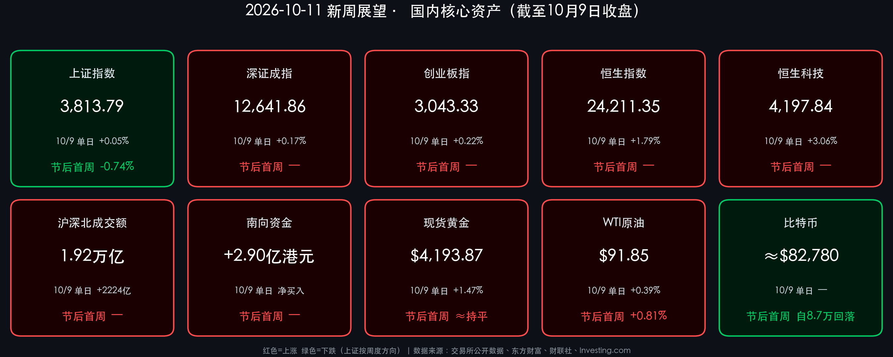

# 新周展望：政策“增量工具”蓄势，三季报与中美通胀数据双线博弈

**日期：2026年10月11日 (星期日)** &nbsp; **时段：下午/新周展望**

> **核心摘要**：周末政策面密集发力——中共中央、国务院部署全面实施“人工智能+”行动，证监会座谈会明确“研究储备更多增量政策工具”，财政部安排使用 **5500亿元** 地方债务结存限额；新一周（10/12-10/16）A股将在三季报窗口开启、中美9月CPI同日（10/14）公布与美股银行财报季三重变量下寻找方向，节后首周的“探底回升”能否延续成为核心看点。

## 周末财经要闻终极汇总

### 上一交易日（10月9日）国内市场定格
*   **上证指数**：**3813.79**（单日 **+0.05%**，节后首周累计 **-0.74%**，较节前9月30日收盘 3842.19 回落）；盘中最低探至 **3754.14**，跌逾1%后午后强势收复。
*   **深证成指**：**12641.86**（**+0.17%**）
*   **创业板指**：**3043.33**（**+0.22%**）
*   **沪深北成交额**：**1.92万亿元**，较前一交易日放量 **2224亿元**；全市场 **3297** 家上涨、**2145** 家下跌，涨停 **72** 家、跌停 **10** 家。
*   **恒生指数**：**24211.35**（**+1.79%**，涨425.56点，收复24000点关口）；**恒生科技指数**：**4197.84**（**+3.06%**）。
*   **南向资金**：成交约 **789.42亿港元**，净买入约 **2.90亿港元**（沪港通净卖出 **23.31亿**、深港通净买入 **26.21亿**）。
*   **外围参考**：现货黄金 **$4,193.87/盎司**（**+1.47%**）、WTI 原油 **$91.85/桶**（**+0.39%**）、比特币周末约 **$82,780**（此前曾触及8.7万美元后回调，现货ETF持续净流出）。

> **核心解读**：节后首周仅2个交易日，A股呈现“先抑后扬”的深V结构——周五早盘科技硬件回调引发恐慌下探，午后资金大规模抄底，成交额重回近2万亿。领涨方向集中于传媒、计算机、商贸零售，呈现由“算力硬件”向“AI应用+内需”的高低切换；港股弹性显著强于A股，恒生科技大涨3%，显示外资对中国资产的底部配置意愿回暖。

### 周末重磅政策与事件
*   **“人工智能+”行动全面实施**：中共中央、国务院印发文件，提出全面实施“人工智能+”行动，强化算力、算法、数据高效供给，推进AI在智能网联汽车、机器人等新一代智能终端的场景应用，因地制宜布局人工智能行业应用中试基地，并构建安全可控的技术体系与风险预警、应急响应机制。
*   **证监会专家座谈会**：证监会主席吴清主持召开资本市场和金融形势专家座谈会，要点包括：持续加强**稳市机制**建设，发展壮大耐心资本、拓宽中长期资金入市渠道；推动有条件的企业加大**分红回购**；优化发行上市制度；强化跨境风险监测应对；**研究储备更多增量政策工具**。
*   **公募基金监管新规**：证监会修订《公开募集证券投资基金运作管理办法（征求意见稿）》，针对“宽基窄投”与“风格漂移”问题，同时优化公募基金注册安排、支持逆周期布局。
*   **财政逆周期发力**：财政部表示将实施更积极的财政政策、加大逆周期调节力度、支持扩大内需，安排使用 **5500亿元** 地方政府债务结存限额，提高县区财力保障并支持地方扩大有效投资。
*   **行业监管**：工信部等四部门就加强汽车产品创新设计和研发测试验证工作征求意见；金融监管总局《财产保险公司保险产品开发管理规定》将于11月1日起施行。
*   **地缘与海外**：据报道沙特首都利雅得机场遭胡塞武装袭击，沙特联军表示将坚决回击，中东风险继续为油价提供支撑；俄罗斯宣布部分解除柴油出口禁令（涉及约50万吨）。美联储方面，理事沃勒10月8日表示未来可能仍需进一步加息，但时点具有灵活性；9月会议纪要显示多数官员认为年底前仍有必要再加息，市场普遍预期10月27-28日议息会议**按兵不动**。

> **核心解读**：周末政策信号呈现“产业+资本市场+财政”三箭齐发的格局。“人工智能+”顶层文件为AI应用端提供了中长期产业叙事，与周五盘面“AI应用领涨”形成呼应；证监会“增量政策工具储备”的表述则为市场提供了托底预期，有助于压降尾部风险。但外部约束并未解除——美联储仍处于“加息偏向”，美债收益率高企与油价在90美元上方运行，构成对全球风险偏好的持续压制。

## 新一周市场核心博弈逻辑

*   **博弈一：政策托底预期 vs. 外部紧缩压力**——国内“增量政策工具”与财政扩张预期为指数提供下方支撑；但美联储加息偏向与高油价意味着外资风险偏好修复的空间受限。
*   **博弈二：从“情绪驱动”到“业绩验证”**——三季报窗口开启，定价重心回归产业景气与业绩兑现，前期高估值、缺乏业绩支撑的纯概念标的面临估值收缩风险。
*   **博弈三：科技内部的高低切换**——算力硬件、半导体短期承压，“人工智能+”政策催化下的AI应用、智能终端、机器人等方向或获增量关注；红利资产作为防守底仓仍具配置价值。
*   **资金面**：下周A股解禁市值约 **424亿元**，压力适中，需关注陕西能源等大额解禁个股；成交额能否稳定在 **1.9万亿** 以上是判断反弹持续性的关键量能指标。

> **核心解读**：节前市场担忧的地缘冲突与流动性收紧风险并未在长假期间演变为现实，筹码压力已有较充分释放，10月具备“结构性修复窗口”的条件。但总量需求修复仍偏弱，指数层面更可能呈现区间震荡、结构轮动的特征，“结构重于仓位”是下周的主基调。

## 本周重磅经济数据与会议前瞻

| 日期 | 事件 | 关注要点 |
| :--- | :--- | :--- |
| 10/12（周一） | 美国哥伦布日 | 美股正常交易，部分债市休市 |
| 10/13（周二） | 美股Q3财报季开启：摩根大通、高盛等 | 大行业绩与信贷质量、净息差指引 |
| 10/14（周三） | **中国9月CPI/PPI**；**美国9月CPI** | 国内通缩压力是否缓解；美国通胀黏性决定美联储12月加息概率 |
| 10/15（周四） | 美国9月PPI、零售销售 | 消费韧性与通胀传导 |
| 10/16（周五） | 美国进出口价格指数、工业生产 | 输入性通胀与制造业景气 |
| 10月中旬 | 中国9月社融、信贷、进出口数据 | 实体融资需求与外需韧性 |
| 10/19-10/22 | 2026金融街论坛年会（北京） | 落实“十五五”规划与金融强国相关政策表态 |
| 10/27-10/28 | 美联储议息会议 | 市场预期按兵不动 |

## 头部券商/投行开盘策略点睛

> **中信证券**：科技板块此前回调主要源于估值倍数收缩，随着业绩逻辑回归，具备业绩支撑的龙头逐步具备左侧布局条件；建议采取“哑铃型”策略，左手高股息防守，右手布局三季报超预期的优质成长股，重点关注AI产业链能否兑现利润。

> **中信建投**：节前A股下跌由多个短期因素集中共振推动，随着这些因素消化完成，节后有望迎来修复行情；建议科技内部从博弈“价的爆发性”转向重视“量的确定性”，向核心资产调仓。

> **高盛（Goldman Sachs）**：全球市场正面临“AI信仰”与“通胀黏性”的双重考验，预计美联储政策将长期偏紧；中概股近期强劲表现暗示外资对中国资产的底部配置意愿回暖。

> **招商证券、中泰证券等**：节前担忧的地缘冲突及流动性收紧风险并未在长假期间兑现，筹码压力已充分释放，市场具备反弹条件；红利资产、创新药及具备出海潜力的头部券商可纳入配置，同时需警惕纯概念炒作的泡沫风险。

## 今日市场情绪：筑桥待渡，谨慎乐观

> Prompt: A colossal ancient stone bridge under construction across a misty canyon at dawn. On the near cliff, a human trader (real person) in a dark coat studies a glowing blueprint of neural network circuits. In the background, half-built arches made of red and green candlestick charts reach toward a distant city of servers, while storm clouds and a faint oil-black river flow beneath.

---

> **免责声明**：内容仅供参考，不构成投资建议。数据来源：交易所公开数据、东方财富、财联社、Investing.com 及各机构公开研报；A股/港股数据截至2026年10月9日收盘，比特币为10月10日周末报价。

🤖 生成模型：Claude Opus 5.5 (Medium) <!-- model-stamp -->
