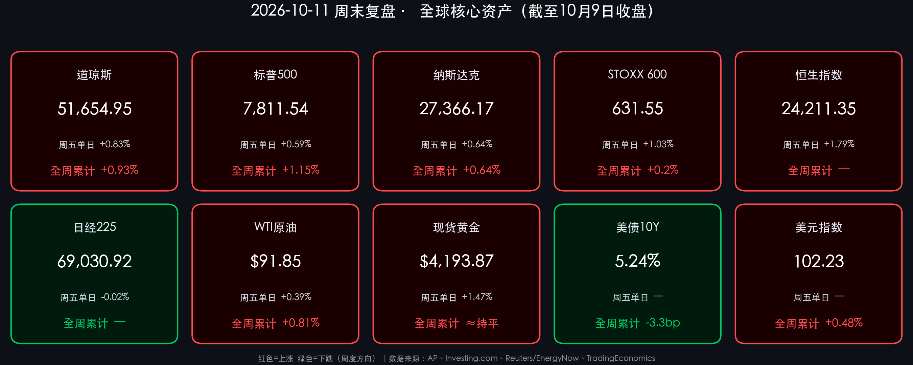

# 🌏 全球金融周末复盘 · 美股三大指数周线齐红，美债收益率五周连升终结，CPI与银行财报周即将揭幕

**日期：2026年10月11日 (星期日)** &nbsp; **时段：早报 (周末复盘 · 模式B)**

> **核心摘要**：截至10月9日（周五）收盘的一周，美股在周四科技股抛售后于周五强势反弹，三大指数周线全部收红：标普500全周累计 **+1.15%**（报 **7,811.54点**），道指 **+0.93%**（报 **51,654.95点**），纳指 **+0.64%** 并录得**连续第四周上涨**。驱动周五反弹的两大变量是：特朗普承诺**在11月3日中期选举前不会对伊朗发动打击**，以及10年期美债收益率周度回落约 **3.3bp** 至 **5.24%**，**终结了连续五周的上行**。但油价并未因此大跌——飓风“Isaias”迫使墨西哥湾超 **70%** 原油产量停产，WTI 周五反而收涨至 **$91.85/桶**，周涨 **+0.81%**。下周（10月12日–16日）是“通胀+财报”双重验证周：周二摩根大通、高盛打响三季报第一枪，周三公布9月CPI及褐皮书，周四PPI与零售销售接踵而至。

---

## 核心资产周度/日度表现回顾

*   **美国核心股指（10月9日收盘 · 周五单日 / 全周累计）**：
    *   **道琼斯工业指数**：收报 **51,654.95 点**，周五上涨 **+423.31 点（+0.83%）**；全周累计 **+0.93%**（上周五收盘 51,176.96 点）。
    *   **标普500指数**：收报 **7,811.54 点**，周五上涨 **+46.18 点（+0.59%）**；全周累计 **+1.15%**（上周五收盘 7,722.72 点），三大指数中周度表现最佳。
    *   **纳斯达克综合指数**：收报 **27,366.17 点**，周五上涨 **+172.83 点（+0.64%）**；全周累计 **+0.64%**（上周五收盘 27,190.86 点），**连续第四周收涨**。周四的科技股领跌抛售几乎抹去了周内全部涨幅，最终靠周五反弹守住周线阳线。
    *   *数学校验*：以上周五收盘为基准，(7,811.54−7,722.72)/7,722.72 = +1.150%；(51,654.95−51,176.96)/51,176.96 = +0.934%；(27,366.17−27,190.86)/27,190.86 = +0.645%，与媒体报道一致 ✅。
*   **欧洲核心股市（10月9日收盘）**：
    *   **STOXX 600**：收报 **631.55 点**，周五上涨 **+1.03%**，成功收复周中跌幅，全周累计约 **+0.2%**。
    *   **德国DAX**：收报 **25,087.27 点**，周五上涨 **+1.13%**，领涨欧洲主要市场。
    *   **英国富时100**：收报 **10,552.05 点**，周五上涨 **+1.06%**，全周录得小幅上涨。
*   **亚太市场（10月9日收盘）**：
    *   **恒生指数**：收报 **24,211.35 点**，周五大涨 **+1.79%**，终结两连跌；内地市场国庆长假后复市，科技股领涨反弹（周度累计数据暂未获得权威确认）。
    *   **日经225**：收报 **69,030.92 点**，周五微跌 **-0.02%**，**连续第三日下跌**。周二盘中一度冲上 **70,683.98 点**的高位后回落；10月SQ结算值为 **68,465.23 点**。
*   **大宗商品、债券与外汇**：
    *   **WTI原油期货**：结算于 **$91.85/桶**，周五上涨 **+0.36 美元（+0.39%）**，全周累计 **+0.81%**。
    *   **布伦特原油期货**：结算于 **$104.72/桶**，周五上涨 **+0.44 美元（+0.42%）**，同样录得周涨。
    *   **现货黄金**：收报 **$4,193.87/盎司**，周五大涨 **+1.47%**；周三一度跌至约 **$4,066** 的两个月低位后V型反弹，**全周基本持平**。
    *   **10年期美债收益率**：报 **5.24%**，全周下行约 **3.3bp**，**终结五周连升**；此前收益率曾突破 5.3%，创数十年新高。
    *   **美元指数 (DXY)**：收报 **102.23**，较上周五 101.74 累计上涨约 **+0.48%**，全周维持强势。
    *   **离岸人民币 (USD/CNH)**：10月9日收于约 **6.6930**，继续稳守 6.70 关口内侧。
    *   **比特币 (BTC)**：10月10日交投于约 **$82,500–$82,750**，周内承压，美国现货比特币ETF出现明显资金流出，**终结三周连涨**。

---

## 过去 48 小时重磅事件深度复盘

> **事件一：特朗普“中期选举前不打伊朗”承诺，地缘战争溢价阶段性退潮**
> 周五盘中，特朗普表示美国在11月3日中期选举前不会对伊朗发动新的军事打击，并称与德黑兰的沟通“富有成效”。
> * **传导逻辑**：短期军事冲突概率下降（事件） → 原油“战争风险溢价”盘中被压缩，美债收益率停止上冲（数据） → 高估值科技与对利率敏感的金融板块获得喘息，欧美股市周五集体收涨超 1%（逻辑）。
> * **风险尚存**：伊朗仍坚持其重新开放霍尔木兹海峡的前提条件，美国则持续制裁与伊朗石油及武器采购相关的船只和网络。该承诺本质上是“时间窗口”而非“问题解决”，2026年以来该冲突始终是全球能源通胀与柴油短缺的核心推手。

> **事件二：飓风“Isaias”重创墨西哥湾产能，原油收复日内跌幅**
> 尽管伊朗消息令油价盘中下挫，但飓风迫使能源公司关停美国墨西哥湾 **超过70%** 的原油产量，WTI 与布伦特最终双双收涨，并守住周线涨幅。与此同时，中国计划在国庆假期短暂暂停后恢复成品油出口，对油价形成一定压制。
> * **市场含义**：原油供应端同时受到“地缘+天气”双重扰动，$90以上的WTI油价意味着通胀黏性仍在，这正是下周CPI数据的关键背景。

> **事件三：美债收益率五周连升终结，“5%新常态”下股市找到平衡**
> 10年期美债收益率在突破 5.3% 后回落至 5.24%，全周下行约 3.3bp。华尔街主流观点认为，本轮收益率上行反映的是强劲的名义经济增长与企业盈利，而非系统性金融压力，因此股市得以与 5% 以上的利率“共存”。
> * **结构分化**：指数层面接近历史高位，但“水面下”分化明显——小盘股与利率敏感型板块在高融资成本下明显跑输，而主导标普500的超大市值科技股依然坚挺。

> **事件四：贸易政策仍是“万能牌”**
> 9月下旬特习会后，中美就各约 **300亿美元** 非敏感商品的关税削减达成“谅解”，紧张局势有所缓和；但特朗普近期威胁对未在18个月内赴美投资制造业的外国企业（包括中国、日本企业）征收**最高300%**关税，令贸易政策不确定性持续存在。此外，欧盟正与中国谈判，寻求限制廉价中国混动汽车出口以缓解巨额贸易逆差。

---

## 下周全球宏观大事预警

| 日期 | 事件 | 关注要点 |
| :--- | :--- | :--- |
| **10月12日（周一）** | 美国哥伦布日 | **美国国债现货市场休市**，股市正常交易；克利夫兰联储主席哈马克（Hammack）讲话 |
| **10月13日（周二）** | **摩根大通、高盛三季报** | 摩根大通美东 7:00 发布、8:30 电话会；高盛 7:30 发布、9:30 电话会，正式开启三季报季 |
| **10月14日（周三）** | **美国9月CPI**（美东 8:30）、美联储褐皮书、美国银行财报 | 油价 $90+ 背景下核心通胀黏性，决定年内是否需要进一步紧缩 |
| **10月15日（周四）** | 美国9月PPI、零售销售 | 生产端通胀传导与消费韧性 |
| **10月16日（周五）** | 美国工业产出 | 飓风对能源与制造业产出的扰动 |

> **预警提示**：周一美债现货休市意味着利率定价将集中在周二之后释放；周三的CPI是本周最大的单一风险事件。若核心通胀超预期，5.3%的收益率前高可能被再度挑战；若温和，“收益率见顶+盈利超预期”的组合将为美股打开新一轮上行空间。

---

## 顶级机构周末策略内参摘要

> **高盛 / 摩根士丹利 / 摩根大通（华尔街共识）**：
> * **维持建设性看法，年末标普500目标普遍在 8,000点 附近**：主流机构认为，强劲的企业盈利与AI带来的生产率提升足以抵消高利率与地缘风险。距离当前 7,811.54 点仍有约 2.4% 的空间。
> * **三季报盈利增速预期高达 29%–35%（同比）**：科技与能源板块被视为主要驱动力。尽管指数处于历史高位，2026年远期市盈率反而有所压缩，说明上涨主要由盈利而非估值扩张驱动。
> * **建议将地缘消息引发的波动视为买入机会**，而非结构性下跌信号；同时关注科技巨头三季报中关于2027年资本开支的指引。

> **中金公司 (CICC)**：
> * **节后信心修复，三季报提供业绩支撑**：在海外市场表现与国内经济数据平稳的背景下，投资者信心有望逐步修复。
> * **配置双主线**：**景气成长**——AI产业链中需求确定、产能瓶颈难以缓解的硬件环节（光通信、半导体设备）、上游电力瓶颈相关行业、创新药（CXO）与电网设备；**周期改善**——化工、石化、工程机械等供需格局改善领域。有色金属基本面较好，但需警惕美联储紧缩对其金融属性的压制。

> **中信证券 (CITIC Securities)**：
> * **下一轮科技行情窗口大概率在2026年四季度**，坚持“结构重于仓位”，四条线索：① 港股大模型股（估值泡沫已大幅挤出，关注版本迭代与ARR兑现）；② 互联网平台（C端入口与个人智能体进展）；③ 硬件升级（NPO、OCS、薄膜铌酸锂、1.6T光互联、高端PCB）；④ 国产替代（国产存储与先进逻辑扩产带来的设备投资）。
> * **建议进一步提升港股配置比例**，认为港股与A股有望迎来指数级行情。

---

## 今日市场情绪：风暴渐远，灯塔引航

> Prompt: A lone silver sailboat gliding across a calming ocean just after a hurricane, its sails woven from glowing golden candlestick charts. On the horizon, a colossal stone lighthouse shaped like an ancient bank vault casts a warm beam across the water, lighting a path toward dawn. In the background, a retreating storm spiral of oil-black clouds and a faint golden balance scale etched among the fading stars.

---

> **免责声明**：内容仅供参考，不构成投资建议。数据来源：AP、Investing.com、TradingEconomics、Reuters/EnergyNow 及各机构公开研报，收盘终值截止于2026年10月9日各市场收盘及10月10日加密市场数据。*数据修订说明*：昨日早报中 WTI（$91.10）与黄金（$4,203.60）为盘中/期货口径，本期统一采用 WTI 结算价 **$91.85** 与现货黄金收盘价 **$4,193.87**。

🤖 生成模型：Claude Opus 5.5 (Medium) <!-- model-stamp -->
