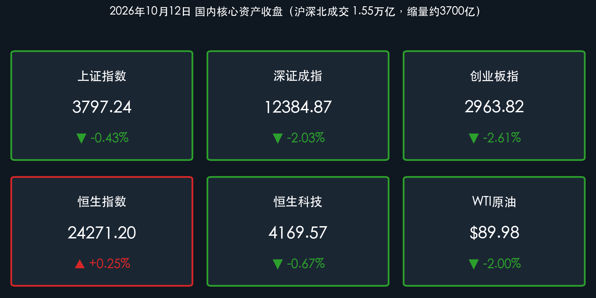

# A股缩量普跌、创业板跌超2.6%：资金退守银行高股息，港股逆势微涨

**日期：2026年10月12日 (星期一)** &nbsp; **时段：下午/国内收盘**

> **核心摘要**：新周首日A股未能延续上周五的“深V”修复，三大指数集体收跌，创业板指重挫 **2.61%**，沪深北成交额骤降约 **3700亿元** 至 **1.55万亿元**，全市场超 **4300** 只个股下跌；资金明显“高切低”，国有大行集体创历史新高，贵金属、能源金属、稀土等前期强势方向领跌。港股表现相对抗跌，恒指微涨 **0.25%**，南向资金净买入约 **30亿港元**。

## 核心行情复盘

*   **上证指数**：**3797.24**（**-0.43%**，较前一交易日 3813.79 回落，失守3800点）
*   **深证成指**：**12384.87**（**-2.03%**）
*   **创业板指**：**2963.82**（**-2.61%**，跌破3000点整数关口）
*   **沪深北成交额**：约 **1.55万亿元**（15507亿元），较上一交易日 1.92万亿元缩量约 **3700亿元**；全市场上涨约 **1167** 家，下跌超 **4300** 家。
*   **恒生指数**：**24271.20**（**+0.25%**，涨59.85点）；**恒生科技指数**：**4169.57**（**-0.67%**，跌28.27点）。
*   **南向资金**：全天净买入约 **30亿港元**，持续加仓互联网龙头。
*   **外围参考**：现货黄金约 **$4,185/盎司**（盘中曾冲高至4217美元后回落，日内约 **-0.22%**）；WTI原油跌超 **2%**，跌破90美元关口至约 **$89.98/桶**；比特币在 **$82,000–84,000** 区间震荡；美元兑离岸人民币（USD/CNH）在 **6.69–6.70** 区间运行。

### 领涨/领跌行业
*   **领涨**：**银行**板块逆市走强，中国银行、中信银行、工商银行等多家国有大行股价续创历史新高；**短剧游戏、AI视频、影视传媒**等概念延续活跃，华策影视等表现亮眼。
*   **领跌**：**贵金属**（晓程科技、四川黄金、招金黄金等集体下挫）、**能源金属、稀土及有色金属、农业、房地产服务**等板块跌幅居前。

> **核心解读**：今日是典型的“缩量+二八分化”行情。上证指数因银行等权重托底仅小幅下跌，而深市与创业板受成长股拖累跌幅显著更大，指数间跌幅差超过2个百分点。成交额骤减3700亿元说明上周五午后的抄底资金并未持续跟进，存量博弈下资金从前期获利丰厚的高位题材（贵金属、有色、科技硬件）撤出，流向估值低、股息稳定的大行。值得注意的是，AI应用端（短剧游戏、AI视频）在普跌中保持活跃，与周末“人工智能+”顶层文件形成呼应，结构性主线并未完全熄火。

## 核心解读与市场逻辑

*   **外部扰动压制风险偏好**：美债收益率维持高位、美联储仍有“加息偏向”，叠加中东地缘不确定性，全球风险偏好受约束；韩国股市近期大幅波动与外资撤离消息也对亚太情绪造成干扰。
*   **获利回吐与估值重塑**：贵金属、有色及部分科技题材前期涨幅较大，在缺乏新增催化时面临集中兑现；黄金冲高回落与原油跌破90美元，进一步削弱了资源品板块的短期支撑。
*   **机构被动卖盘**：部分保险及“固收+”产品存在赎回带来的被动减仓压力，加剧了中小盘成长股的下跌。
*   **业绩验证期来临**：三季报披露窗口开启，选股逻辑从“炒题材”转向“业绩确定性”，缺乏实质业绩支撑的高位概念股遭主力资金撤离。

> **核心解读**：“数据+事件+逻辑”的链条清晰：成交额缩量3700亿元（数据）源于上周五抄底资金未能延续、叠加外部扰动与机构赎回（事件），导致资金在存量环境下从高估值成长与资源股切换至银行高股息（逻辑）。港股相对抗跌、南向资金持续净买入，显示中长期资金对港股互联网龙头的估值性价比仍有认可。短期看，创业板跌破3000点与沪指失守3800点后，市场需要新的量能或政策催化来确认底部。

## 政策脉动

*   **央行公开市场操作**：中国人民银行今日开展 **500亿元** 7天期逆回购操作，保持银行体系流动性合理充裕。
*   **汇率政策立场**：央行近期重申坚持让市场在汇率形成中发挥决定性作用，不预设目标水平、不搞竞争性货币贬值，并指出汇率受多重因素影响，与经常账户不存在简单线性关系。
*   **金融街论坛临近**：2026金融街论坛年会将于 **10月19日至22日** 在北京举行，由人民银行、金融监管总局、证监会、新华社及外汇局联合承办，期间预计集中发布一系列金融改革发展政策。
*   **证监会政策延续**：证监会此前座谈会明确将发展壮大耐心资本、推动加大分红回购、优化发行上市制度、研究储备更多增量政策工具；同时修订公募基金运作管理规定，包括降低权益类基金成立门槛、建立迷你基金强制退出机制等。
*   **港股制度变化**：恒生指数公司计划对恒生科技指数进行系统性改革，成分股由30只扩容至50只并调整选股机制，相关变动预计于 **2026年12月** 生效。

> **核心解读**：今日政策面相对平静，央行以常规逆回购维持流动性，未出现超预期增量信号。市场的政策预期焦点已转向下周的金融街论坛——若论坛期间出台实质性的资本市场或货币增量工具，可能成为扭转当前缩量弱势格局的关键催化。

## 最新机构观点

> **中金公司**：在总量增长弹性有限、结构性高景气与风险偏好波动加大的环境下，建议采用“科技+红利”的哑铃型配置。科技端关注具备长期竞争优势及盈利兑现能力的企业；红利端关注现金流稳健、分红可持续的优质公司。

> **中信建投**：策略维持“中性、均衡、管控风险”，认为9月调整已消化部分估值压力，当前沪深300风险溢价已逼近机会区间。10月市场修复将重点验证三大变量：海外科技财报对AI产业的指引、A股三季报业绩兑现，以及美债长端利率走向。

> **中信证券**：重点关注AI基础设施投资方向，特别是北美数据中心建设带来的电力设备与工程服务增量机会，建议关注燃料电池、航改燃、电网扩容及相关变压器与EPC企业。

> **摩根士丹利 / 高盛**：大摩认为2026年中国市场以“企稳与可持续性”为主，指数上行空间温和，强调“高质量互联网科技龙头 + 高股息红利与保险”的哑铃策略；高盛相对更积极，认可企业盈利增长、AI科技创新与企业“出海”为核心驱动，看好光模块等AI硬件关键环节的中长期需求。

## 今日市场情绪：退潮守城，避险为先

> Prompt: At low tide, a vast glowing crystal city of microchips and gold ingots stands on a shoreline as the silver sea recedes, leaving it exposed and cracking. In the foreground, a massive ancient stone bank fortress with marble columns stands firm on a cliff, its gates open as streams of small lanterns flow into it. In the background, a pale dawn sky with faint red and green candlestick constellations.

---

> **免责声明**：内容仅供参考，不构成投资建议。数据来源：交易所公开数据、东方财富、财联社、证券时报及各机构公开研报；A股/港股数据截至2026年10月12日收盘，黄金、原油、比特币及离岸人民币为当日盘中参考报价。

🤖 生成模型：Claude Opus 5.5 (Medium) <!-- model-stamp -->
