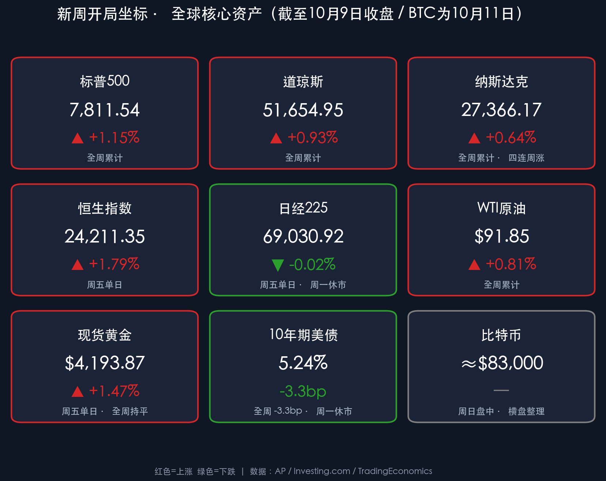

# 🌏 全球金融新周展望 · 霍尔木兹油轮遇袭再起波澜，CPI与银行财报“双考”周拉开帷幕

**日期：2026年10月12日 (星期一)** &nbsp; **时段：早报 (新周展望 · 模式C)**

> **核心摘要**：周末霍尔木兹海峡**接连发生油轮遇袭事件**（触雷起火、不明射弹与无人机袭击），伊朗方面称美方重开海峡的提议“不够充分”，令上周五因特朗普“中期选举前不打伊朗”承诺而压缩的地缘溢价再度抬头；周日晚美股期货与油价**温和上涨**，比特币在 **$83,000** 附近横盘。本周（10月12日–16日）是“通胀+财报”双重验证周：周二摩根大通、高盛、花旗、富国打响三季报第一枪，周三9月CPI（市场预期整体通胀升至 **3.6%–3.7%**）与ASML财报，周四台积电财报与PPI/零售销售，周五美联储主席沃什在曼谷IMF年会发表讲话。今日美国哥伦布日**美债现货休市**、日本“体育日”**东京股市休市**、加拿大感恩节休市，美股照常交易。

---

## 周末财经要闻终极汇总

*   **开局坐标（10月9日收盘 · 全周累计）**：
    *   **标普500**：**7,811.54 点**，全周 **+1.15%**；**道指**：**51,654.95 点**，全周 **+0.93%**；**纳指**：**27,366.17 点**，全周 **+0.64%**，**连续第四周上涨**。
    *   **恒生指数**：**24,211.35 点**（周五 **+1.79%**）；**日经225**：**69,030.92 点**（周五 **-0.02%**，今日休市）。
    *   **WTI原油**：**$91.85/桶**（全周 **+0.81%**）；**布伦特**：**$104.72/桶**；**现货黄金**：**$4,193.87/盎司**（全周基本持平）。
    *   **10年期美债收益率**：**5.24%**（全周 **-3.3bp**，终结五周连升）；**美元指数**：**102.23**；**离岸人民币**：约 **6.6930**。
    *   **比特币**：10月11日交投于 **$82,900–$83,200**，在上周ETF资金流出后进入整理。
    *   **周日晚期货**：美股股指期货与原油期货**小幅上涨**；费城半导体指数近期走弱、超微电脑（SMCI）等个股波动受到关注。

> **要闻一：霍尔木兹海峡油轮“近乎每日”遇袭，地缘溢价卷土重来**
> 10月10日–11日，伊朗伊斯兰革命卫队海军称一艘未具名的超大型原油油轮在关闭导航系统、试图经“未授权航线”驶出海峡时**触雷起火**；英国海事贸易行动办公室（UKMTO）确认另一艘出港油轮左舷被**不明射弹击中**起火；阿曼苏哈尔锚地一艘油轮遭**无人机袭击**，两名印度船员失踪。海事安全报告称过去一周船只遇袭频率“近乎每日”，航运量下降、保险费率上升。伊朗安全事务负责人雷扎伊（Mohsen Rezaei）称美方重开海峡的提议“不够充分”，坚持其通行条件必须得到满足。
> * **传导逻辑**：特朗普“中期选举前不打伊朗”的承诺只压低了“美伊直接开战”的尾部风险（事件），但海峡航运的实际中断仍在持续（数据：航运量下降、保费上升），这意味着原油供给端的风险溢价难以真正回落，WTI 守住 $90 上方将继续向通胀预期和美债收益率传导（逻辑）。

> **要闻二：飓风“Isaias”登陆后减弱，墨西哥湾产能恢复成关注点**
> “Isaias”作为2026年大西洋首个主要飓风，于10月9日夜间以二级强度在佛罗里达州德斯汀附近登陆，至10月11日已减弱为后热带气旋，向阿拉巴马州及阿巴拉契亚中部移动。至少4人遇难，佛州、阿拉巴马州和佐治亚州仍有数十万户断电。
> * **市场含义**：此前墨西哥湾超 **70%** 原油产量停产，风暴减弱后复产进度将决定本周油价的“天气溢价”能否消退；周五的工业产出数据也将反映飓风对能源与制造业的扰动。

> **要闻三：中国稳增长加码，节后政策信号密集**
> * **财政**：财政部10月9日宣布允许各省动用往年未使用的 **5,500亿元** 债务限额，其中 **3,000亿元** 一般债限额用于地方支出、**2,500亿元** 专项债限额用于重大项目，以稳定年末增长；发改委等部门承诺加强“逆周期调节”，力保全年 **5%** 左右的增长目标。
> * **产业**：中共中央、国务院10月9日印发加快发展“新质生产力”的 **19条** 措施，强调数字化转型、数据基础设施与一体化算力网络建设。
> * **汇率**：中国人民银行10月8日发布人民币汇率政策立场文件，重申市场化汇率形成机制，**无意为贸易优势刻意贬值或升值**。周末PBOC与证监会未发布重大新监管措施，近期重点在跨境金融活动综合整治与金融市场互联互通。
> * **贸易**：中国与欧盟委员会10月9日就贸易失衡达成**临时协议**，涉及大幅削减中国混动汽车对欧出口，被视为缓和中欧贸易摩擦的积极一步。

---

## 新一周市场核心博弈逻辑

> **博弈一：“热通胀”vs“盈利超预期”——谁主导5%利率下的估值？**
> 美股站上历史高位、标普今年以来涨幅超 **14%**，但10年期美债仍处约 **5.24%** 的24年高位附近。市场一致预期9月整体CPI同比升至 **3.6%–3.7%**，主要受汽油等能源价格推动。
> * **若CPI超预期**：油价 $90+（数据）叠加海峡航运受阻（事件）→ 市场押注美联储在10月27–28日会议上进一步收紧 → 10年期美债可能再度挑战 **5.3%** 前高，高估值科技与小盘股首当其冲（逻辑）。
> * **若CPI温和**：“收益率见顶+三季报盈利增速 **27%–30%**”的组合将为指数打开新一轮上行空间，年末 **8,000点** 目标（距现价约 2.4%）可期。

> **博弈二：银行财报——高利率下的信贷质量与消费者健康**
> 周二、周三华尔街大行集中披露，投资者将重点关注净息差、贷款增长、信用卡违约率与拨备变化，以及并购/IPO业务的复苏程度。银行业绩是判断“高利率能否与强劲经济共存”的第一手证据。

> **博弈三：AI硬件链的“压力测试”——ASML与台积电**
> 费城半导体指数近期走弱，市场对AI资本开支的持续性存在分歧。周三ASML（订单与2027年指引）和周四台积电（先进制程与CoWoS产能、AI营收占比）将率先给出答案，并为月底超大规模云厂商（Alphabet、Amazon、Microsoft）的2027年资本开支指引定调。

> **博弈四：市场“过度自满”的风险**
> 晨星等机构提醒市场已“极度自满”，VIX指数处于低位，在数据密集周前投资者可能过于放松。地缘（霍尔木兹）、通胀（CPI）与政策（沃什讲话）三重变量叠加，任何一个超预期都可能引发波动率的快速回升。

---

## 本周重磅经济数据与会议前瞻

| 日期 | 事件 | 关注要点 |
| :--- | :--- | :--- |
| **10月12日（周一）** | 美国哥伦布日 / 日本体育日 / 加拿大感恩节 | **美债现货休市、东京与多伦多股市休市**，美股正常交易；IMF/世界银行年会在曼谷开幕（10月12日–18日，三年来首次在华盛顿以外举办）|
| **10月13日（周二）** | **摩根大通、高盛、花旗、富国三季报**；联合健康、强生、达美乐 | 信贷质量、净息差、投行业务复苏，正式开启三季报季 |
| **10月14日（周三）** | **美国9月CPI**（美东 8:30）、美联储褐皮书；**美国银行、摩根士丹利、贝莱德**财报；**ASML** 财报 | 整体通胀预期 3.6%–3.7%，决定10月FOMC是否需要进一步紧缩；半导体设备订单 |
| **10月15日（周四）** | 美国9月PPI、零售销售；**台积电三季报** | 生产端通胀传导、消费韧性、AI芯片需求 |
| **10月16日（周五）** | 美国工业产出、进出口价格指数；**美联储主席沃什**与IMF总裁格奥尔基耶娃对话（曼谷时间12:30）| 10月27–28日FOMC“静默期”前的关键表态 |

> **预警提示**：周一美债现货休市意味着利率定价将在周二之后集中释放；周三的CPI是本周最大的单一风险事件，周五沃什讲话将对CPI结果做出“政策解读”。国内方面，本周还需关注中国9月通胀与金融数据的披露，直接影响A股的流动性预期。

---

## 头部券商/投行开盘策略点睛

> **高盛（Goldman Sachs Asset Management）**：
> * **维持对全球股票的建设性立场**，但预计2026年指数回报低于2025年。全球增长“稳健”（预测 **2.8%**），美国经济韧性受AI资本开支及税收/关税政策驱动，有望继续跑赢；整体认为通胀在正常化，但警告“过热”的估值可能放大波动。

> **摩根士丹利（Morgan Stanley）**：
> * **关注美联储政策较2025年明显转向偏紧**的影响：尽管市场情绪展现韧性，但高利率对企业盈利与并购活动的冲击仍是核心观察点；强调政策驱动的生产率提升，以及已持续5年以上的并购周期走向成熟。

> **中金公司 (CICC)**：
> * **重回“哑铃型”配置**：业绩韧性与积极的稳增长信号有望支撑A股逐步回稳。考虑到成长风格波动加大，一端关注业绩有支撑的科技成长（AI高景气领域、科技硬件），另一端重视具备防御属性的**红利资产**（银行、水电核电、石油石化）。

> **中信证券 (CITIC Securities)**：
> * **全球高利率将维持较长时间，以“景气品种+供给出清品种”应对**：科技内部紧跟AI投资周期拐点，关注光通信、PCB、MLCC及晶圆制造等新技术方向；非科技板块增配能化、创新药及红利资产（煤炭、银行），并重视“反内卷”进程下供给端出清的稀缺资产。

> **机构共识**：节后A股的震荡更多源于交易性因素与外部扰动（美债利率高位、地缘局势），并非趋势性逆转；10月进入三季报集中披露期，**业绩兑现将成为定价核心锚点**。风险提示：市场对全球流动性收紧与地缘扰动仍高度敏感，宜控制仓位、聚焦确定性。

---

## 今日市场情绪：天平悬于海峡，静候周三钟声

> Prompt: A colossal bronze scale balanced on a narrow ocean strait at dusk. On the left pan sits a glowing stack of golden bank vault doors engraved with rising candlestick charts; on the right pan, a heavy black oil drum leaking dark crude into the sea. In the background, distant burning tankers send smoke into a violet sky, while a giant clock tower shaped like a thermometer looms over the horizon, its hands pointing toward Wednesday.

---

> **免责声明**：内容仅供参考，不构成投资建议。数据来源：AP、Investing.com、TradingEconomics、UKMTO、TheStreet、Morningstar、BNN Bloomberg 及各机构公开研报；收盘终值截至2026年10月9日各市场收盘，加密市场数据截至10月11日。*说明*：本周为新周展望（模式C），周一亚洲早盘开盘前暂无新的收盘数据，行情坐标沿用上周五收盘终值。

🤖 生成模型：Claude Opus 5.5 (Medium) <!-- model-stamp -->
