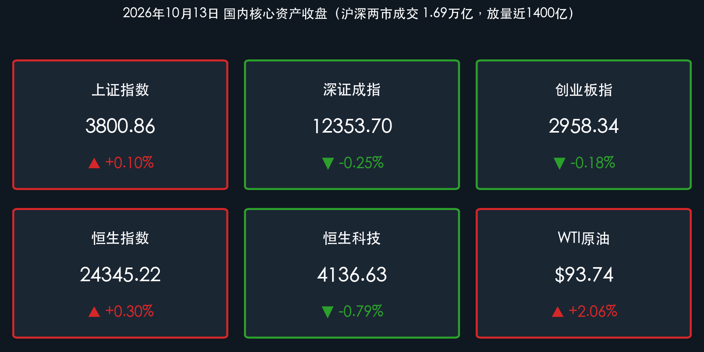

# A股上演深V大逆转、放量重夺3800点：PCB算力掀涨停潮，军工走强港股分化

**日期：2026年10月13日 (星期二)** &nbsp; **时段：下午/国内收盘**

> **核心摘要**：周二A股走出探底回升的“深V”大奇迹日走势。早盘受隔夜强美元与油价攀升带来的通胀扰动，三大指数集体深幅低开，创业板指盘中一度重挫逾 **3%**；午后伴随超声电子、源杰科技等PCB与光通信产业链三季报业绩大幅预喜，算力硬件板块掀起涨停潮，叠加国防军工与商贸零售全天强势爆发，上证指数率先翻红并成功收复 **3800点** 整数关口，收报 **3800.86点**（**+0.10%**）。沪深两市全天成交额放量近 **1400亿元** 至 **1.69万亿元**，全市场超 **2900只** 个股上涨，近 **70只** 涨停。港股维持分化，恒指小涨 **0.30%** 收报 **24345.22点**，恒生科技受半导体调整拖累收跌 **0.79%**。

## 核心行情复盘

*   **上证指数**：**3800.86**（**+0.10%**，涨3.62点，探底回升成功收复3800点整数关）
*   **深证成指**：**12353.70**（**-0.25%**，跌31.17点，跌幅显著收窄）
*   **创业板指**：**2958.34**（**-0.18%**，跌5.48点，早盘一度大跌超3%后走出单针探底深V反弹）
*   **沪深两市成交额**：约 **1.69万亿元**（约16889亿元），较上一交易日（1.55万亿元）放量近 **1400亿元**；全市场上涨 **2900余** 家，下跌约 **2200** 家，近 **70只** 股票封死涨停。
*   **恒生指数**：**24345.22**（**+0.30%**，涨74.02点）；**恒生科技指数**：**4136.63**（**-0.79%**，跌32.94点）。
*   **外围参考**：现货黄金报约 **$4,170/盎司**（自前期4216美元高位回落整固，日内偏弱震荡）；WTI原油高位交投于 **$93~$95/桶**（前收93.74美元，地缘溢价支撑偏强）；比特币在 **$82,400–$83,300** 区间震荡；美元兑离岸人民币（USD/CNH）在 **6.694–6.695** 强势区间窄幅运行。

> **数据闭环校验**：
> * 上证指数：(3800.86 − 3797.24) / 3797.24 = +3.62 / 3797.24 ≈ +0.10%，与官方收盘涨跌幅完全吻合。
> * 深证成指：(12353.70 − 12384.87) / 12384.87 = −31.17 / 12384.87 ≈ −0.25%，与官方收盘涨跌幅完全吻合。
> * 创业板指：(2958.34 − 2963.82) / 2963.82 = −5.48 / 2963.82 ≈ −0.18%，与官方收盘涨跌幅完全吻合。
> * 恒生指数：(24345.22 − 24271.20) / 24271.20 = +74.02 / 24271.20 ≈ +0.30%，与官方收盘涨跌幅完全吻合。
> * 恒生科技：(4136.63 − 4169.57) / 4169.57 = −32.94 / 4169.57 ≈ −0.79%，与官方收盘涨跌幅完全吻合。

### 领涨/领跌行业
*   **领涨**：
    *   **PCB与CPO（印制电路板、光通信）**：盘中爆发涨停潮，超声电子、源杰科技、联讯仪器等多家产业链龙头三季报大幅预喜，带动算力硬件全线V型反转。
    *   **国防军工**：全天表现强势，受第十六届珠海航展将于12月举办、多型新型尖端装备即将亮相的消息催化，资金持续净流入。
    *   **商贸零售 / 消费**：逆势走强，多股封死涨停板；**冰雪经济**受哈尔滨冰雪大世界扩建催化走高；**分散染料**受中间体提价刺激涨幅居前。
    *   **石油加工 / 煤炭**：受海外原油高企驱动，全天表现抗跌。
*   **领跌**：
    *   **电力设备 / 电池（新能源光伏锂电）**：领跌全场，前期套牢筹码反弹抛压较重。
    *   **医药生物 / CRO**：跌幅靠前，海外政策与投融资预期波动压制情绪。
    *   **汽车整车及零部件**：震荡下挫，部分龙头回调。
    *   **银行 / 保险**：昨日逆势冲高的大行今日让出指数流动性，出现获利微调，但跌幅受控。

> **核心解读**：今日市场走出极其典型的“探底企稳、放量长下影”特征。早盘三大指数在海外高油价高利率扰动下低开杀跌，创业板指跌破2900点附近低位，恐慌盘一度出逃。然而午后市场出现重大转折：三季报窗口开启，以PCB和光通信为代表的算力硬件产业链发布亮丽业绩预告，有力击碎了市场对“AI资本开支退潮”的伪命题担忧，抄底资金汹涌买入，直接引爆科技成长板块反攻；同时军工装备与内需零售多点开花，全天成交放量近1400亿元，超2900只个股翻红，一举扭转了昨日4300只股票下跌的被动退守格局。

## 核心解读与市场逻辑

*   **三季报硬科技业绩验证破局**：在经历了前期无序轮动与题材炒作后，市场重新回归基本面定价。超声电子、源杰科技等光通信与算力高景气赛道业绩预喜，给处于磨底阶段的成长股注入强心剂，证明算力供应链的盈利兑现依然强劲。
*   **大宗商品高企与通胀扰动分化**：WTI油价保持在93美元上方，加剧了欧美通胀顽固性预期，导致港股中海外敏感度高的部分大型科技股受压制；但国内资金更注重自身估值性价比与产业趋势，走出独立修复行情。
*   **资金风格由防守转向攻防兼备**：昨日资金单向涌入银行避险，今日在探底后主动承接科技硬件、高端制造与军工，银行股适度退让并未引发市场指数恐慌，反而为全市场激活了赚钱效应。
*   **成交放量确认短期政策与心理底**：在沪指3790点下方及创业板跌超3%的极端时刻，两市成交迅速放大至1.69万亿元，表明长线机构资金与场外抄底买盘认可当前位置的估值安全垫。

> **核心解读**：“数据+事件+逻辑”链条极为清晰：早盘通胀与外围扰动引发快速下探（数据与事件），但在三季报硬科技超预期业绩催化下（事件），抄底资金大规模介入带动两市放量1400亿元走出深V大反弹（数据），驱动市场风险偏好由“退守避险”向“绩优成长主线回归”（逻辑）。放量长下影线奠定了3800点关口的强支撑基础。

## 政策脉动

*   **央行公开市场操作保持充裕**：中国人民银行今日（10月13日）以固定利率、数量招标方式开展了 **650亿元** 7天期逆回购操作，中标利率维持在 **1.40%** 不变，充分对冲短期流动性扰动，呵护资金面平稳跨月中。
*   **证监会健全稳市机制与壮大耐心资本**：证监会近期座谈会持续明确，大力发展壮大中长期耐心资本，拓宽社保、保险、养老金等入市渠道；引导上市公司加大分红和回购力度，优化上市公司交易监管机制，研究储备更多增量制度工具。
*   **券商行业重组标志性落地**：中金公司公告东兴证券与信达证券已获上交所终止上市批准，将于 **10月19日正式终止上市** 并进入换股吸收合并实施阶段。这标志着市场瞩目的“万亿新中金”正式成型，券商头部“四强鼎立”供给侧重组迈入实质落地期，为资本市场中长期平稳运行提供强力中介支撑。

> **核心解读**：央行逆回购维稳资金面，监管层对中长期长线资金与分红回购的制度呵护持续落地；同时券商超级航母重组敲定，预示着资本市场供给侧结构性改革取得实质突破，在制度底与资金底两端构筑坚实屏障。

## 最新机构观点

> **中金公司**：
> * 经历前期震荡磨底后，伴随三季报业绩验证窗口全面展开以及国内积极稳增长信号的持续释放，A股展现出强劲的基本面韧性，市场正逐步从弱势整理走向企稳回升。配置上，建议紧扣三季报盈利高增长或边际改善确定性高的方向，重点聚焦具备海外高景气与算力基础设施支撑的科技硬件、供给端出清的有色与工程机械，以及高股息优质红利底仓。

> **中信证券**：
> * 随着监管层稳市政策信号明确，银行等核心红利资产的ROE绝对数企稳，夯实了全市场估值底座。在海外高利率与AI长周期景气交织的大背景下，四季度核心配置应聚焦两条主线：一是具备供给出清与壁垒优势的稀缺性周期核心资产；二是深度受益于北美算力建设及自主可控推进的硬件高端制造龙头。

> **中信建投**：
> * 三季报披露期是辨别真伪成长的重要试金石。今日PCB与光通信产业链的超预期业绩表现，标志着市场定价逻辑正从前期的纯流动性与主题博弈，全面回归至“业绩兑现与盈利预测上修”。当前各大指数风险溢价均已处于历史高吸引力区间，放量长下影线预示着探底筑底阶段进入收尾，科技成长主线有望引领新一轮结构性反弹。

## 今日市场情绪：绝地反击，淬火成钢

> Prompt: A majestic cybernetic mechanical falcon forged from luminous green optical fiber and intricate printed circuit boards soars upward from a deep obsidian ravine, shattering dark iron chains. In the background, the jagged canyon walls glow with faint green candlestick charts and the golden number 3800, while a blazing golden sunrise breaks through the stormy horizon above massive radar antennas and naval vessels.

---

> **免责声明**：内容仅供参考，不构成投资建议。数据来源：交易所公开数据、东方财富、财联社、证券时报、同花顺及各机构公开研报；A股/港股数据截至2026年10月13日收盘，黄金、原油、比特币及离岸人民币为当日盘中参考报价。

🤖 生成模型：Gemini 3.8 Flash (High) <!-- model-stamp -->
