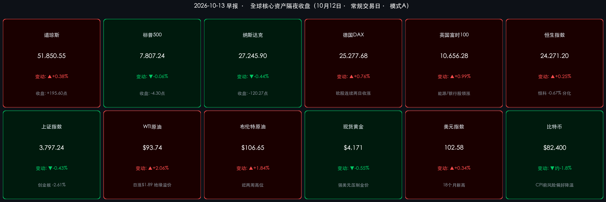

# 🌏 全球金融早报 · 油价跳涨压制科技股，资金轮动银行静候财报与CPI“双考”

**日期：2026年10月13日 (星期二)** &nbsp; **时段：早报 (国际市场 · 常规交易日 · 模式A)**

> **核心摘要**：周一（10月12日）美股在哥伦布日**美债现货休市**的清淡交投中收出分化格局——**道指涨0.38%** 至 **51,850.55点**，标普500微跌0.06%，纳指跌0.44%；资金从高估值科技/半导体轮动至价值与金融板块，为今日开盘前摩根大通、高盛、花旗、富国集体发布三季报做准备。霍尔木兹海峡油轮遇袭与沙特方向安全事件推升油价，**WTI 涨2.06% 至 $93.74**、**布伦特涨1.84% 至 $106.65**，**美元指数升至102.58（18个月新高）**，黄金与比特币同步回落。周三9月CPI是本周最大风险事件。

---

## 核心行情复盘

*   **美股三大指数（10月12日收盘）**：
    *   **道琼斯工业指数**：**51,850.55 点**，**+195.60 点 / +0.38%**（金融、价值股领涨）。
    *   **标普500**：**7,807.24 点**，**-4.30 点 / -0.06%**，仍贴近历史高位。
    *   **纳斯达克综合指数**：**27,245.90 点**，**-120.27 点 / -0.44%**，半导体与芯片链承压。
    *   **成交与情绪**：受哥伦布日影响整体**成交量偏低**，投资者在财报与CPI前防御性布局；**VIX 小幅升至约 15.3–15.5**（单日涨超3%），仍处相对低位。
*   **欧洲股市（连续第二日收涨）**：
    *   **STOXX 600**：**635.65 点（+0.65%）**；**德国DAX**：**25,277.68 点（+0.76%）**；**英国富时100**：**10,656.28 点（+0.99%）**；**法国CAC40**：**7,832.88 点（+0.38%）**；**欧元区STOXX 50**：**6,201.21 点（+0.45%）**；**西班牙IBEX 35** 在银行股带动下 **+1.33%** 领涨。
*   **亚太市场（10月12日）**：
    *   **恒生指数**：**24,271.20 点（+59.85 点 / +0.25%）**；**恒生科技**：**4,169.57 点（-0.67%）**，内银股托底、光通信与算力硬件走弱。
    *   **上证指数**：**3,797.24 点（-0.43%）**，失守3800点；**深证成指 -2.03%**、**创业板指 -2.61%**、沪深300 -0.68%；全市场超 **4,300只** 个股下跌，主力资金净流出约 **150–260亿元**。
    *   **日经225**：因“体育日”**休市**，上一收盘 **69,030.92 点**。
*   **大宗商品与外汇**：
    *   **WTI原油（11月）**：**$93.74/桶（+2.06%）**；**布伦特原油（12月）**：**$106.65/桶（+1.84%）**，近两周高位。
    *   **现货黄金**：约 **$4,171/盎司（约 -0.55%）**；COMEX 12月黄金期货收于约 **$4,209.70（-0.2%）**。
    *   **美元指数**：**102.58（+0.34%）**，创 **18个月新高**；**离岸人民币**：约 **6.6945**，基本持平。
    *   **富时中国A50期货**：夜盘在 **13,740–13,826** 区间整理，小幅承压。
*   **加密资产**：**比特币** 回落至 **$82,400–$83,300** 区间（日内约 -0.5% 至 -1.8%），加密恐惧与贪婪指数降至约 **56（中性）**。
*   **领涨/领跌**：领涨——**银行与金融**（财报前布局）、**能源**（油价上行）、价值板块；领跌——**半导体与科技硬件**（Marvell、Semtech 等回调，Intel、AMD 年内大涨后获利了结）。

> **数据校验**：道指 51,654.95 + 195.60 = 51,850.55；标普 7,811.54 − 4.30 = 7,807.24；纳指 27,366.17 − 120.27 = 27,245.90；恒指 24,211.35 + 59.85 = 24,271.20；WTI (93.74−91.85)/91.85 ≈ +2.06%；布伦特 (106.65−104.72)/104.72 ≈ +1.84%——均与记录涨跌幅吻合。

---

## 核心解读与市场逻辑

> **逻辑一：油价上行（数据）→ 通胀预期升温（事件）→ 科技估值承压、资金轮动价值股（逻辑）**
> 周末至周一，霍尔木兹海峡油轮遇袭“近乎每日”发生，另据报道沙特境内基础设施遭胡塞武装无人机与导弹袭击，地缘风险溢价重新计入油价，布伦特一度触及 **$107** 上方。摩根大通指出，全球**超大型油轮（VLCC）运力紧缺**——大量船只受制裁或航运风险影响被困——推高运费，即便原油实际供给仍在流动，到岸成本也居高不下。油价走高叠加周三CPI（市场预期整体通胀升至 **3.6%–3.7%**），令投资者对“美联储进一步加息”的担忧升温，高估值科技与半导体成为首要减仓对象，资金转向金融、能源等价值板块，形成“道指涨、纳指跌”的典型轮动格局。

> **逻辑二：强美元压制黄金与加密资产**
> 美元指数升至 18 个月新高，叠加美债收益率处于 24 年高位附近（周一现货休市，利率定价将在周二集中释放），无息资产黄金在避险需求与机会成本之间被后者压制，金价从 $4,190 上方回落至 $4,170 附近；比特币则跟随风险偏好降温回落，在宏观流动性担忧下进入CPI前观望状态。

> **逻辑三：欧股为何逆势走强？**
> 欧洲市场受到两条利好支撑：一是美国总统特朗普周日宣称俄乌同意立即实施“能源停火”、停止相互打击能源设施（但泽连斯基称此事“对我来说是新闻”，基辅周一指责俄方随即袭击哈尔科夫等地能源设施，停火可持续性存疑）；二是中欧就**中国混动汽车对欧出口配额**达成临时协议，缓和贸易摩擦。银行股在利率高位下表现强势，带动西班牙IBEX、英国富时领涨。

> **逻辑四：A股缩量调整，科技主线遭遇获利了结**
> 周一A股电子（净流出超 **80亿元**）、通信（净流出超 **55亿元**）领跌，中际旭创、新易盛、兆易创新等AI链高位股遭主力大幅流出；而银行逆势涨超 **2%**，传媒（净流入约 **17–23亿元**）、电力设备获资金加仓，宁德时代、鹏鼎控股、赛力斯获主力净流入。这与美股“科技→价值”的轮动方向高度同步，显示全球高利率环境下资金对高估值成长股的风险偏好整体收敛。

---

## 政策脉动

> **美联储 / 美国财政部**：
> * **IMF/世界银行年会** 于10月12日在**泰国曼谷**开幕（三年来首次在华盛顿以外举办），会议议题被中东冲突、能源供给冲击、接近历史纪录的公共债务与持续通胀所主导。
> * **美国财长贝森特缺席**曼谷年会，理由是与中期选举相关的国内事务，美方代表团由副财长与负责国际事务的副部长率领；鉴于美国今年担任G20主席国，此举在全球债券收益率高企、汇率承压之际引发关注。
> * **美联储主席沃什** 出席年会，将于 **10月16日（周五）** 与IMF总裁格奥尔基耶娃公开对话，这是10月27–28日FOMC“静默期”前的关键表态窗口。期货市场已对美联储在上月启动加息后**再度加息**计入较高概率，本周CPI将决定这一预期的去留。
>
> **中国人民银行 / 证监会 / 财政部**：
> * 央行近期通过**买断式逆回购**等工具呵护流动性；9月制造业PMI回升重回扩张区间，国内基本面与政策托底信号正在夯实市场底部。
> * 财政部此前宣布允许各省动用往年未使用的 **5,500亿元** 债务限额，稳定年末增长；本周还需关注中国9月通胀与金融数据的披露。

---

## 最新机构观点

> **高盛资产管理（Goldman Sachs Asset Management）**：
> * 倾向采用 **“哑铃型”策略**——一端配置全球科技与AI驱动的成长股，另一端配置部分利率敏感型或防御性股票。区域上**超配美国及部分亚洲市场**、**低配欧洲**，认为AI资本开支带来的周期性动能是对冲整体货币紧缩的核心驱动力。

> **摩根大通（JPMorgan）**：
> * 强调企业盈利强劲——标普500三季度盈利同比增速追踪在 **约30%** 附近，主要由科技与数据中心基础设施建设驱动；但对**消费信贷正常化**及货币紧缩的外溢影响保持警惕。本行三季报市场预期EPS约 **$5.82–$5.91**、营收约 **$510亿**，焦点在于戴蒙对净利息收入（NII）指引、信贷质量与2027年加息环境下经营策略的表态。高盛EPS预期分歧较大（**$13.35–$16.42**），股票交易稳健、FICC降温。

> **中信证券 (CITIC Securities)**：
> * 在全球高利率常态化与AI投资周期未改的背景下，四季度聚焦四条线索：**北美AI链、中国“六张网”建设、反内卷驱动的供给出清品种（部分能化、制造周期品）以及具备出海潜力的龙头**；光通信、PCB、晶圆制造等新技术方向短期虽高位震荡，仍是中长期布局核心。

> **中金公司 (CICC) 及主流券商**：
> * 市场处于 **“以时间换空间”的磨底蓄势阶段**；三季报密集披露期，定价锚点正由情绪与概念转向**业绩兑现度与盈利上修方向**。建议均衡配置，兼顾进攻弹性与防御韧性，以**红利资产**作为底仓应对外部不确定性。

---

## 今日市场情绪：灯塔守岸，芯塔待晴

> Prompt: A lone lighthouse built from stacked golden bank vault doors stands firm on a rocky shore, its bright beam sweeping across a dark sea where burning oil tankers drift. In the background, a glowing silicon chip tower slowly cracks and dims under a heavy storm cloud shaped like a rising thermometer, while a torn calendar page reading WEDNESDAY flutters in the wind.

---

> **免责声明**：内容仅供参考，不构成投资建议。数据来源：TheStreet、Motley Fool、Anadolu Agency、Morningstar、The Star、东方财富、新浪财经、证券时报、HKEX、Cboe、Investing.com 及各机构公开研报；收盘终值截至2026年10月12日各市场收盘，加密市场数据截至10月13日早间。*说明*：10月12日美债现货市场因哥伦布日休市，无新的收益率收盘数据；部分中东安全事件报道尚待进一步核实。

🤖 生成模型：Claude Opus 5.5 (Medium) <!-- model-stamp -->
