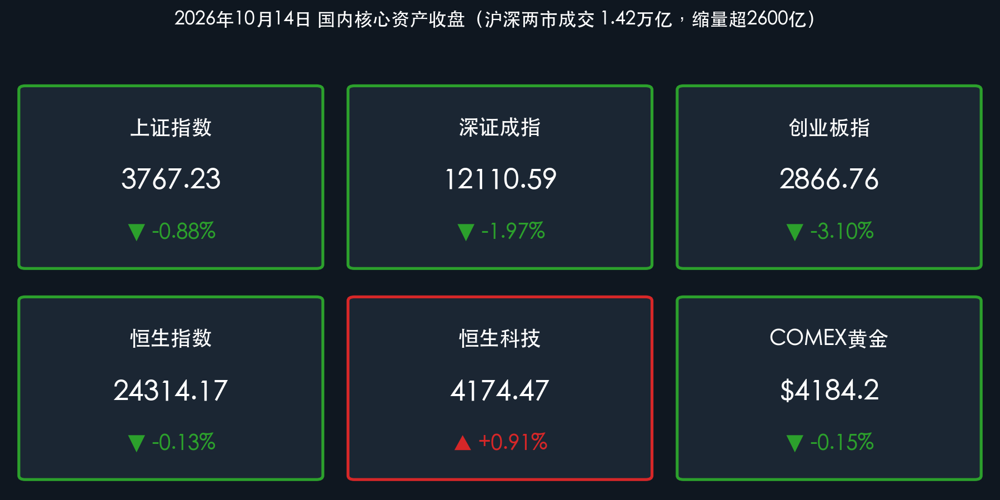

# 双创重挫逾3%、近4500股下跌：AI硬件与风电遭抛售，油气传媒逆势护盘，恒生科技独立走强

**日期：2026年10月14日 (星期三)** &nbsp; **时段：下午/国内收盘**

> **核心摘要**：周三A股未能延续前一日深V反弹势头，三大指数全天震荡走低，**创业板指重挫 3.10%** 收报 **2866.76点**，科创50跌 **3.29%**；上证指数跌 **0.88%** 收报 **3767.23点**，得而复失3800点关口。沪深两市成交额缩量超 **2600亿元** 至约 **1.42万亿元**，全市场近 **4500只** 个股下跌、上涨不足 **900只**，赚钱效应显著退潮。AI硬件、半导体与风电设备遭主力集中抛售，油气开采受WTI原油站上 **95美元** 刺激逆势走强，传媒/AI短剧获超 **66亿元** 主力净流入。港股走出分化，恒指微跌 **0.13%**，恒生科技则在美团、小米带动下逆势上涨 **0.91%**。

## 核心行情复盘

*   **上证指数**：**3767.23**（**-0.88%**，跌33.63点，失守3800点整数关口）
*   **深证成指**：**12110.59**（**-1.97%**，跌243.11点）
*   **创业板指**：**2866.76**（**-3.10%**，跌91.58点，跌破2900点）；**科创50**：**-3.29%**
*   **沪深两市成交额**：约 **1.42万亿元**（沪市约6625亿元、深市约7519亿元），较上一交易日（1.69万亿元）缩量超 **2600亿元**；全市场近 **4500只** 个股下跌，上涨不足 **900只**。
*   **恒生指数**：**24314.17**（**-0.13%**，跌31.05点）；**恒生科技指数**：**4174.47**（**+0.91%**，涨37.84点），美团-W涨超6%、小米集团-W涨超5%、阿里巴巴涨超3%。
*   **主力资金**：申万一级行业中 **传媒** 获主力净流入超 **66亿元** 居首、**公用事业** 净流入逾 **32亿元**；**电子** 遭净流出逾 **67亿元**、**电力设备** 净流出逾 **47亿元**；概念板块中 **人工智能** 净流出超 **81亿元**、**华为概念** 净流出逾 **76亿元**。
*   **外围参考**：COMEX黄金期货报约 **$4,184.2/盎司**（**-0.15%**，盘中再触4200美元未能站稳）；WTI 11月原油期货报 **$94.1~$94.7/桶**（日内 **+0.4%~0.5%**，盘中站上95美元）；比特币在 **$82,400–$83,200** 区间震荡；离岸人民币（USD/CNH）报 **6.6912–6.6926**，人民币中间价 **6.7249**。

> **数据闭环校验**：
> * 上证指数：(3767.23 − 3800.86) / 3800.86 = −33.63 / 3800.86 ≈ −0.88%，与官方收盘涨跌幅完全吻合。
> * 深证成指：(12110.59 − 12353.70) / 12353.70 = −243.11 / 12353.70 ≈ −1.97%，与官方收盘涨跌幅完全吻合。
> * 创业板指：(2866.76 − 2958.34) / 2958.34 = −91.58 / 2958.34 ≈ −3.10%，与官方收盘涨跌幅完全吻合。
> * 恒生指数：(24314.17 − 24345.22) / 24345.22 = −31.05 / 24345.22 ≈ −0.13%，与官方收盘涨跌幅完全吻合。
> * 恒生科技：(4174.47 − 4136.63) / 4136.63 = +37.84 / 4136.63 ≈ +0.91%，与官方收盘涨跌幅完全吻合。

### 领涨/领跌行业
*   **领涨**：
    *   **油气开采及服务 / 石油石化**：受中东地缘局势紧张、能源设施安全风险升级及WTI原油站上95美元/桶刺激逆势走强，中海油服、博迈科涨超6%，中国海油涨超4%。
    *   **文化传媒 / 游戏 / AI短剧**：全天活跃，出版业领涨；字节跳动旗下短剧应用海外数据亮眼催化情绪，慈文传媒、掌阅科技、富春股份等封板或大涨。
    *   **煤炭开采加工**：长假后动力煤市场快速回归、港口报价上行，安泰集团、郑州煤电涨停。
    *   **公用事业 / 电力**：防御性红利板块相对抗跌，获主力资金回流。
*   **领跌**：
    *   **风电设备**：板块重挫领跌，大金重工跌停，威力传动、新强联跌超10%。
    *   **半导体 / 芯片 / AI硬件**：光通信、存储芯片、光刻机、GPU等方向遭大幅抛售，天孚通信跌超7%，信宇人、有研新材等跌停。
    *   **新能源车产业链（电池、光伏设备）**：电池板块全天低迷，多股跌幅居前。
    *   **玻璃玻纤 / 汽车整车**：同样跌幅靠前。

> **核心解读**：今日市场呈现典型的“缩量普跌、高低切换”格局。昨日由PCB与光通信三季报预喜引燃的深V反弹未获增量资金接力，成交额骤降超2600亿元，前一日抄底筹码在午后加速兑现，AI硬件与新能源赛道权重股集体回落，令汇聚大量成长股的创业板与科创板双双跌逾3%。与此同时，资金向油气、煤炭、公用事业等周期红利方向以及传媒/AI短剧等低位题材迁徙，形成“硬科技失血、软应用与红利吸金”的鲜明分化。

## 核心解读与市场逻辑

*   **反弹缺乏量能确认，抄底筹码快速兑现**：前一日放量1.69万亿元的深V反弹，今日即缩量至1.42万亿元，表明场外增量资金并未持续入场；在存量博弈下，昨日大幅反弹的算力硬件成为获利了结的首要对象，引发技术性二次下探。
*   **油价高企压制成长估值、利好资源板块**：中东局势与能源设施安全风险推动WTI站上95美元，强化了全球通胀顽固与高利率常态的预期，直接压制了高估值科技成长股的久期定价；同时也让油气开采、油服、煤炭等资源品获得业绩与情绪双重支撑。
*   **AI内部分化：硬件失血、应用吸金**：人工智能概念遭主力净流出超81亿元，但传媒/短剧方向却获66亿元净流入，资金在AI产业链内部从“卖铲子”的高位硬件向“掘金者”的低位应用端切换。
*   **港股科网逆势，A/H 风格背离**：恒生科技在美团、小米、阿里等平台型科网股带动下逆势收涨0.91%，与A股硬科技暴跌形成鲜明对比，反映出外资对低估值互联网平台与消费科技的偏好；而港股生物医药与光通信板块的调整与A股方向一致。

> **核心解读**：“数据+事件+逻辑”链条清晰：成交额缩量超2600亿元、近4500股下跌（数据），叠加WTI原油站上95美元与中东能源设施风险升级（事件），压制高估值成长股定价并驱动资金向资源红利与低位应用题材避险迁移（逻辑）。短期看，3800点得而复失、创业板跌破2900点，市场仍处于三季报验证期的震荡磨底阶段，量能能否重新放大是判断企稳的关键。

## 政策脉动

*   **央行逆回购净投放维稳**：中国人民银行今日（10月14日）以固定利率、数量招标方式开展 **560亿元** 7天期逆回购操作，中标利率维持 **1.40%** 不变；因当日无逆回购到期，实现 **净投放560亿元**，维护银行体系流动性平稳。
*   **香港证监会重拳打击IPO操纵**：受香港证监会指令，港交所自10月13日起暂停 **茶百道（02555.HK）** 等相关公司股份交易。证监会指相关集团涉嫌在IPO阶段人为操纵股份需求、营造虚假认购表象，已向多家经纪行发出限制通知书并冻结涉案账户资产，强调对严重失当行为“零容忍”。
*   **香港上市制度改革推进**：香港证监会10月12日发表咨询总结，将修订《证券市场上市规则》，针对IPO及上市后企业失当行为推出打击工具，相关修订预计于 **2027年第一季度** 正式生效。

> **核心解读**：内地央行持续通过逆回购净投放呵护流动性，资金面并非今日下跌的主因；香港监管层对IPO造假的高压整治短期或对新股情绪形成扰动，但中长期有助于夯实港股市场质量与国际投资者信心。

## 最新机构观点

> **中信证券**：
> * 全球长债利率受北美AI资本开支等强劲私人部门投融资需求拉动居高不下，高利率环境已成常态。在海外宏观扰动与国内三季报披露交织之下，市场仍具备活跃资金进攻新技术与新题材的土壤，三季报前后是年内指数和情绪的最后一波重要进攻窗口；指数大幅下行风险较小，更倾向于结构性轮动。

> **中金公司**：
> * 经历前期震荡调整后，市场定价重心正逐步向基本面和三季报成色靠拢，稳增长政策信号陆续释放有助于维护投资者信心。在总量增长弹性有限、风险偏好波动加大的环境下，“科技成长 + 红利防御”的 **哑铃型配置** 重要性显著提升，红利端关注煤炭、银行、公用事业等高股息资产。

> **华泰证券**：
> * 经过前期震荡消化，TMT及科技板块拥挤度与两融杠杆压力已有明显出清，宽基ETF承接力度增强。四季度初市场积极信号逐渐累积，后续若 **日均成交额重回2万亿关口** 并伴随赚钱效应扩散，反弹有望更积极展开。

## 今日市场情绪：寒风折枝，黑金涌动

> Prompt: A towering crystalline silicon tree glowing with fiber-optic branches is cracking and shedding green circuit-board leaves under a cold autumn wind, while at its roots a dark river of black crude oil surges upward like a geyser, its spray glittering gold. In the background, a vast stock exchange screen shows the numbers 3767 and a falling green candlestick chart beneath a stormy violet sky.

---

> **免责声明**：内容仅供参考，不构成投资建议。数据来源：交易所公开数据、东方财富、财联社、证券时报、金融界、中国经济网及各机构公开研报；A股/港股数据截至2026年10月14日收盘，黄金、原油、比特币及离岸人民币为当日参考报价。

🤖 生成模型：Claude Opus 5.5 (Medium) <!-- model-stamp -->
