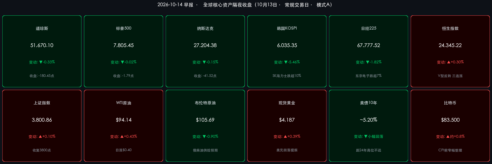

# 🌏 全球金融早报 · 存储芯片遭“长鑫冲击”血洗亚洲，银行财报冷热不均，今晚CPI定成败

**日期：2026年10月14日 (星期三)** &nbsp; **时段：早报 (国际市场 · 常规交易日 · 模式A)**

> **核心摘要**：周二（10月13日）全球半导体遭遇“长鑫存储（CXMT）冲击”——**韩国KOSPI暴跌5.46%**、SK海力士跌超10%、**日经225跌1.82%**，美股存储链同步重挫；美股三大指数窄幅收低（**道指 -0.33%**、标普 -0.02%、纳指 -0.15%），三季报开局冷热不均：**摩根大通近三年来首次营收与利润双双不及预期**，高盛股票交易收入暴增72%大超预期。油价分化（WTI +0.43%、布伦特 -0.90%），美元自18个月高位回落、黄金反弹。**今晚20:30（北京时间）美国9月CPI** 是决定美联储10月底是否再加息的关键一役。

---

## 核心行情复盘

*   **美股三大指数（10月13日收盘）**：
    *   **道琼斯工业指数**：**51,670.10 点**，**-180.45 点 / -0.33%**（摩根大通、富国银行拖累）。
    *   **标普500**：**7,805.45 点**，**-1.79 点 / -0.02%**，基本持平，仍贴近历史高位。
    *   **纳斯达克综合指数**：**27,204.38 点**，**-41.52 点 / -0.15%**，美光、西部数据、SanDisk 等存储股重挫，费城半导体指数延续多日下跌。
    *   **成交与情绪**：财报季开幕叠加CPI前观望，整体交投谨慎；**VIX 约 15.31**，股市恐慌度仍低，但衡量美债波动的 **MOVE 指数** 维持高位。
*   **欧洲股市（冲高回落，小幅收跌）**：
    *   **STOXX 600**：约 **635 点（-0.1% ~ -0.2%）**，抹去盘中涨幅；**德国DAX -0.07% ~ -0.1%**；**英国富时100 约 -0.06% ~ -0.1%**；**法国CAC40 -0.07% ~ -0.1%**。ASML 等半导体设备股领跌，能源与防御板块托底；奢侈品板块业绩更新偏弱。
*   **亚太市场（10月13日）**：
    *   **韩国KOSPI**：**6,035.35 点（-5.46%）**，盘中一度跌超 **7%** 失守6000点；**SK海力士暴跌超10%**，**三星电子跌约7.4%–7.9%**。
    *   **日经225**：**67,777.52 点（约 -1,253 点 / -1.82%）**，体育日假期后复市即创两周新低，**东京电子跌超7%**，铠侠同步走弱。
    *   **恒生指数**：**24,345.22 点（+74.02 点 / +0.30%）**，盘中一度跌超1%后V型反转，**录得三连涨**；**恒生科技**：**4,136.63 点（-0.79%）**。石油石化、银行、地产、光通信走强，半导体与存储概念低迷；南向资金成交约 **709.99亿港元**，**净卖出约4.57亿港元**。
    *   **上证指数**：**3,800.86 点（+3.62 点 / +0.10%）**，盘中一度跌超1%、触及三个月低点后V型回升、**收复3800点**；**深证成指**：**12,353.70 点（-0.25%）**；**创业板指**：**2,958.34 点（-0.18%）**；**科创50**：**1,427.18 点（+0.03%）**。全市场超 **2,900只** 个股上涨。
    *   **A股成交与资金**：两市成交 **约16,759亿元**，**较前一交易日小幅放量**；主力资金 **净流出约91.40亿元**（较周一 150–260亿元的流出规模明显收窄）。
*   **大宗商品与外汇**：
    *   **WTI原油（11月）**：**$94.14/桶（+$0.40 / +0.43%）**；**布伦特原油（12月）**：**$105.69/桶（-$0.96 / -0.90%）**。市场在俄罗斯柴油供给可能增加与中东（沙特方向、霍尔木兹海峡）地缘冲突之间权衡。
    *   **现货黄金**：约 **$4,187/盎司（+0.39%）**，美元走软与美债收益率回落提供支撑。
    *   **美元指数**：回落至 **约102.3**，自前一日18个月高位（102.58）小幅回撤。
    *   **美国10年期国债收益率**：约 **5.19%–5.22%**，自本月早些时候触及的 **24年高位** 小幅回落。
*   **加密资产**：**比特币** 在 **$83,300–$83,700** 区间整理（较前一日 $82,400–$83,300 小幅回升），上方 **$87,000** 阻力明显；链上数据显示巨鲸在宏观数据前逢低吸筹，但整体风险偏好仍偏谨慎。
*   **领涨/领跌**：领涨——**投行/交易型金融（高盛）**、**能源**、港股**石油石化与银行**、A股**国防军工、通信设备、冰雪旅游、PCB**；领跌——**存储芯片与半导体设备**（SK海力士、三星、东京电子、美光、ASML）、**零售银行（富国、花旗）**、A股**电力设备、非银金融、医药生物**。

> **数据校验**：道指 51,850.55 − 180.45 = 51,670.10；标普 7,807.24 − 1.79 = 7,805.45；纳指 27,245.90 − 41.52 = 27,204.38；恒指 24,271.20 + 74.02 = 24,345.22；上证 3,797.24 + 3.62 = 3,800.86；日经 1,253 / 69,030.92 ≈ 1.82%；WTI (94.14−93.74)/93.74 ≈ +0.43%；布伦特 (105.69−106.65)/106.65 ≈ −0.90%——均与记录涨跌幅吻合。

---

## 核心解读与市场逻辑

> **逻辑一：长鑫存储技术突破（事件）→ 存储供给稀释与价格战预期（逻辑）→ 韩日存储链血洗（数据）**
> 周末至周二，市场流传中国存储龙头**长鑫存储（CXMT）**在新一代高密度DRAM架构（如 4F2 单元设计、DDR5 服务器内存）上取得关键进展、目标在2026年底前后推进量产。投资者担忧未来供给扩张将侵蚀三星、SK海力士、美光等巨头在AI服务器内存上的定价权与高毛利，引发“踩踏式”抛售——KOSPI 因存储双雄权重过高录得 **-5.46%** 的单日暴跌，东京电子等设备商跌超7%。叠加博通CEO对“投机性AI支出”的警示以及美债高收益率对高估值的压制，全球半导体板块从“AI信仰”切换至“估值审视”模式。值得注意的是，高盛与摩根士丹利同期被选为SK海力士旗下NAND子公司 **Solidigm 约100亿美元美国IPO** 的主承销商，显示机构对存储赛道的中长期布局并未退潮。

> **逻辑二：银行财报“交易强、存贷弱”——高利率红利出现分化**
> * **摩根大通**：净利润 **153亿美元**，EPS **$5.57**，不及市场预期的 **$5.85–$5.93**，为**近三年来首次盈利不及预期**；营收约 **509亿美元**（管理口径）亦低于预期，主因固定收益交易放缓及 **6.58亿美元** 证券投资净损失，并在季度内收缩回购以保留资本。戴蒙警告：“**庞大的财政赤字、黏性通胀、高企的资产价格、上升的利率与地缘局势，正在水面之下持续变化。**”但股价因净利息收入稳健及股票业务强劲，仅小幅波动（约持平至 +1.4%）。
> * **高盛**：净利润 **52.9亿美元**，EPS **$17.01**，大幅超出 $13.35–$16.42 的预期区间；营收 **186.8亿美元**，为史上第二高季度，**股票交易收入暴增72%至64.4亿美元**，股价涨约1%。
> * **花旗**：EPS **$2.85**、营收 **238.5亿美元**、净利润同比增约40%，创十年最佳三季度，但因费用与信贷调整受到审视，股价反跌 **2.4%–4%**。
> * **富国银行**：EPS **$1.87** 小幅超预期，但营收 **219亿美元** 与净利息收入低于预期，信贷损失拨备升至 **10.3亿美元**，股价跌 **1.3%–2%**。
> 结论：市场波动推升投行交易收入，但传统存贷业务的息差红利已见顶，信贷拨备抬头——这与戴蒙的谨慎表态相互印证。

> **逻辑三：油价分化与美元回落——CPI前的“喘息”**
> 布伦特在触及 $107 后回吐，俄罗斯柴油出口可能增加缓解了成品油供给担忧，但霍尔木兹海峡与沙特方向的安全事件仍为WTI提供支撑，形成“WTI涨、布伦特跌”的分化。美元与美债收益率同步回落，令黄金重新站上 $4,180 上方。但这更像是数据前的技术性喘息：市场预期9月整体CPI同比将由 **3.4%** 升至 **3.6%–3.7%**，主要由能源价格推动。

> **逻辑四：A股/港股V型反转——“去存储化”的结构性韧性**
> 与韩日的暴跌形成鲜明对比，A股与港股早盘虽一度跌超1%，但随后在国防军工、通信设备、PCB以及港股石油石化、银行的带动下双双V型收复，上证重回3800点、恒指三连涨。主力资金净流出规模从周一的 150–260亿元收窄至约 **91亿元**，两市成交小幅放量至 **1.68万亿元**。长鑫冲击对海外存储巨头是利空，但对国产半导体替代链条的叙事反而形成一定支撑，资金正从高位AI硬件向防御与内需方向再平衡。

---

## 政策脉动

> **美联储 / 美国财政部**：
> * **今晚（北京时间20:30）美国9月CPI**：市场预期整体通胀同比升至 **3.6%–3.7%**（前值3.4%），能源是主要推手；本周稍后还将公布PPI。
> * **利率定价**：期货市场计入约 **80%** 概率美联储在 **10月27–28日 FOMC** 按兵不动，但若CPI大超预期，12月再度加息的预期将快速升温。
> * **美联储主席沃什** 将于 **10月16日（周五）** 在IMF/世界银行曼谷年会上与IMF总裁格奥尔基耶娃公开对话，这是FOMC静默期前的最后关键表态窗口。
>
> **中国人民银行 / 证监会 / 财政部 / 海关总署**：
> * **央行**：通过国债买卖、结构性货币政策工具保持流动性合理充裕，在全球高利率环境下以结构性宽松为主，重点支持实体经济与科技创新。
> * **证监会**：近期通过座谈会等方式释放积极信号，强调落实顶层设计、建立稳市机制、防范风险，提振市场信心。
> * **财政部**：此前安排使用 **5,500亿元** 地方政府债务结存限额，向经济大省倾斜，重点支持在建项目及“六张网”等新建项目。
> * **海关总署 / 国新办**：将于10月中旬举行前三季度进出口新闻发布会；8月出口同比增速约 **25%** 高位，市场关注9月出口在非美市场开拓与高端制造出海支撑下的韧性。

---

## 最新机构观点

> **摩根大通（JPMorgan）· 戴蒙**：
> * 美国经济在消费支出与企业投资支撑下仍具韧性，但“**庞大的财政赤字、黏性通胀、高企的资产价格、上升的利率与地缘局势**”正在水面下持续变化；本季主动收缩股票回购以保留资本，释放出对后市偏谨慎的信号。

> **高盛 / 摩根士丹利（Goldman Sachs / Morgan Stanley）**：
> * 华尔街策略团队正在“**强劲的盈利超预期**（银行、医疗领衔）”与“**AI及半导体龙头估值过高**”之间寻求平衡。尽管存储股短期遭受冲击，高盛与大摩仍担任 **Solidigm 约100亿美元IPO** 主承销商，显示对存储赛道中长期景气的信心未改。

> **中信证券 (CITIC Securities)**：
> * 全球长债利率在北美强劲的AI及私人部门投融资需求带动下高位震荡，**高利率是必须应对的常态**；在弱需求与高利率环境下，建议短期利用**景气品种**与**供给出清品种**防御与突围，高度重视明年的“**反内卷**”进程及中央财政扩张相关领域。

> **中金公司 (CICC)**：
> * 经历前期调整后，**三季报业绩韧性**与积极的稳增长信号有望支撑A股在10月及四季度逐步企稳回升；建议关注三季报盈利增速有望改善的领域——**部分有色金属、受益于AI高景气与海外需求的科技硬件、创新药、水电核电、工程机械**以及部分消费与出行服务。

---

## 今日市场情绪：芯坝溃堤，金库静候

> Prompt: A colossal silicon memory chip shaped like a glass dam cracks under a flood of tiny glowing new chips pouring from the east, while In the background a calm golden bank vault stands on a hill, its doors half open with trading tickets flying out. A storm cloud shaped like a thermometer hangs over the horizon, and a torn calendar page reading CPI flutters in the wind.

---

> **免责声明**：内容仅供参考，不构成投资建议。数据来源：TheStreet、Motley Fool、Quartz、Investing.com、Kitco、Trading Economics、Schwab、Mint、The Star、证券时报、东方财富、财联社、每日经济新闻及各机构公开研报；收盘终值截至2026年10月13日各市场收盘，加密市场数据截至10月14日早间。*说明*：欧洲主要指数仅获取到涨跌幅区间，精确收盘点位待核实；长鑫存储技术进展细节来自市场报道，尚待官方确认。

🤖 生成模型：Claude Opus 5.5 (Medium) <!-- model-stamp -->
