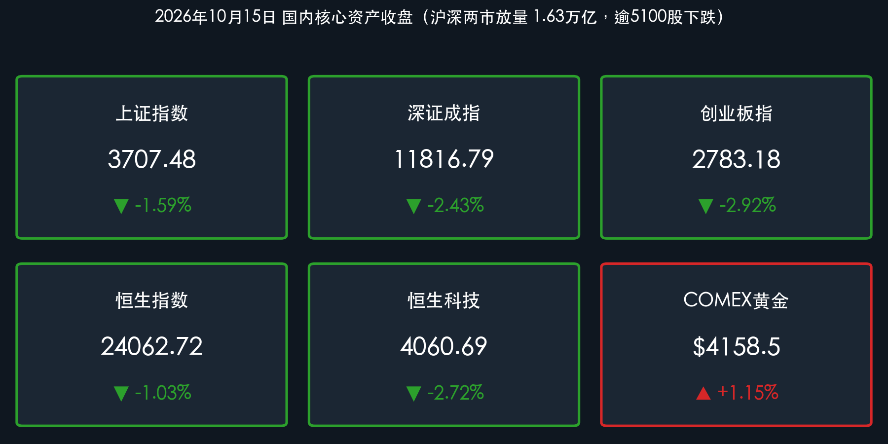

# 放量下挫超5100股下跌、3700点失而复得：算力与航运重挫，PCB与创新药逆势，央行净投放2000亿维稳

**日期：2026年10月15日 (星期四)** &nbsp; **时段：下午/国内收盘**

> **核心摘要**：周四A股未能企稳，三大指数单边走弱并出现放量寻底态势。**创业板指重挫 2.92%** 收报 **2783.18点**，跌破2800点关口；深证成指跌 **2.43%**；**上证指数跌 1.59%** 收报 **3707.48点**，盘中一度失守3700点整数关口，尾盘在券商板块脉冲拉升及工商银行创历史新高护盘下险守。沪深两市全天成交超 **1.63万亿元**，较前一交易日放量逾 **2100亿元**，场内恐慌盘与止损盘集中涌出。全市场超 **5100只** 个股下跌，仅约200只个股上涨，赚钱效应降至冰点。CPO算力硬件、航运港口、油气资源及存储芯片遭遇集中抛售，而印制电路板（PCB）受三季报预喜刺激逆势掀涨停潮，创新药与高股息大金融局部护盘。港股同步调整，恒指跌 **1.03%**，恒生科技大跌 **2.72%**。中国央行开展7000亿元6个月期买断式逆回购，实现 **净投放2000亿元**，精准呵护流动性。

## 核心行情复盘

*   **上证指数**：**3707.48**（**-1.59%**，跌59.75点，盘中最低探至3698点附近，尾盘险守3700点整数关口）
*   **深证成指**：**11816.79**（**-2.43%**，跌293.80点）
*   **创业板指**：**2783.18**（**-2.92%**，跌83.58点，跌破2800点大关）；**科创50**：**1359.52**（**-1.50%**，跌20.74点）
*   **沪深两市成交额**：约 **1.63万亿元**（具体约16,330亿元，其中沪市约7744亿元、深市约8586亿元），较上一交易日（1.42万亿元）放量超 **2100亿元**；全市场超 **5100只** 个股飘绿，仅不足300只个股上涨，出现极端的非理性普跌。
*   **恒生指数**：**24062.72**（**-1.03%**，跌251.45点，考验24000点整数大关）；**恒生科技指数**：**4060.69**（**-2.72%**，跌113.78点），科网权重普遍承压走弱。
*   **主力资金**：场内避险情绪高涨，主力资金从高位高拥挤板块坚决撤离。**通信设备**、**半导体芯片**、**算力硬件** 遭主力资金集中净流出逾百亿元；而部分三季报业绩预增的 **印制电路板（PCB）** 概念以及尾盘承担维稳重任的 **银行** 与 **证券** 获得局部主力资金逆势流入。
*   **外围参考**：COMEX黄金期货报约 **$4,158.5/盎司**（经历震荡后反弹，日内 **+1.15%**，维持高位震荡）；WTI 11月原油期货报 **$94.3~$94.8/桶**（高位盘整，发改委宣布本轮成品油调价搁浅）；比特币（BTC）在 **$80,200–$81,500** 区间展开“8万美元保卫战”，受美国通胀反弹及多头杠杆清算打压；离岸人民币（USD/CNH）报 **6.6920–6.6935**，人民币中间价下调4基点至 **6.7253**。

> **数据闭环校验**：
> * 上证指数：(3707.48 − 3767.23) / 3767.23 = −59.75 / 3767.23 ≈ −1.586% ≈ −1.59%，与官方收盘涨跌幅完全吻合。
> * 深证成指：(11816.79 − 12110.59) / 12110.59 = −293.80 / 12110.59 ≈ −2.426% ≈ −2.43%，与官方收盘涨跌幅完全吻合。
> * 创业板指：(2783.18 − 2866.76) / 2866.76 = −83.58 / 2866.76 ≈ −2.915% ≈ −2.92%，与官方收盘涨跌幅完全吻合。
> * 恒生指数：(24062.72 − 24314.17) / 24314.17 = −251.45 / 24314.17 ≈ −1.034% ≈ −1.03%，与官方收盘涨跌幅完全吻合。
> * 恒生科技：(4060.69 − 4174.47) / 4174.47 = −113.78 / 4174.47 ≈ −2.725% ≈ −2.72%，与官方收盘涨跌幅完全吻合。

### 领涨/领跌行业
*   **领涨**：
    *   **PCB概念（印制电路板）**：逆市爆发掀起涨停潮，金禄电子、澳弘电子、崇达技术等封死涨停，多只产业链标的涨超10%，主要受三季报业绩大幅预喜及北美AI服务器高规格PCB强劲需求驱动。
    *   **创新药概念**：表现出较强防御韧性，百花医药、华北制药逆势封板，出海及临床管线催化带来局部结构性行情。
    *   **证券（券商/牛市旗手）**：午后显著异动拉升护盘，华林证券涨停，锦龙股份盘中触及涨停，有效缓解大盘快速破位风险。
    *   **高股息防御性资产（银行/白酒）**：工商银行盘中走强并创历史新高，四大行稳健发力，对上证指数形成关键托底。
*   **领跌**：
    *   **通信与CPO算力硬件**：板块重挫领跌，前期热门高估值个股遭大幅抛售，新易盛等核心龙头大跌，机构资金高位兑现意愿强烈。
    *   **航运港口**：板块遭遇深度调整，招商轮船、中远海能跌停，反映出市场对运价高位回落及地缘溢价见顶的担忧。
    *   **周期能源（油气开采/煤炭）**：昨日领涨的油气板块今日大幅补跌，油服及石化链条多股跌幅居前。
    *   **存储芯片 / 国防军工 / 汽车整车**：同样位居跌幅前列，市场缺乏持续热点接力。

> **核心解读**：今日市场呈现“放量杀跌、恐慌宣泄、权重护盘”的典型特征。在前期连续缩量阴跌后，今日两市放量2100多亿元至1.63万亿元，表明部分杠杆资金与止损盘被动出清，超过5100只个股下跌形成了短期情绪超跌。盘面上，通信CPO和算力硬件等高位科技成长赛道成为抛压重灾区，而资金转向具备扎实业绩支撑的PCB板块以及以工商银行为代表的确定性高股息资产，形成了极为极端的“结构性抗跌与普遍性失血”。

## 核心解读与市场逻辑

*   **止损盘涌出与放量寻底**：成交额从昨日的1.42万亿元放大到1.63万亿元，放量下跌通常是短期恐慌情绪达到顶峰的标志。3700点关口得而复失后，多头在尾盘依靠券商和大行合力守住3700点，显示出关键点位处政策资金与长线资金的托底意志。
*   **业绩验证期强化当期确定性**：随着上市公司三季报密集披露，市场对“故事型概念”容忍度急剧下降，而对“能够兑现业绩的景气方向”予以积极溢价。通信CPO等因预期差遭到获利了结，而PCB板块因北美高规格硬件需求直接转化为利润预增，成为唯一具备板块效应的科技细分。
*   **全球高利率压制下的久期风险**：北美万亿级投资驱动长端美债利率处于5.20%以上的高位，海外流动性紧缩预期再度升温，直接压制了港股及A股高估值成长股的估值折现率。资金被迫退守至银行、公用事业等具备“类债性”和确定性分红回报的防御板块。
*   **A/H联动下挫，外资风险偏好收缩**：昨日恒生科技逆势上涨的独立行情今日被打破，恒指与恒生科技双双下挫，表明在美元流动性与地缘情绪未明显缓和前，离岸与在岸资产同步承受估值重构压力。

> **核心解读**：“数据+事件+逻辑”链条完整：两市成交放量超2100亿元、超5100股下跌（数据），叠加美国CPI超预期反弹导致全球长端利率居高不下、三季报密集披露窗口（事件），促使机构资金坚决出清缺乏业绩支撑的高估值科技与周期筹码，倒逼资金向三季报预喜的PCB及创历史新高的银行红利资产寻求避风港（逻辑）。

## 政策脉动

*   **央行开展7000亿元买断式逆回购加量续作**：中国人民银行10月15日以固定数量、利率招标、多重价位中标方式开展了 **7000亿元** 6个月期（182天）买断式逆回购操作，到期日为2027年4月15日。鉴于当日有5000亿元买断式逆回购到期，央行实现 **净投放2000亿元**，展现出呵护四季度政府债平稳发行与平滑税期波动的精准调控意图。
*   **国家发改委成品油调价“搁浅”**：国家发改委10月15日发布消息，由于本轮调价周期内国际油价在94-95美元高位震荡，综合评估后决定本次国内汽、柴油价格不作调整，有利于平抑下游物流与工业用能成本。
*   **人民币汇率韧性凸显**：今日人民币对美元汇率中间价报 **6.7253**，小幅微调4个基点。在离岸市场上，美元兑人民币稳定在 **6.69** 附近窄幅波动，贸易顺差与基本面韧性为国内资产提供了坚实的汇率安全垫。

> **核心解读**：央行通过创新型买断式逆回购大额净投放2000亿元，释放出维持银行体系流动性合理充裕的强烈信号，有效切断了流动性踩踏的负反馈通道。国内基本面与汇率韧性依旧，短期行情的剧烈调整更多源自情绪与三季报调仓。

## 最新机构观点

> **中信证券**：
> * 全球油价虽有盘整，但北美在万亿美元级投融资需求驱动下，长端债券利率难以快速下行，高利率环境已成为常态。在整体需求偏弱背景下，“反内卷”与供给出清品种具有稀缺性。当前投资者应以**高景气品种**与**供给出清品种**应对高利率压制，科技端紧扣北美算力与中国“六张网”中的PCB、晶圆制造与光通信，非科技端重点增配能化、创新药与绝对收益空间明确的银行板块。

> **中金公司**：
> * 市场在经历前期成长风格的剧烈波动后，估值安全边际已非常充足。在总量增长弹性受限、风险偏好波动加大的环境下，“科技 + 红利”的 **哑铃型配置** 重要性显著提升。一方面在科技成长端聚焦三季报业绩明确兑现的AI硬件、半导体关键环节及创新药出海；另一方面在防御端增配现金流稳健、股息率出色的银行与水电核电资产。

> **华泰证券**：
> * 节后市场估值约束尚未完全解除，配置标准应从“远期叙事空间”全面转向“当期三季报景气兑现”。对高估值无业绩支撑品种保持克制，继续沿业绩性价比展开布局。建议将红利资产作为底仓压舱石，重点把握PCB、服务器等具备坚实下游订单支撑的硬件赛道，以及受财政稳步发力催化的工程机械等低估值板块。

## 今日市场情绪：狂澜急雨落，磐石扼孤关

> Prompt: A massive granite lighthouse standing steadfast against a surging storm of green falling leaves and rushing waters, casting a golden defensive beam across dark ocean waves. In the background, giant financial numbers 3700 glow softly on distant stone monoliths beneath a dramatic stormy sky.

---

> **免责声明**：内容仅供参考，不构成投资建议。数据来源：交易所公开数据、东方财富、同花顺、财联社、证券时报、金融界、新华网及各机构公开研报；A股/港股数据截至2026年10月15日收盘，黄金、原油、比特币及离岸人民币为当日参考报价。

🤖 生成模型：Gemini 3.8 Flash (High) <!-- model-stamp -->
