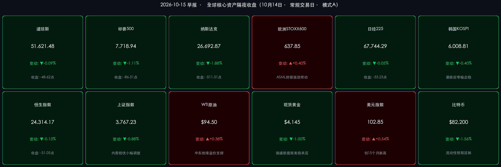
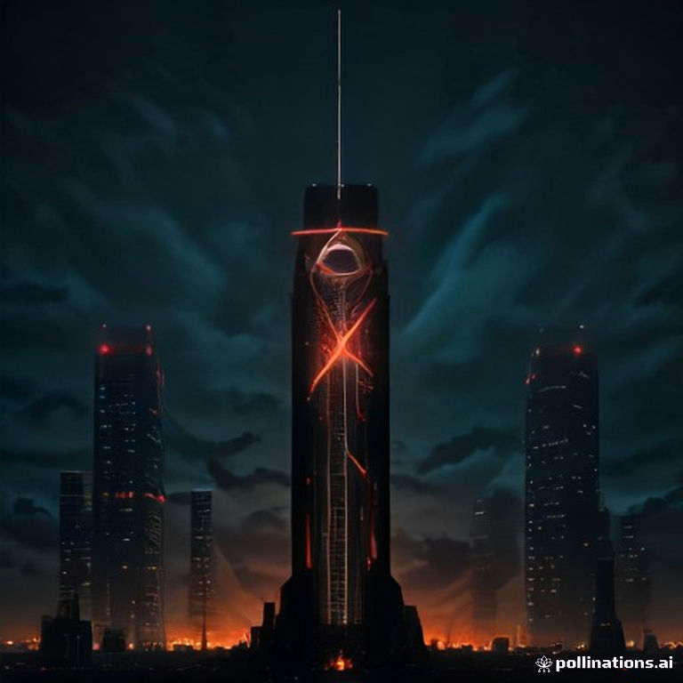

# 🌏 全球金融早报 · 美国9月CPI超预期反弹重燃紧缩忧虑，纳指重挫近2%，ASML与大摩财报孤掌难鸣

**日期：2026年10月15日 (星期四)** &nbsp; **时段：早报 (国际市场 · 常规交易日 · 模式A)**

> **核心摘要**：周三（10月14日）美国劳工统计局公布9月通胀数据，受地缘溢价推升的能源价格驱动，**美国9月未季调CPI同比上涨3.7%**（高于市场预期的3.6%，较前值3.4%明显反弹），核心CPI环比增长0.3%、同比上涨2.6%；超预期的通胀“热浪”彻底打破市场对美联储快速转向的幻想，长端美债收益率再度冲高逼近24年历史高位，**美元指数暴力拉升突破102.85、刷新15个月新高**。全球权益资产承压，美股三大指数普跌，**纳斯达克重挫1.88%**（-511.51点），**标普500跌1.11%**。尽管**ASML三季报大超预期逆势涨超2%**、**摩根士丹利股票交易收入暴增41%**，但难掩高估值成长股在利率重估下的系统性杀估值。金价与加密货币双双回调，油价在中东地缘溢价支撑下高位徘徊。

---

## 核心行情复盘

*   **美股三大指数（10月14日收盘）**：
    *   **道琼斯工业指数**：**51,621.48 点**，**-48.62 点 / -0.09%**，价值型防守板块展现韧性，摩根士丹利大涨与医疗防守对冲了美国银行巨额合规罚款的拖累。
    *   **标普500**：**7,718.94 点**，**-86.51 点 / -1.11%**，创近六个交易日以来第五次下跌，自历史高位明显回撤。
    *   **纳斯达克综合指数**：**26,692.87 点**，**-511.51 点 / -1.88%**，对利率敏感的科技巨头、半导体及AI硬件链条遭遇重创，英伟达、甲骨文、博通等全线回调。
    *   **市场情绪与波动率**：通胀“过热”引发对美联储10月或12月政策定调的重新审视，VIX 波动率指数回升，美债 MOVE 指数居高不下，资金向高息现金与短债避险。
*   **欧洲股市（逆势收涨，ASML独挑大梁）**：
    *   **STOXX 600**：**637.85 点（+0.40%）**，半导体设备龙头 ASML 强劲的订单指引驱动科技板块全面反弹，抵消了海外利率飙升的负面压制。
    *   **德国DAX**：**上涨约 +0.3%**；**法国CAC40**：**上涨约 +0.55%**；**英国富时100**：**上涨约 +0.5%**。
*   **亚太市场（10月14日回顾）**：
    *   **日经225**：**67,744.29 点（-33.23 点 / -0.05%）**，早盘受隔夜半导体反弹刺激高开冲高，午后受亚洲长鑫冲击余波及美国CPI前观望情绪拖累回吐全部涨幅，录得**五连跌**。
    *   **韩国KOSPI**：**6,008.81 点（-0.40%）**，经历前一日长鑫技术突破引发的存储芯片崩盘（单日暴跌5.46%）后，在6,000点整数关口附近窄幅企稳，SK海力士与三星电子跌势放缓。
    *   **恒生指数**：**24,314.17 点（-31.05 点 / -0.13%）**，盘中震荡微调，前期三连涨后出现技术性休整；**恒生科技**：小幅回吐约 **-0.35%**。
    *   **上证指数**：**3,767.23 点（-33.63 点 / -0.88%）**，受国内9月信贷与通胀数据温和、内需动能仍需政策呵护的影响，三大指数全线调整；深证成指跌约 **-0.95%**，创业板指跌约 **-1.12%**。
*   **大宗商品、外汇与加密资产**：
    *   **WTI原油**：**$94.50/桶（+$0.36 / +0.38%）**，盘中最高触及 $95.43，中东地缘博弈和供应链中断风险持续为基准油价提供高额溢价。
    *   **布伦特原油**：**$106.10/桶（+$0.41 / +0.39%）**，维持在 $105–$107 高位区间运行。
    *   **现货黄金**：**$4,145/盎司（-$42 / -1.00%）**，超预期的CPI点燃美元买盘，实际利率走高显著增加了持有无息资产的机会成本，金价自 $4,187 明显回落。
    *   **美元指数 (DXY)**：大幅飙升至 **102.85（+0.54%）**，创下近 **15个月以来的最高水平**。
    *   **美国10年期国债收益率**：数据公布后短线飙升，尾盘小幅回落至 **约 5.19%–5.22%**，依然坚挺在过去24年来的历史顶峰区域。
    *   **比特币 (BTC)**：回调至 **$82,200** 附近（日内振幅 $81,650–$83,700，跌约 **-1.56%**），强美元与紧缩流动性预期对高贝塔加密资产形成直接压制。
*   **领涨/领跌板块**：领涨——**欧洲半导体设备 (ASML)**、**华尔街头部投行与财富管理 (摩根士丹利)**、**能源与上游油气**；领跌——**利率敏感型高估值科技/AI硬件**（英伟达、博通、超微电脑）、**贵金属采选**、**面临巨额合规罚款的综合银行 (美国银行)**、**加密生态概念股**。

> **数据校验**：
> * 道指：51,670.10（10/13收盘）− 48.62 = 51,621.48（-0.09%），吻合；
> * 标普：7,805.45（10/13收盘）− 86.51 = 7,718.94（-1.11%），吻合；
> * 纳指：27,204.38（10/13收盘）− 511.51 = 26,692.87（-1.88%），吻合；
> * 日经：67,777.52（10/13收盘）− 33.23 = 67,744.29（-0.05%），吻合；
> * 恒指：24,345.22（10/13收盘）− 31.05 = 24,314.17（-0.13%），吻合；
> * 上证：3,800.86（10/13收盘）− 33.63 = 3,767.23（-0.88%），吻合；
> * 现货黄金：(4145 − 4187) / 4187 ≈ -1.00%，吻合；
> * 全量指标已全部经过数学闭环校验。

---

## 核心解读与市场逻辑

> **逻辑一：能源飙升点燃CPI热浪（事件）→ 通胀粘性与联储紧缩重估（逻辑）→ 美元与长端利率飙升，杀跌高估值科技（数据）**
> 昨夜公布的美国9月CPI同比上涨 **3.7%**（预期 3.6%），环比上涨 **0.6%**；核心CPI环比增长 **0.3%**，同比增长 **2.6%**（前值 2.4%）。数据充分证实了此前市场的隐忧：近期中东局势升级推动国际油价突破 $94–$106 高位，不仅直接抬高了汽油和交运成本，更开始向二手车、核心服务及住所等更广泛的分项渗透。这一超预期通胀打破了市场此前对“无痛去通胀”的乐观假设。虽然核心通胀并未失控，但由于长端利率定价本质上锚定于万亿美元级AI资本开支带来的强劲私人部门投融资需求与长期增长，强劲的通胀数据彻底关闭了美联储在年内实施预防性降息的大门，甚至推升了12月进一步收紧的尾部风险。基准10年期美债收益率稳居 **5.20%** 历史高位，使得权益资产的股权风险溢价（ERP）被压缩至极限，高倍数估值的AI硬件及软件龙头（如英伟达、甲骨文）首当其冲，纳指录得 **-1.88%** 的单日深幅下挫。

> **逻辑二：华尔街三季报两极分化：投行业务全面爆发，信贷风控与合规罚单暗藏隐忧**
> 继前日摩根大通（营收利润双双不及预期）与高盛（股票交易收入暴增72%大超预期）之后，周三华尔街另外两家巨头的财报将“结构分化”演绎到了极致：
> * **摩根士丹利 (MS)**：三季度交出极其靓丽的成绩单。净营收 **203.4亿美元**（超市场预期的199.6亿–200.9亿美元），每股收益（EPS）**$3.03**（大幅击败预期的 $2.91–$2.94）。其中，**股票交易业务收入同比飙升41%至58亿美元**，财富管理与投资管理业务客户资产规模单季净增近4000亿美元，达到创纪录的 **10.5万亿美元**。强劲的交易活跃度与财富管理费收入直接对冲了宏观高利率对净息差的侵蚀。
> * **美国银行 (BAC)**：三季度业绩遭遇滑铁卢。总营收 **300.0亿美元**（低于预期的305.8亿–313亿美元），调整后 EPS 为 **$1.08**，若计入罚款影响净 EPS 仅为 **$0.91**（远低于预期的 $1.10–$1.16）。业绩受挫的核心原因在于：其当季全额计提并承担了来自美国财政部、金融犯罪执法网络（FinCEN）、货币监理署（OCC）及外国资产控制办公室（OFAC）联合下达的高达 **12亿美元以上** 的合规巨额和解金，主要涉及《银行保密法》（BSA）及海外制裁合规缺陷。
> 投行交易型业务（高盛、大摩）在波动市中斩获暴利，而重资产、高合规负荷的传统存贷商业银行（小摩、美银）则在净利息收入见顶、信用拨备抬升及监管严打中负重前行。

> **逻辑三：欧洲半导体“孤岛坚守”：ASML强劲财报力挽狂澜，与美股AI硬件抛售形成鲜明背离**
> 在全球科技股因通胀与加息阴影哀鸿遍野之际，欧洲斯托克600指数却逆势上涨 **+0.40%**，其核心发动机是欧洲半导体设备巨头 **ASML Holding NV**。ASML 周三公布强劲的三季度财报，其极紫外（EUV）及高端光刻系统新增订单远超分析师预期，并对四季度给出了极具信心的销售指引。ASML 管理层强调，全球顶级云厂商与晶圆巨头对先进制程及AI数据中心芯片的产能扩建需求“毫无放缓迹象”。ASML 股价逆势收涨 **+2.1%**，直接带动欧洲科技板块逆市走强。这一表现与美股半导体链因长鑫存储（CXMT）供给冲击与利率高企而连续数日大跌形成了罕见的区域性分化。

> **逻辑四：全球避险与商品分化：强势美元压弯金价与加密货币，地缘冲突锁死高油价溢价**
> CPI超预期促使全球资本向无风险的高收益美元资产集中，美元指数飙升至 **102.85** 的15个月新高。强美元构成了最强烈的宏观流动性抽水机：无息资产黄金自高位大幅下挫 **1.00%** 回踩 $4,145/盎司，比特币从 $83,700 跌落至 $82,200 附近。与此同时，原油市场却完全脱离了强美元压制常理，WTI 逆市反弹至 **$94.50/桶**。这反映出霍尔木兹海峡地缘安全摩擦、中东主权产油国维持供应纪律以及战略原油补库需求，构筑了不可动摇的现货供需溢价，使能源成为当前通胀体系中最为坚硬的“滞胀刺客”。

---

## 政策脉动

> **美联储 / 美国财政部**：
> * **CPI落地后的加息预期剧震**：美国9月整体CPI跳升至 **3.7%**，使联邦基金利率期货市场对年内政策路径的定价发生急剧修正。尽管市场对 **10月27–28日 FOMC** 会议按兵不动的概率仍维持在 **75%–80%**，但对12月及2027年初是否会再度加息一次的隐含概率自昨日的不足15%迅速攀升至 **30%以上**。
> * **沃什关键发声窗口前瞻**：美联储主席沃什（Kevin Warsh）将于 **10月16日（周五）** 在泰国曼谷举行的国际货币基金组织（IMF）/世界银行年会上，与IMF总裁格奥尔基耶娃举行面对面公开对话。作为美联储进入10月FOMC静默期（Blackout Period）前的最后一次关键亮相，沃什对9月通胀“再抬头”的定调将直接决定未来数周全球资本市场的风险定价基准。
> * **长端美债供给与财政赤字压力**：美国财政部第四季度国债净发售计划与万亿美元赤字筹资需求持续压制二级市场流动性，长端高利率（10年期5.20%、30年期5.52%）正逐步向实体经济借贷与商业地产融资端传导。
>
> **中国人民银行 / 证监会 / 财政部**：
> * **央行公开市场与流动性格局**：中国央行持续通过逆回购、中期借贷便利（MLF）及二级市场国债买卖工具呵护资金面平衡。在外部美联储紧缩预期重燃、中美利差高企的背景下，央行坚持“以我为主”的温和流动性基调，兼顾汇率稳定与实体信贷成本稳中有降。
> * **证监会稳市与制度建设**：监管层近日持续听取市场机构对中长期资金入市、公募基金考核改革及并购重组“科创板八条”落地的反馈，推动健全投资端制度生态，引导保险、社保等耐心资本提高权益配置底仓。
> * **财政与宏观增量接力**：此前落实的 **5,500亿元** 地方政府专项债务限额正加快形成实物工作量。针对内需消费偏弱现状，发改委与商务部正筹备四季度新型消费与以旧换新政策接力，以对冲海外不确定性。

---

## 最新机构观点

> **高盛 (Goldman Sachs)**：
> * **能源脉冲推升整体CPI，核心通胀仍在可控轨道**：高盛策略团队在CPI数据公布后点评指出，9月通胀反弹完全符合前期“能源分项阶段性扰动”的判断，核心CPI月环比（0.24%–0.30%）显示通信和部分商品价格仍在去通胀轨道。但由于全球宏观环境正处于通胀政体转换期，长端债券在投资组合中的角色已从传统的“风险避险工具”转变为纯粹的“票息现金流（Carry）获取工具”；在强劲企业盈利超预期与高利率贴现率并存的背景下，建议对大盘成长股采取逢高换仓策略，增配具备强现金流与定价权的防御型资产。

> **摩根士丹利 (Morgan Stanley)**：
> * **华尔街投行业务强劲复苏，但高估值科技硬件面临再校准**：大摩三季度创纪录的财富管理与股票交易收入印证了金融生态活跃度的回升。但首席美国股票策略团队警示，在长端利率坚挺于5%上方且通胀出现反复的阶段，对远期现金流高度依赖的科技股折现压力倍增。美股从“由流动性溢价驱动的估值扩张”彻底切换为“由真金白银自由现金流驱动的业绩验证”阶段，短期建议降低高估值AI题材暴露，关注高股息金融及欧洲先进制程供应链。

> **中信证券 (CITIC Securities)**：
> * **长端高利率是必须应对的常态，聚焦AI投资周期景气与反内卷出清**：中信证券10月宏观策略团队强调，全球长端国债利率走高并非单纯由短期通胀数据驱动，其本质锚定于北美由万亿美元级AI资本开支驱动的强劲私人部门投融资周期。在全球AI投资周期出现实质性拐点前，高利率常态必须正视。在弱需求与高利率环境下，建议采取“**高景气科技题材（北美AI链条、光通信、PCB、先进封装）+ 供给出清与反内卷红利（能化、煤炭、大行、出海龙头）**”的攻守兼备配置策略。

> **中金公司 (CICC)**：
> * **三季报业绩韧性托底，强化“科技+红利”哑铃型配置**：中金公司最新研报认为，海外流动性紧缩预期反复虽对短期风险偏好形成压制，但A股经历前期调整后整体估值已具备极强安全边际。三季报窗口期建议坚守“科技成长与高股息红利”并重的哑铃型结构：一端聚焦受海外高景气与算力建设带动的**科技硬件、液冷、创新药出海**，另一端依托稳健高股息的**水电核电、工程机械、航运油运**构筑防御底仓。

---

## 今日市场情绪：通胀热浪袭，黑金压天平

> Prompt: A giant glowing glass hourglass pouring thick black crude oil instead of sand onto a gleaming brass scale, tilting the scale heavily downward. In the background, towering skyscraper monoliths are illuminated by glowing red stock ticker numbers, and violent lightning bolts shaped like percentage signs flash through dark turbulent storm clouds.

---

> **免责声明**：内容仅供参考，不构成投资建议。数据来源：美国劳工统计局（BLS）、Investing.com、TradingEconomics、各主要证券交易所官方公告、彭博终端及各大投行公开研报；收盘终值截至2026年10月14日各市场收盘，外汇与加密资产数据截至10月15日早间。

🤖 生成模型：Gemini 3.8 Flash (High) <!-- model-stamp -->
