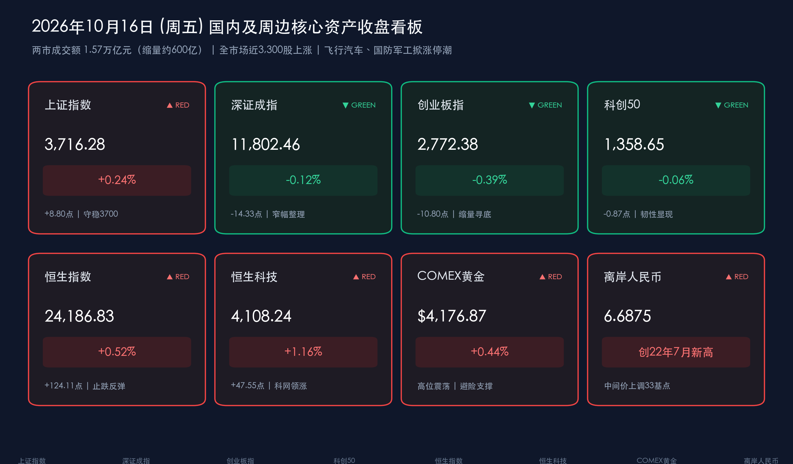

# 沪指缩量微涨守稳3700、近3300股修复：飞行汽车与国防军工掀涨停潮，1.3万亿超长期特别国债收官，离岸人民币创逾四年新高

**日期：2026年10月16日 (星期五)** &nbsp; **时段：下午/国内收盘**

> **核心摘要**：周五A股告别昨日非理性普跌，迎来结构性情绪修复，三大指数涨跌互现、沪强深弱。**上证指数收涨 0.24%** 报 **3716.28点**，稳守3700点整数关口；**深证成指微跌 0.12%** 报 **11802.46点**；**创业板指跌 0.39%** 报 **2772.38点**；**科创50微跌 0.06%** 报 **1358.65点**。沪深两市全天成交额约 **1.57万亿元**（具体约15,691亿元），较上一交易日小幅缩量约 **640亿元**，全市场近 **3300只** 个股上涨（盘中一度超4800股飘红），赚钱效应显著回暖。受特斯拉发布融合SpaceX火箭技术的第二代Roadster超跑及第十六届珠海航展前瞻催化，**飞行汽车（低空经济）** 与 **国防军工** 全线爆发掀起涨停潮；港股同步回暖，**恒生指数涨 0.52%**，**恒生科技指数涨 1.16%**。政策面上，2026年全年 **1.3万亿元超长期特别国债发行正式收官**，央行开展 **600亿元** 7天期逆回购，潘功胜在G20会议表态继续实施好适度宽松的货币政策；离岸人民币（USD/CNH）升破6.69关口至 **6.6869**，刷新2022年7月中旬以来最高纪录。

## 核心行情复盘

*   **上证指数**：**3716.28**（**+0.24%**，涨8.80点，成交额约7324.75亿元，企稳于3700点关口上方）
*   **深证成指**：**11802.46**（**-0.12%**，跌14.33点，成交额约8229.39亿元，窄幅震荡整固）
*   **创业板指**：**2772.38**（**-0.39%**，跌10.80点，成交额约3942.26亿元）；**科创50**：**1358.65**（**-0.06%**，跌0.87点，成交额约716亿元）
*   **沪深两市成交额**：约 **1.57万亿元**（合计约15,691亿元），较上一交易日（约1.63万亿元）缩量约 **640亿元**；全市场近 **3300只** 个股收盘飘红（早盘修复高峰期一度超4800股上涨），市场恐慌抛压显著缓解。
*   **恒生指数**：**24186.83**（**+0.52%**，涨124.11点，收复24100点）；**恒生科技指数**：**4108.24**（**+1.16%**，涨47.55点，重返4100点上方）；**恒生中国企业指数**：**8128.25**（**+0.31%**）。科网股与硬科技多数走强，联想集团大涨超8%，上海复旦大涨超13%，灵宝黄金涨超8%，中航科工涨超4%。
*   **主力资金**：主力资金围绕政策催化与前沿科技主题积极调仓。**国企改革/央企改革**、**国防军工（航空装备）**、**低空经济（飞行汽车）** 以及部分 **电子半导体** 龙头（如长鑫科技产业链等）录得显著主力资金净流入；而 **文化传媒**、**影视院线**、**游戏**、**非银金融**、**元件** 及部分 **CRO/锂电** 概念遭遇主力资金净流出，尾盘部分高位题材股出现获利回吐。
*   **外围参考**：COMEX黄金期货及国际金价维持在 **$4,150–$4,177/盎司** 区间高位震荡（主力前收盘参考价 **$4,176.87/盎司**，国内上金所现货约880元/克、品牌足金饰品约1250元/克）；WTI原油期货报 **$97.00–$97.97/桶**、布伦特原油报 **$105.92/桶**（受美国商业原油库存创2月以来最大单周降幅及中东航运不确定性支撑）；比特币（BTC）经历V型洗盘，短暂下探 **$79,735** 后获机构买盘强力承接，迅速回升至 **$82,000–$82,250** 区间（日内涨幅约 **+1.3%~+1.5%**）；离岸人民币（USD/CNH）强势突破6.69大关，最高触及 **6.6869–6.6875**，创下2022年7月中旬以来逾四年新高，人民币兑美元中间价上调33个基点至 **6.7220**。

> **数据闭环校验**：
> * 上证指数：(3716.28 − 3707.48) / 3707.48 = +8.80 / 3707.48 ≈ +0.237% ≈ +0.24%，与官方收盘涨跌幅完全吻合。
> * 深证成指：(11802.46 − 11816.79) / 11816.79 = −14.33 / 11816.79 ≈ −0.121% ≈ −0.12%，与官方收盘涨跌幅完全吻合。
> * 创业板指：(2772.38 − 2783.18) / 2783.18 = −10.80 / 2783.18 ≈ −0.388% ≈ −0.39%，与官方收盘涨跌幅完全吻合。
> * 科创50：(1358.65 − 1359.52) / 1359.52 = −0.87 / 1359.52 ≈ −0.064% ≈ −0.06%，与官方收盘涨跌幅完全吻合。
> * 恒生指数：(24186.83 − 24062.72) / 24062.72 = +124.11 / 24062.72 ≈ +0.516% ≈ +0.52%，与官方收盘涨跌幅完全吻合。
> * 恒生科技：(4108.24 − 4060.69) / 4060.69 = +47.55 / 4060.69 ≈ +1.171% ≈ +1.16%，与官方收盘涨跌幅完全吻合。

### 领涨/领跌行业
*   **领涨**：
    *   **飞行汽车（低空经济）**：板块全线井喷，整体涨幅超5%，成为全场最强主线。捷众科技（30cm涨停）、华力创通、金盾股份、佳力奇、广联航空、英搏尔等十余只个股集体封死涨停或大幅飙升。一方面受特斯拉于当地时间10月15日晚正式发布融合SpaceX火箭推进技术、具备垂直墙面吸附及短距腾空能力的第二代Roadster超跑引爆全球未来交通想象空间；另一方面受香港及内地加快推进低空经济创新应用亚太区枢纽建设的政策催化。
    *   **国防军工（军工装备/航空装备）**：全天高歌猛进掀起涨停潮，长城军工、新兴装备、晨曦航空、北方长龙、广联航空、佳力奇等十余股涨停。第十六届中国国际航空航天博览会（珠海航展）将于2026年12月盛大举办，多型新型装备同台亮相预期叠加“十五五”规划军工订单落地预期，驱动板块估值与情绪共振修复。
    *   **央国企改革与黄金有色（港/A联动）**：国企改革概念获主力资金大举加仓，多只地方国企与央企整合标的涨停；受国际金价稳居4150美元上方及避险需求推动，黄金及稀土永磁板块走强（港股灵宝黄金大涨超8%）。
*   **领跌**：
    *   **元件 / 印制电路板（昨日强势股补跌）**：昨日逆势大涨的元件及部分硬件细分今日出现获利盘兑现与均值回归，位居跌幅前列。
    *   **游戏 / 文化传媒 / 影视院线**：传媒娱乐板块全天表现低迷，主力资金持续净流出，缺乏增量催化剂支撑。
    *   **锂电池 / 新能源资源局部调整**：受供需结构审视及大宗商品分化影响，部分锂电资源股承压（如港股赣锋锂业跌超6%）。

> **核心解读**：今日A股与港股走出“急跌后的缩量企稳与主题高潮”行情。昨日两市放量逾2100亿元宣泄恐慌盘后，今日成交额温和回落至1.57万亿元，做空动能显著衰竭，上涨个股由昨日的不足300只大幅回升至近3300只。盘面上，资金从昨日单纯的避险防御迅速切换至具备全球产业映射（特斯拉Roadster 2）与国内事件驱动（珠海航展、“十五五”规划）的低空经济与国防军工赛道，反映出市场风险偏好并未熄火，结构性做多热情依然充沛。

## 核心解读与市场逻辑

*   **海外颠覆性技术映射引爆A股新质生产力主线**：特斯拉第二代Roadster融合SpaceX冷气推进器与气动吸附技术实现短距腾空，将“汽车+航空航天”跨界融合推向全球聚光灯下。A股资金敏锐捕捉这一跨洋映射，将其与国内极具政策确定性的“低空经济/eVTOL”及即将到来的珠海航展无缝衔接，形成从“海外黑科技催化”到“本土产业链涨停潮”的凌厉传导。
*   **汇率创逾四年新高，夯实中国资产估值底座**：尽管美国9月CPI、PPI超预期令美债利率居高不下，但人民币汇率走出极强的独立升值行情，离岸人民币（USD/CNH）盘中升破6.69至6.6869，创下2022年7月中旬以来新高。强势人民币不仅直接提振了港股恒生科技（+1.16%）与内银股的外资配置吸引力，也为国内货币政策维持“适度宽松”打开了充裕的操作空间。
*   **财政“1.3万亿”圆满收官与杠杆压力阶段性出清**：今日2026年全年1.3万亿元超长期特别国债全部发行完毕，资金全面落地“两重”建设与设备更新，叠加前期TMT板块两融杠杆资金充分换手消化，市场底部承接力由宽基ETF与长线机构进一步筑牢。
*   **工信部定调“反内卷”，强化供给出清逻辑**：在2026世界储能大会上，工信部明确强调“十五五”时期新型电池产业绝不能盲目“大干快上”，必须突出供需适配。这一表态导致缺乏成本优势的锂电资源端局部承压，但中长期看进一步印证了“反内卷”与供给侧出清的核心投资逻辑。

> **核心解读**：“数据+事件+逻辑”链条清晰：离岸人民币升破6.69创四年新高、近3300股反弹（数据），叠加特斯拉发布二代Roadster、1.3万亿超长期特别国债收官及央行G20适度宽松表态（事件），既通过外部前沿科技映射激活了飞行汽车与军工装备的进攻弹性，又凭借汇率走强与财政货币协同封堵了大盘下行空间（逻辑）。

## 政策脉动

*   **央行G20重磅发声与公开市场精准呵护**：中国人民银行行长潘功胜在泰国曼谷出席G20财长和央行行长会议时明确表示，中国央行将继续实施好**适度宽松的货币政策**，为经济稳定增长和金融市场平稳运行营造良好的货币金融环境。同日（10月16日），央行开展 **600亿元 7天期逆回购操作**，中标利率维持 **1.40%** 不变；结合昨日落地的 **7000亿元6个月期买断式逆回购（加量续作净投放2000亿元）**，中短期流动性极为充裕。
*   **2026年1.3万亿元超长期特别国债发行正式收官**：10月16日上午，随着最后一批200亿元额度顺利发行完毕，2026年全年总额 **1.3万亿元** 的超长期特别国债发行圆满收官，资金重点投向国家重大战略实施和重点领域安全能力建设（“两重”）、大规模设备更新和消费品以旧换新（“两新”），将在四季度集中形成实物工作量。
*   **工信部要求新型电池产业严防“盲目大干快上”**：在福建宁德召开的2026世界储能大会上，工信部相关负责人指出，“十五五”时期新型电池产业规模要保持稳步增长，但必须突出供需适配，严防低水平重复建设与无序竞争。
*   **人民币兑美元中间价显著上调，存款利率结构微调**：10月16日银行间外汇市场人民币对美元汇率中间价报 **6.7220**，较前一交易日大幅 **上调33个基点**。此外，最新金融监测数据显示，9月银行体系除3年期定期存款利率环比小幅下行外，5年期定期存款及大额存单利率出现结构性回升，反映银行负债端长期限资金争夺与资产负债表优化趋势。

> **核心解读**：1.3万亿超长期特别国债收官标志着年内存量财政工具已100%转化为实体经济动能，而潘功胜行长在G20会议上重申“适度宽松的货币政策”，配合离岸人民币升破6.69，打破了“海外高利率制约国内宽松”的市场顾虑，财政与货币双轮驱动为四季度经济收官提供了强力保障。

## 最新机构观点

> **中信证券**：
> * 全球长债利率走高和高利率环境在AI投资周期拐点前仍是常态，弱需求环境下愈发凸显供给出清品种的稀缺性，“反内卷”进程值得高度重视。科技板块本轮回调主要系估值倍数收缩，继续系统性下杀的基础并不充分，国内TMT两融余额较前期高点明显回落，阶段性底部特征逐步显现，部分业绩可验证的公司已具备左侧布局条件。配置上建议以**景气品种**和**供给出清品种**应对高利率，科技主线聚焦海外算力链、光通信、PCB、MLCC、晶圆制造及国产存储设备；非科技主线重点增配能化、创新药、红利资产（银行、煤炭）及具备出海潜力的头部券商。

> **中金公司**：
> * 短期市场虽受中东地缘局势、油价高企带来的通胀黏性及美债高利率等外部逆风扰动，但经历前期调整后，上半年部分板块结构性高估值问题已得到较大改善，**A股整体估值的中期性价比进一步提升**。伴随三季报业绩密集落地，全年有望迎来过去五年最佳业绩改善期，国内基本面与中期向上逻辑并未改变，对后市不必悲观。建议重点布局三季报盈利增速有望较中报改善的领域，包括受益于AI高景气与海外需求的科技硬件、有色金属、创新药、CXO、水电核电、工程机械、航运以及部分可选消费。

> **华泰证券**：
> * 市场底部的支撑因素正在持续累积：一是科技板块拥挤度（TMT成交占比）已显著消化；二是电子、计算机、通信等行业的融资杠杆资金出清取得成效；三是宽基ETF在调整中持续获得大额资金净申购，市场承接力明显增强。在海外长久期估值约束尚未完全解除的背景下，三季报将成为检验成色的关键窗口，建议采取**兼顾攻守的均衡策略**，沿盈利与景气寻找性价比，重点把握需求有支撑的硬件环节、估值偏低且盈利边际修复的顺周期基建链（化纤、工程机械、航海航空装备），并继续以**红利资产**作为稳定底仓。

## 今日市场情绪：破雾凌云起，银翼掠长空

> Prompt: A futuristic silver flying car with glowing plasma thrusters soaring upward from a solid granite runway carved with the number 3716, breaking through parting storm clouds into warm golden sunlight. In the background, sleek aerospace jets formation-fly above a modern city skyline and a rising red digital stock chart on a giant holographic screen.

---

> **免责声明**：内容仅供参考，不构成投资建议。数据来源：沪深港交易所公开数据、中国人民银行、财政部、工信部、中国外汇交易中心、东方财富、同花顺、财联社、证券时报、21世纪经济报道及各机构公开研报；A股/港股数据截至2026年10月16日收盘，黄金、原油、比特币及离岸人民币为当日参考报价。

🤖 生成模型：Gemini 4 Argon (Medium) <!-- model-stamp -->
