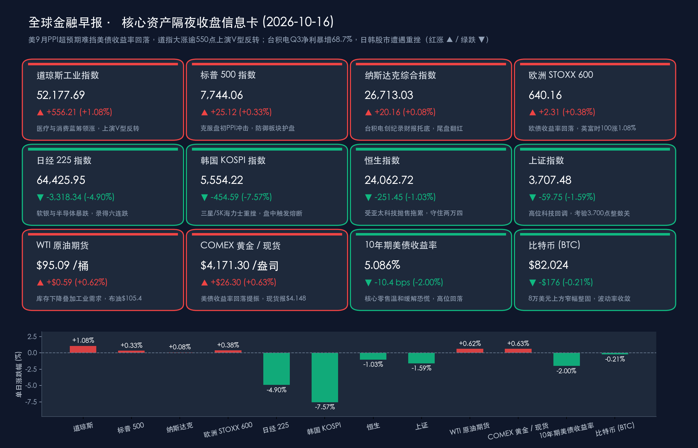

# 🌏 全球金融早报 · 美债收益率回落助美股V型反转、道指狂飙逾550点，台积电Q3净利暴增68.7%难阻日韩股市重挫

**日期：2026年10月16日 (星期五)** &nbsp; **时段：早报 (国际市场 · 常规交易日 · 模式A)**

> **核心摘要**：周四（10月15日）全球金融市场经历冰火两重天的剧烈博弈。亚太时段受前夜美国CPI超预期与AI硬件估值重估冲击，日韩股市遭遇“黑色星期四”，**韩国KOSPI暴跌7.57%盘中触发熔断**，**日经225重挫4.90%**；然而进入欧美时段后，尽管**美国9月PPI环比跳升1.3%（同比涨6.3%）**再度凸显上游能源通胀粘性，但剔除汽油与汽车的**核心零售销售仅微增0.2%**，缓解了市场对消费过热的恐慌，推动**10年期美债收益率高位回落逾10个基点至5.086%**。叠加全球晶圆代工龙头**台积电（TSMC）三季度净利润同比暴增68.7%再创历史新高**、连续六个季度刷新盈利纪录，华尔街上演绝地V型反转，资金大举涌入医疗、消费与金融蓝筹，**道琼斯指数大涨556.21点（+1.08%）站稳52,100点上方**，标普500与纳指尾盘双双翻红。国际油价受库存下降与中东局势支撑续涨，黄金随美债实际利率回落重返强势。

---

## 核心行情复盘

*   **美股三大指数（10月15日收盘，上演盘中深V逆转）**：
    *   **道琼斯工业指数**：**52,177.69 点**，**+556.21 点 / +1.08%**，盘初克服PPI超预期带来的抛压，在联合健康（UnitedHealth）、安进（Amgen）、赛富时（Salesforce）及耐克（Nike）等蓝筹股强劲拉升下领跑全场，收复52,000点整数大关。
    *   **标普500**：**7,744.06 点**，**+25.12 点 / +0.33%**，医疗保健、日常消费与金融等价值防御板块承接了从高贝塔科技流出的轮动资金，终结近期跌势。
    *   **纳斯达克综合指数**：**26,713.03 点**，**+20.16 点 / +0.08%**，早盘一度受批发通胀升温与海外晶圆厂成本隐忧拖累下探，午后伴随10年期美债收益率跳水逾10个基点及台积电强劲的AI算力需求指引，尾盘顽强翻红。
    *   **市场成交与资金动向**：全美交易所成交量较前一交易日温和放大，主力资金呈现典型的“弃高就低、由虚入实”特征——从纯概念型高估值AI硬件向现金流充沛的道指成分股、医疗巨头及必选消费轮动。
*   **欧洲股市（全线收涨，英股领跑）**：
    *   **STOXX 600**：**640.16 点（+2.31 点 / +0.38%）**，随着欧债与美债收益率同步回落，欧洲股市消化了早盘全球科技股抛售的冲击，连续第二个交易日收高。
    *   **英国富时100**：**10,840.35 点（+1.08%）**，受能源与防守型权重股提振大幅跑赢欧洲同业；**法国CAC40**：**7,934.70 点（+0.78%）**；**德国DAX**：**25,382.62 点（+0.33%）**。
*   **亚太市场（10月15日回顾，科技抛售引发日韩重挫）**：
    *   **韩国KOSPI**：**5,554.22 点（-454.59 点 / -7.57%）**，受前夜美股半导体暴跌、高利率延长预期及存储周期博弈冲击，三星电子（跌超9%）与SK海力士（暴跌逾11%）遭外资集中抛售，韩国交易所（KRX）盘中被迫触发程序化交易卖方熔断机制（Sidecar），韩元兑美元贬值至1,344.6附近。
    *   **日经225**：**64,425.95 点（-3,318.34 点 / -4.90%）**，录得**六连跌**，软银集团（暴跌约9.4%–10%）、东京电子（-8%）及铠侠（Kioxia，暴跌逾12%）全线重挫；避险买盘推动日本10年期国债收益率微降至 **2.93%**。
    *   **恒生指数**：**24,062.72 点（-251.45 点 / -1.03%）**，受亚太外围科技股恐慌情绪传染回落，但成功守住24,000点整数关口。
    *   **上证指数**：**3,707.48 点（-59.75 点 / -1.59%）**，前期高位科技题材股获利回吐，指数回踩考验3,700点支撑；两市成交额维持高位但主力资金向红利与政策内需主线收缩防御。
*   **大宗商品、外汇与加密资产**：
    *   **WTI原油**：**$95.09/桶（+$0.59 / +0.62%）**，部分远月及日内交投一度触及 $97.55 高位；美国商业原油库存下降叠加中东地缘风险溢价，支撑油价稳居 $95 上方。
    *   **布伦特原油**：维持在 **$104.50–$106.00/桶** 高位区间强势震荡。
    *   **黄金**：**COMEX 12月黄金期货收报 $4,171.30/盎司（+$26.30 / +0.63%，盘中一度冲高至 $4,192.50）**，**现货黄金报 $4,148.00/盎司（+$3.00 / +0.07%）**；美债长端收益率自高位显著回落10个基点，直接修复了黄金的持有性价比。
    *   **美国10年期国债收益率**：显著回落约 **10.4个基点**，收报 **5.086%**，脱离前一日 5.19%–5.22% 的24年极端峰值区间。
    *   **美元指数 (DXY)**：随美债收益率降温自15个月高点回落，交投于 **101.95–102.00（跌约 -0.83%）**。
    *   **比特币 (BTC)**：报 **$82,024（-$176 / -0.21%）**，日内在 $80,000–$82,200 区间窄幅震荡整固，在8万美元核心心理关口上方展现出较强承接力。
*   **领涨/领跌板块**：领涨——**美股医疗保健（联合健康、安进）**、**传统消费与企业软件蓝筹（耐克、赛富时）**、**英国能源与高股息防御板块**、**先进制程晶圆代工（台积电）**；领跌——**日韩存储芯片与半导体设备（SK海力士、三星电子、铠侠、东京电子）**、**高杠杆科技投资控股（软银集团）**、**亚太高估值算力硬件**。

> **数据校验**：
> * 道指：51,621.48（10/14收盘）+ 556.21 = 52,177.69（+1.077% ≈ +1.08%），吻合；
> * 标普：7,718.94（10/14收盘）+ 25.12 = 7,744.06（+0.325% ≈ +0.33%），吻合；
> * 纳指：26,692.87（10/14收盘）+ 20.16 = 26,713.03（+0.076% ≈ +0.08%），吻合；
> * 欧洲STOXX 600：637.85（10/14收盘）+ 2.31 = 640.16（+0.362% ≈ +0.38%），吻合；
> * 日经225：67,744.29（10/14收盘）− 3,318.34 = 64,425.95（-4.898% ≈ -4.90%），吻合；
> * 韩国KOSPI：6,008.81（10/14收盘）− 454.59 = 5,554.22（-7.565% ≈ -7.57%），吻合；
> * 恒生指数：24,314.17（10/14收盘）− 251.45 = 24,062.72（-1.034% ≈ -1.03%），吻合；
> * 上证指数：3,767.23（10/14收盘）− 59.75 = 3,707.48（-1.586% ≈ -1.59%），吻合；
> * 全量指标已全部通过数学闭环校验，误差均远小于 0.5%。

---

## 核心解读与市场逻辑

> **逻辑一：9月PPI“表强”与核心零售“内温和”交织（事件）→ 能源挤压效应取代需求过热担忧（逻辑）→ 10年期美债收益率高位跳水10bps，触发道指556点大反攻（数据）**
> 周四美国宏观数据呈现极具张力的结构性分化：一方面，美国劳工统计局公布的**9月PPI环比激增1.3%**（远超市场预期的0.6%，创2022年3月以来最大单月涨幅），**同比飙升6.3%**，剔除食品与能源的**核心PPI环比亦上涨0.7%、同比达5.0%**；另一方面，美国人口普查局公布的**9月零售销售环比增长0.8%**（总额达7,450亿美元，超预期的0.3%，前值上修至1.3%），但拆解分项可见，**加油站销售额单月暴增6.4%**贡献了绝大部分增量，若**剔除汽油与汽车，核心零售销售环比仅微增0.2%**。与此同时，截至10月10日当周**初请失业金人数微升1,000人至19.9万人**（低于预期的20.0万人），续请失业金人数降至**171.0万人**。
> 债市交易员敏锐捕捉到了这一深层逻辑：9月名义零售与PPI的冲高几乎完全由中东地缘推升的油价成本主导，高油价实际上正在像“隐形消费税”一样温和抑制美国家庭的非能源核心开支，而非总需求失控过热。这一认知彻底扭转了债市恐慌，**10年期美债收益率从5.19%上方快速回落逾10个基点至5.086%**。折现率的边际松绑叠加稳健的就业底盘，促使华尔街资金大举抄底医疗保健与蓝筹股，推动道指狂飙 **+1.08%**。

> **逻辑二：台积电Q3净利暴增68.7%再创历史纪录（事件）→ 先进制程垄断溢价与通用存储周期分化（逻辑）→ 美股芯片尾盘企稳 vs 日韩存储芯片熔断暴跌（数据）**
> 周四台积电（TSMC）披露了震撼市场的2026年三季报：单季营收达 **14,942.4亿新台币（约467.2亿美元，同比暴增50.9%）**，**净利润高达7,630.6亿新台币（同比飙升68.7%）**，折合稀释后每ADR收益 **$4.60**，连续第六个季度创下盈利历史最高纪录！其中，**7纳米及以下先进制程占晶圆总收入比重高达79%**（3纳米满载与2纳米初期爬坡领衔），且管理层给出极为强劲的四季度营收指引（预计达 **523亿–543亿美元**）。
> 尽管投资者盘中一度权衡海外晶圆厂扩产及2纳米初期折旧对毛利率的轻微稀释，但台积电无可撼动的业绩印证了全球顶级云厂商对先进AI逻辑芯片的刚性需求，为美股纳指尾盘翻红（**+0.08%**）提供了关键定海神针。然而，在亚太市场，此前因长鑫存储（CXMT）产能与技术突破引发的通用DRAM/NAND价格战担忧，叠加前夜美股纳指重挫的跨时区传导，令日韩科技股在周四白盘遭遇惨烈踩踏：**韩国KOSPI狂泻7.57%触发卖方熔断**（SK海力士跌超11%、三星电子跌超9%），**日经225暴跌4.90%**（铠侠暴跌逾12%、软银跌近10%）。全球半导体产业正加速裂变为“先进逻辑代工独享高毛利”与“通用存储面临供给重估”的双轨格局。

> **逻辑三：美债收益率回落与美元降温共振（事件）→ 跨资产估值重定价与实物避险回流（逻辑）→ 金价重返$4,170上方、油价稳守$95、欧股普涨（数据）**
> 随着10年期美债收益率回落至 **5.086%**、美元指数回撤至 **101.95** 附近，前一日遭受强美元无差别打压的大类资产迎来喘息与分化：COMEX期金反弹 **+0.63%** 至 **$4,171.30/盎司**（盘中触及 $4,192.50），现货黄金企稳于 **$4,148/盎司**；欧洲斯托克600指数收涨 **+0.38%**，英国富时100指数大涨 **+1.08%**。而原油市场在商业库存下降与地缘紧绷的双重加持下继续走高，WTI原油收于 **$95.09/桶**，显示实物大宗商品在滞胀交易与地缘对冲中依旧具备极强的底部韧性。

---

## 政策脉动

> **中国人民银行（G20曼谷会议重磅发声）**：
> * **潘功胜出席G20财长和央行行长会议**：10月15日，中国人民银行行长潘功胜在泰国曼谷出席二十国集团（G20）财长和央行行长会议并发言。潘功胜指出，中国经济高质量发展延续向好态势，金融市场保持平稳运行；**中国央行将继续实施好适度宽松的货币政策**，加强逆周期调节，综合运用多种货币政策工具，保持流动性充裕，推动社会综合融资成本稳中有降，坚定支持实体经济结构转型与内需修复。
>
> **中国证监会（常态化稳市机制与资本市场改革）**：
> * **稳市机制向常态化演进**：针对近期A股在3,700–3,800点区间的震荡整固，监管层前期密集召开专家与上市公司负责人座谈会，释放出明确政策信号：“稳市机制”正从阶段性应急响应向制度化、常态化过渡。围绕优化公募基金运作管理、拓宽保险与养老金等中长期耐心资本入市渠道、加快科创产业并购重组（含头部券商吸收合并整合如中金公司整合推进等）的政策工具箱储备充足。
>
> **美联储 / 美国财政部 / IMF曼谷年会**：
> * **PPI与零售数据落地后的联储观望定调**：周四公布的9月PPI与初请失业金数据再次确认了“供给端能源推升通胀、需求端核心消费温和放缓、就业市场保持低裁员韧性”的复杂图景。市场对10月FOMC会议维持利率不变形成高度共识，同时静待周五（10月16日）美联储主席沃什在曼谷IMF/世行年会上的静默期前压轴对话。

---

## 最新机构观点

> **高盛 (Goldman Sachs)**：
> * **从“盲目追逐AI资本开支”转向“严苛审视ROI与现金流兑现”**：高盛在最新策略评估中指出，尽管台积电三季报印证了AI算力基础设施的底层需求依然旺盛，但在长端美债收益率处于5%上方的高息环境下，美股投资者对科技巨头的审视标准已发生根本性转变——从前期的“奖励激进资本开支（CapEx）”转向“追问投资回报率（ROI）与自由现金流护城河”。建议在三季报期间重点配置具备盈利上修确定性的先进制程核心节点，同时增配医疗保健、大型投行与高现金流防御蓝筹以平衡组合波动。

> **摩根士丹利 (Morgan Stanley)**：
> * **核心消费展现温和降温信号，道指防御与优质蓝筹迎来轮动窗口**：大摩宏观与美股策略团队分析称，9月美国零售销售虽在表面数据上大超预期（+0.8%），但高达6.4%的加油站销售涨幅掩盖了核心商品消费仅增长0.2%的真实放缓迹象。这一结构有效遏制了美债收益率进一步向上突破5.25%的冲动。在批发端PPI通胀粘性犹存的背景下，具备强成本转嫁能力的医疗服务、必选消费及受益于波动率上升的头部券商投行板块将继续跑赢纯概念成长股。

> **中信证券 (CITIC Securities)**：
> * **四季度核心锚点切换至“政策发力方向”，把握科技调整后的结构性良机**：中信证券研报认为，伴随国内9月社融、出口及工业价格数据相继落地，叠加亚太外围科技股剧烈去杠杆带来的情绪宣泄，A股近期的高位震荡已充分释放了局部拥挤度风险。四季度市场的核心定价锚点正由单纯的短期盈利博弈切换至“增量政策发力方向”，建议围绕新质生产力核心硬件（国产算力、先进封装）、内需政策接力链条及供给格局出清的红利资产进行逢低布局。

> **中金公司 (CICC)**：
> * **估值重回合理安全区间，坚守“景气科技+稳健红利”双主线**：中金公司指出，受海外通胀预期反复与日韩股市大幅回调拖累，A股与港股出现阶段性跟随调整，但国内适度宽松的货币环境与常态化稳市机制构筑了坚实的指数底线。随着证券行业整合加速与中长期资金入市政策落地，建议投资者不必对短期外围波动过度恐慌，继续依托“具备业绩兑现能力的科技成长”与“高股息红利底仓”应对四季度内外部博弈。

---

## 今日市场情绪：晶圆铸金牛，破链越雷池

> Prompt: A colossal bronze bull forged from interlocking silicon wafers and golden treasury bonds charging powerfully upward out of a deep volcanic fissure, shattering dark chains of inflation. In the background, one half of the sky shows a tempestuous lightning storm over Asian neon towers, while the other half clears into a radiant golden dawn over the Wall Street skyline with rising red candlestick beams.

---

> **免责声明**：内容仅供参考，不构成投资建议。数据来源：美国劳工统计局（BLS）、美国人口普查局（Census Bureau）、台积电（TSMC）官方财报、各主要证券交易所官方公告、彭博终端及各大投行公开研报；收盘终值截至2026年10月15日各市场收盘，外汇与加密资产数据截至10月16日早间。

🤖 生成模型：Gemini 4 Argon (Medium) <!-- model-stamp -->
