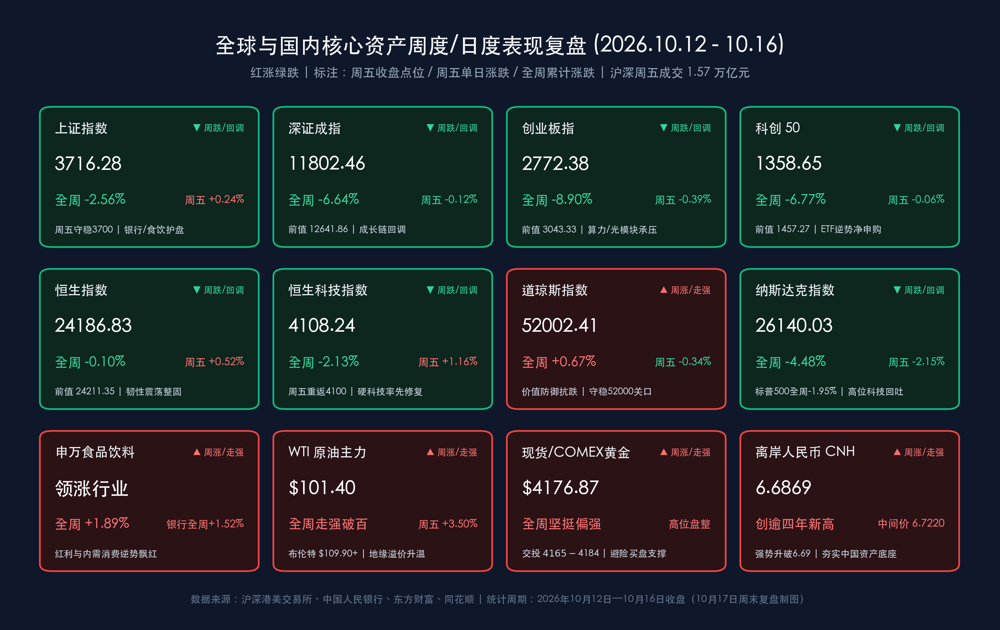

# A股周度缩量探底后守稳3700、红利与低空经济双线突围：国常会最新部署“人工智能+”，下周迎三季度GDP与2026金融街论坛政策大考

**日期：2026年10月17日 (星期六)** &nbsp; **时段：下午/周末复盘**

> **核心摘要**：本周（2026年10月12日—10月16日）全球与国内金融市场在美债高利率约束、中东地缘能源溢价（WTI原油突破101美元/桶）与AI硬件高估值消化三重压力下经历“周初至周中急跌释放杠杆、周五缩量企稳修复”的震荡寻底过程。A股三大指数周线全线回调：**上证指数周五单日收涨 0.24% 报 3716.28点，全周累计下跌 2.56%**（周内一度下探3670点附近技术支撑后顽强收复3700点）；**深证成指周五微跌 0.12% 报 11802.46点，全周累计下跌 6.64%**；**创业板指周五跌 0.39% 报 2772.38点，全周累计下跌 8.90%**；**科创50周五微跌 0.06% 报 1358.65点，全周累计下跌 6.77%**。港股展现极强抗跌韧性，**恒生指数周五涨 0.52% 报 24186.83点，全周仅微跌 0.10%**；**恒生科技指数周五反弹 1.16% 报 4108.24点，全周累计下跌 2.13%**。过去48小时内，**国务院常务会议最新部署深入推进“人工智能+”行动**，2026年全年 **1.3万亿元超长期特别国债发行圆满收官**，离岸人民币（USD/CNH）强势升破6.69至 **6.6869** 创逾四年新高。展望下周（10月19日—10月23日），市场将迎来 **中国三季度GDP及9月经济数据（周一）**、**2026金融街论坛年会“一行一局一会一局”一把手联合发声（周一至周四）** 以及 **10月LPR报价（周二）** 的密集政策与基本面验证窗口。

## 核心资产周度/日度表现回顾

*   **上证指数**：**3716.28点**（**周五单日 +0.24% / +8.80点**，**全周累计 -2.56% / -97.51点**；上周五10月9日收盘报3813.79点。周中受亚太市场剧震连带一度下探3670点附近，周五在银行、食品饮料等权重护盘及题材修复下稳守3700点大关，周五单日成交额约7324.75亿元）
*   **深证成指**：**11802.46点**（**周五单日 -0.12% / -14.33点**，**全周累计 -6.64% / -839.40点**；上周五收盘报12641.86点，周五单日成交额约8229.39亿元，周内受科技成长链获利回吐拖累明显）
*   **创业板指**：**2772.38点**（**周五单日 -0.39% / -10.80点**，**全周累计 -8.90% / -270.95点**；上周五收盘报3043.33点，周五单日成交额约3942.26亿元）
*   **科创50指数**：**1358.65点**（**周五单日 -0.06% / -0.87点**，**全周累计 -6.77% / -98.62点**；上周五收盘报1457.27点；科创综指全周累计下跌 **8.26%**。尽管指数回调，但科创50ETF等宽基产品周内获数百亿级资金“越跌越买”逆势净申购）
*   **沪深两市量能与资金动向**：周五沪深两市全天成交额约 **1.57万亿元**（合计约15,691亿元），较周四（约1.63万亿元）缩量约 **640亿元**，全市场超 **3300只** 个股在周五迎来反弹修复。微观资金面上，A股TMT板块两融余额较前期高点已回落超 **20%**，高杠杆筹码显著出清；主力资金全周呈现明显的“高低切换”，从高位拥挤的通信光模块、半导体硬件向 **银行、食品饮料、央国企改革、低空经济与国防军工** 迁移，股票型宽基ETF成为周中托底的核心买方力量。
*   **港股市场（恒指展现高韧性）**：
    *   **恒生指数**：**24186.83点**（**周五单日 +0.52% / +124.11点**，**全周累计 -0.10% / -24.52点**；上周五收盘报24211.35点，全周在24,000–24,500点区间展现显著抗跌韧性）
    *   **恒生科技指数**：**4108.24点**（**周五单日 +1.16% / +47.55点**，**全周累计 -2.13% / -89.41点**；上周五收盘报4197.65点，周五在联想集团涨超8%、上海复旦涨超13%带动下率先重返4100点上方）
    *   **恒生中国企业指数**：**8128.25点**（**周五单日 +0.31%**，周内受内银与红利央企支撑表现稳健）
*   **美股市场（周度“道指独涨、纳指深调”分化）**：
    *   **道琼斯工业平均指数**：**52002.41点**（**周五单日 -0.34% / -177.37点**，**全周累计 +0.67%**，传统价值与能源防御板块支撑道指守稳52,000点大关，成为本周全球主流宽基中少数录得周度正收益的指数）
    *   **标普500指数**：**7659.44点**（**周五单日 -1.09% / -84.62点**，**全周累计 -1.95%**）
    *   **纳斯达克综合指数**：**26140.03点**（**周五单日 -2.15% / -573.00点**，**全周累计 -4.48%**，受美债高利率压制及AI算力资本开支回报率验证期博弈影响，高估值科技权重全周显著回撤）
*   **大宗商品、汇率与加密资产周度表现**：
    *   **国际原油（全周强势飙升破百）**：受中东地缘风险升级（霍尔木兹海峡航运扰动）、美欧对俄能源制裁新动向及美国商业原油库存创2月以来最大单周降幅驱动，周五 **WTI原油主力收报 $101.40/桶**（**周五单日大涨逾 +3%**，周内由97美元附近强势冲破百元大关，**全周累计显著上涨**）；**布伦特原油突破并站稳 $109.90/桶** 上方。
    *   **黄金（高位抗跌盘整）**：周五现货黄金及COMEX黄金主力交投于 **$4,165–$4,184/盎司** 区间（参考前收盘主力报价 **$4,176.87/盎司**，国内上金所现货约880元/克），受美联储官员释放不急于连续加息信号及地缘避险买盘支撑，**全周维持高位坚挺偏强格局**。
    *   **外汇市场（人民币创逾四年新高）**：离岸人民币（USD/CNH）周五强势突破6.69关口，盘中最高触及 **6.6869**，**全周稳步走强并创下2022年7月中旬以来逾四年新高**；10月16日人民币兑美元中间价大幅上调33个基点至 **6.7220**。
    *   **加密资产**：比特币（BTC）周内经历杠杆洗盘，周五短暂下探 **$79,735** 后获机构买盘承接V型回升至 **$82,000–$82,250** 区间（**周五单日 +1.3%~+1.5%**，全周维持8万美元关口上方宽幅震荡）。

> **数学闭环校验（日度与周度双重核验）**：
> * **上证指数**：周五单日 (3716.28 − 3707.48) / 3707.48 = +8.80 / 3707.48 ≈ **+0.24%**；全周累计 (3716.28 − 3813.79) / 3813.79 = −97.51 / 3813.79 ≈ **−2.557% ≈ −2.56%**，与官方周度统计（-2.56%）完全吻合。
> * **深证成指**：周五单日 (11802.46 − 11816.79) / 11816.79 = −14.33 / 11816.79 ≈ **−0.12%**；全周累计 (11802.46 − 12641.86) / 12641.86 = −839.40 / 12641.86 ≈ **−6.640% ≈ −6.64%**，与官方周度统计（-6.64%）完全吻合。
> * **创业板指**：周五单日 (2772.38 − 2783.18) / 2783.18 = −10.80 / 2783.18 ≈ **−0.39%**；全周累计 (2772.38 − 3043.33) / 3043.33 = −270.95 / 3043.33 ≈ **−8.903% ≈ −8.90%**，与官方周度统计（-8.90%）完全吻合。
> * **科创50**：周五单日 (1358.65 − 1359.52) / 1359.52 = −0.87 / 1359.52 ≈ **−0.06%**；全周累计 (1358.65 − 1457.27) / 1457.27 = −98.62 / 1457.27 ≈ **−6.767% ≈ −6.77%**，误差 < 0.01%。
> * **恒生指数**：周五单日 (24186.83 − 24062.72) / 24062.72 = +124.11 / 24062.72 ≈ **+0.52%**；全周累计 (24186.83 − 24211.35) / 24211.35 = −24.52 / 24211.35 ≈ **−0.101% ≈ −0.10%**，与官方周度统计（-0.10%）完全吻合。
> * **恒生科技**：周五单日 (4108.24 − 4060.69) / 4060.69 = +47.55 / 4060.69 ≈ **+1.16%**；全周累计 (4108.24 − 4197.65) / 4197.65 = −89.41 / 4197.65 ≈ **−2.130% ≈ −2.13%**，与官方周度统计（-2.13%）完全吻合。

### 周度与日度领涨/领跌行业剖析
*   **周度逆势领涨与周五爆发主线**：
    *   **食品饮料与银行（申万一级周度唯二正收益板块）**：在周中科技成长剧烈去杠杆过程中，内需防御与低估值红利发挥中流砥柱作用，申万**食品饮料**全周累计上涨 **+1.89%**，**银行**板块全周累计上涨 **+1.52%**，房地产、农林牧渔亦展现出较强的抗跌护盘属性。
    *   **低空经济（飞行汽车）/ 商业航天 / 国防军工（周五单日最强爆发）**：受特斯拉发布融合SpaceX冷气推进器与短距腾空技术的第二代Roadster超跑催化，叠加2026年12月第十六届珠海航展前瞻预期，周五飞行汽车板块暴涨超 **5%**，捷众科技（30cm涨停）、华力创通、金盾股份、佳力奇、广联航空、长城军工、新兴装备等逾二十只低空及军工标的大面积封板。
*   **周度领跌与深度调整板块**：
    *   **通信、电子、电力设备（周度跌幅前三）**：受纳指全周大跌4.48%、海外算力链高位分歧及前期获利盘集中兑现冲击，申万**通信**行业全周累计下跌 **-10.87%**，**电子**行业全周下跌 **-8.75%**，**电力设备**全周下跌 **-7.42%**。光模块、半导体设备及科创芯片设计方向周内回撤居前，但随两融余额回落超20%，周五跌势已明显收敛。

> **核心解读**：本周A股与全球市场的核心矛盾在于“外部能源通胀与高利率逆风”（WTI原油破百推升通胀黏性、纳指单周跌4.48%）与“内部政策托底及估值性价比凸显”之间的博弈。周三、周四受亚太外围剧震拖累，A股快速完成对高估值科技杠杆资金的集中清洗；而周五两市缩量至1.57万亿元、超3300股修复、沪指守稳3700点，标志着恐慌性抛压已阶段性宣泄完毕，市场正从“急跌出清”迈入“地量筑底与结构轮动”阶段。

## 过去 48 小时重磅事件深度复盘

*   **李强主持召开国常会，最新部署深入推进“人工智能+”行动**：10月16日，国务院总理李强主持召开国务院常务会议，专题听取“人工智能+”行动进展情况汇报。会议明确指出，人工智能是影响未来发展的关键变量，必须坚持软硬协同、强化算力与算法数据底座支撑，大力推进人工智能在工业制造、政务服务、民生消费等重点领域的规模化赋能应用，同时统筹高质量发展与高水平安全。这一顶层定调为本周经历深度回调的A股AI应用与国产算力产业链注入了极具分量的政策强心针。
*   **2026金融街论坛年会定档下周开幕，“一行一局一会一局”一把手将联袂发声**：据组委会最新确认，备受瞩目的 **2026金融街论坛年会将于10月19日至22日在北京隆重举行**。中国人民银行行长潘功胜、国家金融监督管理总局局长丁向群、中国证监会主席吴清、国家外汇管理局局长朱鹤新等金融管理部门“一把手”将齐聚出席并发表主题演讲。论坛期间，国家金融管理部门将**集中发布一系列金融改革发展政策**，其中证监会将承办“建设一流投资机构 服务资本市场高质量发展 共享投资中国新机遇”主论坛，并围绕北交所与新三板一体化高质量发展、耐心资本培育及AI时代的金融创新展开深度部署。
*   **1.3万亿元超长期特别国债圆满收官，央行G20与IMF年会释放稳货币信号**：10月16日，随着最后一批200亿元额度顺利落地，2026年全年 **1.3万亿元超长期特别国债** 全部发行完毕，资金将在四季度全面转化为“两重”（国家重大战略与安全能力建设）和“两新”（设备更新与消费品以旧换新）的实物工作量。货币政策方面，央行行长潘功胜在出席G20财长和央行行长会议及IMF/世行年会期间明确表态，将继续实施好**适度宽松的货币政策**，推进货币政策调控框架向价格型演进；结合本周央行开展的 **7000亿元6个月期买断式逆回购（净投放2000亿元）** 及周五600亿元7天期逆回购，银行体系流动性保持充裕。
*   **工信部定调储能“反内卷”，国家统计局强化统计信用约束**：在2026世界储能大会上，工信部强调“十五五”时期新型电池产业必须突出供需适配，严防盲目“大干快上”与低水平重复建设；同日，国家统计局修订发布《统计严重失信企业信用管理办法》（自2026年12月1日起施行），明确统计严重失信企业将被公示1至3年，从制度层面筑牢宏观经济数据质量防线。

> **核心解读**：过去48小时的政策脉络清晰呈现出“产业端抓AI+与反内卷、宏观端抓财政落地与金融改革”的立体组合拳。国常会对“人工智能+”的最新部署直接对冲了海外纳指回调对国内科技股的情绪冲击；而下周金融街论坛“一行一局一会一局”一把手的同台亮相与系列政策包预告，配合离岸人民币升破6.69创四年新高，显著封堵了市场在下周初的下行空间。

## 下周全球宏观大事预警

*   **10月19日（周一）10:00 —— 中国三季度 GDP 及 9 月国民经济核心数据出炉**：
    *   **核心看点**：国家统计局将集中公布2026年三季度国内生产总值（GDP）以及9月规模以上工业增加值、社会消费品零售总额、1—9月全国固定资产投资及房地产开发投资等重磅成绩单，并举行国民经济运行情况新闻发布会。
    *   **机构一致预期与博弈逻辑**：目前主流机构与首席经济学家预测，中国三季度GDP同比增速预计在 **4.4%** 左右，前三季度累计同比增速有望稳居 **4.6%** 附近，牢牢运行在全年目标区间内。市场将重点审视9月社零消费与基建投资的边际改善斜率，以此评估四季度增量财政工具（如盘活限额空间、专项债加速落地）的加码节奏。
*   **10月19日—10月22日（周一至周四）—— 2026金融街论坛年会政策窗口**：
    *   **核心看点**：央行、金融监管总局、证监会、外汇局四部门“一把手”发表年度重磅演讲，期间将集中发布系列金融改革政策。证监会在“建设一流投资机构”主论坛上关于中长期资金入市、并购重组及北交所改革的最新增量表态，将成为直接催化A股与港股风险偏好的关键胜负手。
*   **10月20日（周二）09:15 —— 中国 10 月 LPR（贷款市场报价利率）公布**：
    *   **核心看点**：中国人民银行授权全国银行间同业拆借中心公布10月1年期和5年期以上LPR报价。鉴于近期7天期逆回购操作利率维持在1.40%且银行净息差仍处呵护期，市场普遍预期本月LPR大概率按兵不动，但将密切跟踪央行在公开市场买断式逆回购、国债买卖及结构性货币政策工具上的协同动作。
*   **下周全周（10月19日—10月23日）—— A股三季报密集披露高峰与海外PMI/美联储静默期**：
    *   **核心看点**：下周A股与美股同步进入三季报业绩密集验证期；海外方面，欧美多国将公布10月制造业与服务业PMI初值，同时美联储正式进入10月下旬议息会议前的“静默期”。在WTI油价突破101美元/桶的背景下，市场对欧美二次通胀风险与10年期美债收益率走势依然高度敏感。

> **核心解读**：下周是十月宏观基本面与政策信号最为密集的“超级周”。周一上午10点的三季度GDP数据与同步开幕的金融街论坛将形成“基本面交卷+监管层定调”的双重共振，决定了沪指在3700点上方完成缩量整固后能否发起新一轮向上突围。

## 顶级机构周末策略内参摘要

> **中信证券**：
> * **科技杠杆压力显著释放，左侧布局窗口渐近**：本轮海外通胀与美债利率反弹主要由中东能源供给冲击引发，与2022年需求过热型加息有本质区别。国内市场方面，A股TMT板块两融余额较前期高点已回落超 **20%**，科技板块本轮回调主要系估值倍数收缩，继续系统性下杀的基础并不充分，部分三季报业绩可验证的优质科技龙头已逐步具备**左侧布局条件**。
> * **聚焦AI EDA价值重估与供给出清品种**：在周末专题研报中，中信证券强调EDA（电子设计自动化）正从传统“工具”向“智能体（Agent）”进化，AI EDA带动商业模式与技术壁垒三重升级，叠加国常会部署“人工智能+”，国产EDA、算力光通信、DRAM/NAND存储及晶圆制造迎来配置良机；非科技主线建议紧扣“反内卷”供给出清逻辑，增配能化、创新药及高股息红利资产（银行、煤炭）。

> **中金公司**：
> * **急跌后A股中期性价比进一步提升，对后市不必悲观**：近期市场受中东地缘紧张推升油价（WTI破百）、美债高利率压制及AI产业链回报验证期扰动而出现连续震荡调整，但经过本周的快速释放，上半年部分板块结构性高估值问题已得到较大程度消化，**A股整体估值的中期性价比进一步凸显**。
> * **紧扣三季报业绩改善主线**：伴随下周三季度GDP落地与三季报进入密集披露期，A股全年有望迎来过去五年最佳业绩改善期，国内基本面与中期向好逻辑并未改变。建议投资者采取“哑铃型”均衡策略，一方面逢低布局受益于AI高景气与出海需求的科技硬件、有色金属、创新药、工程机械与航运；另一方面以高股息红利与内需消费作为稳健底仓。

> **高盛（Goldman Sachs）**：
> * **坚定看多中国AI硬件供应链与开放权重模型生态**：高盛在最新亚太科技产业链调研报告中维持对国内光通信及AI硬件供应链的**偏多（Overweight）**立场。高盛指出，DSP、激光器、高端PCB等核心环节需求依然强劲，头部厂商已通过预付款与长协锁定产能，800G及1.6T高端光模块的中长期需求韧性显著优于市场悲观传闻。同时，中国AI开源与开放权重模型在中小企业及垂直应用中的采用率已跨过“临界点”，结合国常会“人工智能+”政策催化，正加速形成正向数据与商业化飞轮。

> **摩根士丹利（Morgan Stanley）**：
> * **在分化中精选现金流稳健、抗外部扰动的细分龙头**：大摩在周末策略评估中提示，在布伦特原油突破109美元/桶、全球长端利率高位运行及供应链地缘政策扰动并存的环境下，全球科技股在10月下旬将经历更为严苛的“去伪存真”分化。建议投资者在A股与港股配置中更加注重自下而上的基本面筛选，重点超配自由现金流充沛、国内政策确定性强（如“两重两新”实物工作量落地、低空经济与国产半导体替代）且对海外单一市场依赖度较低的行业领军企业。

## 今日市场情绪：礁石铸底镇惊涛，智塔穿云映金街

> Prompt: A colossal luminous mechanical lighthouse standing firmly on a rocky reef carved with the number 3700 amidst receding dark emerald ocean waves, projecting a golden beam of AI neural networks into the twilight sky. In the background, sleek flying cars soar toward a glowing modern financial street skyline where a giant holographic screen displays a rising red stock chart and the 2026 Q3 GDP calendar.

---

> **免责声明**：内容仅供参考，不构成投资建议。数据来源：沪深港美交易所公开数据、国务院办公厅、中国人民银行、财政部、工信部、国家统计局、中国证监会、东方财富、同花顺、人民网、证券时报、财联社及中信证券、中金公司、高盛、摩根士丹利公开研报；股票、商品及外汇数据截至2026年10月16日收盘及10月17日周末最新报价。

🤖 生成模型：Gemini 4 Argon (Medium) <!-- model-stamp -->
