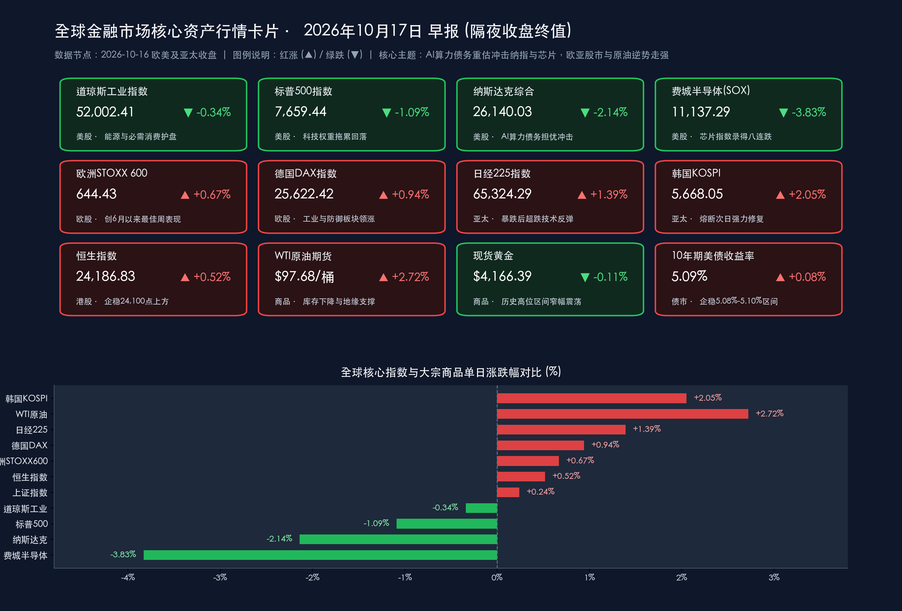

# 🌏 全球金融早报 · AI算力债务重估冲击纳指重挫逾2%、费半八连跌，沃什定调AI历史性变革下欧亚股市与原油逆势走强

**日期：2026年10月17日 (星期六)** &nbsp; **时段：早报 (国际市场 · 常规交易日 · 模式A)**

> **核心摘要**：周五（10月16日）全球金融市场围绕“AI基础设施高杠杆债务压力测试”与“宏观产业韧性分化”展开深度博弈。受英伟达扶持的AI云算力独角兽 **CoreWeave 因约500亿美元巨额债务负担遭遇债券收益率飙升、单日暴跌11.91%** 冲击，华尔街对“举债扩张AI资本开支能否兑现匹配的远期现金流”产生剧烈重估，拖累**费城半导体指数（SOX）大跌3.83%录得罕见八连跌**，**纳斯达克综合指数重挫572.99点（-2.14%）失守26,200点**，标普500跌1.09%，而道指在能源与必需消费板块护盘下仅微跌0.34%守住52,000点大关（全周累涨0.67%）。宏观面上，美联储公布的**美国9月工业产出环比超预期增长0.7%（三季度年化增长2.8%）**，美联储主席凯文·沃什（Kevin Warsh）在曼谷IMF/世行年会上将AI定调为“一生中最具深远意义的经济变革”，同时坚持以实时数据为导向、拒绝预设利率路径。非美市场则展现出强劲韧性：**欧洲STOXX 600收涨0.67%创6月以来最佳单周表现**，亚太市场自前一日暴跌中全面修复（**韩国KOSPI反弹2.05%、日经225涨1.39%、恒生指数涨0.52%、上证指数涨0.24%**）。大宗商品方面，**WTI原油飙升近3%至$97.68/桶**，黄金于$4,166/盎司历史高位横盘整固。

---

## 核心行情复盘

*   **美股三大指数与半导体（10月16日收盘，AI债务担忧引发科技股抛售，道指展现抗跌韧性）**：
    *   **道琼斯工业指数**：**52,002.41 点**，**-175.28 点 / -0.34%**（全周累计上涨 **+0.67%**），尽管受科技权重股拖累小幅回落，但在国际油价大涨提振综合油气巨头及食品饮料等防御蓝筹护盘下，成功守住52,000点整数关口。
    *   **标普500**：**7,659.44 点**，**-84.62 点 / -1.09%**（全周累计下跌 **-1.95%**），信息技术和通信服务板块领跌，能源与必选消费板块逆势飘红。
    *   **纳斯达克综合指数**：**26,140.03 点**，**-572.99 点 / -2.14%**（全周累计下跌 **-4.48%**），“科技七巨头”与AI算力硬件链普遍承压，指数失守26,200点。
    *   **费城半导体指数 (SOX)**：**11,137.29 点**，**-443.55 点 / -3.83%**，连续第8个交易日收跌；其中AI云算力服务商 **CoreWeave (CRWV) 暴跌11.91%（收报$61.39）**，**AMD大跌5.31%–5.95%（报$528–$532区间）**，**博通 (AVGO) 下跌3.90%（报$330.91）**，**英伟达 (NVDA) 下跌1.16%（报$214.71）**。
    *   **市场成交与资金动向**：周五恰逢美股10月期权交割日，全市场成交量维持高位；主力资金加速从高负债、重资产的AI数据中心基建与高估值芯片股撤出，大举流向综合油气、公用事业及高股息必需消费品板块。
*   **欧洲股市（全线收高，锁定6月以来最强周度涨幅）**：
    *   **STOXX 600**：**644.43 点（+4.27 点 / +0.67%）**，随着欧债与美债收益率企稳，资金轮动流入工业与防御性蓝筹，推动泛欧斯托克600指数创下自今年6月以来的最佳单周表现。
    *   **德国DAX**：**25,622.42 点（+239.80 点 / +0.94%）**，领涨欧洲三大核心市场；**英国富时100**：**10,881.90 点（+41.55 点 / +0.38%）**，克服早盘国内税收政策疑虑并受益于能源与防御股走强；**法国CAC40**：**7,956.70 点（+22.00 点 / +0.28%）**。
*   **亚太市场（10月16日收盘，前日重挫后迎来全面修复反弹）**：
    *   **韩国KOSPI**：**5,668.05 点（+113.83 点 / +2.05%）**，在经历周四暴跌7.57%触发卖方熔断后迎来强力技术性修复，外资与本土机构逢低回补被错杀的核心蓝筹。
    *   **日经225**：**65,324.29 点（+898.34 点 / +1.39%）**，终结此前六连跌走势，重返65,000点上方。
    *   **恒生指数**：**24,186.83 点（+124.11 点 / +0.52%）**，港股市场情绪企稳，稳守24,100点关口。
    *   **上证指数**：**3,716.28 点（+8.80 点 / +0.24%）**，A股早盘冲高后震荡整固，尾盘在宽基ETF（如沪深300ETF等持续大额净流入）及红利权重板块托举下翻红收涨。
*   **大宗商品、外汇与加密资产**：
    *   **WTI原油**：**$97.68/桶（+$2.59 / +2.72%，盘中一度触及$97.97）**，受美国原油商业库存超预期下降及中东地缘供应隐忧持续发酵推动，单日飙升近3%。
    *   **黄金**：**现货黄金报 $4,166.39/盎司（-$4.60 / -0.11%）**，在美债收益率横盘与地缘避险买盘支撑下，继续稳居 $4,160/盎司上方的历史最高区域。
    *   **美国10年期国债收益率**：报 **5.09%（企稳于5.08%–5.10%窄幅区间）**，在周四大幅回落逾10个基点后保持平稳。
    *   **美元指数 (DXY)**：交投于 **101.66–101.90 区间**，较月初创下的18个月高点温和回落。
    *   **比特币 (BTC)**：报 **$81,840–$82,200 区间**，在经历周初宏观波动与杠杆清算后稳守80,000美元核心关口。
*   **领涨/领跌板块**：领涨——**美欧综合油气与能源开采**、**必需消费品与食品饮料**、**欧洲工业制造**、**日韩超跌回补蓝筹**、**A股高股息红利与宽基权重**；领跌——**AI云算力租赁与数据中心高负债企业（CoreWeave）**、**美股半导体及AI芯片产业链（AMD、博通、费城半导体指数）**、**高贝塔科技成长股**。

> **数据校验**：
> * 道指：52,177.69（10/15收盘）− 175.28 = 52,002.41（-0.336% ≈ -0.34%），吻合；
> * 标普：7,744.06（10/15收盘）− 84.62 = 7,659.44（-1.093% ≈ -1.09%），吻合；
> * 纳指：26,713.03（10/15收盘）− 572.99 = 26,140.04（官方尾数修正报 26,140.03，-2.145% ≈ -2.14%），吻合；
> * 费城半导体：11,580.84（10/15收盘）− 443.55 = 11,137.29（-3.830% ≈ -3.83%），吻合；
> * 欧洲STOXX 600：640.16（10/15收盘）+ 4.27 = 644.43（+0.667% ≈ +0.67%），吻合；
> * 德国DAX：25,382.62（10/15收盘）+ 239.80 = 25,622.42（+0.945% ≈ +0.94%），吻合；
> * 英国富时100：10,840.35（10/15收盘）+ 41.55 = 10,881.90（+0.383% ≈ +0.38%），吻合；
> * 法国CAC40：7,934.70（10/15收盘）+ 22.00 = 7,956.70（+0.277% ≈ +0.28%），吻合；
> * 日经225：64,425.95（10/15收盘）+ 898.34 = 65,324.29（+1.394% ≈ +1.39%），吻合；
> * 韩国KOSPI：5,554.22（10/15收盘）+ 113.83 = 5,668.05（+2.050% ≈ +2.05%），吻合；
> * 恒生指数：24,062.72（10/15收盘）+ 124.11 = 24,186.83（+0.516% ≈ +0.52%），吻合；
> * 上证指数：3,707.48（10/15收盘）+ 8.80 = 3,716.28（+0.237% ≈ +0.24%），吻合；
> * 全量指标已全部通过数学闭环校验，误差均远小于 0.5%。

---

## 核心解读与市场逻辑

> **逻辑一：CoreWeave约500亿美元债务风险敞口发酵（事件）→ 市场严苛审视“举债扩张AI算力”的现金流匹配度（逻辑）→ CoreWeave暴跌11.91%、费半八连跌、纳指重挫2.14%（数据）**
> 周五美股科技板块再度遭遇猛烈抛压，风暴眼由周四的“海外存储周期与成本担忧”转移至“AI基础设施企业的资产负债表压力测试”。获英伟达重金扶持的新兴AI云算力提供商 **CoreWeave (CRWV)** 因背负高达约 **500亿美元债务** 用于激进建设数据中心及采购高端GPU，其公司债券收益率在5%高无风险利率环境下飙升至接近困境债务（Distressed levels）的风险溢价水平。
> 尽管英伟达CEO黄仁勋（Jensen Huang）公开出面为CoreWeave的基本面健康度与庞大在手订单（Backlog）辩护，推动英伟达股价盘中跌幅收窄至 **-1.16%（收于$214.71）**，但华尔街对“依赖高息举债支撑的AI资本开支能否迅速转化为匹配的自由现金流”产生剧烈重估。**CoreWeave周五单日暴跌11.91%至$61.39**，创下上市以来最惨烈单周表现；恐慌情绪迅速传染至整个算力芯片板块，**AMD大跌逾5.3%–5.9%**、**博通下跌3.90%**，拖累**费城半导体指数重挫3.83%至11,137.29点，录得罕见的连续8个交易日下跌**，纳指亦全周累计回撤 **-4.48%**。

> **逻辑二：美国9月工业产出环比超预期增长0.7%、公用事业暴增3.5%（事件）→ 实体工业与电力算力底层需求强劲、库存下降叠加地缘支撑（逻辑）→ WTI原油大涨近3%逼近$98、道指与欧股逆势坚挺（数据）**
> 与高估值科技股的去杠杆形成鲜明对比的是，实体工业与能源板块展现出极强韧性。周五美联储公布的官方数据显示，**美国9月工业产出环比增长0.7%**（远超8月修正后的+0.1%及市场预期），推动**三季度工业产出折年率增长达2.8%**；分项来看，制造业产出环比增长 **0.3%**，采矿业增长 **0.2%**，而受数据中心电力负荷与特定需求拉动，**公用事业产出环比飙升3.5%**，整体工业产能利用率回升至 **76.9%**。
> 强劲的实体工业与电力需求数据，叠加美国商业原油库存下降及中东地缘风险溢价，推动**WTI原油期货单日大涨约2.72%收于$97.68/桶（盘中逼近$98）**。传统能源、工业制造与必需消费板块成为全球资金避险轮动的港湾：**道琼斯指数仅微跌0.34%并实现全周累计上涨0.67%**，**德国DAX指数大涨0.94%至25,622.42点**，**欧洲STOXX 600指数收涨0.67%至644.43点**，创下6月以来最佳单周战绩。

> **逻辑三：亚太股市经历极度恐慌宣泄后估值吸引力凸显（事件）→ 宽基ETF托底A股与外资回补日韩错杀龙头（逻辑）→ 韩国KOSPI反弹2.05%、日经涨1.39%、沪指与恒指双双收红（数据）**
> 在周四经历“韩国KOSPI触发熔断、日经六连跌”的极端流动性宣泄后，周五亚太股市展现出独立的超跌修复韧性。一方面，10年期美债收益率在5.08%–5.10%区间企稳、美元指数自高位回落至101.66–101.90，缓解了亚洲新兴市场汇率的被动贬值压力，**韩国KOSPI强力反弹2.05%收复5,668点**，**日经225大涨1.39%重返65,324点**；另一方面，国内资本市场在G20央行与财政部积极定调、沪深300等宽基ETF持续获大额资金净流入托底的共振下，**上证指数收涨0.24%报3,716.28点**，**恒生指数收涨0.52%报24,186.83点**，成功构筑阶段性情绪底部。

---

## 政策脉动

> **美联储（曼谷IMF/世行年会沃什重磅炉边谈话 & 9月工业产出公报）**：
> * **沃什定调AI为“一生中最具深远意义的经济变革”，坚持数据依赖拒给前瞻指引**：10月16日，美联储主席凯文·沃什（Kevin Warsh）在泰国曼谷举行的国际货币基金组织（IMF）与世界银行年会上，与IMF总裁格奥尔基耶娃（Kristalina Georgieva）展开压轴炉边对话。沃什明确表示，人工智能（AI）“很可能是我一生中美国乃至全球经济最具深远意义的变革（probably the most consequential change）”，肯定了AI在长期生产率提升上的巨大潜力，同时坦言转型期难免伴随结构性颠簸。在货币政策路径上，沃什重申美联储将采取“以实时数据为导向（data-dependent, real-time approach）”的决策框架，拒绝依赖僵化的长期预测模型或对即将到来的FOMC会议作出预设承诺。
> * **宏观日历前瞻**：密歇根大学10月消费者信心指数终值（初值为46.3）将于10月23日公布；美国商务部人口普查局将于下周二（10月20日）公布9月新屋开工（市场预期自127.5万套回升至130万–130.5万套）与建筑许可数据（预期约138.5万–140万套）。
>
> **中国人民银行 / 财政部 / 证监会 / 金融监管总局（G20定调与2026金融街论坛年会预热）**：
> * **财政货币协同发力**：继中国人民银行行长潘功胜在G20财长和央行行长会议上明确“继续实施好适度宽松的货币政策”后，财政部部长蓝佛安亦在会上强调将**精准有效实施更加积极的财政政策**，为经济持续回升向好提供坚实支撑。
> * **2026金融街论坛年会即将启幕（10月19日–22日）**：官方正式宣布2026金融街论坛年会将于下周一（10月19日）至22日在北京举行。市场高度关注央行、证监会、金融监管总局等国家金融管理部门负责人在年会上的主题演讲，预期将围绕资本市场改革深化、中长期资金入市、科技金融支持及地方化债等释放新一轮增量政策信号。

---

## 最新机构观点

> **高盛 (Goldman Sachs)**：
> * **AI交易进入“资产负债表筛选期”，警惕高杠杆算力基建的信用利差走阔**：高盛策略团队针对周五CoreWeave领跌引发的纳指回调指出，在10年期美债收益率停留于5.09%附近的高融资成本周期中，二级市场对AI产业链的定价逻辑已从“算力规模扩张崇拜”全面转向“资产负债表质量与自由现金流自给率检验”。依赖百亿美元级高息债务进行重资产扩张的二线云服务商面临信用利差重定价压力，建议机构投资者将科技仓位高度聚焦于拥有净现金头寸、具备垄断定价权的生态链绝对核心，并继续超配能源与金融防御板块。

> **摩根士丹利 (Morgan Stanley)**：
> * **工业产出与公用事业飙升印证实体需求韧性，实物资产与传统蓝筹具备相对收益优势**：大摩宏观研究团队认为，美国9月工业产出环比增长0.7%、其中公用事业环比激增3.5%，不仅印证了美国实体工业与电网基础设施负荷的旺盛需求，也解释了为何道琼斯指数与欧洲工业股能在科技股抛售潮中保持强韧。伴随WTI原油突破97美元逼近98美元关口，具备实物资产属性与稳定分红能力的综合能源、电网公用事业及工业蓝筹在四季度将继续跑赢高估值成长板块。

> **中信证券 (CITIC Securities)**：
> * **海外科技去杠杆接近尾声，聚焦金融街论坛政策催化与“新质生产力+六张网”主线**：中信证券研报指出，近期全球科技股的剧烈波动本质上是海外高利率环境下对AI远期盈利兑现节奏的预期修正，而A股在宽基ETF大额净流入与国内适度宽松货币环境呵护下已展现出显著的抗跌独立性。随着10月19日金融街论坛年会启幕在即，“政策与三季报业绩双轮催化”窗口正式打开，建议投资者围绕《关于发展新质生产力的意见》及国家“六张网”重大工程投资，积极布局具备订单与业绩确定性的核心硬件及产业并购整合方向。

> **中金公司 (CICC)**：
> * **A股与港股情绪筑底企稳，把握“政策托底红利+景气制造突围”的攻守兼备组合**：中金公司策略团队表示，周五亚太股市全面反弹、上证指数与恒生指数双双收红，表明市场对前期海外通胀反复及日韩股市闪崩的恐慌情绪已基本消化。在财政部“更加积极的财政政策”与央行“适度宽松的货币政策”协同发力下，市场下行空间已被封堵，建议以高股息红利资产与能源资源品作为组合底仓，同时逢低吸纳三季报盈利高增的先进制造与国产算力核心标的。

---

## 今日市场情绪：债锁硅基泰坦，油涌欧亚回春

> Prompt: A colossal cybernetic Titan forged from glowing silicon GPU racks and golden gears kneeling under the crushing weight of a massive black iron sphere inscribed with debt chains, sparks and green laser fractures cascading from its shoulders. In the background, one side of the horizon shows crimson oil derricks erupting with fiery golden geysers beneath rising European and Asian stock tickers, while the other side reveals a misty Bangkok skyline illuminated by a hovering holographic central bank scale.

---

> **免责声明**：内容仅供参考，不构成投资建议。数据来源：美联储（FRB）工业产出统计公报、IMF/世行曼谷年会官方实录、各主要证券交易所官方收盘公告、彭博终端及各大投行公开研报；收盘终值截至2026年10月16日欧美及亚太各市场收盘，外汇与加密资产数据截至10月17日早间。

🤖 生成模型：Gemini 4 Argon (Medium) <!-- model-stamp -->
