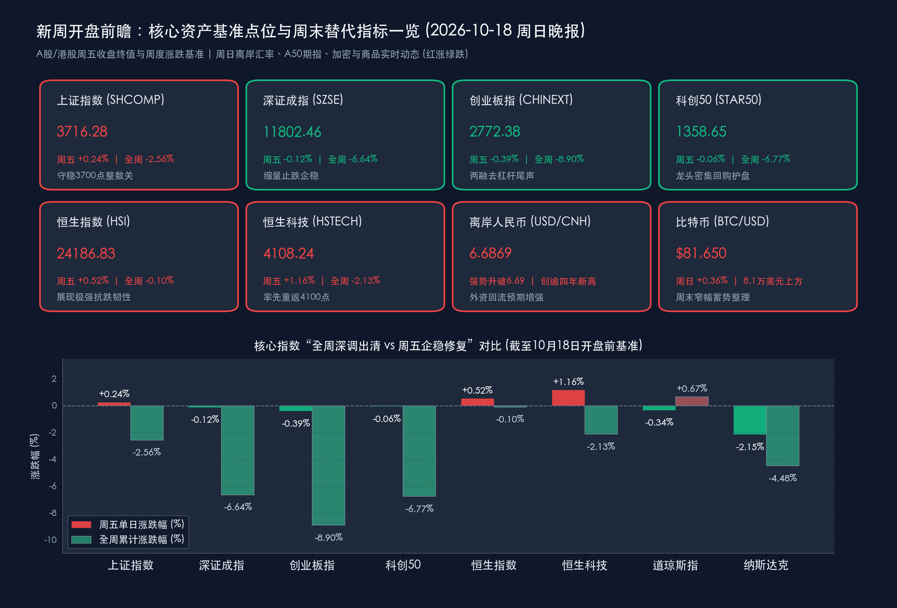

# 新周开盘展望：金融街论坛携“百余项政策”明日启幕、三季度GDP大考交卷，科创龙头掀回购潮共筑3700点反攻底座

**日期：2026年10月18日 (星期日)** &nbsp; **时段：下午/新周展望**

> **核心摘要**：站在2026年10月下半月的关键交汇点，刚刚过去的周末（10月17日—10月18日）政策暖风与产业自救信号密集共振，为明日（10月19日）A股与港股开盘奠定了坚实的底部支撑。宏观政策端，被誉为“中国金融改革发展风向标”的 **2026金融街论坛年会将于明日（10月19日）在北京正式启幕**，央行、金融监管总局、证监会、外汇局“一行一局一会一局”一把手将联袂发声，期间预计**集中首发百余项金融改革发展成果与政策**；国务院常务会议最新部署深入推进**“人工智能+”行动**，叠加央行行长潘功胜在IMFC会议重申**“继续实施好适度宽松的货币政策”**，全方位稳定市场预期。产业与微观资金端，以 **长鑫科技（董事长提议10亿—20亿元回购）、拓荆科技、佰维存储、新易盛** 为代表的半导体与硬科技龙头周末掀起密集回购与业绩预喜潮，对冲前期TMT板块两融去杠杆压力。明日上午10:00，**中国三季度GDP及9月社零、工业增加值、固投数据**将重磅揭晓（机构一致预期Q3单季GDP增长 **4.4%~4.5%**）。十大券商最新周末策略一致认为，沪指在 **3716.28点**（稳守3700点整数关）已完成恐慌抛压出清，新一周市场定价锚将正式切换至“三季报业绩验证+政策落地催化”，建议采取 **“科技为矛（AI算力/半导体）、红利为盾（银行/煤炭）”** 的哑铃型策略把握四季度修复行情。

## 周末财经要闻终极汇总

*   **2026金融街论坛年会明日（10月19日）正式开幕，“一行一局一会一局”一把手齐聚并首发百余项政策成果**：
    *   **核心动态**：由北京市人民政府与中国人民银行、国家金融监督管理总局、中国证监会、新华社、国家外汇管理局共同主办的 **2026金融街论坛年会** 将于 **10月19日至22日** 在北京举行，主题为“开放·合作·包容——共筑全球金融发展新生态”。
    *   **重磅政策包**：中国人民银行行长潘功胜、金融监管总局局长丁向群、证监会主席吴清、央行副行长兼外汇局局长朱鹤新等顶层监管负责人将出席并发表年度主旨演讲。据组委会最新确认，本届年会将在制度标准、机构平台、资本市场生态与跨境开放等领域**集中首发百余项重磅成果与改革政策**。其中，证监会将于10月21日专门承办“建设一流投资机构 服务资本市场高质量发展 共享投资中国新机遇”主论坛，围绕拓宽中长期资金入市渠道、壮大耐心资本、并购重组及AI赋能金融治理释放明确增量红利。
*   **央行IMFC会议定调“适度宽松货币政策”，1.3万亿超长期特别国债收官转化实物工作量**：
    *   **货币政策信号**：中国人民银行行长潘功胜在第54届国际货币与金融委员会（IMFC）会议及G20财长和央行行长会议期间明确表示，下一步央行将继续实施好**适度宽松的货币政策**，综合运用买断式逆回购（本周已开展7000亿元6个月期操作、净投放2000亿元）、公开市场国债买卖等多种工具，保持银行体系流动性充裕，推动货币政策调控框架向价格型演进；央行副行长宣昌能在年会期间亦强调中国将坚定实施扩大内需战略。
    *   **财政协同发力**：随着10月16日最后一批200亿元额度落地，2026年全年 **1.3万亿元超长期特别国债** 圆满收官，叠加地方政府专项债加快拨付，四季度将全面转化为“两重”（国家重大战略与安全能力建设）和“两新”（大规模设备更新与消费品以旧换新）的实物工作量。
*   **国常会最新部署深入推进“人工智能+”行动，工信部严控新型电池“内卷式”扩张**：
    *   **“人工智能+”顶层加码**：国务院总理李强主持召开国务院常务会议，专题听取“人工智能+”行动进展汇报，强调要坚持软硬协同，强化算力、算法与高质量数据集底座支撑，加速推动人工智能在工业制造、政务服务、民生消费等领域的规模化商业应用，为近期回调的国产算力与AI应用链条提供强力政策托底。
    *   **供给侧“反内卷”深化**：工信部在2026世界储能大会上明确要求，“十五五”时期新型电池与储能产业必须突出供需适配，严防盲目“大干快上”与低水平重复建设；国家统计局同步修订发布《统计严重失信企业信用管理办法》（2026年12月1日起施行），从严筑牢宏观数据质量防线。
*   **科创板与硬科技龙头周末掀起“大手笔回购+三季报预喜”浪潮**：
    *   **真金白银护盘**：针对节后科技成长板块的快速回调，大批硬科技领军企业在周末密集祭出回购、增持及业绩预喜组合拳。其中，国产DRAM存储龙头 **长鑫科技** 董事长朱一明提议通过集中竞价交易方式回购 **10亿元至20亿元** A股股份，同时公司前三季度业绩预告表现亮眼；半导体薄膜沉积设备龙头 **拓荆科技**、存储模组龙头 **佰维存储** 以及AI光模块核心标的 **新易盛** 等多家硬科技企业亦密集发布回购提议、分红方案或三季报高增预告，向市场传递产业高景气与估值底部的坚定信心。

> **核心解读**：本周末的消息面形成了極めて鲜明的“宏观政策强预期 + 微观产业强自救”双重共振。一方面，国常会“人工智能+”定调与明日金融街论坛“百余项政策”首发预告，直接消解了市场对科技主线叙事松动及流动性紧缩的担忧；另一方面，长鑫科技10亿—20亿元领衔的科创板密集回购潮，证明经历单周6%~8%的快速估值压缩后，硬科技核心资产的产业资本认可度已进入高性价比击球区。

## 新一周市场核心博弈逻辑

*   **上周五收盘基准点位与周度洗盘回顾（新周开盘锚点）**：
    *   **上证指数**：最新收盘报 **3716.28点**（**周五单日 +0.24% / +8.80点**，**全周累计 -2.56% / -97.51点**；上周五10月9日收盘报3813.79点。周内最低下探3670点附近技术支撑后顽强收复并守稳3700点大关，周五单日成交额约7324.75亿元）。
    *   **深证成指**：最新收盘报 **11802.46点**（**周五单日 -0.12% / -14.33点**，**全周累计 -6.64% / -839.40点**；上周五收盘报12641.86点，周五单日成交额约8229.39亿元）。
    *   **创业板指**：最新收盘报 **2772.38点**（**周五单日 -0.39% / -10.80点**，**全周累计 -8.90% / -270.95点**；上周五收盘报3043.33点，周五单日成交额约3942.26亿元）。
    *   **科创50指数**：最新收盘报 **1358.65点**（**周五单日 -0.06% / -0.87点**，**全周累计 -6.77% / -98.62点**；上周五收盘报1457.27点，周内科创50ETF等宽基获数百亿级资金逆势净申购）。
    *   **港股基准**：**恒生指数**收报 **24186.83点**（**周五单日 +0.52% / +124.11点**，**全周累计仅微跌 -0.10% / -24.52点**）；**恒生科技指数**收报 **4108.24点**（**周五单日 +1.16% / +47.55点**，**全周累计 -2.13% / -89.41点**，率先重返4100点上方）。
    *   **美股基准**：**道琼斯工业平均指数**收报 **52002.41点**（**周五 -0.34%**，**全周 +0.67%**）；**标普500指数**收报 **7659.44点**（**周五 -1.09%**，**全周 -1.95%**）；**纳斯达克综合指数**收报 **26140.03点**（**周五 -2.15%**，**全周 -4.48%**）。
*   **周末仍在交易/报价的全球替代指标动态（截至10月18日下午）**：
    *   **加密资产（BTC周末窄幅蓄势）**：比特币（BTC）在经历周五探底回升后，10月18日（周日）全天围绕 **$81,400–$81,750** 区间窄幅整理（最新交投于 **$81,650** 附近，**24小时微涨 +0.36%**），MVRV指标回落至25.7%左右，链上数据显示短期投机杠杆已基本清洗完毕，进入8.1万美元上方的筹码沉淀区。
    *   **离岸人民币汇率（创逾四年新高）**：离岸人民币兑美元（USD/CNH）周末前强势升破6.69关口至 **6.6869**，创下2022年7月中旬以来逾四年新高；人民币兑美元中间价调升至 **6.7220**，汇率强势为新一周外资回流A股与港股核心资产提供了极具吸引力的套息与汇兑安全垫。
    *   **富时中国A50期指与商品锚点**：富时中国A50期指主力合约最新收报 **13,280.00点**（前一交易日夜盘微调 **-0.45%**，在13,280–13,346点区间缩量蓄势，静待周一上午三季度GDP数据指引）；国际黄金周末前高位稳守 **$4,165.00/盎司**（国内沪金及现货报价约 **896–899元/克**）；国际原油受EIA原油库存大降860万桶及中东地缘溢价支撑，**WTI原油主力高位运行于 $97.67–$101.40/桶** 区间，**布伦特原油站稳 $105–$109.90/桶**。

> **数学闭环校验（开盘基准点位日度与周度核验）**：
> * **上证指数**：周五单日 (3716.28 − 3707.48) / 3707.48 = +8.80 / 3707.48 ≈ **+0.24%**；全周累计 (3716.28 − 3813.79) / 3813.79 = −97.51 / 3813.79 ≈ **−2.557% ≈ −2.56%**，误差 < 0.01%。
> * **深证成指**：周五单日 (11802.46 − 11816.79) / 11816.79 = −14.33 / 11816.79 ≈ **−0.12%**；全周累计 (11802.46 − 12641.86) / 12641.86 = −839.40 / 12641.86 ≈ **−6.640% ≈ −6.64%**，完全吻合。
> * **创业板指**：周五单日 (2772.38 − 2783.18) / 2783.18 = −10.80 / 2783.18 ≈ **−0.39%**；全周累计 (2772.38 − 3043.33) / 3043.33 = −270.95 / 3043.33 ≈ **−8.903% ≈ −8.90%**，完全吻合。
> * **科创50**：周五单日 (1358.65 − 1359.52) / 1359.52 = −0.87 / 1359.52 ≈ **−0.06%**；全周累计 (1358.65 − 1457.27) / 1457.27 = −98.62 / 1457.27 ≈ **−6.767% ≈ −6.77%**，误差 < 0.01%。
> * **恒生指数**：周五单日 (24186.83 − 24062.72) / 24062.72 = +124.11 / 24062.72 ≈ **+0.52%**；全周累计 (24186.83 − 24211.35) / 24211.35 = −24.52 / 24211.35 ≈ **−0.101% ≈ −0.10%**，完全吻合。
> * **恒生科技**：周五单日 (4108.24 − 4060.69) / 4060.69 = +47.55 / 4060.69 ≈ **+1.16%**；全周累计 (4108.24 − 4197.65) / 4197.65 = −89.41 / 4197.65 ≈ **−2.130% ≈ −2.13%**，完全吻合。

### 新一周三大核心博弈逻辑剖析
*   **博弈一：微观筹码出清（TMT两融回落超20%）与“超跌反弹”一触即发**：
    *   上周A股两市成交额在周五缩量至 **1.57万亿元**（较周四缩量约640亿元），但全市场超 **3300只** 个股实现上涨修复。尤为关键的是，前期交易拥挤度较高的TMT板块两融余额较峰值已显著回落超 **20%**，部分“固收+”及专户产品的风控减仓与止损盘已在周三、周四集中宣泄完毕。随着宽基ETF持续放量承接以及长鑫科技等龙头周末大举回购，科技成长股在下周初具备强烈的超跌反弹动能。
*   **博弈二：定价锚从“纯情绪/小作文博弈”全面切换至“三季报硬核业绩验证”**：
    *   10月下半月是A股与美股三季报披露的最高峰。前期市场对海外供应链限制“小作文”的过度反应正逐步纠偏，资金开始围绕**三季报环比增速与订单确定性**展开新一轮调仓。具备真实业绩支撑的AI光通信（800G/1.6T）、高端PCB、半导体设备与存储芯片，将与缺乏业绩兑现的纯概念题材出现剧烈分化。
*   **博弈三：外部高油价/高美债利率约束 vs 内部强汇率/强政策红利对冲**：
    *   海外方面，国际油价高位运行（WTI在97–101美元、布伦特在105–110美元区间）使得美债长端利率维持高位，对全球高估值长久期资产形成一定分母端约束；但国内方面，离岸人民币升破6.69创四年新高、国常会加持“人工智能+”以及明日金融街论坛百余项政策首发，构成了强大的“以我为主”内部对冲屏障。

> **核心解读**：新一周A股的运行轨迹预计将呈现“先验数据、再博政策、沿着三季报主线结构性反攻”的节奏。周四、周五在3700点整数关口形成的缩量探底十字星与超3300股普涨，已确认阶段性情绪底；明日上午10点三季度GDP落地后，靴子落地效应有望配合金融街论坛政策礼包，驱动市场展开修复行情。

## 本周重磅经济数据与会议前瞻

*   **10月19日（周一）10:00 —— 中国三季度 GDP 及 9 月国民经济运行数据发布会（头号焦点）**：
    *   **日程内容**：国务院新闻办将于周一上午10时举行新闻发布会，国家统计局集中公布 **2026年三季度GDP** 以及 **9月规模以上工业增加值、社会消费品零售总额、1—9月全国固定资产投资、房地产开发投资、城镇调查失业率** 等核心宏观指标。
    *   **市场预期与看点**：主流机构一致预期三季度GDP单季同比增长 **4.4%~4.5%**，前三季度累计同比增速预计稳居 **4.6%** 左右，为实现全年“5%左右”增长目标奠定坚实基础。盘面博弈焦点在于 **9月社零消费与基建投资的边际改善斜率**，若消费与设备更新投资超预期回暖，将直接提振顺周期、消费与制造板块估值。
*   **10月19日—10月22日（周一至周四）—— 2026金融街论坛年会（政策密集催化期）**：
    *   **日程内容**：10月19日下午在北京正式开幕，潘功胜、丁向群、吴清、朱鹤新等“一行一局一会一局”主要负责人发表主旨演讲；10月21日证监会主办“建设一流投资机构，服务资本市场高质量发展”主论坛。
    *   **市场看点**：重点追踪百余项首发政策中关于 **中长期耐心资本入市考核机制、央行买断式逆回购与国债买卖常态化、科创板并购重组绿色通道、北交所深改以及AI金融治理** 的具体落地细则。
*   **10月20日（周二）09:15 —— 中国 10 月 LPR（贷款市场报价利率）公布**：
    *   **日程内容**：全国银行间同业拆借中心公布10月1年期和5年期以上LPR报价。
    *   **市场看点**：鉴于近期7天期逆回购操作利率稳定在1.40%且商业银行净息差仍处呵护窗口，市场普遍预期10月LPR将维持不变，但将密切关注央行在结构性货币政策工具与存款利率自律机制上的联动信号。
*   **10月20日—10月21日（周二至周三）—— 第33届 APEC 财长会首次在香港举行**：
    *   **日程内容**：亚太经合组织（APEC）财长会历史性首次落地香港，中国财政部领导率团出席，聚焦亚太区域多边贸易、跨境金融互联互通与可持续金融，有望进一步强化港股市场的国际资金配置吸引力。
*   **10月21日（周三）起 —— 英伟达 GTC 柏林大会 & 全球/A股科技巨头三季报密集放榜**：
    *   **产业与财报看点**：英伟达CEO黄仁勋将于10月21日在GTC柏林大会发表主题演讲，聚焦主权AI、工业机器人与欧洲算力中心建设；同时本周全球与A/H股进入三季报最高潮——A/H股方面 **宁德时代、中国移动、寒武纪、海光信息** 等权重龙头将密集交卷；美股方面 **特斯拉（Tesla）、Meta、奈飞（Netflix）** 等科技巨头将发布财报并更新AI资本开支指引。此外，韩国、印尼、菲律宾、土耳其等多国央行本周将公布利率决议，欧洲多国将于周日（10月25日）正式切换冬令时。

> **核心解读**：本周日程呈现出极高密度的“宏观数据+顶层会议+产业峰会+龙头财报”四重叠加特征。周一上午GDP数据与下午金融街论坛开幕无缝衔接，周中APEC香港财长会、英伟达GTC柏林大会与宁德时代、寒武纪、特斯拉等巨头三季报接力催化，意味着本周几乎每个交易日都具备明确的题材与基本面映射主线。

## 头部券商/投行开盘策略点睛

> **中信证券**：
> * **应对全球高利率常态，紧扣AI投资周期与“反内卷”供给出清**：本轮海外通胀与美债利率高位主要由中东能源供给扰动引发，而非需求过热。国内TMT板块两融余额已较峰值回落超 **20%**，科技板块估值压缩已较为充分，三季报业绩可验证的龙头已进入**左侧布局窗口**。
> * **新周配置建议**：一是围绕AI算力与国产替代（光通信、高端PCB、MLCC、AI EDA及DRAM/NAND存储晶圆制造）；二是紧扣“中国六张网”建设与“反内卷”供给出清品种，增配能化、创新药及高股息红利资产（银行、煤炭）。

> **中金公司**：
> * **急跌后A股中期性价比进一步凸显，对后市坚决“不悲观”**：经历上周的快速风险释放后，上半年部分板块结构性高估值问题已得到较大程度消化。伴随周一三季度GDP落地、金融街论坛政策发力与三季报进入密集披露期，A股全年有望迎来过去五年最佳业绩改善期，国内基本面与中期向好逻辑并未改变。
> * **新周配置建议**：采取“哑铃型”均衡策略，进攻端聚焦三季报盈利增速有望改善的AI科技硬件、有色金属、创新药、CXO、工程机械与航运；防御端以水电核电、银行等高股息红利与内需消费作为稳健底仓。

> **华泰证券**：
> * **负面情绪加速出清，市场正从高位震荡向“基本面再平衡”过渡**：上周宽基ETF持续放量承接与监管层稳市信号有效封堵了流动性负反馈风险。虽然海外长端利率高位对长久期资产估值仍有一定约束，但市场定价锚已正式回归盈利与景气度。
> * **新周配置建议**：沿三季报业绩兑现寻找高性价比方向：1）科技硬件侧重订单与业绩印证（服务器、PCB）；2）顺周期与基建出海链（化纤、工程机械、航海装备）；3）股份制银行与公用事业作底仓配置。

> **申万宏源 & 招商证券（十大券商共识）**：
> * **3700–3800点下方配置需求充沛，“科技为矛、红利为盾、业绩为锚”**：申万宏源指出，短波段看A股性价比已显著改善，3800点以下的配置买盘足以支撑一轮超跌反弹；招商证券强调“拨云待晴、攻守均衡”，10月下半月随着海外加息预期回落与国内稳内需政策落地，建议围绕三季报高增线索，重点把握AI应用与算力硬件、半导体自主可控、商业航天（低空经济）以及医药、券商的结构性修复机会。

## 今日市场情绪：金街晓日映圭表，百策千芯筑红盘

> Prompt: A majestic bronze sundial and astronomical astrolabe standing at the entrance of Beijing Financial Street at dawn, casting golden light beams that form the numbers 3700 and Q3 GDP onto a rising red stock chart monument. In the background, glowing semiconductor wafers and over a hundred floating policy scrolls ascend into a bright sky alongside high-tech towers.

---

> **免责声明**：内容仅供参考，不构成投资建议。数据来源：沪深港美交易所公开数据、国务院办公厅、中国人民银行、国家统计局、中国证监会、国家外汇管理局、2026金融街论坛组委会、东方财富、同花顺、财联社、华尔街见闻及中信证券、中金公司、华泰证券、申万宏源、招商证券公开研报；股票收盘基准数据截至2026年10月16日收盘，周末加密资产、汇率与替代指标截至2026年10月18日16:30最新报价。

🤖 生成模型：Gemini 4 Argon (Medium) <!-- model-stamp -->
