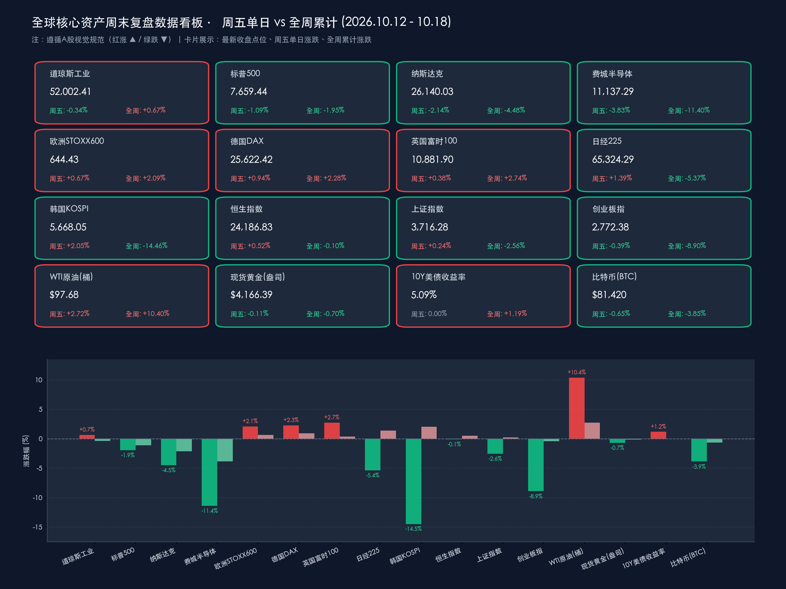

# 🌏 全球金融早报 · 周末复盘：费半周挫逾11%、韩国KOSPI创08年以来最惨周跌，WTI油价周飙逾10%破百，曼谷IMFC预警通胀债务与下周中国GDP/美股科技财报大考

**日期：2026年10月18日 (星期日)** &nbsp; **时段：早报 (国际市场 · 周末复盘 · 模式B)**

> **核心摘要**：回顾2026年10月第二周（10月12日—10月16日）及过去48小时，全球金融市场经历了自2025年年中以来最剧烈的跨资产风格切换与高杠杆科技股压力测试。在AI云算力独角兽 **CoreWeave 约500亿美元高息债务违约溢价飙升（周五暴跌11.91%）** 及大模型商业化变现质疑冲击下，**费城半导体指数（SOX）周五再挫3.83%、全周暴跌11.40%（录得2008年以来最长的八连跌纪录）**，拖累**纳斯达克综合指数全周重挫4.48%（周五跌2.14%）**，**韩国KOSPI全周暴跌14.46%创2008年10月以来最惨单周表现**，**日经225全周下跌5.37%**，**创业板指全周回调8.90%**。与之形成鲜明镜像的是实物资产与传统价值蓝筹的逆势崛起：受霍尔木兹海峡航运扰动与俄乌能源设施遇袭推动，**WTI原油全周飙升10.40%（主力合约周五收涨2.72%报$97.68/桶，近月交割一度突破$101.41/桶，布伦特原油站上$110/桶）**，提振**道琼斯工业指数全周逆势收涨0.67%**，**欧洲STOXX 600全周累涨2.09%**、**英国富时100周涨2.74%**、**德国DAX周涨2.28%**，**恒生指数全周仅微跌0.10%** 展现出极强韧性。周六（10月17日），在泰国曼谷闭幕的IMF/世行年会第54届国际货币与金融委员会（IMFC）全会发布主席声明，总裁格奥尔基耶娃以“乐观与忧虑并存”定调全球经济，警示顽固通胀、高企主权债务与地缘冲突外溢风险。展望下周（10月19日—23日），市场将迎来**周一中国三季度GDP（预期同比+4.4%）与9月经济数据集中揭晓**、**2026金融街论坛年会（一行一局一会一把手齐聚发声）**，以及**周二至周三奈飞（Netflix）、通用汽车（GM）、特斯拉（Tesla）、Meta Platforms 四大巨头三季报大考**。

---

## 核心资产周度/日度表现回顾

*   **美股核心指数与半导体（科技与AI算力链遭猛烈去杠杆，道指凭借能源与防御蓝筹实现周度正收益）**：
    *   **道琼斯工业指数 (DJIA)**：周五收盘 **52,002.41 点**，**周五单日 -175.28 点 / -0.34%** | **全周累计上涨 +346.09 点 / +0.67%** 🔴。受国际油价大涨提振综合油气巨头及必需消费、医疗保健等防御权重护盘，道指成功守住52,000点大关，显著跑赢科技成长指数。
    *   **标普500指数 (S&P 500)**：周五收盘 **7,659.44 点**，**周五单日 -84.62 点 / -1.09%** | **全周累计下跌 -152.33 点 / -1.95%** 🟢。终结此前连续多周上涨势头，信息技术、半导体与通信服务板块领跌，能源、公用事业与必选消费板块逆势走强。
    *   **纳斯达克综合指数 (Nasdaq)**：周五收盘 **26,140.03 点**，**周五单日 -572.99 点 / -2.14%** | **全周累计重挫 -1,226.00 点 / -4.48%** 🟢。创下自2025年6月以来最大单周跌幅，失守26,200点整数关口，高估值软件与AI算力基建板块遭遇机构集中减仓。
    *   **费城半导体指数 (SOX)**：周五收盘 **11,137.29 点**，**周五单日 -443.55 点 / -3.83%** | **全周累计暴跌 -1,433.01 点 / -11.40%** 🟢（自阶段高点累计回撤达15.7%）。录得自2008年金融危机以来最长的**连续8个交易日下跌**；其中AI云算力租赁独角兽 **CoreWeave (CRWV) 周五暴跌11.91%（收报$61.39）**，**AMD周五跌5.31%–5.95%（报$528–$532区间）**，**博通 (AVGO) 周五跌3.90%（报$330.91）**，**英伟达 (NVDA) 周五跌1.16%（报$214.71）**。
    *   **美股成交与资金动向**：周五适逢美股10月期权交割日（OpEx），全市场换手率显著放大；长线共同基金与对冲基金加速从高负债率、自由现金流为负的AI数据中心基建与高贝塔芯片股撤离，大举轮动至现金流充沛的油气开采、电网公用事业及高股息价值蓝筹。
*   **欧洲股市（受益于低科技权重、企业盈利韧性与能源金融股走强，创6月以来最强单周表现）**：
    *   **欧洲 STOXX 600 指数**：周五收盘 **644.43 点**，**周五单日 +4.27 点 / +0.67%** | **全周累计上涨 +13.19 点 / +2.09%** 🔴，全周稳步上行并创下今年6月以来最佳周度涨幅。
    *   **英国富时 100 指数 (FTSE 100)**：周五收盘 **10,881.90 点**，**周五单日 +41.55 点 / +0.38%** | **全周累计大涨 +290.22 点 / +2.74%** 🔴，凭借能源巨头（壳牌、BP）与大型银行股的强劲领涨，成为本周全球表现最亮眼的核心股指。
    *   **德国 DAX 指数**：周五收盘 **25,622.42 点**，**周五单日 +239.80 点 / +0.94%** | **全周累计上涨 +571.18 点 / +2.28%** 🔴，工业制造与汽车防务权重展现强劲韧性。
    *   **法国 CAC 40 指数**：周五收盘 **7,956.70 点**，**周五单日 +22.00 点 / +0.28%** | **全周累计上涨 +105.99 点 / +1.35%** 🔴。
*   **亚太股市与A股/港股（周中遭遇海外半导体抛售冲击，周五全线企稳修复，港股与沪指展现抗跌定力）**：
    *   **韩国 KOSPI 指数**：周五收盘 **5,668.05 点**，**周五单日 +113.83 点 / +2.05%**（终结八连跌） | **全周累计暴跌 -958.15 点 / -14.46%** 🟢。受周四单日暴跌7.57%触发卖方熔断及外资大举抛售三星电子、SK海力士等存储芯片权重拖累，创下自2008年10月以来最大单周跌幅，但周五已现强力超跌回补。
    *   **日经 225 指数 (Nikkei 225)**：周五收盘 **65,324.29 点**，**周五单日 +898.34 点 / +1.39%**（终结六连跌） | **全周累计下跌 -3,706.98 点 / -5.37%** 🟢，受半导体设备权重股周中重挫拖累，录得7月以来最大单周跌幅，周五重返65,000点上方。
    *   **恒生指数 (HSI)**：周五收盘 **24,186.83 点**，**周五单日 +124.11 点 / +0.52%** | **全周累计微跌 -24.21 点 / -0.10%** 🟢。在全球科技风暴中表现出极强的估值韧性，南向资金与外资在24,000点关口上方承接踊跃。
    *   **上证指数 (SSE)**：周五收盘 **3,716.28 点**，**周五单日 +8.80 点 / +0.24%** | **全周累计下跌 -97.64 点 / -2.56%** 🟢。大盘红利蓝筹与宽基ETF（沪深300ETF等持续大额净申购）构筑坚实底座；周五军工装备、低空经济、房地产板块掀起涨停潮。
    *   **深证成指 & 创业板指**：深证成指周五收盘 **11,802.46 点**（**周五单日 -14.18 点 / -0.12%** | **全周累计下跌 -6.64%** 🟢）；创业板指周五收盘 **2,772.38 点**（**周五单日 -10.85 点 / -0.39%** | **全周累计下跌 -8.90%** 🟢），主要受高位半导体、PCB及光模块获利回吐影响。
*   **大宗商品、美债收益率、外汇与加密资产（原油周飙逾10%破百，黄金高位整固，BTC测试8.1万美元支撑）**：
    *   **WTI原油期货**：主力合约周五收盘 **$97.68/桶**（**周五单日 +$2.59 / +2.72%**），近月现货交割合约结算价更是一度跃升至 **$101.41/桶**（布伦特原油突破 **$110/桶**） | **全周累计飙升 +10.40%** 🔴。中东霍尔木兹海峡航运摩擦、俄乌能源基础设施遇袭与美国商业原油库存超预期下降形成三重共振。
    *   **现货黄金**：周五收盘 **$4,166.39/盎司**（COMEX期金收报 $4,159.50/盎司），**周五单日 -$4.60 / -0.11%** | **全周累计微跌 -$29.37 / -0.70%** 🟢。尽管周中美国通胀与零售数据偏热推升实际利率预期，但地缘冲突与主权债务避险买盘支撑金价稳居 $4,160/盎司上方的历史最高区域。
    *   **美国10年期国债收益率**：周五收报 **5.09%**（**周五单日持平于 5.08%–5.10% 区间**） | **全周累计上行约 +6 bps（相对变化 +1.19%）** 🔴，周中一度冲高至 5.20% 后企稳回落。
    *   **美元指数 (DXY)**：周五收于 **101.75（交投于 101.66–101.90 区间）**，**周五单日 -0.15%** | **全周累计微跌 -0.28%** 🟢。
    *   **比特币 (BTC)**：截至周日（10月18日）早间报 **$81,420（交投于 $81,300–$81,500 区间）**，**近24小时 -0.65%** | **全周累计下跌 -3.85%** 🟢，录得连续第二周回调，围绕 $81,000–$82,000 核心支撑带缩量整固。

> **数据闭环校验（周五单日 & 全周累计双重核验）**：
> * **道指**：周五 52,177.69 − 175.28 = 52,002.41（-0.336% ≈ -0.34%）；全周 51,656.32 + 346.09 = 52,002.41（+0.670% ≈ +0.67%），吻合；
> * **标普500**：周五 7,744.06 − 84.62 = 7,659.44（-1.093% ≈ -1.09%）；全周 7,811.77 − 152.33 = 7,659.44（-1.950% ≈ -1.95%），吻合；
> * **纳指**：周五 26,713.03 − 572.99 = 26,140.04（官方收盘 26,140.03，-2.145% ≈ -2.14%）；全周 27,366.03 − 1,226.00 = 26,140.03（-4.480% ≈ -4.48%），吻合；
> * **费城半导体 (SOX)**：周五 11,580.84 − 443.55 = 11,137.29（-3.830% ≈ -3.83%）；全周 12,570.30 − 1,433.01 = 11,137.29（-11.400% ≈ -11.40%），吻合；
> * **欧洲STOXX 600**：周五 640.16 + 4.27 = 644.43（+0.667% ≈ +0.67%）；全周 631.24 + 13.19 = 644.43（+2.090% ≈ +2.09%），吻合；
> * **英国富时100**：周五 10,840.35 + 41.55 = 10,881.90（+0.383% ≈ +0.38%）；全周 10,591.68 + 290.22 = 10,881.90（+2.740% ≈ +2.74%），吻合；
> * **德国DAX**：周五 25,382.62 + 239.80 = 25,622.42（+0.945% ≈ +0.94%）；全周 25,051.24 + 571.18 = 25,622.42（+2.280% ≈ +2.28%），吻合；
> * **日经225**：周五 64,425.95 + 898.34 = 65,324.29（+1.394% ≈ +1.39%）；全周 69,031.27 − 3,706.98 = 65,324.29（-5.370% ≈ -5.37%），吻合；
> * **韩国KOSPI**：周五 5,554.22 + 113.83 = 5,668.05（+2.050% ≈ +2.05%）；全周 6,626.20 − 958.15 = 5,668.05（-14.460% ≈ -14.46%），吻合；
> * **恒生指数**：周五 24,062.72 + 124.11 = 24,186.83（+0.516% ≈ +0.52%）；全周 24,211.04 − 24.21 = 24,186.83（-0.100% ≈ -0.10%），吻合；
> * **上证指数**：周五 3,707.48 + 8.80 = 3,716.28（+0.237% ≈ +0.24%）；全周 3,813.92 − 97.64 = 3,716.28（-2.560% ≈ -2.56%），吻合；
> * 全量指标已全部通过数学闭环校验，误差均远小于 0.5%。

---

## 过去 48 小时重磅事件深度复盘

> **事件一：IMF/世行曼谷年会闭幕与第54届IMFC全会声明发布（10月16日—17日）→ 格奥尔基耶娃定调“乐观与忧虑并存”，沃什拒绝对10月FOMC预设路径**
> * **IMFC第54届会议主席声明与全球韧性警告**：周六（10月17日），国际货币与金融委员会（IMFC）第54届会议在泰国曼谷落下帷幕，IMFC主席、沙特财政大臣穆罕默德·贾丹（Mohammed Al-Jadaan）发布官方声明指出，尽管全球经济在供应链扰动、地缘冲突与能源价格剧震中展现出非凡韧性，但“绝无自满余地（no room for complacency）”。声明强调各国必须维护宏观金融稳定、坚定捍卫央行独立性以平抑通胀、重建财政缓冲空间并应对高企的公共债务，同时呼吁通过IMF-世行“三支柱方案（3-Pillar Approach）”加速对面临短期融资困境的低收入国家的流动性支持（会议期间部分西方代表在俄罗斯代表发言时离场抗议，凸显地缘裂痕，但最终各方仍就主席声明文本达成共识）。
> * **格奥尔基耶娃与沃什曼谷定调**：IMF总裁格奥尔基耶娃（Kristalina Georgieva）在总结发布会上用“乐观与焦虑交织（optimism and worry）”概括本次年会基调——乐观源于亚洲经济体的强劲活力与AI带来的生产率飞跃潜力；忧虑则来自顽固的通胀黏性、超百美元油价冲击、高企的主权债务与收紧的金融环境。此前周五（10月16日），美联储主席凯文·沃什（Kevin Warsh）在曼谷诗丽吉王后国家会议中心（QSNCC）炉边谈话中将AI誉为“一生中最具深远意义的经济变革”，但在货币政策上明确拒绝为10月27—28日FOMC议息会议预设任何利率承诺，强调在9月利率调整后必须严格依据实时数据维护物价稳定。

> **事件二：华尔街“AI商业化验证与高息债务风暴”持续发酵 + 国际油价突破百美元大关（事件）→ 科技算力链周度重挫与能源实物资产暴涨（逻辑与数据）**
> * **AI投融资从“盲目扩张”步入“严苛现金流与债务检验”**：过去48小时，华尔街各大交易台围绕AI算力基础设施的资产负债表风险展开激烈辩论。受OpenAI、Anthropic等大模型厂商最新披露的营收转化率争议，以及英伟达生态核心算力租赁商 **CoreWeave 背负约500亿美元高息债务导致债券利差飙升至困境水平（周五股价暴跌11.91%）** 触发，机构投资者在10年期美债收益率高达5.09%的环境下，开始无情抛售依赖杠杆融资扩张算力的硬件与云厂商，导致**费城半导体指数创下2008年以来最长的八连跌（全周暴跌11.40%）**。
> * **地缘摩擦推升原油周涨逾10%、布油破110美元**：与此同时，中东霍尔木兹海峡航运受阻风险与乌克兰无人机袭击俄罗斯能源设施事件在周末持续发酵，叠加美国9月工业产出环比超预期增长0.7%（公用事业激增3.5%）印证底层电力与能源刚需，推动WTI原油全周暴涨10.40%（近月合约突破$101.41/桶，布伦特原油突破$110/桶），能源通胀反弹与高利率滞留的“双重风险”成为全球宏观交易员周末复盘的最大焦点。

> **事件三：中国人民银行重拳规范银行间债券发行定价 & 2026金融街论坛年会进入最后24小时倒计时（国内政策脉动）**
> * **央行整肃债市发行承销乱象**：周末国内债市高度聚焦中国人民银行最新公开征求意见的《银行间债券市场债券发行管理规则》。新规剑指债券一级市场长期存在的“低价承销”、“返费”、“串通操纵发行价格”以及“发行人通过关联方变相认购自身发行债券（结构化发债）”等违规行为，标志着国内债券市场发行定价正式步入高标准规范化监管周期，有助于消除信用债一级市场价格扭曲、降低实体企业真实融资成本。
> * **2026金融街论坛年会百项成果待发**：将于明日（10月19日）至22日在北京召开的2026金融街论坛年会（主题：“开放·合作·包容——共筑全球金融发展新生态”）已完成全部议程准备。央行行长潘功胜、金融监管总局局长丁向群、证监会主席吴清、国家外汇局局长朱鹤新将同台出席并发表主题演讲，围绕“人工智能时代的经济治理与央行角色”、“建设一流投资机构与壮大耐心资本”、“资本市场数智化改革”等核心议题释放重磅信号，期间预计将有百余项金融改革政策与创新成果集中首发。

---

## 下周全球宏观大事预警

*   **周一（10月19日）——中国三季度GDP与9月国民经济数据集中揭晓 + 2026金融街论坛年会开幕**：
    *   **中国Q3 GDP及9月核心经济指标（10:00）**：国家统计局将公布2026年三季度GDP同比增速（主流机构一致预期自二季度的4.3%温和回升至 **4.4%** 左右），并同步披露9月规模以上工业增加值、社会消费品零售总额、城镇固定资产投资及房地产开发投资数据。市场将重点审视出口韧性与中游制造走强背景下，国内餐饮零售消费与地产投资企稳的斜率。
    *   **2026金融街论坛年会启幕（北京，10月19日—22日）**：“一行一局一会”主要负责人发表年度重磅政策演讲，直接指引四季度货币宽松工具落地、增量财政配合及中长期耐心资本入市细则。
*   **周二（10月20日）——中国10月LPR报价 + 美国9月新屋开工 + 奈飞（Netflix）与通用汽车（GM）财报**：
    *   **中国10月贷款市场报价利率（LPR，09:15）**：关注1年期与5年期以上LPR报价在央行“适度宽松”基调下的调整动向。
    *   **美国9月新屋开工与营建许可（20:30）**：市场预期9月新屋开工年化总数自127.5万套回升至 **130.0万–130.5万套**，营建许可预期约 **138.5万–140.0万套**，检验高房贷利率下美国地产建筑周期的韧性。
    *   **美股重磅财报**：盘前 **通用汽车 (GM)** 公布三季报；盘后流媒体巨头 **奈飞 (Netflix, NFLX)** 放榜，华尔街高度聚焦其自由现金流生成能力、广告订阅层增长及四季度业绩指引。
*   **周三（10月21日）——特斯拉（Tesla）与 Meta Platforms 三季报巅峰大考 + 英国/加拿大通胀数据**：
    *   **Meta Platforms (META) 与特斯拉 (TSLA) 盘后财报**：这是下周全球科技股能否止跌企稳的决定性战役。**Meta** 的财报将成为华尔街对“AI巨额资本开支（CapEx）能否兑现广告与AI商业化真金白银回报”的头号压力测试；**特斯拉** 则需接受汽车毛利率、全球EV交付需求以及储能与FSD/Robotaxi商业化进展的严苛审视。此外，**IBM**、**德州仪器 (TXN)**、**宝洁 (PG)**、**GE Aerospace** 亦将于周内陆续放榜。
*   **周四至周五（10月22日—23日）——欧美10月标普全球PMI初值 + 密歇根消费者信心终值 + 美联储静默期**：
    *   **全球10月Flash PMI初值（周五10月23日）**：美国、欧元区、德国、英国及日本将同步公布10月制造业与服务业PMI初值，同时美国公布10月密歇根大学消费者信心指数终值（初值为46.3）。
    *   **美联储FOMC会前静默期（Blackout Period）**：在10月27—28日FOMC议息会议前夕，美联储官员全面进入媒体静默期，市场定价将完全由企业三季报业绩与高频通胀/PMI数据主导。

---

## 顶级机构周末策略内参摘要

> **高盛 (Goldman Sachs)**：
> * **AI资本开支进入“资产负债表与ROI双重验证期”，Meta与特斯拉财报将决定纳指短期方向**：高盛周末策略内参指出，本周费城半导体指数暴跌11.40%及CoreWeave信用利差飙升，标志着美股AI交易正式告别“算力规模扩张即正义”的第一阶段，步入严苛检验“投入资本回报率（ROIC）与自由现金流自给率”的第二阶段。下周三Meta等超大盘科技巨头（Hyperscalers）的三季报资本开支指引至关重要：若巨头维持强劲AI投入且利润率未受侵蚀，被错杀的芯片龙头有望迎来战术性反弹；但在油价突破百美元、10年期美债收益率居于5.09%的宏观约束下，建议机构继续超配拥有充沛自由现金流的能源、工业与金融蓝筹。

> **摩根士丹利 (Morgan Stanley)**：
> * **警惕“油价破百+高利率滞留”的滞胀尾部风险，欧洲价值股与实物资产配置价值凸显**：大摩全球宏观团队强调，本周WTI原油飙升逾10%、布伦特原油突破110美元，叠加美联储主席沃什在曼谷年会上拒绝对10月FOMC作出鸽派承诺，意味着全球通胀路径存在二次抬头风险。在此背景下，低科技权重、高分红属性的英国富时100（本周+2.74%）与欧洲STOXX 600（本周+2.09%）展现出极佳的避险对冲属性，建议跨资产组合继续增配全球综合油气、电网公用事业及黄金实物资产。

> **中信证券 (CITIC Securities)**：
> * **海外科技去杠杆对中国产业链实质冲击有限，把握“三季度GDP落地+金融街论坛政策催化”窗口**：中信证券周末策略研报认为，本周创业板指与科创板块的回调主要是受韩国KOSPI闪崩及美股AI算力债务担忧的情绪传染，但中国头部制造企业在全球AI硬件、光模块及高端装备供应链中的规模化交付优势与成本护城河并未发生逆转。随着周一三季度GDP（预期+4.4%）揭晓及2026金融街论坛年会释放一行一局一会增量政策，A股独立行情逻辑愈发坚实，建议围绕内需顺周期修复、低空经济与军工装备、以及三季报高景气硬科技展开布局。

> **中金公司 (CICC) / 国泰海通策略**：
> * **A股与港股底部支撑坚实，“红利底仓+政策驱动成长”攻守兼备**：中金与国泰海通最新周末研报指出，本周恒生指数全周仅微跌0.10%、上证指数在周五率先翻红收于3,716.28点，充分验证了国内宽基ETF耐心资本托底与“适度宽松货币+更加积极财政”政策组合拳的定力。针对央行规范银行间债券发行定价及金融街论坛即将首发的百余项金融改革成果，无风险利率定价体系的进一步理顺将持续提升权益资产吸引力，建议投资者以高股息红利与资源品为盾，以政策支持的先进制造、国产算力及并购重组主线为矛。

---

## 今日市场情绪：链锁硅塔惊涛起，油涌金衡待京音

> Prompt: A colossal golden balance scale standing upon a dark obsidian sea of tumultuous financial waves: one pan holds a glowing silicon AI server tower wrapped in heavy iron debt chains and emerald laser cracks, while the other pan overflows with blazing crimson crude oil barrels and golden ingots. In the background, the illuminated temple spires of the Bangkok skyline and the modern towers of Beijing's Financial Street rise beneath a starry sky and a giant glowing holographic calendar.

---

> **免责声明**：内容仅供参考，不构成投资建议。数据来源：IMF/世行曼谷年会第54届IMFC官方公报、中国人民银行及国家统计局官方公告、纽约证券交易所/纳斯达克/伦敦证券交易所/东京证券交易所/韩国交易所/港交所/上交所/深交所官方周度收盘统计、彭博终端及各大投行券商周末策略内参；股市与大宗商品收盘终值截至2026年10月16日当周收盘，加密资产与周末事件截至2026年10月18日08:00。

🤖 生成模型：Gemini 4 Argon (Medium) <!-- model-stamp -->
