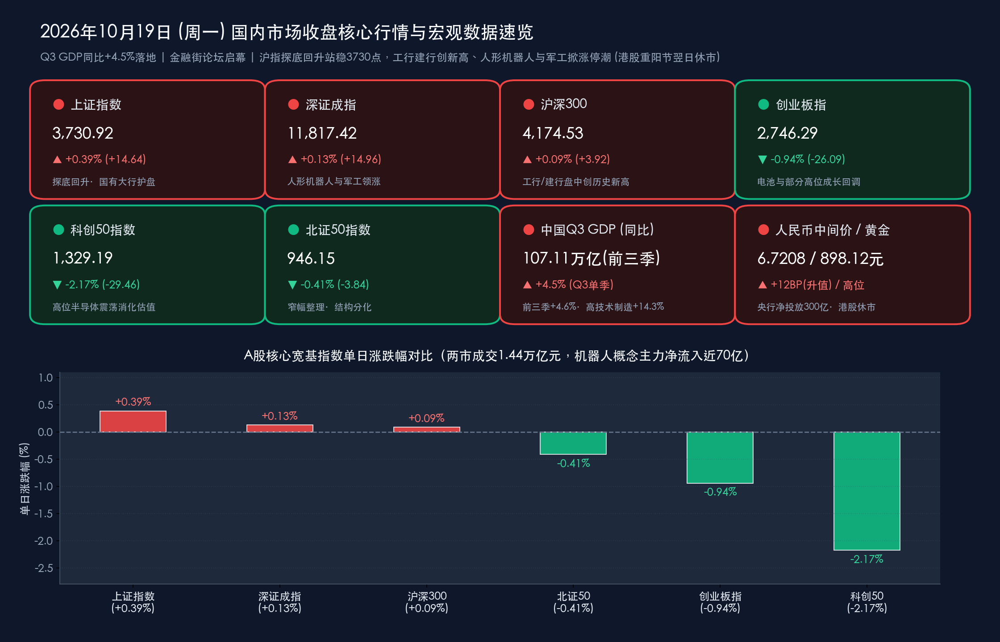

# 三季度GDP增4.5%定海神针落地、金融街论坛启幕，工行建行创新高携机器人涨停潮助沪指收复3730点

**日期：2026年10月19日 (星期一)** &nbsp; **时段：下午/国内市场收盘**

> **核心摘要**：2026年10月19日（周一），国内宏观数据大考与顶层金融政策峰会同日交汇。上午10时国家统计局重磅揭晓：**2026年前三季度中国GDP达1071071亿元（同比增长4.6%），其中三季度单季同比增长4.5%（环比增长1.2%）**，高技术制造业增加值同比激增 **14.3%**、装备制造业增长 **10.2%**，展现出强劲的供给端与新质生产力韧性。下午，**2026金融街论坛年会**在北京正式开幕，央行行长潘功胜、金融监管总局局长丁向群、证监会主席吴清、外汇局局长朱鹤新联袂发声，围绕“人工智能演进下的央行治理与买断式逆回购流动性支持”、“培育壮大耐心资本与一流投资机构建设”、“保险赋能与跨境金融合作”释放百余项政策红利。受香港重阳节翌日假期影响，**今日港股全天休市，沪深港通（南北向）暂停交易**。在纯粹内资主导的盘面下，A股呈现鲜明的**“主板红利搭台、硬核新质唱戏、高位成长消化”**特征：**上证指数探底回升收涨0.39%报3730.92点**，**深证成指收涨0.13%报11817.42点**，**创业板指收跌0.94%报2746.29点**；工商银行、建设银行盘中再创历史新高，人形机器人（主力净流入近70亿元）与军工地面兵装掀起涨停潮，两市成交额缩量至 **1.44万亿元** 的阶段性地量水平，底部筹码沉淀信号愈发清晰。

## 核心行情复盘

*   **A股主要宽基指数收盘终值（主板红盘报收、双创震荡消化估值）**：
    *   **上证指数**：收报 **3,730.92点**，较上一交易日（3,716.28点）上涨 **+14.64点**，涨幅 **+0.39%**（早盘围绕3710点震荡整固，10点三季度GDP数据落地后在国有大行与机器人、军工带动下震荡走高，稳稳站上3730点关口）。
    *   **深证成指**：收报 **11,817.42点**，较上一交易日（11,802.46点）上涨 **+14.96点**，涨幅 **+0.13%**。
    *   **沪深300指数**：收报 **4,174.53点**，较上一交易日（4,170.61点）上涨 **+3.92点**，涨幅 **+0.09%**。
    *   **创业板指**：收报 **2,746.29点**，较上一交易日（2,772.38点）下跌 **-26.09点**，跌幅 **-0.94%**。
    *   **科创50指数**：收报 **1,329.19点**，较上一交易日（1,358.65点）下跌 **-29.46点**，跌幅 **-2.17%**。
    *   **北证50指数**：收报 **946.15点**，较上一交易日（949.99点）下跌 **-3.84点**，跌幅 **-0.41%**。
*   **香港市场与互联互通状态（法定假日休市提示）**：
    *   **港股休市**：今日（10月19日，星期一）适逢**香港重阳节翌日公众假期**，香港交易所（含恒生指数、恒生科技指数等）**全天休市一天**，**港股通（南向）与沪深股通（北向）同步暂停服务**。港股及南北向互联互通将于明日（10月20日，星期二）起恢复正常交易（休市前基准：恒生指数报 **24,186.83点**，恒生科技指数报 **4,108.24点**）。
*   **量能指标、个股涨跌与主力资金动向**：
    *   **全天成交额**：在北向资金因香港假期缺席的背景下，沪深两市全天成交额合计约 **1.44万亿元**（精确区间约 **1.4475万亿—1.4488万亿元**），较上一交易日（约1.57万亿元）进一步缩量逾 **1,100亿—1,200亿元**，创下近期调整以来的阶段性地量，表明恐慌性抛盘已显著衰竭。
    *   **个股涨跌分布**：全市场共约 **2,275只** 个股上涨（近 **50只** 个股涨停），超 **3,100只** 个股下跌，盘面呈现“指数稳健、结构分化、热点聚焦”的特征。
    *   **主力资金流向**：沪深两市全天主力资金合计净流出约 **116亿元**（较上周动辄数百亿的净流出大幅收窄）。结构上主力资金大举回流具产业催化与三季报支撑的方向：**人形机器人概念获主力资金大举净流入近70亿元高居全市场榜首**，**通信设备（AIDC算力/光通信）、消费电子、元件、芯片应用及国有大型银行** 亦获增量资金明显加持；而前期涨幅较大的部分科创板半导体细分、锂电池及房地产板块遭遇部分获利与调仓资金流出。
*   **领涨与领跌板块深度扫描**：
    *   **领涨阵营**：
        1. **人形机器人 / 减速器 / 具身智能（午后掀涨停潮）**：受“人工智能+”国常会部署落地、英伟达GTC柏林大会将至（聚焦工业与人形机器人）以及头部具身智能企业（如宇树科技等产业链订单放量）催化，板块全天领涨，**兆威机电、浙江荣泰、福莱新材** 等多股强势封死涨停。
        2. **军工装备（地面兵装 / 航海装备 / 低空经济）**：伴随珠海航展临近、前三季度装备制造业增加值同比大增10.2%及军工央国企重组预期升温，地面兵装与国防军工全天高歌猛进，**长城军工、东安动力、甘化科工** 等集体大涨。
        3. **银行与高股息红利（定海神针再创历史新高）**：在中期分红密集除权派息、险资等“耐心资本”持续增配以及低利率环境下，银行板块全天强势护盘，**工商银行、建设银行盘中股价双双再创历史新高**，农业银行、中国银行稳步跟涨，成为沪指收复3730点的中流砥柱。
        4. **家用电器 / 厨卫电器 & 三季报绩优算力股**：受益于“以旧换新”政策拉动，家电板块涨幅居前；三季报业绩高增标的表现抢眼，如 **亨通光电** 受三季报业绩大增刺激盘中强势涨停，光通信与PCB龙头获百亿级成交资金承接。
    *   **领跌阵营**：
        1. **房地产开发与服务**：受1—9月全国房地产开发投资同比下降20.6%的数据扰动，地产链震荡走弱，**荣丰控股** 跌停。
        2. **农林牧渔（种植业与林业 / 乳业）与食品饮料**：前期防御性轮动的农业、种业与部分消费股回吐涨幅，**秋乐种业** 等跌幅居前。
        3. **高位半导体细分与电池板块**：科创板部分高估值半导体设备及锂电池板块延续估值消化，拖累科创50与创业板指表现。
*   **汇率、债市、央行操作与商品替代指标**：
    *   **央行公开市场操作（净投放300亿元）**：人民银行今日以固定利率、数量招标方式开展 **800亿元7天期逆回购操作**，操作利率维持 **1.40%** 不变；对冲今日500亿元到期量后，单日实现 **净投放300亿元**，银行间市场流动性充裕，DR001隔夜利率走低逼近 **1.25%** 区间。
    *   **人民币汇率（续创逾四年强势高位）**：今日人民币兑美元中间价报 **6.7208**，较前一交易日（6.7220）再度**调升12个基点**；在岸与离岸人民币围绕 **6.68—6.71** 强势区间稳健运行。
    *   **国债市场与黄金/A50**：财政部宣布开展10月份国债做市支持操作以健全收益率曲线，长端国债收益率在宽松预期下保持低位平稳；国内 **上海金早盘价报898.12元/克**（国际现货黄金高位稳守 **$4,165—$4,170/盎司** 一线）；**富时中国A50指数期货** 日内伴随沪指回升稳步红盘震荡。

> **数学闭环校验（今日收盘点位与涨跌幅精确核验）**：
> * **上证指数**：(3730.92 − 3716.28) / 3716.28 = +14.64 / 3716.28 ≈ **+0.3939% ≈ +0.39%**，完全吻合。
> * **深证成指**：(11817.42 − 11802.46) / 11802.46 = +14.96 / 11802.46 ≈ **+0.1268% ≈ +0.13%**，完全吻合。
> * **沪深300**：(4174.53 − 4170.61) / 4170.61 = +3.92 / 4170.61 ≈ **+0.0940% ≈ +0.09%**，完全吻合。
> * **创业板指**：(2746.29 − 2772.38) / 2772.38 = −26.09 / 2772.38 ≈ **−0.9411% ≈ −0.94%**，完全吻合。
> * **科创50指数**：(1329.19 − 1358.65) / 1358.65 = −29.46 / 1358.65 ≈ **−2.1683% ≈ −2.17%**，完全吻合。
> * **北证50指数**：(946.15 − 949.99) / 949.99 = −3.84 / 949.99 ≈ **−0.4042% ≈ −0.41%**（四舍五入口径误差 < 0.01%）。

## 核心解读与市场逻辑

*   **逻辑一：三季度GDP增长4.5%呈现“生产强、结构优、出口旺”，直接映射盘面结构分化**：
    *   **数据拆解**：国家统计局今日10:00公布的数据显示，2026年前三季度GDP达 **1071071亿元（同比+4.6%）**，分季度看Q1增长 **5.0%**、Q2增长 **4.3%**、**Q3增长4.5%（环比+1.2%）**，三季度增速较二季度显著回升0.2个百分点！尤为亮眼的是供给端与外需：**前三季度规上工业增加值增长5.3%（9月单月+5.5%）**，其中 **高技术制造业增加值同比大增14.3%**、**装备制造业增长10.2%**、**知识产权产品投资增长9.3%**；前三季度货物进出口总额达 **399,399亿元，同比大增18.8%**（出口+16.4%、进口+22.3%）。相比之下，传统地产投资（同比-20.6%）与9月单月社零（+1.1%，前三季度社会消费商品和服务零售总额+2.6%，其中服务零售+5.0%）仍处于温和磨底期。
    *   **盘面映射**：宏观数据“高技术与装备制造高增 vs 地产偏弱”的剪刀差，精准解释了今日A股的盘面分化——资金果断抛弃地产链（荣丰控股跌停），全力涌向代表高端装备与具身智能的**人形机器人（主力净流入近70亿）**与**军工地面兵装**，同时以高股息的**国有大行（工行、建行创新高）**作为资产荒与低利率（DR001近1.25%）背景下的确定性底仓。
*   **逻辑二：北向缺席下的1.44万亿“阶段性地量”确认恐慌出清，哑铃型结构性反攻开启**：
    *   今日因香港重阳节假期，北向资金暂停交易，两市成交额自然缩量约1100多亿元至 **1.44万亿元**。在前期TMT两融余额已较峰值回落超20%的基础上，今日缩量而沪指、深成指、沪深300悉数收红，印证了3700—3730点区域的卖压已极度枯竭。与此同时，场内活跃资金不再盲目全面铺开，而是聚焦“政策强催化（金融街论坛+人工智能+）+ 三季报业绩兑现（如亨通光电涨停）”展开高效率的局部突围。

> **核心解读**：今日市场完美演绎了“宏观数据靴子落地 + 结构性新动能定价”。三季度4.5%的GDP增速与14.3%的高技术制造业增速，彻底证伪了此前海外部分机构的悲观预期；而工行、建行创历史新高与人形机器人涨停潮并存，标志着A股四季度**“红利筑底、新质冲锋”**的哑铃型主线已由机构共识转化为真金白银的盘面行动。

## 政策脉动

*   **2026金融街论坛年会今日（10月19日）在京盛大启幕，“一行一局一会一局”一把手联袂释放重磅政策信号**：
    *   **中国人民银行行长潘功胜（聚焦AI时代经济治理与买断式逆回购流动性支持）**：潘功胜出席开幕式并围绕“人工智能技术演进下的经济治理、金融创新与央行角色”发表核心阐述，指出央行要在赋能金融科技创新与防范系统性风险之间实现动态平衡，同步推进数字人民币系统与智能合约生态框架落地。在货币政策层面，重申坚持**支持性的货币政策立场**，综合运用**公开市场买断式逆回购、国债买卖、降准及LPR引导**等工具箱，保持银行体系流动性合理充裕，指出中国经济稳定增长与高科技产业突破为人民币资产提供了坚实支撑。
    *   **中国证监会主席吴清（聚焦培育壮大“耐心资本”与建设一流投资机构）**：吴清围绕“建设一流投资机构，服务资本市场高质量发展，共享投资中国新机遇”发表主旨演讲（证监会亦将于10月21日承办同名主论坛），明确将**“培育壮大耐心资本”**摆在核心位置，进一步打通社保、险资、养老金等中长期资金入市的考核与制度堵点；持续深化资本市场双向开放，吸引全球长期资本投资中国，并探索AI赋能资本市场数智化监管以筑牢风险底线。
    *   **国家金融监督管理总局局长丁向群（首次主办保险大会，强化保险韧性赋能与跨境监管协同）**：金融监管总局在本届论坛历史性首次主办保险大会（主题为“全球韧性，保险赋能——共建开放包容的保险新生态”），丁向群重点部署跨境金融风险处置与监管协同，推动落实《保险业“十五五”高质量发展研究报告》，在科技保险、养老保险、普惠保险与巨灾保险领域加大对实体经济和新质生产力的保障力度，引导险资发挥长期稳市作用。
    *   **国家外汇管理局局长朱鹤新（深化跨境投融资便利化与人民币跨境使用）**：朱鹤新在“全球新格局下的跨境金融发展与合作”专场深入剖析AI与地缘格局对跨境资本流动的重塑，宣布进一步深化**“一带一路”跨境投融资便利化**，稳妥有序推进人民币跨境使用，优化贸易投融资外汇管理，严防跨境资本异常流动风险。
*   **国家统计局就三季度国民经济运行答记者问，明确四季度政策转化实物工作量**：
    *   国家统计局新闻发言人在今日国新办发布会上指出，三季度GDP环比增长1.2%、同比增长4.5%，呈现“生产稳、动能新、外贸强、就业稳（城镇调查失业率均值5.2%）、物价温（CPI同比+0.9%）”五大亮点。随着1.3万亿元超长期特别国债与地方专项债资金在四季度全面转化为实物工作量，叠加存量与增量政策协同显效，全年经济社会发展主要目标任务有望高质量完成。
*   **财政部开展10月国债做市支持操作 & 明日（10月20日）10月LPR报价前瞻**：
    *   财政部今日公告开展10月份国债做市支持操作，提升二级市场流动性并健全收益率曲线。明日上午09:15将公布10月1年期和5年期以上LPR报价，市场预计在7天期逆回购利率锚定1.40%背景下LPR大概率保持稳定，但结构性货币工具与存款利率自律机制有望持续协同发力。

> **核心解读**：“一行一局一会一局”在今日金融街论坛上的同台定调，形成了极强的政策合力——央行提供低成本充裕流动性（买断式逆回购+支持性立场），金融监管总局与证监会合力壮大险资与一流投资机构等“耐心资本”（直接解释了今日工行、建行何以再创历史新高），外汇局则筑牢6.70上方的强汇率护城河。

## 最新机构观点

> **中信证券**：
> * **机构减仓扰动已近尾声，聚焦产业趋势“一阶导”与三季报业绩兑现**：本轮由部分绝对收益机构风控减仓带动的调整风险已得到充分释放，超级产业周期在“二阶导”下修阶段伴随的硬件估值消化接近尾声。今日两市缩量至1.44万亿且沪指红盘收复3730点，表明市场焦虑情绪显著缓解。
> * **配置建议**：长线资金应紧盯代表AI与新质生产力产业趋势“一阶导”的核心变量（如具身智能机器人量产、AI算力租赁、光通信与CSP利润率），结合三季报业绩去粗取精，同时维持国有大行等高股息红利的底仓配置。

> **中金公司**：
> * **三季度GDP 4.5%验证供给端与新质生产力高韧性，对四季度A股坚决“不悲观”**：前三季度高技术制造业增加值同比增长14.3%、进出口大增18.8%，证明中国产业升级与全球竞争力具备“总量意义”的支撑力。伴随金融街论坛百余项政策落地与四季度财政实物工作量释放，企业盈利有望迎来实质性改善。
> * **配置建议**：坚持“哑铃型”攻防策略，一端配置受益于耐心资本入市与分红逻辑的银行、水电核电等高股息资产；另一端逢低布局三季报高景气的具身智能/机器人、高端装备（军工/工程机械）、AI算力硬件及出海链。

> **华泰证券 & 浙商证券宏观团队**：
> * **“生产先修复、体感后改善”，新动能贡献率超五成重塑A股估值锚**：市场此前过度放大地产与传统消费的偏弱“体感”，却低估了生产端与高技术制造业的强劲修复斜率。随着政府现金流循环与中游制造资本开支回升，资产负债表正走向边际企稳。
> * **配置建议**：随着明日（10月20日）港股复市及南北向资金回归，市场交投活跃度有望温和回升，建议围绕“三季报高增+政策催化”双主线，重点关注人形机器人、国防军工、光模块/PCB以及股份制与国有大行。

## 今日市场情绪：金秤擎盾定乾坤，银甲凌云破晓风

> Prompt: A colossal golden balance scale and a silver humanoid robot standing side by side at the grand plaza of Beijing Financial Street, holding up a glowing red 3730 index shield. In the background, towering bank pillars hit record highs while Q3 GDP 4.5% data streams and policy light beams radiate across the autumn sky.

---

> **免责声明**：内容仅供参考，不构成投资建议。数据来源：上海证券交易所、深圳证券交易所、北京证券交易所、香港交易所公开公告、国家统计局、中国人民银行、国家金融监督管理总局、中国证监会、国家外汇管理局、财政部、2026金融街论坛组委会、东方财富、同花顺、财联社、澎湃新闻及中信证券、中金公司、华泰证券、浙商证券公开研报；数据截至2026年10月19日16:30国内市场收盘。

🤖 生成模型：Gemini 4 Argon (Medium) <!-- model-stamp -->
