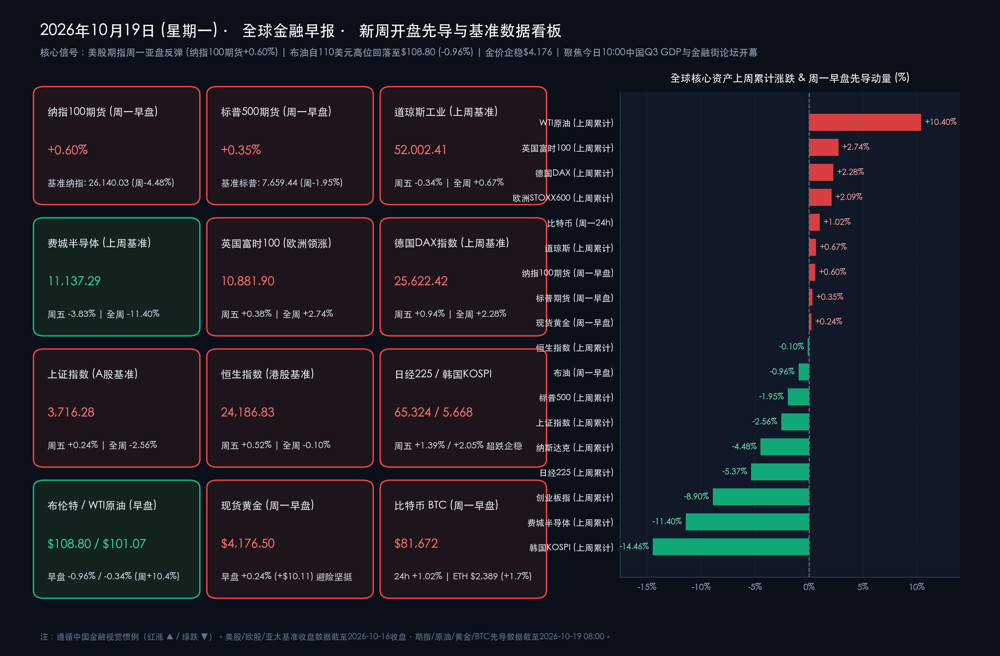

# 🌏 全球金融早报 · 新周展望：聚焦中国三季度GDP与2026金融街论坛启幕，美股期指反弹迎战Meta/特斯拉财报大考，对俄豁免预期令布油自110美元回落

**日期：2026年10月19日 (星期一)** &nbsp; **时段：早报 (国际市场 · 新周展望 · 模式C)**

> **核心摘要**：步入2026年10月第三周（10月19日—10月23日），全球金融市场迎来宏观重磅数据、中国顶层金融政策与美股科技巨头三季报的“三重巅峰对决”。国内方面，今日（10月19日）上午10:00国家统计局将公布**2026年前三季度及三季度GDP（市场一致预期同比+4.4%）与9月社零、固投、工增数据**；与此同时，**2026金融街论坛年会今日在北京正式开幕**，央行行长潘功胜、金融监管总局局长丁向群、证监会主席吴清、国家外汇局局长朱鹤新“一行一局一会”四位一把手将同台发表主题演讲并首发百余项金融改革创新成果，叠加周末**国常会再度定调“人工智能是影响未来发展的关键变量”**及**A股硬科技/半导体龙头（澜起科技、海光信息、中科曙光、长鑫科技等）密集回购护盘**，国内资本市场筑底反攻信号显著增强。国际与跨资产市场方面，经历上周费城半导体指数暴跌11.40%（创2008年以来八连跌）与韩国KOSPI周跌14.46%的猛烈去杠杆后，周一亚盘早间**美股三大期指全线高开反弹（纳斯达克100期货涨0.60%，标普500期货涨0.35%）**，**比特币反弹1.02%重返$81,672**，**现货黄金稳步上行0.24%至$4,176.50/盎司**；而在报道称美国政府拟豁免部分对俄能源制裁与关税后，市场预期俄罗斯燃料出口回升，推动**布伦特原油周一早盘自$110/桶上方回落0.96%至$108.80/桶（WTI原油回落至$101.07/桶）**，为周二至周三即将放榜的 **奈飞（Netflix）、通用汽车（GM）、特斯拉（Tesla）、Meta Platforms** 财报大考提供了宝贵的宏观喘息窗口。

---

## 周末财经要闻终极汇总

> **要闻一：国务院常务会议再部署深化“人工智能+”行动 + 2026金融街论坛年会今日启幕（“一行一局一会”齐聚发声）+ 证监会逾5亿元重罚操纵市场与硬科技回购潮**
> * **国常会定调AI为“关键变量”，突出应用牵引与算电协同**：国务院常务会议听取“人工智能+”行动进展情况汇报，明确指出**人工智能是影响未来发展的关键变量**。会议强调要立足我国产业体系完备、应用场景丰富等独特优势，**注重以落地应用牵引技术创新**，深化拓展“人工智能+”行动；同时要求夯实算法、**算电协同（算力与电力基础设施协同布局）**、高质量数据供给等发展底座，突出赋能实体经济并守牢安全底线，为近期经历估值调整的国产算力、AI应用及电网设备板块注入强力政策强心针。
> * **2026金融街论坛年会今日（10月19日）开幕，百余项改革成果首发**：10月19日至22日，以“开放·合作·包容——共筑全球金融发展新生态”为主题的2026金融街论坛年会在北京隆重举行，来自全球40多个国家和地区的400余位嘉宾出席。中国人民银行行长潘功胜、国家金融监督管理总局局长丁向群、中国证监会主席吴清、国家外汇管理局局长朱鹤新将同台发表年度重磅演讲，围绕“适度宽松货币政策执行”、“建设一流投资机构与壮大耐心资本”、“人工智能+金融治理”、“北交所与新三板一体化高质量发展”及“拓宽境外投资者参与境内黄金衍生品及大宗商品期货渠道”等议题释放核心增量信号。
> * **证监会重拳开出超5亿元罚单 + 硬科技龙头集体回购护盘**：周末证监会公布多份行政处罚决定书，对多名涉嫌操纵市场及内幕交易的自然人依法严厉查处，合计罚没金额**超过5亿元**，进一步净化资本市场生态；与此同时，针对上周科技板块的非理性回调，**澜起科技、海光信息、中科曙光、长鑫科技、鼎泰高科**等多家A股半导体与硬科技龙头周末密集发布或提议大额股份回购与增持计划，叠加宽基ETF持续放量净流入，产业资本与耐心资本合力构筑市场底部。

> **要闻二：美国拟放宽部分对俄能源制裁与关税触发百元油价早盘降温 + IMF/世行曼谷年会闭幕警示“高债务与顽固通胀”**
> * **对俄能源豁免消息缓和供应恐慌，布油自110美元高位回落**：上周受霍尔木兹海峡油轮安保摩擦与俄乌能源设施遇袭影响，WTI原油全周飙升10.40%（近月合约一度冲上$101.41/桶，布伦特原油突破$110/桶）。但据周末至周一早间最新外媒报道，美国总统特朗普倾向于豁免部分针对俄罗斯的制裁与关税限制，引发市场对俄罗斯原油及成品油出口重返全球供应链的预期。受此催化，周一（10月19日）亚盘早间国际油价自多月高点温和回落，**布伦特原油期货下跌0.96%报$108.80/桶**，**WTI原油交投于$98.80–$101.07/桶区间（近月微跌0.34%报$101.07/桶）**，一定程度上缓解了全球股市对“油价失控引发二次通胀”的紧绷神经。
> * **第54届IMFC曼谷声明与各国央行政策定调**：在泰国曼谷闭幕的IMF/世行年会上，第54届国际货币与金融委员会（IMFC）发布主席声明，强调全球经济虽具韧性但“绝无自满余地”，呼吁各国央行坚定维护物价稳定并重建财政缓冲。美联储主席凯文·沃什（Kevin Warsh）在曼谷高度肯定AI对长期生产率的变革作用，但拒绝对10月27—28日FOMC会议预设利率路径；中国人民银行行长潘功胜在IMFC会议上重申中国将继续实施好**适度宽松的货币政策**，保持流动性充裕，并呼吁坚决抵制单边贸易保护主义。

> **要闻三：华尔街迎战Q3财报季最关键一周（Meta、特斯拉、Netflix、SpaceX指标大考）+ 周一早间美股期指与加密资产联袂反弹**
> * **科技巨头打响“AI资本开支ROIC保卫战”**：在上周AI算力租赁独角兽CoreWeave因约500亿美元高息债务利差走阔暴跌11.91%、费城半导体指数周挫11.40%之后，本周华尔街将迎来决定科技股命运的超级财报周。市场焦点高度锁定周二盘后的 **奈飞 (Netflix)** 以及周三盘后的 **Meta Platforms** 与 **特斯拉 (Tesla)**（此外 **SpaceX** 亦将同步向投资者披露最新财务与AI相关运营指标，芯片与硬件端则有 **德州仪器 TXN、IBM、泛林集团 Lam Research** 放榜）。
> * **周一亚盘早间跨资产风险偏好企稳**：经历周末情绪消化与油价小幅回落提振，周一早盘美股期指率先企稳反弹，**纳斯达克100指数期货上涨0.60%**，**标普500指数期货上涨0.35%**；加密资产同步回暖，**比特币 (BTC) 反弹1.02%至$81,672**，**以太坊 (ETH) 上涨1.70%至$2,389**；避险资产方面，**现货黄金上涨0.24%至$4,176.50/盎司**，10年期美债收益率微降至 **5.08%**。

---

## 新一周市场核心博弈逻辑

*   **全球核心资产新周开盘基准与周一早盘先导指标全量清单**：
    *   **美股三大指数与期指先导（科技股超跌修复，迎战周三Meta/特斯拉财报）**：
        *   **纳斯达克100指数期货 (周一早盘)**：**+0.60%** 🔴 | **纳斯达克综合指数 (上周基准收盘)**：**26,140.03 点**（上周五 **-572.99 点 / -2.14%**，全周累计 **-1,226.00 点 / -4.48%** 🟢）。
        *   **标普500指数期货 (周一早盘)**：**+0.35%** 🔴（交投于 7,686 点上方） | **标普500指数 (上周基准收盘)**：**7,659.44 点**（上周五 **-84.62 点 / -1.09%**，全周累计 **-152.33 点 / -1.95%** 🟢）。
        *   **道琼斯工业指数 (上周基准收盘)**：**52,002.41 点**（上周五 **-175.28 点 / -0.34%**，全周累计逆势上涨 **+346.09 点 / +0.67%** 🔴）。
        *   **费城半导体指数 (SOX，上周基准收盘)**：**11,137.29 点**（上周五 **-443.55 点 / -3.83%**，全周累计暴跌 **-1,433.01 点 / -11.40%** 🟢，录得2008年以来最长的八连跌，周一盘前芯片股跟随纳指期货温和反弹）。
    *   **欧洲核心股指基准（低科技权重与能源金融护盘，上周全线跑赢全球）**：
        *   **欧洲 STOXX 600 指数**：上周收盘 **644.43 点**（周五 **+4.27 点 / +0.67%**，全周累计 **+13.19 点 / +2.09%** 🔴）。
        *   **英国富时 100 指数 (FTSE 100)**：上周收盘 **10,881.90 点**（周五 **+41.55 点 / +0.38%**，全周累计 **+290.22 点 / +2.74%** 🔴）。
        *   **德国 DAX 指数**：上周收盘 **25,622.42 点**（周五 **+239.80 点 / +0.94%**，全周累计 **+571.18 点 / +2.28%** 🔴）。
    *   **亚太股市与A股/港股基准（周五率先止跌企稳，今日迎战中国Q3 GDP与金融街论坛）**：
        *   **上证指数 (SSE)**：上周收盘 **3,716.28 点**（周五 **+8.80 点 / +0.24%**，全周累计 **-97.64 点 / -2.56%** 🟢）；**深证成指** 收报 **11,802.46 点**（周五 **-0.12%** / 全周 **-6.64%** 🟢）；**创业板指** 收报 **2,772.38 点**（周五 **-10.85 点 / -0.39%**，全周 **-8.90%** 🟢）。
        *   **恒生指数 (HSI)**：上周收盘 **24,186.83 点**（周五 **+124.11 点 / +0.52%**，全周仅微跌 **-24.21 点 / -0.10%** 🟢，展现出极强的抗跌韧性）。
        *   **日经 225 指数 & 韩国 KOSPI 指数**：日经225上周收盘 **65,324.29 点**（周五 **+898.34 点 / +1.39%**，全周 **-3,706.98 点 / -5.37%** 🟢）；韩国KOSPI上周收盘 **5,668.05 点**（周五 **+113.83 点 / +2.05%** 终结八连跌，全周 **-958.15 点 / -14.46%** 🟢）。周一早盘日韩股市围绕上周五收盘位震荡整固，消化芯片股估值修复与日元波动。
    *   **大宗商品、美债、外汇与加密资产（周一早盘最新动态）**：
        *   **布伦特原油 & WTI原油期货**：周一早盘布伦特原油报 **$108.80/桶**（较上周五结算价 $109.85/桶回落 **-$1.05 / -0.96%** 🟢）；WTI原油近月交割合约报 **$101.07/桶**（较上周五近月结算价 $101.41/桶微跌 **-$0.34 / -0.34%** 🟢，主力合约交投于 $98.80–$101.07/桶区间，上周全周暴涨 **+10.40%** 🔴）。
        *   **现货黄金 (XAU/USD)**：周一早盘报 **$4,176.50/盎司**（较上周五收盘 $4,166.39/盎司上涨 **+$10.11 / +0.24%** 🔴，上周全周微跌 **-0.70%**）。
        *   **美国10年期国债收益率 & 美元指数 (DXY)**：10年期美债收益率周一早盘报 **5.08%**（较上周五收盘 5.09% 微降 **-1 bp** 🟢，上周全周上行 +6 bps）；美元指数报 **101.68**（较上周五收盘 101.75 微跌 **-0.07%** 🟢）。
        *   **加密资产 (BTC & ETH)**：周一早盘 **比特币 (BTC)** 报 **$81,672**（近24小时上涨 **+$824 / +1.02%** 🔴，较周日早间 $81,420 稳步回升）；**以太坊 (ETH)** 报 **$2,389**（近24小时上涨 **+$40 / +1.70%** 🔴）。

> **数学闭环校验（基准收盘终值 & 周一早盘先导数据核验）**：
> * **道指基准**：上周五 52,177.69 − 175.28 = 52,002.41（-0.336% ≈ -0.34%）；全周 51,656.32 + 346.09 = 52,002.41（+0.670% ≈ +0.67%），吻合；
> * **标普500基准**：上周五 7,744.06 − 84.62 = 7,659.44（-1.093% ≈ -1.09%）；全周 7,811.77 − 152.33 = 7,659.44（-1.950% ≈ -1.95%），吻合；
> * **纳指基准**：上周五 26,713.03 − 572.99 = 26,140.04（官方收盘 26,140.03，-2.145% ≈ -2.14%）；全周 27,366.03 − 1,226.00 = 26,140.03（-4.480% ≈ -4.48%），吻合；
> * **费城半导体基准**：上周五 11,580.84 − 443.55 = 11,137.29（-3.830% ≈ -3.83%）；全周 12,570.30 − 1,433.01 = 11,137.29（-11.400% ≈ -11.40%），吻合；
> * **上证指数 & 恒生指数基准**：上证全周 3,813.92 − 97.64 = 3,716.28（-2.560% ≈ -2.56%）；恒指全周 24,211.04 − 24.21 = 24,186.83（-0.100% ≈ -0.10%），吻合；
> * **布伦特原油 & WTI原油早盘**：布油 109.85 − 1.05 = 108.80（-0.956% ≈ -0.96%）；WTI近月 101.41 − 0.34 = 101.07（-0.335% ≈ -0.34%），吻合；
> * **现货黄金 & 比特币早盘**：黄金 4,166.39 + 10.11 = 4,176.50（+0.243% ≈ +0.24%）；BTC 80,848 + 824 = 81,672（+1.019% ≈ +1.02%），全量指标误差均远小于 0.5%。

> **新一周三大核心博弈逻辑深度剖析**：
> 1. **博弈一：从“高息算力债恐慌”到“科技巨头ROIC真金白银大考”（美股与全球半导体生死线）**
>    上周全球科技股遭遇“黑色一周”（费半八连跌累挫11.40%、韩国KOSPI暴跌14.46%），导火索在于高利率环境下市场对AI基础设施高杠杆债务（如CoreWeave约500亿美元债务违约风险溢价飙升）与大模型商业化变现滞后的集中清算。本周三（10月21日）盘后，**Meta Platforms** 将公布三季报，市场一致预期其营收同比增长约 **23%**，但真正的博弈焦点在于其高达 **1,300亿—1,450亿美元（$130B–$145B）** 量级的AI与数据中心资本开支（CapEx）指引及广告ROIC转化率：若Meta证明AI推荐算法正持续转化为广告高增速与健康的自由现金流，全球半导体与光模块产业链将迎来强力逼空修复；反之，若CapEx继续膨胀而利润率承压，科技股去杠杆或将向纵深蔓延。同日放榜的 **特斯拉（预期EPS约$0.43）** 与罕见同步披露财务及AI指标的 **SpaceX**，则将检验自动驾驶（FSD/Robotaxi）与物理AI商业化的真实成色。
> 2. **博弈二：“百元油价+5%美债收益率”的宏观紧箍咒 vs. 地缘能源豁免预期**
>    上周10年期美债收益率站上5.09%、布伦特原油突破110美元，令华尔街对“滞胀型高利率滞留（Higher-for-Longer）”产生高度戒备，美联储主席沃什在曼谷年会上亦拒绝承诺10月降息。然而周一早盘美国拟豁免部分对俄制裁与关税的消息令布油回落近1%至$108.80/桶，显示在11月3日美国中期选举临近之际，白宫正试图通过行政与外交工具强力压制能源通胀。本周油价能否回落至100美元下方，将直接决定美债收益率能否自5.08%–5.10%高位显著回落，进而左右全球成长股的估值分母。
> 3. **博弈三：中国“Q3 GDP经济底 + 金融街论坛政策底 + 硬科技回购产业底”三底共振**
>    相比于海外科技股的高估值去杠杆，A股与港股上周展现出更强的底部支撑（恒指全周仅微跌0.10%，沪指周五逆势收红于3,716.28点）。今日（10月19日）上午10:00公布的**中国三季度GDP及9月经济数据**将验证宏观经济修复斜率；紧随其后的**2026金融街论坛年会**上，“一行一局一会”一把手同台发声并首发百余项金融改革成果，配合国常会“人工智能+”落地应用部署以及澜起科技、海光信息等硬科技龙头密集回购，A股正迎来“经济数据落地+顶层政策催化+三季报业绩兑现”的四季度核心做多窗口。

---

## 本周重磅经济数据与会议前瞻

*   **周一（10月19日）——中国三季度GDP重磅放榜 + 2026金融街论坛年会盛大启幕**：
    *   **10:00 中国2026年前三季度及三季度国民经济运行情况发布会**：国家统计局公布**三季度GDP同比增速（市场预期约+4.4%）**，以及9月规模以上工业增加值、社会消费品零售总额、1—9月全国固定资产投资与房地产开发投资增速。
    *   **全天 2026金融街论坛年会开幕式及主论坛（北京，10月19日—22日）**：中国人民银行行长潘功胜、金融监管总局局长丁向群、证监会主席吴清、国家外汇局局长朱鹤新发表主题演讲，聚焦适度宽松货币政策工具、耐心资本入市与一流投资机构建设、人工智能+金融监管及资本市场高水平开放。
*   **周二（10月20日）——中国10月LPR报价 + 美国9月新屋开工 + 奈飞（Netflix）与通用汽车（GM）财报**：
    *   **09:15 中国10月贷款市场报价利率（LPR）公布**：关注1年期与5年期以上LPR报价动向及银行净息差平衡信号。
    *   **20:30 美国9月新屋开工与营建许可**：预期新屋开工年化约 **130.0万–130.5万套**，营建许可约 **138.5万–140.0万套**。
    *   **美股核心财报**：盘前 **通用汽车 (GM)**、**GE Aerospace** 放榜；盘后流媒体巨头 **奈飞 (Netflix, NFLX)** 公布Q3财报（核心看点：自由现金流FCF指引与广告订阅层ARPU增速）及芯片设备巨头 **德州仪器 (TXN)** 放榜（检验工业与汽车模拟芯片周期复苏斜率）。
*   **周三（10月21日）——Meta与特斯拉（及SpaceX财务披露）巅峰财报夜 + 英国9月CPI**：
    *   **14:00 英国9月CPI通胀数据**：检验欧洲能源价格波动对英国通胀及英央行政策路径的影响。
    *   **美股盘后巅峰财报（决定全球科技股走向）**：
        *   **Meta Platforms (META)**：市场预期Q3营收增长约 **23%**，聚焦 **$130B–$145B** 数据中心与AI资本开支指引及AI广告变现效率。
        *   **特斯拉 (Tesla, TSLA)**：市场预期Q3调整后EPS约 **$0.43**，聚焦全球电动车交付毛利率、储能业务放量及FSD/Robotaxi商业化进展；同日 **SpaceX** 将罕见披露最新财务与AI算力相关指标。
        *   **IBM**、**泛林集团 (Lam Research, LRCX)** 亦将于周三盘后披露业绩，直接映射企业级AI咨询订单与存储晶圆厂设备支出景气度。
*   **周四至周五（10月22日—23日）——欧美10月标普全球Flash PMI初值 + 美国初请失业金 + 美联储静默期**：
    *   **周四（10月22日）20:30**：美国截至10月17日当周初请失业金人数、美国9月成屋签约销售指数。
    *   **周五（10月23日）全天**：欧元区、德国、英国、日本及美国同步公布**10月标普全球（S&P Global）制造业与服务业PMI初值**；22:00公布美国10月密歇根大学消费者信心指数终值（初值为46.3）及1年期/5年期通胀预期终值。
    *   **美联储FOMC会前静默期（Blackout Period）**：10月27—28日FOMC议息会议前最后一周，美联储官员全面静默，宏观交易完全锚定PMI数据与油价走势。

---

## 头部券商/投行开盘策略点睛

> **中信证券 (CITIC Securities)**：
> * **A股本轮调整已接近尾声，AI硬件第一轮估值调整到位，把握“GDP落地+金融街论坛”反攻契机**：中信证券最新开盘策略指出，近期A股与创业板的震荡调整主要由机构重仓股获利回吐与海外高杠杆AI算力债恐慌诱发，但宽基ETF近期持续获得大规模放量净流入，叠加澜起科技、海光信息等硬科技龙头密集发布回购计划，构成了明确的底部信号。针对市场热议的AI板块，超级产业周期增长“二阶导”下修过程中的第一轮硬件估值调整已基本到位，长线资金可密切跟踪内存价格与算卡租赁价格等反映产业“一阶导”景气的核心变量。配置上建议紧扣三条主线：① 业绩兑现度高的算力硬件（光通信、PCB、国产芯片）；② 受益于财政扩张与“反内卷”供给出清的能化、机械等顺周期方向；③ 煤炭、银行等高股息红利底仓及出海龙头。

> **中信建投 (CSC Financial) & 光大证券 (Everbright Securities)**：
> * **中长期耐心资本积极托底，紧扣三季报业绩主线与国常会“人工智能+”落地应用**：中信建投与光大证券策略团队认为，随着今日三季度GDP揭晓与2026金融街论坛年会释放“一行一局一会”增量政策，市场恐慌情绪将显著消退，四季度做多窗口正在打开。国常会最新强调“以落地应用牵引技术创新”与“算电协同”，意味着AI投资重心正从单纯的海外算力映射转向国内垂直场景应用、算电协同基建（电网设备、绿电算力中心）及半导体自主可控；短期操作上建议以低估值红利与非银金融为底仓，逢低布局三季报高景气的硬科技与政策发力的内需顺周期板块。

> **高盛 (Goldman Sachs)**：
> * **美股期指反弹迎来“三季报试金石”，Meta与德州仪器/泛林集团财报将裁决芯片股去杠杆进程**：高盛美股策略团队在周一开盘前瞻中指出，上周费城半导体指数11.40%的暴跌已将芯片板块的短期多头拥挤度清洗至年内低位，促成了周一早盘纳指100期货（+0.60%）的技术性反弹。但反弹能否升级为趋势性反转，完全取决于周二至周三Meta的AI资本开支指引以及泛林集团（Lam Research）、德州仪器（TXN）对存储与工业芯片需求的定调。在10年期美债收益率仍处5.08%高位的背景下，高盛建议机构在科技股内部严格执行“资产负债表筛选”，做多现金流充沛的超大盘AI巨头，规避高负债率、自由现金流为负的二线算力租赁商。

> **摩根士丹利 (Morgan Stanley)**：
> * **对俄能源制裁豁免预期令百元油价暂歇，继续超配欧洲价值蓝筹、黄金与高自由现金流能源工业股**：摩根士丹利跨资产团队表示，周一早盘关于美国拟放宽部分对俄能源制裁与关税的报道令布伦特原油自110美元回落至108.80美元，短期缓解了全球市场的滞胀尾部焦虑。但鉴于中东地缘摩擦与全球主权债务扩张格局未改，现货黄金（早盘升至$4,176.50/盎司）与欧洲低估值价值股（英国富时100与德国DAX上周均录得逾2%正收益）仍具备极佳的风险收益比，建议跨资产组合维持“实物资产+高分红价值蓝筹”的杠铃防御结构。

---

## 今日市场情绪：光羽涅槃金融街，财报锋芒试硅心

> Prompt: A majestic mechanical phoenix forged from glowing emerald and gold optical fibers rising above the modern glass towers of Beijing's Financial Street and a giant golden "Q3 GDP" monolith, carrying a luminous AI silicon core across a stormy ocean of stock candlesticks. In the background, Wall Street earnings spotlights for Meta and Tesla pierce through dark clouds while crimson crude oil waves subside beneath a starry dawn sky.

---

> **免责声明**：内容仅供参考，不构成投资建议。数据来源：国务院常务会议公报、国家统计局及2026金融街论坛年会官方议程、中国证监会及中国人民银行官方公告、IMF/世行曼谷年会第54届IMFC声明、纽约证券交易所/纳斯达克/伦敦证券交易所/东京证券交易所/韩国交易所/港交所/上交所/深交所官方统计、彭博终端及各大投行券商开盘策略研报；全球股指基准收盘数据截至2026年10月16日收盘，美股期指、原油、黄金、美债及加密资产先导数据截至2026年10月19日08:00。

🤖 生成模型：Gemini 4 Argon (Medium) <!-- model-stamp -->
