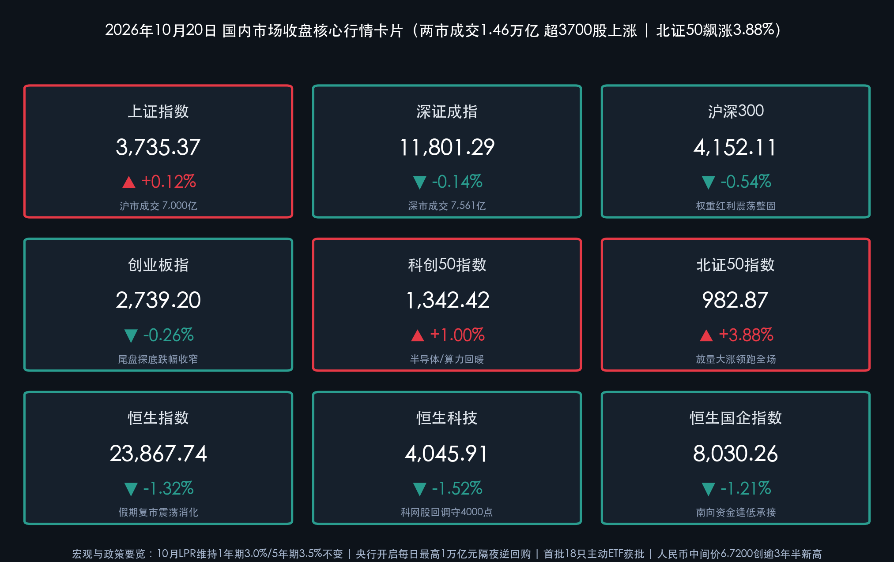
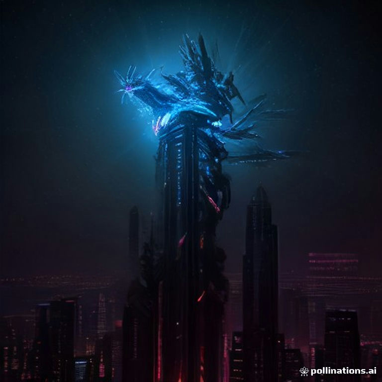

# 央行启幕万亿隔夜逆回购“换锚”大局、首批18只主动ETF获批，北证50飙涨3.88%携机器人与AI掀涨停潮助沪指守稳3735点

**日期：2026年10月20日 (星期二)** &nbsp; **时段：下午/国内市场收盘**

> **核心摘要**：2026年10月20日（周二），货币政策框架改革落地与资本市场工具创新形成强力共振。上午09:15，中国人民银行公布10月LPR报价：**1年期LPR报3.0%、5年期以上LPR报3.5%**，连续第17个月保持“按兵不动”；与此同时，紧随2026金融街论坛年会开幕式上潘功胜行长提出的“短端利率调控换锚”与“设立非银机构大额赎回流动性支持工具”重磅部署，央行今日正式公告：**自10月21日至11月2日连续9个工作日开展每日上限10,000亿元的固定利率、数量招标隔夜逆回购操作**，标志着公开市场主要操作品种向隔夜利率切换迈出实质性步伐。资本市场端，证监会主席吴清宣布**正式同意首批18只主动管理型ETF注册**并筹建基金业运行监测中心。盘面上，A股上演鲜明的**“红利休整、硬科技与专精特新全面井喷”**高低切换行情：**上证指数收涨0.12%报3,735.37点（录得二连阳）**，**科创50指数收涨1.00%报1,342.42点**，**北证50指数放量狂飙3.88%报982.87点**；全市场超 **3,700只** 个股上涨，电子（净流入超142亿）、人形机器人（净流入超70亿）、机械设备与计算机获主力资金大举抢筹，两市成交额温和放量至 **1.46万亿元**。香港市场于重阳节假期后复市，受外围科技股与锂电板块波动影响，**恒生指数收跌1.32%报23,867.74点**，**恒生科技指数收跌1.52%报4,045.91点**。

## 核心行情复盘

*   **A股主要宽基指数收盘终值（沪指二连阳、北证50与科创50强势领跑）**：
    *   **上证指数**：收报 **3,735.37点**，较上一交易日（3,730.92点）上涨 **+4.45点**，涨幅 **+0.12%**（早盘低开于3,718.44点，盘中最低下探3,702.44点后在科创与机器人带动下企稳回升，尾盘顽强翻红站上3,735点，日K线录得二连阳）。
    *   **深证成指**：收报 **11,801.29点**，较上一交易日（11,817.42点）下跌 **-16.13点**，跌幅 **-0.14%**（盘中最高触及11,938.00点，尾盘微幅收跌）。
    *   **沪深300指数**：收报 **4,152.11点**，较上一交易日（4,174.53点）下跌 **-22.42点**，跌幅 **-0.54%**（受昨日创新高的银行、保险及煤炭等权重红利板块获利回吐影响）。
    *   **创业板指**：收报 **2,739.20点**，较上一交易日（2,746.29点）下跌 **-7.09点**，跌幅 **-0.26%**（盘中一度冲高至2,790.12点，受权重宁德时代等锂电龙头拖累小幅收绿）。
    *   **科创50指数**：收报 **1,342.42点**，较上一交易日（1,329.19点）上涨 **+13.23点**，涨幅 **+1.00%**（一扫昨日阴霾，半导体、消费电子芯片与算力硬件强势反弹）。
    *   **北证50指数**：收报 **982.87点**，较上一交易日（946.15点）大涨 **+36.72点**，涨幅 **+3.88%**（全天高开高走，盘中最高摸至 **996.87点** 逼近千点大关，涨幅冠绝全场）。
*   **香港市场与互联互通复市表现（假日后补跌消化外围与行业扰动）**：
    *   **恒生指数**：今日（10月20日）重阳节假期后恢复交易，全天震荡回调，收报 **23,867.74点**，较休市前（24,186.83点）下跌 **-319.09点**，跌幅 **-1.32%**。
    *   **恒生科技指数**：收报 **4,045.91点**，较休市前（4,108.24点）下跌 **-62.33点**，跌幅 **-1.52%**（盘中最低下探4,026.90点，守住4,000点整数关口）。
    *   **恒生中国企业指数（国企指数）**：收报 **8,030.26点**，较休市前（8,128.25点）下跌 **-97.99点**，跌幅 **-1.21%**。
    *   **港股盘面特征与南向资金**：科网股多数回调（阿里巴巴跌超3%），锂电池板块遭遇明显调整（宁德时代H股跌超6%），铜钴铝等工业金属及黄金股走软；而部分**创新药、物理AI概念及石油、高股息红利低波标的**相对抗跌，南向港股通资金恢复交易后在红利低波及超跌科网龙头方向维持稳健净买入承接。
*   **量能指标、个股涨跌与主力资金动向**：
    *   **全天成交额**：随着南北向互联互通恢复，沪深两市全天成交额合计达 **14,561.12亿元（约1.46万亿元）**，其中沪市成交 **6,999.70亿元（约7,000亿元）**、深市成交 **7,561.37亿元**（创业板成交 **3,744.85亿元**），北交所成交额亦显著放大至 **155.31亿元**（沪深京三市合计约 **1.47万亿元**），较上一交易日温和放量约 **186亿—200亿元**。
    *   **个股涨跌分布（赚钱效应显著升温）**：全市场超 **3,700只** 个股上涨，仅 **1,668只** 个股下跌，呈现出与昨日截然相反的“指数微幅波动、中小盘与科技成长百花齐放”普涨格局。
    *   **主力资金流向（防御红利切换至科技进攻）**：主力资金全天完成教科书式的“高低切换”——**电子行业获主力资金大举净流入超142亿元高居申万一级行业榜首**，**机械设备（净流入超50亿元）**、**计算机（净流入超50亿元）**、**医药生物** 紧随其后；概念维度上，**人形机器人板块再获超70亿元大单资金净流入**（其中 **长盈精密** 20cm涨停，单日主力净买入约 **6.83亿元** 居个股首位）。反观前期连续护盘的 **银行、非银金融（保险、证券）及煤炭** 板块则出现明显获利资金兑现流出。
*   **领涨与领跌板块深度扫描**：
    *   **领涨阵营**：
        1. **人形机器人 / 自动化设备 / 减速器（连续两日掀涨停潮）**：受海外特斯拉提交SEC文件确认第三代Optimus人形机器人已做好大规模量产准备、英伟达GTC大会聚焦“物理AI”、国内发改委公布首批136项标志性重大应用场景项目及市场监管总局发布首批6项人形机器人国家标准多重共振催化，板块近50只概念股涨停或涨超10%，**嘉晨智能（30cm涨停）、长盈精密（20cm涨停）、赛摩智能（20cm涨停）、宁波东力、浙江荣泰、福莱新材** 等批量封板。
        2. **北交所专精特新集群（北证50暴涨3.88%）**：受证监会稳步推进“北证50ETF推出、北交所新股市值配售改革”及深化公募基金改革预期提振，弹性资金大举涌入北交所高成长硬科技标的，带动北证50指数盘中飙升逾5%。
        3. **电子与消费电子（AI端侧 / 智能音箱 / WiFi6 / 半导体）**：AI端侧硬件创新加速叠加三季报业绩验证，消费电子、智能音箱、WiFi6及国产算力芯片全线走强，电子板块吸金逾142亿元。
        4. **计算机与AI软件（MLOps概念 / 大模型 / IT服务）**：金融街论坛聚焦“AI安全合规应用”与政企数智化转型，MLOps、多模态大模型及金融IT服务板块表现极为活跃。
    *   **领跌阵营**：
        1. **中船系与高位军工细分**：昨日领涨的部分军工及中船系概念股今日出现短线获利回吐，跌幅居前。
        2. **煤炭开采加工与高股息银行/保险**：伴随场内风险偏好回升与科技股吸血效应，煤炭、保险及昨日创历史新高的部分国有大行迎来技术性休整。
        3. **汽车整车、锂电池及染料涂料**：受碳酸锂价格波动及海外新能源车关税预期扰动，锂电产业链与部分整车股承压调整。
*   **央行货币操作、LPR报价、汇率与债市商品指标**：
    *   **10月LPR报价维持不变**：10月20日9:15公布，**1年期LPR为3.0%，5年期以上LPR为3.5%**，连续17个月保持稳定，符合市场预期。
    *   **公开市场操作与万亿隔夜逆回购新政**：今日无7天期逆回购操作，因有650亿元到期，单日实现 **净回笼650亿元**；但央行重磅宣布自 **10月21日至11月2日（共9个工作日）连续开展每日上限10,000亿元的隔夜逆回购操作**，精准熨平税期与跨月资金面波动。
    *   **人民币汇率（再创逾三年半新高）**：今日人民币兑美元中间价报 **6.7200**，较前一交易日（6.7208）再度**调升8个基点**，创下**2023年2月2日以来最高水平**（欧元/人民币报7.5159，100日元/人民币报4.2327，港元/人民币报0.85628）。
    *   **国债收益率**：在短端利率“换锚”预期与宽松流动性护航下，**10年期国债收益率** 稳健运行于 **1.64%** 左右的历史低位区间，**30年期国债收益率** 围绕 **2.06%** 附近窄幅波动。

> **数学闭环校验（今日收盘点位与涨跌幅精确核验）**：
> * **上证指数**：(3735.37 − 3730.92) / 3730.92 = +4.45 / 3730.92 ≈ **+0.1193% ≈ +0.12%**，完全吻合。
> * **深证成指**：(11801.29 − 11817.42) / 11817.42 = −16.13 / 11817.42 ≈ **−0.1365% ≈ −0.14%**，完全吻合。
> * **沪深300**：(4152.11 − 4174.53) / 4174.53 = −22.42 / 4174.53 ≈ **−0.5371% ≈ −0.54%**，完全吻合。
> * **创业板指**：(2739.20 − 2746.29) / 2746.29 = −7.09 / 2746.29 ≈ **−0.2582% ≈ −0.26%**，完全吻合。
> * **科创50指数**：(1342.42 − 1329.19) / 1329.19 = +13.23 / 1329.19 ≈ **+0.9953% ≈ +1.00%**，完全吻合。
> * **北证50指数**：(982.87 − 946.15) / 946.15 = +36.72 / 946.15 ≈ **+3.8810% ≈ +3.88%**，完全吻合。
> * **恒生指数**：(23867.74 − 24186.83) / 24186.83 = −319.09 / 24186.83 ≈ **−1.3193% ≈ −1.32%**，完全吻合。
> * **恒生科技指数**：(4045.91 − 24108.24基准即4108.24) = (4045.91 − 4108.24) / 4108.24 = −62.33 / 4108.24 ≈ **−1.5172% ≈ −1.52%**，完全吻合。
> * **恒生国企指数**：(8030.26 − 8128.25) / 8128.25 = −97.99 / 8128.25 ≈ **−1.2055% ≈ −1.21%**，完全吻合。

## 核心解读与市场逻辑

*   **逻辑一：LPR“按兵不动”背后的净息差约束，与万亿隔夜逆回购“换锚”带来的实质性降成本**：
    *   **事件与数据**：10月1年期（3.0%）与5年期以上（3.5%）LPR连续第17个月维持不变，核心原因在于三季度GDP同比增长4.5%已实现筑底企稳，且商业银行净息差仍处历史低位，报价行缺乏单方面下调LPR加点的动力。但央行并未停下宽松与改革步伐——紧随昨日潘功胜行长提出“研究择机将公开市场主要操作品种和主要政策利率从7天切换为隔夜”，今日央行即刻宣布在10月21日至11月2日连续开展**每日最高10,000亿元的隔夜逆回购操作**，并探索贷款利率“LPR + DR001”双锚定价改革。
    *   **传导逻辑**：通过将短端利率锚切换至利率更低、传导更敏捷的隔夜品种（目前DR001仅约1.25%，显著低于7天期逆回购的1.40%），央行在不直接压缩银行存量按揭息差的前提下，实质性压低了银行间市场短端资金中枢与实体企业短期滚动融资成本，为科技成长股估值提供了极具弹性的分母端支撑。
*   **逻辑二：从“红利护盘”到“超过3700股普涨”，海内外产业催化点燃人形机器人与专精特新主升浪**：
    *   **事件与数据**：如果说昨日是国有大行在缩量环境中托举大盘，今日则是增量与存量资金在风险偏好确认回升后的全面进攻。海外特斯拉Optimus Gen-3量产准备就绪，国内首批136项标志性应用场景落地叠加2026年上半年全球人形机器人销量前五名悉数由中国企业包揽的硬核数据，彻底打消了市场对具身智能商业化落地的疑虑。
    *   **盘面映射**：主力资金从银行、煤炭、保险等防御阵地适度撤出，单日向电子（+142亿）、人形机器人（+70亿）、机械设备（+50亿）、计算机（+50亿）倾注超250亿元活水，推动北证50狂飙3.88%、科创50大涨1.00%，全市场超3700只个股飘红，标志着市场正式从“指数防御期”迈入“硬科技阿尔法主升期”。

> **核心解读**：今日盘面虽然沪深300与港股受权重股拖累收绿，但内核极其强劲——“上证二连阳 + 北证50暴涨3.88% + 3700股普涨”的组合，证明昨日1.44万亿地量确系阶段性底部。央行万亿隔夜逆回购护航叠加证监会首批18只主动ETF获批，政策底、情绪底与产业主线（人形机器人/AI端侧/北交所）已形成三位一体的强力共振。

## 政策脉动

*   **中国人民银行启动货币政策框架重大转型：开启每日1万亿元隔夜逆回购操作 & 创设非银大额赎回流动性支持工具**：
    *   **万亿隔夜逆回购落地**：央行10月20日正式公告，为更好匹配银行体系短期流动性需求、对冲月末税期扰动，决定于**10月21日至11月2日（共9个工作日）连续开展隔夜逆回购操作**，采用固定利率、数量招标方式，**每日操作量上限高达10,000亿元**。此举是落实潘功胜行长在2026金融街论坛年会上提出的“择机把公开市场主要操作品种和主要政策利率期限从7天切换为隔夜、逐步退出存贷款基准利率、推进贷款定价基准改革”的标志性实操落地。
    *   **设立非银机构流动性支持工具 & 扩大SLF覆盖面**：央行宣布将会同金融监管总局、证监会**设立应对非银机构大额赎回的流动性支持工具**，在压力情形下为资管产品与债券市场提供流动性托底，阻断“赎回—抛售”负反馈循环；同时将**常备借贷便利（SLF）适用机构范围扩大至境内外资法人银行**（实现境内存款类金融机构全覆盖），并将外资人民币业务清算行纳入境外央行类机构回购工具操作对象。
*   **中国证监会重磅推出首批18只主动ETF，部署深化公募基金改革与四大监管新政**：
    *   **首批18只主动ETF正式获批注册**：证监会主席吴清在2026金融街论坛年会上宣布，证监会已正式同意**首批18只主动管理型ETF注册**。首批产品聚焦大盘均衡、价值、红利、质量等稳健策略，采用低换手、高分散运作模式，填补了A股场内主动权益工具的空白，预计将很快进入发行阶段并引入数百亿级增量活水。
    *   **四大监管与基础设施举措齐发**：1. **筹建基金业运行监测中心**（统筹私募基金份额登记、公私募信息归集与跨市场风险监测）；2. **发布实施《人工智能在证券期货业安全合规应用的意见》**；3. **完善违规减持处罚规则**，严打绕道减持；4. **制定证券市场先行赔付指导意见**，全方位保护中小投资者合法权益，同时高度警惕境外挂钩A股个股杠杆产品等新型跨境风险。
*   **国家发改委与市场监管总局协同推进人形机器人及重大应用场景落地**：
    *   国家发改委近期公布首批 **136项标志性重大应用场景项目**，联合市场监管总局正式批准发布的**首批6项人形机器人领域国家标准**，从顶层标准制定与央国企场景开放两端双向发力，加速我国具身智能产业从实验室迈向规模化商业量产。

> **核心解读**：本次金融街论坛释放的政策含金量远超常规会议——央行的“隔夜利率换锚 + 非银赎回支持工具”彻底封死了债市与资管端发生流动性踩踏的尾部风险；证监会的“首批18只主动ETF + 基金监测中心 + AI合规意见”则直接为A股权益市场开辟了全新的机构增量资金入市通道。

## 最新机构观点

> **中信证券（策略首席包承超团队 & 固收团队）**：
> * **政策利率向隔夜“换锚”引导短端中枢下移，A股由单一主线向多元化基本面定价转变**：央行开启每日万亿限额隔夜逆回购并推进政策利率由7天向隔夜“换锚”，预计将引导隔夜利率中枢维持低位运行，7天与隔夜利差有望适度走阔，大幅提升货币政策传导效率。
> * **配置建议**：随着上市公司三季报盈利改善筑牢信心根基、分红回购力度加大以及首批主动ETF入市，A股有望形成“基本面改善、股东回报提升、估值逐步修复”的正向反馈。科技成长板块在经历前期充分换手后，人形机器人、消费电子AI端侧及半导体等业绩与订单可验证领域已迎来极佳的布局窗口。

> **中金公司（策略首席李求索团队）**：
> * **非银流动性支持工具与公募改革筑牢制度底，对A股中期走势坚决不悲观**：2026金融街论坛释放的政策信号兼具短期稳市与长期制度改革双重意义——非银机构大额赎回流动性支持工具消除了极端行情的微观流动性隐患，长周期考核机制与主动ETF获批则持续壮大耐心资本。
> * **配置建议**：前期市场调整已充分计价外部输入性风险。建议继续紧握兼具盈利增长弹性与稳健现金流回报的**“科技成长（具身智能/算力/北交所专精特新）+ 高股息红利”哑铃型配置结构**，利用盘面高低切换节奏优化持仓。

> **华泰证券**：
> * **“LPR+DR001”双锚改革实质性降低实体融资成本，政策组合拳驱动风险偏好拾级而上**：虽然10月LPR表面维持不变，但短端利率调控机制向隔夜利率切换以及贷款定价基准多元化改革，实质上实现了利率中枢的合理下移。叠加人民币中间价升破6.7200创逾三年半新高，外资与内资风险偏好有望同步回暖，重点看好受益于产业标准落地与海外量产催化的机器人产业链、AI软硬件应用及创新药板块。

## 今日市场情绪：机甲鸣凤凌霄起，万亿活水润金秋

> Prompt: An iridescent mechanical phoenix forged of silver gears and glowing red circuit boards soaring up from the Beijing Stock Exchange tower, carrying a radiant "+3.88%" banner alongside a fleet of agile humanoid robots. In the background, a massive golden central bank reservoir releases crystalline overnight liquidity streams into a starry autumn skyline while a steady 3735 index beacon shines on the horizon.

---

> **免责声明**：内容仅供参考，不构成投资建议。数据来源：上海证券交易所、深圳证券交易所、北京证券交易所、香港交易所公开公告、中国人民银行、全国银行间同业拆借中心、中国外汇交易中心、中国证监会、国家金融监督管理总局、国家发改委、国家市场监督管理总局、2026金融街论坛组委会、东方财富、新浪财经、同花顺、财联社、21世纪经济报道及中信证券、中金公司、华泰证券公开研报；数据截至2026年10月20日16:30国内市场收盘。

🤖 生成模型：Gemini 4 Argon (Medium) <!-- model-stamp -->
