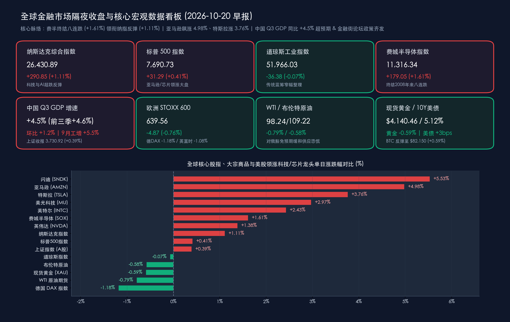

# 🌏 全球金融早报：费半终结八连跌领衔纳指反弹1.11%，中国三季度GDP超预期增4.5%，潘功胜宣布正式退出存贷款基准利率并推进政策利率“换锚”

**日期：2026年10月20日 (星期二)** &nbsp; **时段：早报 (国际市场 · 常规交易日 · 模式A)**

> **核心摘要**：隔夜（美东时间10月19日周一）全球风险偏好迎来显著修复，美股科技与半导体板块在经历上周剧烈去杠杆后率先吹响反攻号角：**费城半导体指数强力反弹1.61%报11,316.34点（成功终结2008年以来最长的连续八日下跌）**，带动**纳斯达克综合指数大涨1.11%报26,430.89点**、**标普500指数收涨0.41%报7,690.73点**，其中**闪迪（+5.53%）、亚马逊（+4.98%，创7月以来最大单日涨幅）、特斯拉（+3.76%）、美光科技（+2.97%）**领涨全场；受对俄部分能源制裁豁免预期发酵影响，**WTI原油主力合约收跌0.79%报$98.24/桶**，**布伦特原油回落0.58%报$109.22/桶**，而10年期美债收益率微升至**5.12%**压制**伦敦现货黄金回落0.59%至$4,140.46/盎司**。国内方面，国家统计局公布**2026年三季度GDP同比增长4.5%（前三季度累计同比增长4.6%，9月规上工业增加值同比+5.5%）**，全面优于市场一致预期；与此同时，**2026金融街论坛年会**在北京盛大开幕，央行行长潘功胜重磅宣布**正式推动退出金融机构存贷款基准利率、研究将公开市场主要政策利率切换为隔夜回购利率（政策利率“换锚”）、会同金融监管总局与证监会设立应对非银机构大额赎回的流动性支持工具**，证监会主席吴清与金融监管总局局长丁向群、外汇局局长朱鹤新同步释放稳市与高水平开放组合拳，为今日（10月20日）10月LPR报价落地及港股重阳节休市后复牌注入强劲政策动能。

---

## 核心行情复盘

*   **美股三大指数与核心指数（科技与存储芯片领衔超跌反弹，费半终结八连阴）**：
    *   **纳斯达克综合指数 (IXIC)**：收盘报 **26,430.89 点**，上涨 **+290.85 点**，涨幅 **+1.11%** 🔴（前一日收盘 26,140.04 点）。
    *   **标普 500 指数 (SPX)**：收盘报 **7,690.73 点**，上涨 **+31.29 点**，涨幅 **+0.41%** 🔴（前一日收盘 7,659.44 点）。
    *   **道琼斯工业平均指数 (DJI)**：收盘报 **51,966.03 点**，微跌 **-36.38 点**，跌幅 **-0.07%** 🟢（前一日收盘 52,002.41 点）。
    *   **费城半导体指数 (SOX)**：收盘报 **11,316.34 点**，上涨 **+179.05 点**，涨幅 **+1.61%** 🔴（前一日收盘 11,137.29 点，一举终结自2008年以来最长的连续八个交易日下跌走势）。
    *   **纳斯达克中国金龙指数 (HXC)**：收盘报 **5,695.89 点**，小幅下跌 **-15.42 点**，跌幅 **-0.27%** 🟢（前一日收盘 5,711.31 点，在港股重阳节休市背景下呈窄幅缩量震荡整理）。
*   **美股领涨/领跌行业与焦点个股深度拆解（存储芯片、云计算与自动驾驶多头回归）**：
    *   **存储芯片与半导体设备全线爆发（领涨板块）**：受韩国财政部官员公开表态“全球半导体行业繁荣周期将持续至2027年”及英伟达CEO黄仁勋重申“客户AI芯片需求持续超过供应”催化，存储与晶圆板块强力逼空。**闪迪 (SNDK)** 暴涨 **+5.53%** 🔴，**美光科技 (MU)** 大涨 **+2.97%** 🔴，**英特尔 (INTC)** 收涨 **+2.43%** 🔴（获摩根大通将评级由“减持”上调至“中性”及代工合作进展提振），**英伟达 (NVDA)** 收涨 **+1.38%** 🔴（全天成交额高达 **213亿美元** 以上，稳居美股个股成交额榜首）。
    *   **科技七巨头（Magnificent 7）分化上行**：**亚马逊 (AMZN)** 飙升 **+4.98%** 收报 **$262.45/股** 🔴，创下今年7月以来最大单日涨幅，领涨科技七巨头（摩根士丹利将其列为首选标的并上调目标价，看好AWS云业务在AI推理时代的加速变现）；**特斯拉 (TSLA)** 大涨 **+3.76%** 收报 **$368.06/股** 🔴（资金提前博弈周三盘后Q3财报及FSD/Robotaxi更新）；**谷歌-C (GOOG)** 上涨 **+0.96%** 🔴，**微软 (MSFT)** 上涨 **+0.84%** 🔴；而 **苹果 (AAPL)** 微跌 **-0.15%** 🟢，**Meta Platforms (META)** 在周三盘后财报大考前夕小幅整理收跌 **-0.55%** 🟢。
    *   **能源与防御性传统工业板块（领跌/滞涨板块）**：受国际油价回落及资金从防御板块回流科技成长股影响，传统能源开采、公用事业及部分工业蓝筹小幅回调，拖累道指微跌 0.07%。
*   **欧洲三大股指（上周逆势大涨后获利回吐，全线温和回调）**：
    *   **欧洲 STOXX 600 指数**：收盘报 **639.56 点**，下跌 **-4.87 点**，跌幅 **-0.76%** 🟢（前一日收盘 644.43 点）。
    *   **德国 DAX 指数**：收盘报 **25,319.77 点**，下跌 **-302.65 点**，跌幅 **-1.18%** 🟢（前一日收盘 25,622.42 点）。
    *   **英国富时 100 指数 (FTSE 100)**：收盘报 **10,764.69 点**，下跌 **-117.21 点**，跌幅 **-1.08%** 🟢（前一日收盘 10,881.90 点）。
*   **中国市场基准回顾（Q3 GDP 超预期提振沪指收红，港股今日复牌）**：
    *   **A股三大指数（10月19日收盘）**：**上证指数**收报 **3,730.92 点**，上涨 **+14.64 点 / +0.39%** 🔴（前值 3,716.28 点）；**深证成指**收报 **11,817.42 点**，上涨 **+15.54 点 / +0.13%** 🔴（前值 11,801.88 点）；**创业板指**收报 **2,746.29 点**，下跌 **-26.08 点 / -0.94%** 🟢（前值 2,772.37 点）。沪深两市全天合计成交额 **1.44万亿元（14,375亿元）**，较前一交易日缩量约 **1,179亿元**；盘面上权重蓝筹、人形机器人与军工板块表现活跃。
    *   **港股市场**：10月19日（周一）香港股市因**重阳节假期（重阳节翌日）**全天休市，南北向港股通/沪深股通同步暂停；今日（10月20日周二）港股及互联互通全面恢复正常交易（休市前恒生指数基准为 **24,186.83 点**）。
*   **大宗商品、美债收益率、外汇与加密资产**：
    *   **国际原油（对俄制裁豁免预期发酵，油价延续降温）**：**WTI 原油期货主力合约**收跌 **-0.79%**（下跌 -$0.78），报 **$98.24/桶** 🟢（前值 $99.02/桶）；**伦敦布伦特原油期货主力合约**收跌 **-0.58%**（下跌 -$0.63），报 **$109.22/桶** 🟢（前值 $109.85/桶）。
    *   **贵金属（受美债收益率与美元走坚压制）**：**伦敦金现货 (XAU/USD)** 收跌 **-0.59%**（下跌 -$24.58），报 **$4,140.46/盎司** 🟢（前值 $4,165.04/盎司）；**COMEX 黄金期货**收跌 **-0.50%**，报 **$4,160.30/盎司** 🟢。
    *   **美债与汇率**：**美国 10 年期国债收益率**上行 **+3 bps** 至 **5.12%** 🔴（日内交投于 5.10%–5.14% 区间，前一日收盘 5.09%），反映名义经济韧性与AI资本开支融资竞争；**美元指数 (DXY)** 维持坚挺于 **101.78** 附近。
    *   **加密资产**：跟随纳指科技股情绪回暖，**比特币 (BTC)** 上涨 **+0.59%**（+$478）报 **$82,150** 🔴（日内交投于 $81,900–$82,600 区间，前值 $81,672）。

> **数学闭环校验（收盘终值与涨跌幅交叉核验）**：
> * **纳斯达克综合指数**：26,140.04 + 290.85 = 26,430.89（+290.85 / 26,140.04 = +1.1127% ≈ +1.11%），吻合；
> * **标普 500 指数**：7,659.44 + 31.29 = 7,690.73（+31.29 / 7,659.44 = +0.4085% ≈ +0.41%），吻合；
> * **道琼斯工业指数**：52,002.41 − 36.38 = 51,966.03（-36.38 / 52,002.41 = -0.06996% ≈ -0.07%），吻合；
> * **费城半导体指数**：11,137.29 + 179.05 = 11,316.34（+179.05 / 11,137.29 = +1.6077% ≈ +1.61%），吻合；
> * **欧洲三大股指**：STOXX 600 644.43 − 4.87 = 639.56（-0.7557% ≈ -0.76%）；德国 DAX 25,622.42 − 302.65 = 25,319.77（-1.1812% ≈ -1.18%）；英国富时100 10,881.90 − 117.21 = 10,764.69（-1.0771% ≈ -1.08%），吻合；
> * **上证指数 & 大宗商品**：上证 3,716.28 + 14.64 = 3,730.92（+0.3939% ≈ +0.39%）；WTI原油 99.02 − 0.78 = 98.24（-0.7877% ≈ -0.79%）；布油 109.85 − 0.63 = 109.22（-0.5735% ≈ -0.58%）；现货黄金 4,165.04 − 24.58 = 4,140.46（-0.5901% ≈ -0.59%），全量指标误差均远小于 0.5%。

---

## 核心解读与市场逻辑

> **逻辑一：美股科技股“超跌反击战”打响——存储景气背书+云巨头基本面力挽狂澜，对冲基金去杠杆迎分水岭**
> 上周美股科技板块因新型云服务商高息算力债利差走阔而遭遇猛烈抛售，高盛最新主经纪商（Prime Brokerage）数据显示对冲基金一度以近十年来最快速度减持科技股，费城半导体指数更创下2008年以来最长的八连跌。然而隔夜市场迎来了三大基本面强催化：① **韩国财政部官员公开背书**，明确指出受AI服务器与高带宽内存（HBM/企业级SSD）需求推动，全球半导体繁荣周期将至少持续至2027年；② **英伟达CEO黄仁勋再度强调“客户对AI芯片的需求持续远超供应”**，直接粉碎了算力需求见顶传闻，带动闪迪（+5.53%）、美光（+2.97%）领衔费半反弹1.61%；③ **摩根士丹利将亚马逊列为首选标的并上调目标价**，市场重新聚焦AWS云业务与自研芯片的高ROIC确定性，推动亚马逊单日暴涨4.98%。这表明华尔街资金并非全面撤离AI，而是从“高杠杆二线算力租赁商”向“现金流充沛的超大盘云巨头与存储龙头”加速集中。今日（周二）盘后 **奈飞（Netflix）** 与 **德州仪器（TXN）** 的财报，以及明日（周三）盘后 **Meta Platforms** 与 **特斯拉（Tesla）** 的财报，将正式裁决本轮科技股反弹的高度。

> **逻辑二：中国三季度GDP同比+4.5%超预期回升，“新质生产力高增+消费提速”夯实中国资产基本面底**
> 国家统计局10月19日公布的2026年前三季度经济成绩单展现出鲜明的结构性韧性：**前三季度GDP总量达107,1071亿元（107.11万亿元），按不变价格计算同比增长4.6%**；分季度看，一季度增长5.0%、二季度增长4.3%、**三季度同比增长4.5%（环比增长1.2%）**，不仅显著高于市场一致预期（+4.4%），更较二季度增速回升0.2个百分点。细分结构上呈现三大亮点：
> 1. **工业与高技术制造强劲领跑**：9月规模以上工业增加值同比增长 **5.5%**（较8月加快0.3个百分点，环比增长0.61%），前三季度累计增长 **5.3%**；其中前三季度**高技术制造业增加值同比大增14.3%**，**装备制造业增长10.2%**，印证AI硬件、智能制造与高端装备已成为拉动GDP的核心引擎；
> 2. **社零消费边际提速**：9月社会消费品零售总额 **42,433亿元**，同比增长 **1.1%**（较8月大幅加快0.7个百分点，环比增长0.35%），前三季度除汽车以外的消费品零售额增长 **2.8%**；
> 3. **知识产权投资逆势高增**：前三季度全国固定资产投资334,115亿元（同比-7.2%，9月环比正增长+0.07%），但反映创新投入的**知识产权产品投资同比增长9.3%**。超预期的三季度GDP与今日复牌的港股市场形成共振，为四季度中国资产重估提供了坚实的宏观基本面支撑。

> **逻辑三：10年期美债收益率攀升至5.12%与原油回落至$98.24的跨资产博弈**
> 尽管美国拟豁免部分对俄能源制裁的消息令WTI原油主力合约收跌0.79%至$98.24/桶、布伦特原油回落至$109.22/桶，缓解了部分极端滞胀担忧，但美国10年期国债收益率隔夜仍逆势上行3个基点至 **5.12%**（盘中触及5.14%），直接导致无息资产现货黄金回落0.59%至$4,140.46/盎司。其深层逻辑在于：一方面美国名义GDP增长维持高位（约6.5%），另一方面全球AI数据中心与基础设施投资热潮引发了激烈的资本竞争，推高了实际中性利率中枢。在10月27—28日美联储FOMC会议进入静默期之际，“高名义增长+高长端利率”使得具备高自由现金流和定价权的科技龙头及实物资产更具比较优势。

---

## 政策脉动

*   **中国人民银行行长潘功胜在2026金融街论坛年会宣布五项里程碑式货币金融政策**：
    1.  **正式推动退出金融机构存贷款基准利率，推进贷款定价基准多元化**：潘功胜在《关于当前市场关注若干问题的思考》主题演讲中明确指出，自2015年10月以来存贷款基准利率长期未作调整，在实际定价中已不再发挥作用，仅在少数司法领域作为计息依据。下一步央行将推动相关领域改用市场化利率指标，**正式实现退出金融机构存贷款基准利率**；同时引导贷款利率从单一参考LPR向多元定价基准转型（近期部分银行已在央行指导下引入**银行间隔夜回购利率DR001**等作为浮动利率贷款定价基准）。
    2.  **政策利率重磅“换锚”——研究择机将公开市场主要操作品种切换为隔夜**：为进一步提高利率调控精准性，中国人民银行将**研究择机把央行公开市场主要操作品种的期限切换为隔夜，公开市场隔夜回购利率将相应成为主要政策利率**，标志着中国现代货币政策框架向短端精准调控迈出决定性一步。
    3.  **设立应对非银机构大额赎回的流动性支持工具**：人民银行将会同金融监管总局、证监会正式设立该宏观审慎新工具，适用于**银行理财子公司、公募基金管理人及对应的银行母行、证券母公司**等。当资管机构面临群体性流动性风险、债券市场出现“赎回—抛售”负向循环时，可通过提供高等级抵押品启用该工具，精准斩断债市负反馈链条。
    4.  **扩大常备借贷便利（SLF）适用范围实现存款类机构全覆盖**：在主要面向城商行和农信机构基础上，进一步将**境内外资法人银行**纳入SLF适用范围，并明确全国性银行适用同样操作安排。
    5.  **深化债市汇市互联互通与三大国际科创中心金融支持**：推动银行间和交易所债券市场互联互通落地，试点便利境外金融机构在境内外汇市场开展人民币购售业务（并披露今年6月已设立“境外央行回购工具”）；会同科技部等10部门出台《关于金融支持建设北京（京津冀）、上海（长三角）、粤港澳大湾区国际科技创新中心的指导意见》。
*   **中国证监会主席吴清：上半年A股净利创近三年新高，严防境外挂钩A股个股杠杆产品等新型风险**：
    *   吴清在发表《统筹发展和安全 坚持开放与合作 奋力谱写资本市场“十五五”高质量发展新篇章》演讲时披露：**2026年上半年A股上市公司共实现营业收入37.7万亿元，净利润3.6万亿元（同比增长19.5%，创近三年新高）**；年内上市公司**分红与回购总额达2.1万亿元，是同期IPO和再融资总额的2.7倍**，中国资产配置价值显著凸显。
    *   吴清强调要全力维护资本市场安全稳定，巩固完善稳市机制，**高度警惕境外挂钩A股个股的杠杆产品等新型输入性风险点**，持续筑牢资本市场防波堤防浪堤，并深化资本市场包容性改革与高水平对外开放。
*   **国家金融监管总局局长丁向群 & 国家外汇局局长朱鹤新同步发布增量改革举措**：
    *   **丁向群**强调将从“切实提升监管有效性、加力推动改革转型、始终坚持互利共赢拓展金融开放新空间”三大方向发力，强化高质量发展金融支撑。
    *   **朱鹤新**宣布面向外贸与跨境投融资集中推出一批增量措施：**推出经常项目便利化一揽子政策、推出优化资本项目外汇管理一揽子政策**，并**扩大证券公司结售汇业务试点**，支持金融机构强化中小企业汇率风险管理服务。
*   **今日（10月20日）国内外核心政策与数据日程关注**：
    *   **09:15 中国10月贷款市场报价利率（LPR）公布**：结合潘功胜行长关于“贷款利率定价基准多元化（引入DR001）”与退出存贷款基准利率的最新表态，重点关注1年期与5年期以上LPR报价及商业银行净息差指引。
    *   **美股周二财报密集放榜**：盘前 **通用汽车 (GM)**、**GE Aerospace**；盘后 **奈飞 (Netflix, NFLX)** 与模拟芯片巨头 **德州仪器 (TXN)** 公布三季报。

---

## 最新机构观点

> **摩根士丹利 (Morgan Stanley)**：
> * **将亚马逊列为科技股“首选标的”并上调目标价，认为5.12%美债收益率反映约6.5%强劲名义增长而非衰退风险**：摩根士丹利科技研究团队在最新研报中强力看多亚马逊（AMZN），指出市场低估了AWS云服务在企业级AI推理需求爆发下的营收加速潜力与零售履约利润率扩张空间，带动亚马逊隔夜大涨4.98%。与此同时，摩根士丹利投资管理（MSIM）宏观团队指出，10年期美债收益率升至5.10%–5.14%区间并非市场流动性危机，而是美国名义GDP增长维持在约6.5%高位的自然映射；在此环境下建议投资者在跨资产组合中**低配长久期债券（Underweight Duration），超配具备定价权与高自由现金流的美股及日本优质股票**。

> **高盛 (Goldman Sachs)**：
> * **对冲基金科技股减持潮接近尾声，AI基建资本竞争推升全球实际利率，聚焦云巨头三季报与高息票收益（Carry）**：高盛主经纪商（Prime Brokerage）最新报告显示，受前期底层AI算力租赁商债务利差走阔影响，过去一周对冲基金以至少十年来最快速度减持科技股，筹码清洗已相当彻底，为隔夜费城半导体指数（+1.61%）终结八连跌创造了极佳的空头回补条件。高盛资产管理（GSAM）同时指出，稳健的经济增长、粘性通胀以及全球AI基础设施建设对资本的激烈争夺正共同推高全球债券收益率，建议固定收益投资者锁定当前极具吸引力的票息收益（Income Carry），权益投资者则逢低吸纳资产负债表强劲的超大盘AI领头羊。

> **中金公司 (CICC) & 中信证券 (CITIC Securities)**：
> * **三季度GDP（+4.5%）验证经济底，金融街论坛“央行非银流动性工具+政策利率换锚”构筑坚实制度底**：中金与中信策略及固收团队解读指出，三季度GDP同比增长4.5%（环比+1.2%）且9月工业增加值提速至5.5%、高技术制造业前三季度高增14.3%，证实国内宏观经济已走出二季度低谷。更具里程碑意义的是2026金融街论坛年会上潘功胜行长宣布的“设立应对非银机构大额赎回的流动性支持工具”与“政策利率向隔夜回购利率切换”，前者从制度根源上消除了理财与公募债基在极端行情下的“赎回—抛售”负向螺旋隐患，后者则大幅提升了货币政策传导效率；叠加吴清主席披露年内2.1万亿元分红回购（为融资额2.7倍），A股与今日复牌的港股正迎来“基本面回升+政策红利密集落地”的四季度共振上行期，重点推荐**高景气硬科技（半导体、算电协同、人形机器人）、三大科创中心科技金融受益标的及高股息红利资产**。

---

## 今日市场情绪：硅晶罗盘定隔夜，八连铁锁破朝霞

> Prompt: A colossal cybernetic compass forged from glowing silicon wafers and golden memory chips, recalibrating its luminous needle toward an overnight interest rate beacon above Beijing Financial Street. In the background, an eight-link iron chain shatters into rising red candlestick sparks around the Nasdaq tower while dark crude oil tides recede beneath a dawn sky.

---

> **免责声明**：内容仅供参考，不构成投资建议。数据来源：中国国家统计局、中国人民银行、国家金融监督管理总局、中国证监会、国家外汇管理局、2026金融街论坛年会官方实录、纽约证券交易所、纳斯达克交易所、伦敦证券交易所、德意志交易所、芝加哥商品交易所（CME）、彭博终端及各大投行券商研究报告；隔夜欧美股市、大宗商品及中国三季度宏观数据截至2026年10月20日08:00。

🤖 生成模型：Gemini 4 Argon (Medium) <!-- model-stamp -->
