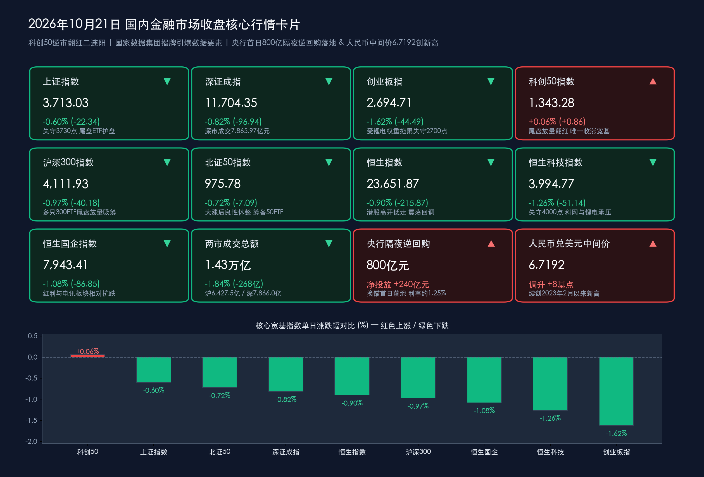

# 国家数据集团揭牌引爆数据要素涨停潮、科创50逆市翻红二连阳，央行首日800亿隔夜逆回购落地携百亿宽基ETF尾盘护盘

**日期：2026年10月21日 (星期三)** &nbsp; **时段：下午/国内市场收盘**

> **核心摘要**：2026年10月21日（周三），A股与港股在权重股三季报业绩分化与存量博弈中呈现鲜明的**“指数震荡整固、科技内部分化、大资金尾盘借道ETF强力托底”**特征。宏观与政策层面，中国人民银行今日正式落地短端利率调控“换锚”后的**首场公开市场隔夜逆回购操作（投放800亿元、单日净投放240亿元，7天期操作量为0）**，同时人民币兑美元中间价再升8个基点报 **6.7192**，续创2023年2月2日以来逾三年半新高；国务院批准组建、位列央企名录第28位的**“国家数据集团有限公司”在河北雄安新区正式揭牌成立**，叠加证监会在2026金融街论坛年会上宣布**发布北交所创新性评价标准、稳步推出北证50ETF、自12月1日起施行《违规转让证券案件行政处罚实施规则》**，政策暖风向新质生产力与制度建设纵深推进。盘面上，受锂电权重龙头**宁德时代**披露三季报后放量重挫超12%拖累，**创业板指收跌1.62%报2,694.71点（失守2,700点）**，**上证指数收跌0.60%报3,713.03点**；但**科创50指数在尾盘ETF放量拉升下逆市收涨0.06%报1,343.28点（录得二连阳，成为全场唯一收红的核心宽基指数）**。全天数据要素、东数西算、AI漫剧与文化传媒逆势掀起涨停潮，电子（主力净流入超85亿元）与计算机（净流入超43亿元）继续获大单抢筹，而创业板ETF易方达（单日成交突破104亿元）、沪深300ETF华泰柏瑞（成交近60亿元）等核心宽基ETF在尾盘最后十分钟再度密集放量吸筹，构筑坚实的市场流动性底座。

## 核心行情复盘

*   **A股主要宽基指数收盘终值（三大指数冲高回落、科创50尾盘翻红独秀）**：
    *   **上证指数**：收报 **3,713.03点**，较上一交易日（3,735.37点）下跌 **-22.34点**，跌幅 **-0.60%**（早盘高开后冲高回落，全天围绕3,710点上方震荡整固，尾盘在宽基ETF放量承接下稳守3,700点整数关口）。
    *   **深证成指**：收报 **11,704.35点**，较上一交易日（11,801.29点）下跌 **-96.94点**，跌幅 **-0.82%**。
    *   **沪深300指数**：收报 **4,111.93点**，较上一交易日（4,152.11点）下跌 **-40.18点**，跌幅 **-0.97%**（受新能源与白酒等权重股走弱拖累，但收盘前最后十分钟多只沪深300ETF显著放量吸筹）。
    *   **创业板指**：收报 **2,694.71点**，较上一交易日（2,739.20点）下跌 **-44.49点**，跌幅 **-1.62%**（受第一大权重股宁德时代绩后大跌超12%直接拖累，失守2,700点整数关口）。
    *   **科创50指数**：收报 **1,343.28点**，较上一交易日（1,342.42点）上涨 **+0.86点**，涨幅 **+0.06%**（盘中随大盘震荡洗盘，尾盘多只科创50ETF放量拉升带动指数顽强翻红，实现日K线二连阳，成为今日唯一收涨的核心宽基指数）。
    *   **北证50指数**：收报 **975.78点**，较上一交易日（982.87点）下跌 **-7.09点**，跌幅 **-0.72%**（在昨日暴涨3.88%逼近千点关口后展开良性获利消化，整体筹码承接依然稳健）。
*   **香港市场表现（高开低走、恒生科技失守4000点关口）**：
    *   **恒生指数**：收报 **23,651.87点**，较上一交易日（23,867.74点）下跌 **-215.87点**，跌幅 **-0.90%**。
    *   **恒生科技指数**：收报 **3,994.77点**，较上一交易日（4,045.91点）下跌 **-51.14点**，跌幅 **-1.26%**（失守4,000点整数关口）。
    *   **恒生中国企业指数（国企指数）**：收报 **7,943.41点**，较上一交易日（8,030.26点）下跌 **-86.85点**，跌幅 **-1.08%**。
    *   **港股盘面特征**：港股全天高开低走，大型科网股、锂电池产业链（宁德时代H股同步下挫）及汽车股承压走低，而部分高股息央国企、电讯服务及数据中心概念股展现较强韧性。
*   **量能指标、个股涨跌、主力资金与尾盘ETF护盘异动**：
    *   **全天成交额**：沪深两市全天成交额合计达 **14,293.49亿元（约1.43万亿元）**，其中沪市成交 **6,427.52亿元**、深市成交 **7,865.97亿元**（加上北交所成交额后，沪深京三市合计成交约 **14,421亿元**），较上一交易日（沪深两市14,561.12亿元）温和缩量 **267.63亿元（降幅约1.84%）**。
    *   **个股涨跌分布**：全市场共 **1,981只** 个股上涨，超 **3,300只** 个股下跌，市场从昨日的普涨格局转入围绕三季报业绩与政策主线的结构性分化。
    *   **主力资金流向（坚定抱团电子与数据要素/计算机）**：尽管大盘指数回调，主力资金对硬科技与数字经济主线的配置依然坚决——**电子行业再获超85亿元主力资金净流入蝉联榜首**，**计算机行业获超43亿元净流入**，**农林牧渔、通信、机械设备** 等行业亦分别录得超 **20亿元** 净流入；反观受龙头业绩扰动的 **电力设备（锂电）、汽车、食品饮料（白酒）及非银金融（证券）** 则遭遇明显资金净流出。
    *   **宽基ETF尾盘再度放量托底**：延续10月中旬以来的护盘规律，今日尾盘多只核心宽基ETF再现密集大单买盘——**创业板ETF易方达（159915）** 尾盘放量拉升，全天成交额突破百亿大关达 **104.10亿元**；**沪深300ETF华泰柏瑞（510300）**、**沪深300ETF嘉实（159919）**、**科创50ETF工银（588050）** 收盘前最后十分钟成交显著放大，全天分别成交 **59.43亿元**、**18.90亿元** 和 **5.45亿元** 以上，大资金“越跌越买”逆势托底信号极为清晰。
*   **领涨与领跌板块深度扫描**：
    *   **领涨阵营**：
        1. **数据要素 / 数据确权 / 东数西算 / IT服务（全天最强风口，掀涨停潮）**：受国务院批准组建、位列央企第28位的**“国家数据集团有限公司”在雄安新区正式揭牌成立**催化，数据要素与算力底座概念全线井喷，**三维天地（20cm涨停）、海量数据、太极股份、润建股份、南威软件、星光股份** 等多股强势封死涨停，**慧辰股份** 等大幅飙升。
        2. **文化传媒 / AI漫剧 / 广播电视**：AI多模态视频生成在漫剧与短剧商业化变现端的渗透率快速提升，带动**兆讯传媒（20cm涨停）**及影视传媒、知识产权保护板块逆势大涨。
        3. **农林牧渔（养殖业）**：作为防御性与三季报盈利改善兼具的顺周期细分，生猪与水产养殖板块今日获超20亿元主力资金净流入，逆势走强。
        4. **半导体设备与科创芯片细分**：受益于三季报业绩环比提速与国产替代订单饱满，科创板半导体设备及光器件标的在尾盘资金助推下稳步走高，支撑科创50翻红。
    *   **领跌阵营**：
        1. **电池 / 能源金属 / 锂电产业链（全天重灾区）**：行业龙头**宁德时代**10月20日晚披露三季报后（Q3归母净利润环比回落，叠加市场对单位利润及海外税收政策扰动的担忧），今日A股放量重挫 **超12%**，全天成交额高达 **321亿元** 居A股第一；叠加碳酸锂期货价格走低，**时代万恒** 等触及跌停，整个电力设备与能源金属板块深度回调。
        2. **白酒 / 食品饮料与证券板块**：在存量资金博弈下，缺乏超预期高频催化的白酒与券商权重股随大盘震荡走软，拖累沪深300指数表现。
*   **央行首日隔夜逆回购操作与人民币汇率再创新高**：
    *   **公开市场操作（800亿隔夜逆回购首秀落地）**：按照昨日公告的“10月21日至11月2日连续开展每日上限1万亿元隔夜逆回购”新政，央行今日正式开展 **800亿元隔夜逆回购操作**（采用固定利率、数量招标，操作利率维持在约 **1.25%** 附近低位），当日7天期逆回购操作量为 **0元**；因今日有560亿元7天期逆回购到期，单日实现 **净投放240亿元**，标志着公开市场短端利率“换锚”实操平稳落地。
    *   **人民币汇率（续创逾三年半新高）**：今日人民币兑美元中间价报 **6.7192**，较上一交易日（6.7200）再度**调升8个基点**，继续刷新**2023年2月2日以来最高纪录**（其他主要货币中间价：1欧元对人民币7.5197元，100日元对人民币4.2354元，100港元对人民币85.619元，1英镑对人民币8.9562元）。

> **数学闭环校验（今日收盘点位与涨跌幅精确核验）**：
> * **上证指数**：(3713.03 − 3735.37) / 3735.37 = −22.34 / 3735.37 ≈ **−0.5981% ≈ −0.60%**，完全吻合。
> * **深证成指**：(11704.35 − 11801.29) / 11801.29 = −96.94 / 11801.29 ≈ **−0.8214% ≈ −0.82%**，完全吻合。
> * **沪深300**：(4111.93 − 4152.11) / 4152.11 = −40.18 / 4152.11 ≈ **−0.9677% ≈ −0.97%**，完全吻合。
> * **创业板指**：(2694.71 − 2739.20) / 2739.20 = −44.49 / 2739.20 ≈ **−1.6242% ≈ −1.62%**，完全吻合。
> * **科创50指数**：(1343.28 − 1342.42) / 1342.42 = +0.86 / 1342.42 ≈ **+0.0641% ≈ +0.06%**，完全吻合。
> * **北证50指数**：(975.78 − 982.87) / 982.87 = −7.09 / 982.87 ≈ **−0.7214% ≈ −0.72%**，完全吻合。
> * **恒生指数**：(23651.87 − 23867.74) / 23867.74 = −215.87 / 23867.74 ≈ **−0.9044% ≈ −0.90%**，完全吻合。
> * **恒生科技指数**：(3994.77 − 4045.91) / 4045.91 = −51.14 / 4045.91 ≈ **−1.2640% ≈ −1.26%**，完全吻合。
> * **恒生国企指数**：(7943.41 − 8030.26) / 8030.26 = −86.85 / 8030.26 ≈ **−1.0815% ≈ −1.08%**，完全吻合。

## 核心解读与市场逻辑

*   **逻辑一：权重龙头三季报“业绩杀”拖累创业板，但宽基ETF百亿级尾盘买盘锁定指数下行空间**：
    *   **事件与数据**：今日创业板指大跌1.62%并失守2,700点，核心症结并非系统性宏观风险，而是单一超级权重股**宁德时代**在披露三季报后因Q3单季盈利环比回落、单位盈利承压及海外关税扰动而放量暴跌超12%（单日成交逾321亿元），引发电池与能源金属产业链共振调整。
    *   **盘面映射**：在创业板指承压的关键时刻，**创业板ETF易方达（159915）单日爆量成交104.1亿元**，叠加沪深300ETF与科创50ETF在收盘前最后十分钟同步放量拉升（助推科创50逆市翻红收涨0.06%），表明场外长线托底资金正 strictly 遵循“借道宽基、逢低承接、平抑单一权重冲击”的稳市策略，有效阻断了局部绩后调整向全市场蔓延。
*   **逻辑二：“国家数据集团”雄安揭牌落地，数字经济与AI数据底座接棒成为硬科技核心主线**：
    *   **事件与数据**：国务院批准组建、由国资委履行出资人职责并位列央企名录第28位的**国家数据集团有限公司**正式在雄安新区揭牌。作为统筹国家级公共数据资源开发利用与服务人工智能大模型训练的“央企国家队”，其成立标志着我国数据要素市场化配置从顶层制度设计正式迈入央企平台实质性运营阶段。
    *   **传导逻辑**：在锂电等传统新能源赛道陷入产能与单位利润博弈之际，场内活跃资金迅速向具备国家级产业催化的**数据要素（三维天地、海量数据、太极股份等涨停）、电子（主力净流入超85亿）与计算机（净流入超43亿）**集中，印证了市场“弃旧迎新、围绕新质生产力寻找结构性阿尔法”的清晰脉络。

> **核心解读**：今日A股看似“三千股下跌、创业板失守2700点”，实则呈现出极强的韧性分化——跌幅几乎完全由锂电权重三季报宣泄所致，而代表国产硬科技与数字经济的**科创50逆市实现二连阳**、**数据要素掀起涨停潮**。伴随央行800亿隔夜逆回购首秀落地与尾盘百亿ETF托底，市场微观结构出清已进入尾声。

## 政策脉动

*   **国务院批准组建“国家数据集团有限公司”在雄安新区正式揭牌**：
    *   **央企“国家队”登场**：国家数据集团有限公司正式在河北雄安新区揭牌成立，由国务院国资委履行出资人职责，位列中央企业名录第28位。集团以国家级数据资源整合、开发利用、跨境数据流通与高质量中文语料库建设为主责主业，全面赋能人工智能产业跨越式发展与数字中国建设。
*   **中国证监会密集部署北交所高质量发展、违规减持严惩新规与《证券法》修法研究**：
    *   **北交所与新三板一体化深化**：10月21日在2026金融街论坛年会上，证监会相关负责人明确表示将**发布北交所创新性评价标准**以稳定市场申报预期，优化新股发行定价机制，**稳步推出北证50ETF**，引导更多公募基金与耐心资本配置专精特新企业。
    *   **《违规转让证券案件行政处罚实施规则》定于12月1日施行**：证监会正式发布18条新规细则，将违规减持划分为四大类，确立**“违规转让比例 + 金额”双指标裁量基准**，通过穿透式监管精准封堵“马甲账户”、“违规代持”与绕道减持漏洞。同时，证监会首席律师宣布正研究推进将**《证券法》修改纳入下一届全国人大立法规划**，并加快修改《证券投资基金法》。
*   **央行等11部门联合印发国际科创中心科技金融指导意见 & 国家发改委推进增量内需方案**：
    *   **11部门科技金融协同**：中国人民银行、金融监管总局、证监会、国家发改委、财政部等11部门联合印发《关于金融支持建设北京（京津冀）、上海（长三角）、粤港澳大湾区国际科技创新中心的指导意见》，构建覆盖科技型企业全生命周期的多元化接力式金融服务体系。
    *   **发改委统筹存量与增量政策**：国家发改委明确表示正加紧**研究制定扩大内需战略实施方案**，加大直达消费者的普惠支持力度，用好超长期特别国债与新型政策性金融工具，同时在推进首批136项标志性重大应用场景落地过程中，严禁地方借新质生产力之名盲目跟风与违规重复建设。

> **核心解读**：政策层面的组合拳极具前瞻性——央行首日800亿隔夜逆回购稳住短端资金锚，国家数据集团揭牌树起数字经济产业旗帜，而证监会“12月1日严惩违规减持新规 + 稳步推出北证50ETF”则从供需两端持续净化资本市场生态。

## 最新机构观点

> **中信证券（策略团队包承超等）**：
> * **第一轮科技硬件估值调整接近尾声，宽基ETF持续放量释放积极左侧信号**：本轮市场局部调整主要由机构重仓股调仓诱发，但从AI与核心科技标的时间与空间调整幅度看，其性价比已接近历史底部区域，超级产业周期二阶导下修过程中的第一轮估值出清已接近尾声。
> * **策略建议**：近期核心宽基ETF在尾盘的持续放量是极其重要的左侧企稳信号。随着2026金融街论坛稳市场、引长钱政策落地，资本市场内在稳定性显著增强，建议围绕三季报业绩兑现与新质生产力主线积极把握结构性布局机会。

> **华泰证券（策略研究团队）**：
> * **宽基ETF提供坚实托底，短期以防守反击为主、紧抓三季报盈利环比加速线索**：近期宽基ETF频频放量为低位指数提供了有力的资金托底，但考虑到海外利率、大宗商品波动及财报季个股分化，短期操作建议兼顾防御与三季报高景气细分。
> * **配置方向**：1. **防御底仓**：继续持有低波红利资产作为组合压舱石；2. **三季报环比提速主线**：AI链内重点关注Q3盈利预告环比加速集中的 **PCB、光器件、半导体设备**；AI链外关注 **通用及专用设备、电网设备、风电及医疗服务**。

> **中金公司（研究部策略首席李求索团队）**：
> * **长周期考核与主动ETF扩容协同发力，中国资产中长期配置价值凸显**：监管层在推动首批18只主动管理型ETF注册、健全中长期资金长周期考核机制及创设非银流动性支持工具方面打出制度组合拳，有助于降低短期业绩波动对机构行为的干扰，引导资金聚焦企业自由现金流、长期ROE与股东回报，对A股中长期走势保持坚定乐观。

> **国泰海通（策略研究团队）**：
> * **“转型牛”休整期呈现横盘震荡，均衡布局本土科技、战略资源与高分红**：当前市场处于增量博弈向存量结构优化的休整期，局部交易过热筹码的消化需要时间。建议投资者保持均衡分散配置，重点看好三大方向：1. **具备基本面与政策支撑的本土创新科技（电子、通信、计算机/数据要素）**；2. **战略资源品**；3. **大金融与高分红央国企**。

## 今日市场情绪：数智丰碑擎云起，百亿金盾御寒潮

> Prompt: A colossal glowing monolith of crystalline data streams rising from a futuristic cityscape, radiating golden digital circuits and lifting the STAR 50 index upward into the clouds. In the background, a turbulent emerald storm of falling lithium battery blocks is held back by a giant shield of institutional ETFs and an 800-billion overnight liquidity dam under a twilight sky.

---

> **免责声明**：内容仅供参考，不构成投资建议。数据来源：上海证券交易所、深圳证券交易所、北京证券交易所、香港交易所公开公告、中国人民银行、全国银行间同业拆借中心、中国外汇交易中心、国务院国资委、国家数据局、中国证监会、国家发展改革委、2026金融街论坛组委会、东方财富、新浪财经、证券时报、财联社、21世纪经济报道、每日经济新闻及中信证券、华泰证券、中金公司、国泰海通公开研报；数据截至2026年10月21日16:30国内市场收盘。

🤖 生成模型：Gemini 4 Argon (Medium) <!-- model-stamp -->
