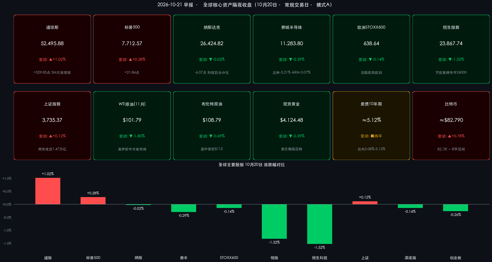

# 🌏 全球金融早报：美伊“折中方案”传闻掀动油价过山车，道指劲升529点蓝筹接棒科技，奈飞下修广告指引盘后重挫，今夜Meta与特斯拉财报大考

**日期：2026年10月21日 (星期三)** &nbsp; **时段：早报 (国际市场 · 常规交易日 · 模式A)**

> **核心摘要**：隔夜（美东时间10月20日周二）美股呈现鲜明的“蓝筹强、科技弱”风格轮动：受美伊“折中和解方案”传闻引发油价盘中急跌、9月新屋开工意外大降5.2%推动长端美债收益率自5.15%附近回落、以及3M等传统蓝筹财报超预期提振，**道琼斯工业指数大涨1.02%（+529.85点）报52,495.88点**，**标普500指数收涨0.28%报7,712.57点**，而**纳斯达克综合指数微跌0.02%报26,424.82点**、**费城半导体指数回落0.29%报11,283.80点**，苹果（-1.00%）、谷歌（-1.11%）、Meta（-1.59%）等科技巨头在AI资本开支回报审视下承压。商品端，**WTI原油11月合约（到期日）收跌1.80%报$101.79/桶**、**布伦特原油12月合约收跌0.69%报$108.79/桶**（盘中一度逼近$112），**现货黄金回落0.39%至$4,124.48/盎司**。盘后**奈飞（Netflix）**虽三季度EPS超预期，但因下调全年广告营收预期及四季度营收指引低于预期，**盘后股价重挫约5%–6%**。亚洲方面，港股重阳节后复牌补跌，**恒生指数跌1.32%失守24,000点**；中国10月LPR连续第17个月按兵不动。今夜（周三）盘后**Meta与特斯拉**将率先开启“科技七巨头”财报季，是检验AI资本开支叙事的关键时刻。

---

## 核心行情复盘

*   **美股三大指数与核心指数（蓝筹接棒科技，道指重返52,000点上方）**：
    *   **道琼斯工业平均指数 (DJI)**：收盘报 **52,495.88 点**，上涨 **+529.85 点**，涨幅 **+1.02%** 🔴（前一日收盘 51,966.03 点）。
    *   **标普 500 指数 (SPX)**：收盘报 **7,712.57 点**，上涨 **+21.84 点**，涨幅 **+0.28%** 🔴（前一日收盘 7,690.73 点）。
    *   **纳斯达克综合指数 (IXIC)**：收盘报 **26,424.82 点**，微跌 **-6.07 点**，跌幅 **-0.02%** 🟢（前一日收盘 26,430.89 点）。
    *   **费城半导体指数 (SOX)**：收盘报 **11,283.80 点**，下跌 **-32.54 点**，跌幅 **-0.29%** 🟢（前一日收盘 11,316.34 点）；成分股 **11 涨 19 跌**，芯片股整体偏弱。
    *   **纳斯达克中国金龙指数 (HXC)**：收涨 **+0.68%** 🔴，报约 **5,734.6 点**（按前一日收盘 5,695.89 点推算），中概新能源车板块强势领涨。
*   **美股领涨/领跌行业与焦点个股深度拆解（工业蓝筹财报驱动 vs. AI巨头资本开支审视）**：
    *   **传统工业/蓝筹板块（领涨板块）**：**3M (MMM)** 大涨约 **+5%~6%** 🔴，三季度利润超预期并**上调2026全年利润指引**，同时宣布与**亚马逊扩大数据中心及光连接产品合作**（亚马逊获得认股权证，可依多年销售里程碑最多认购320万股3M股票），成为推升道指的核心力量；**Equifax、孩之宝 (Hasbro)** 等财报亦超预期，金融、工业及医疗保健等防御性板块获资金买入。
    *   **汽车板块**：**通用汽车 (GM)** 三季度调整后EPS **$3.70**（预期 $3.69）、营收 **500亿美元**，仅小幅超预期，但全年调整后EPS指引收窄至 **$12.75–$13.75**（中值略低于市场一致预期），且管理层警示**大宗商品、物流及存储芯片等成本通胀压力上升**，股价下跌逾 **-5%** 🟢。
    *   **科技七巨头（Magnificent 7）多数走低**：**Meta Platforms (META)** 下跌 **-1.59%** 🟢（周三盘后财报前夕，市场审视其巨额AI资本开支回报）；**谷歌-C (GOOG)** 下跌 **-1.11%** 🟢；**苹果 (AAPL)** 下跌 **-1.00%** 🟢（苹果已确认将于10月28日举行新品发布会，传将推出首款触控屏 MacBook Pro）；**英伟达 (NVDA)** 下跌 **-0.29%** 🟢（报约 $217.59）；**特斯拉 (TSLA)** 逆势上涨 **+1.54%** 🔴（新一代 Roadster 热度延续，周三盘后与 Meta 同日发布财报）。
    *   **半导体设备与IP（领跌板块）**：**泛林集团 (LRCX)** 下跌 **-3.21%** 🟢，**ARM** 下跌 **-3.07%** 🟢，**阿斯麦 (ASML)** 下跌 **-0.99%** 🟢，**AMD** 下跌 **-0.62%** 🟢；模拟芯片龙头 **德州仪器 (TXN)** 财报前夕逆势上涨约 **+1.4%** 🔴 至 $280 附近。
    *   **热门中概股**：**小鹏汽车** 大涨 **+7.60%** 🔴，**理想汽车** 涨 **+5.67%** 🔴，**小马智行** 涨 **+5.39%** 🔴，**再鼎医药** 涨 **+4.24%** 🔴，**百度** 涨 **+0.90%** 🔴，**阿里巴巴** 微涨 **+0.04%** 🔴。
    *   **盘后焦点——奈飞 (NFLX) 三季报**：EPS **$0.87**（预期 $0.82），营收 **128.7亿美元**（同比 **+11.8%**，符合预期）；但**四季度营收指引 134亿美元低于预期的 135.1亿美元**，且因广告能力推出慢于预期，将**2026全年广告营收预期由约30亿美元下调至约27亿美元**，并收窄全年财测，**盘后股价下跌约 5%–6%** 🟢。
*   **欧洲三大股指（法国政局动荡+AI投资回报担忧，全线小幅收跌）**：
    *   **欧洲 STOXX 600 指数**：收盘报 **638.64 点**，下跌 **-0.92 点**，跌幅 **-0.14%** 🟢（前一日收盘 639.56 点）。
    *   **德国 DAX 指数**：收盘报 **25,304.42 点**，下跌 **-15.35 点**，跌幅 **-0.06%** 🟢（前一日收盘 25,319.77 点）。
    *   **英国富时 100 指数 (FTSE 100)**：收盘报 **10,733.00 点**，下跌 **-31.69 点**，跌幅 **-0.29%** 🟢（前一日收盘 10,764.69 点），银行股及大宗商品相关板块拖累。
*   **中国市场基准回顾（A股窄幅震荡，港股节后复牌补跌）**：
    *   **A股三大指数（10月20日收盘）**：**上证指数**收报 **3,735.37 点**，上涨 **+4.45 点 / +0.12%** 🔴（前值 3,730.92 点）；**深证成指**收报 **11,801.29 点**，下跌 **-16.13 点 / -0.14%** 🟢（前值 11,817.42 点）；**创业板指**收报 **2,739.20 点**，下跌 **-7.09 点 / -0.26%** 🟢（前值 2,746.29 点）。沪深北三市合计成交额约 **1.47万亿元（约14,715亿元）**，较前一交易日（14,375亿元）**放量约340亿元**；其中沪市成交约 **6,999.70亿元**、深市约 **7,561.37亿元**、创业板约 **3,744.85亿元**。全市场超 **3,700只** 个股上涨，**人形机器人、消费电子、端侧AI** 等科技板块活跃，**煤炭、保险** 板块跌幅居前。
    *   **港股市场（10月20日重阳节后复牌）**：**恒生指数**收报 **23,867.74 点**，下跌 **-319.09 点 / -1.32%** 🟢（前值 24,186.83 点），**跌破24,000点整数关口**；**恒生科技指数**收报 **4,045.91 点**，下跌 **-62.33 点 / -1.52%** 🟢，创本轮调整以来新低。
*   **大宗商品、美债收益率、外汇与加密资产**：
    *   **国际原油（美伊谈判传闻主导，盘中“过山车”）**：**WTI 原油11月合约（10月20日到期）**收跌 **-1.80%**（下跌 -$1.87），报 **$101.79/桶** 🟢（前值 $103.66/桶）；交投更活跃的 **WTI 12月合约** 收于约 **$97.82/桶** 🟢；**伦敦布伦特原油12月合约**收跌 **-0.69%**（下跌 -$0.76），报 **$108.79/桶** 🟢（前值 $109.55/桶，盘中一度逼近 **$112** 的数月高位）。
    *   **贵金属（美元偏强+粘性通胀担忧压制）**：**伦敦金现货 (XAU/USD)** 收跌 **-0.39%**（下跌 -$15.98），报 **$4,124.48/盎司** 🟢（前值 $4,140.46/盎司）。
    *   **美债**：**美国 10 年期国债收益率**收于约 **5.12%**（约5.116%），日内交投于 **5.08%–5.15%** 区间，自周初5.13%–5.15%高位回落；**2 年期**收益率小幅下行至约 **4.76%**，**30 年期**回落至约 **5.42%–5.43%**。
    *   **加密资产**：**比特币 (BTC)** 稳定交投于 **$82,700–$83,000** 区间，报约 **$82,790** 🔴（较前一日 $82,150 上涨约 **+0.78%**）。

> **数学闭环校验（收盘终值与涨跌幅交叉核验）**：
> * **道琼斯工业指数**：51,966.03 + 529.85 = 52,495.88（+529.85 / 51,966.03 = +1.0196% ≈ +1.02%），吻合；
> * **标普 500 指数**：7,690.73 + 21.84 = 7,712.57（+21.84 / 7,690.73 = +0.2840% ≈ +0.28%），吻合；
> * **纳斯达克综合指数**：26,430.89 − 6.07 = 26,424.82（-6.07 / 26,430.89 = -0.0230% ≈ -0.02%），吻合；
> * **费城半导体指数**：11,316.34 − 32.54 = 11,283.80（-0.2875% ≈ -0.29%），吻合；
> * **欧洲三大股指**：STOXX 600 639.56 → 638.64（-0.144% ≈ -0.14%）；DAX 25,319.77 → 25,304.42（-0.061% ≈ -0.06%）；FTSE 100 10,764.69 → 10,733.00（-0.294% ≈ -0.29%），吻合；
> * **中国市场**：上证 3,730.92 + 4.45 = 3,735.37（+0.119%）；深成指 11,817.42 − 16.13 = 11,801.29（-0.136%）；创业板 2,746.29 − 7.09 = 2,739.20（-0.258%）；恒指 24,186.83 − 319.09 = 23,867.74（-1.319%），吻合；
> * **大宗商品**：WTI 11月 103.66 − 1.87 = 101.79（-1.804%）；布油 109.55 − 0.76 = 108.79（-0.694%）；现货黄金 4,140.46 → 4,124.48（-0.386%），吻合。
> * **数据说明**：昨日早报记录的布伦特“前值”为 $109.22（对应不同口径/合约），今日按 12 月合约结算价 $109.55 为基准；WTI 11 月合约于 10 月 20 日到期，与昨日引用的主力合约口径不同，请以合约月份区分解读。金龙指数与比特币点位为推算/区间值，仅供参考。

---

## 核心解读与市场逻辑

> **逻辑一：美伊“折中方案”传闻→油价盘中急跌→通胀与成本担忧缓和→资金涌入传统蓝筹（道指+529点）**
> 周二早盘，市场传出卡塔尔、巴基斯坦向美伊双方提交折中和解方案（内容涉及解冻部分资金利息、对核设施进行非公开核查等）、“美伊接近达成协议”的消息，原本处于数月高位（布油盘中近$112）的国际油价一度急跌超3%，涨幅尽失转为下跌。随后有参与谈判的外交官澄清“即将达成协议”的报道有误，油价跌幅收窄，但外交接触本身已有效缓解了市场对中东能源供应彻底中断的极端恐慌。油价回落直接缓解了市场对能源成本飙升、企业利润挤压与通胀反弹的担忧，对工业、消费等传统板块构成直接利好；叠加 **3M 上调全年利润指引并携手亚马逊切入数据中心光连接**、Equifax 与孩之宝财报亮眼，资金从高估值 AI 资产向盈利确定性更强、估值更合理的金融、工业与医疗保健板块轮动，合力推动道指大涨1.02%。

> **逻辑二：新屋开工骤降5.2%（数据）→长端美债收益率自5.15%回落（事件）→缓释估值压力但暴露高利率对实体的侵蚀（逻辑）**
> 美国人口普查局公布9月新屋开工 **环比下降5.2%至年化121.1万套**（8月上修为128.8万套），远逊于市场预期的约130万套；其中**单户住宅开工下降4.6%至年化85.9万套**，**5套以上多户住宅下降6.7%**。在30年期固定按揭利率徘徊于7.5%左右的背景下，利率敏感的地产部门承压明显。疲弱数据促使10年期美债收益率从5.13%–5.15%的周初高位回落至约5.12%（日内低见5.08%），2年期降至约4.76%。市场普遍预期美联储在10月27–28日的FOMC会议上维持利率不变。收益率回落一定程度缓释了股市估值压力，但“高利率→地产走弱”的传导链条也提示美国经济内部的K型分化正在加剧。

> **逻辑三：“AI资本开支回报大考”前夜——科技巨头谨慎观望，奈飞指引下修敲响警钟**
> 纳指与费半双双收跌，Meta（-1.59%）、谷歌（-1.11%）、苹果（-1.00%）走弱，半导体设备股泛林（-3.21%）、ARM（-3.07%）领跌，反映投资者在财报季核心窗口对“AI巨额资本开支 vs. 近期变现”（spenders vs. sellers）的高度审视，叠加全球债券收益率与举债融资成本攀升，高估值成长股承压。奈飞盘后因下修广告营收预期（30亿→27亿美元）及四季度指引不及预期重挫5%–6%，提醒市场：即便利润超预期，前瞻指引才是当前定价核心。今夜（周三）盘后 **Meta**（市场预期营收约633–639亿美元，全年资本开支指引1,300–1,450亿美元，关注 Muse AI agent 变现路径与自由现金流压力）与 **特斯拉**（三季度交付486,532辆超预期，关注汽车毛利率、自由现金流及 Robotaxi/Cybercab、Optimus 与新款 Roadster 进展）将率先揭开科技七巨头财报序幕，其结果将直接决定周四AI交易的方向。

> **逻辑四：港股节后补跌失守24,000点，A股放量窄幅震荡——外部AI情绪降温与内部政策红利的拉锯**
> 港股因重阳节休市一日后复牌，集中消化了前期全球科技股剧烈调整及AI估值审视的压力，恒指跌1.32%、恒生科技指数跌1.52%创本轮调整新低。A股表现相对稳健，上证指数在潘功胜行长“退出存贷款基准利率+政策利率换锚+非银流动性支持工具”等政策红利余温下小幅收红，两市成交放量至1.47万亿元，超3,700只个股上涨，赚钱效应良好；人形机器人、消费电子与端侧AI活跃，煤炭与保险回调。10月LPR（1年期3.0%、5年期以上3.5%）连续17个月维持不变，在央行推进“贷款定价基准多元化”的改革背景下，政策重心由“降价”转向“机制优化”。隔夜中概新能源车（小鹏+7.60%、理想+5.67%）大涨，金龙指数收涨0.68%，或为今日港股企稳提供一定情绪支撑。

---

## 政策脉动

*   **美联储与美国宏观数据**：
    *   美国9月新屋开工 **年化121.1万套，环比 -5.2%**（预期约130万套），单户 **85.9万套（-4.6%）**、多户 **-6.7%**；30年期固定按揭利率在 **7.5%** 附近，地产部门持续承压。
    *   美联储 **10月27–28日 FOMC** 会议临近，市场广泛预期维持基准利率不变，关注后续通胀与就业数据以判断年内是否仍有政策调整空间。
*   **地缘政治——美伊谈判**：卡塔尔、巴基斯坦据传向美伊提交折中和解方案（解冻部分资金利息、核设施非公开核查等），但参与谈判外交官随后澄清“即将达成协议”的报道有误，谈判局势依然错综复杂，原油地缘风险溢价仍具高波动性。
*   **欧洲**：法国政治动荡推升主权债务风险溢价，叠加对 AI 投资回报及工业板块盈利前景的担忧，压制欧股表现。
*   **中国**：
    *   **10月20日 LPR 报价**：**1年期 3.0%**、**5年期以上 3.5%**，均与上月持平，**连续17个月按兵不动**。
    *   金融街论坛年会政策延续发酵：央行推动退出存贷款基准利率、研究将公开市场主要操作品种切换为隔夜（政策利率“换锚”）、设立应对非银机构大额赎回的流动性支持工具等举措，持续为A股提供制度性支撑。
*   **今日（10月21日周三）核心日程关注**：
    *   **美股盘后**：**Meta Platforms (META)** 发布三季报（电话会美东时间 16:30）；**特斯拉 (TSLA)** 发布三季报（问答直播美东时间 17:30）。
    *   **德州仪器 (TXN)**：据最新日程预计于周三盘后公布三季报（市场一致预期营收约 **59.3亿美元**、非GAAP EPS **$2.40**），是观察模拟芯片、工业与汽车需求及数据中心景气的重要风向标。
    *   **苹果新品发布会** 定于 **10月28日**。

---

## 最新机构观点

> **高盛 (Goldman Sachs)**：
> * **美股牛市未终结，但市场广度极低、追逐动量隐患巨大；AI贡献标普近一半盈利增量**：高盛策略团队（Ben Snider 领衔）认为，受企业盈利支撑，美股本轮上涨趋势并未终结，预计标普500成分股2026、2027年EPS保持稳健；但市场广度指标已触及历史极低水平，行情高度集中于少数科技巨头，追逐强势股的动量策略风险巨大。高盛强调 **AI资本开支贡献了标普500近一半的盈利增量**，近期主推“**AI生产力受益组合（GSXUPROD）**”，看好金融、零售、物流等非科技行业借助AI提升劳动生产率与利润率，同时提示数据中心电网供电瓶颈与内存成本高企带来的阶段性成本压力。中国市场方面，高盛指出自“DeepSeek时刻”以来中国AI相关上市公司已创造近 **5万亿美元** 市值，对中国科技行业 **11个子行业** 维持“建设性”看法：一是 **AI出口/供应链主线**（半导体、光通信、AI服务器与PCB），二是 **本土内需主线**（受益于国内云厂商资本开支增加及自主可控政策）。

> **摩根大通 (J.P. Morgan)**：
> * **“选股型牛市”与AI供应链定价权；中国资产“哑铃型”配置**：摩根大通认为美股正处于由AI驱动的超级周期深处，但属于典型的“选股型牛市”（K型两极分化），资金更青睐具备强执行力与竞争优势的高质量成长股。由于 **先进逻辑芯片、先进封装、HBM、高速光组件等AI硬件供应紧张预计将持续至2028年**，相关产业链企业具备极强的定价能力，AI股票将是亚洲及全球盈利增长的核心引擎。中国股票策略团队维持建设性看法，建议采取“哑铃型”配置：**防御端** 配置高股息标的以应对海外宏观扰动，**增长端** 重点布局AI、创新药等产业上行板块。

> **中金公司 (CICC)**：
> * **AI资本开支迎来“金融时刻”——从内部现金流驱动转向资产负债表扩张**：中金宏观策略团队指出，AI资本开支正处于从“内部现金流驱动”向“外部融资驱动”的转折点。随着投资规模超过企业内部现金流承载能力，未来数年全球AI基建将产生庞大的外部融资需求（涵盖投资级债券、私募资本及公开市场股权），金融体系如何承接这些资本开支将成为影响全球市场资金面与利率中枢的关键变量——这也与当前10年期美债收益率维持5%以上高位、科技巨头财报季对资本开支回报的严苛审视形成呼应。

---

## 今日市场情绪：油浪颠簸铜像擎天，硅塔凝雾待财报

> Prompt: A towering bronze Atlas statue of blue-chip industry rising from a calm harbor at dawn, lifting a glowing red candlestick skyward. In the background, a giant black oil derrick sways on a rollercoaster track made of crude oil waves, silver semiconductor skyscrapers stand frozen in silver mist, and a fragile olive branch floats uncertainly above the stormy sea.

---

> **免责声明**：内容仅供参考，不构成投资建议。数据来源：纽约证券交易所、纳斯达克交易所、伦敦证券交易所、德意志交易所、芝加哥商品交易所（CME）、洲际交易所（ICE）、上海/深圳/香港交易所、中国人民银行/全国银行间同业拆借中心、美国人口普查局、Netflix/3M/GM 公司公告及各大投行券商研究报告；隔夜欧美股市及大宗商品数据截至2026年10月21日08:00。

🤖 生成模型：Claude Opus 5.5 (Medium) <!-- model-stamp -->
