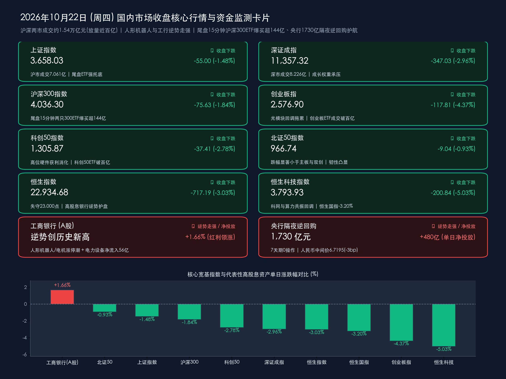

# 光模块与科网重挫拖累双创跌超4%，人形机器人携工行新高逆势抗跌，尾盘15分钟百亿沪深300ETF联手央行1730亿隔夜逆回购强力护盘

**日期：2026年10月22日 (星期四)** &nbsp; **时段：下午/国内市场收盘**

> **核心摘要**：2026年10月22日（周四），受高位AI算力光模块筹码松动、海外CPO供应链传闻及互联网平台监管预期扰动，A股与港股遭遇放量共振回调，呈现鲜明的**“高位科技硬件集中出清、人形机器人与高股息银行逆势突围、尾盘国家队百亿宽基ETF爆量强托底”**特征。宏观与政策层面，中国人民银行今日继续执行“7天期零操作、加码隔夜品种”的新调控机制，单日开展 **1,730亿元隔夜逆回购操作**，实现公开市场 **单日净投放480亿元**；人民币兑美元中间价微调3个基点报 **6.7195**，稳守逾三年半高位区间；2026金融街论坛年会今日迎收官高潮，《北京市“十五五”时期金融业发展规划》与提升金融营商环境17条改革举措正式发布，国家外汇局同步预告拟集中推出一批支持企业跨境经营的增量措施。盘面上，**上证指数收跌1.48%报3,658.03点**，**创业板指收跌4.37%报2,576.90点（失守2,600点）**，**恒生科技指数重挫5.03%报3,793.93点**；但**人形机器人与电机制造板块（华阳智能、奕帆传动20cm涨停，兆威机电、鸣志电器等涨停）**逆势掀起涨停潮，**工商银行A股逆势收涨1.66%再创历史新高**，**电力设备行业逆势获超56亿元主力资金净流入**。尤为关键的是，收盘前最后15分钟以**沪深300ETF华泰柏瑞（尾盘15分钟狂买75.94亿元、全天成交146亿元）**、**沪深300ETF嘉实（尾盘15分钟成交68.47亿元、全天成交106亿元）**为代表的核心宽基ETF突然爆量拉升，多只旗舰ETF单日成交突破百亿大关，释放出极强的机构底部承接信号。

## 核心行情复盘

*   **A股主要宽基指数收盘终值（三大指数放量回调、北证50展现相对韧性）**：
    *   **上证指数**：收报 **3,658.03点**，较上一交易日（3,713.03点）下跌 **-55.00点**，跌幅 **-1.48%**（失守3,700点整数关口，但尾盘在银行权重与沪深300ETF巨量买盘托举下收窄跌幅）。
    *   **深证成指**：收报 **11,357.32点**，较上一交易日（11,704.35点）下跌 **-347.03点**，跌幅 **-2.96%**。
    *   **沪深300指数**：收报 **4,036.30点**，较上一交易日（4,111.93点）下跌 **-75.63点**，跌幅 **-1.84%**（稳守4,000点整数大关，收盘前最后15分钟获得超百亿级宽基ETF集中扫货）。
    *   **创业板指**：收报 **2,576.90点**，较上一交易日（2,694.71点）下跌 **-117.81点**，跌幅 **-4.37%**（受光模块“易中天”等算力权重股大幅补跌拖累，失守2,600点关口）。
    *   **科创50指数**：收报 **1,305.87点**，较上一交易日（1,343.28点）下跌 **-37.41点**，跌幅 **-2.78%**（在连续两日逆市收红后迎来高位硬件筹码获利回吐，险守1,300点整数关口）。
    *   **北证50指数**：收报 **966.74点**，较上一交易日（975.78点）下跌 **-9.04点**，跌幅 **-0.93%**（跌幅显著小于沪深主板与双创指数，专精特新板块筹码锁定度较高）。
*   **香港市场表现（单边走低、恒指失守23000点、恒科指重挫逾5%）**：
    *   **恒生指数**：收报 **22,934.68点**，较上一交易日（23,651.87点）下跌 **-717.19点**，跌幅 **-3.03%**（失守23,000点整数关口）。
    *   **恒生科技指数**：收报 **3,793.93点**，较上一交易日（3,994.77点）下跌 **-200.84点**，跌幅 **-5.03%**。
    *   **恒生中国企业指数（国企指数）**：收报 **7,689.19点**，较上一交易日（7,943.41点）下跌 **-254.22点**，跌幅 **-3.20%**。
    *   **港股盘面特征**：港股全天单边下行，大型互联网平台、光通信及锂电板块跌幅居前——**阿里巴巴-W跌超6%**，**小米集团-W跌超3%**，**腾讯控股跌近3%**；光通信龙头**长飞光纤光缆跌近12%**，**宁德时代H股续跌超7%**；唯有部分内银股与高股息公用事业标的展现抗跌防御属性。
*   **量能指标、个股涨跌、主力资金调仓与尾盘15分钟百亿ETF爆量护盘**：
    *   **全天成交额**：沪深两市全天成交额合计达 **15,287.09亿元（约1.53万亿元）**，其中沪市成交 **7,060.96亿元**、深市成交 **8,226.13亿元**（加上北交所成交额后，沪深京三市全市场成交额达 **15,419亿元，约1.54万亿元**），较上一交易日（沪深两市14,293.49亿元、三市14,421亿元）放量近 **1,000亿元（增幅约6.9%）**，显示调整过程中既有高位获利盘涌出，也有低位承接盘大举进场。
    *   **个股涨跌分布**：全市场近 **5,000只** 个股飘绿，市场情绪经历三季报密集披露期的集中宣泄与高低切换。
    *   **行业主力资金流向（弃高就低、回流电力设备与人形机器人/机械设备）**：与昨日资金抱团电子截然不同，今日主力资金在科技内部展开剧烈调仓——前期拥挤的 **电子行业全天主力净流出超140亿元**，通信、计算机亦遭显著净流出；但昨日重挫的 **电力设备行业今日逆势获超56亿元主力资金净流入高居榜首**（资金逢低回补超跌新能源龙头），受人形机器人催化带动 **机械设备行业获逾25亿元净流入**，**家用电器行业获超15亿元净流入**。
    *   **宽基ETF尾盘最后15分钟惊现“百亿级”爆量吸筹**：今日盘面最大的亮点出现在14:45至15:00的收盘前最后15分钟，以沪深300与上证50为代表的价值型宽基ETF成交额呈垂直脉冲式放大：
        1. **沪深300ETF华泰柏瑞（510300）**：全天成交额飙升至 **146亿元**（昨日为59.43亿元），其中**最后15分钟密集涌入75.94亿元买盘**，占全天成交过半。
        2. **沪深300ETF嘉实（159919）**：全天成交额突破百亿达 **106亿元**（昨日为18.90亿元），其中**最后15分钟狂揽68.47亿元成交**，较昨日全天放量逾4.6倍。
        3. **上证50ETF华夏（510050）**：全天成交 **68.08亿元**，其中**最后15分钟成交33.77亿元**。
        4. **双创核心ETF同步破百亿**：**创业板ETF易方达（159915）** 与 **科创50ETF华夏（588000）** 全天成交额亦双双突破 **100亿元** 大关。单日多只宽基ETF同时突破百亿成交且集中在最后15分钟扫货，清晰印证“国家队”及险资等长线机构正在3,650点与沪深300指数4,000点附近构筑坚实的资金防线。
*   **领涨与领跌板块深度扫描**：
    *   **领涨/抗跌阵营**：
        1. **人形机器人 / 电机制造 / 减速器（全天唯一逆势掀起涨停潮的成长主线）**：受益于物理AI（Physical AI）与具身智能“大脑”技术突破（第一视角EGO数据采集方法创新、世界模型引入训练），人形机器人与核心执行器板块无惧大盘调整逆势走强，**华阳智能（20cm涨停）、奕帆传动（20cm涨停）** 双双封死涨停，**兆威机电、鸣志电器、大洋电机** 等核心标的纷纷涨停或大幅收涨，**机器人ETF易方达** 盘中逆势拉升逾2%。
        2. **高股息银行权重（红利压舱石，工行再创历史新高）**：在成长赛道剧烈波动之际，防御性红利资金加速抱团国有大行，**工商银行（601398.SH）逆势收涨1.66%并再创历史新高**，建设银行等同步走强，有效封锁了上证指数与沪深300的下行空间。
    *   **领跌阵营**：
        1. **算力硬件 / 光通信 / 光模块（全天重灾区，“易中天”集体大跌）**：受英伟达GTC柏林大会宣布联合中国台湾矽品精密（SPIL）在2027年中前将CPO（共封装光学）光引擎产能提升至15倍引发的“CPO技术路线替代与供应链分化”担忧，叠加三季度部分公募基金高位减仓光模块龙头的持仓披露，年内涨幅超80%的光模块板块遭遇集中获利了结——**新易盛盘中重挫超10%逼近跌停**，**中际旭创、天孚通信大跌超7%至8%**，港股**长飞光纤光缆大跌近12%**。
        2. **AI应用 / 影视院线 / 互联网电商**：前期活跃的AI漫剧与影视传媒大幅回吐，港股互联网龙头受电商平台质量合规监管座谈会消息扰动集体走低。
*   **央行公开市场1730亿隔夜逆回购加码与人民币汇率稳守高位**：
    *   **公开市场操作（隔夜逆回购增至1,730亿元，单日净投放480亿元）**：继昨日首秀800亿元隔夜逆回购后，中国人民银行今日继续暂停7天期逆回购（操作量为0），并将**隔夜逆回购操作规模大幅加码至1,730亿元**（固定利率、数量招标），对冲当日到期的逆回购资金后，实现公开市场 **单日净投放480亿元**，精准呵护税期及跨月前的银行体系短端流动性。
    *   **人民币汇率（稳居6.71区间逾三年半高位）**：今日银行间外汇市场人民币兑美元中间价报 **6.7195**，较上一交易日（6.7192）温和微调 **3个基点**，在美元指数与长端美债收益率高位运行的外部环境下依然展现出极强的韧性。

> **数学闭环校验（今日收盘点位与涨跌幅精确核验）**：
> * **上证指数**：(3658.03 − 3713.03) / 3713.03 = −55.00 / 3713.03 ≈ **−1.4813% ≈ −1.48%**，完全吻合。
> * **深证成指**：(11357.32 − 11704.35) / 11704.35 = −347.03 / 11704.35 ≈ **−2.9650% ≈ −2.96%**，完全吻合。
> * **沪深300**：(4036.30 − 4111.93) / 4111.93 = −75.63 / 4111.93 ≈ **−1.8393% ≈ −1.84%**，完全吻合。
> * **创业板指**：(2576.90 − 2694.71) / 2694.71 = −117.81 / 2694.71 ≈ **−4.3719% ≈ −4.37%**，完全吻合。
> * **科创50指数**：(1305.87 − 1343.28) / 1343.28 = −37.41 / 1343.28 ≈ **−2.7850% ≈ −2.78%**，完全吻合。
> * **北证50指数**：(966.74 − 975.78) / 975.78 = −9.04 / 975.78 ≈ **−0.9264% ≈ −0.93%**，完全吻合。
> * **恒生指数**：(22934.68 − 23651.87) / 23651.87 = −717.19 / 23651.87 ≈ **−3.0323% ≈ −3.03%**，完全吻合。
> * **恒生科技指数**：(3793.93 − 3994.77) / 3994.77 = −200.84 / 3994.77 ≈ **−5.0276% ≈ −5.03%**，完全吻合。
> * **恒生国企指数**：(7689.19 − 7943.41) / 7943.41 = −254.22 / 7943.41 ≈ **−3.2004% ≈ −3.20%**，完全吻合。

## 核心解读与市场逻辑

*   **逻辑一：高位算力硬件“筹码拥挤+CPO路线传闻”触发机构调仓，资金向具身智能与超跌电新切换**：
    *   **事件与数据**：今日创业板指大跌4.37%、电子与通信板块主力净流出居前，核心导火索是年内涨幅巨大的光通信“易中天”（中际旭创、新易盛、天孚通信）集体补跌。一方面，公募基金三季报披露显示部分明星产品对高仓位光模块进行了获利减持；另一方面，英伟达在GTC柏林大会宣布携手矽品精密（SPIL）将2027年CPO光引擎产能扩充15倍，引发市场对传统可插拔光模块向CPO演进过程中供应链份额重塑的短线博弈。
    *   **传导逻辑**：在“利好钝化、利空敏感”的高位拥挤状态下，短线资金迅速从算力硬件撤出，转而流向具备新催化的**人形机器人/电机（机械设备净流入逾25亿元）**、昨日已完成业绩宣泄的**电力设备（主力净流入超56亿元）**以及**工商银行（涨1.66%创历史新高）**等红利避风港，体现出鲜明的“高低切换”特征。
*   **逻辑二：港股受内外多重因素共振回调，而A股尾盘15分钟超177亿宽基ETF扫货亮明政策底牌**：
    *   **事件与数据**：恒生科技指数今日重挫5.03%，主要受国家市场监管总局召开电商平台产品和服务质量提升专题座谈会（要求淘天、京东、拼多多、抖音压实“守门人”责任）引发的短期合规成本担忧（阿里巴巴跌超6%），以及海外美债高利率与亚太股市（日韩股市同步下挫）避险情绪拖累。
    *   **盘面映射**：面对日内恐慌盘涌出，大资金在14:45后启动本轮调整以来最凌厉的尾盘干预——仅**沪深300ETF华泰柏瑞（75.94亿元）**、**沪深300ETF嘉实（68.47亿元）**与**上证50ETF华夏（33.77亿元）**三只产品在最后15分钟便合计扫货达 **178.18亿元**，全市场至少4只宽基ETF单日成交破百亿，有力阻断了融资盘与被动止损盘的负反馈链条。

> **核心解读**：今日市场的放量调整本质上是三季报窗口期“机构高仓位硬件股抱团松动”与外部消息扰动叠加的集中出清。但无论是央行单日1,730亿元隔夜逆回购的流动性呵护，还是尾盘15分钟百亿级沪深300ETF的雷霆扫货，均表明系统性下行风险已被严格封锁，市场正在完成从“单一算力硬件拥挤交易”向“红利底仓+具身智能+三季报绩优真成长”的再平衡。

## 政策脉动

*   **央行连续第二日开展大额隔夜逆回购（1,730亿元），短端利率“换锚”实操纵深推进**：
    *   **操作细节**：中国人民银行10月22日开展 **1,730亿元隔夜逆回购操作**，7天期逆回购操作量继续为0，单日实现 **净投放480亿元**。操作规模较首日（800亿元）翻倍增长，精准平抑税期走款与跨月前的银行间资金面波动，推动公开市场隔夜回购利率（DR001）稳步承担主要政策利率职能。
*   **国家外汇管理局拟集中推出增量跨境金融政策，全面赋能企业全球化经营**：
    *   **政策导向**：中国人民银行副行长、国家外汇管理局局长朱鹤新在2026金融街论坛年会期间明确表示，外汇管理部门正将“企业跨境经营自主”与“开放生态建设”纳入同一治理框架，近期**拟集中推出一批增量外汇便利化与支持政策**，并配合试点便利境外金融机构在境内外汇市场开展人民币购售业务，提升跨境贸易投融资自由化便利化水平。
*   **2026金融街论坛年会收官：《北京市“十五五”时期金融业发展规划》与营商环境17条正式发布**：
    *   **重磅成果落地**：10月22日上午，在“金融街发布”专场上，**《北京市“十五五”时期金融业发展规划》**正式发布，确立2030年与2035年国家金融管理中心建设目标；同时**《北京市全面提升金融营商环境实施方案》**正式出台，围绕优化间接融资服务、强化耐心资本供给、深化金融科技赋能等五大领域推出17条改革举措。
*   **国家市场监管总局召开平台产品和服务质量提升专题座谈会**：
    *   **规范平台经济健康发展**：国家市场监管总局在北京召集阿里巴巴（淘天集团）、京东、拼多多、抖音等主要电商平台举行专题座谈会，要求各平台严格落实“守门人”主体责任，强化全链条质量管控、打击假冒伪劣与算法内卷，推动平台经济在合规轨道上实现高质量发展。

> **核心解读**：宏观政策继续保持“内稳流动性、外促高水平开放、微观重规范提质”的清晰定力。央行隔夜逆回购规模倍增至1,730亿元与国家外汇局增量政策预告，为资本市场抵御外部冲击提供了充裕的货币与外汇政策缓冲垫。

## 最新机构观点

> **中信证券（策略研究团队）**：
> * **第一轮科技硬件估值调整已接近尾声，宽基ETF爆量释放强烈企稳信号**：本轮市场剧烈调整主要由机构重仓的光模块等科技硬件股调仓诱发，并向高融资占比板块传导。但从调整时空幅度以及今日尾盘多只沪深300ETF、双创ETF单日破百亿的爆量托底信号来看，超级产业周期增长“二阶导”下修过程中的第一轮硬件估值出清已接近尾声，投资者切忌在底部区域盲目外推负面情绪。
> * **配置建议**：伴随短端利率回落与长线资金护盘，建议等待拥挤筹码出清后，聚焦具备三季报真实订单兑现的硬科技细分（具身智能/物理AI、半导体设备）及高股息红利核心资产。

> **国泰海通证券（策略研究团队）**：
> * **“转型牛”休整期维持大盘横盘震荡判断，急跌后有望迎结构性修复**：当前A股处于“转型牛”途中的阶段性休整期，局部微观交易结构过热的消化需要时间，但下方政策底与长线ETF资金底极为坚实，大跌之后市场往往迎来技术性与结构性反弹。
> * **配置主线**：在缺乏单一宏大叙事上修的窗口期，建议坚持“红利筑底+景气轮动”，重点关注国有大行与公用事业高股息压舱石、物理AI驱动的人形机器人产业链，以及具备“反内卷”供给出清逻辑的顺周期行业。

> **中金公司（研究部策略团队）**：
> * **三季报密集披露期定价重心回归基本面，市场调整趋近尾声**：10月下旬正值A股三季报业绩验证高峰，市场正从前期单纯的估值扩张过渡到对企业盈利环比增速与ROE质量的严格审视。随着风险溢价快速释放与稳增长、稳市场工具落地，10月下旬A股有望企稳并转入结构性修复窗口。

> **摩根大通 & 华泰证券（行业与策略联合视角）**：
> * **算力与新能源进入去伪存真阶段，防御底仓与物理AI新催化并重**：针对近期光通信与锂电板块的剧烈波动，机构指出全球科技与新能源投资已从“讲产能扩张故事”转向审视“资本开支回报率（ROI）与单位盈利韧性”。短期建议以低波红利（银行、电力）对冲财报季波动，同时积极关注具备第一视角EGO数据与世界模型突破的**人形机器人核心执行器（电机、丝杠、减速器）**以及三季报盈利改善兑现的高端制造龙头。

## 今日市场情绪：银甲金舰破惊涛，百亿巨盾筑狂澜

> Prompt: A gleaming silver humanoid robot and a colossal golden fortress-ship of high-dividend banking stocks standing resiliently at the center, illuminated by warm amber light. In the background, a turbulent emerald storm of falling optical fiber crystals and tech stock charts is held back by a towering dam of 173-billion overnight liquidity and massive glowing shields of CSI 300 ETFs at twilight.

---

> **免责声明**：内容仅供参考，不构成投资建议。数据来源：上海证券交易所、深圳证券交易所、北京证券交易所、香港交易所公开公告、中国人民银行、全国银行间同业拆借中心、中国外汇交易中心、国家外汇管理局、国家市场监督管理总局、北京市人民政府、2026金融街论坛组委会、新华社、东方财富、新浪财经、证券时报、财联社、21世纪经济报道及中信证券、国泰海通、中金公司、华泰证券、摩根大通公开研报；数据截至2026年10月22日16:30国内市场收盘。

🤖 生成模型：Gemini 4 Argon (Medium) <!-- model-stamp -->
