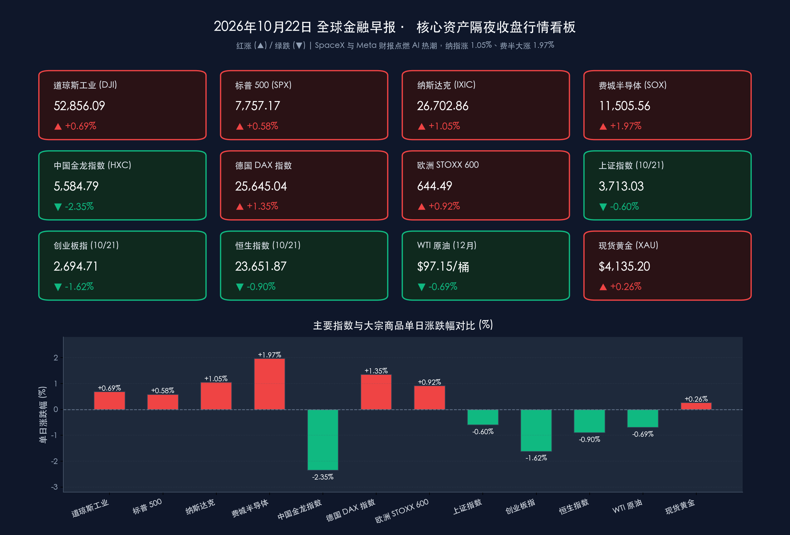
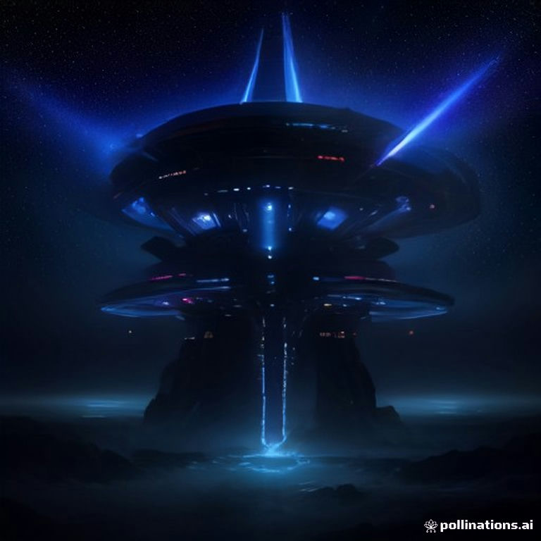

# 🌏 全球金融早报：SpaceX与Meta财报双响炮重燃AI信仰，纳指劲升1.05%、费半大涨1.97%，马斯克证实研究“特斯X”合并，A股宁王闪崩拖累创业板失守2700点

**日期：2026年10月22日 (星期四)** &nbsp; **时段：早报 (国际市场 · 常规交易日 · 模式A)**

> **核心摘要**：隔夜（美东时间10月21日周三）全球风险偏好显著回暖，由**SpaceX炸裂三季报**（营收同比暴增161%至145.8亿美元，AI业务飙升829%）及马斯克证实已成立独立委员会**正式研究特斯拉与SpaceX潜在合并**点燃科技多头热情，美股三大指数全线收涨：**道琼斯工业平均指数上涨0.69%（+360.21点）报52,856.09点**，**标普500指数上涨0.58%（+44.60点）报7,757.17点**，**纳斯达克综合指数劲升1.05%（+278.04点）报26,702.86点**；**费城半导体指数大涨1.97%报11,505.56点**（30只成分股29涨1跌），英伟达（+2.54%）、AMD（+3.36%）、阿斯麦（+2.81%）及存储芯片全线走强。盘后“科技七巨头”财报首秀再传捷报：**Meta** 三季度营收创纪录达 **646亿美元（同比+26%）**、剔除州检察长诉讼和解金后调整后EPS达 **$7.40**，上调全年资本开支指引下限至 **1,350–1,450亿美元** 并宣布推出无投票权C类股以支持AI基建扩张，盘后股价上涨约 **2%–2.8%**（一度涨超7%）；**特斯拉** 三季度非GAAP EPS **$0.48**（超预期的$0.45）、自由现金流修复至 **15.3亿美元**，同时披露Austin自动驾驶Cybercab车队累计无监督里程逼近200万英里、2027年Megapack储能产能几近售罄，盘后股价上涨约 **1%–2%**；**IBM** 与 **德州仪器（TXN）** 三季报亦双双报喜。大宗商品端，受俄乌和谈信号及EIA馏分油累库对冲原油去库影响，**WTI原油12月主力合约收跌0.69%报$97.15/桶**，**布伦特原油微涨0.06%报$108.85/桶**；**现货黄金止跌回升0.26%报$4,135.20/盎司**；**比特币（BTC）** 突破 **$84,000** 关口。亚太方面，周三A股受宁德时代单日重挫12.03%拖累，**上证指数跌0.60%报3,713.03点**、**创业板指跌1.62%失守2,700点**，**恒生科技指数跌1.26%失守4,000点**，但数据要素与AI算力光模块逆势活跃，今日有望迎海外AI映射共振。

---

## 核心行情复盘

*   **美股三大指数与核心指数（AI信仰强势回归，纳指领涨、费半29涨1跌）**：
    *   **道琼斯工业平均指数 (DJI)**：收盘报 **52,856.09 点**，上涨 **+360.21 点**，涨幅 **+0.69%** 🔴（前一日收盘 52,495.88 点）。
    *   **标普 500 指数 (SPX)**：收盘报 **7,757.17 点**，上涨 **+44.60 点**，涨幅 **+0.58%** 🔴（前一日收盘 7,712.57 点）。
    *   **纳斯达克综合指数 (IXIC)**：收盘报 **26,702.86 点**，上涨 **+278.04 点**，涨幅 **+1.05%** 🔴（前一日收盘 26,424.82 点）。
    *   **费城半导体指数 (SOX)**：收盘报 **11,505.56 点**，大涨 **+221.75 点**，涨幅 **+1.97%** 🔴（前一日收盘 11,283.80 点），盘中交投于 11,355.3 至 11,551.6 点区间；指数 **30 只成分股中 29 家上涨、仅 1 家下跌**，算力与存储链全面爆发。
    *   **纳斯达克中国金龙指数 (HXC)**：逆势回调，收盘报 **5,584.79 点**，下跌 **-2.35%** 🟢（前一日收盘修正值约 5,719.19 点）。
*   **美股领涨/领跌板块与焦点个股深度拆解（SpaceX点燃AI与太空经济，盘后Meta/特斯拉/IBM/TXN财报齐捷）**：
    *   **焦点事件——SpaceX 三季报引爆全场 & 特斯拉-SpaceX合并研究委员会**：**SpaceX (SPCX)** 公布惊艳三季报，总营收同比激增 **+161%** 至 **145.8亿美元**，净利润达 **44亿美元**；其中 **AI业务部门营收同比暴增 829% 至 75.6亿美元**，星链连接业务持续高增，马斯克更在电话会上抛出“2027年底前ARR（年度经常性收入）有望冲击5,000亿至1万亿美元”的宏大愿景，并**正式确认特斯拉与SpaceX双方均已成立独立委员会研究潜在合并方案**（目前处于早期探索评估阶段，尚未达成最终协议）。SpaceX日内大涨 **7%–8%以上**（盘后续涨约 **+9%**）🔴，一举扭转市场此前对AI投资回报的焦虑，并带动太空概念股集体井喷。
    *   **科技七巨头（Magnificent 7）正股多数收涨**：**特斯拉 (TSLA)** 正股大涨 **+3.41%** 🔴（受与SpaceX潜在合并研究及财报预期催化）；**英伟达 (NVDA)** 上涨 **+2.54%** 🔴（黄仁勋在GTC柏林大会发表主题演讲，展示AI基础设施、智能体、工业机器人与自动驾驶最新布局）；**苹果 (AAPL)** 上涨 **+1.32%** 🔴；**Meta Platforms (META)** 正股收涨 **+0.47%** 🔴；**微软 (MSFT)** 微涨 **+0.20%** 🔴；**亚马逊 (AMZN)** 微跌 **-0.10%** 🟢；**谷歌 (GOOGL)** 下跌 **-1.62%** 🟢。此外，前一日盘后下修广告收入指引的 **奈飞 (NFLX)** 正股重挫逾 **-5%** 🟢，创逾两年新低。
    *   **半导体与存储芯片板块（领涨先锋）**：逻辑与设备端，**AMD** 大涨 **+3.36%** 🔴，**阿斯麦 (ASML)** 上涨 **+2.81%** 🔴，**ARM** 上涨 **+2.50%** 🔴，**台积电 (TSM)** 上涨 **+1.57%** 🔴，**英特尔 (INTC)** 上涨 **+1.39%** 🔴，**高通 (QCOM)** 上涨 **+1.28%** 🔴，**博通 (AVGO)** 上涨 **+1.03%** 🔴；存储芯片全线反弹，**西部数据 (WDC)** 大涨 **+3.89%** 🔴，**希捷科技 (STX)** 上涨 **+3.22%** 🔴，**SK海力士** 上涨 **+2.48%** 🔴，**美光科技 (MU)** 上涨 **+1.96%** 🔴。
    *   **盘后重磅财报一——Meta Platforms (META) 三季报超预期**：
        *   **业绩与指引双杀预期**：三季度营收创历史新高至 **646.0亿美元（$64,601M，同比+26%）**，超华尔街预期的633亿美元；四季度营收指引高达 **730亿–760亿美元**，再度超越市场一致预期。
        *   **利润与州检察长和解费用**：受与美国各州检察长达成青少年心理健康诉讼和解协议（总额约186亿美元，当季计提税前法律费用 **98.9亿美元**）影响，GAAP净利润为 **98.6亿美元**、稀释后EPS **$3.83**；若**剔除该项一次性法律支出，调整后营业利润达228.8亿美元、调整后EPS达 $7.40**，大幅击败市场预期。
        *   **AI商业化与资本开支上修**：9月家族日活跃用户（DAP）同比增长 **+3%** 至 **36.4亿**；扎克伯格披露前沿模型 **Muse 与 Muse Wonder** 进展，Muse AI智能体上线后圈粉千万、首周购物交易火爆，预计明年成本效率提升10倍。公司单季资本开支达 **349.1亿美元**，并将 **2026全年资本开支指引由 1,300–1,450亿美元上修收窄至 1,350–1,450亿美元**；同时宣布设立**无投票权C类普通股（Class C）拆股架构**，在不稀释扎克伯格投票控制权的前提下为AI基础设施筹资。盘后股价一度飙升超 **+7%**，随后稳健收涨约 **+2%–2.8%** 🔴。
    *   **盘后重磅财报二——特斯拉 (TSLA) 三季报**：
        *   **盈利与现金流修复**：三季度营收约 **280.6亿美元**（受储能确认节奏等影响略逊于部分激进预期），调整后EBITDA约 **39亿美元**，GAAP净利润约 **8亿美元**；但**非GAAP EPS达 $0.48（高于预期的 $0.45）**，毛利率企稳回升，**自由现金流显著修复至 15.3亿美元**。
        *   **Robotaxi与储能路线图**：公司已在奥斯汀（Austin）将 **Cybercab** 部署进 Robotaxi 车队，截至三季度末累计无监督自动驾驶里程逼近 **200万英里**；FSD在欧洲多国获批扩展，活跃用户突破 **10万**、累计行驶超 **1.6亿公里**。管理层重申 **2030年年产500万辆汽车** 的长期目标，并透露 **2027年全年 Megapack 储能产能已几乎全部售罄**。盘后股价多空交锋后上涨约 **+1%–2%** 🔴。
    *   **盘后重磅财报三——IBM 与 德州仪器 (TXN)**：**IBM** 三季度利润走高，软件与基础设施业务营收加速增长，证实此前递延的企业级大单已顺利落地；模拟芯片龙头 **德州仪器 (TXN)** 三季度净利润达 **24.3亿美元**，在工业板块需求复苏与数据中心带动下实现广泛营收增长，彻底扫除周二奈飞指引下修带来的阴霾。
    *   **热门中概股（普跌调整）**：**好未来** 跌近 **-9%** 🟢，**小鹏汽车** 跌超 **-5.5%** 🟢，**禾赛科技** 跌超 **-5%** 🟢，**阿里巴巴、京东、理想汽车、拼多多** 均下跌约 **-3%** 🟢。
*   **欧洲三大股指（企业财报向好对冲地缘阴霾，德股领涨1.35%）**：
    *   **欧洲 STOXX 600 指数**：收盘报 **644.49 点**，上涨 **+5.85 点**，涨幅 **+0.92%** 🔴（前一日收盘 638.64 点）。
    *   **德国 DAX 指数**：收盘报 **25,645.04 点**，大涨 **+340.62 点**，涨幅 **+1.35%** 🔴（前一日收盘 25,304.42 点）。
    *   **英国富时 100 指数 (FTSE 100)**：收盘报 **10,752.88 点**，上涨 **+19.88 点**，涨幅 **+0.19%** 🔴（前一日收盘 10,733.00 点）。
*   **中国市场基准回顾（10月21日收盘：宁王重挫拖累指数，AI算力与数据要素逆势走强）**：
    *   **A股主要指数（10月21日收盘）**：三大指数高开低走，呈现“权重拖累、题材活跃”格局。**上证指数**收报 **3,713.03 点**，下跌 **-22.34 点 / -0.60%** 🟢（前值 3,735.37 点）；**深证成指**收报 **11,704.35 点**，下跌 **-96.94 点 / -0.82%** 🟢（前值 11,801.29 点）；**创业板指**收报 **2,694.71 点**，下跌 **-44.49 点 / -1.62%** 🟢（前值 2,739.20 点，**失守2,700点整数关口**）；**沪深300**收跌 **-0.97%** 🟢 报 **4,111.93 点**；而代表硬科技与中小盘的 **科创50指数** 逆势收涨 **+0.06%（+0.86点）** 🔴 报 **1,343.28 点**，**中证1000指数** 收涨 **+0.20%** 🔴 报 **6,780.26 点**。
    *   **A股成交额与主力资金动向**：沪深两市全天成交额约 **1.44万亿元**（其中沪市 **6,427.52亿元**、深市 **7,865.93亿元**），较前一交易日 **缩量约295亿元**，延续存量博弈。主力资金方面，以 **宁德时代（单日暴跌 -12.03%，全天成交额超324亿元居两市之首）** 为代表的电池、新能源产业链及部分大盘消费股遭主力资金集中抛售，成为压制创业板指的最大空头因子；相反，**数据要素、AI算力（光模块等）、农牧饲渔、文化传媒** 等方向获短线及中小盘资金积极回流。
    *   **港股市场（10月21日收盘）**：**恒生指数**收报 **23,651.87 点**，下跌 **-215.87 点 / -0.90%** 🟢（前值 23,867.74 点）；**恒生科技指数**收报 **3,994.77 点**，下跌 **-51.14 点 / -1.26%** 🟢（前值 4,045.91 点，盘中高见 4,110.74 点、低见 3,985.63 点，**失守4,000点关口**）。
*   **大宗商品、美债收益率与加密资产（原油多空拉锯回落，黄金止跌、比特币破8.4万美元）**：
    *   **国际原油**：**WTI 原油12月主力合约**结算价收跌 **-0.69%（-$0.67）**，报 **$97.15/桶** 🟢（前一日12月合约结算价 $97.82/桶）；**伦敦布伦特原油12月合约**结算价微涨 **+0.06%（+$0.06）**，报 **$108.85/桶** 🔴（收盘区间 $108.82–$108.89，前值 $108.79/桶；盘中因EIA商业原油去库超预期及美对伊新制裁一度冲上 **$110/桶**，后受俄乌和谈信号及馏分油累库影响回吐涨幅）。
    *   **贵金属**：**伦敦金现货 (XAU/USD)** 扭转两连跌，纽约尾盘收涨 **+0.26%（+$10.72）**，报 **$4,135.20/盎司** 🔴（前值 $4,124.48/盎司）；**COMEX 12月黄金期货**结算价报 **$4,145.20/盎司** 🔴。
    *   **美债收益率**：受美联储褐皮书揭示企业燃料与投入成本压力上升影响，**美国 10 年期国债收益率**小幅上行约 **2.9个基点** 至 **5.145%**（前一日约 5.116%）。
    *   **加密资产**：**比特币 (BTC)** 大幅走强并突破 **$84,000** 大关，日内交投于 **$82,943–$84,737** 区间，纽约尾盘报约 **$84,120** 🔴（较前一日 $82,790 上涨 **+1.61%**），受AI科技股风险偏好共振、现货ETF资金净流入及空头头寸强平挤压驱动。

> **数学闭环校验（收盘终值与涨跌幅交叉核验）**：
> * **道琼斯工业指数**：52,495.88 + 360.21 = 52,856.09（+360.21 / 52,495.88 = +0.6862% ≈ +0.69%），吻合；
> * **标普 500 指数**：7,712.57 + 44.60 = 7,757.17（+44.60 / 7,712.57 = +0.5783% ≈ +0.58%），吻合；
> * **纳斯达克综合指数**：26,424.82 + 278.04 = 26,702.86（+278.04 / 26,424.82 = +1.0522% ≈ +1.05%），吻合；
> * **费城半导体指数**：11,283.80 + 221.75 = 11,505.55 ≈ 11,505.56（+221.75 / 11,283.80 = +1.9652% ≈ +1.97%），吻合；
> * **欧洲三大股指**：STOXX 600 638.64 + 5.85 = 644.49（+0.916% ≈ +0.92%）；DAX 25,304.42 + 340.62 = 25,645.04（+1.346% ≈ +1.35%）；FTSE 100 10,733.00 + 19.88 = 10,752.88（+0.185% ≈ +0.19%），吻合；
> * **中国市场（10月21日收盘）**：上证 3,735.37 − 22.34 = 3,713.03（-0.598% ≈ -0.60%）；深成指 11,801.29 − 96.94 = 11,704.35（-0.821% ≈ -0.82%）；创业板 2,739.20 − 44.49 = 2,694.71（-1.624% ≈ -1.62%）；恒指 23,867.74 − 215.87 = 23,651.87（-0.904% ≈ -0.90%）；恒生科技 4,045.91 − 51.14 = 3,994.77（-1.264% ≈ -1.26%），完全吻合；
> * **大宗商品**：WTI 12月主力合约 97.82 − 0.67 = 97.15（-0.685% ≈ -0.69%）；布油12月合约 108.79 + 0.06 = 108.85（+0.055% ≈ +0.06%）；现货黄金 4,124.48 + 10.72 = 4,135.20（+0.260%），完全吻合。

---

## 核心解读与市场逻辑

> **逻辑一：SpaceX与Meta业绩双响炮（数据）→证实AI软件与智能体进入高速变现期（事件）→打破“AI资本开支无回报”质疑、资金回流算力与存储链（逻辑）**
> 过去两周，受全球长端利率突破5.1%及奈飞下修广告指引冲击，市场一度陷入“AI巨额资本开支何时变现”的焦虑。然而周三两份重量级财报彻底扭转叙事：一是 **SpaceX** 三季度营收同比暴增161%至145.8亿美元，其中 **AI部门营收飙升829%至75.6亿美元**，单季净利润高达44亿美元；二是盘后 **Meta** 三季度营收同比增长26%至646亿美元、四季度指引高达730–760亿美元，其 **Muse AI智能体** 上线即带动购物交易爆发，使市场看到“AI资本开支→智能体与广告效率十倍跃升→真金白银现金流”的清晰闭环。在此提振下，Meta将全年资本开支指引下限由1,300亿上修至1,350亿美元（上限1,450亿美元），并创设无投票权C类股为AI基建融资，直接点燃上游半导体与存储芯片买盘（费半大涨1.97%，西部数据+3.89%、AMD+3.36%、英伟达+2.54%），叠加 **IBM** 与 **德州仪器** 财报验证企业IT与工业芯片需求回暖，科技股重掌美股领涨大旗。

> **逻辑二：“特斯X”潜在合并研究启动（事件）→太空算力+星链网络+地面Robotaxi/机器人生态闭环（逻辑）→重塑马斯克商业帝国估值锚**
> 马斯克在SpaceX财报电话会上正式确认，特斯拉与SpaceX董事会已分别设立独立委员会，对两家公司的潜在合并进行早期可行性研究。尽管目前尚无确定性协议，但这一设想在资本市场掀起巨浪：一旦SpaceX的高盈利现金流（单季净利44亿美元）与天基星链/AI算力网络，同特斯拉地面端的 **Cybercab自动驾驶车队**（奥斯汀累计无监督里程近200万英里）、**FSD欧洲扩张** 及 **Megapack储能业务**（2027年产能几近售罄）深度整合，不仅能缓解特斯拉在AI与机器人扩张期的资本开支压力，更将构建起全球唯一的“天地一体化AI与物理智能生态”。这也解释了为何特斯拉在三季度汽车利润承压的背景下，凭借 **$15.3亿自由现金流** 与生态叙事在正股（+3.41%）与盘后（+1%–2%）持续获资金追捧。

> **逻辑三：EIA原油去库306万桶+美对伊“影子船队”制裁 vs. 俄乌和谈信号+馏分油累库→油价冲高回落，褐皮书揭示高油价向供应链传导**
> 原油市场周三经历激烈的多空博弈：一方面，美国能源信息署（EIA）公布截至10月16日当周商业原油库存大降 **306万桶** 至4.125亿桶（连续第三周去库且远超预期），汽油库存亦锐减 **295万桶**，叠加美国财政部启动“经济弃儿行动（Operation Economic Outcast）”制裁协助伊朗规避石油禁运的希腊/巴拿马律所及航运网络，推动布伦特原油盘中再度冲破 **$110/桶**；但另一方面，EIA馏分油（柴油与取暖油）库存意外增加 **168万桶**，且俄乌和平谈判浮现新信号（报道称泽连斯基表示愿在保留75%领土控制权基础上探讨协议框架）及美俄柴油相关消息传出，令油价尾盘回吐涨幅，WTI收跌0.69%至 **$97.15/桶**。不过，美联储最新发布的 **褐皮书（Beige Book）** 明确警示，企业正普遍遭遇柴油与燃油附加费攀升带来的投入成本压力，这也是10年期美债收益率逆势上行2.9个基点至 **5.145%** 的核心原因。

> **逻辑四：A股“宁王”闪崩12%释放机构重仓股去杠杆压力，海外AI与光模块高景气有望驱动科技结构性修复**
> 周三A股与港股呈现调整态势，创业板指下跌1.62%失守2,700点，核心症结在于以 **宁德时代（-12.03%，成交超324亿元）** 为代表的机构重仓新能源赛道遭遇集中抛售与两融去杠杆。然而盘面并非泥沙俱下：科创50（+0.06%）与中证1000（+0.20%）逆势翻红，**数据要素、AI算力（光模块）** 获得资金逆势承接。结合隔夜Meta上修AI资本开支下限至1,350亿美元、SpaceX AI业务暴增829%以及费城半导体指数大涨1.97%，海外AI算力链的真实业绩爆发，将为今日A股光模块、AI服务器、PCB及科创板半导体板块提供强劲的基本面映射与情绪对冲。

---

## 政策脉动

*   **美联储褐皮书 (Federal Reserve Beige Book)**：
    *   **经济增长温和但分化明显**：美联储12个辖区经济活动整体呈“微弱至温和（slight to moderate）”增长。消费支出净变化不大，主要由高收入家庭支撑，“K型消费分化”延续。
    *   **能源成本向供应链传导**：多家企业报告投入价格压力再度加剧，特别是**高企的柴油价格与燃油附加费**正沿着物流与供应链向下游传导。
    *   **制造业亮点在数据中心与国防**：钢铁、机械、国防工业及**数据中心基础设施建设**保持强劲增长，但受宏观不确定性与高利率制约，企业对未来展望依然审慎。
*   **美国能源信息署 (EIA) 周度库存报告（截至10月16日当周）**：
    *   **商业原油库存**：大幅减少 **306万桶** 至 **4.125亿桶**（连续第3周下降，降幅远超预期）；美国原油日产量微降至 **1,330万桶/日**。
    *   **成品油库存分化**：汽油库存大幅减少 **295万桶**；但包括柴油和取暖油在内的**馏分油库存意外增加 168万桶**，缓和了成品油市场的逼空情绪。
*   **地缘政治与美国财政部制裁**：
    *   **美国财政部“经济弃儿行动 (Operation Economic Outcast)”**：10月21日，美国财政部宣布新一轮对伊制裁，精准打击一家总部位于巴拿马和希腊的律师事务所（Karnakis and Karnakis）、多家航运运营商及空壳公司，指控其协助伊朗“影子船队”走私数百万桶石油与石化产品以资助伊朗伊斯兰革命卫队圣城旅（IRGC-QF）。
    *   **俄乌局势动态**：市场传出俄乌和平协议曙光信号（涉及在现有约75%领土控制线基础上探讨停火协议的传闻），一定程度压制了原油尾盘的风险溢价。
*   **中国市场与产业政策动态**：
    *   金融街论坛政策红利持续落地，宽基ETF在权重股调整过程中显现承接迹象；当前正值A股三季报密集披露窗口期，市场关注点由宏观预期转向三季报真实盈利增速核验。

---

## 最新机构观点

> **高盛 (Goldman Sachs)**：
> * **美股“指数高位、个股隐性熊市”，三大资金流将支撑优质资产，AI向生产力受益者与消费轮动**：高盛策略师 Ben Snider 团队指出，尽管标普500指数逼近历史高位，但市场宽度（Market Breadth）极窄，大量中位数个股经历明显回调。不过美股企业盈利基本面依然稳健，预计2026–2027年基础盈利保持增长；高盛资金流向团队预测，随着**企业回购窗口重新开启、年末散户资金季节性流入以及中期选举后外资买盘回归**，“三路增量资金”将为经历估值消化的优质股票提供支撑。配置上，鉴于AI资本开支折旧上升，建议避免盲目追高前期过热硬件股，重点布局**AI生产力受益组合**及受益于购买力改善的**消费与补涨板块**。

> **摩根大通 (J.P. Morgan)**：
> * **AI资本开支周期对高利率“脱敏”，力挺全球存储芯片重回牛市；中国资产坚持“哑铃型”策略**：摩根大通资管与策略团队强调，美国经济之所以在5%以上的长端美债收益率下保持韧性，核心在于**AI资本开支周期对传统高利率环境高度脱敏**（企业通过自由现金流或创新股权工具如Meta C类股融资）。针对10月中旬科技股震荡，摩根大通发布重磅看涨研报，指出宏观层面对AI持续性的担忧与微观供需紧张存在严重错配，三季度是“预期重置季”，**强烈看多SK海力士、三星、美光等全球存储芯片龙头重回牛市**。中国市场方面，摩根大通中国股票策略团队（张晓宁等）维持结构性看好，建议采取**“高股息防御 + AI科技/创新药进攻”的哑铃型配置**。

> **中信证券 (CITIC Securities)**：
> * **A股机构重仓股与两融去杠杆接近尾声，紧盯AI产业周期“一阶导”与国内“反内卷”供给出清**：中信证券策略团队认为，10月A股的阶段性调整主要由机构重仓股（如新能源权重）触发，并向高融资占比板块传导，目前两融杠杆去化与恐慌释放已接近尾声，部分宽基ETF放量显示底部承接力增强。针对AI主线，虽然市场短期纠结于资本开支增速“二阶导”放缓并消化估值，但长线资金更看重**“一阶导”核心高频指标（内存价格、算卡租赁价格及云厂商CSP利润率）**——只要上述指标向上，AI产业大趋势便未动摇；同时建议重视国内弱需求背景下的**“反内卷”与供给侧出清**龙头。

> **中金公司 (CICC)**：
> * **三季报业绩韧性叠加稳增长信号支撑A股回稳，聚焦AI硬件与出海景气主线**：中金公司指出，经历10月前期的震荡洗盘与筹码优化后，上市公司三季报业绩韧性叠加金融街论坛释放的宏观稳增长信号，将支撑A股逐步震荡筑底回稳。行业配置上，建议围绕三季报盈利改善确定性布局：**一是受益于全球AI高景气与海外资本开支上修的科技硬件（光模块、AI服务器、半导体）、二是创新药与CXO、三是具备全球竞争力的工程机械与高端制造**。

---

## 今日市场情绪：星舰熔硅擎苍穹，神庙织光扫阴霾

> Prompt: A colossal silver starship forged from glowing semiconductor wafers ascending into a starry cosmos, trailing twin plumes of crimson laser light that weave an orbital bridge toward a futuristic autonomous cyber-chariot. In the background, a holographic sapphire data-muse temple radiates golden constellations above a calm dark ocean where oil derricks fade into mist.

---

> **免责声明**：内容仅供参考，不构成投资建议。数据来源：纽约证券交易所、纳斯达克交易所、伦敦证券交易所、德意志交易所、芝加哥商品交易所（CME）、洲际交易所（ICE）、上海/深圳/香港交易所、美联储（Federal Reserve）褐皮书、美国能源信息署（EIA）、美国财政部、Meta/Tesla/SpaceX/IBM/Texas Instruments 公司财报及高盛、摩根大通、中信证券、中金公司研究报告；隔夜欧美股市及大宗商品数据截至2026年10月22日08:00。

🤖 生成模型：Gemini 4 Argon (Medium) <!-- model-stamp -->
