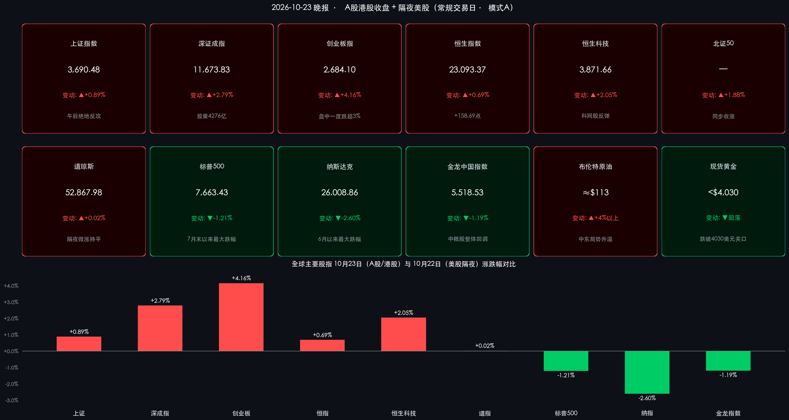

# A股午后绝地反攻创业板指飙涨4.16%，人形机器人全线爆发掀涨停潮；隔夜纳指重挫2.6%创6月以来最大跌幅，中东局势推升布油破113美元

**日期：2026年10月23日 (星期五)** &nbsp; **时段：下午/国内市场收盘**

> **核心摘要**：2026年10月23日（周五），A股上演惊心动魄的“深V”绝地反攻——早盘受隔夜美股科技股重挫拖累，沪指盘中一度跌超2%失守3,600点、创业板指盘中跌超3%跌破2,500点，午后资金大举回流，三大指数集体翻红：**上证指数收涨0.89%报3,690.48点**，**深证成指涨2.79%报11,673.83点**，**创业板指飙涨4.16%报2,684.10点**；沪深两市全天成交 **1.96万亿元**，较上一交易日放量 **4,276亿元**，主力资金全天净流入 **35.16亿元**，全市场超4,500只个股收涨。**人形机器人概念全线爆发**（宇树科技、利亚德、海天瑞声20cm涨停），港股同步回暖（恒生科技指数涨2.05%）。海外方面，隔夜美股因AI巨额资本支出担忧与美伊紧张升级而剧烈分化，**纳指重挫2.60%创6月23日以来最大单日跌幅**；中东局势升温推动**布伦特原油飙升逾4%突破113美元/桶**，现货黄金跌破4,030美元，比特币跌破8.2万美元。

## 核心行情复盘

*   **A股主要宽基指数收盘终值（三大指数探底回升、全线收涨）**：
    *   **上证指数**：收报 **3,690.48点**，较上一交易日（3,658.03点）上涨 **+32.45点**，涨幅 **+0.89%**（盘中一度跌超2%失守3,600点整数关口，午后强势收复全部失地）。
    *   **深证成指**：收报 **11,673.83点**，较上一交易日（11,357.32点）上涨 **+316.51点**，涨幅 **+2.79%**。
    *   **创业板指**：收报 **2,684.10点**，较上一交易日（2,576.90点）上涨 **+107.20点**，涨幅 **+4.16%**（盘中一度跌超3%、跌破2,500点，午后绝地反攻收涨逾4%，日内振幅接近8%）。
    *   **沪深300指数**：收涨 **+1.71%**，权重股午后发力是指数反转的重要压舱石。
    *   **北证50指数**：收涨 **+1.88%**，小盘股同步回暖。
*   **香港市场表现（午后延续涨势、科网股集体反弹）**：
    *   **恒生指数**：收报 **23,093.37点**，较上一交易日（22,934.68点）上涨 **+158.69点**，涨幅 **+0.69%**，重回23,000点上方。
    *   **恒生科技指数**：收报 **3,871.66点**，较上一交易日（3,793.93点）上涨 **+77.73点**，涨幅 **+2.05%**。
    *   **港股盘面特征**：科网股部分反弹，**小米集团涨近4%**，**宁德时代H股终结日线7连跌**；恒生指数成分股中**中国铝业**领涨。
*   **量能指标、个股涨跌与主力资金动向**：
    *   **全天成交额**：沪深两市全天成交额合计达 **1.96万亿元**，较上一交易日（约1.53万亿元）大幅放量 **4,276亿元**，放量幅度约28%，恐慌盘与抄底盘在日内完成充分换手。上午半日成交即达10,768亿元。
    *   **个股涨跌分布**：全市场 **4,525只** 个股收涨（占比81.22%），仅909只下跌，与上午收盘时逾4,800只个股下跌形成戏剧性逆转。
    *   **主力资金流向**：今日主力资金全天 **净流入35.16亿元**（昨日为大幅净流出格局），其中**创业板主力净流入40.83亿元**、**科创板净流入15.52亿元**、**沪深300成份股净流入15.82亿元**，显示机构资金午后集中回补成长方向。
    *   **宽基ETF持续放量**：**创业板ETF易方达（159915）成交额突破195亿元**，创2024年10月9日以来新高；上午沪深300ETF华泰柏瑞（510300）成交超90亿元、科创50ETF华夏（588000）成交超72亿元，机构资金借道ETF大举进场特征明显。
*   **领涨与领跌板块深度扫描**：
    *   **领涨阵营**：
        1. **人形机器人（全天最强主线，午后引爆市场情绪）**：人形机器人板块持续拉升，**宇树科技、利亚德、海天瑞声** 等多股“20cm”涨停，**众诚科技“30cm”涨停**，凌云光、摩尔线程、上纬新材等跟涨；**宇树科技总市值重返2,500亿元上方**。
        2. **计算机 / 传媒（申万一级行业领涨）**：计算机行业大涨 **4.67%**、传媒行业上涨 **3.78%**，软件开发、影视院线方向集体走强，AI应用端接棒硬件成为反弹急先锋。
        3. **早盘护盘权重**：上午市场急跌过程中，大金融、白酒等板块表现活跃，**宁德时代、长鑫科技、中国石油、中国电信** 等权重“大象”发力，为午后反攻稳住基本盘。
    *   **领跌阵营**：**银行（-1.30%）与公用事业（-0.60%）** 成为全天仅有的两个收跌的申万一级行业——昨日逆势护盘的防御性红利板块在风险偏好急升后出现资金获利了结，高低切换节奏极快。
*   **隔夜美股（10月22日收盘）：AI资本支出担忧+地缘风险双杀，科技板块重挫**：
    *   **道琼斯工业指数**：收报 **52,867.98点**，微涨 **+0.02%（+11.89点）**，尾盘收窄跌幅转正。
    *   **纳斯达克综合指数**：收报 **26,008.86点**，重挫 **-2.60%**，创 **6月23日以来最大单日跌幅**。
    *   **标普500指数**：收报 **7,663.43点**，下跌 **-1.21%**，创 **7月29日以来最大单日跌幅**。
    *   **热门个股**：**Meta跌近7%—8%**（尽管三季度营收超预期且业绩指引乐观，但巨额AI资本支出引发投资者对回报周期的担忧），**英伟达跌4.4%**，**SpaceX跌9%**，存储与芯片股普跌（**闪迪、SK海力士跌超8%**），**Moderna重挫17%**。
    *   **中概股**：纳斯达克中国金龙指数收跌 **-1.19%** 报 **5,518.53点**，阿里巴巴跌超2%、网易跌超3%。
*   **大宗商品与加密资产（中东局势主导全球定价）**：
    *   **原油**：也门胡塞武装宣称48小时内对沙特阿拉伯发动4次导弹和无人机袭击（目标包括首都利雅得），中东供应风险急剧升温——**布伦特原油10月22日飙升逾4%突破113美元/桶**；10月23日早盘 **WTI原油期货涨破99美元/桶** 继续冲高。
    *   **黄金**：现货黄金高位震荡回落，**跌破4,030美元/盎司** 关口。
    *   **加密货币**：**比特币跌破8.2万美元、跌幅超3.5%**，ETH、SOL等跟跌；CoinGlass数据显示近24小时全球加密货币市场超 **10万人被爆仓**。

> **数学闭环校验（今日收盘点位与涨跌幅精确核验）**：
> * **上证指数**：(3690.48 − 3658.03) / 3658.03 = +32.45 / 3658.03 ≈ **+0.8871% ≈ +0.89%**，完全吻合。
> * **深证成指**：(11673.83 − 11357.32) / 11357.32 = +316.51 / 11357.32 ≈ **+2.7868% ≈ +2.79%**，完全吻合。
> * **创业板指**：(2684.10 − 2576.90) / 2576.90 = +107.20 / 2576.90 ≈ **+4.1601% ≈ +4.16%**，完全吻合。
> * **恒生指数**：(23093.37 − 22934.68) / 22934.68 = +158.69 / 22934.68 ≈ **+0.6919% ≈ +0.69%**，完全吻合。
> * **恒生科技指数**：(3871.66 − 3793.93) / 3793.93 = +77.73 / 3793.93 ≈ **+2.0488% ≈ +2.05%**，完全吻合。
> * **标普500（隔夜）**：(7663.43 − 7757.17) / 7757.17 = −93.74 / 7757.17 ≈ **−1.2084% ≈ −1.21%**，完全吻合。
> * **纳斯达克（隔夜）**：(26008.86 − 26702.86) / 26702.86 = −694.00 / 26702.86 ≈ **−2.5990% ≈ −2.60%**，完全吻合。
> * **道琼斯（隔夜）**：+11.89 / 52856.09 ≈ **+0.0225% ≈ +0.02%**，完全吻合。

## 核心解读与市场逻辑

*   **逻辑一：隔夜美股“AI资本支出质疑”冲击波传导A股早盘，但午后内资定价权完成强势对冲**：
    *   **事件与数据**：隔夜Meta在营收超预期的情况下仍因巨额AI资本支出计划遭抛售（跌近7%—8%），引发全球科技股估值共振下杀——纳指重挫2.6%、存储芯片（闪迪、SK海力士）跌超8%。受此拖累，A股早盘低开低走，沪指一度失守3,600点、创业板指跌破2,500点，上午收盘时全市场逾4,800只个股下跌。
    *   **传导逻辑**：与前期“外盘跌、A股跟跌到底”不同，今日午后内资展现出极强的独立定价意愿——主力资金全天转为净流入35.16亿元，创业板单板块净流入40.83亿元，创业板ETF易方达成交额暴增至195亿元创逾一年新高。本质是A股在经历上周探底3,674点（精准回踩2024年“924行情”阶段高点3,674.40点）及连续缩量调整后，做空动能已充分释放，低位承接力量对“外部利空”的钝化效应开始显现。
*   **逻辑二：人形机器人接棒算力硬件成为新进攻主线，“高低切换”在一天内完成闭环**：
    *   **事件与数据**：前期领涨的银行、公用事业今日成为仅有的两个收跌行业，而人形机器人概念全线爆发（宇树科技20cm涨停、市值重返2,500亿），计算机、传媒两大AI应用方向领涨申万一级行业。
    *   **传导逻辑**：昨日尾盘百亿级宽基ETF护盘确认了指数底线，今日资金便果断从防御性红利仓位撤出，向具备产业催化（具身智能、Physical AI）且前期调整充分的机器人与AI应用方向集中进攻。盘面“防御跌、成长涨”的镜像结构，是典型的一轮调整末期、新周期启动的资金再配置信号。
*   **逻辑三：中东局势骤然升级重构全球大宗与避险资产定价**：
    *   **事件与数据**：胡塞武装48小时内4次袭击沙特（含首都利雅得），布伦特原油飙升逾4%突破113美元、WTI早盘破99美元；避险资金涌入美债压低收益率，而黄金在创历史新高后反而回落跌破4,030美元，比特币跌超3.5%跌破8.2万美元、24小时超10万人爆仓。
    *   **传导逻辑**：油价急涨重新点燃“滞胀”交易——高油价若持续将制约美联储政策空间，叠加9月重启加息后10年期美债收益率本已处于高位，这解释了为何黄金与比特币未因避险情绪走强反而回落（实际利率上行压力压制无息资产）。对国内而言，油价上行利好油气产业链但将抬升中下游制造成本，需关注输入性通胀对货币政策的边际约束。

> **核心解读**：今日市场的核心价值不在于指数涨了多少，而在于“外部科技股崩盘+内部盘中破位”的双重压力测试下，A股凭借放量1.96万亿、主力资金转正、超4,500只个股收涨完成了一次教科书级的日内反转。这表明经过两周充分调整后，市场底部承接机制（宽基ETF+主力资金+产业新主线）已重新运转，短期调整大概率接近尾声；但隔夜美股AI资本支出分歧与中东油价冲击仍是悬在头顶的两大外部变量，反弹持续性有待下周初量能验证。

## 政策脉动

*   **证监会主席吴清金融街论坛发声：警惕跨境跨市场跨行业风险传导**：
    *   **政策导向**：10月19日，证监会主席吴清在2026金融街论坛年会开幕式上表示，当前百年变局加速演进，新一轮科技革命和产业变革蓬勃发展，地缘冲突扰动抬升全球风险溢价，利率环境复杂化推动资产再定价再平衡，**跨境跨市场跨行业风险传导值得高度警惕**。讲话同时释放维护市场稳定、增强投资者回报、改善市场生态等多方面积极信号。
*   **央行拟推出非银流动性支持工具，证监会打出投资者保护组合拳**：
    *   **增量工具储备**：据市场报道，中国人民银行拟推出**非银机构流动性支持工具**，有助于缓解债市赎回抛售压力、降低风险向其他市场传导；证监会方面则提出**鼓励回购增持、完善违规减持处罚规则、推动长周期考核**等一揽子措施，市场积极信号正在增多。
*   **隔夜流动性呵护延续**：
    *   继10月22日开展1,730亿元隔夜逆回购（单日净投放480亿元）之后，央行“7天期零操作+加码隔夜品种”的短端调控新机制持续运行，为跨月前的资金面稳定提供保障。

> **核心解读**：政策层当前处于“底线思维+工具储备前置”状态——监管高层公开提示风险传导的同时，流动性支持工具与投资者保护规则同步推进，政策底与市场底形成共振的概率正在上升。

## 最新机构观点

> **中金公司（李求索，研究部国内策略首席分析师）**：
> 在解读金融街论坛年会监管讲话时表示，本次讲话释放出**维护市场稳定、增强投资者回报、改善市场生态**等多方面积极信号，**市场向好的逻辑未变**。（2026年10月20日，券商中国专访）

> **中信证券（策略研究团队）**：
> 维持**年内A股震荡市**的判断，认为**三季报前后是年内最后一波进攻窗口**，指数年内修复的概率比创新低的概率大得多；策略上主张**用景气和供给出清来应对高利率环境**，密切跟踪AI投资周期拐点。此外，中信证券监测数据显示，本轮调整中**高融资组合跌幅已超过机构重仓股组合**，融资去杠杆放大了部分成长标的的跌幅——这也意味着去杠杆进程越充分，后续反弹的筹码结构越干净。（2026年10月研报及监测数据）

> **摩根士丹利（王滢，中国首席股票策略师）**：
> 在盈利改善、全球上游供应链主导地位增强以及人民币走强的支撑下，中国股票市场存在**温和上行空间**；中期目标方面，预计到2027年二季度**恒生指数有望升至28,400点**，MSCI中国指数和沪深300指数目标位分别达91点和5,400点。（2026年5月观点，作为中期框架参考）

## 今日市场情绪：深V逆转——机械凤凰从下跌风暴中涅槃

> Prompt: A colossal mechanical phoenix built from glowing red circuits and golden gears rising powerfully from the depths of a stormy emerald ocean made of falling candlestick charts, spreading its wings at twilight. In the background, on the distant horizon, a dark silicon fortress of shattered AI server towers is sinking under lightning, while a black geyser of crude oil erupts beside it into the crimson sky.

---
免责声明：内容仅供参考，不构成投资建议。
