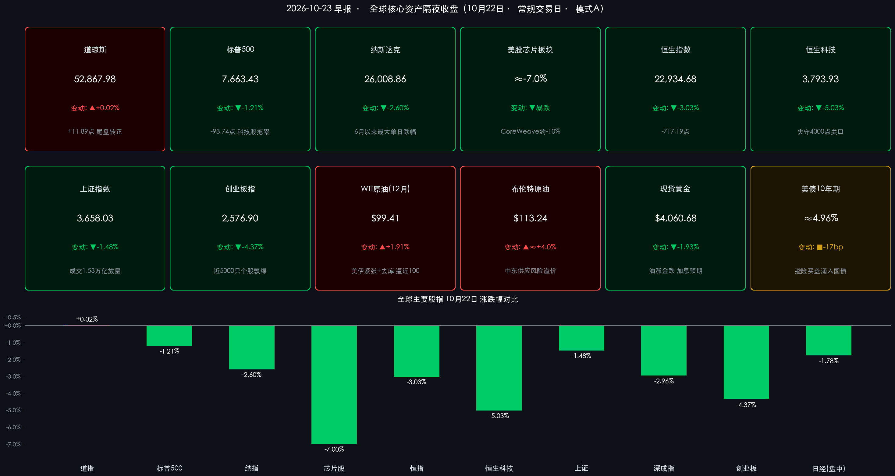

# 🌏 全球金融早报：AI信仰遭遇“清算日”，纳指重挫2.6%创6月以来最大跌幅，Meta自由现金流十年首度转负暴跌近7%，油价逼近100美元、10年期美债收益率骤降17个基点

**日期：2026年10月23日 (星期五)** &nbsp; **时段：早报 (国际市场 · 常规交易日 · 模式A)**

> **核心摘要**：隔夜（美东时间10月22日周四）全球市场上演“AI信仰清算日”——**Meta三季度自由现金流-21.2亿美元（逾十年来首度转负）** 叠加2026年资本开支下限上修至1,350亿美元，股价暴跌6.98%、5年期CDS创历史新高，引爆AI基础设施成本恐慌：**纳斯达克综合指数重挫2.60%报26,008.86点**（创6月以来最大单日跌幅，盘中低点25,949.41点），**标普500指数下跌1.21%报7,663.43点**，芯片股整体暴跌近7%；资金大举涌入避险与防御资产，**10年期美债收益率骤降约17个基点至4.96%下方**，VIX飙升约15%，宝洁（+5.79%）、家得宝（+4.27%）、强生（+3.83%）等防御股逆势大涨，**道琼斯指数尾盘最后一分钟转正、微涨0.02%报52,867.98点**。地缘端美伊紧张升级叠加EIA原油去库，**WTI原油收涨约2%报$99.41/桶逼近百元关口**，布伦特报$113.24/桶；黄金反而下跌1.93%至$4,060.68，比特币回落至约$81,700。亚太承压：昨日A股创业板指重挫4.37%、近5000只个股飘绿，港股恒生科技暴跌5.03%；今日早盘日经225一度下挫逾2.6%。

---

## 核心行情复盘

*   **美股三大指数与核心指数（AI抛售潮席卷科技板块，道指尾盘惊险转正）**：
    *   **道琼斯工业平均指数 (DJI)**：收盘报 **52,867.98 点**，上涨 **+11.89 点**，涨幅 **+0.02%** 🔴（前一日收盘 52,856.09 点），在最后一分钟由跌转涨，宝洁、家得宝、强生等蓝筹防御股力挽狂澜。
    *   **标普 500 指数 (SPX)**：收盘报 **7,663.43 点**，下跌 **-93.74 点**，跌幅 **-1.21%** 🟢（前一日收盘 7,757.17 点）；但指数内“平均个股”表现相对稳健，市场广度并未全面崩塌，呈现典型的权重股拖累格局。
    *   **纳斯达克综合指数 (IXIC)**：收盘报 **26,008.86 点**，暴跌 **-694.00 点**，跌幅 **-2.60%** 🟢（前一日收盘 26,702.86 点），创 **6月以来最大单日跌幅**；盘中一度触及 **25,949.41 点** 低点（美东14:54），10月累计跌幅扩大至 **-3.4%**。
    *   **芯片板块**：美股芯片股整体暴跌近 **-7%** 🟢，拖累纳斯达克100指数创6月以来最差单日表现；AI基础设施概念股 **CoreWeave** 重挫约 **-10%** 🟢，成为抛售潮的重灾区。
*   **焦点个股与板块深度拆解（Meta财报引爆AI成本恐慌，防御与能源逆势称王）**：
    *   **Meta Platforms (META)**：暴跌 **-6.98%** 🟢。尽管三季度营收创纪录达646亿美元（同比+26%），但市场焦点彻底转向成本端——**三季度自由现金流为-21.2亿美元，为逾十年来首次出现季度现金净流出**；公司将2026年资本开支指引下限由1,300亿美元上修至 **1,350亿–1,450亿美元**，其 **5年期信用违约互换（CDS）利差飙升至历史新高**，信用市场开始对AI巨额投入定价风险。
    *   **特斯拉 (TSLA)**：三季度业绩虽超分析师预期，但因 **盈利能力指引下调**，股价下跌约 **-2%** 🟢。
    *   **Moderna (MRNA)**：成为当日标普500指数中表现最差的成分股 🟢。
    *   **防御与价值股逆势大涨**：**宝洁 (P&G)** 大涨 **+5.79%** 🔴，**家得宝 (HD)** 上涨 **+4.27%** 🔴，**强生 (J&J)** 上涨 **+3.83%** 🔴；私募股权巨头 **黑石集团 (Blackstone)** 财报向好，股价飙升约 **+8%** 🔴，成为金融板块最大亮点。
*   **中国市场基准回顾（10月22日收盘：A股港股遭遇“黑色星期四”，成长赛道全面重挫）**：
    *   **A股主要指数（10月22日收盘）**：三大指数集体大跌，全市场近 **5000只个股飘绿**。**上证指数**收报 **3,658.03 点**，下跌 **-1.48%** 🟢（前值 3,713.03 点）；**深证成指**收报 **11,357.32 点**，下跌 **-2.96%** 🟢（前值 11,704.35 点）；**创业板指**暴跌 **-4.37%** 🟢 报 **2,576.90 点**（前值 2,694.71 点）；**北证50** 下跌 **-0.93%** 🟢。沪深两市成交额约 **1.53万亿元**（15,287亿元），较前一交易日 **放量近1,000亿元**，呈现放量下跌、恐慌盘涌出格局。
    *   **港股市场（10月22日收盘）**：**恒生指数**收报 **22,934.68 点**，大跌 **-717.19 点 / -3.03%** 🟢（前值 23,651.87 点）；**恒生科技指数**收报 **3,793.93 点**，暴跌 **-200.84 点 / -5.03%** 🟢（前值 3,994.77 点），午后跌幅一度扩大至5%，失守3,800点关口在即。
*   **大宗商品、美债收益率与加密资产（避险与滞胀逻辑交织：油涨、债涨、金跌、币跌）**：
    *   **国际原油**：受美伊紧张局势升级、中东能源基础设施威胁及EIA商业原油库存周度大降 **310万桶** 至 **4.125亿桶** 推动，**WTI原油12月主力合约**收涨约 **+1.9%**，报 **$99.41/桶** 🔴，逼近100美元心理关口；**布伦特原油**报 **$113.24/桶** 🔴。过去一个月WTI累计上涨约 **5.3%**（自9月24日的$94.38起），年内涨幅超 **+70%**；美国零售汽油均价回落至 **$4.284/加仑**，油气钻机数增至 **603台（+5台/周）**。
    *   **贵金属**：**现货黄金**不涨反跌 **-1.93%** 🟢，报 **$4,060.68/盎司**（前值约 $4,141.02/盎司）——油价飙升重燃美联储加息押注，实际利率压力压制金价，“油涨金跌”的滞胀定价特征明显。
    *   **美债收益率**：避险买盘疯狂涌入国债，**美国 10 年期国债收益率**骤降约 **17个基点** 至 **4.953%–4.96%**（前一日 5.13%），跌破5%大关。
    *   **汇率与波动率**：**美元指数 (DXY)** 收报 **101.62**，下跌 **-0.22%** 🟢；**VIX恐慌指数**飙升近 **+15%**。
    *   **加密资产**：**比特币 (BTC)** 回落至约 **$81,739**（美东8:00报价），较前一日早间下跌约 **$1,665（约-2%）** 🟢，与科技股同步承压。
*   **亚太市场今日早盘联动（10月23日）**：**日经225指数**早盘一度下挫 **-2.65%**，截至发稿跌约 **-1.78%** 至 **61,790点** 附近 🟢，半导体股跟随隔夜美股抛售潮承压，日元与区域风险偏好同步走弱。

> **数学闭环校验（收盘终值与涨跌幅交叉核验）**：
> * **道琼斯工业指数**：52,856.09 + 11.89 = 52,867.98（+11.89 / 52,856.09 = +0.0225% ≈ +0.02%），吻合；
> * **标普 500 指数**：7,757.17 − 93.74 = 7,663.43（-93.74 / 7,757.17 = -1.208% ≈ -1.21%），吻合；
> * **纳斯达克综合指数**：26,702.86 − 694.00 = 26,008.86（-694.00 / 26,702.86 = -2.599% ≈ -2.60%），吻合；
> * **中国市场（10月22日收盘）**：上证 3,713.03 − 55.00 = 3,658.03（-1.481% ≈ -1.48%）；深成指 11,704.35 − 347.03 = 11,357.32（-2.965% ≈ -2.96%）；创业板 2,694.71 − 117.81 = 2,576.90（-4.372% ≈ -4.37%）；恒指 23,651.87 − 717.19 = 22,934.68（-3.032% ≈ -3.03%）；恒生科技 3,994.77 − 200.84 = 3,793.93（-5.028% ≈ -5.03%），完全吻合；
> * **美债与商品**：10年期收益率 5.13% − 17bp ≈ 4.96%，吻合；WTI 97.15 → 99.41（+2.3%），与“收涨约2%”表述吻合；现货黄金 4,141.02 → 4,060.68（-1.94% ≈ -1.93%），吻合。

---

## 核心解读与市场逻辑

> **逻辑一：Meta自由现金流十年首度转负（数据）→“AI资本开支无回报”焦虑从叙事变为财务报表现实（事件）→信用市场与股市同步对AI基建定价风险（逻辑）**
> 本轮AI牛市的核心支撑一直是“巨头用经营现金流覆盖资本开支”的轻负债叙事。然而Meta三季报捅破了这层窗户纸：**单季自由现金流-21.2亿美元、逾十年来首次转负**，同时将2026年资本开支下限上修至1,350亿美元。更危险的信号来自信用市场——Meta **5年期CDS利差创历史新高**，意味着债券投资者已开始为其AI扩张的融资风险要求溢价。这一“股债双杀Meta”的定价迅速传导至整条AI产业链：芯片股暴跌近7%、CoreWeave重挫10%、纳指创6月以来最大跌幅。市场逻辑已从“AI能涨多高”切换为“AI要花多少钱、谁来买单”。

> **逻辑二：科技股失血 vs. 避险资产充血（数据）→AI焦虑驱动资金大轮动而非全面Risk-Off（逻辑）→道指尾盘转正揭示本轮调整的结构性格局**
> 周四盘面最耐人寻味的细节是：**标普500的“平均个股”表现远好于指数本身**，宝洁（+5.79%）、家得宝（+4.27%）、强生（+3.83%）、黑石（+8%）逆势大涨，道指在最后一分钟转正。同时10年期美债收益率骤降17个基点、VIX飙升15%——这是一幅典型的 **“拥挤交易平仓 + 防御轮动”** 图景，而非2000年式的全面崩盘。资金并没有离开市场，而是从AI高beta资产大规模迁往国债、消费必需品与低估值蓝筹。这解释了为何黄金反而下跌（实际利率与加息预期压制）而国债暴涨（避险+经济降温预期）。

> **逻辑三：美伊紧张升级+EIA去库310万桶（事件）→WTI逼近100美元、年内涨超70%（数据）→油价重燃加息预期，黄金失宠、成长股估值承压（逻辑）**
> 原油市场多头逻辑持续强化：美伊紧张升级威胁中东能源基础设施，EIA商业原油库存降至4.125亿桶（周降310万桶），布伦特站稳$113上方。油价年内+70%的涨幅正在向通胀预期传导——这与美联储褐皮书此前警示的“柴油与燃油附加费沿供应链传导”形成闭环。对黄金市场而言，油价飙升意味着美联储降息路径受阻甚至重燃加息押注，实际利率压力导致金价在避险日反常下跌1.93%；对成长股而言，通胀中枢抬升直接压缩远期现金流估值，与AI成本恐慌形成“双杀”共振。

> **逻辑四：隔夜AI抛售潮跨洋传导（事件）→A股创业板重挫4.37%、恒生科技暴跌5.03%（数据）→今日亚太市场继续消化海外映射，关注“一阶导”高频指标能否企稳（逻辑）**
> 周四A股与港股已提前经历了一轮惨烈的调整：创业板指单日-4.37%、全市场近5000只个股下跌，恒生科技指数暴跌5.03%险守3,800点，且A股成交放量近千亿显示恐慌盘涌出。隔夜美股AI抛售潮将进一步压制今日（周五）亚太科技股情绪——日经早盘已下挫近2%。短期市场企稳的关键观察点在于中信证券强调的 **“一阶导”高频指标：存储芯片价格、算卡租赁价格与云厂商CSP利润率**——只要上述指标维持上行，AI产业趋势就未被证伪，本轮调整性质更接近“资本开支增速二阶导放缓引发的估值消化”而非趋势终结。

---

## 政策脉动

*   **美国宏观数据**：
    *   **初请失业金人数**：最新一周初请人数降至 **19.4万人**，劳动力市场维持韧性，但未能对冲AI成本恐慌主导的市场情绪。
    *   **美联储政策预期**：油价逼近100美元重新点燃通胀担忧，市场对美联储后续降息路径的押注趋于谨慎，甚至出现加息押注回潮（黄金下跌的核心驱动）；10年期美债收益率骤降更多反映避险需求而非政策宽松预期。
*   **地缘与能源政策**：
    *   **美伊局势**：紧张态势持续升级，中东能源基础设施面临威胁，成为油价冲击100美元的核心风险溢价来源。
    *   **EIA周度库存（最新周度数据）**：商业原油库存（不含战略储备）降至 **4.125亿桶**，单周去库 **310万桶**；美国油气活跃钻机数 **603台**（周环比+5台）；零售汽油均价 **$4.284/加仑**（周环比-$0.047）。
*   **中国监管动态**：
    *   证监会主席吴清在2026金融街论坛年会上警示 **“跨境、跨市场、跨行业风险传导值得高度警惕”**——隔夜美股AI抛售与昨日A股港股大跌的联动，恰为这一判断提供了现实注脚。当前正值A股三季报密集披露期，市场关注点转向盈利增速的真实核验。

---

## 最新机构观点

> **高盛 (Goldman Sachs)**：
> * **“AI不是2000年的互联网泡沫，但AI交易瓦解是市场反转最清晰的催化剂”**：高盛强调，与2000年科网泡沫时期不同，当前科技巨头拥有更强劲的资产负债表与真实的现金流，估值提升存在基本面支撑而非纯粹投机过剩；AI基础设施受益者预计将贡献标普500约一半的2026–2027年盈利增长。但高盛首席美股策略师Kostin同时警告，**AI交易的瓦解是市场反转最清晰的潜在催化剂**，前期龙头自高点已出现明显回撤。配置上建议规避前期过热的硬件股追高，转向 **AI生产力受益组合** 与受益于购买力改善的 **消费补涨板块**。

> **摩根大通 (J.P. Morgan)**：
> * **AI已占据亚洲股指权重半壁江山，将驱动亚洲2027年盈利增长的70%**：摩根大通分析师指出，AI股票目前占亚洲主要指数权重的比例最高可达一半，预计该板块将推动该地区 **2027年盈利增长的约70%**——亚洲AI敞口高度集中于半导体与硬件供应链。这意味着隔夜美股AI抛售潮对亚太市场的传导烈度将显著高于其他主题，短期波动加剧但中期产业逻辑未破。

> **中信证券 (CITIC Securities)**：
> * **本轮CSP回撤是“AI资本开支增速二阶导”方向的痛苦交易，紧盯一阶导高频指标**：中信证券指出，北美四大超大规模云服务商（CSP）股价自年中以来明显回撤，本质是市场沿着“AI资本开支增速回落”方向进行的痛苦定价；预计 **2026年四大CSP资本开支超7,100亿美元（同比+71%）**，但约3,000亿美元的增量中 **超60%将被存储芯片涨价吸收**。市场担忧集中于三点：CSP从轻资产平台商转向重资产算力商、杠杆上升风险与ROI兑现周期拉长。中信证券强调，长线资金应紧盯 **“一阶导”核心高频指标（内存价格、算卡租赁价格、云厂商利润率）**——只要其向上，AI产业大趋势便未动摇。

> **中信建投 (CSC Financial)**：
> * **算力建设高峰远未见顶，坚定看好AI算力产业链**：中信建投研报认为，北美四大云厂商集体上调2026年资本开支预期且对2027年展望积极，预示算力基础设施建设高峰远未见顶；类比工业革命，AI产业革命需要以更长期的视角观察，坚定看好光模块/光器件/光芯片、交换机、液冷、IDC、端侧AI等算力产业链方向。

---

## 今日市场情绪：硅甲巨灵负金跪，黑泉涌处鸽衔盾

> Prompt: A colossal translucent AI colossus built from glowing blue circuitry and silicon wafers is cracking apart, kneeling on a stormy trading floor of falling green candlestick charts, golden coins pouring from a fracture in its chest. In the background, a black oil fountain erupts toward a blood-red sky, while a flock of silver doves carries tiny human investors toward a giant glowing US Treasury bond shield on the horizon.

---

> **免责声明**：内容仅供参考，不构成投资建议。数据来源：纽约证券交易所、纳斯达克交易所、芝加哥商品交易所（CME）、洲际交易所（ICE）、上海/深圳/香港交易所、美联储（Federal Reserve）、美国能源信息署（EIA）、美国劳工部、Meta/Tesla 公司财报及高盛、摩根大通、中信证券、中信建投研究报告；隔夜欧美股市及大宗商品数据截至2026年10月23日09:00。

🤖 生成模型：Kimi Code CLI <!-- model-stamp -->
