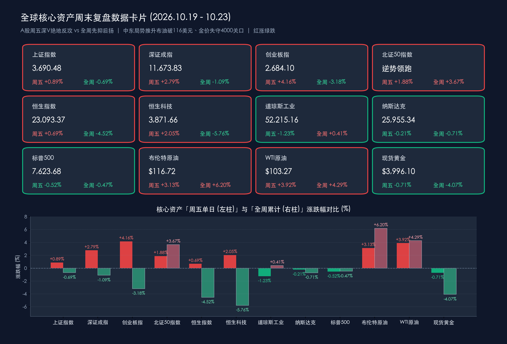

# 周末深度复盘：A股周五放量1.96万亿“深V”反转对冲周初调整，中东局势推升布油破116美元、金价失守4000大关，下周迎重磅会议与美联储议息“超级周”

**日期：2026年10月24日 (星期六)** &nbsp; **时段：下午/周末复盘**

> **核心摘要**：本周（10月19日—10月23日）全球金融市场在“AI资本支出回报分歧”与“中东地缘风暴升级”的双重冲击下剧烈震荡。国内市场呈现典型的“先抑后扬、探底回升”格局：周五（10月23日）A股上演教科书级“深V”绝地反攻——**上证指数单日收涨0.89%报3,690.48点（全周累计-0.69%）**，**深证成指单日大涨2.79%报11,673.83点（全周累计-1.09%）**，**创业板指单日飙涨4.16%报2,684.10点（全周累计-3.18%）**，**北证50指数全周逆势累涨3.67%**，两市周五成交额放量4,276亿元至**1.96万亿元**，人形机器人与AI应用全线爆发；港股同步探底回升（恒指周五涨0.69%、全周累跌4.52%）。海外方面，周五（10月23日）美股三大指数延续回调（道指跌1.23%、周涨0.41%，标普500跌0.52%、周跌0.47%，纳指跌0.21%、周跌0.71%）；中东能源设施遇袭推动**布伦特原油突破116美元/桶（周涨超6.2%）、WTI原油站上103美元/桶**，油价飙升引发的再通胀与高利率预期令**现货黄金跌破4,000美元大关（收报3,996.10美元，周跌4.07%）**。下周全球市场将步入集结**二十届五中全会、美联储10月议息会议、A股三季报收官及美股科技巨头财报**的“超级周”。

## 核心资产周度/日度表现回顾

*   **中国A股核心宽基指数（先抑后扬，周五放量“深V”收复周内大半失地）**：
    *   **上证指数**：**周五单日收涨 +0.89%（+32.45点）**，收报 **3,690.48点**（周五盘中一度跌超2%失守3,600点整数关口，午后强势翻红）；**全周累计下跌 -0.69%（-25.64点，上周五收盘3,716.12点）**。
    *   **深证成指**：**周五单日大涨 +2.79%（+316.51点）**，收报 **11,673.83点**；**全周累计下跌 -1.09%（-128.65点，上周五收盘11,802.48点）**。
    *   **创业板指**：**周五单日飙涨 +4.16%（+107.20点）**，收报 **2,684.10点**（周五盘中一度跌破2,500点，日内振幅近8%）；**全周累计下跌 -3.18%（-88.16点，上周五收盘2,772.26点）**。
    *   **沪深300指数**：**周五单日上涨 +1.71%**，收报 **4,105.33点**；**全周累计下跌 -1.57%**，大盘权重股在周四尾盘与周五午后承担了中流砥柱作用。
    *   **科创50指数**：**周五单日大涨 +3.04%**，收报 **1,345.51点**；**全周累计录得周线调整**，但周五半导体与算力芯片明显止跌回升。
    *   **北证50指数**：**周五单日上涨 +1.88%**；**全周累计逆势上涨 +3.67%**，成为本周各大主流宽基指数中唯一录得周度正收益的弹性先锋（众诚科技周五“30cm”涨停）。
    *   **周度成交额与资金动向**：周五沪深两市全天成交额跃升至 **1.96万亿元**，较周四（约1.53万亿元）大幅放量 **4,276亿元（+28%）**；周五全天主力资金转为 **净流入35.16亿元**（其中创业板主力净流入 **40.83亿元**、科创板净流入 **15.52亿元**、沪深300成份股净流入 **15.82亿元**），全市场 **4,525只** 个股收涨（占比81.22%）；**创业板ETF易方达（159915）周五单日成交突破195亿元**，创2024年10月9日以来新高。
*   **香港市场表现（周初受外部流动性冲击回调，周五科网股带动超跌反弹）**：
    *   **恒生指数**：**周五单日上涨 +0.69%（+158.69点）**，收报 **23,093.37点**，重返23,000点关口上方；**全周累计下跌 -4.52%（全周累计下挫1,093.24点，上周五收盘24,186.61点）**。
    *   **恒生科技指数**：**周五单日上涨 +2.05%（+77.73点）**，收报 **3,871.66点**；**全周累计下跌 -5.76%**。周五盘面上，小米集团涨近4%，宁德时代H股终结日线7连跌，中国铝业领涨蓝筹。
*   **美股三大指数（周四科技股重挫后周五延续分化，道指单日补跌超650点）**：
    *   **道琼斯工业平均指数**：**周五单日下跌 -1.23%（-652.82点）**，收报 **52,215.16点**；凭借周初防御与传统板块的强势，**全周累计微涨 +0.41%**。
    *   **标普500指数**：**周五单日下跌 -0.52%（-39.75点）**，收报 **7,623.68点**（周四单日跌1.21%）；**全周累计下跌 -0.47%**。
    *   **纳斯达克综合指数**：**周五单日微跌 -0.21%（-53.52点）**，收报 **25,955.34点**（周四单日重挫2.60%创6月23日以来最大跌幅）；**全周累计下跌 -0.71%**。
    *   **美股焦点科技股**：周五**英伟达（NVIDIA）**微跌 **-0.59%** 报 **210.96美元**（CEO黄仁勋公开反驳“AI算力过剩论”，强调高带宽内存HBM需求依旧强劲，带动跌幅较周四的-4.4%大幅收窄）；**英特尔（Intel）**逆势收涨 **+1.72%** 报 **86.96美元**；**特斯拉（Tesla）**微跌 **-0.63%** 报 **372.22美元**。
*   **大宗商品、债市、汇市与加密资产（油价狂飙破百 vs 金价失守4,000美元）**：
    *   **布伦特原油期货**：**周五单日大涨 +3.13%**，收报 **116.72美元/桶**（继周四突破113美元后再创阶段新高）；**全周累计飙升逾 +6.20%**。
    *   **WTI原油期货**：**周五单日大涨 +3.92%**，收报 **103.27美元/桶**，正式突破100美元心理大关；**全周累计上涨 +4.29%**。
    *   **现货黄金**：**周五单日下跌 -0.71%**，收报 **3,996.10美元/盎司**（盘中直线跳水失守4,000美元整数大关，最低触及3,980美元下方）；**全周累计下跌 -4.07%**。
    *   **全球债市与汇率**：**10年期美债收益率**周五收报 **4.953%**（单日回落16.6个基点，避险买盘与高利率博弈交织）；**离岸人民币兑美元（USD/CNH）**周五纽约尾盘收报 **6.6727**，全周维持在近年相对强势区间窄幅震荡。
    *   **加密货币**：**比特币（BTC）**在周四跌破8.2万美元（单日跌超3.5%、24小时超10万人爆仓）后，周五窄幅整理于 **81,234美元** 附近（**周五单日微跌约 -0.35%**），全周受高利率环境与ETF资金净流出压制录得周度回调。

> **数学闭环校验（周五收盘点位、单日涨跌幅与全周涨跌幅精确核验）**：
> * **上证指数**：周五单日 (3690.48 − 3658.03) / 3658.03 = +32.45 / 3658.03 ≈ **+0.8871% ≈ +0.89%**；全周 (3690.48 − 3716.12) / 3716.12 = −25.64 / 3716.12 ≈ **−0.6899% ≈ −0.69%**，完全吻合。
> * **深证成指**：周五单日 (11673.83 − 11357.32) / 11357.32 = +316.51 / 11357.32 ≈ **+2.7868% ≈ +2.79%**；全周 (11673.83 − 11802.48) / 11802.48 = −128.65 / 11802.48 ≈ **−1.0900% ≈ −1.09%**，完全吻合。
> * **创业板指**：周五单日 (2684.10 − 2576.90) / 2576.90 = +107.20 / 2576.90 ≈ **+4.1601% ≈ +4.16%**；全周 (2684.10 − 2772.26) / 2772.26 = −88.16 / 2772.26 ≈ **−3.1801% ≈ −3.18%**，完全吻合。
> * **恒生指数**：周五单日 (23093.37 − 22934.68) / 22934.68 = +158.69 / 22934.68 ≈ **+0.6919% ≈ +0.69%**；全周 (23093.37 − 24186.61) / 24186.61 = −1093.24 / 24186.61 ≈ **−4.5200% ≈ −4.52%**，完全吻合。
> * **道琼斯工业指数**：周五单日 (52215.16 − 52867.98) / 52867.98 = −652.82 / 52867.98 ≈ **−1.2348% ≈ −1.23%**，完全吻合。
> * **标普500指数**：周五单日 (7623.68 − 7663.43) / 7663.43 = −39.75 / 7663.43 ≈ **−0.5187% ≈ −0.52%**，完全吻合。
> * **纳斯达克综合指数**：周五单日 (25955.34 − 26008.86) / 26008.86 = −53.52 / 26008.86 ≈ **−0.2058% ≈ −0.21%**，完全吻合。

## 过去 48 小时重磅事件深度复盘

*   **事件一：A股上演近8%日内振幅“深V”大逆转，宽基ETF天量承接+人形机器人掀涨停潮**：
    *   **事件脉络**：周四晚间美股纳指重挫2.60%（Meta因巨额AI资本支出致自由现金流承压大跌近8%），拖累周五A股早盘大幅低开低走，沪指盘中失守3,600点、创业板指跌超3%失守2,500点，早盘一度逾4,800只个股下跌。然而午后风云突变，机构与托底资金借道宽基ETF大举进场（创业板ETF易方达单日成交破195亿元，沪深300ETF华泰柏瑞、科创50ETF华夏早盘即成交逾90亿与72亿元），带动两市成交放量4,276亿元至1.96万亿元。
    *   **板块高低切换逻辑**：前期护盘的银行（周五-1.30%）与公用事业（周五-0.60%）成为全天仅有的两个收跌行业，资金果断向具备产业催化的**人形机器人（宇树科技、利亚德、海天瑞声20cm涨停，宇树科技总市值重返2,500亿元上方）**及**计算机（+4.67%）、传媒（+3.78%）**等AI应用端集中进攻，标志着A股在经历回踩3,674点（2024年“924行情”高点）的缩量洗盘与高融资标的去杠杆后，内资独立定价权显著增强。
*   **事件二：中东地缘风险再升级引爆全球“滞胀交易”，布油冲破116美元、黄金反常失守4,000美元**：
    *   **事件脉络**：过去48小时内，也门胡塞武装对沙特阿拉伯能源与核心设施发动多次导弹及无人机袭击，叠加美伊紧张关系升温，市场对霍尔木兹海峡与中东原油供应中断的担忧急剧恶化。WTI原油周五飙升3.92%突破103美元/桶，布伦特原油大涨3.13%收于116.72美元/桶，周度涨幅超6.2%。
    *   **跨资产定价逻辑**：为何在地缘战火升温之际，避险资产黄金反而遭遇抛售、周五跌破4,000美元/盎司（周跌4.07%）？核心逻辑在于**“油价破百→能源通胀卷土重来→美联储高利率维持更久（Higher for Longer）”**的传导链条。由于美联储已在9月重启加息，油价暴涨直接推升通胀预期与实际利率中枢，无息资产黄金与高Beta加密资产同时遭到宏观对冲基金的流动性抽离；而美股传统工业与消费巨头（道指周五补跌1.23%）亦因能源成本飙升与利润率挤压担忧而承压。
*   **事件三：黄仁勋发声力挺HBM与AI算力需求，美股芯片股周五出现结构性止跌**：
    *   **事件脉络**：针对周四因Meta巨额资本支出引发的“AI算力过剩与投资回报周期过长”恐慌，英伟达CEO黄仁勋在过去24小时内公开反驳算力过剩论，明确指出全球高带宽内存（HBM）及下一代推理算力需求依旧供不应求。
    *   **市场反馈**：周五纳指跌幅收窄至-0.21%，英伟达仅微跌0.59%，英特尔逆势收涨1.72%，美光科技、SK海力士等HBM产业链标的获资金回流，缓解了全球科技成长股的连续杀跌情绪。
*   **事件四：国内金融监管释放“稳市+换锚+流动性工具”组合拳信号**：
    *   **事件脉络**：围绕2026金融街论坛年会精神，证监会主席吴清强调高度警惕跨境跨市场跨行业风险传导，并推进鼓励回购增持、完善违规减持处罚、落实长周期考核等措施；央行方面不仅持续通过隔夜逆回购（如周四单日净投放480亿元）推进短端利率“换锚”，更拟推出**非银机构流动性支持工具**，从制度层面阻断债市与股市的负向流动性螺旋。

> **核心解读**：过去48小时的全球市场博弈揭示了两条截然不同的主线——海外市场正被“116美元布油+高利率常态化+AI资本开支审视”锁入滞胀交易的紧箍咒；而中国A股则在政策工具前置与估值筹码出清的支撑下，借周五1.96万亿放量“深V”完成了对外部利空的脱敏测试。

## 下周全球宏观大事预警

*   **国内头号政治与经济大事：二十届五中全会召开（10月26日—10月29日）**：
    *   **核心看点**：会议将于下周一至周四在北京召开，涉及中长期宏观经济规划、新质生产力产业布局（具身智能/人形机器人、半导体自主可控、商业航天、低空经济）以及扩内需与财税金融体制改革的顶层设计，将成为未来数年A股中长期产业主线的总航标。
*   **海外头号宏观焦点：美联储10月FOMC议息会议（北京时间10月28日—29日，周四凌晨公布决议）**：
    *   **核心看点**：继9月议息会议后，目前CME FedWatch工具与华尔街主流机构普遍预期美联储本月将**“按兵不动”（维持联邦基金利率不变）**，留出政策观察窗口。但在布伦特原油突破116美元的背景下，全球投资者将高度聚焦美联储主席沃什（Kevin Warsh）在新闻发布会上对**能源通胀反弹、AI投融资热潮推升中性利率以及12月/明年一季度是否进一步收紧**的最新表态。
*   **业绩大考收官：A股三季报密集披露冲刺与美股科技巨头财报周**：
    *   **A股三季报收官（截至10月31日）**：下周A股将迎来三季报业绩披露的最后高峰期，市场定价重心将从纯粹的主题博弈转向**“三季报业绩兑现度+四季度订单景气度”**的双重检验。
    *   **美股科技巨头放榜**：微软（Microsoft）、谷歌（Alphabet）、亚马逊（Amazon）、英特尔及半导体设备巨头将密集披露最新财报与云/AI资本开支指引，直接决定全球算力链能否彻底扭转本周四以来的回调颓势。
*   **中东地缘局势与OPEC+供应链动态跟踪**：
    *   周末及下周初需密切跟踪红海与沙特能源设施安全态势，若布伦特原油继续向120美元/桶关口冲击，全球航运、化工及通胀敏感型资产波动率将进一步放大。

> **核心解读**：下周是名副其实的“宏观与业绩超级周”——内部有重磅会议定调产业远景与三季报业绩验真，外部有美联储议息决议与美股科技巨头财报验证AI景气，建议投资者在周末做好仓位结构审视，聚焦高景气与自主可控方向。

## 顶级机构周末策略内参摘要

> **中信证券（策略研究团队）**：
> 1. **宏观与高利率常态**：北美强劲的私人部门投融资需求（尤其是AI基础设施投资周期）使得全球高利率环境在拐点出现前将成为常态；国内方面，伴随央行政策利率框架向隔夜品种靠拢，银行间资金面调控更加精准高效。
> 2. **A股市场研判与筹码结构**：维持**年内A股震荡市**判断，认为**三季报前后是年内最后一波重要进攻窗口**，指数年内修复的概率远大于创新低的概率。监测数据显示，本轮调整中**高融资组合跌幅已超过机构重仓股组合**，融资盘去杠杆越充分，后续反弹的筹码结构越干净。
> 3. **行业配置建议**：科技成长板块重点聚焦代表新技术与自主可控的**光通信、PCB、半导体零部件及设备、具身智能/人形机器人**；非科技板块主张**“用景气和供给出清应对高利率环境”**，重视具备供给出清优势的**能化品种、创新药、优质红利资产（银行、煤炭）**及具备出海潜力的制造业龙头。

> **中金公司（李求索，研究部国内策略首席分析师及策略团队）**：
> 1. **政策底与市场生态重塑**：近期监管层在金融街论坛释放的信号不仅在于短期维稳，更在于通过完善价格型货币政策框架、推出非银流动性支持工具、健全长周期考核机制及鼓励回购增持，从根源上夯实资本市场内在稳定性，**A股市场中期向好的核心逻辑未变**。
> 2. **三季报收官期风格切换**：随着三季报进入最后密集披露期，叠加主动管理型ETF等长线工具落地，机构资金正加大对优质龙头与中长期现金流稳定标的的配置力度。建议采取**“基本面景气+股东回报”双轮驱动策略**，重点布局三季报业绩高增确定的科技硬件、AI应用与数字经济新动能。

> **高盛（Goldman Sachs，首席美国经济学家及亚太策略团队）**：
> 1. **美联储路径预判**：预计美联储将在下周（10月）议息会议上暂停动作以评估前期紧缩与油价冲击的滞后效应，后续政策路径高度取决于美国劳动力市场韧性与能源通胀的动态平衡。
> 2. **中国资产全球性价比凸显**：前三季度中国宏观经济保持总体平稳（新动能领域对工业增长贡献超五成），叠加一揽子稳市场与中长期资金入市机制加速落地，中国权益资产在全球新兴市场配置中的估值性价比依然突出，外资正密切跟踪三季报落地后的科技制造与消费龙头结构性机会。

## 今日市场情绪：深V反转与百元油价的周末天平博弈

> Prompt: A giant celestial balance scale forged from bronze and glowing optical fibers floating above a turbulent twilight canyon. On one pan, an army of radiant silver humanoid robots marches upward along a fiery red V-shaped beam of light; on the other pan, a towering black barrel of boiling crude oil crushes a cracked golden bullion bar beneath 4000. In the background, a massive marble temple of the Federal Reserve stands beside a glowing holographic calendar of the upcoming super week.

---
免责声明：内容仅供参考，不构成投资建议。

🤖 生成模型：Gemini 4 Argon (Medium) <!-- model-stamp -->
