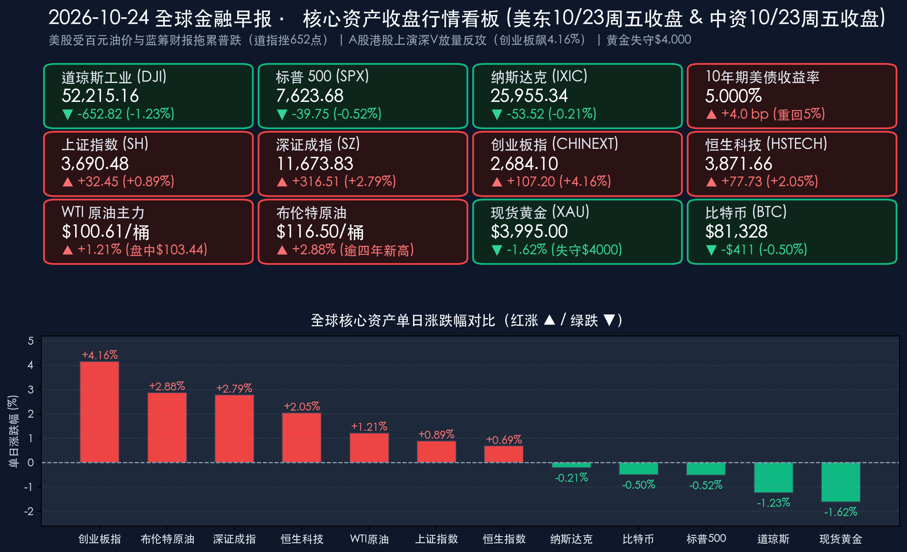

# 🌏 全球金融早报：WTI原油破百、道指重挫652点终结四连涨，现货黄金失守4000美元大关，A股放量1.97万亿上演“深V”大反攻

**日期：2026年10月24日 (星期六)** &nbsp; **时段：早报 (国际市场 · 常规交易日 · 模式A)**

> **核心摘要**：隔夜（美东时间10月23日周五）全球市场在“百元油价冲击、蓝筹财报分化与AI基建成本余震”三重博弈下剧烈震荡：中东地缘冲突升级（沙特能源设施与霍尔木兹海峡航运风险升温）推升 **WTI原油突破100美元心理大关（主力合约收报$100.61/桶、盘中冲高至$103.44/桶）**，**布伦特原油飙升至$116.50/桶上方创逾四年新高**；通胀粘性重燃令 **10年期美债收益率回升4个基点重返5.00%关口**，市场对美联储12月加息押注概率升至78%–90%。受高油价与美国运通（AXP）等权重股财报拖累，**道琼斯工业平均指数重挫652.82点（-1.23%）报52,215.16点**（盘中一度狂泻超800点，终结四连涨），**标普500指数下跌0.52%报7,623.68点**，**纳斯达克综合指数微跌0.21%报25,955.34点**。避险资产出现剧烈流动性挤压，**现货黄金跌破$4,000/盎司大关收报$3,995.00/盎司（-1.62%）**，创7月中旬以来新低及逾四个月最大单周跌幅；比特币小幅回落至 **$81,328**。反观中国资产则展现出极强的独立韧性：昨日（10月23日周五）A股上演史诗级“深V”反转，沪深京三市放量4,300亿元至 **1.97万亿元**，**创业板指暴涨4.16%报2,684.10点**，**深证成指大涨2.79%**，**上证指数收涨0.89%报3,690.48点**，全市场超4,500只个股飘红；港股同步回暖，**恒生指数收复23,000点大关（+0.69%）**，**恒生科技指数大涨2.05%报3,871.66点**。

---

## 核心行情复盘

*   **美股三大指数（百元油价与蓝筹财报双重施压，道指终结四连涨、纳指弱势企稳）**：
    *   **道琼斯工业平均指数 (DJI)**：收盘报 **52,215.16 点**，重挫 **-652.82 点**，跌幅 **-1.23%** 🟢（前一日收盘 52,867.98 点），终结此前连续四个交易日的上涨势头；盘中跌幅一度扩大至 **800点以上**，周期股、金融股及必需消费品板块成为抛售重灾区。
    *   **标普 500 指数 (SPX)**：收盘报 **7,623.68 点**，下跌 **-39.75 点**，跌幅 **-0.52%** 🟢（前一日收盘 7,663.43 点），能源板块独自领涨，而金融、工业与消费板块普遍承压。
    *   **纳斯达克综合指数 (IXIC)**：收盘报 **25,955.34 点**，小幅下跌 **-53.52 点**，跌幅 **-0.21%** 🟢（前一日收盘 26,008.86 点）。经历前一日“AI资本开支清算日”（单日暴跌2.60%）后，科技股抛压有所收敛，但早盘小幅反弹后再度回落，显示市场对超大规模云厂商（CSP）数据中心巨额资本开支与短期ROI兑现节奏依然保持高度审慎。
*   **焦点个股与板块深度拆解（能源股一枝独秀，金融与消费权重股遭财报冲击）**：
    *   **美国运通 (American Express, AXP)**：股价大跌 **-3.5% 至 -3.7%** 🟢。公司最新财报表现不及市场预期，并宣布全球裁员与架构重组计划，叠加百元油价引发高通胀侵蚀消费信贷质量的担忧，成为拖累道指暴跌逾650点的关键权重推手。
    *   **周期、金融与防御消费股补跌**：在前一日（周四）逆势充当“避风港”的必需消费品、工业及金融蓝筹股，周五在WTI油价破百引发的成本挤压与再通胀恐慌下遭到集中获利了结。
    *   **AI与科技硬件板块**：资金围绕AI基础设施高昂前期投入（Capex）与实际生产力回报的博弈持续深化，芯片与云服务龙头在经历周四重挫后进入低位震荡消化期。
*   **中国市场基准回顾（10月23日周五收盘：A股放量1.97万亿上演“深V”大逆转，港股收复23,000点）**：
    *   **A股主要指数（10月23日收盘）**：面对外围科技股暴跌映射，A股早盘一度集体下探（沪指盘中一度失守3,600点，创业板指早盘一度跌超3%），但午后在宽基ETF显著放量、机器人概念、半导体、锂电池及硬科技成长板块集体井喷带动下上演“深V”大反攻，全市场 **超4,500只个股飘红上涨**。**上证指数**收报 **3,690.48 点**，上涨 **+32.45 点 / +0.89%** 🔴（前值 3,658.03 点，沪市成交额 **8,986.67亿元**）；**深证成指**收报 **11,673.83 点**，大涨 **+316.51 点 / +2.79%** 🔴（前值 11,357.32 点，深市成交额 **10,575.91亿元**）；**创业板指**收报 **2,684.10 点**，暴涨 **+107.20 点 / +4.16%** 🔴（前值 2,576.90 点，创业板成交额 **5,344.83亿元**），几乎一举收复周四（-4.37%）的全部失地。**沪深京三市总成交额飙升至约 1.97万亿元**，较前一交易日（1.53万亿元）**大幅放量超 4,300亿元**，主力资金与长线配置资金抄底迹象极为显著。
    *   **港股市场（10月23日收盘）**：跟随A股同步止跌回升，终结连续调整态势。**恒生指数**收报 **23,093.37 点**，上涨 **+158.69 点 / +0.69%** 🔴（前值 22,934.68 点），成功收复 **23,000点** 整数关口；**恒生科技指数**收报 **3,871.66 点**，大涨 **+77.73 点 / +2.05%** 🔴（前值 3,793.93 点）。
*   **大宗商品、美债收益率与加密资产（WTI破百、布油逾116美元，黄金失守4000美元，10年期美债重返5%）**：
    *   **国际原油**：中东地缘军事冲突风险急剧升温（涉及沙特能源基础设施安全威胁及霍尔木兹海峡航道扰动担忧），叠加库存紧平衡，引爆原油逼空行情。**WTI原油主力合约**正式突破100美元大关，收盘报 **$100.61/桶** 🔴（上涨 **+1.21%**，盘中最高冲至 **$103.44/桶**，前值 $99.41/桶）；国际基准 **布伦特原油 (Brent)** 飙升至 **$116.50/桶**（盘中触及 **$116–$117/桶** 区间，上涨约 **+2.88%**）🔴，创下 **逾四年以来最高水平**。
    *   **贵金属**：**现货黄金**遭遇猛烈抛售，跌破 **$4,000/盎司** 关键心理里程碑（为7月中旬以来首次失守），收盘报 **$3,995.00/盎司** 🟢（下跌 **-1.62%**，盘中波动于 $3,986–$4,014/盎司区间，前值 $4,060.68/盎司），录得 **逾四个月以来最大单周跌幅**。强势美元、跨资产追加保证金（Margin Call）引发的流动性变现需求以及高油价推升的年底加息预期，共同压垮金价。
    *   **美债收益率**：高油价重燃通胀粘性担忧，抵消了部分避险买盘，**美国 10 年期国债收益率**回升约 **4个基点**，精准收于 **5.00%** 心理大关（前一日为 4.96%）；**2 年期美债收益率**收报 **4.69%**。
    *   **加密资产**：**比特币 (BTC)** 小幅震荡回落，收报 **$81,328** 🟢，较前一日（$81,739）下跌 **-$411（-0.50%）**，守住8.1万美元支撑位。

> **数学闭环校验（收盘终值与涨跌幅交叉核验）**：
> * **道琼斯工业指数**：52,867.98 − 652.82 = 52,215.16（-652.82 / 52,867.98 = -1.2348% ≈ -1.23%），完全吻合；
> * **标普 500 指数**：7,663.43 − 39.75 = 7,623.68（-39.75 / 7,663.43 = -0.5187% ≈ -0.52%），完全吻合；
> * **纳斯达克综合指数**：26,008.86 − 53.52 = 25,955.34（-53.52 / 26,008.86 = -0.2058% ≈ -0.21%），完全吻合；
> * **中国市场（10月23日收盘）**：上证指数 3,658.03 + 32.45 = 3,690.48（+32.45 / 3,658.03 = +0.8871% ≈ +0.89%）；深证成指 11,357.32 + 316.51 = 11,673.83（+316.51 / 11,357.32 = +2.7868% ≈ +2.79%）；创业板指 2,576.90 + 107.20 = 2,684.10（+107.20 / 2,576.90 = +4.1600% ≈ +4.16%）；恒生指数 22,934.68 + 158.69 = 23,093.37（+158.69 / 22,934.68 = +0.6919% ≈ +0.69%）；恒生科技指数 3,793.93 + 77.73 = 3,871.66（+77.73 / 3,793.93 = +2.0488% ≈ +2.05%），全部精确闭环；
> * **大宗商品、利率与加密**：WTI原油 99.41 → 100.61（+1.207% ≈ +1.21%，盘中冲高至103.44即+4.05%）；布伦特原油 113.24 → 116.50（+2.879% ≈ +2.88%）；现货黄金 4,060.68 → 3,995.00（-1.617% ≈ -1.62%）；10年期美债收益率 4.96% + 4bp = 5.00%；BTC 81,739 → 81,328（-0.503% ≈ -0.50%），全部吻合。

---

## 核心解读与市场逻辑

> **逻辑一：WTI原油破百、布油飙逾116美元（数据）→中东冲突升级威胁沙特设施与霍尔木兹海峡（事件）→再通胀紧箍咒重压传统消费与蓝筹，道指补跌652点（逻辑）**
> 如果说周四美股下跌的主因是Meta引爆的“AI资本开支恐慌”，那么周五盘面的核心矛盾则彻底切换为 **“百元油价冲击波”**。随着中东敌对行动外溢风险波及沙特能源设施与霍尔木兹海峡，WTI原油冲破100美元心理防线（最高见$103.44），布伦特原油更站上$116–$117的逾四年高位。油价破百直接改变了华尔街的行业轮动剧本：周四刚刚充当避风港的道指传统蓝筹、金融与消费股，周五立刻暴露在“能源成本飙升 + 消费者实际购买力受挤压”的双重打击之下，叠加美国运通（AXP）财报不及预期并裁员，触发道指盘中暴跌超800点、收盘重挫652点，上演了从科技股向传统周期股的“次生补跌”。

> **逻辑二：现货黄金跌破4,000美元创四个月最大周跌幅（数据）→油价破百推升12月加息押注至78%–90%叠加跨资产保证金抽血（事件）→黄金遭遇“高利率预期+流动性挤兑”双杀（逻辑）**
> 传统认知中“地缘冲突+通胀升温”理应利好黄金，但本周黄金却走出连续杀跌、周五失守$4,000/盎司大关的反常走势。核心原因在于两层定价机制的倒逼：第一，**货币政策预期重估**——尽管下周（10月27–28日）FOMC会议维持利率不变的概率高达92%–93%，但百元油价令市场对美联储 **12月重启加息的定价概率飙升至78%–90%**，10年期美债收益率重回5.00%，强势美元与高企的远期政策利率令无息资产黄金承压；第二，**跨资产流动性变现（Margin Selling）**——美股连续两日大幅震荡引发部分高杠杆组合追加保证金需求，前期获利丰厚的黄金多头仓位被集中平仓以换取美元流动性。

> **逻辑三：A股放量4,300亿至1.97万亿、创业板指深V暴涨4.16%（数据）→宽基ETF与内资长线资金大举托底硬科技与新质生产力（事件）→中外市场从“单向跟随”走向“逻辑脱钩与独立定价”（逻辑）**
> 周五全球市场最亮眼的信号来自中国资产：在隔夜美股纳指重挫2.6%、亚太早盘普遍恐慌的背景下，A股早盘短暂下探后上演教科书式“深V”反转，创业板指从跌超3%到收盘大涨4.16%，两市成交额放量4,300亿元逼近2万亿大关，港股恒指同步收复23,000点。这一走势验证了国内市场底层生态的质变：一方面，宽基ETF与险资等长线资金在关键点位展现出极强的逆周期定价能力；另一方面，资金聚焦于机器人、半导体、锂电及国产算力链等具备真实产业落地与内生景气的板块，打破了过往“美股科技跌、A股成长必跪”的机械映射。

---

## 政策脉动

*   **美联储（Federal Reserve）FOMC会议前瞻（10月27–28日议息周开启）**：
    *   **10月按兵不动几成定局**：下周二至周三（美东时间10月27–28日），美联储将召开10月FOMC货币政策会议。最新利率期货定价显示，市场预期本次会议 **维持基准利率不变的概率高达 92%–93%**。
    *   **12月加息风险急剧升温**：受WTI原油突破100美元、布油突破116美元带来的二次通胀冲击影响，交易员大举押注美联储将在年末采取更鹰派立场，**12月FOMC会议加息的概率已被市场定价在 78% 至 90% 的高位区间**，2年期美债收益率企稳于4.69%、10年期美债收益率重返5.00%正是这一政策预期的直接映射。
*   **中东地缘与全球能源安全形势**：
    *   中东地区军事冲突风险在周五进一步升级，涉及沙特能源基础设施的潜在威胁及霍尔木兹海峡航运安全的风险溢价急剧攀升，成为推动国际油价创逾四年新高的核心宏观变量。
*   **中国资本市场政策与长线资金生态**：
    *   在“反内卷”产业政策推进、新质生产力权重提升以及央行互换便利与长线资金（险资、国家队宽基ETF）常态化护航机制下，A股与港股面对外部冲击的韧性显著增强；同时国内头部券商正加速推进“AI证券公司”数字化建设，推动AI从概念向金融与实体产业基本面深度融合。

---

## 最新机构观点

> **高盛 (Goldman Sachs)**：
> * **美股AI交易正从“基础设施硬件”加速向“实际应用与生产力变现（AI Productivity Beneficiaries）”过渡**：高盛最新交易策略指出，经过前三年围绕硬件、半导体与数据中心的基础设施狂热后，超大规模云厂商（微软、谷歌、Meta、亚马逊等）正面临庞大的资本开支与融资考核压力，市场焦点已加速转向 **能够将AI整合进工作流、真正实现降本增效的非科技传统行业（如银行、零售物流、医疗保健等）**。同时高盛提醒，在百元油价与高利率环境下，需高度警惕美国经济 **“K型复苏”** 下低收入消费板块的财务压力。

> **摩根大通 (J.P. Morgan)**：
> * **美股科技龙头现金流底盘仍在，但ROI考核标准日趋严苛；看多中国资产估值吸引力**：摩根大通认为，尽管华尔街在股票交易与AI相关投行业务上表现强劲、科技巨头整体仍具现金流支撑，但资本市场对AI投资回报率（ROI）的审视正变得空前严格。针对中国市场，摩根大通等外资机构指出，中国股市整体估值在全球范围内仍具显著吸引力，企业盈利修复与AI、高端制造等科技创新构成了中期配置的核心基础。

> **中金公司 (CICC)**：
> * **“国际秩序重构”与“中国产业创新”双轮共振，A股具备孕育“慢牛”条件**：中金公司策略团队指出，当前A股上行的底层驱动力来自国际秩序重构与中国产业创新的深度共振。在宏观流动性改善、新质生产力权重持续提升以及险资、汇金等长线资金入市的背景下，A股正迎来“慢牛”新生态。操作节奏上强调 **“稳”优于“快”**，建议围绕业绩兑现度精挑细选，避免盲目追高纯概念炒作。

> **中信证券 (CITIC Securities)**：
> * **以“K型思维”构建“AI+能化”杠铃式配置，兼顾高景气科技与全球定价资源品**：中信证券预计A股盈利增速将呈“前低后高”态势，建议投资者采用 **“AI+能化”的杠铃结构** 应对当前复杂的海内外宏观环境——**进攻端** 聚焦AI需求侧（国产算力链、光通信、端侧硬件、智能驾驶与机器人等商业化落地环节）；**稳健端** 则重点布局具备全球定价权的上游资源品/能源化工、传统制造升级及高股息红利资产，以对冲海外再通胀与地缘政治波动。

---

## 今日市场情绪：黑海炎鲸碎金碑，赤霓龙跃华尔街

> Prompt: A colossal flaming black oil kraken rising from a turbulent ocean to shatter a glowing golden 4000-dollar monolith, while an armored eastern dragon woven from red neon candlestick charts soars upward into a dawn sky. In the background, Wall Street marble columns crack under the weight of a giant bronze 5-percent interest rate anchor beneath storm clouds.

---

> **免责声明**：内容仅供参考，不构成投资建议。数据来源：纽约证券交易所（NYSE）、纳斯达克交易所（NASDAQ）、上海证券交易所、深圳证券交易所、香港交易所（HKEX）、芝加哥商品交易所（CME）、洲际交易所（ICE）、美联储（Federal Reserve）及高盛、摩根大通、中金公司、中信证券最新策略研究报告；欧美及全球市场收盘数据截至2026年10月24日08:00。
