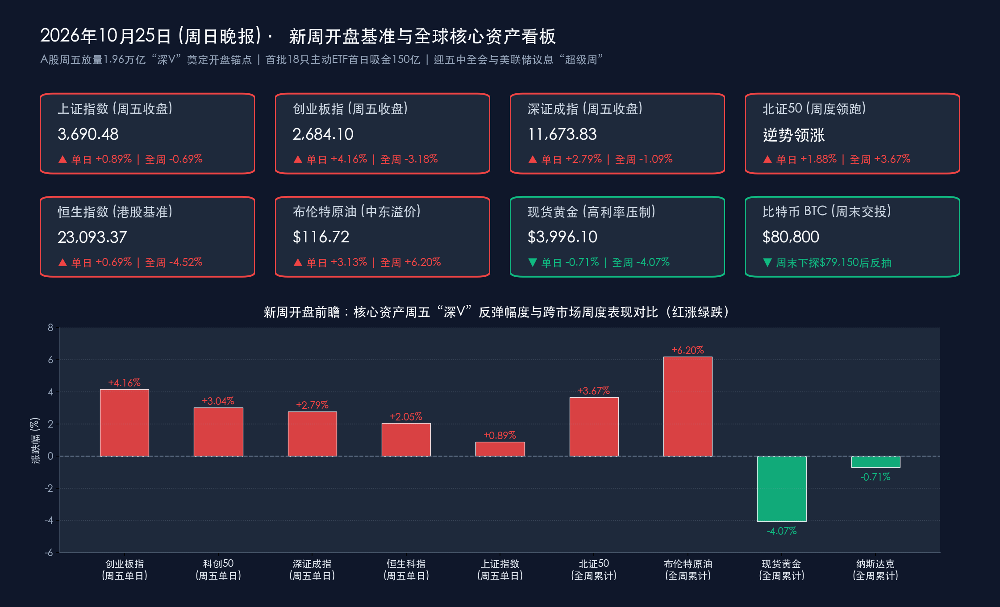

# 新周展望：上证等核心指数15%权重上限新规明起实施，首批18只主动ETF首日吸金150亿，迎五中全会与美联储议息“超级周”

**日期：2026年10月25日 (星期日)** &nbsp; **时段：下午/新周展望**

> **核心摘要**：随着周末（10月24日—25日）消息面密集发酵，A股与全球金融市场即将迈入10月最后一个完整交易周（10月26日—10月30日）的“超级宏观与财报周”。国内方面，三大重磅催化在周末交汇：一是**上交所修订的上证指数、科创综指等核心指数编制方案将于明日（10月26日）正式实施**（新增**单个样本权重不超过15%上限**并提前剔除风险警示股）；二是公募改革标志性产品**首批18只主动管理型ETF首日狂揽约150亿元**（摩根、易方达、富国旗下3只产品触及20亿元上限“一日售罄”），叠加周五两市放量4,276亿元至**1.96万亿元**上演的“深V”大逆转，为新周开盘注入强劲流动性支撑；三是**首批券商三季报集中亮相**，行业旗手**东方财富前三季度归母净利润达119.07亿元**，而部分中小券商受三季度震荡影响单季盈利分化。展望新的一周，内部将迎来**二十届五中全会（10月26日—29日）**、**1—9月全国规上工业企业利润（10月27日）**、**10月官方PMI（10月31日）**及**A股三季报收官**；外部则聚焦**美联储FOMC议息决议（北京时间10月29日凌晨2点，市场定价暂停动作概率达90%—92%，但12月加息预期升至80%—85%）**及**谷歌、微软、亚马逊三季报**对全球8,000亿美元AI资本开支的终极检验。

## 周末财经要闻终极汇总

*   **要闻一：上证指数、科创综指等重要指数编制方案明起（10月26日）正式实施**：
    *   **核心修订内容**：根据上海证券交易所与中证指数有限公司此前发布的公告，针对上证综合指数（上证指数）、上证科创板综合指数（科创综指）等核心指数的编制方案修订将于**2026年10月26日（周一）开盘起正式生效**。
    *   **两大制度调整**：① **增设单个样本权重上限**：明确增加**“单个样本权重不超过15%”**的权重上限规则，防止单一超大市值个股对综合指数造成过度绑架，提升指数表征市场整体的均衡度；② **加速出清风险警示证券**：将风险警示股票（ST/*ST股）从指数样本中剔除的时间，由原先的“风险警示实施日次月第二个星期五的下一交易日”提前至**“风险警示公告日次月第二个星期五的下一交易日”**，进一步强化优胜劣汰与指数防风险能力。
*   **要闻二：公募创新“闪电战”告捷，首批18只主动管理型ETF首日吸金约150亿元、3只“日光”**：
    *   **认购盛况**：10月23日（周五）在沪深交易所同步挂牌发售的**首批18只主动管理型ETF（沪深各9只）**迎来火爆认购，周末最新统计显示发售首日全市场合计吸金约 **150亿元**（其中券商代销渠道贡献约 **130亿元**）。
    *   **头部提前结募與机构自购**：**摩根大盘成长主动股票ETF**、**易方达品质均衡主动ETF**、**富国价值优选量化选股主动ETF** 等3只产品在首日迅速触及 **20亿元募集规模上限**，宣布提前结束募集并启动末日比例配售。与此同时，易方达、富国、华夏、汇添富、华安、工银瑞信等多家公募及券商自营掀起超 **15亿元“自购潮”**（其中摩根基金外资股东关联方动用 **7,500万美元/约5亿元人民币** 自有资金申购）。这批采用“每日透明披露持仓+双基金经理共管+1%年管理费率”的产品，将在未来数周内为A股核心资产带来约150亿元的实质性建仓活水。
*   **要闻三：首批上市券商2026年三季报密集出炉，“旗手”东方财富净利近120亿元，行业分化加剧**：
    *   **东方财富领跑全行业**：受证券经纪业务手续费及佣金净收入大幅增长驱动，**东方财富**前三季度实现营收与归母净利润双位数增长，**前三季度归母净利润高达119.07亿元**，单家净利规模超过同期已披露的其余三家上市券商总和近两倍。
    *   **中小券商三季度单季自营承压**：受第三季度A股市场尤其是科创板与高弹性板块震荡调整影响，部分中小券商自营及公允价值变动损益承压——**东兴证券**前三季度营业收入 **34.85亿元（同比-3.47%）**、归母净利润 **16.11亿元（同比+0.75%）**，但第三季度单季净利同比下降 **24.85%**；**信达证券**前三季度营业收入 **33.05亿元（同比+9.48%）**、归母净利润 **12.88亿元（同比-4.83%）**，第三季度单季归母净利润同比下降 **42.03%**；**华西证券**第三季度单季实现营业收入 **9.37亿元（同比-34.00%）**、单季归母净利润 **2.30亿元（同比-58.04%）**。数据印证三季报收官期资金加速向业绩确定性高的头部龙头集中。
*   **要闻四：央行推进货币政策框架转型与非银流动性工具，证监会违规减持处罚新规落地**：
    *   **央行制度性护航**：围绕2026金融街论坛年会最新部署，人民银行行长潘功胜明确未来货币政策框架将**更多发挥利率调控作用**，优化短端利率调控机制并**稳步退出存贷款基准利率**；同时设立**应对非银机构大额赎回的流动性支持工具**、扩大常备借贷便利（SLF）适用机构范围，并联合多部门出台金融支持北京、上海、粤港澳大湾区国际科技创新中心的指导意见。
    *   **证监会强监管落地**：证监会正式发布《违规转让证券案件行政处罚实施规则》（自2026年12月1日起施行），严厉打击“绕道减持”“马甲账户”等违法违规行为，并加速推进北证50ETF及北交所新股市值配售改革。
*   **要闻五：产业微观催化不断——南方区域电力市场转入正式运行，冬春航季今日开启**：
    *   **电力市场化里程碑**：我国首个区域电力市场——**南方区域电力市场**正式由试运行转入**正式运行**，目前注册经营主体突破 **29万家**，虚拟电厂、新型储能、分布式新能源加速全面入市交易。
    *   **民航换季回暖**：自今日（10月25日）起至2027年3月27日，全国民航正式执行**2026/2027年冬春航季航班计划**，国际航线与国内干线客货运排班密度进一步提升。
*   **要闻六：新周开盘基准点位回顾与周末24小时跨市场替代指标动态**：
    *   **A股与港股开盘基准（上周五10月23日收盘终值）**：**上证指数**报 **3,690.48点**（周五单日 **+0.89%**，全周 **-0.69%**）；**深证成指**报 **11,673.83点**（周五单日 **+2.79%**，全周 **-1.09%**）；**创业板指**报 **2,684.10点**（周五单日飙涨 **+4.16%**，全周 **-3.18%**）；**沪深300**报 **4,105.33点**（周五单日 **+1.71%**，全周 **-1.57%**）；**科创50**报 **1,345.51点**（周五单日 **+3.04%**）；**北证50**周五单日涨 **+1.88%**、全周逆势累涨 **+3.67%**；沪深两市周五成交额 **1.96万亿元**（环比放量 **4,276亿元**，主力资金净流入 **35.16亿元**）。港股**恒生指数**报 **23,093.37点**（周五单日 **+0.69%**，全周 **-4.52%**），**恒生科技指数**报 **3,871.66点**（周五单日 **+2.05%**，全周 **-5.76%**）。
    *   **美股、大宗商品与周末加密市场替代指标**：美股周五收跌（**道指**报 **52,215.16点**、单日 **-1.23%**、周涨 **+0.41%**；**标普500**报 **7,623.68点**、单日 **-0.52%**、周跌 **-0.47%**；**纳指**报 **25,955.34点**、单日 **-0.21%**、周跌 **-0.71%**）。中东冲突升级推升**布伦特原油**收报 **116.72美元/桶**（周五 **+3.13%**、周涨 **+6.20%**），**WTI原油**收报 **103.27美元/桶**（周五 **+3.92%**）；高油价引发的再通胀与高利率担忧压制**现货黄金**收报 **3,996.10美元/盎司**（周五 **-0.71%**、周跌 **-4.07%**）；**10年期美债收益率**报 **4.953%**，**离岸人民币（USD/CNH）**报 **6.6727**。周末仍在连续交易的**比特币（BTC）**受强美元与百元油价引发的流动性紧缩担忧冲击，周末盘中一度跌破80,000美元心理关口、最低下探至 **79,150美元**（触发全网超 **8.1亿美元** 加密衍生品爆仓清算），周日下午反抽修复至 **80,800美元** 附近窄幅震荡。

> **数学闭环校验（新周开盘基准点位与涨跌幅精确核验）**：
> * **上证指数**：周五收盘 **3,690.48点**，对比周四收盘 3,658.03点，单日变动 (3690.48 − 3658.03) / 3658.03 = +32.45 / 3658.03 ≈ **+0.8871% ≈ +0.89%**；对比上周五收盘 3,716.12点，全周变动 (3690.48 − 3716.12) / 3716.12 = −25.64 / 3716.12 ≈ **−0.6899% ≈ −0.69%**，误差 < 0.01%。
> * **深证成指**：周五收盘 **11,673.83点**，对比周四收盘 11,357.32点，单日变动 (11673.83 − 11357.32) / 11357.32 = +316.51 / 11357.32 ≈ **+2.7868% ≈ +2.79%**；对比上周五收盘 11,802.48点，全周变动 (11673.83 − 11802.48) / 11802.48 = −128.65 / 11802.48 ≈ **−1.0900% ≈ −1.09%**，完全吻合。
> * **创业板指**：周五收盘 **2,684.10点**，对比周四收盘 2,576.90点，单日变动 (2684.10 − 2576.90) / 2576.90 = +107.20 / 2576.90 ≈ **+4.1601% ≈ +4.16%**；对比上周五收盘 2,772.26点，全周变动 (2684.10 − 2772.26) / 2772.26 = −88.16 / 2772.26 ≈ **−3.1801% ≈ −3.18%**，完全吻合。
> * **恒生指数**：周五收盘 **23,093.37点**，对比周四收盘 22,934.68点，单日变动 (23093.37 − 22934.68) / 22934.68 = +158.69 / 22934.68 ≈ **+0.6919% ≈ +0.69%**；对比上周五收盘 24,186.61点，全周变动 (23093.37 − 24186.61) / 24186.61 = −1093.24 / 24186.61 ≈ **−4.5200% ≈ −4.52%**，完全吻合。

## 新一周市场核心博弈逻辑

*   **博弈一：“深V”右侧确认 vs 增量资金接力（1.96万亿量能 + 150亿主动ETF + 指数新规生效）**：
    *   **数据与事件**：上周五A股在盘中跌破3,600点的极端逆境下放量4,276亿元至1.96万亿元完成“深V”反转（创业板ETF易方达单日成交破195亿元），紧接着周末确认首批18只主动ETF首日吸金约150亿元，且明日（10月26日）上证指数与科创综指15%权重上限及风险警示股加速剔除新规正式生效。
    *   **传导逻辑**：前期市场担忧的“高融资盘踩踏与被动资金负反馈”已被周五午后的巨量承接彻底阻断。随着主动ETF首募资金进入建仓期，叠加指数编制方案优化降低单一超大权重股波动拖累、加速绩差ST股出清，新一周A股的核心博弈在于**成交额能否稳守1.8万亿—2万亿元阈值**，从而将周五的“情绪反抽”升级为跨月度的“右侧主升修复”。
*   **博弈二：三季报收官“业绩大考” vs 题材去伪存真（以首批券商与算力硬件业绩分化为鉴）**：
    *   **数据与事件**：下周（10月26日—31日）是A股三季报披露的最后冲刺周。周末已披露的首批券商三季报直观展示了“龙头恒强、中小分化”的残酷现实（东方财富前三季净利119.07亿元高增，而华西证券、信达证券三季度单季净利分别下滑58.04%和42.03%）。
    *   **传导逻辑**：在三季报披露截止日前的最后5个交易日，纯粹依靠概念炒作但缺乏业绩支撑的微盘股或绩差股将面临业绩暴雷与指数剔除的双重规避压力；反之，**三季报环比加速改善的方向（如AI光通信/PCB/半导体设备、证券经纪龙头、新型储能与出海高端制造）**将成为主动ETF与机构调仓的吸金洼地。
*   **博弈三：海外“百元油价+12月加息阴云” vs 华尔街科技巨头AI资本开支证伪战**：
    *   **数据与事件**：中东局势推升布伦特原油突破116.72美元/桶，导致联邦基金利率期货在定价本周四（10月29日凌晨）美联储暂停动作概率达90%—92%的同时，将**12月加息概率推高至80%—85%**（周末比特币一度跌破8万美元引发8.1亿美元爆仓即是海外流动性敏感资产的提前反应）。与此同时，谷歌、微软、亚马逊将于周三至周四密集发布财报。
    *   **传导逻辑**：全球科技股正处于“高利率贴现率挤压”与“全球约8,000亿美元AI基建CAPEX能否兑现云业务收入”的十字路口。若微软Azure与谷歌云在周三晚间交出超预期的AI商业化变现数据，将一举扭转上周四Meta引发的算力恐慌，并与A股半导体、光模块及人形机器人板块形成跨洋共振；反之，若指引偏谨慎，国内科技成长股将更多依赖“自主可控与内需政策”走出独立结构行情。
*   **博弈四：政策顶层设计定调（五中全会“十五五”规划） vs 传统顺周期估值修复**：
    *   **数据与事件**：二十届五中全会于明日（10月26日）正式开幕，研究“十五五”规划建议；同时前三季度GDP同比增长4.6%（三季度单季4.5%、环比1.2%），9月一线城市二手房价格连续7个月环比上涨。
    *   **传导逻辑**：顶层会议对**新质生产力（具身智能、低空经济、商业航天、国产算力、新型电力系统）**及**扩内需、化债与房地产止跌回稳**的战略定调，将成为四季度乃至跨年行情的核心政策锚点。

> **核心解读**：新一周市场的核心矛盾已从上周的“外部流动性冲击与恐慌去杠杆”全面切换至**“政策红利落地（五中全会+指数改革）+ 实质业绩验真（A股三季报收官+美股科技财报）+ 增量资金建仓（150亿主动ETF）”**的三维共振。内外温差之下，A股凭借政策工具前置与估值优势，具备显著高于海外市场的抗波动韧性。

## 本周重磅经济数据与会议前瞻

*   **10月26日—10月29日（周一至周四）｜国内头号政治与产业风向标：二十届五中全会召开**：
    *   中国共产党第二十届中央委员会第五次全体会议在北京召开，重点研究关于制定国民经济和社会发展第十五个五年规划（“十五五”规划）的建议，全面框定未来五年科技创新、自主可控、绿色能源转型、内需消费与财税金融改革的战略蓝图。
*   **10月26日（周一）｜A股制度落地：上证指数、科创综指等编制方案修订正式实施**：
    *   上交所新增“单个样本权重不超过15%”上限规则及风险警示证券（ST/*ST）提前剔除机制于周一开盘正式生效，相关指数基金与量化对标组合将完成相应权重再平衡。
*   **10月27日（周二 09:30）｜国内实体盈利检验：1—9月份全国规模以上工业企业利润公布**：
    *   国家统计局将公布1—9月规上工业企业利润同比增速及营收利润率数据，市场重点观察在9月PPI边际变化与工业增加值回升背景下，中下游装备制造与上游资源品的盈利修复斜率。
*   **10月28日—10月29日（周三至周四）｜全球“超级央行周”：美联储10月FOMC利率决议登场**：
    *   **美联储议息（北京时间10月29日周四凌晨02:00）**：公布10月联邦基金利率决议，随后美联储主席举行新闻发布会。目前市场预期本月维持利率不变的概率达 **90%—92%**（避免在11月3日美国中期选举前数日调整利率），但重点在于决策层对 **116美元以上布伦特油价、再通胀风险以及12月是否进一步加息（当前市场隐含概率80%—85%）** 的前瞻指引。
    *   **多国央行联动**：欧洲央行（ECB）、日本央行（BOJ）、加拿大央行（BoC）及新西兰联储亦将在本周陆续公布利率决议或政策动向。
*   **10月28日—10月30日（周三至周五）｜全球业绩大考：美股三大云/AI巨头放榜 & A股三季报收官**：
    *   **美股科技巨头三季报**：**谷歌（Alphabet）**与**微软（Microsoft）**将于美东时间10月28日（周三盘后）放榜，**亚马逊（Amazon）**将于10月29日（周四盘后）放榜，直接检验全球AI基础设施投资回报率与云计算增速。
    *   **A股三季报收官冲刺**：A股逾5,000家上市公司三季报将于10月31日前全部披露完毕，本周最后5个交易日将迎来权重白马与科技龙头业绩公告的最高峰。
*   **10月29日（周四 24:00）｜国内通胀与能源跟踪：新一轮国内成品油零售限价调价窗口开启**：
    *   受近期国际原油持续暴涨（布油破116美元、WTI破103美元）推动，本轮国内成品油零售限价面临较大上调压力，油气开采、煤化工及航运物流成本端将受到直接影响。
*   **10月31日（周六 09:30）｜四季度景气先行指标：中国10月官方制造业与非制造业PMI公布**：
    *   国家统计局将于周六上午公布10月官方制造业PMI、非制造业商务活动指数及综合PMI产出指数，全面验证四季度开局国内增量政策的落地成效。

> **核心解读**：本周从周一的指数新规实施与五中全会开幕，到周二的工业企业利润、周三周四的美联储议息与美股云巨头财报，再到周五三季报收官与周六10月PMI公布，几乎每一个交易日都有改变板块短期斜率的重量级催化剂，建议投资者紧扣日历节点把握节奏。

## 头部券商/投行开盘策略点睛

> **中信证券（策略研究团队）**：
> 1. **大势研判（调整接近尾声，把握三季报进攻窗口）**：前期A股受海外高利率扰动及高融资盘去杠杆影响出现的回调已接近尾声，周五放量“深V”印证下方承接坚实。维持年内震荡市判断，**三季报前后是年内最后一波重要进攻窗口**，指数向上修复概率远大于下探风险。
> 2. **AI与科技左侧布局**：尽管海外AI融资热潮下相关主体的信用利差（CDS）与资本开支回报期受到华尔街审视，但全球头部云厂商（CSP）的CAPEX高景气仍在延续，2027年海外算力链EPS上行可见度依然较高；国内科技板块在经历估值回落与筹码出清后，业绩可验证标的已具备极佳的左侧与右侧兼备布局条件。
> 3. **配置主线**：科技端聚焦**光通信、PCB、半导体设备及零部件、具身智能/人形机器人**；非科技端主张用“景气与供给出清”抵御海外高利率，看好**油气能化、创新药、优质红利（银行、煤炭）及高端制造出海**。

> **中金公司（策略研究团队）**：
> 1. **政策生态护航与哑铃型配置回归**：随着2026金融街论坛释放货币政策框架转型、非银流动性支持工具及首批主动ETF火爆募集等积极信号，资本市场内在稳定性显著提升。当前资金流向重新呈现典型的**“哑铃型”结构**——一端配置高股息红利资产提供确定性底仓，另一端进攻具备强产业催化的科技成长主线。
> 2. **三季报胜率与赔率优选**：10月最后一周是核心“业绩验证期”，建议围绕三季报寻找业绩环比好于中报、景气度边际改善的细分赛道，重点关注**科技硬件、AI应用、油气化工、创新药及业绩超预期的头部非银金融（券商/保险）**。

> **华泰证券 & 德邦证券（策略与宏观团队联合点睛）**：
> 1. **华泰证券（定价重心回归基本面）**：随着国庆节后宏观与外部变量压制的阶段性退潮，市场定价重心已全面回归产业景气与三季报基本面验证。10月券商金股与机构增量资金明显向**电子（含金量最高）、医药生物、电力设备、机械设备及通信**五大三季报高景气行业倾斜。
> 2. **德邦证券（首席经济学家程强：跨年行情值得期待）**：目前A股估值已处于合理偏低区间，前期负面因素已被充分定价，安全边际大幅增厚。随着稳增长政策落地与三季报业绩兑现，市场已具备从企稳走向回升的基础，**四季度至跨年行情值得期待**，重点看好**国产算力半导体、红利资产、航海装备及新型电池储能**。

> **华尔街机构与海外投行共识（高盛 Goldman Sachs / 宏观交易台）**：
> 1. **美联储“10月暂停、紧盯通胀”**：预计本周美联储FOMC将按兵不动以避开中期选举政治敏感期并观察前期政策滞后效应，但在布伦特原油站上116美元的背景下，声明措辞将保持鹰派审慎，全球无息资产与高负债成长股仍需消化高利率维持更久（Higher for Longer）的定价。
> 2. **中国资产独立性与性价比**：在中国前三季度GDP保持4.6%稳健增长、楼市一线城市二手房连续7个月环比回暖及公募长线资金入市加速的背景下，A股与港股核心资产对海外滞胀交易展现出较强抗跌性，建议超配具备全球竞争力的中国硬科技制造与高现金流消费龙头。

## 今日市场情绪：破浪百元油海与指数新规灯塔下的“超级周”启航

> Prompt: A colossal futuristic lighthouse forged from glowing golden circuit boards and crystal glass standing on a rocky promontory at dawn, projecting a powerful red laser beam that parts a stormy ocean of dark crude oil waves. In the background, eighteen radiant golden cargo ships sail toward a rising sun marked 15 percent cap, while a marble temple and glowing holographic tech earnings charts float in the sky.

---
免责声明：内容仅供参考，不构成投资建议。

🤖 生成模型：Gemini 4 Argon (Medium) <!-- model-stamp -->
