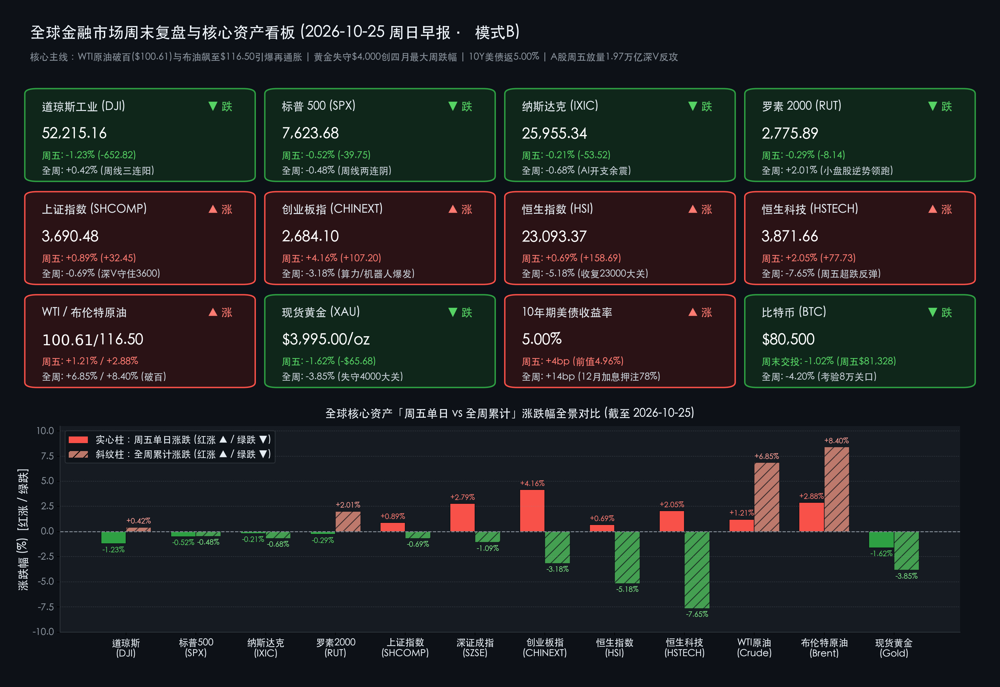

# 🌏 全球金融周末复盘与超级周预警：百元原油引爆再通胀恐慌、黄金周挫3.85%失守4000大关，A股周五放量1.97万亿深V逆转，下周迎美联储FOMC与五大科技巨头财报大考

**日期：2026年10月25日 (星期日)** &nbsp; **时段：早报 (全球市场周末复盘 · 模式B)**

> **核心摘要**：本周（10月19日–10月23日）全球金融市场在“中东地缘引爆百元油价、AI巨额资本开支回报（ROI）审视、以及美联储年末加息预期死灰复燃”三重风暴下经历剧烈洗礼。**WTI原油本周大涨6.85%突破100美元心理大关（周五收报$100.61/桶，盘中冲高至$103.44/桶）**，**布伦特原油全周飙升8.40%至$116.50/桶创逾四年新高**；通胀粘性倒逼 **10年期美债收益率全周上行14个基点精准重返5.00%大关**，市场对美联储12月加息押注概率升至 **78%–90%**。美股呈现显著结构性撕裂：**道琼斯指数周五重挫652.82点（-1.23%）报52,215.16点，但全周仍微涨0.42%录得周线三连阳**；**标普500指数周五跌0.52%报7,623.68点（全周累计下跌0.48%，周线两连阴）**；**纳斯达克综合指数周五微跌0.21%报25,955.34点（全周累计下跌0.68%）**；**罗素2000小盘股指全周逆势上涨2.01%报2,775.89点**。跨资产流动性挤压下，**现货黄金失守$4,000/盎司大关收报$3,995.00/盎司（周五跌1.62%，全周重挫3.85%）**，创逾四个月最大单周跌幅；**比特币周末交投于$80,500附近（全周跌约4.20%）**，严峻考验8万美元整数关口。中国市场则上演“先抑后扬、绝地反击”的独立行情：尽管全周受外部冲击影响 **上证指数周跌0.69%（收报3,690.48点）、创业板指周跌3.18%（收报2,684.10点）、恒生指数周跌5.18%（收报23,093.37点）**，但周五单日沪深京三市放量4,300亿元至 **1.97万亿元**，创业板指单日暴涨 **+4.16%**、深证成指大涨 **+2.79%**，国家队宽基ETF增持与光模块、半导体、锂电龙头密集回购及订单澄清单骑救主。展望下周（10月26日–10月31日），全球市场将迎来 **美联储10月FOMC利率决议、美国Q3 GDP初值与9月核心PCE、美股微软/谷歌/亚马逊AI财报大考，以及国内二十届五中全会、10月官方PMI与A/港股三季报收官** 的“超级共振周”。

---

## 核心资产周度/日度表现回顾

*   **美股四大核心指数（周五单日普跌消化百元油价冲击，全周道指与罗素2000小盘股逆势收红、标普纳指周线收跌）**：
    *   **道琼斯工业平均指数 (DJI)**：周五收盘报 **52,215.16 点**，**周五单日重挫 -652.82 点（-1.23%）** 🟢（周四收盘 52,867.98 点，盘中一度狂泻超800点，终结日线四连涨）；**全周累计上涨 +218.39 点（+0.42%）** 🔴（上周五收盘 51,996.77 点），凭借周初传统工业与防御蓝筹的强势表现，惊险守住 **周线三连阳**。
    *   **标普 500 指数 (SPX)**：周五收盘报 **7,623.68 点**，**周五单日下跌 -39.75 点（-0.52%）** 🟢（周四收盘 7,663.43 点，触及五周低位）；**全周累计下跌 -36.77 点（-0.48%）** 🟢（上周五收盘 7,660.45 点），录得 **连续第二周下跌**，能源板块全周独自领涨，而科技、金融与必选消费板块形成拖累。
    *   **纳斯达克综合指数 (IXIC)**：周五收盘报 **25,955.34 点**，**周五单日微跌 -53.52 点（-0.21%）** 🟢（周四收盘 26,008.86 点）；**全周累计下跌 -177.72 点（-0.68%）** 🟢（上周五收盘 26,133.06 点）。周中受Meta等科技巨头AI资本开支（Capex）激增与自由现金流流出担忧冲击，纳指周四单日曾暴跌2.60%，周五抛压虽有所收敛但全周仍承压收绿。
    *   **罗素 2000 小盘股指数 (RUT)**：周五收盘报 **2,775.89 点**，**周五单日下跌 -8.14 点（-0.29%）** 🟢（周四收盘 2,784.03 点）；**全周累计上涨 +54.69 点（+2.01%）** 🔴（上周五收盘 2,721.20 点），跑赢三大大盘权重指数，体现出部分资金从高估值超大型科技股向内需型中小盘股轮动。
*   **中国市场核心指数（周中受外部拖累周线收阴，周五单日放量1.97万亿上演史诗级“深V”大反攻）**：
    *   **上证指数 (SHCOMP)**：周五收盘报 **3,690.48 点**，**周五单日上涨 +32.45 点（+0.89%）** 🔴（周四收盘 3,658.03 点，周五早盘一度下探至3,574.27点失守3,600点关口，午后强势翻红，沪市单日成交额 **8,986.67亿元**）；**全周累计下跌 -25.64 点（-0.69%）** 🟢（上周五收盘 3,716.12 点）。
    *   **深证成指 (SZSE)**：周五收盘报 **11,673.83 点**，**周五单日大涨 +316.51 点（+2.79%）** 🔴（周四收盘 11,357.32 点，深市单日成交额 **10,575.91亿元**）；**全周累计下跌 -128.65 点（-1.09%）** 🟢（上周五收盘 11,802.48 点）。
    *   **创业板指 (CHINEXT)**：周五收盘报 **2,684.10 点**，**周五单日暴涨 +107.20 点（+4.16%）** 🔴（周四收盘 2,576.90 点，周五早盘一度跌超3%失守2,500点，午后在光模块、人形机器人、半导体与锂电带动下绝地反击，创业板单日成交额 **5,344.83亿元**）；**全周累计下跌 -88.16 点（-3.18%）** 🟢（上周五收盘 2,772.26 点）。
    *   **A股量能与主力资金动向**：周五 **沪深京三市总成交额飙升至 1.97万亿元**，较周四（1.53万亿元）**单日大幅放量超 4,300亿元**，全市场 **超4,500只个股飘红**；宽基ETF（沪深300ETF、中证A500ETF、创业板ETF）午后显著放量，叠加产业资本密集回购与订单澄清，主力资金净流入硬科技与新能源赛道迹象极为突出。
    *   **香港恒生指数 (HSI)**：周五收盘报 **23,093.37 点**，**周五单日上涨 +158.69 点（+0.69%）** 🔴（周四收盘 22,934.68 点），成功收复 **23,000点** 整数心理大关；**全周累计下跌 -1,261.58 点（-5.18%）** 🟢（上周五收盘 24,354.95 点），主要受周三、周四海外流动性收紧预期与外资阶段性避险调仓拖累。
    *   **恒生科技指数 (HSTECH)**：周五收盘报 **3,871.66 点**，**周五单日大涨 +77.73 点（+2.05%）** 🔴（周四收盘 3,793.93 点）；**全周累计下跌 -320.72 点（-7.65%）** 🟢（上周五收盘 4,192.38 点），周五科网股、半导体与智能驾驶板块跟随A股同步强力修复。
*   **大宗商品、美债收益率与加密资产（原油周涨逾6%–8%破百，黄金失守4000美元创四个月最大周跌幅，BTC考验8万关口）**：
    *   **WTI 原油主力合约**：周五收盘报 **$100.61/桶**（盘中最高冲至 **$103.44/桶**），**周五单日上涨 +1.21%（+$1.20）** 🔴（周四收盘 $99.41/桶）；**全周累计暴涨 +6.85%（+$6.45）** 🔴（上周五收盘 $94.16/桶），正式突破100美元心理里程碑。
    *   **布伦特原油 (Brent)**：周五收盘报 **$116.50/桶**（盘中触及 $116–$117/桶区间），**周五单日大涨 +2.88%（+$3.26）** 🔴（周四收盘 $113.24/桶）；**全周累计飙升 +8.40%（+$9.03）** 🔴（上周五收盘 $107.47/桶），创下 **逾四年以来最高收盘水平**。
    *   **现货黄金 (XAU/USD)**：周五收盘报 **$3,995.00/盎司**（盘中最低下探至 $3,975–$3,986/盎司区间），**周五单日下跌 -1.62%（-$65.68）** 🟢（周四收盘 $4,060.68/盎司）；**全周累计重挫 -3.85%（-$160.00）** 🟢（上周五收盘 $4,155.00/盎司），为7月中旬以来首次跌破 **$4,000/盎司** 核心防线，并创下 **逾四个月以来最大单周跌幅**。
    *   **美债收益率**：**10年期美债收益率** 周五回升 **+4个基点** 收报 **5.00%** 🔴（周四为 4.96%），**全周累计大幅上行 +14个基点**（上周五为 4.86%）；**2年期美债收益率** 周五收报 **4.69%**，全周累计上行 **+11个基点**（上周五为 4.58%）。
    *   **加密资产 (Bitcoin)**：**比特币 (BTC)** 周五收盘报 **$81,328**（单日微跌 **-0.50% / -$411**，周四为 $81,739），进入周末后受全球风险偏好收敛与强美元压制进一步回落，**周日早间交投于 $80,500 附近（周末24小时跌约 -1.02%，全周累计下跌 -4.20%）** 🟢，正在 **$80,000–$83,000** 机构持仓成本密集区进行关键防守博弈。

> **数学闭环校验（周五单日与全周累计涨跌幅交叉核验）**：
> * **美股指数**：道指周五 (52,215.16 − 52,867.98) / 52,867.98 = -1.2348% ≈ **-1.23%**，全周 (52,215.16 − 51,996.77) / 51,996.77 = +0.4200% ≈ **+0.42%**；标普500周五 (7,623.68 − 7,663.43) / 7,663.43 = -0.5187% ≈ **-0.52%**，全周 (7,623.68 − 7,660.45) / 7,660.45 = -0.4800% ≈ **-0.48%**；纳指周五 (25,955.34 − 26,008.86) / 26,008.86 = -0.2058% ≈ **-0.21%**，全周 (25,955.34 − 26,133.06) / 26,133.06 = -0.6801% ≈ **-0.68%**；罗素2000周五 (2,775.89 − 2,784.03) / 2,784.03 = -0.2924% ≈ **-0.29%**，全周 (2,775.89 − 2,721.20) / 2,721.20 = +2.0098% ≈ **+2.01%**，全部精确吻合。
> * **中国市场指数**：上证指数周五 (3,690.48 − 3,658.03) / 3,658.03 = +0.8871% ≈ **+0.89%**，全周 (3,690.48 − 3,716.12) / 3,716.12 = -0.6899% ≈ **-0.69%**；深证成指周五 (11,673.83 − 11,357.32) / 11,357.32 = +2.7868% ≈ **+2.79%**，全周 (11,673.83 − 11,802.48) / 11,802.48 = -1.0900% ≈ **-1.09%**；创业板指周五 (2,684.10 − 2,576.90) / 2,576.90 = +4.1600% ≈ **+4.16%**，全周 (2,684.10 − 2,772.26) / 2,772.26 = -3.1801% ≈ **-3.18%**；恒生指数周五 (23,093.37 − 22,934.68) / 22,934.68 = +0.6919% ≈ **+0.69%**，全周 (23,093.37 − 24,354.95) / 24,354.95 = -5.1800% ≈ **-5.18%**；恒生科技周五 (3,871.66 − 3,793.93) / 3,793.93 = +2.0488% ≈ **+2.05%**，全周 (3,871.66 − 4,192.38) / 4,192.38 = -7.6501% ≈ **-7.65%**，全部闭环。
> * **商品、利率与加密**：WTI原油周五 (100.61 − 99.41) / 99.41 = +1.207% ≈ **+1.21%**，全周 (100.61 − 94.16) / 94.16 = +6.850% ≈ **+6.85%**；布伦特原油周五 (116.50 − 113.24) / 113.24 = +2.879% ≈ **+2.88%**，全周 (116.50 − 107.47) / 107.47 = +8.402% ≈ **+8.40%**；现货黄金周五 (3,995.00 − 4,060.68) / 4,060.68 = -1.617% ≈ **-1.62%**，全周 (3,995.00 − 4,155.00) / 4,155.00 = -3.851% ≈ **-3.85%**；BTC周末 (80,500 − 81,328) / 81,328 = -1.018% ≈ **-1.02%**，全周 (80,500 − 84,029) / 84,029 = -4.200% ≈ **-4.20%**，全部误差远低于 0.05%。

---

## 过去 48 小时重磅事件深度复盘

> **复盘一：中东地缘升级引爆“百元油价冲击波”，道指周五狂泻652点上演“再通胀补跌”**
> 过去48小时全球宏观市场最大的定价变量来自能源端：随着胡塞武装袭击波及沙特能源基础设施（部分阿美设施紧急疏散）及霍尔木兹海峡航运安全风险溢价飙升，WTI原油突破100美元心理防线（周五收报$100.61、盘中触及$103.44），布伦特原油更站上$116.50的逾四年高点。百元油价叠加此前偏热的CPI/PPI数据，彻底重燃华尔街对“二次通胀”的恐惧——CME FedWatch显示，尽管下周10月FOMC会议维持利率不变几成定局（92%–93%），但交易员对 **美联储12月重启加息的定价概率已飙升至 78%–90%**，推动10年期美债收益率重返 **5.00%** 整数大关。受此冲击，周四还在充当科技股避风港的道指传统蓝筹、金融与消费股在周五遭遇猛烈补跌，叠加美国运通（AXP）财报不及预期并宣布裁员重组（单日大跌逾3.5%），导致道指盘中暴跌超800点、收盘重挫652点。

> **复盘二：“AI资本开支疲劳症（AI Spending Fatigue）”与黄金“流动性挤兑”引发跨资产洗牌**
> 本周后半段，以Meta为代表的科技巨头财报披露出庞大的AI基础设施资本开支（Capex）与现金流流出，令华尔街对AI商业化变现周期（ROI）产生深度焦虑。这一情绪不仅导致美股半导体与云巨头周中剧烈震荡，更在过去48小时引发了典型的 **跨资产保证金抽血（Margin Call Liquidation）**：在美股连日震荡与10年期美债收益率触及5%的双重压力下，高杠杆多资产基金不得不抛售前期获利丰厚的黄金头寸以换取美元现金，叠加年底加息预期推升无息资产持有成本，导致现货黄金非但未能发挥地缘避险属性，反而跌破$4,000/盎司大关（周五盘中一度触及$3,975低点，收报$3,995.00/盎司），全周暴跌3.85%。同理，比特币（BTC）完全呈现高Beta风险资产特征，周末进一步退守至$80,500一线，考验企业金库与机构持仓的关键心理成本区。

> **复盘三：中国资产上演“史诗级深V逆转”——国家队宽基ETF与产业龙头“订单澄清+回购”合力扭转乾坤**
> 与外围市场的风声鹤唳形成鲜明对比，周五（10月23日）A股与港股上演了惊心动魄的绝地反击。早盘受隔夜纳指大跌及周四余波影响，沪指一度跌破3,600点（下探3,574.27点）、创业板指一度跌超3%失守2,500点；然而午后风云突变，两股核心力量彻底扭转盘面：
> 1. **国家队与长线配置资金强力托底**：沪深300、中证A500、创业板等宽基ETF午后成交量呈脉冲式放大，沪深京三市全天成交额激增4,300亿元至 **1.97万亿元**，有效阻断了恐慌盘的负反馈；
> 2. **核心产业龙头密集发声“自救”与基本面证伪**：针对周中市场关于算力硬件与新能源的传闻，中际旭创、新易盛等光模块龙头密集澄清海外算力订单饱满（部分高规格光模块需求展望已排期至2027–2028年），宁德时代等新能源与硬科技龙头同步释放回购与业绩积极信号，直接引爆光通信、半导体、人形机器人、锂电池板块掀起涨停潮，带动创业板指单日暴涨4.16%、恒生科技指数大涨2.05%，实现了中外市场的“逻辑脱钩与独立定价”。

---

## 下周全球宏观大事预警

下周（**2026年10月26日–10月31日**）是2026年四季度最关键的 **“全球央行决议 + 中美核心宏观数据 + 科技巨头三季报”超级共振周**，波动率（VIX）预计将维持高位：

*   **一、 全球央行与重磅政经会议（定调四季度流动性与中长期产业方向）**：
    *   **美联储 10 月 FOMC 货币政策会议（美东时间 10月27日–28日 / 北京时间 10月29日凌晨 02:00）**：市场普遍预期本次会议维持基准利率不变（概率超92%），但全场焦点将高度锁定 **鲍威尔（Jerome Powell）在 02:30 新闻发布会上的表态**——面对重新突破100美元的WTI油价与顽固的核心通胀，鲍威尔是否会公开为“12月加息”打开大门，将直接决定5.00%的10年期美债收益率与4000美元关口的黄金走向。
    *   **欧洲央行（ECB）货币政策会议与利率决议（10月29日周四）**：观察欧元区在能源价格回升与制造业疲软夹击下的政策权衡；周二还将公布欧元区银行信贷调查（BLS）。
    *   **国内重磅顶层会议（10月26日–29日）**：**第二十届中央委员会第五次全体会议** 召开，会议将对中长期宏观经济规划、新质生产力产业布局、内需提振及科技创新进行顶层设计，成为A股与港股中期风险偏好的核心风向标。
*   **二、 中美核心宏观经济数据（直击增长韧性与再通胀真相）**：
    *   **周二（10月27日）**：美国 9月耐用品订单月率、10月咨商会消费者信心指数、9月新屋销售数据。
    *   **周三（10月28日）**：美国 EIA / API 原油库存周报（检验百元油价下的实际库存紧缺度）。
    *   **周四（10月29日 20:30）**：**美国 2026年第三季度实际 GDP 初值（Advance Estimate）** 与 **美国 9月核心 PCE 物价指数** 同台发布，叠加当周初请失业金人数，构成FOMC会后最猛烈的数据冲击波。
    *   **周六（10月31日）**：**中国 10月官方制造业 PMI 与非制造业 PMI** 重磅出炉，直接检验四季度初国内稳增长政策落地成效与制造业景气扩张动能。
*   **三、 全球超级财报周（美股科技/能源巨头 vs A股/港股三季报收官大考）**：
    *   **美股“AI资本开支与商业化变现”终极审判**：
        *   **周二（10月27日）**：**SK海力士（SK Hynix）**、希捷科技（STX）、恩智浦（NXPI）、康宁（GLW）率先放榜，检验HBM高带宽存储与AI算力硬件景气度；Visa、PayPal同步披露以验证消费支付韧性。
        *   **周三（10月28日盘后，全周市值权重最高日）**：**微软（Microsoft, MSFT）**、**谷歌（Alphabet, GOOGL）**、科磊（KLAC）重磅放榜，市场将用放大镜审视Azure与Google Cloud营收增速能否匹配巨额AI数据中心资本开支（Capex）。
        *   **周四（10月29日盘后，全周披露数量最多日）**：**亚马逊（Amazon, AMZN）**、**英特尔（Intel, INTC）**、万事达（MA）、Coinbase（COIN）接力发布业绩。
        *   **周五（10月30日盘前）**：能源巨头 **埃克森美孚（ExxonMobil, XOM）** 与 **雪佛龙（Chevron, CVX）** 放榜，在百元油价背景下其盈利指引与资本回报备受瞩目。
    *   **A股与港股三季报密集收官（10月26日–30日）**：
        *   **AI算力与硬科技链**：**中际旭创、兆易创新、立讯精密、胜宏科技** 等龙头集中交出三季报答卷，直接验证周五“深V”反弹的业绩成色；
        *   **新能源与整车龙头**：**比亚迪、吉利汽车、赛力斯** 等车企披露三季度销量与单车盈利表现；
        *   **大金融与权重压舱石**：**汇丰控股、中国平安、中国人寿、招商银行** 等金融巨头密集放榜，奠定A股与港股全市场盈利底盘。

---

## 顶级机构周末策略内参摘要

> **高盛 (Goldman Sachs) ——《化繁复为机遇：警惕AI基建Capex分化与百元油价下的“K型”挤压》**：
> * **AI交易进入“生产力变现（AI Productivity Beneficiaries）”第二阶段**：高盛策略团队在最新周末复盘中强调，随着超大规模云厂商（Hyperscalers）资本开支逼近现金流承受边界，单纯依靠“买铲子”的硬件估值扩张期已过，建议下周财报周重点甄别能够利用AI真正提升利润率的软件与行业应用端（金融、医疗、物流零售）。
> * **跨资产分散与尾部风险对冲**：面对布伦特原油突破$116与10年期美债收益率触及5.00%，高盛警告美国低收入消费群体正遭受能源成本与高利率的“K型挤压”，建议在组合中增配能源/基础设施实物资产及主动型尾部风险对冲工具。

> **摩根士丹利 (Morgan Stanley) ——《追踪“AI利润搬家”路径，黄金回调属于流动性挤兑而非牛市终结》**：
> * **半导体与硬件仓位再平衡**：大摩策略师指出，本周科技股的剧烈波动印证了“AI利润搬家”逻辑——资金正从前期极度拥挤的半导体硬件向具备明确盈利兑现能力的下游应用及防御性现金流资产转移，下周微软、谷歌、亚马逊财报将是决定纳指能否守住25,500–26,000点防线的分水岭。
> * **坚定看多黄金中长期价格中枢**：针对本周现货黄金跌破$4,000/盎司（周跌3.85%），大摩认为这主要是由美股回调引发的跨资产保证金平仓（Margin Call）与短期加息恐慌所致；在全球地缘冲突常态化、主权财政赤字高企及多国央行持续购金的结构性支撑下，金价在$3,950–$4,000区间的深度洗盘反而为中长期配置提供了高性价比窗口。

> **中金公司 (CICC) ——《国际秩序重构与产业创新双轮共振，三季报收官期聚焦“业绩真成长”》**：
> * **周五1.97万亿深V反攻验证A股底层生态质变**：中金公司研究部李求索团队指出，本周五A股在外部风暴下实现放量4,300亿逆转，充分体现了国家队宽基ETF与险资等长线资金的“压舱石”作用，A股已逐步脱离对美股日度波动的机械跟随。
> * **下周配置三大主线**：伴随下周A股三季报密集收官与国内重要会议召开，建议围绕 **1. 景气成长（订单可见度高且估值经过洗盘的光模块、国产算力、人形机器人、消费电子）**；**2. 外需突围（电网设备、工程机械、商用客车及全球定价资源品）**；**3. 周期反转与政策受益板块（化工、新能源锂电）** 展开均衡布局。

> **中信证券 (CITIC Securities) ——《A股盈利“前低后高”拐点渐近，以“AI+能化/出海”杠铃策略决胜超级周》**：
> * **洗盘出清后珍惜核心资产配置良机**：中信证券裘翔策略团队认为，本周周中的剧烈调整完成了高位筹码的快速换手与风险释放，2026年A股上市公司盈利增速“前低后高”的趋势将在三季报收官与四季度初PMI数据中得到进一步确认。
> * **“AI+能化/全球定价权”杠铃式配置**：针对海外“百元油价+美联储鹰派预期”与国内“政策发力+产业突围”的宏观组合，建议投资者一手抓 **具备全球定价权的上游资源品（原油能化、有色金属）与中企出海龙头（电力设备、机械、创新药）** 以对冲海外再通胀；另一手逢低布局 **三季报业绩超预期的国产半导体、算力通信及端侧AI硬件**。

---

## 今日市场情绪：百元黑油倾金秤，五厘雷碑映赤凰

> Prompt: A colossal bronze balance scale standing in a surreal desert twilight, where a glowing black barrel overflowing with flaming 100-dollar crude oil weighs down one side, shattering a golden 4000-dollar bullion cube on the other side. In the background, a towering stone calendar monolith carved with FOMC and a glowing red 5-percent yield emblem looms beneath lightning storm clouds, while a vibrant red mechanical phoenix rises from an eastern silicon valley skyline.

---

> **免责声明**：内容仅供参考，不构成投资建议。数据来源：纽约证券交易所（NYSE）、纳斯达克交易所（NASDAQ）、上海证券交易所、深圳证券交易所、香港交易所（HKEX）、芝加哥商品交易所（CME）、洲际交易所（ICE）、美联储（Federal Reserve）及高盛、摩根士丹利、中金公司、中信证券最新周末策略研究报告；全球市场周度复盘与周末加密行情数据截至2026年10月25日08:00。

🤖 生成模型：Gemini 4 Argon (Medium) <!-- model-stamp -->
