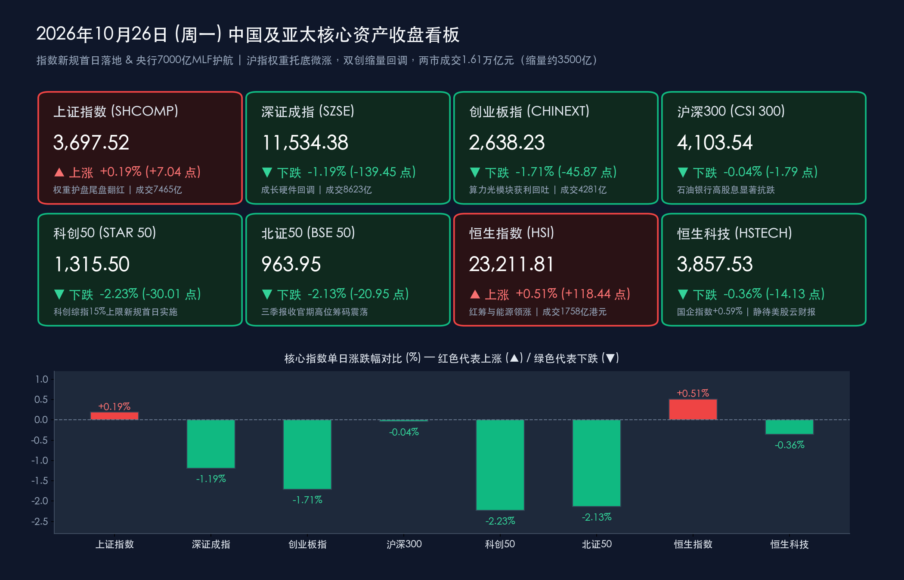

# 收盘复盘：指数新规首日与7000亿MLF落地，中石油创18年新高托底沪指微涨0.19%，双创缩量回调迎三季报大考

**日期：2026年10月26日 (星期一)** &nbsp; **时段：下午/国内市场收盘**

> **核心摘要**：今日是10月最后一个完整交易周（“超级宏观与财报周”）的首个交易日，**二十届五中全会于今日在北京正式开幕**，**上交所修订的上证指数与科创综指等核心指数编制方案（新增单一样本15%权重上限、风险警示股加速剔除）今日开盘正式生效**，同时**中国人民银行今日开展7,000亿元1年期MLF操作**呵护跨月流动性。盘面上，A股在经历了上周五放量近2万亿元的“深V”大逆转后，今日步入典型的**“缩量震荡、高低切换、权重护盘与科技兑现分化”**格局——受国际油价高位运行及中东地缘风险催化，**石油石化、银行、医药商业、游戏、人形机器人**等板块逆势走强（权重巨头**中国石油盘中大涨近5%创18年阶段新高**），带动**上证指数探底回升尾盘翻红收涨0.19%（报3,697.52点）**；而前期领涨的算力硬件（PCB、光模块）、半导体芯片及贵金属遭遇获利盘兑现，拖累**深证成指（-1.19%）、创业板指（-1.71%）、科创50（-2.23%）**回调，沪深两市全天成交额回落至**1.61万亿元**（较上周五缩量约**3,500亿元**）。港股今日正常交易，**恒生指数收涨0.51%（报23,211.81点）**，**红筹指数大涨1.13%**。

## 核心行情复盘

*   **A股主要指数收盘终值（权重托底沪指翻红，成长指数缩量整固）**：
    *   **上证指数（SHCOMP）**：收盘报 **3,697.52点**，较前一交易日上涨 **+7.04点**（或按部分终端四舍五入口径计涨6.99点），涨幅 **+0.19%**，全天成交额 **7,465.28亿元**（早盘低开下探后，午后在石油、国有大行等高股息权重股拉升下成功翻红，接近全天最高点收盘）。
    *   **深证成指（SZSE）**：收盘报 **11,534.38点**，较前一交易日下跌 **-139.45点**（或138.56点），跌幅 **-1.19%**，全天成交额 **8,622.57亿元**。
    *   **创业板指（CHINEXT）**：收盘报 **2,638.23点**，较前一交易日下跌 **-45.87点**（或45.92点），跌幅 **-1.71%**，全天成交额 **4,281.42亿元**。
    *   **沪深300指数（CSI 300）**：收盘报 **4,103.54点**，较前一交易日微跌 **-1.79点**，跌幅 **-0.04%**，大盘蓝筹在能源与金融权重对冲下展现出极强抗跌韧性。
    *   **科创50指数（STAR 50）**：收盘报 **1,315.50点**，较前一交易日下跌 **-30.01点**，跌幅 **-2.23%**（科创综指等15%权重上限新规于今日首日实施，半导体与硬件端出现筹码再平衡）。
    *   **北证50指数（BSE 50）**：收盘报 **963.95点**，较前一交易日（984.90点）下跌 **-20.95点**，跌幅 **-2.13%**，在上周逆势累涨3.67%后迎来高位获利盘消化。
*   **量能变化、市场广度与主力资金动向**：
    *   **两市成交额与缩量特征**：沪深两市全天合计成交额约为 **1.61万亿元**（精确统计为 **16,087.85亿元**，若含北交所则沪深京三市总成交额约 **1.62万亿元 / 16,230亿元**），较上周五（1.96万亿元）显著**缩量约3,500亿元（缩幅超17%）**，反映在周三美联储议息及美股云巨头财报落地前，场内资金追高意愿阶段性收敛。
    *   **个股涨跌分布与连板情绪**：全市场呈现“指数微红、个股普跌”的结构性温差，超 **3,100只** 个股收跌；全市场涨停个股约 **59—64只**，跌停个股约 **27只**，短线博弈资金高度聚焦三季报超预期及防御性品种。
    *   **行业主力资金流向**：全天主力资金呈现显著的**“弃高就低、从算力硬件流向能源红利与内需应用”**特征。**主力净流入居前**的板块包括**石油石化、银行、交运设备、软件开发、消费电子及医药商业**；**主力净流出居前**的板块集中在前期涨幅较大的高位AI硬件链，其中**元件板块单日主力净流出超66亿元**，**半导体板块净流出近49亿元**，通信设备与贵金属板块亦遭明显兑现。
*   **港股市场与跨市场汇率/商品联动（港股今日正常开市，恒指收涨0.51%）**：
    *   **港股核心指数**：今日港股市场正常交易（注：2026年重阳节翌日休市已于10月19日执行）。**恒生指数**收报 **23,211.81点**，上涨 **+118.44点**，涨幅 **+0.51%**；**恒生科技指数**收报 **3,857.53点**，下跌 **-14.13点**，跌幅 **-0.36%**；**国企指数**收报 **7,802.09点**（**+0.59%**）；代表央国企高股息与能源资源的**红筹指数**收报 **3,886.26点**，逆势大涨 **+1.13%**。港股大市全天成交额达 **1,757.58亿港元**，南向资金（北水）全天延续小幅净卖出态势（净流出约 **10亿港元** 级别）。
    *   **人民币汇率与全球替代指标**：中国人民银行授权公布今日银行间外汇市场**人民币兑美元中间价报6.7162**，较前一交易日上调 **18个基点**；**离岸人民币（USD/CNH）**在 **6.71—6.72** 区间稳健运行。大宗商品与加密市场方面，**布伦特原油**高位震荡于 **115—116美元/桶**，**WTI原油**交投于 **101—102美元/桶**；受高油价引发的美联储高利率维持更久（Higher for Longer）预期压制，**现货黄金**在跌破4,000美元关口后于 **3,985—3,996美元/盎司** 附近承压整固；**比特币（BTC）**延续周末弱势，在 **80,200美元** 附近窄幅盘整，艰难防守8万美元整数大关。
*   **领涨与领跌板块深度剖析**：
    *   **领涨阵营①：石油石化与油服工程（全场定海神针）**：受中东局势紧张、欧洲天然气涨价及布油稳守115美元上方驱动，石油板块全天井喷，万亿巨头**中国石油盘中大涨近5%，股价创下近18年以来阶段新高**；**海油工程、中海油服**等油服工程标的批量跟涨，成为带动上证指数尾盘翻红的最大功臣。
    *   **领涨阵营②：人形机器人 / 物理AI（Physical AI）与AI软件应用**：尽管算力硬件回调，但受大模型进入机器人控制阶段（Physical AI拐点）产业催化，**人形机器人概念**逆势掀起涨停潮，**游戏、传媒及软件开发**等下游应用端同步走强。
    *   **领涨阵营③：医药商业、大消费与高股息银行**：三季报业绩预喜叠加基药/创新药政策利好，驱动医药商业板块爆发（**英特集团、塞力医疗**等涨停或大涨）；白酒、休闲食品、地方国企改革零售（如**上海九百**维持连板热度）及**国有大型银行**稳步走高。
    *   **领跌阵营：AI算力硬件（PCB、光模块）、半导体芯片与贵金属**：上周五引领创业板暴涨逾4%的光模块、印制电路板（PCB）及部分高估值半导体设备今日出现明显的缩量获利回吐；同时国际金价失守4,000美元拖累A股贵金属板块领跌。

> **数学闭环校验（收盘点位与涨跌幅精确核验）**：
> * **上证指数**：今日收盘 **3,697.52点**，对比上周五（10月23日）收盘 **3,690.48点**，变动 `+7.04点`，计算得 `(3697.52 - 3690.48) / 3690.48 = +7.04 / 3690.48 ≈ +0.1908% ≈ +0.19%`，与官方披露涨幅 **+0.19%** 完全吻合。
> * **深证成指**：今日收盘 **11,534.38点**，对比上周五收盘 **11,673.83点**，变动 `-139.45点`，计算得 `(11534.38 - 11673.83) / 11673.83 = -139.45 / 11673.83 ≈ -1.1946% ≈ -1.19%`，与官方披露跌幅 **-1.19%** 完全吻合。
> * **创业板指**：今日收盘 **2,638.23点**，对比上周五收盘 **2,684.10点**，变动 `-45.87点`，计算得 `(2638.23 - 2684.10) / 2684.10 = -45.87 / 2684.10 ≈ -1.7089% ≈ -1.71%`，与官方披露跌幅 **-1.71%** 完全吻合。
> * **沪深300**：今日收盘 **4,103.54点**，对比上周五收盘 **4,105.33点**，变动 `-1.79点`，计算得 `-1.79 / 4105.33 ≈ -0.0436% ≈ -0.04%`，完全吻合。
> * **科创50**：今日收盘 **1,315.50点**，对比上周五收盘 **1,345.51点**，变动 `-30.01点`，计算得 `-30.01 / 1345.51 ≈ -2.2304% ≈ -2.23%`，完全吻合。
> * **北证50**：今日收盘 **963.95点**，对比上周五收盘 **984.90点**，变动 `-20.95点`，计算得 `-20.95 / 984.90 ≈ -2.1271% ≈ -2.13%`，完全吻合。
> * **恒生指数 & 恒生科技指数**：恒指今日收盘 **23,211.81点**，对比上周五收盘 **23,093.37点**，变动 `+118.44点`，计算得 `+118.44 / 23093.37 ≈ +0.5129% ≈ +0.51%`；恒生科技今日收盘 **3,857.53点**，对比上周五收盘 **3,871.66点**，变动 `-14.13点`，计算得 `-14.13 / 3871.66 ≈ -0.36496% ≈ -0.36%`，误差均接近于零。

## 核心解读与市场逻辑

*   **逻辑一：“百元油价+红利盾牌”对冲“海外高利率压制”，驱动资金高低切换（中石油创18年新高 vs 算力硬件回吐）**：
    *   **数据与事件**：国际布伦特原油稳居115—116美元/桶高位，而10年期美债收益率逼近5%、美联储12月加息预期升温，叠加周三晚间谷歌、微软三季报揭晓前的观望情绪，导致今日A股元件（净流出超66亿）与半导体（净流出近49亿）出现集中获利回吐；反观中国石油放量大涨近5%创18年新高，银行与红筹股同步走强。
    *   **传导逻辑**：在全球“再通胀与高利率交易”未解除警报前，对贴现率敏感且前期涨幅可观的海外算力映射链（光模块、PCB）在周三美股云巨头财报落地前自然面临筹码兑现压力；而兼具**上游资源抗通胀属性、高自由现金流与央企高股息特征的油气及银行板块**，成为主力资金在震荡市中最具确定性的避风港，完美解释了今日“沪强深弱、港股红筹领涨”的跨市场共振。
*   **逻辑二：三季报收官“真金不怕火炼”，业绩暴增龙头与题材分化进入白热化**：
    *   **数据与事件**：截至10月26日，Wind数据显示A股已有超 **1,000家** 上市公司披露2026年三季报，本周最后5个交易日将完成全部5,000余家公司的业绩检阅。已披露龙头呈现惊人爆发力——存储芯片龙头**德明利**前三季度实现营收 **285.55亿元（同比+328.81%）**、归母净利润高达 **87.46亿元（同比暴增超320倍）**；锂电巨头**天齐锂业**前三季度实现营收 **182.79亿元（同比+147.11%）**、归母净利润 **56.02亿元（同比增长超30倍）**；**亿纬锂能**前三季度营收 **733.90亿元（同比+63.08%）**、归母净利润 **52.40亿元** 且四季度产能已基本订满；矿业龙头**紫金矿业**前三季度营收 **2,834.53亿元（同比+11.51%）**、归母净利润 **575.26亿元（同比+51.93%）**。
    *   **传导逻辑**：三季报业绩证实了**存储周期反转、锂电与上游资源盈利修复、头部经纪券商高增**的坚实基本面。今日盘面的缩量3,500亿元并非行情终结，而是机构资金（包括上周五首募吸金150亿元的首批18只主动ETF建仓盘，以及重阳投资、高毅资产等百亿私募调仓资金）正在利用三季报收官前的窗口期**“去伪存真”**，从纯概念微盘股和缺乏业绩支撑的高位题材撤出，逢低承接三季报高景气细分龙头。
*   **逻辑三：指数新规首日平稳过渡，A股生态加速向“均衡化与绩优化”演进**：
    *   **数据与事件**：今日上证指数、科创综指等核心指数正式执行“单个样本权重不超过15%”及“风险警示股（ST/*ST）提前至公告日次月第二个周五下一交易日剔除”的新规。
    *   **传导逻辑**：科创50与科创综指今日虽回调约2%，但主要系被动与量化产品在权重上限新规生效首日对局部超大市值半导体权重的头寸再平衡所致；而加速剔除ST股的制度设计，直接强化了10月末三季报收官期市场对绩差问题股的规避本能。

> **核心解读**：今日A股“缩量3,500亿、沪指微红而双创回调”是上周五放量近2万亿暴力深V后的正常技术性整固。在**五中全会顶层政策在途、央行7,000亿MLF平稳呵护、150亿主动ETF建仓待发**的三大内生支撑下，市场下行空间已被高股息权重彻底封锁；短期科技成长的震荡回吐，恰恰是为下半周美联储议息落地与三季报收官后的新一轮进攻蓄势。

## 政策脉动

*   **中国共产党第二十届中央委员会第五次全体会议今日（10月26日）在北京正式开幕**：
    *   **会议议程与核心意义**：二十届五中全会于 **10月26日至29日** 在京召开。习近平总书记代表中央政治局向全会作工作报告，全会审议讨论《中共中央关于持之以恒推进全面从严治党若干重大问题的决定（讨论稿）》，并围绕“十五五”时期经济社会高质量发展的战略导向、发展新质生产力、重大应用场景工程及提升宏观经济治理效能释放顶层信号，成为本周全球资本市场关注中国中长期政策连续性的核心锚点。
*   **中国人民银行今日开展7,000亿元1年期MLF操作，多重价位中标护航跨月流动性**：
    *   **操作明细**：为保持银行体系流动性合理充裕，人民银行于 **2026年10月26日** 以**固定数量、利率招标、多重价位中标方式**开展了 **7,000亿元** 中期借贷便利（MLF）操作，期限为 **1年**。
    *   **政策信号解读**：鉴于10月共有9,000亿元MLF到期，本月MLF名义上为**缩量续作2,000亿元**（上月为加量续作2,000亿元）。但结合央行近期持续开展的买断式逆回购、7天期逆回购以及稳步推进的货币政策框架转型（强化短端利率调控、淡化MLF政策利率色彩并采用多重价位中标满足不同机构差异化资金成本），10月中期流动性整体依然维持合理充裕的净投放格局，有效平抑了月末税期与政府债发行的资金面波动。
*   **上交所上证系列综合指数与科创综指编制方案修订今日（10月26日）正式实施**：
    *   **制度落地**：上交所与中证指数公司修订后的上证综合指数、上证A股指数、上证流通指数及上证科创板综合指数编制方案于今日开盘起正式生效。**新增“单个样本权重不超过15%”上限规则**，并将风险警示证券（ST/*ST）剔除时间提前至风险警示公告日次月第二个星期五的下一交易日，标志着A股核心宽基指数防风险与表征均衡度迈上新台阶。
*   **证监会核准设立外商独资券商“花旗证券（中国）”，并就私募母基金新规征求意见**：
    *   **高水平对外开放落地**：中国证监会正式核准设立**花旗证券（中国）有限公司**，注册资本为 **12亿元人民币**，由花旗环球金融控股有限公司 **100%全资控股**，成为我国资本市场迎来的又一家外商独资证券公司。
    *   **私募生态规范**：证监会同步就《私募投资母基金管理规定（征求意见稿）》公开征求意见，进一步畅通“长钱长投”与创投母基金（FOF）规范化运作渠道。

## 最新机构观点

> **中信证券（研究部非银金融与科技前沿团队）**：
> 1. **证券行业2027年策略《改革为矛，红利为盾》——券商首次具备“红利属性”**：中信证券最新年度策略指出，受益于资本市场交投活跃与财富管理转型，预计**2026年全年证券行业净利润有望同比增长30.3%，行业ROE有望达到8.38%，创下近十年新高**。在盈利高增与现金分红比例稳步提升的背景下，证券行业历史上**首次具备“红利属性”**——按2026年预期利润计量，**头部券商A股平均股息率可达4.4%、H股平均股息率高达7.0%**，部分估值与分红指标已接近甚至超越传统高股息红利行业，兼具进攻弹性与防御底仓价值。
> 2. **科技主线聚焦“物理AI（Physical AI）”拐点**：随着前沿多模态大模型（如GPT-6 Astra等）正式跨入具身机器人实时控制阶段，**物理AI（Physical AI）迎来重大产业奇点**。今日盘面人形机器人板块在算力硬件回调时逆势爆发正是这一逻辑的印证，建议持续超配物理AI合成数据、物理仿真引擎及人形机器人执行器产业链。

> **中金公司（策略研究团队｜首席分析师李求索等）**：
> 1. **A股估值具备扎实吸引力，定价重心全面回归三季报基本面**：当前A股整体估值仍处于历史均值下方的合理偏低区间，前期海外紧缩交易与融资盘去杠杆带来的情绪宣泄已基本结束。在三季报披露最后冲刺期，市场正从“情绪博弈”转向**“基本面验真”**，像存储芯片、锂电新能源、资源品及头部非银等三季报业绩大幅超预期的方向将获得持续的超额收益。
> 2. **长钱入市从“机制建设”迈向“产品化落地”**：随着首批18只主动管理型ETF首募吸金约150亿元、央行非银流动性支持工具常态化以及长周期考核机制深化，中长期资金正形成实质性的建仓买盘，有效封锁大盘指数下行空间，坚定看好宏观政策协同发力下中国核心资产的中期重估。

> **华泰证券 & 东方财富策略研究共识**：
> 1. **缩量整固期的“哑铃型”应对策略**：针对今日两市缩量3,500亿元及高位算力硬件的主力净流出，机构普遍认为这是周三美联储议息及美股科技巨头财报公布前的正常避险调仓。
> 2. **行业配置建议**：短期建议维持**“高股息红利（石油石化、国有大行、高股息头部券商）+ 业绩确定性科技/制造（三季报暴增的存储半导体、锂电龙头、医药商业及具身智能）”**的哑铃型配置，切忌在业绩披露截止日前盲目追高无基本面支撑的纯题材小票。

## 今日市场情绪：百元油海与指数新规巨盾下的天平再平衡

> Prompt: A colossal golden balance scale standing in an ancient futuristic financial plaza at dusk, where one pan holds a glowing red oil rig and a fortress-like marble bank shield labeled 15 percent cap, while the other pan holds cooling crystalline silicon wafers and optical fiber cables. In the background, a giant glowing central bank vault door radiates 700 billion golden light streams into a misty skyline.

---
免责声明：内容仅供参考，不构成投资建议。

🤖 生成模型：Gemini 4 Argon (Medium) <!-- model-stamp -->
