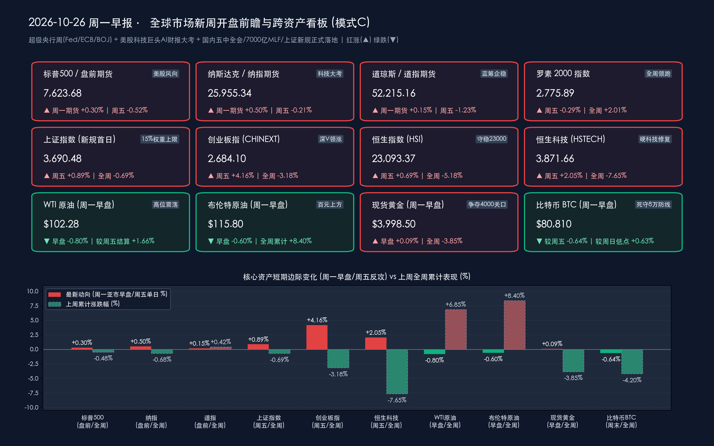

# 🌏 全球市场新周展望与开盘决战：央行“三巨头”议息携科技巨头AI财报来袭，国内7000亿MLF护航、上证综指新规今日生效与三季报业绩浪共振

**日期：2026年10月26日 (星期一)** &nbsp; **时段：早报 (全球市场新周展望 · 模式C)**

> **核心摘要**：步入10月最后一周（10月26日–10月31日），全球金融市场正式迎来2026年四季度最关键的 **“美欧日三大央行议息 + 中美核心宏观数据 + 美股科技巨头与A股三季报收官”超级决战周**。经过周末（10月24日–25日）的密集消息发酵，周一亚市早盘美股三大期指温和反抽（**纳指100期货涨+0.50%、标普500期货涨+0.30%、道指期货涨+0.15%**），试图修复上周五道指重挫652点（**-1.23%**）及标普纳指周线两连阴的阴霾。跨资产端，受中东潜在外交接触传闻缓和极度紧绷情绪影响，**WTI原油周一早盘自周末前高点微调0.80%至$102.28/桶（较上周五结算价$100.61仍高出+1.66%），布伦特原油回落0.60%报$115.80/桶（上周累计暴涨+8.40%）**，百元油价引发的“再通胀粘性”仍是华尔街头号悬剑；**现货黄金早盘微涨0.09%报$3,998.50/盎司**，围绕 **$4,000/盎司** 生死线展开激烈争夺；**10年期美债收益率微降2个基点报4.98%**；**比特币（BTC）早盘交投于$80,810（较周日低点$80,300回升+0.63%）**，死守8万美元机构防线。国内方面，周末迎来多重政策与制度利好共振：**央行今日（26日）开展7,000亿元1年期MLF操作** 呵护月末流动性；**二十届五中全会于10月26日–29日隆重召开**；**上证综合指数等编制方案修订（新增15%单一权重上限）于今日正式生效**；叠加 **超1,000家A股公司披露三季报（超八成盈利，天齐锂业净利暴增3013.86%、寒武纪增超130%、长电科技扣非近翻倍）**，为上周五放量1.97万亿“深V”大逆转后的A股与港股注入强劲的基本面底气。

---

## 周末财经要闻终极汇总

*   **一、 全球跨资产开盘前瞻基准与周末行情演变（美股期指反抽、百元原油高位震荡、黄金争夺4000关口）**：
    *   **美股核心指数上周五收盘基数与周一早盘期指风向**：
        *   **道琼斯工业平均指数 (DJI)**：上周五收盘报 **52,215.16 点**，单日重挫 **-652.82 点（-1.23%）** 🟢（上周四收盘 52,867.98 点），全周累计微涨 **+218.39 点（+0.42%）** 🔴（前周五收盘 51,996.77 点）；**周一亚市早盘道指期货微涨 +0.15%** 🔴。
        *   **标普 500 指数 (SPX)**：上周五收盘报 **7,623.68 点**，单日下跌 **-39.75 点（-0.52%）** 🟢（上周四收盘 7,663.43 点），全周累计下跌 **-36.77 点（-0.48%）** 🟢（前周五收盘 7,660.45 点）；**周一亚市早盘标普500期货反弹 +0.30%** 🔴。
        *   **纳斯达克综合指数 (IXIC)**：上周五收盘报 **25,955.34 点**，单日微跌 **-53.52 点（-0.21%）** 🟢（上周四收盘 26,008.86 点），全周累计下跌 **-177.72 点（-0.68%）** 🟢（前周五收盘 26,133.06 点）；**周一亚市早盘纳斯达克100期货反弹 +0.50%** 🔴，周末前夕美股硬科技暗盘已现局部抢筹迹象。
        *   **罗素 2000 小盘股指数 (RUT)**：上周五收盘报 **2,775.89 点**，单日下跌 **-8.14 点（-0.29%）** 🟢（上周四收盘 2,784.03 点），全周逆势大涨 **+54.69 点（+2.01%）** 🔴（前周五收盘 2,721.20 点）。
    *   **中国核心资产开盘基准（承接上周五1.97万亿放量“深V”反攻动能）**：
        *   **上证指数 (SHCOMP)**：上周五收盘报 **3,690.48 点**，单日上涨 **+32.45 点（+0.89%）** 🔴（上周四收盘 3,658.03 点，周五早盘一度探底 3,574.27 点后强势逆转），全周微跌 **-0.69%** 🟢；沪深京三市上周五成交额达 **1.97万亿元**（单日放量超 **4,300亿元**，超 **4,500只** 个股飘红）。
        *   **深证成指 (SZSE) 与 创业板指 (CHINEXT)**：深成指上周五收报 **11,673.83 点**（单日大涨 **+2.79%** 🔴，全周 **-1.09%** 🟢）；创业板指上周五收报 **2,684.10 点**（单日暴涨 **+4.16% / +107.20 点** 🔴，全周 **-3.18%** 🟢）。
        *   **香港恒生指数 (HSI) 与 恒生科技指数 (HSTECH)**：恒指上周五收报 **23,093.37 点**（单日上涨 **+0.69%** 🔴 收复 23,000 点大关，全周 **-5.18%** 🟢）；恒生科技上周五收报 **3,871.66 点**（单日大涨 **+2.05%** 🔴，全周 **-7.65%** 🟢）。
    *   **大宗商品、美债与加密资产周一早盘最新动态**：
        *   **WTI 原油主力合约**：周一亚市早盘交投于 **$102.28/桶**，较周末前冲高水位（$103.11/桶）温和回落 **-0.80%（-$0.83）** 🟢，但较上周五官方结算价（**$100.61/桶**，全周暴涨 **+6.85%**）仍高出 **+1.66%（+$1.67）** 🔴，稳居百元大关上方。
        *   **布伦特原油 (Brent)**：周一亚市早盘报 **$115.80/桶**，较上周五收盘价（**$116.50/桶**，全周飙升 **+8.40%** 创逾四年新高）小幅回调 **-0.60%（-$0.70）** 🟢。
        *   **现货黄金 (XAU/USD)**：周一亚市早盘报 **$3,998.50/盎司**，较上周五收盘价（**$3,995.00/盎司**，上周五单日跌 **-1.62%**、全周重挫 **-3.85%**）微涨 **+0.09%（+$3.50）** 🔴，盘中多次试探重返 **$4,000/盎司** 整数关口。
        *   **美债收益率**：**10年期美债收益率** 周一早盘微降 **2个基点** 报 **4.98%** 🟢（上周五收报 **5.00%**，上周累计上行 **+14个基点**）；**2年期美债收益率** 报 **4.68%**（上周五为 **4.69%**）。
        *   **加密资产 (Bitcoin)**：**比特币 (BTC)** 周日一度下探至 **$80,300**，周一早盘回升至 **$80,810**（较周日低点反弹 **+0.63%** 🔴，较上周五收盘价 $81,328 微跌 **-0.64%** 🟢，上周累计下跌 **-4.20%**），继续在 **$80,000** 整数关口展开密集防守。

> **数学闭环校验（基准点位与早盘边际变动交叉核验）**：
> * **美股与A/港股基准**：道指周五 (52,215.16 − 52,867.98) / 52,867.98 = **-1.23%**，全周 (52,215.16 − 51,996.77) / 51,996.77 = **+0.42%**；标普500周五 (7,623.68 − 7,663.43) / 7,663.43 = **-0.52%**，全周 (7,623.68 − 7,660.45) / 7,660.45 = **-0.48%**；纳指周五 (25,955.34 − 26,008.86) / 26,008.86 = **-0.21%**，全周 (25,955.34 − 26,133.06) / 26,133.06 = **-0.68%**；上证指数周五 (3,690.48 − 3,658.03) / 3,658.03 = **+0.89%**；创业板指周五 (2,684.10 − 2,576.90) / 2,576.90 = **+4.16%**；恒生科技周五 (3,871.66 − 3,793.93) / 3,793.93 = **+2.05%**。
> * **跨资产周一早盘核验**：WTI原油早盘较周末前高点 (102.28 − 103.11) / 103.11 = -0.805% ≈ **-0.80%**，较周五结算价 (102.28 − 100.61) / 100.61 = +1.6598% ≈ **+1.66%**；布伦特原油早盘 (115.80 − 116.50) / 116.50 = -0.6008% ≈ **-0.60%**；现货黄金早盘 (3,998.50 − 3,995.00) / 3,995.00 = +0.0876% ≈ **+0.09%**；比特币BTC早盘较周五 (80,810 − 81,328) / 81,328 = -0.6369% ≈ **-0.64%**，较周日低点 (80,810 − 80,300) / 80,300 = +0.6351% ≈ **+0.63%**，全部精确闭环。

*   **二、 周末国内宏观政策与制度重磅（五中全会启幕、7000亿MLF投放、上证综指修订今日生效）**：
    *   **二十届五中全会今日正式召开（10月26日–29日）**：聚焦中长期经济社会发展顶层设计、新质生产力培育、科技自立自强及内需体系扩容，构成A股与港股四季度的核心政策催化主线。
    *   **央行今日开展 7,000 亿元 MLF 操作**：中国人民银行公告定于 **10月26日（周一）开展 7,000亿元 1年期中期借贷便利（MLF）操作**，在月末税期与政府债发行高峰期精准投放中长期流动性，确保银行体系流动性充裕。
    *   **国常会部署生育支持与国办印发“AI+就业”指导意见**：国务院常务会议明确加快建设生育友好型社会，优化面向家庭的 **财税、社保、住房** 等全链条支持举措；国务院办公厅同步印发 **《关于适应人工智能技术发展助力构建就业友好型发展方式的意见》**，提出大力拓展新兴领域人工智能就业新空间，缓释AI应用带来的结构性就业替代压力。
    *   **上证综合指数等编制方案修订今日（10月26日）正式实施**：上交所与中证指数公司修订的 **上证指数、上证A股指数、上证流通指数、科创综指** 等编制方案于今日开盘正式生效。核心变革包括 **新增“单个样本权重不超过15%”的权重上限规则**，并优化风险警示证券（ST/*ST）剔除机制，有效降低超大市值单一权重股对指数的过度扰动，提升指数对科技与新兴产业的代表性。
    *   **中国债券全球权重升至 11.9% 与外管局便利化新政**：富时世界国债指数（WGBI）最新数据显示，**中国国债权重升至 11.9%，稳居全球第二大成分国**，外资长线配置人民币债券动能稳固；国家外汇局同步就 **11项资本项目便利化新政** 公开征求意见。

*   **三、 周末A股三季报业绩浪与重大产业并购（超千家公司交卷，锂电与半导体龙头业绩炸裂）**：
    *   **超 1,000 家 A股公司披露三季报，超八成实现盈利**：截至10月25日晚间，A股已有逾千家上市公司交出2026年三季报成绩单，呈现 **“过半营收增长、超八成实现盈利”** 的复苏格局，电子半导体、新能源锂电、有色金属与化工板块景气度领跑：
        *   **天齐锂业（002466）净利暴增超 30 倍**：10月25日晚间发布三季报，前三季度实现营收 **182.79亿元（同比增长 +147.11%）**，归母净利润高达 **56.02亿元，同比暴增 +3,013.86%**，成为新能源锂电产业链周期反转的标志性信号。
        *   **硬科技半导体与存储业绩高增**：AI芯片设计龙头 **寒武纪** 前三季度归母净利润同比增长 **超130%**；封测龙头 **长电科技** 扣非净利润增幅 **接近翻倍** 并宣布上调固定资产投资计划；存储控制芯片龙头 **德明利** 等亦披露业绩倍增公告。
        *   **周末重大并购重组密集落地**：**华能水电** 拟以 **87.01亿元** 现金收购控股股东旗下清洁能源资产（HNYL公司100%股权）；**罗普斯金** 拟 **2.07亿元** 收购盟萤电子51%股权切入半导体AMHS天车核心零部件；**科瑞思** 拟收购宏钢光电100%股权于10月26日复牌；**高争民爆**（拟收购紫隆矿业等）、**华鑫股份**（控股股东仪电集团筹划股份转让）于周一停牌。

*   **四、 周末国际地缘、商贸博弈与海外交易制度调整**：
    *   **商务部坚决反对美方新版对华投资限制拟议规则**：针对美国财政部近期发布的新版对外投资限制拟议规则，中国商务部周末严正表态坚决反对，指出其泛化国家安全概念、干扰跨国正常投资，中方将保留采取相应反制措施的权利。
    *   **中东地缘风险与美伊局势博弈**：胡塞武装袭击沙特延布（Yanbu）与谢巴（Shaybah）能源设施余波未平，市场同时关注美国中期选举后对伊朗能源设施的潜在行动风险，但周末有关潜在外交斡旋的传闻促使油价在周一亚市早盘暂缓狂飙、小幅回吐约0.8%。
    *   **欧洲冬令时今日（10月26日）正式生效**：欧洲多国已于10月25日切换至冬令时，自10月26日（周一）起，**欧洲主要股市开收盘时间及欧元区经济数据（含本周四欧洲央行利率决议）公布时间均较夏令时延后 1 小时**。

---

## 新一周市场核心博弈逻辑

> **博弈逻辑一：“百元油价再通胀” vs “全球三大央行政策定力”的正面碰撞**
> 上周布伦特原油突破 $116/桶、WTI原油站上 $100–$102/桶，直接将10年期美债收益率推回 **5.00%** 心理大关，并令华尔街对“美联储12月重启加息”的押注概率飙升至 **78%–90%**。本周美联储（Fed）、欧洲央行（ECB）与日本央行（BOJ）罕见同周议息：
> * 对于 **美联储**，市场关注的已不是10月按兵不动本身（概率超92%），而是鲍威尔如何评估能源价格飙升向核心PCE通胀的传导——若鲍威尔释放强硬鹰派信号，5%的美债收益率将进一步压制全球高估值资产；反之，若其将油价冲高定性为“地缘供给冲击带来的暂时性扰动”并强调金融条件已足够紧缩，美股与黄金将迎来报复性逼空反弹。
> * 对于 **欧央行与日央行**，欧元区正面临“能源成本反弹+法德财政与制造业疲软”的滞胀困局，而日本央行则需在全球债市风暴与日元避险买盘之间权衡收益率曲线与利率正常化步伐。

> **博弈逻辑二：美股“AI资本开支疲劳症（Capex Fatigue）”迎微软、谷歌、亚马逊财报终极证伪**
> 10月中下旬美股科技股与半导体板块遭遇连番抛售，核心症结在于投资者对超大规模云厂商（Hyperscalers）动辄数百亿美元的AI资本开支回报周期（ROI）及大规模发债融资产生焦虑。然而，周末高盛与摩根士丹利最新研报均指出，近期调整本质上是 **对冲基金去杠杆与仓位再平衡（达负3个标准差）**，而非AI基本面见顶。本周三、周四盘后 **微软（MSFT）、谷歌（GOOGL）、亚马逊（AMZN）** 以及周二 **SK海力士** 的财报，将直接用 **云业务AI货币化增速与2027年算力订单指引** 回答市场疑虑——只要云收入增速能够覆盖折旧摊销压力，纳指有望在 25,500–26,000 点构筑坚实双底。

> **博弈逻辑三：A股“去杠杆出清+国家队托底”后，由情绪修复全面切换至“三季报真成长+政策催化”**
> 与美股高位震荡不同，A股TMT板块两融余额较7月高点已回落超20%，筹码与杠杆压力充分出清。上周五沪深京三市放量4,300亿元至 **1.97万亿元** 的史诗级“深V”反转，叠加今日 **7,000亿元MLF投放**、**上证综指15%权重上限新规落地** 以及 **二十届五中全会启幕**，确立了坚实的政策与流动性底。更为关键的是，周末 **天齐锂业（净利+3013.86%）、寒武纪（+130%）、长电科技** 等硬核三季报证实了新能源锂电、AI算力与半导体封测的业绩拐点并非虚火，新一周A股博弈核心将正式从“超跌反弹”升级为 **“三季报高景气验证 + 五中全会产业规划”** 的双轮驱动。

---

## 本周重磅经济数据与会议前瞻

本周（**2026年10月26日–10月31日**）全球政经日历密度达到年内峰值，每日核心日程如下：

*   **周一（10月26日）—— 国内政策与制度密集落地日**：
    *   **国内顶层会议**：**中国共产党第二十届中央委员会第五次全体会议** 于北京正式开幕（会期10月26日–29日）。
    *   **流动性与指数新规**：央行开展 **7,000亿元 1年期 MLF 操作**；**上证综合指数、科创综指等修订版编制方案（15%权重上限）** 首日生效；欧洲金融市场正式进入 **冬令时**。
    *   **海外数据**：德国 10月 IFO 商业景气指数、美国 10月 达拉斯联储商业活动指数。
*   **周二（10月27日）—— AI存储芯片风向标与美国消费数据**：
    *   **宏观数据**：美国 9月 耐用品订单月率、10月 咨商会消费者信心指数、9月 新屋销售年化总数；欧元区第三季度银行信贷调查（BLS）。
    *   **重点财报**：HBM高带宽存储龙头 **SK海力士（SK Hynix）**、希捷科技（STX）、恩智浦（NXPI）、康宁（GLW）、Visa、PayPal 放榜。
*   **周三（10月28日）—— 美股云巨头AI大考与EIA原油库存**：
    *   **能源数据**：美国当周 API 及 **EIA 原油库存变动**（检验 $102 WTI 油价背后的物理库存紧缺度）。
    *   **超级财报（全周市值权重巅峰）**：盘后 **微软（Microsoft, MSFT）**、**谷歌（Alphabet, GOOGL）**、半导体设备巨头 **科磊（KLAC）** 同步披露季报，直击 Azure 与 Google Cloud 营收增速及 2027 年 AI Capex 指引。
*   **周四（10月29日）—— 美欧日三大央行决议 + 美国Q3 GDP与核心PCE共振日**：
    *   **凌晨 02:00 / 02:30（北京时间）**：**美联储 10月 FOMC 利率决议** 公布，随后美联储主席 **鲍威尔（Jerome Powell）** 召开货币政策新闻发布会。
    *   **午间至晚间**：**日本央行（BOJ）利率决议** 与行长植田和男发布会；**欧洲央行（ECB）利率决议**（冬令时顺延1小时公布）与拉加德发布会；国内 **二十届五中全会闭幕** 并预计发布会议公报。
    *   **晚间 20:30（北京时间）**：**美国 2026年第三季度实际 GDP 初值（Advance Estimate）**、**美国 9月 核心 PCE 物价指数年率/月率**、当周初请失业金人数同台揭晓。
    *   **重点财报**：盘后 **亚马逊（Amazon, AMZN）**、**英特尔（Intel, INTC）**、万事达（MA）、Coinbase（COIN）放榜；A股与港股 **比亚迪、中国平安、中际旭创、立讯精密** 等密集交卷。
*   **周五至周六（10月30日–31日）—— 石油巨头财报与中国10月官方PMI收官**：
    *   **周五（10月30日）**：欧元区第三季度 GDP 初值与 10月 CPI 初值；美股盘前能源双雄 **埃克森美孚（ExxonMobil, XOM）** 与 **雪佛龙（Chevron, CVX）** 放榜；A股三季报披露正式收官。
    *   **周六（10月31日 09:30）**：国家统计局公布 **中国 10月官方制造业 PMI 与非制造业 PMI**，检验四季度初稳增长一揽子政策落地成色。

---

## 头部券商/投行开盘策略点睛

> **中信证券 (CITIC Securities) ——《TMT去杠杆充分出清，三季报业绩验证开启“左侧布局+杠铃配置”黄金窗口》**：
> * **科技板块杠杆压力显著释放，阶段性底部确立**：中信证券策略团队指出，经历10月中下旬的震荡洗盘，国内TMT板块两融余额较7月高点已回落 **超20%**，配合上周五1.97万亿放量反转，纯情绪层面的去杠杆已近尾声。虽然需关注海外AI主机融资领域的信用利差（CDS）边际变化，但国内具备实质订单与三季报高增支撑的硬科技与内需龙头已具备极佳的 **左侧布局条件**。
> * **“全球定价资源/出海 + 国产算力/电池”双主线**：针对海外百元油价再通胀与国内三季报收官，建议一手配置具备全球定价权的上游能化、有色资源品及电力设备出海龙头；另一手紧抓三季报业绩爆发的 **锂电产业链（如天齐锂业、宁德时代链）、光模块及国产AI半导体（寒武纪、长电科技链）**。

> **中金公司 (CICC) ——《政策与制度红利共振，以“高胜率哑铃型结构”决胜三季报与重要会议周》**：
> * **7000亿MLF与上证新规夯实市场底盘**：中金公司认为，本周一央行7,000亿MLF操作、上证综指15%权重上限新规落地以及二十届五中全会启幕，将合力巩固上周五宽基ETF放量托底后的市场信心，A股独立性显著增强。
> * **聚焦“现金流稳健+景气兑现”的哑铃结构**：在海外三大央行议息引发全球波动率攀升的背景下，建议对A股与港股采取 **“哑铃型”配置**：哑铃一端 anchored 于现金流充裕、分红稳定的银行、保险、油气能源及高股息国企（受益于WGBI中国国债权重升至11.9%带来的广谱人民币资产重估）；另一端精选三季报环比景气向上、估值消化充分的 **电子元件、半导体封测、光通信及储能锂电** 细分龙头。

> **高盛 (Goldman Sachs) ——《驳斥AI基建债务泡沫论，对冲基金去杠杆后聚焦“AI生产力变现”》**：
> * **AI基础设施融资空间至2027–2028年依然畅通**：针对近期市场对科技巨头巨额Capex与举债融资的恐慌，高盛全球投资研究部首席信用策略师 **Amanda Lynam** 团队在最新报告中明确驳斥“AI信用泡沫破裂论”，指出无论在投资级债券（IG）、高收益债还是拥有庞大待投资金（Dry Powder）的私募信贷市场，AI数据中心基建的融资渠道在 **2027–2028年** 依然高度充裕。
> * **10月抛售实为机构仓位重置而非基本面崩塌**：高盛交易台指出，近期美股科技股回调主要是对冲基金净曝险从夏季高点回落的“杠杆重置”，建议投资者在本周微软、谷歌、亚马逊财报中重点布局能够将AI转化为实际利润率提升的 **AI生产力受益者（软件、云服务及行业垂直应用）**，同时保留能源实物资产以对冲中东百元油价风险。

> **摩根士丹利 (Morgan Stanley) ——《“负3个标准差”强平调仓临近尾声，紧盯2027–2030全球算力长周期与黄金抄底良机》**：
> * **技术面出清已近极值，回调接近尾声**：摩根士丹利策略团队量化测算显示，美股科技与动量板块此前的急跌属于多头部位遭强平的标准 **“负3个标准差（-3σ）”** 调整，随着恐慌盘出清与周一期指企稳，短期技术面回调已临近尾声。
> * **算力长周期未改，黄金$4,000下方系绝佳买点**：大摩强调，2027至2030年全球AI数据中心与电力基建扩张蓝图依然宏大，但定价核心已从“讲故事”转向“验订单与现金流”；同时重申上周黄金跌破 $4,000/盎司（周跌3.85%）属于跨资产保证金抽血所致，在全球央行购金与地缘赤字支撑下，**$3,950–$4,000/盎司** 区间是中长期战略做多黄金的黄金窗口。

---

## 今日市场情绪：三碑镇海迎雷劫，金盘架桥定乾坤

> Prompt: Three towering ancient stone monoliths engraved with FED, ECB, and BOJ emblems standing amidst a stormy sea of glowing stock charts, while a colossal radiant golden-red mechanical compass hovers above a bridge connecting Wall Street and Shanghai. In the background, a fiery 102-dollar crude oil beacon and a glowing 4000-dollar gold orb illuminate dark clouds over giant AI server towers.

---

> **免责声明**：内容仅供参考，不构成投资建议。数据来源：纽约证券交易所（NYSE）、纳斯达克交易所（NASDAQ）、上海证券交易所、深圳证券交易所、香港交易所（HKEX）、芝加哥商品交易所（CME）、洲际交易所（ICE）、中国人民银行（PBOC）、国家外汇管理局、中证指数有限公司及中信证券、中金公司、高盛（Goldman Sachs）、摩根士丹利（Morgan Stanley）最新策略研究报告；跨资产盘前及早盘行情数据截至2026年10月26日08:30。

🤖 生成模型：Gemini 4 Argon (Medium) <!-- model-stamp -->
