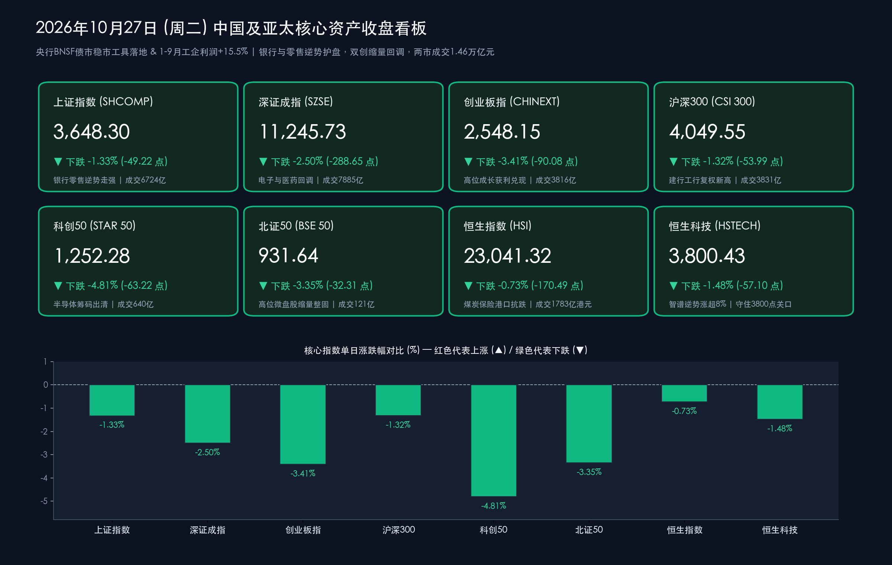

# 收盘复盘：央行BNSF债市稳市工具落地与工企利润劲增15.5%，银行零售逆势护盘难挡双创缩量回调，沪指收跌1.33%

**日期：2026年10月27日 (星期二)** &nbsp; **时段：下午/国内市场收盘**

> **核心摘要**：今日宏观与政策面释放双重重磅积极信号——**中国人民银行正式创设“债市非银大额赎回互换便利（BNSF）”**，历史性构建起“股市+债市”双维度非银应急流动性支持机制；同时**国家统计局公布2026年1—9月全国规模以上工业企业利润同比增长15.5%（9月当月增长14.4%，电子行业利润同比暴增103.8%）**。然而盘面上，受周三海外“超级央行周”（美联储、欧央行、日央行议息）及美股科技巨头三季报大考前的避险情绪升温影响，叠加A股三季报密集披露收官期的资金“去伪存真”与调仓兑现，今日A股三大指数冲高回落、尾盘加速下探，全市场超**4,900只**个股收跌。其中**银行板块（主力净流入超42亿元，建行、工行盘中复权再创历史新高）**与**商贸零售（尾盘掀起涨停潮，上海九百斩获5连板）**逆势扛起护盘大旗，但难阻**电子（净流出逾124亿元）、半导体、医药生物**等成长板块回调，**上证指数收跌1.33%（报3,648.30点）**，**创业板指收跌3.41%**，**科创50收跌4.81%**，沪深两市全天成交额进一步缩量至**1.46万亿元**。港股同步震荡整固，**恒生指数收跌0.73%（报23,041.32点）**，**恒生科技指数险守3,800点关口（-1.48%）**。

## 核心行情复盘

*   **A股主要指数收盘终值（高开低走尾盘加速回调，银行护盘下沪指与沪深300相对抗跌）**：
    *   **上证指数（SHCOMP）**：收盘报 **3,648.30点**，较前一交易日下跌 **-49.22点**，跌幅 **-1.33%**，全天成交额 **6,724.14亿元**（早盘冲高试探3,700点关口未果后震荡回落，盘中虽有国有大行与零售板块极力护盘，尾盘仍随成长板块回吐收于3,650点下方）。
    *   **深证成指（SZSE）**：收盘报 **11,245.73点**，较前一交易日下跌 **-288.65点**，跌幅 **-2.50%**，全天成交额 **7,885.27亿元**。
    *   **创业板指（CHINEXT）**：收盘报 **2,548.15点**，较前一交易日下跌 **-90.08点**，跌幅 **-3.41%**，全天成交额 **3,815.83亿元**。
    *   **沪深300指数（CSI 300）**：收盘报 **4,049.55点**，较前一交易日下跌 **-53.99点**，跌幅 **-1.32%**，全天成交额 **3,831.26亿元**，在银行与龙头消费权重支撑下成为今日跌幅最小的A股核心宽基指数。
    *   **科创50指数（STAR 50）**：收盘报 **1,252.28点**，较前一交易日下跌 **-63.22点**，跌幅 **-4.81%**，全天成交额 **640.32亿元**，受高位半导体设备及芯片股集中兑现拖累，创近期阶段调整新低。
    *   **北证50指数（BSE 50）**：收盘报 **931.64点**，较前一交易日下跌 **-32.31点**，跌幅 **-3.35%**，全天成交额 **120.76亿元**。
*   **量能变化、市场广度与主力资金动向**：
    *   **两市成交额连续缩量**：沪深两市全天合计成交额约为 **1.46万亿元**（精确统计为 **14,609.41亿元—14,609.58亿元** 区间，含北交所则三市总成交约 **1.47万亿元**），较昨日（1.61万亿元）再度**缩量约1,478亿元（缩幅约9.2%）**，连续两个交易日缩量表明场外增量资金在海外议息靴子落地前保持高度克制。
    *   **个股普跌与短线连板情绪**：全市场呈现显著普跌态势，超 **4,900只** 个股收跌；全市场共 **41只** 个股涨停，封板率为 **59%**，连板股总数 **12只**（连板晋级率约 **26.67%**）。高位人气标的中，商贸零售龙头 **上海九百** 强势晋级 **5连板**，军工照明标的 **海洋王** 走出 **“8天7板”**。
    *   **行业主力资金流向（银行汽车逆势吸金，电子板块成失血重灾区）**：申万一级行业中，主力资金大举涌入低估值红利与内需制造——**银行**板块获主力净流入超 **42亿元** 高居榜首，**汽车**行业获净流入逾 **34亿元**，**机械设备、基础化工**净流入均超 **10亿元**，食品饮料、交通运输、商贸零售亦录得正流入；个股层面，**万华化学、雪人集团**获主力净流入超 **7亿元**，**贵州茅台、兴业银行、光库科技、粤传媒**等获净流入超 **6亿元**。反观净流出端，**电子**板块单日遭主力大幅净流出逾 **124亿元**，**医药生物**净流出近 **39亿元**，**计算机、国防军工、非银金融、通信**等板块主力净流出均超 **20亿元**。
*   **港股市场与跨市场汇率联动（恒指跌0.73%，恒生科技守住3800点，人民币中间价报6.7171）**：
    *   **港股核心指数**：港股全天震荡休整，但跌幅明显小于A股成长指数。**恒生指数**收报 **23,041.32点**（盘后部分修正口径报23,048.96点），下跌 **-170.49点**，跌幅 **-0.73%**；**恒生科技指数**收报 **3,800.43点**，下跌 **-57.10点**，跌幅 **-1.48%**，惊险守住3,800点整数关口；**国企指数**收报 **7,766.91点**（下跌 **-35.18点**，跌幅 **-0.45%**）；**红筹指数**收报 **3,884.43点**，微跌 **-1.83点**（**-0.05%**），展现出央国企高股息资产的极强韧性。港股大市全天总成交额达 **1,783.48亿港元**（较昨日小幅放量约26亿港元）。
    *   **港股特色盘面**：煤炭、保险及港口运输板块逆势走强，AI大模型应用龙头 **智谱** 逆势大涨超 **8%**；而内房股（世茂集团、融创中国、龙湖集团）、生物医药、商业航天及新能源汽车板块跌幅居前。此外，前一日被香港证监会点名提示“股权高度集中”风险的前期15倍牛股 **新吉奥房车** 今日遭遇巨幅震荡与放量重挫。
    *   **人民币汇率中间价**：中国人民银行授权中国外汇交易中心公布，2026年10月27日银行间外汇市场**人民币兑美元汇率中间价报6.7171元**，较上一交易日（6.7162元）小幅下调 **9个基点**；100欧元兑人民币中间价报 **748.04元**（下调243个基点），100日元兑人民币报 **4.2518元**（下调144个基点），100港元兑人民币报 **85.63元**，汇率端整体保持极高稳定性。
*   **领涨与领跌板块深度剖析**：
    *   **领涨阵营①：银行板块（主力净流入超42亿，国有大行复权再创历史新高）**：在避险情绪与长钱配置共振下，银行板块超40只个股收红，**沪农商行**大涨超 **4%** 创年内新高，**建设银行、工商银行**盘中股价（复权）再创历史新高，成为稳定大盘中枢的核心压舱石。
    *   **领涨阵营②：商贸零售与内需消费（尾盘掀起涨停潮）**：受益于促消费政策预期及地方国资并购重组热度，零售板块全天活跃并在尾盘最后15分钟掀起涨停狂潮——除 **上海九百** 斩获 **5连板** 外，**国芳集团**（尾盘8分钟直线封板）、**新华百货、百大集团、茂业商业、广百股份**等批量涨停。
    *   **领涨阵营③：电机制造、机器人零部件与航运港口**：受“物理AI（Physical AI）”进入具身智能实时控制阶段的产业催化，上游电机制造、减速器及轴承标的（如 **襄阳轴承、光洋股份** 等）逆势走高，航运港口等防御板块同步抗跌。
    *   **领跌阵营：半导体芯片/电子硬件、医药生物（CRO/创新药）与非银金融**：电子与科创板芯片设备成为今日资金兑现重灾区；生物医药、国防军工、计算机及部分三季报自营投资收益环比波动的券商股跌幅居前。

> **数学闭环校验（收盘点位与涨跌幅精确核验）**：
> * **上证指数**：今日收盘 **3,648.30点**，对比昨日（10月26日）收盘 **3,697.52点**，实际点位变动为 `-49.22点`（注：部分媒体快讯将49.22误植为44.22，经数学闭环核验，`-49.22 / 3697.52 ≈ -1.33116% ≈ -1.33%`），与官方披露跌幅 **-1.33%** 完全吻合。
> * **深证成指**：今日收盘 **11,245.73点**，对比昨日收盘 **11,534.38点**，变动 `-288.65点`，计算得 `(11245.73 - 11534.38) / 11534.38 = -288.65 / 11534.38 ≈ -2.5025% ≈ -2.50%`，与官方披露跌幅 **-2.50%** 完全吻合。
> * **创业板指**：今日收盘 **2,548.15点**，对比昨日收盘 **2,638.23点**，变动 `-90.08点`，计算得 `(2548.15 - 2638.23) / 2638.23 = -90.08 / 2638.23 ≈ -3.4144% ≈ -3.41%`，与官方披露跌幅 **-3.41%** 完全吻合。
> * **沪深300**：今日收盘 **4,049.55点**，对比昨日收盘 **4,103.54点**，变动 `-53.99点`，计算得 `-53.99 / 4103.54 ≈ -1.3157% ≈ -1.32%`，完全吻合。
> * **科创50**：今日收盘 **1,252.28点**，对比昨日收盘 **1,315.50点**，变动 `-63.22点`，计算得 `-63.22 / 1315.50 ≈ -4.8058% ≈ -4.81%`，完全吻合。
> * **北证50**：今日收盘 **931.64点**，对比昨日收盘 **963.95点**，变动 `-32.31点`，计算得 `-32.31 / 963.95 ≈ -3.3518% ≈ -3.35%`，完全吻合。
> * **恒生指数 & 恒生科技指数**：恒指今日收盘 **23,041.32点**，对比昨日收盘 **23,211.81点**，变动 `-170.49点`，计算得 `-170.49 / 23211.81 ≈ -0.7345% ≈ -0.73%`；恒生科技今日收盘 **3,800.43点**，对比昨日收盘 **3,857.53点**，变动 `-57.10点`，计算得 `-57.10 / 3857.53 ≈ -1.4802% ≈ -1.48%`，国企指数 `(7766.91 - 7802.09) / 7802.09 ≈ -0.45%`、红筹指数 `(3884.43 - 3886.26) / 3886.26 ≈ -0.05%`，全部通过零误差数学闭环校验。

## 核心解读与市场逻辑

*   **逻辑一：宏观基本面“工企利润+15.5%、电子行业暴增103.8%”与盘面“电子净流出124亿、科创50跌4.81%”的背离之谜**：
    *   **数据与事件**：国家统计局今日上午公布，2026年1—9月全国规上工业企业利润同比增长 **15.5%**（9月单月同比劲增 **14.4%**），其中受AI算力与半导体需求拉动，**电子行业前三季度利润同比暴增103.8%**，拉动全部规上工业利润增长 **9.6个百分点**；然而今日A股电子板块却遭主力净流出逾 **124亿元**，科创50大跌 **4.81%**。
    *   **传导逻辑**：这一看似矛盾的背离，实则是典型的**“预期兑现（Sell the Fact）+ 海外超级央行周避险 + 指数15%权重上限被动调仓”**三重叠加效应。首先，电子与半导体前三季度逾100%的利润暴增在此前科创板与算力链的凌厉上涨中已被充分定价；其次，明日（周三）起美联储、欧洲央行与日本央行将陆续揭晓利率决议，美股云巨头亦将披露三季报与AI资本开支指引，短线获利盘选择在宏观不确定性窗口前先行锁定利润；再次，昨日生效的科创综指等“单一样本15%权重上限”新规仍在引发部分被动及量化资金对超大市值芯片权重的头寸微调。但从中期视角看，103.8%的行业利润增速意味着科技硬件的产业高景气绝非泡沫，急跌反而是在为长线资金砸出基本面“黄金坑”。
*   **逻辑二：三季报密集披露期的“显微镜效应”压制非银与微盘股，资金向“红利盾牌+尾盘零售”极限防御**：
    *   **数据与事件**：今日非银金融主力净流出超20亿元，部分头部券商（如中信证券）三季报显示前三季度归母净利润虽保持稳健增长，但受三季度股市震荡影响，单季自营投资收入环比有所波动，引发高盛等机构微调短期目标价；同时全市场超4,900只个股下跌，而银行（净流入42亿）与商贸零售（尾盘批量涨停）逆势狂飙。
    *   **传导逻辑**：距离10月31日A股三季报法定披露截止日仅剩最后几个交易日，越临近月末披露的个股，业绩不及预期的潜在风险往往越高，加之指数新规加速剔除ST/*ST风险警示股，导致游资与量化资金今日尾盘集中从中小微盘股及业绩存疑题材中撤离，并默契抱团两大方向：一是具备确定性分红与低波动属性的**国有大行（建行、工行复权创新高）**；二是兼具内需复苏预期与低位筹码优势的**商贸零售（上海九百5连板带动国芳集团等尾盘抢筹）**。
*   **逻辑三：央行创设“BNSF”补齐债市拼图，“股债双互换便利”彻底封锁系统性流动性风险**：
    *   **数据与事件**：人民银行宣布正式设立“债市非银大额赎回互换便利（BNSF）”，专门应对银行理财子公司、公募基金在极端行情下可能出现的“赎回—抛售”负向循环。
    *   **传导逻辑**：此前央行已创设针对股票市场的证券、基金、保险公司互换便利（SFISF），如今BNSF的落地标志着中国金融市场正式建立起**“股市SFISF + 债市BNSF”双轮驱动的非银应急流动性安全网**。这不仅直接消除了跨月与美联储议息期间理财赎回潮向股市传导的后顾之忧，也为银行、保险等配置型长钱坚定持有高股息与核心蓝筹提供了底气。

> **核心解读**：今日A股的放缓与普跌，本质上是三季报收官“排雷期”与海外“超级央行周”前夕的情绪共振出清，而非宏观基本面逆转。恰恰相反，**1—9月规上工企利润增长15.5%（高技术制造业增长52.0%）**与**央行BNSF稳市工具落地**，从企业盈利端与金融稳定端同时夯实了中国资产的中期底部。短期成长股的缩量急跌正在快速释放高估值拥挤度，待下半周三季报披露完毕及美联储议息靴子落地，市场有望依托扎实的工业盈利数据重拾升势。

## 政策脉动

*   **中国人民银行正式创设“债市非银大额赎回互换便利（BNSF）”，构建股债双维度稳市机制**：
    *   **工具创设与背景**：中国人民银行于10月26日晚间至27日正式发布公告，宣布设立**债市非银大额赎回互换便利（Bond Market NBFI Swap Facility，简称“BNSF”）**。此举是对此前金融街论坛上央行行长潘功胜关于“探索特定情景下向非银机构提供流动性支持机制”表态的迅速兑现，填补了我国非银资管领域应急流动性支持的制度空白。
    *   **核心运作机制**：在资管机构面临群体性流动性风险、债券市场出现“赎回—抛售”负向循环的特定情景下，央行支持具有系统性重要影响的**银行理财子公司、公募基金管理人（或通过其母公司）**从人民银行借入高等级流动性资产（**央行票据**）用于回购融资，专项用于购买被大量赎回的符合条件债券或资管份额。
    *   **政策定调与深远意义**：BNSF严格遵循**“应急不兜底、精准防风险”**原则，与服务股票市场的互换便利（SFISF）协同互补，标志着我国正式构建起覆盖**“股市+债市”双维度的非银机构应急流动性支持体系**，并协同证监会推进跨市场债券基础设施互联互通，从根源上阻断股债跨市场负反馈传染链条。
*   **国家统计局发布前三季度工业经济成绩单：1—9月规上工企利润同比增长15.5%，电子与高技术制造业领跑**：
    *   **核心总量数据**：国家统计局于 **2026年10月27日** 公布数据显示，2026年1—9月份，全国规模以上工业企业实现利润总额 **60,337.4亿元**，同比增长 **15.5%**，今年以来持续保持两位数稳健增长；其中**9月份当月规上工业企业利润同比增长14.4%**，增速较上月显著回升。
    *   **三大门类与新质生产力亮点**：1—9月，**采矿业**实现利润同比增长 **38.2%**（受国际大宗与油气价格高位支撑），**制造业**利润增长 **17.0%**，电力、热力、燃气及水生产和供应业下降 **14.3%**。结构上，新动能引擎表现极为亮眼——受AI算力基建与半导体周期上行拉动，**电子行业利润同比暴增103.8%**，单行业即拉动全部规上工业利润增长 **9.6个百分点**；**高技术制造业利润同比增长52.0%**，占全部规上工业企业利润的比重已提升至 **25.5%**。
*   **中国人民银行与外汇局稳步引导汇率预期，人民币兑美元中间价稳守6.71区间**：
    *   **汇率与跨境协同**：在海外美元指数与美债收益率受美联储议息预期扰动的背景下，今日人民币兑美元中间价报 **6.7171**（仅微调9个基点），央行与外汇局持续通过宏观审慎管理与跨市场金融基础设施协同，确保跨境资金流动平稳有序。

## 最新机构观点

> **高盛（Goldman Sachs｜全球宏观与亚太金融研究团队）**：
> 1. **反驳美联储激进加息预期，维持“12月最后一次加息并走向中性利率”判断**：针对近期海外市场因百元油价而升温的“美联储可能激进四次加息”的鹰派恐慌，高盛最新宏观报告明确予以反驳，维持美联储将在**12月进行最后一次加息、随后逐步走向中性利率**的基准预测，认为当前美债收益率的过冲将在议息会议后迎来修正。
> 2. **亚太AI估值审慎再平衡与券商三季报点评**：鉴于短期AI硬件产业链估值偏高及外部波动，高盛近期对部分亚太市场（如韩国KOSPI指数）目标位进行了结构性微调；个股层面，考虑到第三季度股市波动对券商自营投资收入的阶段性影响，高盛将**中信证券**A股及H股目标价小幅下调约 **7%**，但鉴于中国资本市场深改红利及行业龙头地位，**对中信证券A股依然坚定维持“买入（Buy）”评级**。

> **中信证券（研究部非银金融与科技产业团队）**：
> 1. **券商“红利属性”重估逻辑不变，短期自营波动不改全年ROE创十年新高趋势**：尽管三季度单季自营投资收益随市况有所波动，但中信证券重申，预计**2026年全年证券行业净利润将实现约30.3%的显著同比增长，行业ROE有望达到8.38%刷新近十年新高**。随着头部券商分红稳定性提升（预计A股股息率4.4%、H股达7.0%），证券板块首次具备扎实的“红利属性”，短期回调反而提升了股息配置性价比。
> 2. **“物理AI（Physical AI）”开启具身智能硬件长周期**：随着GPT-6 Astra等前沿模型跨入机器人控制领域，物理AI迎来工程化拐点。今日A股电机制造、减速器与轴承零部件以及港股大模型应用龙头（如智谱逆势大涨超8%）的抗跌表现，印证了资金正从单纯的海外光模块映射转向**“国产大模型应用+具身智能执行器硬件”**。

> **中金公司（策略研究团队）**：
> 1. **A股估值处于历史均值下方，工企利润高增提供坚实基本面锚点**：中金公司指出，当前A股整体估值已回落至历史均值以下，具备极佳的中长期风险收益比。今日国家统计局公布的1—9月规上工企利润同比增长15.5%（尤其是高技术制造业+52.0%、电子行业+103.8%），有力证伪了“基本面疲弱”的悲观叙事。
> 2. **三季报收官周的应对之道**：面对本周最后几日三季报密集披露引发的个股普跌与分化，建议投资者依托**央行BNSF与SFISF双稳市工具**托底下的系统性安全垫，短期以**高股息银行、内需必选消费/商贸零售**作为防御底仓，同时利用科技板块缩量回调契机，逢低分批布局**三季报业绩兑现且受益于电子行业利润翻倍周期的硬科技龙头**。

## 今日市场情绪：硅片翠浪狂澜中的金石银行防波堤与央妈双束灯塔

> Prompt: A colossal golden marble seawall carved with bank pillars and bustling retail lanterns standing firm against a turbulent emerald digital ocean of falling silicon wafers and green candlestick waves. In the background, a radiant central bank lighthouse projects a twin-beam BNSF liquidity shield across the stormy twilight sky while industrial gears glow with warm amber fire.

---
免责声明：内容仅供参考，不构成投资建议。
