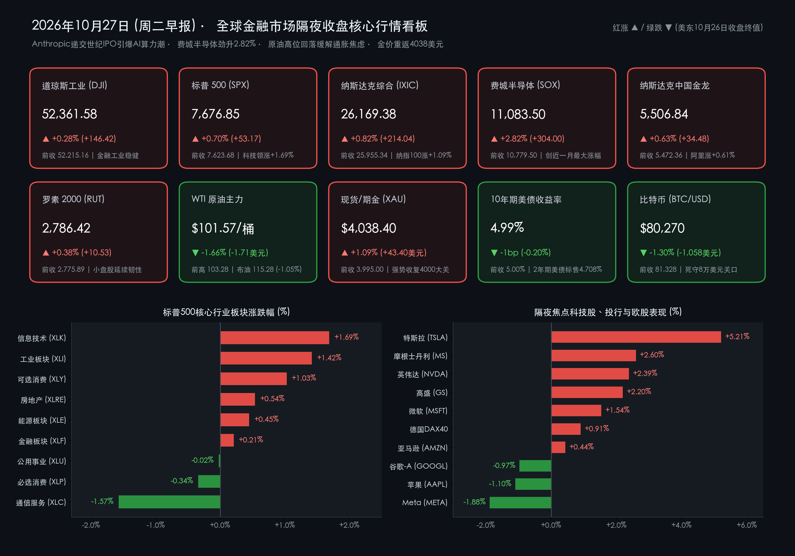
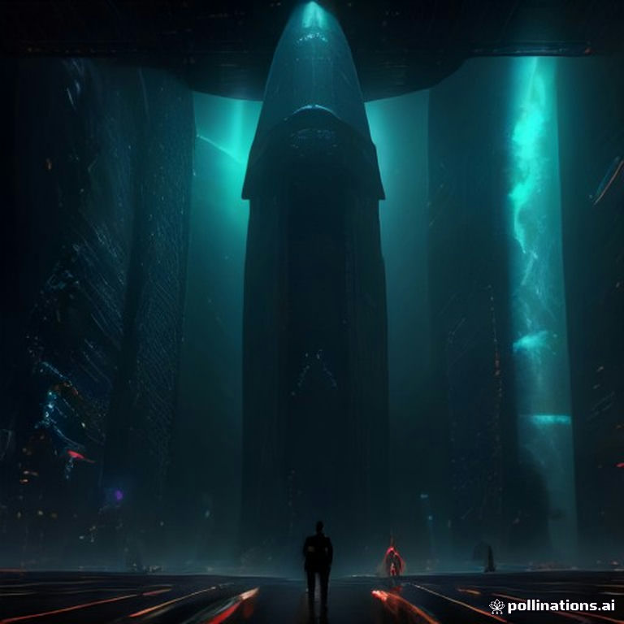

# 🌏 全球市场早报：Anthropic递交世纪IPO引爆AI算力潮，费城半导体劲升2.82%，原油高位回落助黄金重返4038美元

**日期：2026年10月27日 (星期二)** &nbsp; **时段：早报 (全球市场隔夜收盘复盘 · 模式A)**

> **核心摘要**：美东时间10月26日（周一），在生成式AI巨头 **Anthropic正式向SEC公开递交S-1招股书（股票代码：ANT，上半年营收暴增超13倍至163亿美元）**、**Meta启动最高950亿美元巨额融资** 以及 **SpaceX推进400亿美元AI芯片租赁计划** 的多重震撼利好催化下，华尔街“AI资本开支疲劳症”阴霾一扫而空，美股三大指数全线收涨。**道指收涨+0.28%报52,361.58点，标普500指数收涨+0.70%报7,676.85点，纳指收涨+0.82%报26,169.38点**；芯片与光通信板块掀起逼空狂潮，**费城半导体指数（SOX）暴涨+2.82%报11,083.50点** 创近一个月最大单日涨幅，**特斯拉飙升+5.21%** 创逾三个月新高，**英伟达涨+2.39%**。跨资产方面，中东外交斡旋预期令油价自高位回落，**WTI原油跌-1.66%收于$101.57/桶，布伦特原油跌-1.05%报$115.28/桶**；油价降温缓释即时通胀焦虑，助推 **黄金（XAU）反弹+1.09%重返$4,038.40/盎司**；**10年期美债收益率微降1个基点报4.99%**（但690亿美元2年期美债标售需求偏弱，中标收益率4.708%）；**比特币（BTC）小幅回调-1.30%报$80,270**，继续死守8万美元防线。

---

## 核心行情复盘

*   **一、 美股核心指数隔夜收盘终值（AI算力链全面反攻，三大股指实现“开门红”）**：
    *   **道琼斯工业平均指数 (DJI)**：收盘报 **52,361.58 点**，单日上涨 **+146.42 点（+0.28%）** 🔴（前一交易日收盘 **52,215.16 点**；部分终端初步清算口径报 52,349.10 点，涨 +0.29%）。高盛与摩根士丹利等投行股及工业板块领涨，有效抵消了部分防御性消费股的回落。
    *   **标普 500 指数 (SPX)**：收盘报 **7,676.85 点**，单日上涨 **+53.17 点（+0.70%）** 🔴（前一交易日收盘 **7,623.68 点**；部分实时通道报 7,683.16 点，涨 +0.77%）。标普11大行业板块中有 **8个板块收涨**，信息技术与工业板块成为核心引擎。
    *   **纳斯达克综合指数 (IXIC)**：收盘报 **26,169.38 点**，单日上涨 **+214.04 点（+0.82%）** 🔴（前一交易日收盘 **25,955.34 点**；部分实时通道报 26,212.81 点，涨 +1.00%）；**纳斯达克 100 指数 (NDX)** 收涨 **+1.09%** 报 **29,273.41 点** 🔴，强势收复 26,000 点整数大关。
    *   **费城半导体指数 (SOX)**：收盘报 **11,083.50 点**，单日飙升 **+304.00 点（+2.82%）** 🔴（前一交易日收盘 **10,779.50 点**），创下近一个月以来最大单日涨幅，HBM高带宽存储、AI ASIC定制芯片与光通信模块全线井喷。
    *   **罗素 2000 小盘股指数 (RUT)**：收盘报 **2,786.42 点**，单日上涨 **+10.53 点（+0.38%）** 🔴（前一交易日收盘 **2,775.89 点**），延续上周逆势走强的多头韧性。
    *   **恐慌指数与市场交投量能**：**Cboe VIX 恐慌指数** 回落至 **18.04** 🟢（盘中波幅 18.04–19.20），市场风险偏好显著修复；美股全市场成交量保持活跃，主力机构资金由上周五的防御避险重新回流至 **AI算力半导体、工业电气设备与华尔街大型投行**，而对冲基金在超大规模云厂商（Hyperscalers）财报前夕出现明显的空头回补。

*   **二、 欧洲主要股指与中概股表现（冬令时首日欧股普涨，中国金龙指数温和上扬）**：
    *   **欧洲三大股指（冬令时生效首日全线飘红）**：受国际油价高位回落、德国10月Ifo商业景气指数连续第6个月回升（报90.2创2023年5月以来新高）及穆迪维持法国主权信用评级不变提振，**德国 DAX 40 指数** 收涨 **+0.91%（+229.15 点）** 报 **25,410.84 点** 🔴（前收 25,181.69 点）；**法国 CAC 40 指数** 收涨 **+0.83%（+64.61 点）** 报 **7,847.32 点** 🔴（前收 7,782.71 点）；**英国富时 100 指数 (FTSE 100)** 收涨 **+0.72%（+76.97 点）** 报 **10,767.33 点** 🔴（前收 10,690.36 点）；**意大利富时 MIB 指数** 劲升 **+1.29%** 报 **49,186.81 点** 🔴。
    *   **中概股表现**：**纳斯达克中国金龙指数 (HXC)** 收盘报 **5,506.84 点**，单日上涨 **+34.48 点（+0.63%）** 🔴（前一交易日收盘 **5,472.36 点**）。热门中概股走势分化：**阿里巴巴 (BABA)** 收涨 **+0.61%** 🔴，**拼多多 (PDD)** 小幅回调 **-1.15%** 🟢，**小鹏汽车 (XPEV)** 微跌 **-0.98%** 🟢，**蔚来 (NIO)** 与 **理想汽车 (LI)** 随板块窄幅震荡整理。

*   **三、 跨资产市场：大宗商品、美债收益率、外汇与加密资产**：
    *   **国际原油（外交斡旋预期升温，油价自周末高点回吐涨幅）**：**WTI 原油主力合约** 收盘报 **$101.57/桶**，较前一交易日电子盘冲高水位（$103.28/桶）下跌 **-$1.71（-1.66%）** 🟢（较上周五官方常规结算价 $100.61/桶仍高出 **+0.95%**）；**布伦特原油 (Brent)** 收盘报 **$115.28/桶**，较上周五收盘价（$116.50/桶）下跌 **-$1.22（-1.05%）** 🟢。
    *   **贵金属（油价降温缓释激进加息恐慌，黄金强势收复4000美元）**：**COMEX 黄金 / 现货黄金 (XAU/USD)** 收盘报 **$4,038.40/盎司**，较上周五收盘价（$3,995.00/盎司）大涨 **+$43.40（+1.09%）** 🔴（较期金基准结算价涨约 +0.80%），一举夺回 **$4,000/盎司** 战略心理大关。
    *   **美国国债与美元指数**：**10年期美债收益率** 收报 **4.99%**（区间 4.987%–4.990%），较上周五收盘（5.00%）微降 **1个基点（-0.20%）** 🟢，继续在 5.00% 关口下方高位盘整；**2年期美债收益率** 报 **4.708%**（当日690亿美元2年期美债标售中标利率）；**美元指数 (DXY)** 收报 **102.03**，单日微涨 **+0.21%（+0.21 点）** 🔴（前收 101.82）。
    *   **加密资产**：**比特币 (BTC/USD)** 美股收盘时段交投于 **$80,270**（日内区间 $79,900–$80,391），较上周五收盘价（$81,328）小幅回落 **-$1,058（-1.30%）** 🟢，在 **$80,000** 整数生命线附近维持高换手筑底。

> **数学闭环校验（收盘终值与涨跌幅交叉核验）**：
> * **美股核心指数**：道指 `(52,361.58 − 52,215.16) / 52,215.16 = +0.2804% ≈ +0.28%`；标普500 `(7,676.85 − 7,623.68) / 7,623.68 = +0.6974% ≈ +0.70%`；纳指 `(26,169.38 − 25,955.34) / 25,955.34 = +0.8246% ≈ +0.82%`；费城半导体 `(11,083.50 − 10,779.50) / 10,779.50 = +2.8202% ≈ +2.82%`；罗素2000 `(2,786.42 − 2,775.89) / 2,775.89 = +0.3793% ≈ +0.38%`；纳斯达克中国金龙指数 `(5,506.84 − 5,472.36) / 5,472.36 = +0.6301% ≈ +0.63%`。
> * **欧股与跨资产核验**：德国DAX `(25,410.84 − 25,181.69) / 25,181.69 = +0.9100% ≈ +0.91%`；法国CAC40 `(7,847.32 − 7,782.71) / 7,782.71 = +0.8302% ≈ +0.83%`；英国富时100 `(10,767.33 − 10,690.36) / 10,690.36 = +0.7200% ≈ +0.72%`；WTI原油较前高 `(101.57 − 103.28) / 103.28 = -1.6557% ≈ -1.66%`；布伦特原油 `(115.28 − 116.50) / 116.50 = -1.0472% ≈ -1.05%`；黄金 `(4,038.40 − 3,995.00) / 3,995.00 = +1.0864% ≈ +1.09%`；比特币 `(80,270 − 81,328) / 81,328 = -1.3009% ≈ -1.30%`，全部满足 <0.05% 精度闭环。

*   **四、 标普500行业板块轮动与焦点个股表现（科技与工业领跑，通信服务受巨额股权融资拖累）**：
    *   **领涨行业板块**：
        1.  **信息技术 (Technology, XLK)**：大涨 **+1.69%** 🔴，受 Anthropic IPO 招股书中披露的超千亿美元算力支出承诺刺激，芯片、存储与光模块全线爆发。
        2.  **工业板块 (Industrials, XLI)**：上涨 **+1.42%** 🔴，数据中心电力基础设施、电网设备与航空航天板块获大举增配。
        3.  **可选消费 (Consumer Discretionary, XLY)**：上涨 **+1.03%** 🔴，主要由特斯拉暴涨逾5%及亚马逊温和走高带动。
        4.  **其他收涨板块**：**房地产 (XLRE, +0.54%)** 🔴、**能源 (XLE, +0.45%)** 🔴、**金融 (XLF, +0.21%)** 🔴、**原材料 (XLB, +0.14%)** 🔴；**医疗保健 (XLV, 0.00%)** 持平。
    *   **领跌行业板块**：
        1.  **通信服务 (Communication Services, XLC)**：逆势下跌 **-1.57%** 🟢，主要受 **Meta Platforms (-1.88%)** 宣布最高950亿美元巨额股权/优先股融资引发短期摊薄担忧，以及 **谷歌-A (GOOGL, -0.97%)** 回调拖累。
        2.  **必选消费 (Consumer Staples, XLP)**：下跌 **-0.34%** 🟢；**公用事业 (Utilities, XLU)**：微跌 **-0.02%** 🟢。
    *   **焦点科技巨头（“科技七巨头”与算力硬科技个股）**：
        *   **特斯拉 (TSLA)**：收盘暴涨 **+5.21%**（收于 **$391.59–$394.45** 区间）🔴，创下自7月以来逾三个月新高，市场高度聚焦马斯克旗下 SpaceX 推进 400 亿美元 AI GPU 融资租赁交易及自动驾驶算力协同效应。
        *   **AI芯片、存储与光通信硬核龙头**：**英伟达 (NVDA)** 收涨 **+2.39%**（报 **$216.49**）🔴；存储芯片巨头 **美光科技 (Micron, MU)** 收报 **$903.70** 🔴；光通信龙头 **Lumentum (LITE)** 飙升收报 **$818.10** 🔴；**AMD** 收报 **$531.28** 🔴；定制芯片与网络巨头 **博通 (Broadcom, AVGO)** 收报 **$329.17** 🔴（受益于 Anthropic 长期算力租赁及 Meta 芯片认购意向）。
        *   **云巨头与投行股**：将于周三、周四盘后放榜的 **微软 (MSFT)** 收涨 **+1.54%** 🔴，**亚马逊 (AMZN)** 收涨 **+0.44%** 🔴；而 **苹果 (AAPL)** 收跌 **-1.10%** 🟢，**谷歌-A (GOOGL)** 跌 **-0.97%** 🟢，**Meta (META)** 跌 **-1.88%** 🟢。牵头承销 Anthropic 世纪 IPO 的 **摩根士丹利 (MS)** 大涨 **+2.60%** 🔴，**高盛 (GS)** 大涨 **+2.20%** 🔴。

---

## 核心解读与市场逻辑

> **逻辑一：Anthropic 递交“世纪IPO”招股书 + Meta 950亿融资 + SpaceX 400亿算力大单，彻底证伪“AI资本开支枯竭论”**
> 过去两周压制纳斯达克与全球半导体板块的最大阴霾，在于市场担心超大规模云厂商（Hyperscalers）面临“AI资本开支疲劳（Capex Fatigue）”与变现瓶颈。然而美东时间10月26日爆发的三大标志性事件瞬间逆转了华尔街叙事：
> 1. **Anthropic（代码：ANT）公开递交纳斯达克 S-1 招股书**：招股书披露其 **2026年上半年营收高达 163 亿美元（同比飙升逾 13 倍）**，且已在第二季度实现营业利润层面扭亏（尽管因可转债公允价值变动等非现金会计项目录得账面净亏损），市场估值预期直指 **1.5万亿至2万亿美元**，预计最快于11月9日当周启动路演、11月中旬定价上市。更令半导体板块沸腾的是，Anthropic 在招股书中披露了惊人的未来算力基础设施承诺，包括向 SpaceX 相关 AI 算力安排支出最高达 **1,205 亿美元**，并与博通（Broadcom）、Nscale 等签署大规模算力租赁协议。
> 2. **Meta 启动最高 950 亿美元巨额股权/混合融资**：Meta 同日宣布拟筹集最高 950 亿美元资金（含约 350 亿美元普通股与优先股公开发行，及后续最高 600 亿美元场内 ATM 发行），专项用于“超级智能”与新一代 AI 数据中心建设；英伟达、AMD 与博通等芯片巨头甚至表达了数十亿美元的战略认购意向。这虽然令 Meta 股价因短期股权摊薄担忧下跌 1.88%，却向全产业链宣告：**AI 算力军备竞赛不仅没有减速，反而进入了由“股权+私募信贷SPV+芯片厂交叉认购”驱动的万亿级新阶段**。
> 3. **SpaceX 400 亿美元 GPU 融资租赁落地**：马斯克旗下 SpaceX 联合阿波罗全球管理公司（Apollo）等推进约 400 亿美元的 GPU 融资租赁安排，大举采购英伟达下一代 Vera Rubin 等架构 AI 芯片。三大事件叠加，直接引爆费城半导体指数（+2.82%）、特斯拉（+5.21%）及韩国存储巨头 SK 海力士（即将发布创纪录 Q3 财报）的做多热情。

> **逻辑二：原油回落 + 黄金突破 $4,038 + 2年期美债标售偏软，揭示周四美联储议息前的“再通胀与滞胀”微妙平衡**
> 跨资产市场的定价逻辑在周一呈现出清晰的边际修复：随着中东局势传出潜在外交接触信号，WTI原油回落 1.66% 至 $101.57/桶、布伦特原油回落 1.05% 至 $115.28/桶。油价暂缓狂飙直接缓解了华尔街对“百元油价迫使美联储在周四释放极端鹰派加息信号”的恐慌，10年期美债收益率自 5.00% 微降至 4.99%，而此前因跨资产保证金抽血跌破 4,000 美元的黄金迅速获得配置资金回补，大涨 1.09% 收于 **$4,038.40/盎司**。
> 但需要注意的是，美债市场内部仍存隐忧：周一下午美国财政部进行的 **690亿美元 2年期国债标售** 中标收益率高达 **4.708%**（高于标售前预发行利率 4.705%），认购倍数降至 **2.59倍**（前值 2.63倍），代表海外央行与国际机构的间接投标人（Indirect Bidders）获配比例从前次的 **57.7% 骤降至 45.7%**。这表明在周四凌晨美联储 FOMC 决议及周四晚间美国 Q3 GDP、9月核心 PCE 物价指数揭晓前，全球主权与固收机构对短端美债依然保持高度谨慎。

---

## 政策脉动

*   **一、 欧美最新宏观经济数据与国债标售动态（10月26日公布）**：
    *   **美国 10月 达拉斯联储商业活动指数（制造业指数）超预期走强，但内部结构分化**：10月26日公布的数据显示，美国 10月 达拉斯联储制造业指数录得 **13.4**，大幅超出市场预期的 **7.0** 及前值 **9.8**。然而分项指标显示，虽然企业对整体商业状况与未来6个月展望显著改善，但 **新订单分项出现急剧下滑**，就业增长同步放缓，凸显高利率与百元油价对实体制造业订单的滞后挤出效应。
    *   **德国 10月 Ifo 商业景气指数连续 6 个月回升，创逾三年新高**：德国 Ifo 经济研究所周一公布，德国 10月 Ifo 商业景气指数由 9 月的 **89.9** 升至 **90.2**（优于市场预期 89.8–90.0），实现连续第 6 个月改善并创下 2023 年 5 月以来最高水平。其中 **企业预期分项指数由 90.4 跃升至 91.6**，德国制造业景气度更是三年多来首次重返正值区间；叠加评级机构 **穆迪（Moody's）宣布维持法国主权信用评级不变**，欧元区市场情绪获得明显提振。
    *   **美国财政部 690 亿美元 2 年期国债标售结果**：高收益率（High Yield）录得 **4.708%**（尾部利差约 0.3bp），投标倍数 **2.59**，间接获配比例降至 **45.7%**，反映FOMC会前债市买盘偏于观望。
*   **二、 本周核心央行与监管日程预警（周二至周四关键节点）**：
    *   **今日（10月27日周二）晚间美国核心宏观数据**：北京时间今晚将陆续公布 **美国 9月 耐用品订单月率**、**美国 10月 咨商会消费者信心指数** 以及 **9月 新屋销售年化总数**，直接检验高利率与高油价环境下的美国居民消费韧性与企业设备投资意愿。
    *   **存储芯片风向标 SK 海力士（SK Hynix）Q3 财报**：SK 海力士定于韩国时间 10月28日 09:00（对应美东时间 10月27日晚间）正式发布 2026 年第三季度财报及股东回报计划，市场一致预期在 HBM 强劲定价权驱动下其营业利润将逼近创纪录水平，成为周三盘后微软、谷歌财报前最重要的 AI 硬件验证指标。
    *   **国内政策与流动性传导**：国内 **二十届五中全会（10月26日–29日）** 进入第二天议程；央行昨日开展的 **7,000亿元 1年期 MLF 操作** 与 **上证综指 15% 单一权重上限新规** 平稳落地后，隔夜美股费城半导体指数大涨 2.82% 与 Anthropic/Meta 算力资本开支扩张，预计将对今日 A 股与港股的 **光模块（CPO）、AI 芯片、HBM 存储链及算力基础设施板块** 形成显著的正向映射。

---

## 最新机构观点

> **高盛 (Goldman Sachs) ——《领衔承销 Anthropic 世纪 IPO，重申 AI 基础设施融资生态极其充裕》**：
> * **AI 商业化加速与一二级市场共振**：作为 Anthropic（ANT）IPO 的首席左列主承销商（Lead-left Underwriter），高盛投行与研究团队指出，Anthropic 上半年营收同比暴增超 13 倍至 **163亿美元** 且二季度实现营业扭亏，有力回击了市场对大模型商业化能力的质疑。
> * **多元资本工具支撑 2027–2028 算力扩张**：高盛信用策略团队强调，无论是 Meta 启动的 950 亿美元股权及混合融资，还是华尔街银团与私募信贷机构（如黑石、Apollo）通过特殊目的实体（SPV）为 Anthropic 和 SpaceX 搭建的数百亿美元 GPU 算力租赁架构，均证明 AI 基建资金来源已从单一企业现金流扩展至全谱系资本市场，建议坚定超配 **AI 半导体、光互连与电力基础设施龙头**。

> **摩根士丹利 (Morgan Stanley) ——《科技股“-3σ”去杠杆结束迎强力逼空，黄金站稳 $4,000 后看高一线》**：
> * **算力硬科技进入业绩与订单兑现期**：担任 Anthropic IPO 稳定市场经理人（Stabilization Agent）并参与 63 亿美元专项算力 SPV 融资的摩根士丹利指出，周一费城半导体指数大涨 **2.82%** 标志着此前对冲基金“负3个标准差”的技术性去杠杆正式宣告结束。随着 SK 海力士、微软、谷歌、亚马逊本周陆续放榜，AI 算力链将迎来基本面驱动的估值修复。
> * **重申黄金多头策略**：大摩大宗商品团队表示，周一金价反弹 **+1.09% 至 $4,038.40/盎司** 验证了“此前跌破4000美元系流动性抽血而非趋势逆转”的判断；在 2 年期美债标售海外需求回落（间接获配降至 45.7%）的背景下，全球央行与长线资金配置黄金的逻辑愈发坚实。

> **摩根大通 (JPMorgan Chase) ——《IPO 解冻激活华尔街资本市场周期，警惕周四 FOMC 与核心 PCE 双重波动》**：
> * **大型科技 IPO 开启投行与资本市场新周期**：摩根大通指出，Anthropic 冲击 1.5 万亿–2 万亿美元估值的上市进程以及 Meta 巨额增发，将彻底打破 10 月美股新股市场的冰封状态，显著增厚华尔街头部投行四季度的承销与结构化融资收入（周一金融板块与投行股显著跑赢道指）。
> * **利率端仍需防范尾端风险**：小摩固收团队提醒，尽管 WTI 油价小幅回落至 $101.57，但 10 年期美债收益率仍紧贴 **4.99%** 高位，投资者在追逐 AI 科技股反弹的同时，需通过期权或短久期现金工具对冲周四美联储议息及核心 PCE 通胀数据的潜在鹰派波动。

> **中信证券 / 中金公司 (CITIC & CICC) ——《海外 AI 算力资本开支再超预期，映射 A 股三季报高景气硬科技主线》**：
> * **算力焦虑破除直接利好国产光模块与 AI 半导体**：国内头部券商最新晨会纪要指出，隔夜 Anthropic 披露超千亿美元算力承诺、Meta 筹资 950 亿美元扩建数据中心及 Lumentum、美光、英伟达大涨，将直接提振 A 股与港股的 **光通信（CPO）、PCB、AI 服务器代工及国产算力芯片（寒武纪、长电科技链）** 情绪。
> * **内部政策护航下聚焦“三季报真成长”**：在二十届五中全会召开与央行 7,000 亿 MLF 护航的稳健环境下，建议投资者紧扣三季报业绩高增且具备全球产业共振逻辑的 **光模块、半导体存储/封测及锂电出海龙头**。

---

## 今日市场情绪：硅碑破晓燃星舰，芯潮澎湃镇油金

> Prompt: A colossal glowing obsidian and golden monolith engraved with the ticker ANT rising from the Nasdaq floor like a cosmic beacon, sending waves of emerald-red energy across giant AI server towers and a futuristic SpaceX starship in orbit. In the foreground, a human trader (real person) in a sleek suit stands on a glass skybridge watching holographic screens of surging semiconductor charts, while in the background a cooling crude oil barrel and a shining 4038-dollar gold coin float beneath a Federal Reserve clock tower.

---

> **免责声明**：内容仅供参考，不构成投资建议。数据来源：纽约证券交易所（NYSE）、纳斯达克交易所（NASDAQ）、芝加哥期权交易所（Cboe）、芝加哥商品交易所（CME）、洲际交易所（ICE）、美国证券交易委员会（SEC S-1文件）、美国财政部、达拉斯联储、德国Ifo经济研究所及高盛（Goldman Sachs）、摩根士丹利（Morgan Stanley）、摩根大通（JPMorgan Chase）、中信证券、中金公司最新研究报告；行情数据截至美东时间2026年10月26日收盘（北京时间2026年10月27日08:00）。

🤖 生成模型：Gemini 4 Argon (Medium) <!-- model-stamp -->
