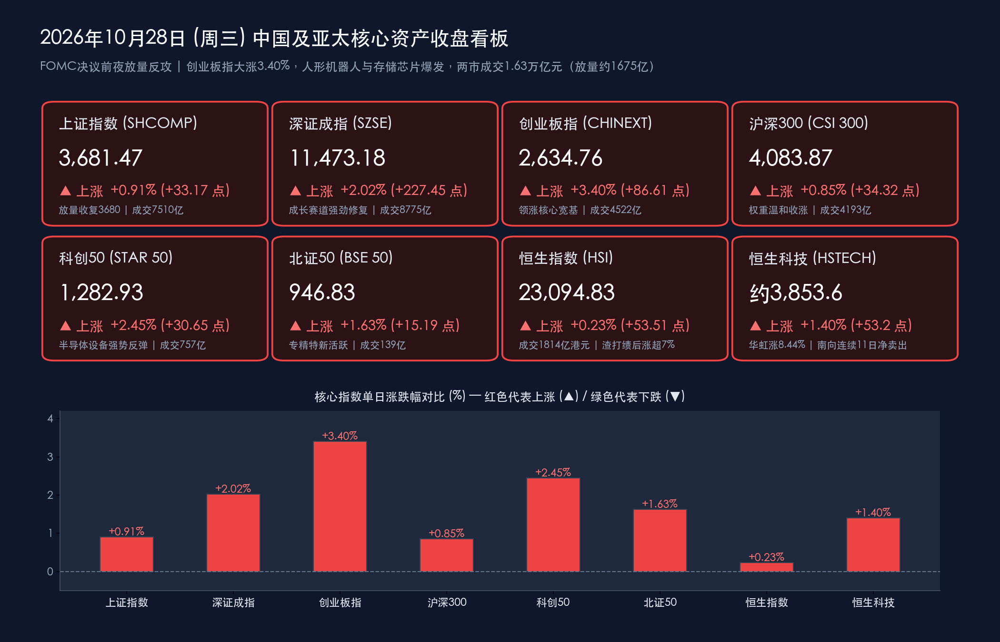

# 收盘复盘：FOMC决议前夜A股放量反攻，人形机器人与存储芯片双线爆发，创业板指大涨3.40%收复2600点

**日期：2026年10月28日 (星期三)** &nbsp; **时段：下午/国内市场收盘**

> **核心摘要**：在美联储FOMC利率决议揭晓前夜（北京时间10月29日凌晨公布，市场预期90.6%概率按兵不动于3.75%—4.00%区间），A股三大指数高开高走、午后延续强势，走出酣畅淋漓的放量反攻行情——**创业板指大涨3.40%收报2,634.76点**，**深证成指涨2.02%**，**科创50涨2.45%**，**上证指数收涨0.91%报3,681.47点**；沪深两市成交额重回**1.63万亿元**（较昨日放量约1,675亿元），全市场超**4,100只**个股上涨，主力资金全天大幅**净流入243.34亿元**。盘面上**人形机器人概念全面爆发**（襄阳轴承斩获5连板）、**存储芯片与CPO概念**集体狂飙（中际旭创涨超10%），PCB产业链三季报业绩浪延续；而白酒、证券、保险、银行等前期防御板块逆势走弱。港股同步收涨，**恒生指数涨0.23%报23,094.83点**，**恒生科技指数涨1.40%**，半导体股华虹宏力大涨8.44%，但南向资金已连续11日净卖出港股（月内累计净卖出逾210亿港元）。

## 核心行情复盘

*   **A股主要指数收盘终值（高开高走午后续强，成长风格全面占优，小盘显著强于大盘）**：
    *   **上证指数（SHCOMP）**：收盘报 **3,681.47点**，较前一交易日上涨 **+33.17点**，涨幅 **+0.91%**，全天成交额 **7,510.19亿元**（放量收复3,680点，早盘高开后小幅回落，午后在成长赛道带动下震荡走强）。
    *   **深证成指（SZSE）**：收盘报 **11,473.18点**，较前一交易日上涨 **+227.45点**，涨幅 **+2.02%**，全天成交额 **8,774.59亿元**。
    *   **创业板指（CHINEXT）**：收盘报 **2,634.76点**，较前一交易日大涨 **+86.61点**，涨幅 **+3.40%**，全天成交额 **4,522.26亿元**，涨幅居所有核心宽基指数之首，强势收复2,600点整数关口。
    *   **沪深300指数（CSI 300）**：收盘报 **4,083.87点**，较前一交易日上涨 **+34.32点**，涨幅 **+0.85%**，全天成交额 **4,192.79亿元**，为今日涨幅最小的核心宽基，成长强、权重稳的格局鲜明。
    *   **科创50指数（STAR 50）**：收盘报 **1,282.93点**，较前一交易日上涨 **+30.65点**，涨幅 **+2.45%**，全天成交额 **756.76亿元**，半导体设备与存储芯片强势反弹一举收复昨日近半失地。
    *   **北证50指数（BSE 50）**：收盘报 **946.83点**，较前一交易日上涨 **+15.19点**，涨幅 **+1.63%**，全天成交额 **138.58亿元**；科创综指收报 **1,560.38点**（**+3.20%**），中证500、中证1000、国证2000分别上涨 **+1.99%**、**+2.35%**、**+2.55%**，中小盘成长风格全面占优。
*   **量能变化、市场广度与主力资金动向**：
    *   **两市成交额重回放量轨道**：沪深两市全天合计成交额约 **1.63万亿元**（精确统计为 **16,284.78亿元**，含北交所的全市场成交额达 **16,421亿元**），较昨日（1.46万亿元）**放量约1,675亿元（增幅约11.5%）**，一举终结此前连续两个交易日的缩量格局，显示场外增量资金在FOMC靴子落地前夕提前进场抢筹。
    *   **个股普涨与短线连板情绪**：全市场 **4,156只** 个股上涨、1,239只下跌，上涨个股占比约 **74%**；全市场共 **74只** 个股涨停、8只跌停。连板梯队中，人形机器人概念龙头 **襄阳轴承** 强势斩获 **5连板**，**光洋股份** 实现 **3连板**，**万向钱潮** 4个交易日内3次涨停，**东贝集团** 2连板；短剧概念 **文投控股** 拿下2连板。
    *   **行业主力资金流向（电子板块单日吸金超117亿，全面逆转昨日失血格局）**：全市场主力资金全天 **净流入243.34亿元**。申万一级行业中，**电子**板块获主力净流入高达 **117.16亿元** 高居榜首，**通信、半导体**等板块同步获大举净流入；个股层面，算力光模块龙头 **中际旭创** 大涨超 **10%** 引领CPO阵营。净流出端，**电力设备（电新）、非银金融、有色金属** 板块遭主力减持，**宁德时代** 遭主力净卖出超 **9亿元**。
*   **港股市场与跨市场汇率联动（恒指涨0.23%三连阳企稳，恒生科技涨1.40%，人民币中间价报6.7165）**：
    *   **港股核心指数**：**恒生指数**收报 **23,094.83点**，上涨 **+53.51点**，涨幅 **+0.23%**；**恒生科技指数**收涨 **+1.40%**（按涨幅推算收报约 **3,853.6点**，昨收3,800.43点）。港股大市全天总成交额达 **1,814.28亿港元**（较昨日1,783.48亿港元小幅放量约31亿港元）。
    *   **港股特色盘面**：半导体板块大爆发，**华虹宏力** 大涨 **8.44%**；**君正股份** 大涨近 **19%**；**渣打集团** 三季度业绩公布后跳涨超 **7%**；权重股腾讯控股涨0.62%收报387.6港元、汇丰控股涨0.97%收报135.6港元，香港交易所跌0.71%；消费龙头 **泡泡玛特** 盘中跌超6%。新股 **东山精密（2384.HK）** 今日登陆港交所主板，绿鞋机制护航下首秀好于预期。此外，上海发文研制推广物理AI装备，带动港股物理AI概念多股表现亮眼。
    *   **南向资金动向（值得警惕的背离信号）**：南向资金今日 **净卖出港股8.04亿港元**（全天成交额670.37亿港元），为 **连续第11日净卖出**，月内累计净卖出达 **210.32亿港元**，或创 **2021年以来最大单月净流出**；结构上，南向资金逆势净买入AI大模型龙头 **智谱** 近6亿港元。
    *   **人民币汇率中间价**：中国人民银行授权中国外汇交易中心公布，2026年10月28日银行间外汇市场**人民币兑美元汇率中间价报6.7165元**，较上一交易日（6.7171元）小幅 **升值6个基点**，汇率端在FOMC决议前保持极高稳定性。
*   **领涨与领跌板块深度剖析**：
    *   **领涨阵营①：人形机器人概念（全面爆发，批量连板）**：受“物理AI”产业政策催化（上海发文研制推广物理AI装备）及商业化落地预期升温，人形机器人产业链全线爆发——**襄阳轴承** 斩获 **5连板**，**光洋股份** **3连板**，**万向钱潮** 4天3板，**宁波东力、五洲新春** 等多股同步封板，通用机械、减速器、轴承等上游零部件标的领涨两市。
    *   **领涨阵营②：存储芯片、CPO与半导体设备（主力回流117亿）**：存储芯片与CPO概念集体爆发，**“易中天”组合**（中际旭创等光模块三巨头）集体大涨，**中际旭创** 涨超 **10%**；通信设备、半导体、汽车板块同步大涨，科创50指数大涨2.45%。
    *   **领涨阵营③：PCB产业链与短剧/创新药概念**：PCB产业链三季报业绩浪延续，**方正科技、金安国纪、世运电路** 等业绩预增股批量涨停；短剧概念走势活跃，**文投控股** 2连板、百纳千成跟涨；创新药、CRO概念涨幅居前。
    *   **领跌阵营：白酒、证券、保险、银行与电信海运**：前期护盘主力今日集体回调——**白酒板块领跌**（皇台酒业等酿酒股集体走低），证券、保险、银行等非银及大金融板块跌幅居前，电信、海运同步走弱，呈现典型的“成长进攻、防御退潮”风格切换。

> **数学闭环校验（收盘点位与涨跌幅精确核验）**：
> * **上证指数**：今日收盘 **3,681.47点**，对比昨日（10月27日）收盘 **3,648.30点**，实际点位变动为 `+33.17点`，计算得 `+33.17 / 3648.30 ≈ +0.9091% ≈ +0.91%`，与官方披露涨幅 **+0.91%** 完全吻合。
> * **深证成指**：今日收盘 **11,473.18点**，对比昨日收盘 **11,245.73点**，变动 `+227.45点`，计算得 `(11473.18 - 11245.73) / 11245.73 ≈ +2.0225% ≈ +2.02%`，完全吻合。
> * **创业板指**：今日收盘 **2,634.76点**，对比昨日收盘 **2,548.15点**，变动 `+86.61点`，计算得 `+86.61 / 2548.15 ≈ +3.3989% ≈ +3.40%`，完全吻合。
> * **沪深300**：今日收盘 **4,083.87点**，对比昨日收盘 **4,049.55点**，变动 `+34.32点`，计算得 `+34.32 / 4049.55 ≈ +0.8475% ≈ +0.85%`，完全吻合。
> * **科创50**：今日收盘 **1,282.93点**，对比昨日收盘 **1,252.28点**，变动 `+30.65点`，计算得 `+30.65 / 1252.28 ≈ +2.4476% ≈ +2.45%`，完全吻合。
> * **北证50**：今日收盘 **946.83点**，对比昨日收盘 **931.64点**，变动 `+15.19点`，计算得 `+15.19 / 931.64 ≈ +1.6305% ≈ +1.63%`，完全吻合。
> * **恒生指数**：今日收盘 **23,094.83点**，对比昨日收盘 **23,041.32点**，变动 `+53.51点`，计算得 `+53.51 / 23041.32 ≈ +0.2322% ≈ +0.23%`，与新华社及Yahoo Finance披露数据完全一致。恒生科技指数官方披露涨幅 **+1.40%**（昨收3,800.43点，推算收盘约3,853.6点）。

## 核心解读与市场逻辑

*   **逻辑一：从“电子净流出124亿”到“电子净流入117亿”——24小时内的极限反转，印证昨日急跌是“黄金坑”而非趋势逆转**：
    *   **数据与事件**：昨日（10月27日）电子板块遭主力净流出逾 **124亿元**、科创50重挫 **4.81%**；今日电子板块即获主力净流入 **117.16亿元**、科创50大涨 **2.45%**、创业板指飙升 **3.40%**，存储芯片与CPO概念全面爆发，中际旭创涨超10%。
    *   **传导逻辑**：昨日报告中“103.8%的电子行业利润暴增意味着科技硬件高景气绝非泡沫、急跌是为长线资金砸出黄金坑”的判断在24小时内即获市场验证。本质逻辑在于：1—9月规上工企利润同比+15.5%（电子行业+103.8%）的硬核基本面没有因一日回调而改变，昨日的下跌仅是“超级央行周避险 + 三季报排雷 + 指数权重新规调仓”的情绪共振出清；当今日早盘高开后获利盘并未再度涌出，观望资金迅速确认抛压衰竭，午后进场抢筹形成放量反攻，两市成交额放量约1,675亿元即是增量资金回流的铁证。
*   **逻辑二：FOMC决议前夜“抢跑式做多”——市场对“按兵不动”高度笃定，风险偏好提前修复**：
    *   **数据与事件**：美联储10月27—28日FOMC会议决议将于北京时间10月29日凌晨公布，CME数据显示市场预期 **维持利率不变（3.75%—4.00%）的概率高达90.6%**；尽管9月CPI上升显示通胀压力未消，但就业增长放缓限制了政策进一步收紧的空间。
    *   **传导逻辑**：在“90.6%概率不加息”的高度一致预期下，昨日因避险而撤离的短线资金今日选择提前“抢跑”回流，押注决议落地后的不确定性消除行情。但需注意，美联储主席沃什自Jackson Hole会议以来立场偏鹰且不提供前瞻指引，若明日凌晨声明或发布会出现任何关于“12月再加息”的超预期鹰派暗示，今日的抢跑行情仍可能面临反复——这也是今日白酒、银行等防御板块虽回调但并未崩盘的深层原因：市场在为成长股狂欢的同时，仍保留着一份对海外变量的敬畏。
*   **逻辑三：风格极致切换——从“红利盾牌防御”到“机器人+存储进攻”，产业催化接棒避险情绪**：
    *   **数据与事件**：昨日领涨的银行（主力净流入42亿）与商贸零售（尾盘涨停潮）今日集体走弱，而人形机器人概念批量连板（襄阳轴承5连板）、通用机械/光刻机/存储芯片领涨；上海发文研制推广物理AI装备，政策端为“物理AI（Physical AI）”产业趋势再添一把火。
    *   **传导逻辑**：当海外宏观不确定性（FOMC）即将落地、国内流动性安全垫（央行BNSF+SFISF双互换便利）已筑牢的背景下，资金的风险偏好从“确定性分红”快速切换到“确定性产业趋势”。人形机器人兼具“具身智能技术拐点 + 上海等地方政策催化 + 三季报业绩兑现（PCB/零部件订单同比超40%增速）”三重逻辑，成为今日情绪总龙头；而白酒、证券的调整则反映三季报披露收官期（10月31日截止）资金对业绩平淡板块的最后撤离。
*   **逻辑四：南向资金连续11日净卖出的“隐忧信号”与港股半导体的独立强势**：
    *   **数据与事件**：港股今日虽收涨（恒指+0.23%、恒生科技+1.40%、华虹宏力+8.44%），但南向资金单日净卖出8.04亿港元，已连续11日净卖出、月内累计净卖出逾210亿港元，或创2021年以来最大单月净流出纪录。
    *   **传导逻辑**：港股的上涨动力正从“南向内资驱动”切换为“外资与业绩驱动”——渣打集团绩后跳涨超7%、华虹等半导体大涨主要由产业景气和国际资金推动；南向的持续撤离一方面源于A股今日更强的赚钱效应对资金的虹吸，另一方面也反映内资对港股在美联储议息前的谨慎。若明日FOMC落地偏鸽，港股有望迎来外资回流与南向回补的双击；反之，南向流出趋势延续将压制港股反弹高度。

> **核心解读**：今日A股的放量反攻是对昨日“情绪错杀”的快速修正，更是工企利润+15.5%与电子行业+103.8%硬核基本面的必然回归。市场在FOMC决议前夜敢于放量抢筹，本质上是对“央行双互换便利托底 + 国内盈利周期上行”两大确定性的投票。短期看，明日凌晨美联储决议与10月31日三季报披露截止是最后的两道考验；中期看，只要1.6万亿级别的成交额能够维持，成长主线（机器人、存储、算力硬件）的结构性行情就具备延续的量能基础。

## 政策脉动

*   **美联储FOMC会议（10月27—28日）进入决议倒计时，市场笃定按兵不动**：
    *   **会议与预期**：美联储联邦公开市场委员会于美东时间10月27日至28日召开议息会议，利率决议将于北京时间10月29日凌晨公布。CME数据显示市场预期本次会议 **维持联邦基金利率目标区间3.75%—4.00%不变的概率为90.6%**。此前9月会议曾以12—0一致投票加息25个基点，点阵图显示18名票委中12人预计2026年内再加息25个基点。
    *   **数据背景与博弈焦点**：9月美国CPI上升显示通胀压力未消，但就业增长放缓限制了政策收紧空间；主席沃什延续鹰派立场且不提供前瞻指引，市场焦点将集中于声明措辞与新闻发布会上关于12月会议的任何线索。
*   **上海发文研制推广物理AI装备，地方产业政策催化人形机器人行情**：
    *   **政策动态**：上海最新发文部署研制推广物理AI（Physical AI）装备，直接点燃今日A股人形机器人产业链（襄阳轴承5连板、万向钱潮4天3板）与港股物理AI概念的集体爆发，标志着“具身智能”正从技术主题升级为地方产业政策的正式抓手。
*   **人民币汇率稳守6.71区间，央行中间价引导波澜不惊**：
    *   **汇率动态**：今日人民币兑美元中间价报 **6.7165**（升值6个基点），在FOMC决议前夜，央行通过中间价的平稳引导有效隔绝了海外利率预期波动对境内市场情绪的扰动，为今日A股放量反攻提供了稳定的汇率环境。
*   **三季报披露进入最后冲刺期（10月31日截止），业绩主线持续主导个股分化**：
    *   **披露进程**：距离A股三季报法定披露截止日仅剩最后3个交易日，今日涨停阵营中PCB产业链（方正科技、金安国纪、世运电路）、电网设备（长城科技）等均为三季报业绩预增标的，“业绩兑现”取代“题材想象”成为月末资金选股的核心标尺。

## 最新机构观点

> **中信证券（研究部｜AI产业团队）**：
> 1. **Anthropic上市将为AI产业提供关键定价锚**：中信证券10月28日最新研报指出，Anthropic的上市进程将为全球AI产业提供关键估值锚点，有助于厘清大模型商业化路径的定价体系，对A股及港股的AI应用与算力产业链形成映射催化。
> 2. **年末把握新技术与新题材布局窗口**：站在短期情绪和筹码周期角度，叠加三季报的消息面催化，年末市场具备活跃资金布局新技术与新题材的土壤，今日人形机器人、存储芯片与短剧概念的领涨正是该逻辑的盘面兑现。

> **高盛（Goldman Sachs｜亚太金融团队）**：
> 1. **下调中信证券盈利预测但维持A股“买入”评级**：高盛10月27日研报指出，中信证券第三季度净收入及纯利分别为169亿元及79亿元，同比分别下跌27%及21%，主要受自营投资收益拖累（单季投资收益37亿元，同比跌71%）；该行将中信证券2026—2028年纯利预测下调11%/2%/3%，A股目标价由44.72元下调至 **41.72元**（维持 **“买入”** 评级），H股目标价下调7%至 **31.27港元**（维持“中性”）。
> 2. **券商板块短期波动不改资本市场深改红利**：尽管下调目标价，高盛强调投行收入及净利息收入均超预期（分别高出预期28%及106%），中国资本市场深化改革红利及头部券商的行业地位依然稳固，短期自营盘波动属于市场贝塔扰动而非阿尔法恶化。

> **中金公司（策略研究团队）**：
> 1. **外部扰动强化下的结构性应对**：中金公司近期晨会指出，美国9月通胀超预期、美联储加息预期升温等压制风险偏好的外部因素阶段性强化，亚太市场波动加剧；但A股估值已回落至历史均值下方，1—9月规上工企利润+15.5%（高技术制造业+52.0%）提供了坚实的基本面锚点，外部扰动带来的回调恰是中线布局窗口。
> 2. **三季报收官期聚焦业绩确定性**：建议投资者在披露收官阶段聚焦三季报业绩兑现方向——今日PCB产业链、半导体设备、机器人零部件等业绩预增板块的批量涨停，正是“盈利验证”主线的集中演绎。

## 今日市场情绪：红烛阶梯上的机械军团与午夜议息钟楼

> Prompt: A majestic squadron of glowing humanoid robots marching in unison up a rising staircase of red candlesticks, led by a radiant storage-chip comet and a blazing phoenix woven from CPO optical fibers. In the background, a distant Capitol-shaped clock tower ticks toward a midnight FOMC interest rate verdict under a starry indigo sky, while a calm golden river of 1.63 trillion turnover flows through the valley below.

---
免责声明：内容仅供参考，不构成投资建议。

🤖 生成模型：Kimi Code (Daily Pipeline) <!-- model-stamp -->
