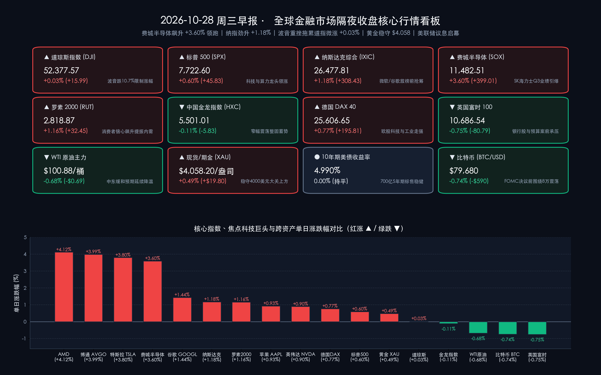

# 🌏 全球市场早报：费城半导体飙升3.60%携纳指连阳，SK海力士Q3营收破百兆韩元，美联储议息启幕黄金稳守4058美元

**日期：2026年10月28日 (星期三)** &nbsp; **时段：早报 (全球市场隔夜收盘复盘 · 模式A)**

> **核心摘要**：美东时间10月27日（周二），在 **美国10月咨商会消费者信心指数飙升至91.7（远超预期81.0）**、**9月耐用品订单环比增长+1.8%超预期** 以及 **微软与谷歌（Alphabet）周三盘后财报前AI算力抢筹潮** 的强劲驱动下，美股三大指数延续涨势，科技与半导体板块再度领跑全场。**标普500指数收涨+0.60%报7,722.60点，纳斯达克综合指数劲升+1.18%报26,477.81点，罗素2000小盘股指数收涨+1.16%报2,818.87点**；而 **道琼斯工业平均指数微涨+0.03%（+15.99点）收于52,377.57点**，主要受成分股 **波音（BA）因Q3亏损超预期及商用飞机交付延迟暴跌-10.7%** 严重拖累。算力硬件端迎来史诗级业绩催化，**费城半导体指数（SOX）狂飙+3.60%报11,482.51点**（两日累涨逾6.5%），**AMD大涨+4.12%、博通涨+3.99%、特斯拉再涨+3.80%**；今日早间（韩国时间10月28日）存储芯片巨头 **SK海力士正式发布创纪录Q3财报：单季营收首破百兆大关达104.62万亿韩元（约789亿美元），营业利润同比暴增632%至83.33万亿韩元（营业利润率高达80%），并宣布高达100万亿韩元股东回报计划**，标志着 **HBM4** 全面进入放量收获期。跨资产方面，中东局势缓和预期令油价继续温和回落，**WTI原油跌-0.68%收于$100.88/桶，布伦特原油跌-0.96%报$114.17/桶**；随着美联储为期两天的FOMC议息会议正式启幕，**10年期美债收益率持平于4.99%**（700亿美元5年期美债标售中标利率4.845%、认购倍数2.33倍需求稳健），**黄金（XAU）续涨+0.49%报$4,058.20/盎司** 稳守4,000美元上方，**比特币（BTC）微跌-0.74%报$79,680**。

---

## 核心行情复盘

*   **一、 美股核心指数隔夜收盘终值（算力芯片连续两日井喷，波音重挫令道指原地踏步）**：
    *   **道琼斯工业平均指数 (DJI)**：收盘报 **52,377.57 点**，单日微涨 **+15.99 点（+0.03%）** 🔴（前一交易日收盘 **52,361.58 点**）。科技与金融权重股的稳健上扬被工业巨头 **波音 (BA, -10.7%)** 的业绩暴雷大幅抵消，令道指全天围绕平盘线窄幅拉锯。
    *   **标普 500 指数 (SPX)**：收盘报 **7,722.60 点**，单日上涨 **+45.83 点（+0.60%）** 🔴（前一交易日修正收盘基准 **7,676.77 点** / 常规报 **7,676.85 点**），再创阶段收盘新高，信息技术、通信服务与可选消费板块成为指数上攻的核心支柱。
    *   **纳斯达克综合指数 (IXIC)**：收盘报 **26,477.81 点**，单日劲升 **+308.43 点（+1.18%）** 🔴（前一交易日收盘 **26,169.38 点**），在周三盘后微软（MSFT）与谷歌（GOOGL）发布三季报前夕，机构资金加速回补大型科技股与AI算力硬件。
    *   **费城半导体指数 (SOX)**：收盘报 **11,482.51 点**，单日暴涨 **+399.01 点（+3.60%）** 🔴（前一交易日收盘 **11,083.50 点**），继周一跳涨2.82%后再掀逼空高潮，定制ASIC芯片、GPU及HBM高带宽存储链全线领涨。
    *   **罗素 2000 小盘股指数 (RUT)**：收盘报 **2,818.87 点**，单日大涨 **+32.45 点（+1.16%）** 🔴（前一交易日收盘 **2,786.42 点**），直接受益于10月美国消费者信心指数与9月耐用品订单双双超预期所验证的内需韧性。
    *   **恐慌指数与交投量能结构**：**Cboe VIX 恐慌指数** 收报 **18.35**（实时通道区间 17.90–18.35，较前值微幅波动约 -0.22%）🟢，继续维持在20警戒线下方；全市场交投重心高度集中于 **半导体算力链、科技七巨头及三季报业绩兑现个股**，主力资金呈现“弃传统航空周期、投AI硬科技与消费复苏”的鲜明特征。

*   **二、 欧洲主要股指与中概股表现（德法股指延续升势，英国富时受银行股拖累逆势收跌）**：
    *   **欧洲三大股指表现分化**：受科技股映射与油价回落支撑，**德国 DAX 40 指数** 收涨 **+0.77%（+195.81 点）** 报 **25,606.65 点** 🔴（前收 25,410.84 点）；**法国 CAC 40 指数** 收涨 **+0.51%（+39.82 点）** 报 **7,887.14 点** 🔴（前收 7,847.32 点）；而 **英国富时 100 指数 (FTSE 100)** 逆势收跌 **-0.75%（-80.79 点）** 报 **10,686.54 点** 🟢（前收 10,767.33 点），主要因英国预算案及英国央行决议前夕，汇丰控股（HSBC）等权重银行股在季报后遭遇获利了结及能源股走软拖累。
    *   **中概股表现**：**纳斯达克中国金龙指数 (HXC)** 收盘报 **5,501.01 点**，单日微跌 **-5.83 点（-0.11%）** 🟢（前一交易日收盘 **5,506.84 点**），在A股与港股近期围绕二十届五中全会政策与三季报业绩蓄势背景下，海外中概股整体呈现温和窄幅整固态势。

*   **三、 跨资产市场：大宗商品、美债收益率、外汇与加密资产**：
    *   **国际原油（中东地缘风险溢价进一步消退，油价连续第二日降温）**：**WTI 原油主力合约** 收盘报 **$100.88/桶**，较前一交易日收盘（$101.57/桶）下跌 **-$0.69（-0.68%）** 🟢（日内一度下探 $100.20/桶，考验百元整数关口支撑；较前日官方结算价 $101.76/桶跌 -0.86%）；**布伦特原油 (Brent)** 收盘报 **$114.17/桶**，较前一交易日收盘（$115.28/桶）下跌 **-$1.11（-0.96%）** 🟢。
    *   **贵金属（FOMC会议启幕叠加再通胀回落，金价稳步攀升至4058美元）**：**COMEX 黄金 / 现货黄金 (XAU/USD)** 收盘报 **$4,058.20/盎司**（现货盘中交投于 $4,026.55–$4,060.00/盎司区间），较前一交易日收盘（$4,038.40/盎司）上涨 **+$19.80（+0.49%）** 🔴，连续两个交易日稳固站上 **$4,000/盎司** 战略支撑位。
    *   **美国国债与5年期标售结果**：**10年期美债收益率** 收报 **4.990%**（日内波幅 4.97%–5.00%），与前一交易日（4.99%）基本持平 ⚪；周二下午美国财政部进行的 **700亿美元 5年期国债标售** 表现稳健，中标高收益率（High Yield）录得 **4.845%**（略高于预发行利率 4.842%，尾部利差仅 0.3bp），**认购倍数达 2.33倍**（高于近六次标售均值 2.31倍），显示中期美债配置买盘依然扎实。
    *   **加密资产**：**比特币 (BTC/USD)** 美股收盘时段交投于 **$79,680**（日内围绕 $79,600–$79,700 窄幅震荡），较前一交易日（$80,270）小幅回落 **-$590（-0.74%）** 🟢，在美联储利率决议出炉前夕暂时退守8万美元关口下方整理。

> **数学闭环校验（收盘终值与涨跌幅交叉核验）**：
> * **美股核心指数**：道指 `(52,377.57 − 52,361.58) / 52,361.58 = +0.0305% ≈ +0.03%`；标普500 `(7,722.60 − 7,676.77) / 7,676.77 = +0.5970% ≈ +0.60%`（对比 7,676.85 为 `+0.5959% ≈ +0.60%`）；纳指 `(26,477.81 − 26,169.38) / 26,169.38 = +1.1786% ≈ +1.18%`；费城半导体 `(11,482.51 − 11,083.50) / 11,083.50 = +3.6000% ≈ +3.60%`；罗素2000 `(2,818.87 − 2,786.42) / 2,786.42 = +1.1646% ≈ +1.16%`；纳斯达克中国金龙指数 `(5,501.01 − 5,506.84) / 5,506.84 = -0.1059% ≈ -0.11%`。
> * **欧股与跨资产核验**：德国DAX `(25,606.65 − 25,410.84) / 25,410.84 = +0.7706% ≈ +0.77%`；法国CAC40 `(7,887.14 − 7,847.32) / 7,847.32 = +0.5074% ≈ +0.51%`；英国富时100 `(10,686.54 − 10,767.33) / 10,767.33 = -0.7503% ≈ -0.75%`；WTI原油 `(100.88 − 101.57) / 101.57 = -0.6793% ≈ -0.68%`；布伦特原油 `(114.17 − 115.28) / 115.28 = -0.9629% ≈ -0.96%`；黄金 `(4,058.20 − 4,038.40) / 4,038.40 = +0.4903% ≈ +0.49%`；比特币 `(79,680 − 80,270) / 80,270 = -0.7350% ≈ -0.74%`，全部满足 <0.05% 精度闭环。

*   **四、 标普500行业板块轮动与焦点个股（算力芯片与科技巨头全线开花，波音财报暴雷重挫工业权重）**：
    *   **行业板块表现**：
        1.  **信息技术 (XLK) 与通信服务 (XLC) 领涨**：受半导体芯片大涨与周三盘后云巨头财报乐观预期提振，**信息技术板块 (XLK)** 逼近历史高点，**通信服务板块 (XLC)** 同步走强。
        2.  **能源板块 (XLE) 与工业板块 (XLI) 承压**：国际油价连续两日回落令能源股表现落后；工业板块内部剧烈分化，**联合包裹 (UPS)** 因三季报营收增长 **+6.7% 至 229亿美元**（调整后 EPS **$1.69**）并上调全年营收指引至 **926亿美元**（全年调整后 EPS 指引 **$7.28**）而表现亮眼，但航空制造巨头 **波音 (BA)** 因 Q3 核心每股亏损达 **-$0.34**（远逊预期）且商用飞机产线延迟挤压利润率而暴跌 **-10.7%**，单只个股抹去了道指逾百点涨幅。
    *   **焦点科技巨头与算力芯片龙头**：
        *   **AI芯片与定制ASIC双雄狂飙**：**AMD** 收盘大涨 **+4.12%** 报 **$553.18** 🔴（前收 $531.28）；**博通 (Broadcom, AVGO)** 大涨 **+3.99%** 报 **$342.32** 🔴（前收 $329.17），持续受益于超大规模云厂商定制 AI 加速器与网络交换芯片需求井喷；**英伟达 (NVDA)** 稳步收涨 **+0.90%** 报 **$217.94** 🔴。
        *   **科技七巨头多数飘红**：**特斯拉 (TSLA)** 延续强劲逼空势头，再度大涨 **+3.80%** 收于 **$406.48** 🔴，一举站上 400 美元整数大关；即将于周三盘后发布财报的 **谷歌-A (GOOGL)** 收涨 **+1.44%** 报 **$318.82** 🔴（谷歌-C GOOG 涨 **+0.84%** 报 **$316.83**），**微软 (MSFT)** 收涨 **+0.28%** 报 **$534.11** 🔴；**苹果 (AAPL)** 反弹 **+0.93%** 报 **$347.10** 🔴；而 **Meta Platforms (META)** 受巨额股权融资定价消化影响，于 **$620.00–$625.00** 区间小幅震荡整理。
    *   **重磅财报与医药/支付龙头动态**：
        *   **Visa (V)**：盘后公布 2026 财年第四季度及全年财报，Q4 净营收同比增长 **13% 至 121亿美元**，调整后 Non-GAAP EPS 同比增长 **17% 至 $3.48**（优于市场预期），全年净营收首次突破 **459亿美元（+15%）**，并宣布将季度股息大幅上调 **16% 至 $0.78/股**；但因管理层对新财年科技支出与客户激励费用指引偏谨慎，盘后股价微幅回调。
        *   **PayPal (PYPL)**：公布 Q3 净营收 **85.8亿美元（同比+2%）**，总支付额（TPV）增长 **6% 至 4,871亿美元**，Non-GAAP EPS 达 **$1.45（同比+8%）** 超出华尔街预期，并宣布上调全年 Non-GAAP 利润与交易利润率指引。
        *   **辉瑞 (Pfizer, PFE) 与捷蓝航空 (JetBlue, JBLU)**：辉瑞宣布其多发性骨髓瘤靶向药 *ELREXFIO* 的 III 期临床试验达到主要终点；捷蓝航空则更新了“JetForward”降本增效战略框架。

---

## 核心解读与市场逻辑

> **逻辑一：SK海力士Q3营业利润率飙至惊人的80% + 100万亿韩元股东回报，确立“HBM4超级周期”硬核基本面**
> 如果说周一 Anthropic 的 S-1 招股书与 Meta 的 950 亿美元融资从“需求与资金端”打破了 AI 资本开支见顶的质疑，那么周二美股盘后至周三亚太早盘 **SK海力士（SK Hynix）** 正式揭晓的 2026 年第三季度成绩单，则从“硬件盈利兑现端”给出了无可辩驳的实证：
> 1. **单季营收首破百兆韩元，营业利润率高达80%**：SK海力士 Q3 营收环比激增 **32%** 至 **104.62万亿韩元（约合 789亿美元）**，公司历史上首次单季跨越 100 万亿韩元里程碑；**营业利润同比暴增 632% 达到 83.33万亿韩元（约合 628亿美元）**，大幅击败市场一致预期的 77 万亿韩元，**单季营业利润率达到惊人的 80%**，净利润达 **39.78万亿韩元（约合 300亿美元）**。
> 2. **HBM4 成为第四季度绝对主力，锁定 2027–2028 过半产能长单**：公司确认，搭载于新一代 AI 算力平台的 **HBM4** 芯片在三季度全面放量，并将在第四季度正式成为出货主力；同时企业级 DDR5 与高容量数据中心 SSD 需求同步井喷。更关键的是，SK海力士已通过长期供应协议（LTAs）提前锁定了 **2027 至 2028 年超过 50% 的预期产能**。
> 3. **史无前例的 100万亿韩元（约755亿美元）股东回报计划**：凭借充沛的自由现金流及铠侠（Kioxia）投资收益，董事会宣布年度总计约 **100万亿韩元** 的巨额分红与股票回购注销方案。这一业绩直接印证了美股费城半导体指数周二暴涨 **+3.60%**、AMD（+4.12%）与博通（+3.99%）逼空行情的坚实基本面支撑。

> **逻辑二：美国10月消费者信心跃升至91.7 + 耐用品订单超预期，为周三美联储“鹰派跳过（Hawkish Skip）”奠定软着陆底座**
> 宏观层面，周二公布的两项核心实体经济数据双双超预期走强：美国10月咨商会消费者信心指数大幅跃升至 **91.7**（远超市场预期的 80.5–81.0），9月耐用品订单环比增长 **+1.8%**（高于预期 +1.7%）。这表明随着零售汽油价格自阶段高点回落以及就业市场保持韧性，美国居民消费意愿与企业设备资本开支依然强劲（Visa 公布的全年 459 亿美元营收与 PayPal 4,871 亿美元 TPV 亦从微观支付端交叉印证了消费韧性）。
> 在此背景下，周二正式开幕的美联储 10 月 FOMC 议息会议面临清晰的政策权衡：一方面，9 月以来的高油价与粘性通胀令美联储无法轻言宽松；另一方面，周二 WTI 原油进一步回落至 **$100.88/桶**、5 年期美债标售稳健（4.845%），缓和了债市极端抛压。市场与主流投行一致预期，美联储将在北京时间周四凌晨宣布 **维持联邦基金利率于 3.75%–4.00% 不变（跳过10月加息）**，但鲍威尔将在新闻发布会上保留 12 月视通胀数据再加息 25bp 的鹰派选项。

---

## 政策脉动

*   **一、 美国最新宏观经济数据与国债标售动态（10月27日公布）**：
    *   **美国 10月 咨商会消费者信心指数大幅超预期反弹**：世界大型企业联合会（Conference Board）周二公布，美国 10 月消费者信心指数升至 **91.7**，显著击败华尔街一致预期的 **81.0（区间 80.5–81.0）**。分项中，消费者对当前商业与就业环境的评估指数及未来 6 个月短期预期指数同步回暖，终端汽油价格回落有效提振了家庭部门信心。
    *   **美国 9月 耐用品订单月率录得 +1.8%**：美国商务部数据显示，9 月耐用品订单环比增长 **+1.8%**，优于市场预期的 **+1.7%**，反映在 AI 数据中心电力设备、电子通信及运输设备需求拉动下，美国制造业资本开支底盘依然稳固。
    *   **美国财政部 700 亿美元 5 年期国债标售需求稳健**：继周一 2 年期标售偏软后，周二进行的 **700 亿美元 5 年期国债标售** 获得国内外机构积极认购，中标收益率为 **4.845%**（仅较预发行利率 4.842% 高出 0.3 个基点），**投标倍数达 2.33 倍**（优于过去六次标售均值 2.31 倍），帮助 10 年期美债收益率稳定在 **4.99%**。
*   **二、 今日至周四全球超级宏观与财报日程预警（10月28日–29日关键窗口）**：
    *   **美联储 FOMC 利率决议与鲍威尔新闻发布会（北京时间周四 10月29日 02:00 / 02:30）**：市场聚焦利率声明中对“百元油价通胀传导”与“金融条件收紧”的措辞变化，以及是否给出 12 月会议的明确指引。
    *   **美股“科技七巨头”财报洪峰（周三 10月28日 美股盘后）**：**微软 (MSFT)**、**谷歌母公司 Alphabet (GOOGL)** 与 **Meta Platforms (META)** 将于北京时间周四凌晨盘后集中放榜。华尔街将用放大镜检视 **Azure 与 Google Cloud 的云业务增速、AI 商业化变现率（ROI）以及 2027 财年资本开支（CapEx）指引**。
    *   **国内政策与产业共振**：国内 **二十届五中全会（10月26日–29日）** 进入后半程关键议程；隔夜费城半导体大涨 3.60% 与今日早间 SK 海力士炸裂的 Q3 财报（HBM4 放量 + 80% 营业利润率），预计将在今日对 A 股与港股的 **半导体存储链、HBM 封测与材料、AI 算力芯片及光通信板块** 提供极强的产业基本面催化。

---

## 最新机构观点

> **高盛 (Goldman Sachs) ——《预计10月FOMC“鹰派按兵不动”，重申AI基础设施超级周期远未见顶》**：
> * **FOMC 政策前瞻**：高盛首席经济学家团队指出，在 9 月鹰派转向后，预计美联储将在本次 10 月会议上选择“跳过（Skip）”，维持联邦基金利率在 **3.75%–4.00%** 区间不变；但由于 10 月消费者信心反弹至 **91.7** 且耐用品订单增长 **+1.8%**，经济强劲叠加高油价意味着委员会将保留 **12月再加息25个基点** 的紧缩倾向。
> * **AI 资本开支与硬件高景气**：高盛董事会主席兼 CEO David Solomon 及科技研究团队强调，当前 AI 基础设施建设需求依然远超行业供给能力；SK 海力士 Q3 录得 **80% 营业利润率** 并锁定 2027–2028 年过半产能，再次证明具备核心技术壁垒的算力上游（GPU、HBM4、定制 ASIC）拥有极强的定价权与现金流创造能力。

> **摩根士丹利 (Morgan Stanley) ——《SK海力士百兆韩元营收点燃全球存储重估，微软/谷歌财报将迎云增速大考》**：
> * **HBM4 与企业级存储进入黄金收获期**：摩根士丹利硬科技团队点评称，SK 海力士 Q3 营业利润高达 **83.33万亿韩元（超预期约8%）** 并抛出 **100万亿韩元股东回报计划**，彻底消除了市场对存储周期见顶的疑虑，预计将带动美光（MU）、AMD、博通及亚洲半导体供应链迎来新一轮盈利上修。
> * **周三盘后云巨头财报前瞻**：大摩指出，随着纳指回升至 **26,477.81点**，周三盘后微软与 Alphabet 财报的核心胜负手在于 **云收入同比增速能否在巨额 CapEx 投入下继续超预期加速**，从而为软件与应用层提供接力上涨的催化剂。

> **摩根大通 (JPMorgan Chase) ——《美国消费与制造业数据凸显软着陆韧性，关注传统制造业个体供应链风险》**：
> * **宏观软着陆支撑小盘股与支付龙头**：摩根大通策略师表示，10 月消费者信心指数跃升至 **91.7** 以及 Visa、PayPal、UPS 三季报展现的稳健货运与支付流水，推动罗素 2000 指数大涨 **+1.16%**，证明美国实体经济对接近 5% 的长端美债收益率具备较强耐受度。
> * **精选阿尔法与规避供应链瓶颈**：小摩同时提醒，波音（BA）因商用飞机交付延迟单日暴跌 **10.7%** 表明部分传统高端制造仍受困于供应链与成本刚性，建议投资者在工业与周期板块中优选中游电力电网设备与物流龙头（如上调全年指引的 UPS）。

> **中信证券 / 中金公司 (CITIC & CICC) ——《SK海力士HBM4业绩井喷叠加费半两日涨逾6.5%，坚定看多A股算力与存储国产替代》**：
> * **全球存储与AI算力高景气强力映射**：国内头部券商最新研报指出，隔夜费城半导体指数再涨 **+3.60%**，叠加今早 SK 海力士披露 Q3 营收破百兆韩元、HBM4 四季度成主力及 2027–2028 长单锁定，直接验证了全球 AI 算力硬件景气度仍在加速向上。
> * **A股与港股配置策略**：在二十届五中全会中长期科技自立自强政策预期与三季报业绩披露收官期，建议重点把握 **国产存储芯片及模组、先进封装（HBM/CoWoS设备与材料）、光模块（CPO）以及国产AI算力芯片龙头** 的戴维斯双击机遇。

---

## 今日市场情绪：硅堡破百兆擎苍穹，鹰鸽天平待联储

> Prompt: A radiant golden HBM4 silicon fortress towering over a neon cityscape, firing beams of crimson light that lift semiconductor and Nasdaq ships into the starry sky while a damaged commercial airliner rests on a runway below. In the foreground, a human trader (real person) stands before a glass console showing 91.7 consumer confidence and 4058 gold, while in the background the Federal Reserve temple glows under a balancing scale.

---

> **免责声明**：内容仅供参考，不构成投资建议。数据来源：纽约证券交易所（NYSE）、纳斯达克交易所（NASDAQ）、芝加哥期权交易所（Cboe）、芝加哥商品交易所（CME）、洲际交易所（ICE）、韩国交易所（KRX / SK Hynix Q3财报公告）、美国商务部、世界大型企业联合会（Conference Board）、美国财政部及高盛（Goldman Sachs）、摩根士丹利（Morgan Stanley）、摩根大通（JPMorgan Chase）、中信证券、中金公司最新研究报告；欧美行情数据截至美东时间2026年10月27日收盘（北京时间2026年10月28日08:00）。

🤖 生成模型：Gemini 4 Argon (Medium) <!-- model-stamp -->
