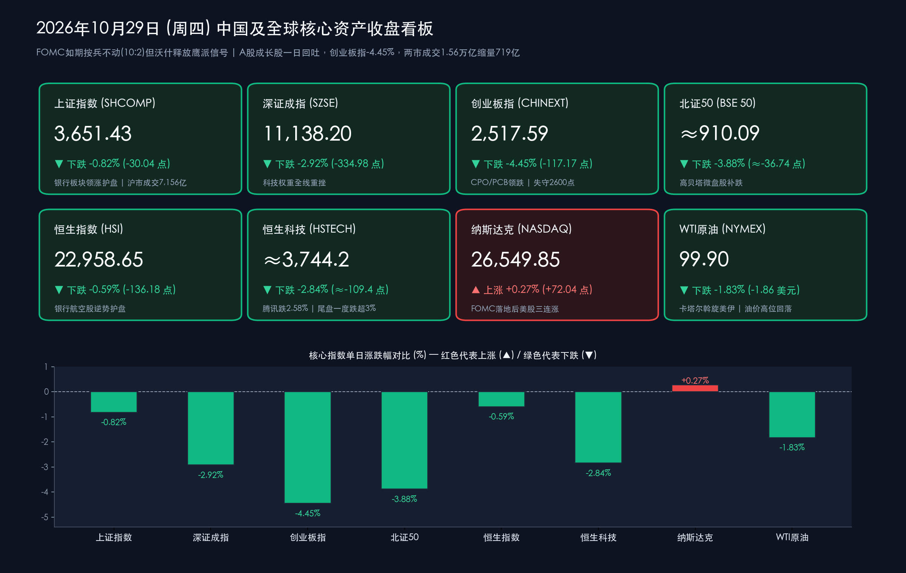

# 收盘复盘：FOMC按兵不动难掩鹰派内核，A股成长股一日回吐昨日涨幅，创业板指重挫4.45%失守2600点

**日期：2026年10月29日 (星期四)** &nbsp; **时段：下午/国内市场收盘**

> **核心摘要**：北京时间今日凌晨，美联储FOMC以**10:2**投票维持联邦基金利率**3.75%—4.00%**不变，但库克与哈马克两名委员投出反对票主张加息25个基点，主席沃什宣布减少利率决议次数并拒绝前瞻指引，市场对**12月再加息25bp的定价已升至78.4%**——"暂停"被定义为鹰派中性而非转向。隔夜美股三大指数三连涨（道指+0.19%、标普+0.28%、纳指+0.27%），而A股昨日放量反攻行情戛然而止：三大指数集体下挫，**创业板指暴跌4.45%收报2,517.59点**，CPO、PCB等高位科技硬件链领跌，东山精密跌停；**银行板块逆势领涨**护盘，两市成交额**15,565.24亿元**较前一日缩量约719亿元。港股同步走弱，**恒生指数跌0.59%报22,958.65点**，**恒生科技指数跌2.84%**，腾讯跌2.58%，银行与航空股逆势护盘。

## 核心行情复盘

*   **A股主要指数收盘终值（低开低走午后加速下探，成长风格全面溃退，昨日涨幅一日回吐大半）**：
    *   **上证指数（SHCOMP）**：收盘报 **3,651.43点**，较前一交易日下跌 **-30.04点**，跌幅 **-0.82%**，沪市成交额 **7,156.21亿元**，为所有核心宽基中跌幅最小者，银行权重股全天护盘特征鲜明。
    *   **深证成指（SZSE）**：收盘报 **11,138.20点**，较前一交易日下跌 **-334.98点**，跌幅 **-2.92%**。
    *   **创业板指（CHINEXT）**：收盘报 **2,517.59点**，较前一交易日重挫 **-117.17点**，跌幅 **-4.45%**，跌幅居核心宽基之首，一举失守2,600点整数关口，昨日+3.40%的反攻涨幅被尽数吞没并倒吐。
    *   **北证50指数（BSE 50）**：官方披露跌幅 **-3.88%**（按昨收946.83点推算收报约 **910.09点**，下跌约36.74点），高贝塔微盘股补跌惨烈。
    *   **双创指数低开低走均跌超4%**，科创方向同步重挫，昨日领涨的存储芯片、CPO、人形机器人板块全面反转领跌。
*   **量能变化、市场广度与短线情绪**：
    *   **两市成交额缩量回落**：沪深两市全天合计成交额约 **15,565.24亿元**，较前一交易日（16,284.78亿元）**缩量约719.5亿元**，昨日的放量抢筹未能延续，增量资金一日观望，印证昨日反攻更多是"FOMC靴子落地前的抢跑"而非趋势性增量进场。
    *   **短线情绪急剧降温**：全市场仅 **39只** 个股涨停（昨日为74只），连板梯队大幅收缩——食品板块 **青岛食品** 收获 **4连板**，人形机器人概念 **光洋股份** **4连板**，AI漫剧概念 **文投控股** **3连板**；跌停阵营则集中于高位科技股。
    *   **标志性个股事件**：PCB/AI硬件龙头 **东山精密** 触及跌停（-10%，收报94.14元，总市值1,831亿元），公司H股发行新增股份带来每股收益摊薄、有息负债较期初增长超40亿元、大额资本开支致投资活动净流出超54亿元，叠加市场对AI下游需求增长放缓后新增产能利用率不足的担忧，多重利空在股价高位集中引爆，成为今日AI硬件链情绪崩塌的导火索；**中金公司盘中逼近跌停**拖累证券板块持续走弱。
*   **港股市场（恒指跌0.59%相对抗跌，恒生科技重挫2.84%，银行航空逆势护盘）**：
    *   **港股核心指数**：**恒生指数**收报 **22,958.65点**，下跌 **-136.18点**，跌幅 **-0.59%**；**恒生科技指数**收跌 **-2.84%**（按昨收3,853.6点推算收报约 **3,744.2点**），临近尾盘一度跌超3%。
    *   **港股特色盘面**：权重股 **腾讯控股** 跌 **2.58%** 收报 **377.6港元**，**香港交易所** 跌0.33%收报363.8港元；**银行股与航空股逆势护盘**，成为恒指跌幅显著小于A股成长指数与恒生科技指数的核心原因。
*   **隔夜美股与大宗商品（FOMC落地美股三连涨，油价高位回落）**：
    *   **美股周三（10月28日）收盘**：**道指** 涨 **+97.53点（+0.19%）** 报 **52,475.10点**；**标普500** 涨 **+0.28%** 报 **7,743.98点**；**纳指** 涨 **+0.27%** 报 **26,549.85点**，三大指数集体三连涨。FOMC决议公布前市场对按兵不动的定价概率接近93%，决议落地后不确定性消除支撑美股平稳收涨。
    *   **原油**：卡塔尔等国再度斡旋美伊谈判推动油价高位回落——纽约商品交易所12月交货的 **WTI轻质原油期货下跌1.86美元（-1.83%）收于每桶99.90美元**，12月交货的 **布伦特原油期货下跌1.93美元（-1.67%）收于每桶113.88美元**；国内上期所原油主力合约日盘收涨1.16%报730.8元/桶。
    *   **国内商品**：碳酸锂期货破位大跌超 **8%**，中证商品期货价格指数收报1,603.47点，较前一交易日下跌7.34点。
    *   **汇率**：FOMC声明强调"通胀仍然处于较高水平"、12月加息预期升温至78.4%，美元指数与美债收益率维持高位，人民币资产估值端持续承压。

> **数学闭环校验（收盘点位与涨跌幅精确核验）**：
> * **上证指数**：今日收盘 **3,651.43点**，对比昨日（10月28日）收盘 **3,681.47点**，实际点位变动为 `-30.04点`，计算得 `-30.04 / 3681.47 ≈ -0.816% ≈ -0.82%`，与官方披露跌幅完全吻合。
> * **深证成指**：今日收盘 **11,138.20点**，对比昨日收盘 **11,473.18点**，变动 `-334.98点`，计算得 `-334.98 / 11473.18 ≈ -2.920% ≈ -2.92%`，完全吻合。
> * **创业板指**：今日收盘 **2,517.59点**，对比昨日收盘 **2,634.76点**，变动 `-117.17点`，计算得 `-117.17 / 2634.76 ≈ -4.447% ≈ -4.45%`，完全吻合。
> * **恒生指数**：今日收盘 **22,958.65点**，对比昨日收盘 **23,094.83点**，变动 `-136.18点`，计算得 `-136.18 / 23094.83 ≈ -0.590% ≈ -0.59%`，与新华社披露数据完全一致。
> * **纳斯达克**：今日收盘 **26,549.85点**，对比昨日收盘 **26,477.81点**，变动 `+72.04点`，计算得 `+72.04 / 26477.81 ≈ +0.272% ≈ +0.27%`，完全吻合；标普500（7,743.98 vs 7,722.60，+0.277%≈+0.28%）与道指（52,475.10 vs 52,377.57，+0.186%≈+0.19%）同样闭环吻合。
> * **成交额**：今日两市成交 **15,565.24亿元**，对比昨日 **16,284.78亿元**，缩量 `719.54亿元`，与官方"缩量约719亿元"披露一致。
> * **推算项说明**：北证50收盘约910.09点（946.83 × (1-3.88%)）、恒生科技收盘约3,744.2点（3,853.6 × (1-2.84%)）均按官方披露涨跌幅推算，已在正文标注"≈"。

## 核心解读与市场逻辑

*   **逻辑一：FOMC"鹰派暂停"——不加息的决议，加息的内核，12月加息概率飙升至78.4%**：
    *   **数据与事件**：北京时间10月29日凌晨，美联储以 **10:2** 投票维持利率 **3.75%—4.00%** 不变；理事 **库克**（2022年入联储以来首次投反对票）与克利夫兰联储主席 **哈马克** 主张立即加息25bp；声明直言"**通胀仍然处于较高水平**"并上调经济评估；主席 **沃什** 在发布会上强调"除非紧急情况否则不相信前瞻指引"，并宣布 **减少利率决议次数** 的制度性安排。截至10月29日10:00，CME FedWatch显示 **12月加息25bp概率达78.4%**。
    *   **传导逻辑**：这是沃什接任美联储主席后的关键定调——9月刚完成2023年7月以来首次加息，10月暂停仅是"观察通胀数据"的战术停顿，而非政策转向。取消前瞻指引意味着市场失去了利率路径的"锚"，每一次会议都将重新定价，波动率中枢抬升。对全球资产而言，"更高更久且更不可测"的利率环境直接压制高久期成长股估值——这正是今日A股双创指数与恒生科技重挫、而美股因盈利支撑（三连涨）相对抗跌的分化根源。
*   **逻辑二：昨日"抢跑式做多"今日"利好出尽式回吐"——一日游行情暴露存量博弈本质**：
    *   **数据与事件**：昨日创业板指大涨 **+3.40%**、主力资金净流入 **243.34亿元**、电子板块单日吸金117亿；今日创业板指暴跌 **-4.45%**、涨停家数从74只骤降至39只、成交额缩量约719亿元，昨日领涨的CPO、存储芯片、PCB全面反转领跌。
    *   **传导逻辑**：昨日的放量反攻本质是"93%概率按兵不动"高度一致预期下的抢跑交易；当决议如期落地且沃什释放鹰派信号后，抢跑资金失去继续持有的宏观理由，叠加三季报披露收官期（10月31日截止）资金对高位题材股的排雷需求，形成"利好出尽+业绩排雷"的双重兑现压力。缩量下跌而非放量恐慌，说明当前仍是存量资金的高低切换，而非增量资金的系统性撤离。
*   **逻辑三：东山精密跌停——AI硬件链"叙事裂缝"的标志性事件**：
    *   **数据与事件**：东山精密今日触及跌停（-10%），直接诱因是H股发行摊薄每股收益、有息负债较期初增长超40亿元、投资活动净流出超54亿元，深层原因是市场开始担忧 **AI下游需求增长放缓后新增产能利用率不足**；PCB概念多股跌停（华正新材等），CPO概念连续调整。
    *   **传导逻辑**：10月以来A股深度调整的核心矛盾正是"AI叙事的证伪压力"——中信建投此前指出科技板块调整直接受FCC光模块限制与OpenAI收入不及预期冲击，根本原因是第二波杠杆资金去化。东山精密的跌停标志着资金审视视角从"AI订单增速"转向"AI资本开支的财务可持续性"，高负债扩产的硬件标的率先被杀估值；只要海外AI商业化收入的验证信号未出现，算力硬件链的筹码出清就难以轻言结束。
*   **逻辑四：银行领涨与"哑铃策略"回归——防御资金再聚集，港股银行航空同步护盘**：
    *   **数据与事件**：昨日还逆势走弱的 **银行板块今日领涨** A股，港股银行与航空股同样逆势护盘；恒指（-0.59%）显著跑赢恒生科技（-2.84%）与创业板指（-4.45%）。
    *   **传导逻辑**：中金公司近期研报判断险资提升权益配置的理论空间有限，**高股息资产是超配状态下平衡风险的重要方向**——今日盘面正是"科技+红利"哑铃策略在剧烈波动中的再平衡：资金从拥挤的科技成长赛道撤向低估值高股息的银行板块。值得注意的是，这种防御切换发生在"8000亿元新型政策性金融工具投放完成"的流动性利好背景下，说明当前市场缺的不是流动性，而是风险偏好的修复催化剂。

> **核心解读**：今日行情的本质是"鹰派美联储 + AI叙事裂缝 + 三季报排雷"三重压力对昨日抢跑行情的总清算。美联储取消前瞻指引意味着海外利率变量将从"可预期的背景噪音"变为"逐月重估的定价主线"，12月加息概率78.4%的定价将贯穿整个四季度。短期看，10月31日三季报披露截止前高位科技股仍有排雷压力，需观察1.5万亿级成交额能否守住；中期看，银行等红利资产的逆势走强与政策性金融工具投放完成，为指数下方提供了估值与流动性的双重缓冲，市场大概率延续"指数震荡、结构分化"的存量博弈格局。

## 政策脉动

*   **美联储FOMC决议（10月27—28日）：按兵不动但鹰派信号密集**：
    *   **决议要点**：以 **10:2** 维持联邦基金利率目标区间 **3.75%—4.00%** 不变；反对票来自理事库克（主张加息25bp，为其2022年入职以来首次反对）与克利夫兰联储主席哈马克。声明表示"通胀仍然处于较高水平。随着更多信息不断积累，委员会将能够更好地确定适当的货币政策立场，以确保及时实现2%的通胀目标。"
    *   **发布会与制度变革**：主席沃什强调央行仍专注于"价格稳定"，称就业形势"相当积极"，并明确"除非存在紧急情况、除非出现危机，否则我不相信前瞻指引"；同时宣布减少利率决议次数的安排。市场对12月加息25bp的定价已达 **78.4%**，维持不变概率约两成。
    *   **外围扰动**：特朗普政府针对库克理事的免职程序预计11月初举行听证会，美联储人事与独立性问题为利率路径再添政治变量。
*   **8000亿元新型政策性金融工具投放完成**：
    *   **政策动态**：据央视新闻10月28日报道，8000亿元新型政策性金融工具已投放完成，为基建与重点领域项目提供资本金支持，构成国内流动性与信用端的重要托底力量。
*   **中长期资金入市步伐加快，回购潮延续**：
    *   **资金动态**：10月以来已有超 **120家** 公司密集披露回购方案，产业资本在市场调整期持续出手，与"防御化"的机构调仓形成对冲，为市场提供底部承接力量。
*   **国内成品油价调整窗口今日24时开启**：
    *   **价格动态**：国内油价将于10月29日24时迎来调整窗口，适逢国际油价因卡塔尔斡旋美伊谈判而高位回落（WTI跌破100美元/桶），若下调落地将边际缓解输入性通胀预期。

## 最新机构观点

> **华泰证券（宏观研究团队｜10月29日FOMC点评）**：
> 1. **如期暂停加息并调整会议安排**：10月FOMC以10:2将政策利率维持在3.75%—4.00%，符合预期；2位票委要求加息25bp，决议声明对经济表态偏强，沃什宣布减少利率决议次数意味着货币政策沟通机制的重大调整，市场对单次会议的定价权重将上升。
> 2. **前瞻指引缺位抬升波动中枢**：在"无前瞻指引"的新框架下，12月会议前的每一份通胀与就业数据都将引发利率预期的剧烈摆动，风险资产需适应更高的政策不确定性溢价。

> **中信建投（策略研究团队）**：
> 1. **科技板块仍是调整重心**：节后A股行情低于预期，科技板块调整短期直接受FCC光模块限制与OpenAI收入不及预期冲击，根本原因是A股处于第二波杠杆资金去化阶段；今日CPO、PCB的再度重挫与东山精密跌停正是该判断的延续验证。
> 2. **等待杠杆出清与业绩验证的双重信号**：在杠杆资金去化完成、三季报披露收官（10月31日）之前，高弹性科技成长板块仍以消化拥挤度为主。

> **中金公司（策略研究团队）**：
> 1. **"科技+红利"哑铃型配置重视程度提升**：2026年以来A股科技成长风格受益于AI产业链高景气，但近期外部扰动强化，哑铃型配置结构可平衡组合波动。
> 2. **险资权益配置空间有限，高股息为平衡方向**：短期看保险行业继续提升权益配置比例的理论空间较为有限，高股息资产是在超配状态下平衡风险、实现资产负债匹配的重要方向——今日银行板块的领涨即是该逻辑的资金面印证。

> **高盛（Goldman Sachs｜10月27日研报）**：
> 1. **下调中信证券盈利预测，A股维持"买入"**：将中信证券2026—2028年纯利预测下调11%/2%/3%至404亿/407亿/420亿元，A股目标价下调至 **41.72元**（维持买入），H股目标价下调7%至 **31.27港元**（中性），主要反映较低投资收益；今日券商板块走弱（中金公司一度逼近跌停）印证头部券商业绩与股价同步承压。

## 今日市场情绪：光纤凤凰坠落之夜，驮着金库的石龟与鹰形议息钟塔

> Prompt: A flock of glowing phoenixes woven from optical fibers plummets from a stormy sky, shedding luminous feathers that turn into falling green candlesticks, while a giant ancient stone tortoise carrying golden bank vault doors on its shell marches steadily forward through the chaos. In the background, a hawk-shaped clock tower of the Federal Reserve looms under indigo storm clouds, casting a long shadow over the market valley.

---
免责声明：内容仅供参考，不构成投资建议。

🤖 生成模型：Kimi Code (Daily Pipeline) <!-- model-stamp -->
