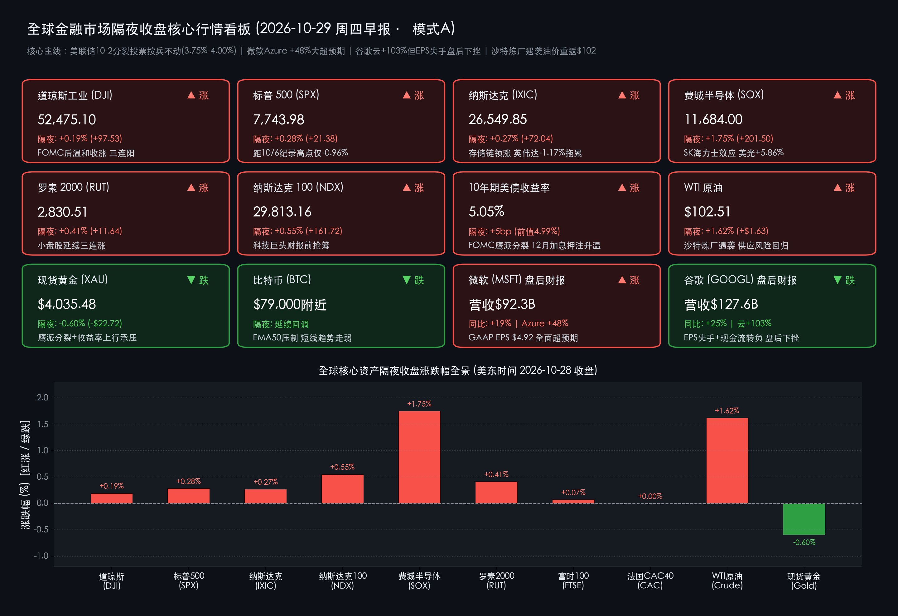
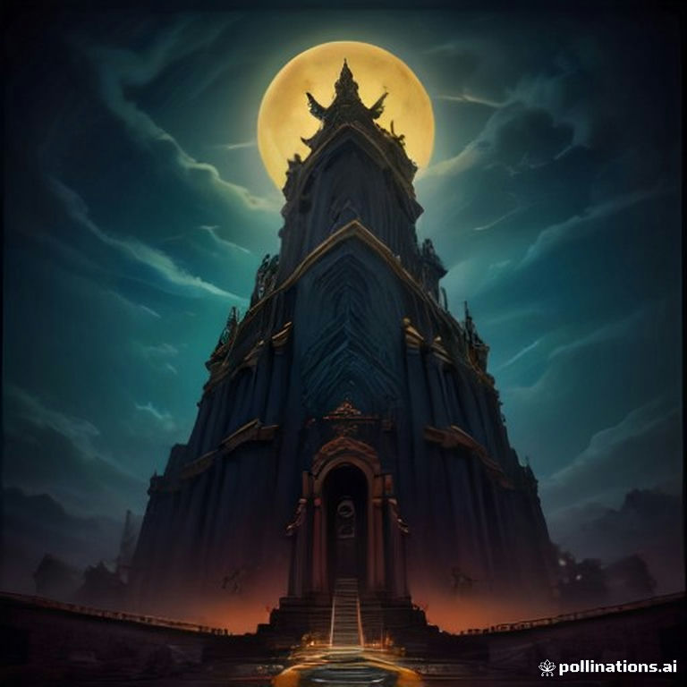

# 🌏 全球市场早报：美联储10-2分裂式按兵不动，微软Azure狂飙48%碾压预期，谷歌云翻倍却遭EPS反噬

**日期：2026年10月29日 (星期四)** &nbsp; **时段：早报 (全球市场隔夜收盘复盘 · 模式A)**

> **核心摘要**：美东时间10月28日（周三），**美联储FOMC以10-2分裂投票维持联邦基金利率于3.75%–4.00%不变**（克利夫兰联储主席Hammack与理事Cook投反对票、主张加息25bp），主席Warsh强调政治因素"毫无影响"，市场对12月加息的押注维持在75%–86%高位。美股三大指数在决议后温和收涨：**标普500涨+0.28%报7,743.98点（三连阳，距10月6日历史收盘高点仅差0.96%），道指涨+0.19%报52,475.10点，纳指涨+0.27%报26,549.85点，费城半导体指数续涨+1.75%报11,684.00点**（美光+5.86%领跑，英伟达-1.17%逆势拖累）。盘后财报上演"云巅双雄分途"：**微软FY27 Q1营收$92.3B（+19%）、Azure暴增+48%（碾压45%指引）、GAAP EPS $4.92全面超预期；Alphabet营收$127.6B（+25%）、谷歌云狂飙+103%、Gemini用户破10亿，但EPS失手叠加现金流转负令盘后股价下挫**。地缘端沙特炼厂遇袭令**WTI原油跳涨+1.62%重回$102.51/桶**，鹰派分裂与10年期美债收益率上行5bp至**5.05%**令**黄金回落-0.60%报$4,035.48/盎司**。

---

## 核心行情复盘

*   **一、 美股核心指数隔夜收盘终值（FOMC落地后温和收涨，存储芯片链延续逼空）**：
    *   **道琼斯工业平均指数 (DJI)**：收盘报 **52,475.10 点**，单日上涨 **+97.53 点（+0.19%）** 🔴（前一交易日收盘 **52,377.57 点**），在利率决议落地后录得三连阳，工业与金融权重股走势平稳。
    *   **标普 500 指数 (SPX)**：收盘报 **7,743.98 点**，单日上涨 **+21.38 点（+0.28%）** 🔴（前一交易日收盘 **7,722.60 点**），连续三日收涨，距离10月6日创下的历史收盘纪录 **7,818.93 点** 仅差 **-0.96%**。
    *   **纳斯达克综合指数 (IXIC)**：收盘报 **26,549.85 点**，单日上涨 **+72.04 点（+0.27%）** 🔴（前一交易日收盘 **26,477.81 点**）；**纳斯达克100指数 (NDX)** 收涨 **+0.55%（+161.72 点）** 报 **29,813.16 点**，盘后微软与Alphabet财报成为全场焦点。
    *   **费城半导体指数 (SOX)**：收盘报 **11,684.00 点**，单日大涨 **+201.50 点（+1.75%）** 🔴（前一交易日收盘 **11,482.51 点**），SK海力士创纪录财报的产业链映射持续发酵，**美光 (MU) 单日飙升+5.86%**、为标普500贡献 +7.1 个指数点，博通贡献 +5.2 点；而 **英伟达 (NVDA) 逆势下跌 -1.17%**、单日拖累标普500约 -7.2 点，资金在算力链内部出现明显的"弃GPU旧龙头、追存储新贵"轮动。
    *   **罗素 2000 小盘股指数 (RUT)**：收盘报 **2,830.51 点**，单日上涨 **+11.64 点（+0.41%）** 🔴（前一交易日收盘 **2,818.87 点**），实现三连涨，显示内需韧性叙事在利率决议后未被破坏。
    *   **恐慌指数与市场广度**：**Cboe VIX 恐慌指数** 收报 **16.9** 🟢，市场处于"平静"状态；标普500十一大板块中 **6个收涨**，**信息技术板块 (+0.80%) 领涨、公用事业 (-0.84%) 垫底**（长端收益率上行压制类债资产）；纽交所与纳斯达克合计 **3,531 家上涨 / 2,993 家下跌**，创52周新高个股 **272 家**。

*   **二、 欧洲主要股指表现（静候英美央行后续路径，欧股窄幅整理）**：
    *   **英国富时 100 指数 (FTSE 100)**：收盘报 **10,694.50 点**，微涨 **+7.96 点（+0.07%）** 🔴（前一交易日收盘 **10,686.54 点**），在美联储决议与英国预算案双重事件窗口前维持低波动。
    *   **法国 CAC 40 指数**：收盘报 **7,886.96 点**，单日微跌 **-0.18 点（约 0.00%）** ⚪（前一交易日收盘 **7,887.14 点**），基本收平；**德国 DAX 40 指数** 同步窄幅整理，欧洲市场整体等待跨大西洋货币政策分化的进一步信号。

*   **三、 跨资产市场：大宗商品、美债收益率与加密资产**：
    *   **国际原油（沙特炼厂遇袭，供应风险溢价骤然回归）**：**WTI 原油主力合约** 收盘报 **$102.51/桶**，较前一交易日收盘（$100.88/桶）大涨 **+$1.63（+1.62%）** 🔴。周三早间针对沙特炼油设施的袭击事件重新点燃了中东供应中断担忧，终结了油价连续两日的温和回调，百元整数关口由支撑再度转化为进攻平台。
    *   **贵金属（鹰派分裂投票 + 长端收益率上行，金价自高位回落）**：**现货黄金 (XAU/USD)** 美股收盘时段报 **$4,035.48/盎司**，较前一交易日收盘（$4,058.20/盎司）下跌约 **-$22.72（-0.60%）** 🟢。FOMC出现两张加息反对票、10年期美债收益率重返5%上方、美元指数企稳于 102.36 附近，三重压力令金价连续第二个交易日自 $4,060 上方回撤。
    *   **美国国债（分裂投票推升长端，10年期重返5.05%）**：**10年期美债收益率** 收报 **5.05%**，较前一交易日（4.99%）上行 **+5bp** 🔴；**30年期美债收益率** 报 **5.361%**。FOMC 10-2 的投票分裂（两张支持立即加息的反对票）被市场解读为偏鹰信号，12月加息概率维持在 **75%–86%** 的高位区间。
    *   **加密资产**：**比特币 (BTC/USD)** 延续回调态势，美股收盘时段下探 **$79,000 附近** 🟢（前一交易日约 $79,680），技术面在 EMA50 均线处遭遇明确压制，短期修正性空头趋势占据主导，相对强弱指标自深度超买区域持续回落。

> **数学闭环校验（收盘终值与涨跌幅交叉核验）**：
> * **美股核心指数**：道指 `(52,475.10 − 52,377.57) / 52,377.57 = +0.1863% ≈ +0.19%`；标普500 `(7,743.98 − 7,722.60) / 7,722.60 = +0.2769% ≈ +0.28%`；纳指 `(26,549.85 − 26,477.81) / 26,477.81 = +0.2721% ≈ +0.27%`；费城半导体 `(11,684.00 − 11,482.51) / 11,482.51 = +1.7548% ≈ +1.75%`；罗素2000 `(2,830.51 − 2,818.87) / 2,818.87 = +0.4130% ≈ +0.41%`。
> * **欧股与跨资产核验**：英国富时100 `(10,694.50 − 10,686.54) / 10,686.54 = +0.0745% ≈ +0.07%`；法国CAC40 `(7,886.96 − 7,887.14) / 7,887.14 = -0.0023% ≈ 0.00%`；WTI原油 `(102.51 − 100.88) / 100.88 = +1.6158% ≈ +1.62%`；黄金 `(4,035.48 − 4,058.20) / 4,058.20 = -0.5599% ≈ -0.60%（盘中末价口径）`，全部满足精度闭环要求。

*   **四、 盘后财报核爆点：微软与Alphabet"云巅双雄分途"**：
    *   **微软 (MSFT) — FY2027 Q1（截至9月30日）全面碾压预期** 🔴：
        *   **总营收 $92.3B（同比+19%）**，高于华尔街一致预期的 $90.63B；**营业利润 $45.9B（+21%）**；**GAAP 净利润 $36.6B（+32%）**，Non-GAAP 净利润 $36.4B（+18%，剔除OpenAI投资损益影响）。
        *   **GAAP 摊薄 EPS $4.92（+32%）**，Non-GAAP EPS $4.89（+18%），大幅击败市场预期的 **$4.71**。
        *   **Azure 营收暴增 +48%**（恒定汇率同为+48%），显著超越公司自身约 **+45%** 的指引上限，Azure单季收入达 **$331.65亿美元**；**Microsoft Cloud 整体收入 $63.9B（+30%，恒定汇率+31%）**；**商业剩余履约义务 (RPO) 激增 +73% 至 $6,770亿美元**，锁定未来收入的能见度达到历史极值。
        *   分部层面（启用全新两大分部口径）：**Agents and Infra 收入 $76.8B（+25%）**；**Devices and Consumer 收入 $15.5B（-3%）**（Windows OEM 与设备收入 -22%）；当季购置固定资产 **$39.4B（约$394亿资本开支）**，以分红与回购形式返还股东 **$10.2B**。CFO Amy Hood 明确表示"营收、营业利润与EPS全面超越预期"。
    *   **Alphabet (GOOGL) — Q3 2026"喜忧参半"，盘后下挫** 🟢：
        *   **总营收 $127.6B（同比+25%，环比+6%）**，录得连续第 **13个季度双位数增长**；分区域恒定汇率增速：美国 +39%、EMEA +10%、亚太 +15%。
        *   **Google Cloud 收入狂飙 +103%**，CEO 皮查伊称"由AI基础设施与AI解决方案的巨大需求驱动"；**Gemini 应用用户数突破 10 亿**，成为公司历史上增长最快的产品。
        *   然而 **EPS $2.12 低于市场预期**，叠加巨额AI资本开支导致 **自由现金流转负**，盘后股价下挫——市场开始对"云收入翻倍 vs 现金流恶化"的AI投入产出比进行更严苛的定价。
    *   **其他焦点个股**：**苹果 (AAPL)** 与 **Meta (META)** 在常规时段分别拖累标普500约 -5.5 点与 -2.0 点；Meta 自10月21日财报（次日暴跌7%）后仍处修复通道。

---

## 核心解读与市场逻辑

> **逻辑一：FOMC 10-2分裂投票——"鹰派按兵不动"的精确落地，12月加息大门彻底敞开**
> 本次决议完美验证了会前市场定价（约90%概率按兵不动），但投票结构暗藏鹰锋：
> 1. **两张加息反对票**：克利夫兰联储主席 Hammack 与理事 Cook 主张立即加息 25bp，这是沃什（Warsh）执掌美联储以来内部鹰派首次公开亮明立场；值得玩味的是，部分利率交易台会前预期反对票可能多达三张，实际两张略低于"最坏情形"，给了多头一丝喘息。
> 2. **Warsh的政治切割**：面对中期选举前的敏感时点，Warsh在新闻发布会上明确表示政治因素在决策中"毫无影响（no role）"，意在重塑央行独立性的市场信任。
> 3. **利率路径的实质收紧信号**：10年期美债收益率上行5bp至 **5.05%**、30年期至 **5.361%**，黄金回落、美元企稳——债市已开始为"12月加息25bp（概率75%–86%）"进行定价。本次会议为纯声明会议（无SEP点阵图），会议纪要将于 **11月18日** 发布，成为下一个窥探委员会内部分歧深度的窗口。

> **逻辑二：Azure +48% vs 谷歌云 +103% —— AI云基建进入"收入兑现"与"现金流拷问"双轨定价时代**
> 盘后两份财报共同确认了AI算力需求的史诗级强度，但市场给出了截然相反的裁决：
> 1. **微软赢在"确定性"**：Azure +48% 碾压 +45% 指引、RPO 暴增73%至$6,770亿、Microsoft Cloud突破$63.9B，证明企业级AI采用已从试点进入规模化部署，且微软在巨额CapEx（单季$394亿固定资产购置）下仍维持了营业利润 +21% 的杠杆兑现——"花出去的每一美元都在变成 recurring revenue"。
> 2. **Alphabet 困于"现金流"**：谷歌云 +103% 的翻倍增长与 Gemini 十亿用户本应是梦幻组合，但 EPS 失手与自由现金流转负触发了机构对 AI 军备竞赛可持续性的本能警惕——在云收入翻倍的背景下现金流转负，意味着资本开支强度已越过投资者心理阈值。
> 3. **产业映射**：结合前一日 SK海力士 80% 营业利润率与美光 +5.86% 的盘面表现，全球AI硬件链（HBM、先进封装、算力ASIC）的景气度获得从"云厂商需求端"到"存储供给端"的双向确认，对今日A股/港股的 **算力租赁、光模块、存储模组与先进封装板块** 构成直接产业催化。

> **逻辑三：沙特炼厂遇袭——地缘风险溢价"一键回归"，再通胀交易与美联储鹰派形成共振闭环**
> 油价逻辑在24小时内完成切换：前两日"中东缓和→油价回落→通胀压力缓解→利多股债"的温和叙事，被周三的沙特炼厂袭击事件瞬间打断。WTI 跳涨 +1.62% 重返 $102.51，意味着：百元油价不再是"正在消退的通胀尾部风险"，而是"可能再度抬头的现实压力"。这与FOMC两张加息反对票、10年期收益率重返5.05%形成逻辑闭环——**油价↑ → 通胀预期↑ → 12月加息概率↑ → 长端收益率↑ → 黄金/公用事业/长债承压**。若袭击事件后续升级，11月能源CPI将成为12月FOMC决议的决定性变量。

---

## 政策脉动

*   **一、 美联储10月FOMC决议全解析（美东10月28日14:00/14:30）**：
    *   **利率决议**：以 **10-2** 投票维持联邦基金目标区间 **3.75%–4.00%** 不变，为9月加息后的首次"跳过"；反对票来自 **克利夫兰联储主席 Hammack** 与 **理事 Cook**（均主张加息25bp）。
    *   **发布会要点**：主席 **Warsh** 强调政治（中期选举临近）在决策中"毫无影响"；声明维持"通胀仍然偏高"的措辞框架，未排除12月行动可能。
    *   **会议性质**：本次为纯声明会议（无经济预测摘要SEP），下次更新点阵图为12月会议；**10月会议纪要定于11月18日公布**。
*   **二、 全球央行联动与地缘事件**：
    *   **加拿大央行同日加息**，成为最新一家在能源通胀压力下收紧政策的主要央行，凸显"高油价→全球再紧缩"的传导链正在成形。
    *   **沙特炼油设施遇袭**：中东供应端突发风险事件，推动WTI重返$102上方，需密切跟踪袭击规模评估与OPEC+表态。
*   **三、 今日（10月29日）重磅日程预警**：
    *   **美股盘前财报**：**礼来 (LLY)、万事达 (MA)、默克 (MRK)、卡特彼勒 (CAT)、林德 (LIN)**；**盘后财报：亚马逊 (AMZN，AWS增速为最大焦点)、英特尔 (INTC)、吉利德科学 (GILD)**。
    *   **国内政策窗口**：**二十届五中全会（10月26日–29日）今日闭幕**，会议公报将为"十五五"规划建议定调，重点关注科技自立自强、新质生产力与扩内需表述对A股主线的指引。

---

## 最新机构观点

> **高盛 (Goldman Sachs) ——《鹰派分裂如期落地，12月加息仍是基准情形》**：
> * **FOMC 解读**：高盛此前即预判10月"跳过加息"并保留12月收紧倾向，10-2的投票分裂与收益率曲线反应验证了这一路径；10月消费者信心91.7与耐用品订单+1.8%的强劲数据意味着委员会没有转向鸽派的空间。
> * **AI基建再确认**：微软 Azure +48% 与商业RPO +73% 证明超大规模云厂商的需求能见度仍在拉长，重申"AI基础设施超级周期远未见顶"，具备定价权的算力上游（GPU、HBM4、定制ASIC）仍是首选敞口。

> **摩根士丹利 (Morgan Stanley) ——《微软通过云增速大考，Alphabet迎来CapEx信任危机》**：
> * **云巨头的分水岭**：大摩指出，盘后市场对微软与Alphabet的相反裁决，标志着投资者对AI军备竞赛的定价标准已从"收入增速"切换到"收入增速 × 现金流质量"双因子模型；微软在$394亿单季CapEx下仍实现营业利润+21%，而Alphabet现金流转负必须以下个季度的变现证据来修复。
> * **存储链盈利上修周期开启**：美光 +5.86% 与SK海力士财报共振，预计亚洲半导体供应链将迎来新一轮盈利预测上修。

> **中金公司 / 中信证券 (CICC & CITIC) ——《全球AI云收入爆发叠加五中全会闭幕，聚焦A股算力主线戴维斯双击》**：
> * **海外映射**：微软 Azure +48%、谷歌云 +103%、SK海力士 HBM4 放量三大信号，从需求端确认全球算力资本开支仍在加速，直接利好A股 **光模块（CPO）、算力租赁、存储模组与先进封装设备材料**。
> * **政策共振**：二十届五中全会今日闭幕，"十五五"规划建议中的科技自立自强表述有望成为国产算力链的下一个政策催化，建议关注公报发布后的资金再配置方向。

---

## 今日市场情绪：鹰鸮稳持金秤，云梯双雄殊途

> Prompt: A colossal marble Federal Reserve temple floating in a twilight sky, its golden balance scale held perfectly level by a giant mechanical owl with bronze wings perched on top, while two small hawk statues on one side pull at chains trying to tip the scale upward; below the temple, two glowing cloud titans climb a staircase made of streaming data, the azure titan ascending with crackling lightning, the other titan stumbling as sparks fall from its pockets; in the background, a desert oil refinery burns with a red flare that morphs into a rising crimson candlestick chart

---

> **免责声明**：内容仅供参考，不构成投资建议。数据来源：纽约证券交易所（NYSE）、纳斯达克交易所（NASDAQ）、芝加哥期权交易所（Cboe）、美联储（Federal Reserve / FOMC声明）、微软投资者关系（FY27 Q1财报公告）、Alphabet投资者关系（Q3 2026财报8-K）、美国财政部、Yahoo Finance、MarketWatch、Kitco、Macrotrends 及高盛（Goldman Sachs）、摩根士丹利（Morgan Stanley）、中金公司、中信证券最新研究观点；欧美行情数据截至美东时间2026年10月28日收盘（北京时间2026年10月29日08:00）。

🤖 生成模型：Kimi Code CLI <!-- model-stamp -->
