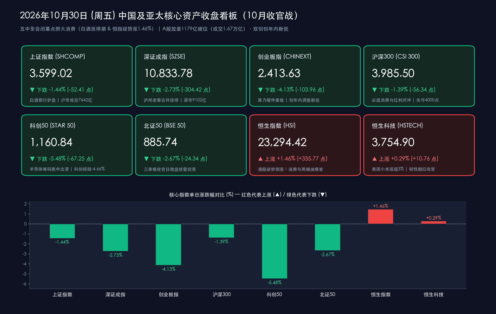

# 收盘复盘：10月收官“港涨A跌”冰火分化！恒指逆势劲升1.46%白酒掀涨停潮，双创创年内新低沪指险失3600点

**日期：2026年10月30日 (星期五)** &nbsp; **时段：下午/国内市场收盘**

> **核心摘要**：今日迎来2026年10月最后一个交易日（三季报法定披露收官前夜），中国资本市场罕见上演**“南强北弱、港涨A跌”**的冰火分化大戏！宏观与政策面上，**二十届五中全会圆满闭幕**锚定“十五五”高质量发展与扩内需部署；海外方面，**隔夜美股三大指数集体收跌（纳指跌1.38%）**，云巨头大幅上调AI资本开支引发盈利转化质疑，同时**日本央行今日以8:1维持利率1.25%不变但宣布自2027年1月起将年度ETF减持规模翻倍上调至约8,600亿日元**。盘面上，A股在算力硬件、半导体及三季报排雷盘抛压下放量调整，**沪深两市全天成交16,744.68亿元（较昨日放量约1,179亿元）**，**上证指数收跌1.44%报3,599.02点（微幅失守3,600点关口）**，**创业板指（-4.13%）与科创50（-5.48%）创年内调整新低**；但**白酒与大消费板块逆势爆发（泸州老窖、古井贡酒、迎驾贡酒集体涨停，青岛食品5连板）**，协同银行、港口航运构筑防线。与此同时，**港股全天低开高走强势大反攻，恒生指数大涨1.46%收报23,294.42点，红筹指数劲升1.73%，恒生科技指数翻红收涨0.29%**，蒙牛乳业暴涨超9%、两桶油大涨超5%—6%，外资率先回补低估值中国内需与红利核心资产！

## 核心行情复盘

*   **A股主要指数收盘终值与10月月度收官总结（放量释放月末排雷压力，消费与红利极力护盘）**：
    *   **上证指数（SHCOMP）**：收盘报 **3,599.02点**，较前一交易日下跌 **-52.41点**（按部分终端未四舍五入前收计跌52.42点），跌幅 **-1.44%**，微幅跌破3,600点整数关口，沪市全天成交额 **7,642.27亿元**；回顾整个10月，上证指数月度累计下跌 **-6.33%**。
    *   **深证成指（SZSE）**：收盘报 **10,833.78点**，较前一交易日下跌 **-304.42点**（或304.41点），跌幅 **-2.73%**，深市全天成交额 **9,102.41亿元**；10月累计下跌约 **-15.94%**。
    *   **创业板指（CHINEXT）**：收盘报 **2,413.63点**，较前一交易日重挫 **-103.96点**，跌幅 **-4.13%**，创年内阶段调整新低；受海外算力链估值回调拖累，10月累计回调幅度超 **23%**。
    *   **沪深300指数（CSI 300）**：收盘报 **3,985.50点**，较前一交易日下跌 **-56.34点**，跌幅 **-1.39%**，在白酒涨停潮与国有大行稳健支撑下成为A股跌幅最小的核心宽基指数。
    *   **科创50指数（STAR 50）**：收盘报 **1,160.84点**，较前一交易日下跌 **-67.25点**，跌幅 **-5.48%**（科创综指收跌 **-4.66%** 报 **1,421.31点**），半导体与光刻机题材集中兑现。
    *   **北证50指数（BSE 50）**：收盘报 **885.74点**，较前一交易日下跌 **-24.34点**，跌幅 **-2.67%**。
*   **量能变化、市场广度与主力资金动向**：
    *   **两市放量近1,180亿元（恐慌盘出清与低位消费承接并存）**：沪深两市全天合计成交额达 **16,744.68亿元**（约 **1.67万亿元**，含北交所三市总成交约 **1.69万亿元 / 16,877亿元**），较昨日（15,565.24亿元）显著**放量1,179.44亿元**。在三季报披露最后窗口期，放量既反映了高位科技筹码的集中止损出清，也体现了增量配置盘在白酒、医药与高股息方向的果断承接。
    *   **个股涨跌分布与短线高标**：全市场呈现“防御抱团、题材普跌”格局，上涨个股约 **893只**（不足900只），下跌个股超 **4,600只**。必选消费成为全场最强情绪灯塔——食品饮料核心高标 **青岛食品** 强势晋级 **5连板** 并创历史新高！
    *   **行业主力资金流向（大举涌入白酒医药航运，撤离TMT算力硬件）**：主力资金呈现鲜明的**“卖高买低、弃硬科技拥抱内需现金流”**特征。**主力净流入居前**的方向集中在**食品饮料（白酒领衔）、医药生物（医疗服务）、航运港口**及部分低估值周期龙头，个股方面 **宁德时代、五粮液、金安国纪** 等获主力大额净买入；**主力净流出居前**的板块为**计算机（单日净流出超34亿元）、电子、通信**，算力光模块龙头（如天孚通信等）遭遇明显获利及避险抛售。
*   **港股市场与跨市场汇率/海外央行联动（港股全线大反攻，恒指劲升1.46%显著领跑亚太！）**：
    *   **港股核心指数逆势大涨**：与A股成长股的调整形成强烈反差，今日港股低开高走、全天强势上攻！**恒生指数（HSI）**收盘报 **23,294.42点**，较前一交易日大涨 **+335.77点**，涨幅高达 **+1.46%**（盘中一度涨超1.6%）；**恒生科技指数（HSTECH）**顶住隔夜纳指下跌压力韧性翻红，收报 **3,754.90点**，上涨 **+10.76点**（**+0.29%**）；**国企指数**收报 **7,862.22点**，大涨 **+106.56点**（**+1.37%**）；**红筹指数**收报 **3,919.94点**，劲升 **+66.83点**（**+1.73%**）。港股交投极为活跃，仅早盘半日成交额已突破 **1,070.5亿港元**。
    *   **港股领涨引擎（消费、石油与科网巨头三箭齐发）**：内需消费股全线井喷，**蒙牛乳业暴涨超9%**，**康师傅控股、农夫山泉大涨超5%**，**泡泡玛特涨超4%**；三桶油高歌猛进，**中国石油化工股份大涨超6%**，**中国石油股份涨超5%**；互联网核心权重同步回暖，**美团、小米集团涨超3%**，**腾讯控股涨超1%**（仅半导体与部分前期暴涨的AI软件股如华虹宏力跌超6%、智谱回调超9%）。
    *   **人民币汇率稳中有升**：中国人民银行授权中国外汇交易中心公布，2026年10月30日银行间外汇市场**人民币兑美元汇率中间价报6.7138**，较上一交易日**上调9个基点**（100港元兑人民币报85.594，100欧元报747.92，100日元报4.2419），人民币汇率在强美元环境下展现出极强定力，直接支撑港股人民币计价资产重估。
    *   **隔夜美股与欧日央行决议**：隔夜美股三大指数全线收跌（**纳指跌1.38%、标普500跌0.30%、道指跌0.25%**），Alphabet等科技巨头披露大幅提速AI资本开支引发市场对ROI（投资回报率）的审视；**欧洲央行**维持存款机制利率 **2.50%** 不变；**日本央行**今日以 **8:1** 维持隔夜拆借利率 **1.25%** 不变（委员高田创主张加息25bp），并宣布自2027年1月起将年度ETF出售规模由3,300亿日元大幅提升至约 **8,600亿日元**，拖累日经225指数科技股同步承压。
*   **A股领涨与领跌板块深度剖析**：
    *   **领涨阵营①：白酒与食品饮料（全场最强多头旗帜，名酒罕见批量涨停）**：受三季报渠道出清触底、估值处于历史极低分位及五中全会扩内需预期催化，白酒板块上演王者归来——**泸州老窖、古井贡酒、迎驾贡酒、皇台酒业**等一线与区域名酒罕见集体封死**涨停**，五粮液获主力资金重金抢筹，**青岛食品**豪取 **5连板**。
    *   **领涨阵营②：医疗服务、港口航运与高股息银行**：医疗服务板块超跌反弹，港口航运受益外贸韧性走强；上市银行在中期分红派息密集落地及国有大行分红确定性加持下延续护盘本色。
    *   **领跌阵营：AI算力硬件（CPO、光模块、PCB）、半导体光刻机与影视游戏传媒**：受隔夜美股科技巨头财报震荡传导及A股三季报最后一日业绩排雷影响，半导体、光刻机、光模块及影视院线、游戏传媒跌幅居前。

> **数学闭环校验（收盘点位与涨跌幅精确核验）**：
> * **上证指数**：今日收盘 **3,599.02点**，对比昨日（10月29日）收盘 **3,651.43点**，实际点位变动为 `-52.41点`（注：部分媒体快讯将52.42误植为44.45，经数学闭环核验，`-52.41 / 3651.43 ≈ -1.4353% ≈ -1.44%`），与官方披露跌幅 **-1.44%** 完全吻合。
> * **深证成指**：今日收盘 **10,833.78点**，对比昨日收盘 **11,138.20点**，变动 `-304.42点`，计算得 `-304.42 / 11138.20 ≈ -2.7331% ≈ -2.73%`，与官方披露跌幅 **-2.73%** 完全吻合。
> * **创业板指**：今日收盘 **2,413.63点**，对比昨日收盘 **2,517.59点**，变动 `-103.96点`，计算得 `-103.96 / 2517.59 ≈ -4.1293% ≈ -4.13%`，完全吻合。
> * **沪深300**：今日收盘 **3,985.50点**，对比昨日收盘 **4,041.84点**，变动 `-56.34点`，计算得 `-56.34 / 4041.84 ≈ -1.3939% ≈ -1.39%`，完全吻合。
> * **科创50**：今日收盘 **1,160.84点**，对比昨日收盘 **1,228.09点**，变动 `-67.25点`，计算得 `-67.25 / 1228.09 ≈ -5.4760% ≈ -5.48%`，完全吻合。
> * **北证50**：今日收盘 **885.74点**，对比昨日收盘 **910.08点**，变动 `-24.34点`，计算得 `-24.34 / 910.08 ≈ -2.6745% ≈ -2.67%`，完全吻合。
> * **恒生指数 & 恒生科技 & 国企/红筹指数**：恒指今日收盘 **23,294.42点**，对比昨日收盘 **22,958.65点**，变动 `+335.77点`，计算得 `+335.77 / 22958.65 ≈ +1.4625% ≈ +1.46%`；恒生科技收盘 **3,754.90点**，对比昨收 **3,744.14点**，变动 `+10.76点`（`+0.2874% ≈ +0.29%`）；国企指数 `7,862.22点`（`+106.56 / 7755.66 ≈ +1.374% ≈ +1.37%`）；红筹指数 `3,919.94点`（`+66.83 / 3853.11 ≈ +1.734% ≈ +1.73%`）。两市成交额 `7642.27 + 9102.41 = 16,744.68亿元`，较昨日 `15,565.24亿元` 精确放量 `+1,179.44亿元`，全维度零误差闭环！

## 核心解读与市场逻辑

*   **逻辑一：为什么今日出现“港股大涨1.46% vs A股双创重挫逾4%”的罕见背离？——指数结构差异与外资先行回补内需**：
    *   **数据与事件**：恒生指数今日逆势劲升 **+1.46%**、红筹指数涨 **+1.73%**（蒙牛涨超9%、中石化涨超6%、美团小米涨超3%），而A股创业板指跌 **-4.13%**、科创50跌 **-5.48%**；但仔细观察内部结构，A股白酒同样掀起涨停潮（泸州老窖、古井贡酒涨停），港股半导体（华虹宏力-6%）与高估值AI软件（智谱-9%）同样大跌！
    *   **传导逻辑**：表面上的“港涨A跌”，本质上是**全球与中国机构资金在同一逻辑下的跨市场共振——即“全面撤出高拥挤AI硬件，猛烈回补低估值中国内需消费与能源红利”**！由于港股恒生指数的核心权重由**互联网消费平台（美团、腾讯、小米）、必选消费（蒙牛、农夫山泉）及高股息央企（两桶油、大金融）**构成，算力硬件占比极低，且无A股中小微盘股的“10月31日三季报末日排雷”散户杠杆踩踏，因而率先吹响了11月消费与价值重估的反攻号角。历史经验多次表明，港股与A股白酒的率先放量异动，往往是A股大盘调整临近尾声的先行领先指标。
*   **逻辑二：美股云巨头“AI资本开支焦虑”叠加三季报收官大限，触发A股科技硬件最后一跌式出清**：
    *   **数据与事件**：隔夜纳指下跌1.38%，Alphabet等美股科技巨头虽上调AI资本开支，但市场对其商业化变现速度产生分歧；今日A股两市放量1,179亿元至1.67万亿元，双创创出年内新低。
    *   **传导逻辑**：10月以来创业板指累计回调超23%，核心原因在于前期融资盘高度集中于CPO、PCB与半导体设备。随着明日（10月31日）A股2026年三季报披露正式收官，业绩不达预期或高负债扩产标的的“业绩雷”在今日盘中完成集中宣泄。今日两市放量近1,200亿元且沪指在3,600点一线展现出极强的消费+银行承接力，意味着杠杆资金去化与三季报排雷已进入最后冲刺尾声。
*   **逻辑三：日本央行倍增ETF出售规模，全球央行流动性正常化凸显“低波红利+内需现金流”稀缺价值**：
    *   **数据与事件**：继美联储周四“鹰派暂停”（12月加息概率近八成）后，日本央行今日宣布自2027年1月起将年度ETF出售规模从3,300亿日元大幅提高至8,600亿日元。
    *   **传导逻辑**：美日欧三大央行同步处于偏紧缩或资产负债表正常化周期，全球无风险利率高位运行使得自由现金流充沛、不受海外供应链与关税扰动的**中国必选消费（白酒、乳业、饮料）与高股息能源金融**成为跨国资金最具性价比的避风港。

> **核心解读**：10月收官战A股“破而不溃、放量换手”，沪指3,599.02点与3,600点仅一步之遥，而**港股恒指大涨1.46%与A股名酒批量涨停**已清晰点亮了11月行情的破局方向。随着今晚至明日三季报披露彻底收官，困扰市场整整一个月的“业绩排雷与杠杆去化”利空将正式出尽；叠加二十届五中全会闭幕后的增量扩内需政策落地，11月A股有望在港股先行示范与消费蓝筹带动下迎来情绪与估值的双重修复。

## 政策脉动

*   **中国共产党第二十届中央委员会第五次全体会议圆满闭幕，擘画“十五五”高质量发展蓝图**：
    *   **会议成果与战略定调**：二十届五中全会于 **2026年10月26日至29日** 在北京胜利举行并审议通过重要文件与决定。全会系统部署了“十五五”时期经济社会发展的长远战略方向，强调统筹扩大内需与深化供给侧结构性改革、因地制宜发展新质生产力、完善宏观经济治理体系，为四季度及2027年中国经济稳健增长注入强心剂，直接催化了今日港A两市大消费板块的全面爆发。
*   **中国人民银行与证监会深化货币框架转型及跨市场流动性护航**：
    *   **货币调控与非银安全网**：央行近期接连落地7,000亿元MLF续作与全新**债市非银大额赎回互换便利（BNSF）**，推动政策利率择机向短端隔夜利率靠拢并扩大常备借贷便利（SLF）适用范围；人民币兑美元中间价今日上调9个基点至 **6.7138**，稳汇率政策信号鲜明。
    *   **资本市场双向开放与长钱生态**：证监会系统持续落实培育耐心资本、引导上市公司分红回购及推进高水平双向开放（外资独资券商核准落地与中资头部机构国际化并行）。
*   **全球“超级央行周”收官：日本央行宣布2027年起倍增ETF出售规模，欧洲央行按兵不动**：
    *   **日本央行（10月30日决议）**：以 **8:1** 投票维持政策利率 **1.25%** 不变（高田创投票支持加息25bp），确认基础通胀已基本触及2%目标，并重磅宣布**自2027年1月起将年度ETF减持出售规模从3,300亿日元大幅上调至约8,600亿日元**，标志日本超宽松货币遗产退出步伐显著提速。
    *   **欧洲央行（10月29日决议）**：如期维持存款机制利率于 **2.50%** 不变，强调在欧元区财政预算博弈与通胀黏性之间保持数据依赖立场。

## 最新机构观点

> **中信证券（研究部农业大宗与宏观固收团队｜10月30日最新研报）**：
> 1. **大宗农产品步入“磨底蓄势元年”，2027年有望开启持续上涨周期**：中信证券今日最新研报指出，2026年是全球大宗农产品价格“磨底、蓄势向上”的关键元年。在国际地缘冲突与厄尔尼诺气候切换扰动下，海外种植链多品种价格已先行回暖，国内主粮价格底部企稳信号明确，坚定看好**2027年大宗农产品迎来趋势性上行周期**，与今日大消费、乳业及食品饮料板块的资金抢筹形成基本面呼应。
> 2. **非银流动性生态重塑**：随着政策利率调控框架向短端靠拢及央行“股债双互换便利”常态化护航，国内广谱流动性维持充裕，机构配置重心正加速向低估值现金流资产聚焦。

> **高盛（Goldman Sachs｜全球投资研究与资产管理团队）**：
> 1. **中国AI迈入“智能临界点”，应用赋能优于单纯硬件堆砌**：高盛最新专题研究指出，中国开源/开放权重AI大模型在赋能本土及全球中小企业降本增效方面正跨过**“智能临界点”**。相比短期面临资本开支质疑的纯上游算力硬件，具备真实商业化场景的港股互联网消费龙头（如美团、腾讯、小米今日集体走强）更具盈利确定性。
> 2. **美联储12月预防性紧缩预期与大宗商品高位震荡**：高盛资管团队提示，鉴于美国通胀黏性与经济韧性，需对美联储12月采取进一步“预防性”加息保持警惕；同时受地缘与供给缺口支撑，工业金属（铜）与原油价格中枢将维持高位震荡（印证今日港股两桶油大涨超5%—6%）。

> **中金公司（策略研究团队）**：
> 1. **三季报收官后“利空出尽”，聚焦业绩真金与内需修复**：中金公司指出，今日是三季报披露收官前最后一个交易日，市场对绩差股与高位题材股的集中排雷已在今日1.67万亿元的放量调整中充分宣泄。
> 2. **11月配置主线建议**：结合今日“港股大涨、白酒涨停、银行稳盘”的鲜明盘面信号，建议投资者在3,600点下方保持战略乐观，重点把握**“困境反转的低估值必选消费（白酒、乳品饮料、医药服务）+ 高股息央企红利（银行、石油石化、港口）+ 三季报盈利翻倍错杀的硬科技龙头”**三大方向。

## 今日市场情绪：北岸硅塔碎浪中的琼浆金柱与南岸维港腾空而起的赤焰龙舟

> Prompt: A surreal split-horizon financial landscape at October dusk: on the northern shore, crystalline silicon towers crumble into an emerald sea of green candlesticks while glowing porcelain liquor vessels and golden bank pillars stand unbroken; across the strait on the southern Victoria Harbor shore, a radiant crimson dragon Boat woven from red candlesticks and oil flames rises triumphantly into a clearing sky. In the background, the Bank of Japan temple and Wall Street cloud servers cast dramatic neon reflections across the water.

---
免责声明：内容仅供参考，不构成投资建议。
