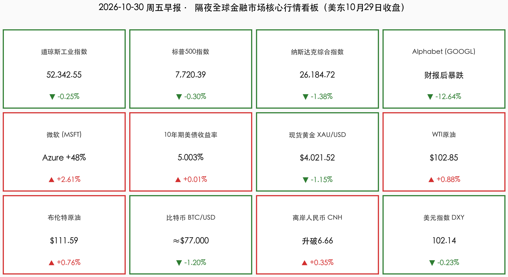

# 🌏 全球市场早报：Alphabet创上市22年最惨单日暴跌（-12.64%），单日蒸发5000亿美元；亚马逊AWS狂飙39%仍遭盘后抛售，AI军备竞赛进入"现金流审判日"

**日期：2026年10月30日 (星期五)** &nbsp; **时段：早报 (全球市场隔夜收盘复盘 · 模式A)**

> **核心摘要**：美东时间10月29日（周四），美股三大指数集体回落：**道指跌-0.25%报52,342.55点，标普500跌-0.30%报7,720.39点，纳指重挫-1.38%报26,184.72点**。核心冲击来自 **Alphabet 单日暴跌-12.64%**（创2004年上市以来最大单日跌幅，市值单日蒸发约5,000亿美元）——搜索营收增速放缓至12%（五季度最慢）、单季资本开支激增114%至514亿美元、自由现金流连续第二季转负（-91亿美元）。但盘面深度远好于指数：**标普500约八成成分股收涨，小盘股逆势大涨**，抛售高度集中于大型科技股。盘后财报延续"AI审判"：**亚马逊AWS增速39.3%但单季资本开支773亿美元、盘后跌逾5%；英特尔Q4指引暴雷、盘后一度暴跌约21%**。宏观端，**Q3 GDP年化+3.4%超预期、9月PCE通胀升至3.6%**，强化美联储12月加息预期（概率75%–86%）。

---

## 核心行情复盘

*   **一、 美股核心指数隔夜收盘终值（科技巨头杀估值，市场广度意外坚挺）**：
    *   **道琼斯工业平均指数 (DJI)**：收盘报 **52,342.55 点**，单日下跌 **-132.54 点（-0.25%）** 🟢（前一交易日收盘 **52,475.10 点**），工业与价值权重股相对抗跌。
    *   **标普 500 指数 (SPX)**：收盘报 **7,720.39 点**，单日下跌 **-23.59 点（-0.30%）** 🟢（前一交易日收盘 **7,743.98 点**），终结三连阳；指数小跌背后是极致分化——**约八成成分股当日收涨**，跌幅几乎全部由超大市值科技股贡献。
    *   **纳斯达克综合指数 (IXIC)**：收盘报 **26,184.72 点**，单日重挫 **-365.12 点（-1.38%）** 🟢（前一交易日收盘 **26,549.85 点**），Alphabet 暴跌拖累通信服务板块大幅走低。
    *   **市场广度与风格**：**罗素 2000 小盘股指数逆势大涨**，资金从"AI烧钱巨头"向内需与价值板块轮动的迹象明确——市场担忧的核心并非AI技术本身，而是科技巨头为维持竞争优势正在投入的失控成本。

*   **二、 财报核爆点：Alphabet 史诗级暴跌 + 盘后"双雷"（亚马逊、英特尔）**：
    *   **Alphabet (GOOGL) — 单日暴跌 -12.64%，创2004年上市以来最大单日跌幅** 🟢：
        *   **市值单日蒸发约 5,000 亿美元**；Q3 总营收 **$127.6B（+25%）** 仅略低于预期，谷歌云营收 **翻倍至 $30.7B（+103%）**、营业利润率扩至 **36.2%**、云营业利润 $11.1B——但市场完全无视云业务亮点。
        *   **抛售导火索一：搜索现金牛失速**——搜索营收增速由 Q2 的 +17% 放缓至 **+12%（$633.5亿 vs 预期 $649.6亿）**，为五个季度最慢；AI Overviews 已触发 **48%** 的受追踪查询（一年前约30%），直接给出答案的AI搜索正在蚕食付费点击（付费点击增速由去年5%放缓至2%），谷歌首席商务官承认AI查询"变现能力较低"——这被市场定义为**结构性而非周期性冲击**。
        *   **抛售导火索二：烧钱速度失控**——Q3 资本开支 **激增114%至 $51.4B（约占当季营收四成）**，自由现金流连续第二季为负（**-91亿美元，远超分析师预期的 -27亿**），全年资本开支指引 **$1950亿–2050亿** 并暗示2027年"显著增加"；EPS $2.12 同比下滑。市场正将谷歌从"高质量成长股"按"高资本开支、低自由现金流的基础设施公司"逻辑重新定价，**多家机构下调评级与目标价**。
    *   **微软 (MSFT) — 逆势收涨 +2.61%，AI 投入"确定性兑现"的唯一幸存者** 🔴：
        *   FY27 Q1 营收 **$92.28B（+19%）** 超预期；**Azure 增速由43%加快至48%（约$331.7亿）**；Microsoft Cloud 收入 $63.9B（+30%）；GAAP 净利润 $36.6B（+32%），摊薄 EPS $4.92；商业剩余履约义务（RPO）**+73%至 $6,770亿**（略低于约$7,056亿预期）。
        *   关键差异：单季资本开支 **$45.2B（+30%，低于约$500亿预期）**，仍产生 **约$186亿正自由现金流**——与 Alphabet、亚马逊现金流转负形成鲜明对照。同日微软提交文件拟发行 **至少250亿美元债券**（2017年以来首次在美国本土发债），标志AI融资进入"借钱建AI"的资产负债表时代。
    *   **亚马逊 (AMZN) — AWS +39.3% 仍遭盘后抛售逾5%** 🟢：
        *   Q3 净销售额 **+12% 至 $2,019亿**（略低于约$2,021.6亿一致预期）；**AWS 收入 +39.3% 至 $460亿**；经营利润 $28.1B，AWS 运营利润率 **13.9% 创历史新高**。
        *   但单季资本开支高达 **$77.3B**，推动滚动12个月自由现金流 **净流出 $42.4B**，全年资本开支指引约 **$2,200亿**——市场已从"先投入后回报"转向追问商业化进度。
    *   **英特尔 (INTC) — Q4 指引暴雷，盘后一度暴跌约 -21%** 🟢：
        *   Q3 营收 **$16.5B（+21%）**、EPS $0.52 超预期，数据中心与AI业务收入 **+78% 至 $7.3B**；但 **Q4 营收指引 $150亿–160亿（远低于市场约$171亿预期）**，毛利率指引由 Q3 的43% **骤降至38%**，PC客户端营收同比 -5%——纯硬件供应商在AI浪潮中议价权与利润率双承压。
    *   **其他焦点**：**礼来 (LLY)** Q3 业绩超预期收涨；**DoorDash 宣布以 $170亿 收购 Instacart**，股价大涨；英伟达因美国司法部对其 **$119亿收购 Hugging Face** 交易的反垄断问询持续承压（周三已跌约1.7%）。

*   **三、 跨资产市场：油强金弱、比特币失守8万美元、人民币走强**：
    *   **国际原油（中东供应担忧重燃）**：**WTI 原油** 收盘报 **$102.85/桶（+0.88%）** 🔴；**布伦特原油** 报 **$111.59/桶（+0.76%）** 🔴。沙特炼厂遇袭后续发酵叠加美国务卿万斯寻求重启伊朗和谈的双向扰动，油价高位震荡。
    *   **贵金属（强GDP + 鹰派预期压制）**：**现货黄金 (XAU/USD)** 下跌 **-1.15% 报 $4,021.52/盎司** 🟢，GDP超预期与12月加息押注削弱避险溢价。
    *   **美国国债（10年期坚守5%上方）**：**10年期美债收益率** 报 **5.003%**（+0.4bp）🔴；**30年期报 5.331%**（+2bp）。3.4%的GDP与3.6%的PCE通胀组合令长端收益率易上难下。
    *   **外汇**：**美元指数** 报 **102.14（-0.23%）** 🟢；**离岸人民币升破 6.66**，在岸夜盘收报 6.6660，人民币中间价报 6.7147（上调18点）——美元走弱与五中全会政策预期共振支撑人民币资产。
    *   **加密资产**：**比特币 (BTC/USD)** 亚市时段报 **约 $77,000（约-1.2%）** 🟢，再度跌破8万美元整数关口；10年期美债收益率高企令生息资产相对投机性资产的吸引力持续占优。

> **数学闭环校验（收盘终值与涨跌幅交叉核验）**：
> * **美股核心指数**：道指 `(52,342.55 − 52,475.10) / 52,475.10 = -0.2526% ≈ -0.25%`；标普500 `(7,720.39 − 7,743.98) / 7,743.98 = -0.3046% ≈ -0.30%`；纳指 `(26,184.72 − 26,549.85) / 26,549.85 = -1.3753% ≈ -1.38%`，全部满足精度闭环要求。

*   **四、 A股前一日（10月29日）回顾与今日联动展望**：
    *   **昨日A股全线收跌**：上证指数报 **3,651.43 点（-0.82%）**，深证成指 **-2.92%**，创业板指报 **2,517.59 点（-4.45%）**，科创50 **-4.27%**；沪深两市成交额约 **1.57万亿元，较前日缩量约714亿元**，全市场超4,700只个股飘绿，科技成长方向遭遇剧烈杀估值。
    *   **今日联动逻辑**：隔夜 Alphabet 暴跌 + 亚马逊/英特尔盘后双杀，对A股算力链（光模块、算力租赁）构成情绪压制；但"微软式确定性"（Azure +48%、RPO +73%）证明AI需求本身仍在加速，且离岸人民币升破6.66、五中全会公报落地（10月29日闭幕）提供政策对冲——**今日A股大概率低开分化，国产算力自主可控主线的相对收益逻辑反而可能强化**。

---

## 核心解读与市场逻辑

> **逻辑一：Alphabet 暴跌 -12.64% —— AI 估值逻辑的"分水岭时刻"，从"收入增速"切换到"现金流质量"**
> 这是本轮AI牛市以来最具象征意义的单日事件：一家单季营收+25%、云业务+103%的公司，因为"搜索失速 + 烧钱失控"被单日抹去5,000亿美元市值。市场定价公式已发生根本切换：
> 1. **变现悖论被正式定价**：AI Overviews 覆盖48%的查询、商业意图页面AI覆盖率半年增71%——AI正在吞噬谷歌自己的广告变现效率，这是结构性侵蚀而非周期性波动；
> 2. **资本开支容忍度见顶**：单季 CapEx 占营收四成、FCF -91亿（预期值的四倍）、2027年还要"显著增加"——机构对"军备竞赛可持续性"的本能警惕被彻底激活；
> 3. **幸存者溢价**：微软在同一周交出 Azure +48% + 正自由现金流$186亿，证明市场的审判标准不是"投不投AI"，而是"投入的每一美元能否看到 recurring revenue 与现金流纪律"。

> **逻辑二：盘后双雷（亚马逊 -5%、英特尔 -21%）—— AI 回报的"分层审判"正在展开**
> 两份财报揭示了AI繁荣的两种结局：
> 1. **掌握客户关系与应用场景的超大规模云厂商**（AWS +39.3%、Azure +48%）仍维持定价权与收入可见性，但资本市场已不再为"收入增长"单独付溢价——亚马逊单季$773亿CapEx、滚动FCF -$424亿，盘后照样跌逾5%；
> 2. **纯硬件供应商**（英特尔Q4指引暴雷、毛利率骤降5个百分点至38%）议价空间被极限压缩，成为AI军备竞赛中的"成本承担者"；
> 3. **信贷市场同步亮起红灯**：AI云服务商 CoreWeave 五年期CDS利差于10月15日飙至 **1,194.5个基点历史新高，隐含违约概率超60%**——AI交易的风险裂痕正从股市蔓延至债市。

> **逻辑三：强GDP + 高PCE + 鹰派美联储 —— "再通胀交易"闭环压制长久期资产**
> Q3 GDP 年化 **+3.4%**（Q2为2.2%，投资、消费、政府支出共同拉动）+ 9月 PCE 同比 **3.6%**（环比+0.5%）+ 核心PCE **3.1%**——这份"增长强、通胀黏"的数据组合，恰好落在 FOMC 10-2 分裂投票（Cook 与 Hammack 主张立即加息25bp）之后48小时。逻辑闭环为：**油价百元上方运行 → 通胀预期居高 → 12月加息概率75%–86% → 10年期收益率坚守5% → 黄金回落（-1.15%）、比特币失守8万、高估值长久期科技股承压**。下一个关键节点是12月FOMC（将发布新点阵图）与11月18日公布的10月会议纪要。

---

## 政策脉动

*   **一、 美联储10月FOMC决议（美东10月28日）后续发酵**：
    *   以 **10-2** 投票维持联邦基金利率 **3.75%–4.00%** 不变，反对票来自理事 **Cook** 与克利夫兰联储主席 **Hammack**（主张立即加息25bp）；主席 **Warsh** 强调政治因素"毫无影响"，同时宣布 **2027年起议息会议缩减至每年六次**。
    *   路透社100位经济学家调查：**全部预期12月加息**；市场定价的12月加息概率维持在 **75%–86%** 高位。本次为纯声明会议（无SEP点阵图），**10月会议纪要定于11月18日公布**。
*   **二、 AI 融资的"债券化"拐点（结构性政策/监管信号）**：
    *   据高盛统计，**2026年科技行业AI相关债务发行已达 $4,890亿，远超2025年全年的 $3,220亿**；微软10月29日提交 **至少$250亿债券发行文件**（2017年以来首次在美发债）——AI融资逻辑正从"用赚来的钱建AI"转向"借钱建AI"。
    *   **监管逆风**：美国司法部已就英伟达 **$129.3亿收购 Hugging Face** 展开竞争问询，审查覆盖其整条"影响力收购链"（SchedMD、Run:ai、Groq $200亿许可协议）；英伟达被曝CEO与中方情报关联的报道亦在发酵。
*   **三、 国内政策窗口**：
    *   **二十届五中全会已于10月29日闭幕**，"十五五"规划建议公报定调科技自立自强与扩内需，重点关注公报全文发布后对A股国产算力、新质生产力主线的资金指引。
    *   人民币中间价报 **6.7147（上调18点）**，离岸人民币升破6.66——汇率企稳为北向资金情绪提供支撑。

---

## 最新机构观点

> **高盛 (Goldman Sachs) ——《AI融资的债券化时代：机会与裂缝并存》**：
> * 统计2026年AI相关债务发行已达 **$4,890亿**（2025全年仅$3,220亿）；预计五大超大规模云厂商 **2026年投资级债券发行约$2,500亿（约占其资本开支33%）、2027年约$4,000亿**。
> * 个股层面：10月19日将 CoreWeave 上调至"买入"但目标价由139美元下调至106美元——评级与目标价的背离折射出对整个AI信贷链条的谨慎。

> **摩根士丹利 (Morgan Stanley) ——《数据中心资本开支逼近$8,500亿，AI债务承销成最赚钱业务》**：
> * CEO Ted Pick 表示 **2026年数据中心资本开支正逼近 $8,500亿**，大幅高于2025年11月时 $5,750亿 的预测；大摩2026年已超越高盛成为头部AI债务交易银行，全球AI相关债务发行接近 $5,700亿。
> * 银行既服务AI也使用AI：数据中心的发债、股权融资、并购整合全面转化为投行业务机会，华尔街是AI资本开支周期的"卖铲人"。

> **瑞银 (UBS) / Gartner ——《万亿资本开支的减值警告》**：
> * 瑞银测算所覆盖云与AI基础设施企业 **2026–2028年资本开支分别约 $1.009万亿、$1.447万亿、$1.619万亿**；
> * **Gartner（10月14日）警告**：若维持当前投资节奏，到2030年 **逾 $3.5万亿 AI基础设施支出可能面临减值，超80%的新兴云服务商将停止独立运营**。摩根大通则认为银行体系对AI信贷的直接风险敞口有限。

> **Capital.com（Daniela Hathorn）——《市场不再奖励"烧钱"，开始奖励"证据"》**：
> * "Alphabet与微软的分化财报凸显了投资者情绪转变：市场不再奖励单纯重金投入AI的公司，而是越来越要求看到投入产生可持续利润的证据。在纳指承压之际，亚马逊财报是另一场重要考验。"

---

## 今日市场情绪：巨塔裂金，鹰临绝顶

> Prompt: A colossal glass lighthouse shaped like a giant magnifying glass cracking apart on a stormy digital coastline, golden coins gushing from its fractures into a dark emerald sea of falling candlestick charts, while a resilient azure cloud titan ascends a bridge made of silver bonds toward the sky. In the background, a marble Federal Reserve temple with two hawk statues on its roof glows under a blood-orange twilight, and a black oil barrel floats beside a flickering five-percent yield beacon.

---

> **免责声明**：内容仅供参考，不构成投资建议。数据来源：纽约证券交易所（NYSE）、纳斯达克交易所（NASDAQ）、美联储（Federal Reserve / FOMC声明）、美国经济分析局（Q3 GDP初值、9月PCE）、微软/Alphabet/亚马逊/英特尔投资者关系公告、Yahoo Finance、新浪财经、TradingKey、财新、钛媒体 Edge AI Daily 及高盛（Goldman Sachs）、摩根士丹利（Morgan Stanley）、摩根大通（JPMorgan）、瑞银（UBS）、Gartner、Capital.com 最新研究观点；欧美行情数据截至美东时间2026年10月29日收盘（北京时间2026年10月30日凌晨）。

🤖 生成模型：Kimi Code CLI <!-- model-stamp -->
