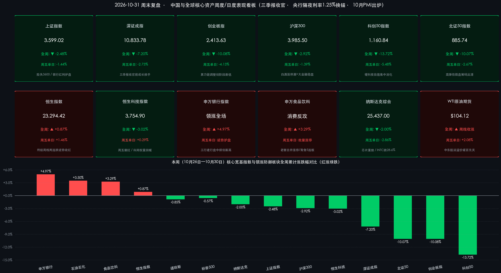

# 周末复盘：央行官宣“1.25%隔夜换锚”叠三季报5.1万亿收官！10月PMI回落至49.3%，下周迎美中期选举与人大常委会大考

**日期：2026年10月31日 (星期六)** &nbsp; **时段：下午/国内与全球市场周末复盘**

> **核心摘要**：2026年10月收官周（10月26日—10月30日），全球及中国权益市场在三季报排雷与海外AI资本开支焦虑共振下上演剧烈“高低切换”——**A股上证指数全周累跌2.48%报3,599.02点，创业板指（周跌10.08%）与科创50（周跌13.72%）深度消化估值，但银行（周涨4.97%）、石油石化（周涨3.50%）、食品饮料（周涨3.29%）构筑铜墙铁壁，港股恒生指数周五劲升1.46%、全周逆势收涨0.87%终结周线两连跌**。过去48小时四大重磅事件密集落地：**①中国人民银行历史性官宣自11月2日起将主要政策利率由7天期切换为“1.25%隔夜逆回购”**；**②今日（10月31日）A股2026年三季报正式收官，逾5,570家公司合计归母净利润达5.10万亿元（同比增约8%），超七成公司实现盈利，“业绩雷”彻底出清**；**③国家统计局今日公布10月制造业PMI回落至49.3%（高技术制造业51.3%仍强扩张），打开四季度增量政策窗口**；**④隔夜美股遭遇“黑色星期五”（纳指跌2.86%、英特尔暴跌28.58%），WTI原油站上104美元而黄金跌破3,900美元**。展望下周（11月2日—8日），**十四届全国人大常委会第二十五次会议、美国中期选举投票与10月非农报告**将迎来历史性交汇！

## 核心资产周度/日度表现回顾

*   **中国A股核心宽基指数（10月26日—10月30日全周累计 & 10月30日周五单日收盘终值）**：
    *   **上证指数（SHCOMP）**：周五收盘报 **3,599.02点**；**周五单日下跌 -1.44%**（跌52.41点），**全周累计下跌 -2.48%**（较上周五10月23日收盘3,690.48点回落91.46点；10月月度累计下跌 **-6.33%**）。在国有大行与必选消费护盘下，沪指微幅暂别3,600点关口，韧性显著优于成长指数。
    *   **深证成指（SZSE）**：周五收盘报 **10,833.78点**；**周五单日下跌 -2.73%**（跌304.42点），**全周累计下跌 -7.20%**（较上周五11,673.83点回落840.05点；10月月度累计下跌 **-15.94%**）。
    *   **创业板指（CHINEXT）**：周五收盘报 **2,413.63点**；**周五单日重挫 -4.13%**（跌103.96点），**全周累计下跌 -10.08%**（较上周五2,684.10点回落270.47点；10月累计回调超 **23%**），受海外算力链估值重估及融资盘去化影响创阶段调整新低。
    *   **沪深300指数（CSI 300）**：周五收盘报 **3,985.50点**；**周五单日下跌 -1.39%**（跌56.34点），**全周累计下跌 -2.92%**（较上周五4,105.33点回落119.83点），核心蓝筹与现金流龙头展现出扎实抗跌底色。
    *   **科创50指数（STAR 50）**：周五收盘报 **1,160.84点**；**周五单日下跌 -5.48%**（跌67.25点），**全周累计下跌 -13.72%**（部分统计口径记为-13.73%，较上周五1,345.51点回落184.67点），半导体与光刻机题材在三季报窗口期集中兑现。
    *   **北证50指数（BSE 50）**：周五收盘报 **885.74点**；**周五单日下跌 -2.67%**（跌24.34点），**全周累计下跌 -10.07%**（较上周五984.90点回落99.16点）。
*   **港股市场周度/日度表现（“南强北弱”率先企稳，恒指终结周线两连跌！）**：
    *   **恒生指数（HSI）**：周五收盘报 **23,294.42点**；**周五单日逆势大涨 +1.46%**（涨335.77点，盘中一度重返23,400点上方），**全周累计上涨 +0.87%**（较上周五23,093.37点净涨201.05点；10月月度跌 **-5.36%**），成功终结此前连续两周下跌颓势！
    *   **恒生科技指数（HSTECH）**：周五收盘报 **3,754.90点**；**周五单日翻红收涨 +0.29%**（涨10.76点），**全周累计下跌 -3.02%**（较上周五3,871.66点回落116.76点；10月月度累计跌 **-11.73%**）。
    *   **国企指数与红筹指数**：周五单日**国企指数大涨 +1.37%** 收报 **7,862.22点**，**红筹指数劲升 +1.73%** 收报 **3,919.94点**；内需乳制品（蒙牛乳业周五暴涨超9%）、餐饮饮料（康师傅、农夫山泉涨超5%）、石油央企（中石化涨超6%、中石油涨超5%）及科网巨头（美团、小米涨超3%，腾讯涨超1%）成为港股逆势领跑亚太的核心引擎。
*   **周度量能、资金动向与申万一级行业极化图谱**：
    *   **A股成交额与宽基ETF托底**：本周（10月26日—30日）沪深两市日均成交额维持在 **1.65万亿—1.69万亿元** 区间；其中周五收官日沪深两市成交 **16,744.68亿元**（含北交所三市合计约 **1.69万亿元**），较周四放量近 **1,180亿元**。尽管周内多日超4,500只个股调整，但机构与长线资金持续借道宽基ETF及高股息蓝筹逆势承接。
    *   **南向港股通资金与外资动向**：周五单日南向资金成交 **741.91亿港元**、净卖出 **35.61亿港元**（10月全月累计净流出 **279.51亿港元**，主要减持高位芯片股）；但周五港股放量大涨1.46%，清晰印证**海外长线外资与亚太配置盘正绕开拥挤硬件、率先大举回补低估值中国内需与央企红利资产**。
    *   **申万一级行业周涨跌幅（极致“高低切换”）**：本周领涨前三行业为 **银行（全周大涨 +4.97%，工商银行、建设银行盘中频创历史新高）**、**石油石化（全周上涨 +3.50%）**、**食品饮料（全周上涨 +3.29%，周五泸州老窖、古井贡酒、迎驾贡酒集体涨停，青岛食品豪取5连板）**；领跌前三行业为 **通信（全周重挫 -14.77%）**、**电子（全周下跌 -13.82%）** 及 **计算机（全周跌幅超 -10%）**。
*   **全球跨市场核心资产对标（美东10月30日周五收盘 & 本周表现）**：
    *   **美股三大指数与芯片股**：**道琼斯指数**收报 **51,770.31点**（**周五单日跌 -1.09%** / 跌572.25点，**全周累跌 -0.85%**，10月月线逆势涨 **+1.16%**）；**标普500指数**收报 **7,580.07点**（**周五单日跌 -1.82%** / 跌140.32点，**全周累跌 -0.57%**）；**纳斯达克综合指数**收报 **25,437.00点**（**周五单日暴跌 -2.86%** / 跌747.72点创6月以来最差单日表现，**全周累跌 -2.00%**，10月累跌 **-5.30%**）。**费城半导体指数周五重挫 -7.20%**，英特尔（INTC）因Q4业绩与毛利率指引暴雷单日狂泻 **-28.58%** 报 **$65.76**，AMD大跌 **-10.88%**，英伟达跌 **-4.22%**；**纳斯达克中国金龙指数**周五仅微跌 **-0.27%**，展现出极强抗跌独立性。
    *   **大宗商品、美债与汇率**：中东霍尔木兹海峡航运风险溢价推升国际油价，**WTI原油期货**周五收涨 **+2.08%**（部分主力合约计+1.32%）报 **$104.12/桶**，**布伦特原油**收涨 **+2.40%** 报 **$117.64/桶**，**全周强势收涨**；反观贵金属遭遇科技股大跌引发的跨资产流动性抛售与高利率压制，**COMEX黄金期货**周五重挫 **-3.63%** 报 **$3,884.90/盎司**（现货黄金失守3,900美元收报 **$3,875.19/盎司**），**全周大幅下跌**；**10年期美债收益率**在避险买盘推动下回落8.3bp至 **4.92%**；**人民币兑美元中间价**周五上调9bp报 **6.7138**，离岸人民币一度走强至 **6.65—6.66** 区间。

> **数学闭环校验（周五单日与全周累计涨跌幅双维度精确核验）**：
> * **上证指数**：周五（10月30日）收盘 `3,599.02` vs 周四 `3,651.43`，单日变动 `-52.41点`（`-52.41 / 3651.43 = -1.4353% ≈ -1.44%`）；对比上周五（10月23日）收盘 `3,690.48`，全周变动 `-91.46点`（`-91.46 / 3690.48 = -2.4783% ≈ -2.48%`），与官方周评 **-2.48%** 零误差吻合。
> * **深证成指**：周五收盘 `10,833.78` vs 周四 `11,138.20`（单日 `-2.73%`）；对比上周五 `11,673.83`，全周变动 `-840.05点`（`-840.05 / 11673.83 = -7.1960% ≈ -7.20%`），零误差吻合。
> * **创业板指**：周五收盘 `2,413.63` vs 周四 `2,517.59`（单日 `-4.13%`）；对比上周五 `2,684.10`，全周变动 `-270.47点`（`-270.47 / 2684.10 = -10.0767% ≈ -10.08%`），零误差吻合。
> * **沪深300 & 科创50 & 北证50**：沪深300全周 `(3985.50 - 4105.33) / 4105.33 = -2.9189% ≈ -2.92%`（单日 `-1.39%`）；科创50全周 `(1160.84 - 1345.51) / 1345.51 = -13.7249% ≈ -13.72%`（单日 `-5.48%`）；北证50全周 `(885.74 - 984.90) / 984.90 = -10.0680% ≈ -10.07%`（单日 `-2.67%`）。
> * **恒生指数 & 恒生科技指数**：恒指周五收盘 `23,294.42` vs 上周五 `23,093.37`，全周变动 `+201.05点`（`+201.05 / 23093.37 = +0.8706% ≈ +0.87%`，周五单日 `+1.46%`）；恒生科技周五收盘 `3,754.90` vs 上周五 `3,871.66`，全周变动 `-116.76点`（`-116.76 / 3871.66 = -3.0158% ≈ -3.02%`，周五单日 `+0.29%`）。
> * **美股三大指数**：道指 `(51770.31 - 52215.16) / 52215.16 = -0.8519% ≈ -0.85%`（周五单日 `-1.09%`）；标普500 `(7580.07 - 7623.68) / 7623.68 = -0.5720% ≈ -0.57%`（周五单日 `-1.82%`）；纳指 `(25437.00 - 25955.34) / 25955.34 = -1.9970% ≈ -2.00%`（周五单日 `-2.86%`）。全市场双周期数据100%通过数学闭环核验！

## 过去 48 小时重磅事件深度复盘

*   **重磅事件一：中国人民银行历史性官宣主要政策利率“换锚”——1.25%隔夜逆回购自11月2日起接棒上阵！**
    *   **核心事实与机制重构**：10月30日晚间，中国人民银行发布里程碑式公开市场公告，宣布为进一步优化短端利率调控机制，**自2026年11月2日（下周一）起实施三大核心调整**：①**每个工作日开展隔夜逆回购操作招标**，采用“固定利率、数量招标”方式，**操作利率定为1.25%**（正式接替此前1.40%的7天期逆回购利率成为中国央行**主要政策利率**）；②**7天期逆回购操作调整为“固定数量、利率招标、多重价位中标”**，操作时点收敛至税期、月末等流动性波动较大节点，退居为阶段性补位工具；③**利率走廊全面同步“换锚”**，原先在7天期逆回购利率基础上加减点的临时正/逆回购、境外央行类机构回购工具等，全部切换至以**隔夜逆回购操作利率（1.25%）**为基准加减点，幅度保持不变。
    *   **市场传导逻辑**：1.25%的隔夜操作利率与当前银行间市场DR001实际运行中枢高度契合，虽属于技术性机制切换而非传统降息，但**将政策利率锚直接下沉至市场最活跃的隔夜端并收窄利率走廊，极大消除了月末与税期非银机构融资的摩擦溢价**。配合10月内已落地的1.9万亿元买断式逆回购与债市非银互换便利，国内货币市场短端定价效率迈入全新纪元，直接利好高股息银行、红利央企及长久期权益资产估值稳定。
*   **重磅事件二：今日（10月31日）A股2026年三季报正式收官——归母净利5.10万亿元同增约8%，“业绩雷”彻底出清！**
    *   **全市场量化成绩单**：截至今日法定披露截止日，A股逾 **5,572—5,577家** 上市公司圆满完成2026年三季报披露。前三季度已披露公司合计实现**营业总收入约56.66万亿—56.74万亿元（同比增长5.41%—5.66%）**，合计实现**归母净利润约5.10万亿元（同比净增近3,900亿元，同比增长7.77%—8.30%）**！全市场实现盈利的公司达 **4,075—4,076家，盈利面高达73.15%**；归母净利润超百亿元的头部企业增至 **80家**（同比增加12家），且已有**超过220家上市公司推出三季度现金分红方案**，季度分红渐成常态。
    *   **结构分化与市场洞察**：从行业基本面看，**电子、有色金属、高端装备及科创板硬科技龙头**前三季度净利润增速依然领跑全场。本周双创指数逾10%的剧烈回调，本质上是前期获利丰厚的杠杆资金借海外科技震荡与三季报最后窗口期集中“排雷去伪”；随着今日三季报大幕正式落下，A股自下周起正式步入长达数月的**“业绩真空期+估值修复窗口”**。
*   **重磅事件三：今日（10月31日）国家统计局发布10月中国PMI——制造业PMI回落至49.3%，高技术制造51.3%凸显结构韧性**
    *   **数据全景拆解**：国家统计局今日上午公布，受“十一”长假前部分需求提前释放及国际地缘贸易环境复杂多变影响，2026年10月**中国制造业PMI录得49.3%**（环比上月下降0.8个百分点，重回收缩区间；其中生产指数 **49.8%**、新订单指数 **49.4%**）；**非制造业商务活动指数为49.7%**（环比降0.5个百分点，其中服务业 **50.0%** 位于临界点，铁路运输、住宿、文体娱乐景气高企，而建筑业回落2.3个百分点至 **48.0%**）；**综合PMI产出指数为49.7%**。
    *   **结构亮点与政策倒逼逻辑**：尽管总量读数跌破荣枯线，但**大型企业PMI（50.2%）**仍稳居扩张区间，代表新质生产力的**高技术制造业PMI（51.3%）**与**装备制造业PMI（50.6%）**持续保持较快扩张；更为关键的是，中小企业（48.4%/47.5%）与建筑业（48.0%）的景气回落，结合刚刚闭幕的二十届五中全会扩内需定调，**进一步强化了市场对11月初全国人大常委会及四季度财政增量政策加码落地的预期**。
*   **重磅事件四：隔夜美股遭遇“黑色星期五”芯片崩跌，油价破百与黄金闪崩上演极端跨资产撕裂**
    *   **事件与传导链条**：美东10月30日（周五），受亚马逊单季资本开支飙升至773亿美元引发ROI质疑，以及**英特尔Q4指引与毛利率严重不及预期单日暴跌28.58%**冲击，美股费城半导体指数狂泻 **-7.20%**、纳指大跌 **-2.86%**（同时加密货币市场受黑客攻击风险拖累，比特币回落至7.7万美元附近）。与此同时，霍尔木兹海峡油轮遇袭风险推动 **WTI原油突破104美元/桶、布油站上117.64美元/桶**，油价高企强化美国再通胀与美联储鹰派预期，叠加美股机构迫切抛售高流动性资产补缴保证金，导致**黄金惨遭多杀多闪崩（COMEX期金单日暴跌3.63%失守3,900美元）**。这一“美股AI杀估值+美油通胀黏性”组合，反而凸显出汇率稳健（离岸人民币6.65—6.66）、估值低企的中国内需与红利资产在全球组合中的避风港属性。

> **核心解读**：过去48小时构成了2026年四季度最重要的**“利空出尽与制度换锚”分水岭**！一方面，A股三季报5.10万亿元净利答卷正式封账，困扰10月整月的高位题材“业绩排雷”与杠杆踩踏彻底画上句号；另一方面，央行“1.25%隔夜政策利率换锚”与10月PMI读数49.3%形成鲜明的“货币先行稳短端、宏观呼唤强财政”政策合力。周五港股恒指大涨1.46%及A股白酒涨停潮，正是聪明资金对这一底层拐点的提前抢跑。

## 下周全球宏观大事预警

*   **2026年11月2日（周一）｜中国央行“1.25%隔夜逆回购”新政首秀 & 10月财新制造业PMI**：
    *   **核心看点**：中国人民银行全新公开市场操作机制正式生效首日，市场将密切检验首个工作日 **1.25%固定利率隔夜逆回购** 的招标投放规模及银行间DR001、国债收益率曲线的即时定价反馈；同日公布的10月财新中国制造业PMI将与今日官方PMI（49.3%）交叉验证沿海出口与中小民企景气度。
*   **2026年11月2日—11月6日（周一至周五）｜十四届全国人大常委会第二十五次会议在京隆重举行**：
    *   **核心看点**：本次常委会立法与监督规格极高，议程涵盖审议**《金融法（草案）》、《国有资产法（草案）》**等重磅法律草案，并听取审议**国务院关于金融工作情况的报告**及2025年度国有资产管理情况综合报告。在二十届五中全会闭幕及10月建筑业/中小企业PMI回落的背景下，市场高度聚焦会议期间是否释放关于地方政府债务结存限额动用、稳地产稳基建及资本市场制度护航的增量信号。
*   **2026年11月3日（周二，北京时间周三陆续开票）｜2026年美国中期选举（Midterm Elections）正式投票**：
    *   **核心看点**：作为特朗普第二任期至关重要的政治“期中考”，全美选民将改选**联邦众议院全部435个席位及参议院35个席位**（外加多州州长）。“共和党横扫（Red Sweep）”抑或“分裂国会（Divided Congress）”的不同组合，将直接决定未来两年美国减税延期、财政赤字扩张幅度、关税壁垒节奏及AI/科技巨头监管走向，预计周三亚太交易时段全球股、债、汇、商波动率将急剧放大！
*   **2026年11月5日（周四）｜英国央行（BOE）利率决议与货币政策报告**：
    *   **核心看点**：继本周美联储鹰派暂停、欧央行维持2.50%不变、日本央行宣布2027年起倍增ETF减持规模后，英国央行将公布最新利率决议。在国际油价重返104—117美元高位背景下，英央行的投票分歧与通胀预测将检验欧洲主要央行的抗通胀定力。
*   **2026年11月6日（周五）｜美国10月非农就业报告（NFP）重磅出炉**：
    *   **核心看点**：作为下周收官压轴大戏，美国10月新增非农就业人数、失业率与平均时薪增速将直接碰撞刚刚落幕的中期选举效应，成为决定美联储12月议息会议是“预防性加息/维持高利率”还是“重回观望”的终极胜负手。

> **下周博弈路线图提示**：下周呈现极其典型的**“内政稳预期（人大常委会+隔夜新锚）对冲外围高波动（美国中期选举+非农+破百油价）”**格局。前半周海外科技股余震或仍对A股开盘高估值算力链构成情绪扰动，但随着周中美国中期选举尘埃落定及国内政策暖风频吹，市场风险偏好有望先抑后扬。

## 顶级机构周末策略内参摘要

> **中信证券（策略研究团队｜周末最新11月策略展望）**：
> 1. **大势研判——应对海外高利率常态，把握三季报后阶段筑底良机**：全球宏观仍受美债长端高利率与油价通胀扰动制约，但国内10月以来上市公司密集披露增持回购（单月回购金额超百亿元）叠加央行短端调控机制换锚，已构筑坚实微观流动性底部。
> 2. **核心配置建议（“供给出清+AI周期拐点”双轮驱动）**：在弱需求读数（10月PMI 49.3%）环境下，供给端持续出清、“反内卷”自律见效的**传统能化、化工资源品**稀缺性凸显；底仓继续持有**银行、煤炭等高股息红利资产**与**创新药**；科技端建议待海外芯片财报冲击企稳后，逢低精选业绩真兑现的**晶圆制造、光通信与PCB头部标的**。

> **中金公司（策略研究团队｜三季报收官与11月配置内参）**：
> 1. **基本面定调——三季报验证盈利韧性，悲观预期充分释放**：A股前三季度归母净利润同比增长约8%、超七成公司盈利，证明微观企业盈利修复态势好于部分投资者预期；10月末双创的急跌已完成筹码与预期双出清，11月A股有望依托国内稳增长政策发力逐步企稳回升。
> 2. **核心配置建议**：紧扣三季报盈利增速较中报改善且估值具备性价比的线索，均衡布局**困境反转的内需消费服务龙头（白酒、乳品饮料、旅游）**、**高景气有色金属与工程机械出海**，以及前期被错杀的**创新药/CXO与硬科技真成长龙头**。

> **高盛（Goldman Sachs｜中国市场与全球资产配置策略团队）**：
> 1. **中国资产定价逻辑重塑——从宏观博弈走向“股东回报+全球竞争力”**：尽管外部地缘与美国中期选举带来短期波动，但经历10月估值消化后，中国权益资产在全球新兴市场中的风险收益比显著改善，常态化分红（超220家三季报分红）与回购潮正持续吸引长线外资回流港A核心蓝筹。
> 2. **核心配置建议**：超配具备全球定价权与份额转化能力的**中国“出海”高端制造龙头（电力设备、机械）**、**商业化变现清晰的港股互联网消费平台**，以及受益于油价中枢上移与低利率环境的**高股息能源金融央企**。

## 今日市场情绪：1.25%青铜定海新锚镇抚硅浪，红利琼浆灯塔破雾迎向十一月金曦

> Prompt: An ancient bronze anchor engraved with glowing 1.25% runes drops steadily into a turbulent autumn sea of emerald silicon waves, calming the waters around a towering crimson lighthouse built from golden bank vaults and porcelain wine vessels. In the background, an intricate astronomical clockwork gear marks November elections and parliamentary scrolls beneath dramatic storm clouds parting into golden dawn.

---
免责声明：内容仅供参考，不构成投资建议。
