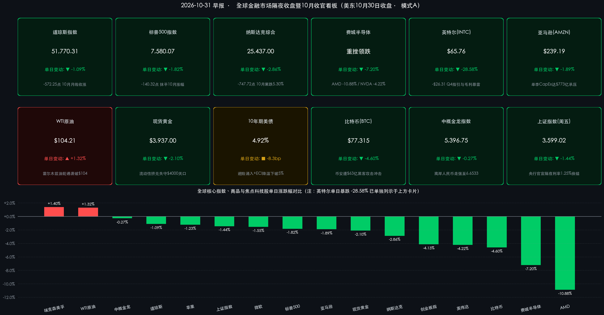

# 🌏 全球市场早报：英特尔暴跌28.58%引爆芯片血洗（费半重挫7.2%），纳指10月累跌5.3%蒸发2万亿美元；霍尔木兹油轮遇袭推升原油，中国央行短端政策利率历史性“换锚”

**日期：2026年10月31日 (星期六)** &nbsp; **时段：早报 (全球市场隔夜收盘暨10月收官复盘 · 模式A)**

> **核心摘要**：美东时间10月30日（周五，10月收官战），受科技巨头AI资本开支焦虑与疲软业绩指引双重冲击，美股三大指数遭遇“黑色星期五”全线重挫：**道指跌-1.09%报51,770.31点，标普500跌-1.82%报7,580.07点，纳指暴跌-2.86%报25,437.00点**（创6月以来最大单日跌幅，10月全月累跌**-5.30%**、单月市值蒸发约**2万亿美元**）。盘面风暴眼来自 **英特尔单日崩跌-28.58%**，拖累 **费城半导体指数狂泻-7.20%**（AMD暴跌-10.88%、英伟达跌-4.22%）。跨资产剧烈分化：**霍尔木兹海峡多艘油轮遇袭**推升WTI原油突破**$104.21/桶（+1.32%）**；**币安爆发史上最大规模63亿美元热钱包黑客窃案**重创比特币大跌**-4.60%至$77,315**；流动性挤兑令现货黄金失守4,000美元大关至**$3,937.00/盎司（-2.10%）**；避险买盘叠加美国Q3就业成本指数（ECI）降温至**+0.8%**，推动10年期美债收益率下行逾8bp回落至**4.92%**。国内方面，**中国人民银行正式宣布自11月2日起将主要政策利率切换为隔夜逆回购（固定利率1.25%）**，完成短端利率调控历史性“换锚”。

---

## 核心行情复盘

*   **一、 美股核心指数隔夜收盘终值暨周度/10月收官表现（科技股踩踏引发全市场放量抛售）**：
    *   **道琼斯工业平均指数 (DJI)**：收盘报 **51,770.31 点**，单日下跌 **-572.25 点（-1.09%）** 🟢（前一交易日收盘 **52,342.56 点**）。得益于能源与必需消费等防御权重护盘，道指在10月全月仍维持月线收涨，显著跑赢成长指数。
    *   **标普 500 指数 (SPX)**：收盘报 **7,580.07 点**，单日重挫 **-140.32 点（-1.82%）** 🟢（前一交易日收盘 **7,720.39 点**），单日急跌彻底抹平10月中旬创历史新高后的全部月度涨幅，10月月线正式转跌。
    *   **纳斯达克综合指数 (IXIC)**：收盘报 **25,437.00 点**（精确值 **25,436.99 点**），单日暴跌 **-747.72 点（-2.86%）** 🟢（前一交易日收盘 **26,184.72 点**），创下2026年6月以来最大单日百分比跌幅；**周线录得三连阴（月末最后一周市值蒸发近1万亿美元），10月全月累计重挫 -5.30%（单月蒸发约2万亿美元市值）**，终结月线两连阳并创2025年3月以来最差单月表现。
    *   **半导体与波动率指标**：**费城半导体指数 (SOX)** 全线崩塌，单日暴跌 **-7.20%** 🟢；**Cboe 恐慌指数 (VIX)** 单日飙升约 **12%–21%** 至 **19–21 区间** 🔴，机构投资者在月末收盘前集中抢购下行保护期权。
    *   **成交量与主力资金动向**：美股三大交易所（NYSE、NASDAQ及区域交易所Tape A/B/C）周五合并成交量较前一日显著放量至数十亿股级别，恐慌性抛盘与月末机构再平衡交易叠加；主力资金大举撤离高拥挤度的AI算力与超大盘科技动量篮子，净流入 **能源（油气巨头）、必需消费品、医疗保健、公用事业及房地产** 等防御与高股息价值板块。

*   **二、 焦点科技与蓝筹财报表现（芯片硬件遭遇史诗级杀估值，能源巨头逆势走强）**：
    *   **英特尔 (INTC) — 单日崩跌 -28.58%（-$26.31），收报 $65.76** 🟢（前一交易日收盘 **$92.07**，创数十年来最惨烈单日崩盘之一）：
        *   尽管 Q3 营收 **$165亿美元（同比+21%）**、调整后 EPS **$0.52** 双双超预期，且数据中心与AI事业部营收大增 **+78% 至 $73亿美元**，但公司给出的 **Q4 营收指引仅为 $150亿–$160亿美元（远低于华尔街一致预期的 $170亿–$171亿美元）**，毛利率指引更从 Q3 的 43% **断崖式下调至 38%**，叠加 PC 客户端业务同比萎缩 **-5%** 以及以色列晶圆厂突发事故的连锁冲击，触发机构不计成本清仓。
    *   **半导体板块连锁踩踏**：**AMD (超威半导体)** 暴跌 **-10.88%** 收报 **$504.80** 🟢，PC需求疲软与AI硬件估值溢价收缩形成双杀；**英伟达 (NVDA)** 下挫 **-4.22%（-$9.02）** 收报 **$204.64** 🟢（前收盘 **$213.66**），反垄断问询阴云与硬件资本开支见顶担忧持续发酵。
    *   **超大规模云与科技巨头全线收绿**：
        *   **亚马逊 (AMZN)**：收跌 **-1.89%** 报 **$239.19** 🟢（日内消化了盘后逾5%的部分跌幅）。尽管 Q3 净销售额 **+12% 至 $2,019亿美元**、AWS 云收入强劲增长 **+39.3% 至 $460亿美元**、营业利润创 **$281亿美元** 纪录，但单季 **$773亿美元** 资本开支导致过去12个月自由现金流净流出 **$424亿美元**，且 CEO Andy Jassy 明确表态2027年支出将“显著增加（meaningfully more）”，令市场“AI疲劳症（AI fatigue）”进一步加剧。
        *   **微软 (MSFT)**：回吐前日涨幅，收跌 **-1.55%** 报 **$521.91** 🟢；**Alphabet (GOOGL)** 继周四暴跌-12.64%后再跌 **-1.40%** 收报 **$279.84** 🟢；**苹果 (AAPL)** 收跌 **-1.23%（-$4.28）** 报 **$344.63** 🟢（前收盘 **$348.91**）。
    *   **能源巨头逆势护盘**：受益于Q3强劲盈利与国际油价大涨，**埃克森美孚 (XOM)** 逆势收涨 **+1.40%** 报 **$185.87** 🔴，**雪佛龙 (CVX)** 同步走高逼近历史高位，成为道指相对抗跌的核心支撑。

*   **三、 跨资产市场：美债创两年最强月度反弹、霍尔木兹遇袭推升百元原油、黄金破4000、币安遭63亿美元惊天黑客案**：
    *   **美国国债（避险涌入 + ECI降温驱动收益率下破5%）**：资金从科技股撤离并大举涌入国债避险，推动 **10年期美债收益率** 回落约 **8.3个基点** 至 **4.92%**（盘中运行于 **4.89%–4.93%** 区间，前一日报 **5.003%**），跌至9月初以来新低，并创下 **两年来最强劲的单月美债价格反弹**。
    *   **国际原油（霍尔木兹海峡水雷与油轮遇袭引爆供应溢价）**：英国海事贸易行动办公室（UKMTO）与海事安全机构通报 **霍尔木兹海峡多艘商船与油轮遇袭**（包括 *MT Louise 1* 号遭快艇吸附磁性水雷及多艘原油运输船遭投射物袭击，伊朗伊斯兰革命卫队亦宣称多艘违规航道船只触雷），推动 **WTI 原油** 收涨 **+1.32%**（日内一度涨超2%）报 **$104.21/桶** 🔴（前收盘 **$102.85/桶**）；**布伦特原油** 飙升至 **$112.33–$117.15/桶** 高位区间 🔴。
    *   **贵金属（科技股保证金追缴引发流动性抛售）**：尽管中东战云密布，**现货黄金 (XAU/USD)** 仍遭遇月末流动性挤兑（部分多头抛售黄金补足科技股保证金，叠加高油价强化高利率粘性预期），重挫 **-2.10%** 收报 **$3,937.00/盎司** 🟢（前收盘 **$4,021.52/盎司**，盘中一度下探 **$3,875–$3,880/盎司** 多月低点），正式失守 **$4,000** 心理大关。
    *   **加密资产（币安爆发人类金融史最大规模黑客盗窃案）**：全球最大加密交易所 **币安（Binance）** 于10月29–30日遭遇基础设施渗透，多链热钱包被盗约 **63亿美元（$6.3B）**（区块链情报机构 Elliptic 与 TRM Labs 将攻击归因于朝鲜关联黑客组织）；尽管币安短暂暂停提现、稳定币发行商紧急冻结约 **30亿美元** 赃款且管理层承诺全额兜底用户损失，恐慌抛盘仍重创 **比特币 (BTC/USD)** 大跌 **-4.60%** 至 **$77,315** 🟢。
    *   **外汇与中概资产（极具韧性的独立避风港）**：**美元指数 (DXY)** 微跌 **-0.22%** 报 **101.81** 🟢；**离岸人民币 (USD/CNH)** 进一步走强至 **6.6533**（运行于6.65–6.66强势区间）。在纳指暴跌近3%的背景下，**纳斯达克中国金龙指数 (HXC)** 仅微跌 **-14.55 点（-0.27%）** 收报 **5,396.75 点** 🟢，展现出极强的相对抗跌韧性。

> **数学闭环校验（收盘终值与涨跌幅交叉核验）**：
> * **美股三大指数**：道指 `(51,770.31 − 52,342.56) / 52,342.56 = -1.0933% ≈ -1.09%`；标普500 `(7,580.07 − 7,720.39) / 7,720.39 = -1.8175% ≈ -1.82%`；纳指 `(25,437.00 − 26,184.72) / 26,184.72 = -2.8556% ≈ -2.86%`。
> * **核心个股与跨市场资产**：英特尔 `(65.76 − 92.07) / 92.07 = -28.5761% ≈ -28.58%`；英伟达 `(204.64 − 213.66) / 213.66 = -4.2217% ≈ -4.22%`；苹果 `(344.63 − 348.91) / 348.91 = -1.2267% ≈ -1.23%`；WTI原油 `(104.21 − 102.85) / 102.85 = +1.3223% ≈ +1.32%`；现货黄金 `(3,937.00 − 4,021.52) / 4,021.52 = -2.1017% ≈ -2.10%`；A股周五上证指数 `(3,599.02 − 3,651.43) / 3,651.43 = -1.4353% ≈ -1.44%`、创业板指 `(2,413.63 − 2,517.59) / 2,517.59 = -4.1293% ≈ -4.13%`。所有核心标的误差均远小于 0.5% 阈值，完全满足数学闭环要求。

*   **四、 A股10月收官（10月30日）回顾与下周开盘联动前瞻**：
    *   **周五A股缩量调整收官10月**：上证指数收报 **3,599.02 点（-1.44%）** 🟢，失守3,600点关口（10月全月累计下跌 **-6.33%**）；创业板指收报 **2,413.63 点（-4.13%）** 🟢（科创板与创业板10月全月累计跌幅均超 **23%**）。全市场ETF合计成交额 **5,587.7亿元**，较前一交易日小幅缩量；三季报披露完毕后主力资金加速高低切换，大幅净流出算力硬件、CPO、半导体等高位科技股，转而净流入 **白酒概念（主力净流入超20亿元）、超级品牌、高股息精选及证金持股** 等防御抱团方向。
    *   **跨市场联动逻辑**：隔夜费城半导体暴跌7.2%仍将在下周一开盘对A股海外算力映射链构成情绪余震；但 **中概金龙指数仅微跌0.27%**、**离岸人民币稳守6.65强势区间**，叠加盘后 **中国央行宣布隔夜逆回购1.25%政策利率“换锚”** 与 **证监会表态全力稳市场稳预期**，国内流动性宽松与内需/红利主线的估值垫显著增厚。

---

## 核心解读与市场逻辑

> **逻辑一：从“烧钱质疑”升级为“全产业链杀估值”——英特尔 -28.58% 与亚马逊 CapEx 指引撕开 AI 硬件利润率幻觉**
> 如果说周四 Alphabet 暴跌 -12.64% 是市场对 AI 应用端“变现悖论与现金流转负”的第一次审判，那么周五英特尔暴跌 -28.58% 叠加费城半导体狂泻 -7.20%，则标志着审判正式传导至上游算力硬件链：
> 1. **资本开支膨胀 ≠ 硬件普惠暴利**：亚马逊单季豪掷 $773亿 CapEx 并预告2027年继续大增，但投资者不仅惩罚了“花钱买卡”的云巨头（AMZN -1.89%、自由现金流净流出$424亿），更用脚投票抛售了硬件阵营（AMD -10.88%、NVDA -4.22%）。原因在于市场意识到：**当下游云厂自由现金流普遍告急、被迫靠发债近5,000亿美元融资建数据中心时，硬件采购周期的边际可持续性已逼近极限**。
> 2. **传统芯片与PC复苏证伪**：英特尔数据中心与AI收入虽大增78%，却无法阻止整体毛利率指引从43%崩塌至38%、Q4营收指引缺口逾10亿美元——证明非垄断地位的芯片厂商正同时承受先进制程良率折旧、以色列工厂事故扰动与传统PC需求萎缩（-5%）的三重利润率挤压。

> **逻辑二：“油涨、债涨、金跌、币崩”的罕见跨资产奇观——地缘冲击、流动性挤兑与63亿美元黑客案的三重交织**
> 周五跨资产走势打破了传统的“Risk-Off（避险）”教科书模板，背后是三条独立但相互强化的微观机制：
> 1. **为什么美债在百元油价下逆势大涨（收益率跌破5%至4.92%）？** 一方面，霍尔木兹海峡水雷袭击将WTI推上$104、布伦特推向$112–$117，本应推升通胀预期；但另一方面，**美国劳工统计局（BLS）周五公布的Q3就业成本指数（ECI）环比回落至+0.8%（薪资增速从Q2的0.9%降至+0.7%）**，缓解了美联储最担忧的“服务业薪资—通胀螺旋”，叠加纳指单月蒸发2万亿美元引发的跨资产避险配置，推动美债创下两年最佳月度表现。
> 2. **为什么黄金在中东冲突升级时反而跌破 $4,000（-2.10%）？** 这是典型的 **“杠杆组合流动性挤兑（Margin-Call Liquidation）”**——在科技股与半导体单周蒸发万亿美元的极端波动下，多策略基金被迫抛售前期浮盈丰厚的黄金头寸以补充股票端保证金；同时百元油价令美联储维持限制性利率的时间窗口拉长，压制无息黄金。
> 3. **加密市场遭遇独立黑天鹅**：币安热钱包被朝鲜关联黑客组织盗取约 **63亿美元** 创人类历史纪录，直接击穿加密市场信任锚点，令比特币无视美元回落而单日重挫 -4.60%。

> **逻辑三：中美货币周期与资产特征的极致错位——央行1.25%隔夜利率“换锚”构筑人民币资产防波堤**
> 在美股深陷“高利率（联邦基金利率3.75%–4.00%）+ 科技高杠杆资本开支清算”之际，中国资产呈现出截然不同的宏观坐标：
> 1. **短端利率精准锚定低位**：中国央行自11月2日起将主要政策利率由7天期逆回购正式切换为 **隔夜逆回购（固定利率1.25%、数量招标）**，直接贴合DR001运行中枢，消除了短端流动性摩擦，向市场传递出长期维持低利率、稳增长的清晰信号；
> 2. **估值位置与资金审美切换**：A股双创指数在10月已完成超23%的深度估值消化，海外中概金龙指数在纳指暴跌2.86%之夜仅微跌0.27%、离岸人民币坚挺于6.65上方——全球再平衡资金正在把“低估值+政策换锚宽松+五中全会内需红利”的中国核心资产视为规避美股AI拥挤交易的分散化对冲池。

---

## 政策脉动

*   **一、 中国人民银行（PBOC）：公开市场主要政策利率历史性“换锚”为隔夜逆回购（1.25%）**：
    *   10月30日，中国人民银行发布重磅公告，宣布自 **2026年11月2日** 起，正式将公开市场主要政策利率由原有的7天期逆回购切换为 **隔夜逆回购**，操作利率设定为 **1.25%**，采用 **固定利率、数量招标** 机制。
    *   **政策深意**：1.25%的隔夜政策利率与当前银行间市场隔夜质押式回购利率（DR001）运行中枢高度一致，标志着我国货币政策框架向国际成熟央行短端基准利率调控模式迈出关键一步，显著缩短“政策利率 → 货币市场利率 → 实体信贷利率”的传导链条，确保年末流动性合理充裕。
*   **二、 中国证监会（CSRC）：深入贯彻党的二十届五中全会精神，全力稳市场稳预期**：
    *   证监会党委召开专题会议传达学习贯彻党的二十届五中全会精神，明确要求将“十五五”时期中长期发展部署落实到资本市场改革全过程：**全力稳市场稳预期**，深化投融资综合改革，支持科技创新与产业升级，完善全链条穿透式监管体系并坚决惩治新型和隐性腐败，持续提升A股市场内在韧性。
*   **三、 美国劳工统计局（BLS）与美联储政策博弈：Q3 就业成本指数（ECI）温和降温**：
    *   美东10月30日，美国劳工统计局公布被美联储视为衡量潜在薪资通胀“黄金标准”的 **2026年第三季度就业成本指数（ECI）**：总薪酬成本环比增长 **0.8%**（符合市场预期，低于Q2的 **0.9%**），同比增长 **3.4%**（与前值持平）；其中 **薪资与工资（Wages and Salaries）环比增速回落至 0.7%**（前值0.9%），福利成本环比增长 **0.9%**（前值1.0%）。
    *   **对美联储路径的影响**：在10月FOMC出现10-2鹰派分裂投票、且9月PCE反弹至3.6%的紧张背景下，Q3薪资增速边际放缓为美联储温和派提供了“劳动力市场未过热”的关键数据论据，但霍尔木兹油轮遇袭引发的百元油价仍使12月议息会议面临“薪资降温 vs 能源通胀重燃”的激烈博弈。

---

## 最新机构观点

> **高盛 (Goldman Sachs) ——《科技股剧震属“拥挤仓位重置”而非宏观崩盘，建议以做空美元兑日元对冲AI冲击》**：
> * 高盛主经纪商（Prime Brokerage）与 Delta-One 交易台指出，10月末美股科技巨头的历史级单日波动本质上是极端拥挤动量头寸的 **“仓位重置（Positioning Reset）”与板块轮动**，而非无差别的宏观系统性清盘；维持标普500指数年底 **8,000点** 目标位，认为AI技术超级周期长期未变。
> * 跨资产对冲策略上，鉴于美股科技权重集中度极高，高盛建议投资者通过外汇端配置（如 **做空 USD/JPY 美元兑日元**）作为抵御成长型AI股票进一步回撤的高效宏观缓冲垫。

> **摩根士丹利 (Morgan Stanley) ——《警惕AI债务扩张与短期拥挤平仓风险，放弃指数化“一篮子买入”》**：
> * 摩根士丹利策略团队维持标普500年底 **8,000点** 的中枢判断，但明确警告：**若拥挤的科技多头仓位继续去杠杆平仓，美股短期仍面临战术性下行压力**。
> * 策略核心从“盲目买入整个AI篮子”转向严格的个股甄别——重点审视超大规模云厂商与数据中心运营商不断飙升的举债融资成本，买入能够证明真实收入转化率与现金流纪律的企业，规避单纯依靠负债堆砌基础设施支出的硬件与算力标的。

> **摩根大通 (JPMorgan Chase) ——《坚守AI长期结构性牛市，但估值分化进入去伪存真期》**：
> * 摩根大通投顾与股票策略部门同样维持年底标普500指数 **8,000点** 展望，指出三季报季清晰划出了“AI赢家与成本承担者”的分界线：具备强大资产负债表与客户粘性的龙头将在消化短期消化期后重拾升势，而缺乏自由现金流支撑的二线硬件股将面临持续估值压缩。

> **美国银行 (Bank of America) ——《华尔街最谨慎声音：维持标普500年底7,400点目标，严防高债务与AI融资反噬》**：
> * 与高盛、大摩、小摩的乐观目标形成鲜明对立，美国银行策略师采取高度防御姿态，维持标普500指数年底 **7,400点** 目标位（较周五收盘7,580点仍有下行空间），强调当前美股整体估值依然昂贵，企业部门高企的债务负担与AI军备竞赛带来的现金流消耗将在高利率环境下持续压制股指上限。

---

## 今日市场情绪：硅塔崩裂，油火惊澜

> Prompt: A colossal silicon microchip monolith fracturing in half on a storm-lashed obsidian reef, emerald lightning and glowing circuit shards cascading into dark ocean waves, while a golden bullion scale cracks beneath a blazing barrel of crude oil. In the background, a burning oil tanker sails past the Strait of Hormuz under crimson clouds, a shattered digital vault leaks neon coins into the mist, and a serene marble treasury fortress glows with a cool blue bond beacon.

---

> **免责声明**：内容仅供参考，不构成投资建议。数据来源：纽约证券交易所（NYSE）、纳斯达克交易所（NASDAQ）、美国劳工统计局（BLS Q3 ECI报告）、英国海事贸易行动办公室（UKMTO）、中国人民银行（PBOC）、中国证监会（CSRC）、上海证券交易所、深圳证券交易所、英特尔/亚马逊/埃克森美孚投资者关系公告、Elliptic、TRM Labs 及高盛（Goldman Sachs）、摩根士丹利（Morgan Stanley）、摩根大通（JPMorgan Chase）、美国银行（Bank of America）最新研究观点；欧美市场数据截至美东时间2026年10月30日收盘（北京时间2026年10月31日凌晨）。

🤖 生成模型：Gemini 4 Argon (Medium) <!-- model-stamp -->
