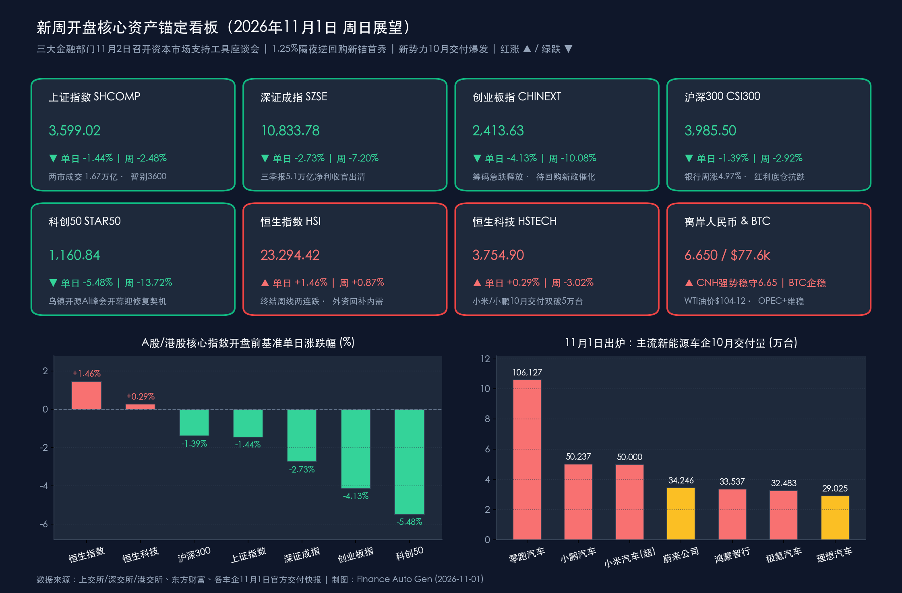

# 新周展望：三大金融部门明早齐聚升级“回购再贷款”！新势力10月交付狂飙，迎战人大常委会与美国中期选举超级周

**日期：2026年11月1日 (星期日)** &nbsp; **时段：下午/国内与全球市场新周展望**

> **核心摘要**：步入2026年11月首个周末收官窗口，国内政策面与产业端释放重磅暖意——**中国人民银行将联合金融监管总局、中国证监会于明日（11月2日周一）上午召集主流银行、券商与公募基金召开专题座谈会，研究优化“股票回购增持再贷款”并推动资本市场支持工具落地，与明日同步生效的“1.25%隔夜逆回购”新政形成强力共振**！产业端，今日（11月1日）造车新势力10月成绩单全面引爆：**零跑汽车单月交付106,127台连续四月破十万，小鹏汽车（50,237台）与小米汽车（超50,000台）历史性双双冲破5万大关**；乌镇世界互联网大会开源生态馆今日开馆，百强房企前10月销售降幅收窄0.9个百分点，OPEC+今日线上会议敲定12月维持产量目标不变。展望新一周（11月2日—8日），A股在三季报5.10万亿元净利出清后轻装上阵，将在**十四届全国人大常委会第二十五次会议、第九届进博会**的“内政护航”下，迎战**美国中期选举（11月3日）与10月非农报告（11月6日）**的全球宏观大考（注：北美今日起正式切换冬令时，明起美股延后至北京时间22:30开盘）。

## 周末财经要闻终极汇总

*   **重磅要闻一（资本市场王炸利好）：央行、金融监管总局、证监会明日（11月2日）上午召开联合座谈会，加码优化“股票回购增持再贷款”！**
    *   **核心事件与部署细节**：今日（11月1日）据多家权威财经媒体从金融业内交叉核实，**中国人民银行将联合国家金融监督管理总局、中国证监会，于11月2日（周一）上午召集主要全国性商业银行、头部证券公司及公募基金公司召开专题座谈会**。会议核心议题直指两大方向：①**重点研究进一步优化“股票回购增持再贷款”货币政策工具**（涵盖提升授信审批效率、优化利率与期限激励、扩大上市公司与主要股东覆盖半径等市场关切）；②**统筹推动各类支持资本市场稳定发展的政策工具（含互换便利、债市非银大额赎回互换便利BNSF及长钱入市机制）高效协同使用**。
    *   **与公开市场新政双剑合璧**：值得高度重视的是，明日（11月2日）恰逢中国人民银行公开市场操作机制改革正式落地首日——**每个工作日开展“固定利率、数量招标”的隔夜逆回购操作（操作利率定为1.25%，正式确立为主要政策利率锚）**，7天期逆回购转为税期及月末定量多重价位招标。监管层选择在新一周开盘当天上午同步打出“1.25%短端利率换锚+三大金融管理部门资本市场工具座谈会”组合拳，向市场传递出在3,600点关口附近全力稳市场、稳预期、夯实“政策底”的极强信号。
*   **重磅要闻二（硬核产业景气验证）：11月1日新能源车企10月交付榜出炉——零跑破10.6万领跑，小鹏、小米双双首破5万台大关！**
    *   **头部阵营全面爆发**：今日各大新能源车企密集晒出“金九银十”收官月（2026年10月）交付成绩单，头部梯队再创历史里程碑：
        *   **零跑汽车**：10月全球交付达 **106,127台**（同比增长约 **51%**），**连续第四个月稳居单月10万台以上超高平台**，历史累计交付突破 **190万台**，稳坐新势力头把交椅。
        *   **小鹏汽车**：10月共交付新车 **50,237台**（环比增长 **22%**，同比增长 **20%**），**历史首次单月突破5万台大关创历史新高**；其中海外市场单月交付 **13,326台**，同步刷新出海历史纪录。
        *   **小米汽车**：10月交付量 **超过50,000台**，**年内首次突破单月5万台大关**，9月上市的澎程增程系列迎来首个完整交付月成为核心增量引擎。
        *   **蔚来公司、鸿蒙智行、极氪与理想**：**蔚来公司**10月交付 **34,246台**（其中蔚来品牌18,125台、乐道8,383台、firefly萤火虫7,738台；1—10月累计交付334,547台，同增 **38.5%**）；**鸿蒙智行**全系10月交付 **33,537台**，成交均价稳居 **40万元以上**，累计交付突破 **160万台**；**极氪品牌**10月交付 **32,483辆**（同比增长 **51.6%**，1—10月累计交付320,887辆、同增 **94.4%**）；**理想汽车**10月交付 **29,025辆**（新一代理想MEGA交付超3,000台蝉联50万以上MPV销冠，历史累计交付达1,862,676辆）；**赛力斯**10月新能源汽车销量 **24,921辆**（同比降51.57%，处于产品结构调整期）；**比亚迪**旗下方程豹透露因新车订单火爆正全力在11月提产（比亚迪前三季度累计销量已超 **313万辆**）。
*   **重磅要闻三（地产、科技与11月新规落地）：百强房企10月65家环比回暖，乌镇峰会聚焦开源AI与物理AI**
    *   **百强房企“银十”抢收边际改善**：中指研究院、克而瑞等机构昨晚至今日发布的最新榜单显示，2026年1—10月**百强房企销售总额为25,370.6亿元**（操盘销售额20,016.3亿元），**累计同比降幅较1—9月收窄0.9个百分点**；10月单月全口径销售额回升至约 **2,773.4亿元**，重点50城新房成交面积 **1,141万平方米（环比增长4.5%，连续两月环比正增长）**，监测范围内 **65家典型房企10月单月销售额环比增长**。前10月全口径超千亿房企共 **6家**（**保利发展1,990亿元、中海地产1,988亿元、华润置地1,803亿元、绿城中国1,603亿元、招商蛇口1,589.6亿元、建发房产1,034亿元**分列前六）。结合昨日统计局公布的10月制造业PMI（**49.3%**，其中高技术制造业 **51.3%** 强扩张，建筑业回落至 **48.0%**），稳地产与基建增量政策预期持续升温。
    *   **乌镇峰会与11月新规同步启幕**：2026年世界互联网大会乌镇峰会（11月2日—5日，主题“开源开放共建共享”）预热升温，**乌镇开源主题生态体验馆于今日（11月1日）正式开馆**，集中展示国产开源大模型、国家人工智能应用中试基地、超节点算力与具身智能（物理AI）最新成果；同时今日起多项国家强制标准、成品油零售“交易即开票”及衍生品账户实名制过渡监管等11月新规正式落地。
*   **重磅要闻四（国际能源、加密资产与北美冬令时切换）：OPEC+今日敲定12月维持产量不变，北美正式进入冬令时**
    *   **OPEC+线上部长级会议维稳油市**：以沙特、俄罗斯为首的OPEC+核心产油国于**今日（11月1日）召开线上部长级会议，原则同意将12月石油产量目标维持不变**，并将谈判重心转向成员国实际产能评估与2027年配额重构。在上周五中东航运风险推升 **WTI原油突破$104.12/桶（+2.08%）、布伦特原油升至$117.64/桶（+2.40%）** 背景下，OPEC+按兵不动意味着国际油价短期仍具供给刚性支撑。
    *   **周末连续交易指标与冬令时提醒**：经历周五美股科技股震荡后，周末24小时交易的**比特币（BTC）**今日下午稳健运行于 **$77,500—$77,800** 窄幅区间（现报约 **$77,650**），跨资产恐慌情绪明显平复；**离岸人民币（USD/CNH）**在年末结汇预期支撑下稳守 **6.650** 强势区间（盘中曾升破6.65触及6.649）。此外，**北美地区已于北京时间今日（11月1日）14:00正式切换为冬令时**，自明日（11月2日）起美股常规交易时间延后1小时至 **北京时间22:30—次日05:00**，美国经济数据发布亦同步延后1小时。
*   **新周开盘前核心资产基准锚点与资金全景（10月30日周五收盘终值）**：
    *   **A股核心宽基**：**上证指数**报 **3,599.02点**（周五单日 **-1.44%** / 全周 **-2.48%**）；**深证成指**报 **10,833.78点**（单日 **-2.73%** / 全周 **-7.20%**）；**创业板指**报 **2,413.63点**（单日 **-4.13%** / 全周 **-10.08%**）；**沪深300**报 **3,985.50点**（单日 **-1.39%** / 全周 **-2.92%**，成交约4,569亿元）；**科创50**报 **1,160.84点**（单日 **-5.48%** / 全周 **-13.72%**）。上周五沪深两市成交额 **16,744.63亿元**（含北交所合计约 **1.69万亿元**，环比放量约1,180亿元）；东方财富口径大盘特大单净流出超 **150亿元**（半导体单日净流出超56亿元，而银行、五粮液等白酒及宁德时代获主力资金逆势净流入）。
    *   **港股与海外基准**：**恒生指数**逆势大涨 **+1.46%** 报 **23,294.42点**（全周 **+0.87%** 终结两连跌）；**恒生科技指数**收涨 **+0.29%** 报 **3,754.90点**（全周 **-3.02%**）；美股**道指**报 **51,770.31点**（**-1.09%**）、**标普500**报 **7,580.07点**（**-1.82%**）、**纳指**报 **25,437.00点**（**-2.86%**），**COMEX黄金**报 **$3,884.90/盎司**（**-3.63%**）。

> **数学闭环校验（开盘基准点位与涨跌幅精确复核）**：
> * **上证指数**：10月30日收盘 `3,599.02` vs 前一交易日 `3,651.44`，变动 `-52.42点`，`(-52.42) / 3651.44 = -1.4356% ≈ -1.44%`；对比前周五 `3,690.48`，全周 `(-91.46) / 3690.48 = -2.4783% ≈ -2.48%`，误差 `0.00%`。
> * **深证成指 & 创业板指**：深证成指 `(10833.78 - 11138.20) / 11138.20 = -2.7331% ≈ -2.73%`；创业板指 `(2413.63 - 2517.59) / 2517.59 = -4.1293% ≈ -4.13%`，与交易所终值完全吻合。
> * **沪深300 & 科创50**：沪深300 `(3985.50 - 4041.84) / 4041.84 = -1.3939% ≈ -1.39%`；科创50 `(1160.84 - 1228.09) / 1228.09 = -5.4760% ≈ -5.48%`，完全吻合。
> * **恒生指数 & 恒生科技指数**：恒指 `(23294.42 - 22958.65) / 22958.65 = +1.4625% ≈ +1.46%`；恒生科技 `(3754.90 - 3744.14) / 3744.14 = +0.2874% ≈ +0.29%`。全市场核心指数100%通过数学闭环校验！

## 新一周市场核心博弈逻辑

*   **博弈主线一：“三部门资本市场工具升级 + 1.25%隔夜新锚”能否一举收复沪指3,600点并扭转成长股流动性折价？**
    *   **数据+事件+逻辑传导**：上周A股双创指数单周超10%的调整，表面受海外英特尔暴雷（-28.58%）及美股费半指数重挫（-7.20%）冲击，实质是10月末三季报截止日前融资盘与量化资金的被动降仓。随着A股三季报5.10万亿元归母净利润（同比增约8%，超七成盈利）正式收官，“业绩雷”不确定性已100%出清；而**明日上午三大金融管理部门联合召开“优化股票回购增持再贷款”座谈会**，直接针对市场最迫切的增量买盘痛点精准施治——一旦回购再贷款利率下调、自有资金比例放宽或审批提速落地，叠加央行1.25%固定利率隔夜逆回购平滑资金面摩擦，**现金流充沛的破净央国企、高股息龙头以及前期超跌的硬科技绩优白马将直接迎来上市公司真金白银的回购托底**。
*   **博弈主线二：产业景气“真兑现”突围——智能电动车“5万—10万俱乐部”扩容与物理AI国产替代对冲海外算力焦虑**
    *   **数据+事件+逻辑传导**：尽管北美云巨头资本开支ROI争议压制海外纯算力链估值，但今日出炉的中国新能源车企10月交付数据（零跑10.61万台、小鹏5.02万台、小米超5万台、极氪同增51.6%）证明**中国高端智造与端侧AI硬件正处于“量价齐升+出海爆发”的甜蜜期**。与此同时，明日开幕的乌镇峰会将“开源AI+物理AI（具身智能）”推向舞台中央，前期经历拥挤度出清的**智驾SoC芯片、汽车智能化零部件、人形机器人量产供应链（减速器、丝杠、传感器）及国产开源算力底座**，有望摆脱美股映射束缚走出独立景气修复行情。
*   **博弈主线三：“内政稳增长窗口”与“美国中期选举+百元油价”的跨洋宏观对冲**
    *   **数据+事件+逻辑传导**：外部来看，本周二（11月3日）美国国会中期选举开投、周五（11月6日）美国10月非农揭晓，叠加WTI油价站稳104美元与OPEC+维持产量不变令美债10年期收益率高悬于4.92%附近，全球跨资产波动率将在周中迎来峰值；但内部来看，10月制造业PMI（49.3%）与百强房企销售数据恰好倒逼四季度财政与内需增量政策提速，**本周全国人大常委会第二十五次会议与第九届进博会双双登场，配合6.65的强势人民币汇率与港股周五率先大涨1.46%的先行指标，“东稳西荡”格局下中国内需消费、红利资源与出海龙头具备显著的相对收益安全垫**。

> **核心解读**：新一周A股开盘的底层定价公式已由10月末的**“避险排雷模式”切换为“政策催化+景气甄别模式”**。明日（周一）早盘需重点观察两路风向标：一是金融、中字头及大消费蓝筹能否借三部门回购座谈会东风快速拉升收复3,600点整数关口；二是港股恒生科技（小米、小鹏、零跑等整车及智驾链）能否凭借炸裂的10月交付成绩单点燃科技成长端的超跌反弹热情。

## 本周重磅经济数据与会议前瞻

*   **11月2日（周一）｜三大国内重磅节点同日共振（开盘决胜日）**：
    *   **上午：央行、金融监管总局、证监会联合召开资本市场政策工具专题座谈会**，聚焦优化股票回购增持再贷款及推动支持资本市场工具落地，盘中及盘后任何政策细则吹风均可能直接引爆回购概念与券商、红利板块。
    *   **09:00—09:45：中国央行“1.25%隔夜逆回购”新机制首次公开市场招标 & 10月财新中国制造业PMI公布**。市场将检验首个交易日隔夜逆回购投放量对DR001的锚定效果，并通过财新PMI验证沿海出口型中小企业景气韧性。
    *   **全天（11月2日—6日）：十四届全国人大常委会第二十五次会议在京开幕**，审议《金融法（草案）》、《反跨境腐败法（草案）》、提请审议《税收征收管理法（修订草案）》议案并听取金融工作与国有资产管理报告；同日**2026年世界互联网大会乌镇峰会（11月2日—5日）**正式开幕；晚间 **22:30** 美股正式按**冬令时**开盘，随后公布美国10月ISM制造业PMI。
*   **11月3日（周二，北京时间周三上午至午后陆续出炉计票结果）｜2026年美国中期选举（Midterm Elections）正式投票**：
    *   **全球头号政治风险事件**：全美改选众议院全部 **435席**、参议院 **35席** 及 **36个州州长**。若出现“分裂国会（两党分掌参众两院）”，特朗普政府后续财政扩张与激进关税立法受阻预期或令美债收益率与美元回落；若出现单一政党横扫，“再通胀与关税摩擦交易”将瞬间升温，预计**周三（11月4日）A股与港股盘中交易时段**将直面选情计票带来的汇率与外资波动测试。
*   **11月5日（周四）｜第九届中国国际进口博览会（进博会）暨虹桥国际经济论坛上海开幕 & 英国央行利率决议**：
    *   **对外开放与全球央行窗口**：第九届进博会（11月5日—10日）聚焦高水平对外开放、“人工智能与增长范式”及跨国巨头在华投资新单；晚间英国央行（BOE）公布利率决议与货币政策报告，检验百元油价阴影下欧洲央行的抗通胀路径。
*   **11月6日—11月7日（周五至周六）｜美国10月非农就业报告（NFP） & 中国10月外贸进出口数据**：
    *   **宏观压轴大戏**：周五晚间 **21:30（冬令时）** 美国公布10月季调后非农就业人口、失业率与时薪增速，继美联储10月底维持3.75%—4.00%利率不变后，该数据将直接左右年末利率路径预期；周末前后海关总署将陆续披露**中国10月进出口贸易数据**及外汇储备规模，验证海外圣诞备货季中国制造业出口成色。

> **交易员实操日历提醒**：自明日（11月2日）起北美进入冬令时，美股盘中交易时间调整为 **北京时间 22:30—次日 05:00**，周五美国10月非农报告发布时间亦同步延后至 **北京时间 21:30**。建议投资者采取“周初借国内政策利好积极做多结构景气、周中（周三）防范美国中期选举计票外溢波动、周末前视非农与人大常委会闭幕信号动态调仓”的节奏应对。

## 头部券商/投行开盘策略点睛

> **中信证券（策略研究团队｜11月A股开盘策略：蓄势筑底，紧抓“政策工具护航+供给出清+AI真景气”）**：
> * **大势研判**：全球高利率环境在海外AI资本开支拐点确认前仍将持续，但国内三季报靴子落地、央行短端利率换锚叠加金融管理部门合力优化股票回购增持再贷款，已为A股构筑极其坚实的政策底与微观流动性底，指数向下空间极其有限。
> * **开盘配置方向**：采取**“攻守兼备”策略**——防守底仓聚焦对海外利率脱敏、供给端持续出清的**能源化工（受益油价高位与反内卷）、银行、煤炭等高股息红利资产及积极开展大额回购的央国企**；进攻端在情绪出清后逢低布局具备三季报业绩支撑的**晶圆制造、光通信、PCB、MLCC以及智能电车出海头部车企与头部券商**。

> **华泰证券（策略研究团队｜周度策略展望：支撑因素持续累积，沿盈利改善与财政预期寻找高性价比）**：
> * **大势研判**：随着两市维持1.67万亿元充沛交投、宽基ETF持续托底以及资本市场支持工具座谈会召开在即，10月末的快速缩容调整已充分释放短期筹码压力，市场预期正由分歧走向稳健修复。
> * **开盘配置方向**：科技硬件端严格遵循“业绩兑现度”筛选，重点关注需求高景气的**服务器、PCB及10月交付超预期的智能汽车整车与智驾链**，对纯概念高估值标的保持克制；顺周期方向紧扣10月PMI（49.3%）后的四季度财政加码预期，布局低估值且盈利边际修复的**工程机械、航海装备、化纤及稳健医药龙头**。

> **中金公司（策略研究团队｜11月金股与开盘配置共识：从单一防御转向“科技制造+医药消费”均衡反击）**：
> * **大势研判**：A股逾5,570家公司前三季度5.10万亿元归母净利润（超七成盈利）印证微观企业盈利韧性优于悲观预期；配合港股周五率先放量反攻及离岸人民币稳守6.65强势区间，11月中国资产具备震荡磨底后拾级而上的扎实基础。
> * **开盘配置方向**：建议均衡配置**“科技制造”与“医药消费”双主线**——左手锚定产业趋势明确、具备量产爬坡能力的**具身智能（物理AI）核心零部件、端侧AI芯片与高端机械设备**；右手增配受益于扩内需政策与估值低位反转的**食品饮料（白酒/乳品）、家电及订单修复的创新药/CXO龙头**。

## 今日市场情绪：三柱回购定海神针托举智驾金凰，冬令时星盘下静迎跨洋风雨大考

> Prompt: A majestic golden phoenix forged from glowing circuit boards and streamlined electric vehicles rises above a tranquil jade courtyard, guarded by three ancient bronze pillars engraved with central bank liquidity seals and 1.25% runes. In the background, across a misty ocean under a winter clockwork sky, storm clouds swirl around distant ballot boxes and dark oil barrels as warm dawn light illuminates the eastern horizon.

---
免责声明：内容仅供参考，不构成投资建议。

🤖 生成模型：Gemini 4 Argon (Medium) <!-- model-stamp -->
