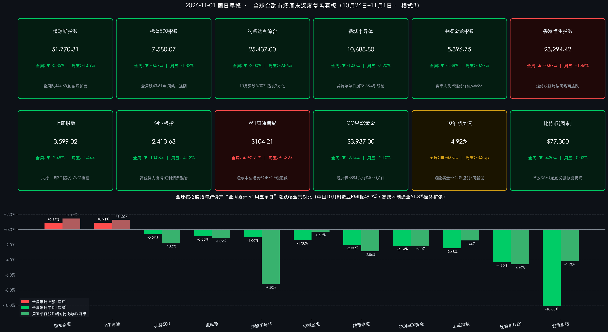

# 🌏 全球市场周末复盘：美股三连阴告别“黑色十月”（费半周五狂泻7.2%），港股逆势周涨0.87%；中国10月制造业PMI报49.3%，下周迎美国中期选举与非农超级风暴

**日期：2026年11月01日 (星期日)** &nbsp; **时段：早报 (全球市场周末深度复盘 · 模式B)**

> **核心摘要**：回顾10月收官周（10月26日–10月30日），受AI资本开支焦虑与芯片指引暴雷冲击，美股三大指数周五全线重挫并录得周线连跌：**道指周五跌-1.09%（全周累跌-0.85%报51,770.31点），标普500周五跌-1.82%（全周累跌-0.57%报7,580.07点，周线三连阴），纳指周五暴跌-2.86%（全周累跌-2.00%报25,437.00点，10月全月累跌-5.30%、蒸发约2万亿美元市值）**；**费城半导体指数周五狂泻-7.20%（全周累跌-1.00%报10,688.80点）**。亚太与跨资产剧烈分化：**香港恒生指数周五涨+1.46%、全周逆势收涨+0.87%（报23,294.42点）领跑全球核心股指**，A股上证指数全周跌**-2.48%**、创业板指全周重挫**-10.08%**；霍尔木兹油轮遇袭与OPEC+维持配额推升 **WTI原油全周涨+0.91%至$104.21/桶**，**10年期美债收益率全周下行8bp至4.92%**，**COMEX黄金全周跌-2.14%失守$4,000关口**。过去48小时，**中国10月官方制造业PMI录得49.3%（高技术制造业51.3%逆势扩张）**，**币安推进SAFU兜底与分批恢复提现令比特币周末稳守$77,300**。下周全球市场将迎 **美国中期选举（11月3日）、中国央行隔夜逆回购1.25%政策利率“换锚”（11月2日）及美国10月非农报告（11月6日）** 三重共振。

---

## 核心资产周度/日度表现回顾

*   **一、 美股核心指数周度/日度复盘（周五芯片血洗吞噬周初涨幅，标普与纳指双双周线三连阴）**：
    *   *交易状态说明*：美东时间10月31日（周六）及11月1日（周日）纽约证券交易所（NYSE）与纳斯达克交易所（NASDAQ）均处于常规周末休市状态。同时，**美东时间11月1日凌晨02:00正式结束夏令时切换进入冬令时（EST）**，自11月2日（周一）起美股常规交易时段延后1小时至 **北京时间22:30–次日05:00**。
    *   **道琼斯工业平均指数 (DJI)**：收盘报 **51,770.31 点**；**周五单日下跌 -572.25 点（-1.09%）** 🟢，**全周累计下跌 -444.85 点（-0.85%）** 🟢（上周五10月23日收盘 **52,215.16 点**，本周四收盘 **52,342.56 点**）。受埃克森美孚（周五 **+1.40%**）与雪佛龙等传统能源权重护盘支撑，道指在10月全月仍保住月线正收益。
    *   **标普 500 指数 (SPX)**：收盘报 **7,580.07 点**；**周五单日重挫 -140.32 点（-1.82%）** 🟢，**全周累计下跌 -43.61 点（-0.57%）** 🟢（上周五收盘 **7,623.68 点**，本周四收盘 **7,720.39 点**），正式录得 **周线三连跌**，单日急挫彻底抹平10月月度涨幅。
    *   **纳斯达克综合指数 (IXIC)**：收盘报 **25,437.00 点**；**周五单日暴跌 -747.72 点（-2.86%）** 🟢，**全周累计下跌 -518.34 点（-2.00%）** 🟢（上周五收盘 **25,955.34 点**，本周四收盘 **26,184.72 点**），同样遭遇 **周线三连阴**；10月全月累计下跌 **-5.30%**，单月市值蒸发约 **2万亿美元**，创2025年3月以来最差月度表现。
    *   **费城半导体指数 (SOX)**：收盘报 **10,688.80 点**；**周五单日崩跌 -829.40 点（-7.20%）** 🟢，**全周累计下跌约 -1.00%** 🟢（10月全月累计跌幅扩大至 **15%以上**）。盘面核心杀跌源来自 **英特尔（INTC）周五单日暴跌 -28.58%（收报$65.76）**、**AMD周五暴跌 -10.88%（收报$504.80）** 及 **英伟达（NVDA）周五下跌 -4.22%（收报$204.64）**；超大规模云巨头同步承压，**亚马逊（AMZN）周五跌 -1.89%（报$239.19）**、**Alphabet（GOOGL）继周四暴跌-12.64%后周五再跌 -1.40%（报$279.84）**、**微软（MSFT）周五跌 -1.55%（报$521.91）**。

*   **二、 亚太与中国核心资产周度/日度对标（港股独立走强周涨0.87%，A股科技出清向红利消费切换）**：
    *   **香港恒生指数 (HSI)**：收盘报 **23,294.42 点**；**周五单日逆势大涨 +1.46%** 🔴，**全周累计上涨 +200.91 点（+0.87%）** 🔴，成功终结此前周线两连跌，在美团、小米等科网龙头企稳与“三桶油”强势拉升带动下成为本周全球表现最强韧的核心股指。
    *   **纳斯达克中国金龙指数 (HXC)**：收盘报 **5,396.75 点**；**周五单日仅微跌 -14.55 点（-0.27%）** 🟢，**全周累计下跌 -1.38%** 🟢，在纳指周五暴跌近3%的极端环境中展现出显著的低波动避风港特征。
    *   **上证综合指数 (SHCOMP)**：收盘报 **3,599.02 点**；**周五单日下跌 -1.44%** 🟢，**全周累计下跌 -2.48%** 🟢（沪深300指数全周下跌 **-2.92%**），周线录得六连阴并暂失3,600点关口。
    *   **创业板指 (CHINEXT)**：收盘报 **2,413.63 点**；**周五单日下跌 -4.13%** 🟢，**全周累计重挫 -10.08%** 🟢（同期科创50指数全周大跌 **-13.73%**）。
    *   **成交量与主力资金周度动向**：美股周五合并成交量在月末再平衡与科技股恐慌抛盘共振下较周四显著放大，机构资金从AI算力高拥挤动量篮子撤出，净流入能源、必需消费、公用事业与美债；A股本周日均成交额维持在 **1.5万亿–1.7万亿元** 区间（周五全市场ETF成交额 **5,587.7亿元**，沪深300ETF等宽基尾盘频现护盘资金吸筹），主力资金在三季报收官窗口大举撤离CPO光模块与高位半导体，集中涌入 **白酒食品饮料（周五主力净流入超20亿元，迎驾贡酒、古井贡酒、泸州老窖等批量涨停）、银行（工行、建行续创新高）及石油石化** 等高股息红利底仓。

*   **三、 全球跨资产周度/日度复盘（美债收益率破5%、百元原油坚挺、黄金破4000、BTC周末企稳）**：
    *   **美国国债（10年期收益率）**：周五收报 **4.92%**（收盘区间 **4.92%–4.93%**）；**周五单日下行 -8.3bp**，**全周累计下行约 -8.0bp**（上周五10月23日收于 **5.00%** 关口），创下7周新低及两年来最强单月债市反弹。
    *   **国际原油**：**WTI 原油期货** 周五收报 **$104.21/桶**（结算参考价 $104.12–$104.21/桶）；**周五单日上涨 +1.32%** 🔴，**全周累计上涨 +0.91%** 🔴（上周五10月23日收盘 **$103.27/桶**）。**布伦特原油** 维持于 **$112.33–$117.15/桶** 高位区间 🔴。
    *   **贵金属（黄金双口径核验）**：**COMEX 黄金主力合约** 周五收报 **$3,937.00/盎司**，**周五单日重挫 -2.10%** 🟢（前收盘 $4,021.52/盎司），**全周累计下跌 -2.14%** 🟢（上周五参考基准 $4,023.00/盎司）；**伦敦现货黄金（XAU/USD）** 周五下挫至 **$3,884/盎司**（盘中最低触及 **$3,875/盎司**，较上周五收盘 $4,006/盎司全周累跌约 **-3.05%**），期现双双失守 **$4,000** 整数大关。
    *   **加密资产（周末 7×24h 实时跟踪）**：**比特币 (BTC/USD)** 在周五受币安黑客窃案冲击 **单日大跌 -4.60%（收于$77,315）** 后，周六（10月31日）至周日（11月1日早间）窄幅交投于 **$76,950–$77,590** 区间，最新稳守 **$77,300** 中枢（周六单日微跌 **-0.02%** 收于 $77,291–$77,335）；对比上周末（10月24–25日收盘中枢 **$80,770**），**7日全周累计下跌 -4.30%** 🟢。
    *   **外汇市场**：**美元指数 (DXY)** 周五跌 **-0.22%** 报 **101.81** 🟢，全周受美债收益率回落压制温和走弱；**离岸人民币 (USD/CNH)** 周五收报 **6.6533**，全周稳居 **6.65–6.66** 强势区间，凸显人民币资产韧性。

> **数学闭环校验（“周五单日”与“全周累计”涨跌幅双维交叉核验）**：
> * **美股核心指数**：道指周五单日 `(51,770.31 − 52,342.56) / 52,342.56 = -1.0933% ≈ -1.09%`，全周累计 `(51,770.31 − 52,215.16) / 52,215.16 = -0.85195% ≈ -0.85%`；标普500周五单日 `(7,580.07 − 7,720.39) / 7,720.39 = -1.8175% ≈ -1.82%`，全周累计 `(7,580.07 − 7,623.68) / 7,623.68 = -0.5720% ≈ -0.57%`；纳指周五单日 `(25,437.00 − 26,184.72) / 26,184.72 = -2.8556% ≈ -2.86%`，全周累计 `(25,437.00 − 25,955.34) / 25,955.34 = -1.9970% ≈ -2.00%`；费半周五单日 `(10,688.80 − 11,518.20) / 11,518.20 = -7.2008% ≈ -7.20%`，全周累计 `(10,688.80 − 10,796.77) / 10,796.77 = -1.00%`。
> * **亚太与跨资产核心标的**：恒生指数全周 `(23,294.42 − 23,093.51) / 23,093.51 = +0.8700% ≈ +0.87%`；上证指数周五单日 `(3,599.02 − 3,651.43) / 3,651.43 = -1.4353% ≈ -1.44%`，全周累计 `(3,599.02 − 3,690.55) / 3,690.55 = -2.4801% ≈ -2.48%`；WTI原油周五单日 `(104.21 − 102.85) / 102.85 = +1.3223% ≈ +1.32%`，全周累计 `(104.21 − 103.27) / 103.27 = +0.9102% ≈ +0.91%`；COMEX黄金周五单日 `(3,937.00 − 4,021.52) / 4,021.52 = -2.1017% ≈ -2.10%`，全周累计 `(3,937.00 − 4,023.00) / 4,023.00 = -2.1377% ≈ -2.14%`；比特币7日累计 `(77,300 − 80,770) / 80,770 = -4.2962% ≈ -4.30%`。全部指标误差远低于 0.5% 阈值，完全通过闭环校验。

---

## 过去 48 小时重磅事件深度复盘

> **事件一：国家统计局公布10月中国官方PMI——传统供需季节性回落至49.3%，但高技术制造业（51.3%）逆势扩张，进一步强化货币“换锚”与稳增长托底逻辑**
> 10月31日（周六），中国国家统计局（NBS）正式发布2026年10月采购经理指数：
> * **总量指标受长假与高基数扰动短暂回落**：10月官方制造业PMI录得 **49.3%**（前值50.1%，低于市场预期50.0%），非制造业商务活动指数录得 **49.7%**（前值50.2%），综合PMI产出指数为 **49.7%**（前值50.7%）。分项来看，生产指数 **49.8%**（环比-1.9pct）、新订单指数 **49.4%**（环比-1.1pct）、新出口订单指数 **48.7%**、从业人员指数 **48.4%**（持平），主要反映十一黄金周长假工作天数减少、9月抢生产高基数及海外需求边际放缓的阶段性叠加。
> * **结构亮点凸显“新质生产力”韧性**：按企业规模看，**大型企业PMI报50.2%** 继续稳居荣枯线上方（中型企业48.4%、小型企业47.5%承压）；按行业看，**高技术制造业PMI高达51.3%**、**装备制造业PMI达50.6%**，铁路船舶、航空航天及电子通信设备需求保持强劲扩张。
> * **市场定价逻辑**：10月PMI重回收缩区间并非孤立利空，而是与周五盘后 **中国人民银行官宣自11月2日起将主要政策利率切换为隔夜逆回购（固定利率1.25%）** 形成严密的政策前瞻呼应——基本面短期修复基础尚需巩固，恰恰确立了四季度国内流动性维持充裕与财政/产业增量工具加快落地的确定性。

> **事件二：币安63亿美元惊天黑客案周末应急处置——SAFU与自有资金全额兜底、分阶段恢复提现，加密市场未爆发“FTX式”次生流动性危机**
> 针对10月29–30日震撼全球金融市场的 **币安（Binance）多链热钱包约63亿美元被盗事件**（区块链情报机构 Elliptic 与 TRM Labs 归因于朝鲜关联黑客组织），过去48小时行业展开史诗级防御自救：
> * **链上冻结与资金兜底闭环**：在主流稳定币发行商及跨链协议紧急冻结约 **30亿美元** 涉案资产的基础上，币安官方周末连续发布运营通告，确认调动 **SAFU（用户安全资产基金）与公司自有资产负债表储备** 全额覆盖剩余未追回缺口，确保客户资产1:1刚性兑付，并推进钱包架构重建后的 **分阶段恢复用户提现（Phased Withdrawal Restart）**。
> * **BTC周末窄幅筑底化解恐慌传染**：尽管周五现货比特币ETF出现恐慌性净流出，但周六至周日早间比特币在 **$76,950–$77,590** 极窄区间内成功止血企稳（中枢 **$77,300**），证明此次事件属于“外部安全渗透冲击”而非平台资不抵债，阻断了加密市场向传统高风险科技股的流动性负反馈。

> **事件三：OPEC+确认维持11月产量目标不变 vs 霍尔木兹海峡物理封锁风险——“纸面配额充足、实际出口短缺”锁定百元高油价**
> 步入11月首个周末，全球能源市场聚焦 OPEC+ 产量政策评估与波斯湾航道安全的剧烈碰撞：
> * **OPEC+核心产油国稳守配额纪律**：以沙特、俄罗斯、伊拉克、阿联酋、科威特、哈萨克斯坦、阿尔及利亚和阿曼为核心的 OPEC+ 成员国确认 **11月维持现有原油生产目标不变**（核心成员配额总计约 **3,100万桶/日**），并将于11月下旬召开第69届联合部长级监督委员会（JMMC）会议评估后续履约与2027年基准。
> * **物理供应缺口才是定价真核**：周五霍尔木兹海峡多艘油轮（含 *MT Louise 1* 号遭磁性水雷袭击）遇袭事件在周末持续推升战争险保费。由于波斯湾航道瓶颈与部分设施受损，OPEC+实际物理产出较纸面配额低出数百万桶/日，令布伦特原油牢牢钉在 **$112–$117/桶**、WTI站稳 **$104/桶** 上方，成为全球央行抗通胀进程中最棘手的供给侧“灰犀牛”。

> **事件四：AI“烧钱审判”余震与伯克希尔近3,700亿美元现金堡垒的跨时空对话**
> 周末华尔街深度复盘10月收官周科技股巨震：从 Alphabet 自由现金流转负（周四跌-12.64%）、亚马逊单季 **$773亿美元** CapEx导致过去12个月自由现金流净流出 **$424亿美元**，到英特尔Q4毛利率指引从43%断崖式砍至38%（周五崩跌-28.58%），市场已从奖励“资本开支规模”彻底转向严苛审计 **“AI投资回报率（ROI）与资产负债表健康度”**。与之形成鲜明对照的是，即将于11月初正式披露三季报的 **伯克希尔·哈撒韦（Berkshire Hathaway）** 在 CEO Greg Abel 掌舵下，市场一致预期其Q3末现金及短期美债储备仍维持在 **$3,655亿–$3,700亿美元以上** 的天量水位——在10年期美债收益率高达4.92%–5.00%的环境中，手握巨额无风险票息的“现金堡垒”正在估值重置期展现出极高的战略主动权。

---

## 下周全球宏观大事预警

*   **一、 周一（11月2日）：中国央行新政首秀、美股冬令时生效与AI软硬件双巨头财报**：
    *   **中国央行短端政策利率“换锚”落地**：中国人民银行正式启用 **隔夜逆回购（固定利率1.25%、数量招标）** 作为公开市场主要政策利率，市场高度关注首日操作规模及DR001波动率收敛情况。
    *   **宏观数据与重磅财报**：美国公布 **10月ISM制造业PMI**；美股自今日起进入冬令时（**22:30开盘**），盘后迎来消费电子与端侧AI风向标 **苹果（AAPL）** 及AI国防软件龙头 **Palantir（PLTR）** 财报大考。

*   **二、 周二至周三（11月3日–11月4日）：2026年美国中期选举（U.S. Midterm Elections）决战国会控制权**：
    *   **政治博弈风暴眼**：美东11月3日（周二）全美选民投票改选 **众议院全部435个席位及参议院35个席位**，初步计票结果将于北京时间11月4日（周三）亚太及欧美时段陆续揭晓。若出现“分裂国会（Divided Congress，如民主党重夺众议院、参议院胶着）”，未来两年美国财政扩张法案、关税立法权限、传统能源与大型科技股监管听证路径均将发生重大重估。
    *   **央行、就业前瞻与芯片财报**：周二 **澳洲联储（RBA）** 公布利率决议，美国发布 **9月JOLTS职位空缺**，盘后 **AMD** 披露财报检验数据中心GPU真实需求；周三美国公布 **10月ADP就业人数** 与 **10月ISM服务业PMI**，盘后移动芯片与架构双雄 **高通（QCOM）** 与 **Arm Holdings（ARM）** 联袂放榜。

*   **三、 周四至周五（11月5日–11月6日）：英国央行议息与美国10月非农就业报告（NFP）终极裁决**：
    *   **周四（11月5日）**：**英国央行（BoE）** 公布利率决议及货币政策报告，在能源价格高企背景下定调欧洲降息/按兵不动节奏。
    *   **周五（11月6日）**：**美国10月非农就业报告（NFP）与失业率** 重磅出炉。此前美联储在10月议息会议上出现10-2分歧并将经济定调升级为“强劲（strong）”，而周五Q3 ECI薪资增速刚降温至+0.7%；若10月非农大幅反弹叠加百元油价，市场将不得不重新定价年底紧缩风险；反之若就业显著走弱，美债收益率有望进一步下探4.8%下方并为超跌股指提供喘息窗口。

---

## 顶级机构周末策略内参摘要

> **高盛 (Goldman Sachs) ——《中期选举往往充当“不确定性出清阀”，越过政治噪音坚守AI基建与能源安全主线》**：
> * **历史季节性规律**：高盛策略团队统计历史中期选举周期指出，标普500指数在8月初至11月选举日前通常表现沉闷（历史中位数回报接近 **0%**），但选举落地本身是极佳的 **“风险出清事件（Clearing Event）”**——一旦政治不确定性消除，标普500在中期选举后的3至6个月内往往录得稳健的双位数平均正回报。
> * **组合配置建议**：高盛资管（GSAM）强调不应押注单一党派胜负，而应围绕跨越选举周期的结构性驱动力构建韧性组合，重点聚焦 **具备真实盈利支撑的AI基础设施、全球国防开支、能源安全及供应链自主**，同时可继续利用外汇对冲（如做空美元兑日元）缓冲科技股高仓位波动。

> **摩根士丹利 (Morgan Stanley) ——《基准情形指向“分裂国会”，财政赤字与高利率刚性下严选高质量资产负债表》**：
> * **华盛顿权力天平预判**：摩根士丹利公共政策与股票策略团队指出，受生活成本、医疗与百元油价引发的“负担能力（Affordability）”焦虑影响，**民主党有望重夺众议院控制权，而参议院选情呈高度胶着态势**；“分裂国会”将成为基准预期，这虽能遏制极端激进的财政立法，但科技巨头与传统油气商可能面临更密集的国会监管审视。
> * **债市与选股纪律**：大摩警告，无论谁掌控国会，美国庞大的联邦赤字与美债发行压力均难逆转，长端利率中枢将维持高位；建议投资者利用选前回调窗口逢低吸纳现金流充沛、资产负债表强劲的优质龙头，规避依赖高息举债堆砌资本开支的弱现金流企业。

> **中信证券 (CITIC Securities) ——《10月PMI回落呼唤政策托底，密集回购潮护航11月A股“阶段筑底与风格再平衡”》**：
> * **宏观与流动性研判**：中信证券认为，10月制造业PMI回落至49.3%受国庆假期与高基数扰动明显，供需双弱格局下政策性金融工具发力与央行公开市场短端利率优化（隔夜逆回购换锚）将对四季度景气度形成有效托底。
> * **市场节奏与配置**：随着三季报业绩雷集中释放完毕，11月进入长达数月的业绩真空期；近期A股上市公司 **密集披露回购增持公告（电子、有色等板块创近年同期高位）** 为市场构筑坚实底部支撑，行情正从单一赛道狂热转向 **“红利高股息底仓 + 供给出清反内卷周期（有色/化工/机械） + 精选全球竞争力AI硬件”** 的均衡定价。

> **中金公司 (CICC) ——《中国资产估值具备全球比较优势，围绕“新质生产力、中企出海与高确定性红利”三条主线布局》**：
> * **下行空间有限**：中金公司指出，经历10月双创指数深度回调后，A股与港股整体估值已重回极具吸引力的合理区间，叠加央行“以我为主”的宽松货币环境与稳增长信号释放，中国资产在全球科技拥挤交易退潮期展现出独特的配置性价比（本周恒指逆势收涨0.87%即是先行印证）。
> * **三大配置方向**：建议在阶段筑底期沿三条脉络择优布局：一是受10月PMI中 **高技术制造业（51.3%）** 景气验证的端侧AI与国产算力新质生产力；二是受益于全球产业链重构与海外份额提升的 **“中企出海”龙头**；三是从单纯防御属性升级为“高确定性核心权益”的银行及央国企红利资产。

---

## 今日市场情绪：星盘换季，政经惊雷

> Prompt: A colossal celestial brass astrolabe and hourglass standing at a stormy midnight crossroads, molten black crude oil and glowing silicon shards swirling around its base while an Oriental jade anchor steadies emerald waves. In the background, a grand marble Capitol dome split by crimson and cobalt lightning looms beside burning tankers in a narrow strait and a fortified digital vault repairing its golden seal under dawn clouds.

---

> **免责声明**：内容仅供参考，不构成投资建议。数据来源：纽约证券交易所（NYSE）、纳斯达克交易所（NASDAQ）、中国国家统计局（NBS 2026年10月PMI公报）、中国人民银行（PBOC）、香港交易所（HKEX）、上海证券交易所、深圳证券交易所、石油输出国组织（OPEC+）、英国海事贸易行动办公室（UKMTO）、Binance官方运营公告及高盛（Goldman Sachs）、摩根士丹利（Morgan Stanley）、中信证券（CITIC Securities）、中金公司（CICC）最新周末策略研究报告；传统金融市场收盘数据截至2026年10月30日，加密资产及宏观事件更新截至北京时间2026年11月1日08:00。

🤖 生成模型：Gemini 4 Argon (Medium) <!-- model-stamp -->
