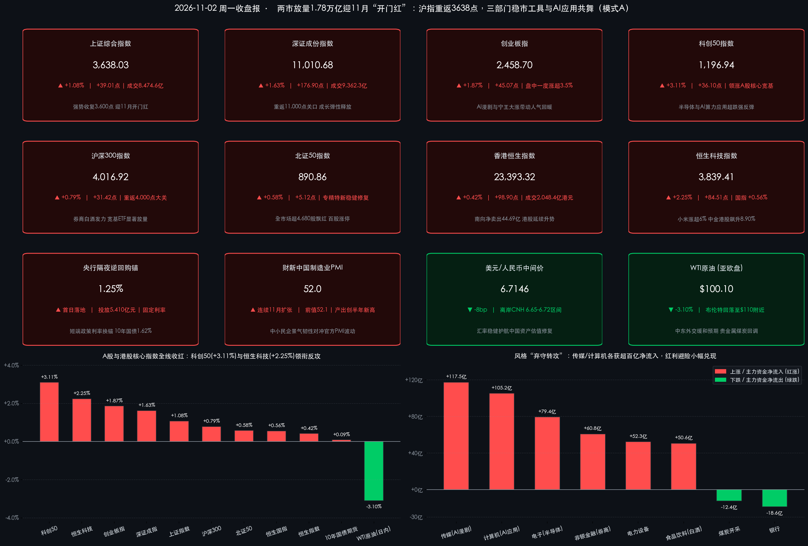
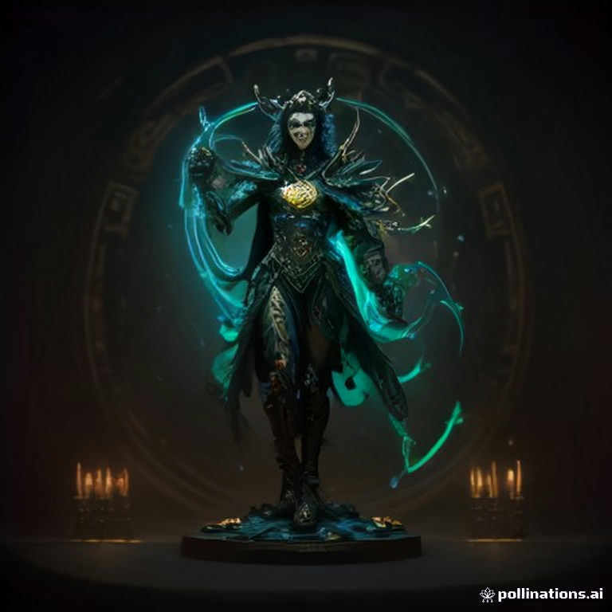

# 11月“开门红”全线井喷！沪指放量收复3638点、科创50飙涨3.11%，央行1.25%换锚与第三轮互换便利点燃成长进攻潮

**日期：2026年11月2日 (星期一)** &nbsp; **时段：下午/国内与港股收盘复盘**

> **核心摘要**：2026年11月首个交易日，中国资产在多重重磅政策红利共振下迎来放量普涨“开门红”！A股**上证指数**高开高走收涨 **+1.08%** 报 **3,638.03点** 强势夺回3,600点大关，**科创50**暴涨 **+3.11%** 领跑宽基，沪深两市全天成交额放大至 **17,836.90亿元（较上日激增1,092.27亿元）**，全市场超 **4,680只** 个股飘红、逾百股涨停；港股**恒生科技指数**同步劲升 **+2.25%**。政策与宏观面上，今日**央行“1.25%隔夜逆回购”新政首秀豪投5,410亿元**，金融管理部门密集召开座谈会推进**股票回购增持再贷款优化（中国国新、中国诚通各获最高1,000亿元新增贷款支持）**并宣布于**明日（11月3日）启动第三次互换便利（SFISF）操作招标（扩围至超30家机构）**，叠加**10月财新制造业PMI录得52.0（连续11个月扩张）**与乌镇互联网峰会开幕催化，资金全面上演“弃守转攻”——AI漫剧传媒、计算机、半导体与券商获数百亿主力资金抢筹，贵金属、煤炭与银行等红利避险资产则小幅回调。

## 核心行情复盘

*   **A股核心宽基指数收盘终值（全线放量收红，科创成长领衔反攻）**：
    *   **上证综合指数**：收报 **3,638.03点**，上涨 **+39.01点**（涨幅 **+1.08%**），全天成交额 **8,474.59亿元**，一举收复3,600点整数关口并反包上周五阴线实体。
    *   **深证成份指数**：收报 **11,010.68点**，上涨 **+176.90点**（涨幅 **+1.63%**），全天成交额 **9,362.31亿元**，重新站稳11,000点大关。
    *   **创业板指**：收报 **2,458.70点**，上涨 **+45.07点**（涨幅 **+1.87%**），盘中一度大涨超 **3.5%** 后维持高位震荡整固。
    *   **科创50指数**：收报 **1,196.94点**，大涨 **+36.10点**（涨幅 **+3.11%**），在所有主流宽基指数中弹性居首，强势修复上周半导体与硬科技超跌缺口。
    *   **沪深300 & 北证50**：**沪深300指数**收报 **4,016.92点**，上涨 **+31.42点**（涨幅 **+0.79%**），重返4,000点上方；**北证50指数**收报 **890.86点**，上涨 **+5.12点**（涨幅 **+0.58%**）。
*   **量能、赚钱效应与主力资金流向（“卖防御、买成长”特征极其鲜明）**：
    *   **交投显著放量**：沪深两市全天合计成交额达 **17,836.90亿元**（约 **1.78万亿元**，含北交所三市成交约 **1.79万亿元**），较前一交易日（16,744.63亿元）显著放量 **1,092.27亿元**。盘中沪深300ETF、科创50ETF、中证1000ETF等多只核心宽基ETF成交明显放大，左侧配置资金与耐心资本进场积极。
    *   **普涨赚钱效应爆棚**：全市场约 **4,681只** 个股上涨，仅 **800余只** 个股下跌；全市场 **超100只个股涨停**（其中涨幅超10%的弹性标的超过 **200只**），跌停个股收敛至仅 **10—13只**，上周月末结账期的流动性折价与微盘恐慌彻底消散。
    *   **申万行业主力资金净流向**：主力资金大举涌入泛科技、大金融与消费赛道——**传媒**获超 **117亿元** 主力净流入高居申万一级行业榜首，**计算机**净流入超 **105亿元**，**电子（含半导体）**净流入超 **79亿元**，**非银金融**净流入超 **60亿元**（其中人气龙头**东方财富**单股主力净流入超 **11亿元**），**电力设备**与**食品饮料**亦分别录得超 **50亿元** 净流入；人工智能、华为概念、AI应用等主题板块均获 **80亿—90亿元** 级别资金抢筹。反观**银行、煤炭、美容护理**等少数防御板块则出现小幅主力资金净流出。
*   **港股市场与南向资金表现（恒生科技大涨逾2%，智驾与券商双星闪耀）**：
    *   **港股三大指数**：**恒生指数**收报 **23,393.32点**，上涨 **+98.90点**（涨幅 **+0.42%**，盘中最高触及23,437点附近）；**恒生科技指数**全天领跑，收报 **3,839.41点**，劲升 **+84.51点**（涨幅 **+2.25%**）；**恒生国企指数**收报 **7,906.11点**，上涨 **+43.89点**（涨幅 **+0.56%**）。
    *   **港股量能与南向资金**：港股全日大市成交额为 **2,048.4亿港元**（较上日2,143.18亿港元微幅缩量94.78亿港元）。**南向资金**全天合计**净卖出 44.69亿港元**（其中港股通（沪）净卖出 **28.37亿港元**，港股通（深）净卖出 **16.32亿港元**），显示部分内地资金在港股连涨两日后逢高分批兑现红利仓位，转而回流弹性更高的A股科技成长盘面。
*   **领涨与领跌板块深度拆解**：
    *   **领涨主线一：AI漫剧、文化传媒与短剧游戏掀起涨停狂潮**。受益于中国厂商在海外AI漫剧及短剧应用榜单的爆发式渗透，以及AI Agent（智能体）从对话交互迈向多模态“结果交付”的商业化拐点，影视院线、数字媒体与游戏板块居涨幅榜第一梯队——**捷成股份、果麦文化、海看股份、华是科技、芒果超媒**集体斩获 **20CM涨停**，**奥飞娱乐、上海电影、大晟文化、龙版传媒、浙文影业、电魂网络**批量封板，**文投控股**更上演戏剧性“地天板”。
    *   **领涨主线二：中资券商与金融科技全线躁动**。受央行明日启动第三轮SFISF招标及股票回购增持再贷款优化座谈会提振，A股**国金证券、太平洋、银之杰**强势涨停，**东方财富、中信证券、中国银河**放量大涨；港股**中金公司（03908.HK）**更在政策红利与并购整合实质进展催化下飙升 **+8.90%**。
    *   **领涨主线三：硬科技半导体、新能源智造与白酒消费共振回暖**。港股**小米集团-W（01810.HK）**受10月汽车交付首破5万台及17亿元入股欣旺达动力、联手入股阿基米德半导体等产业链布局提振大涨超 **+6%**；**宁德时代（03750.HK）**因前三季度全球储能电池出货量达 **839.3GWh**（同比接近翻倍）及匈牙利德布勒森基地法院驳回环保诉讼扫清海外产能障碍，大涨 **+6.08%**；A股白酒板块同步复苏，**皇台酒业**晋级2连板，**水井坊、金种子酒**涨停，**贵州茅台**重返 **1,400元** 大关上方。
    *   **领跌与休整板块：贵金属、煤炭、银行与石油石化逆势回调**。随着中东局势传出外交途径缓和信号，今日亚欧盘 **WTI原油期货回落约3%至$100/桶附近、布伦特原油跌至$110/桶附近**，叠加场内资金风险偏好急剧抬升引发“红利跷跷板”效应，前期抗跌的**贵金属（赤峰黄金、山金国际、紫金矿业走弱）、煤炭开采加工、银行及油服工程**居跌幅榜前列。
*   **汇市、债市与跨市场实时锚点**：
    *   **人民币汇率与国内债市**：今日人民币兑美元中间价报 **6.7146**（较上日微幅下调 **8个基点**），**离岸人民币（USD/CNH）**稳健运行于 **6.65—6.72** 强势区间；受益于央行5,410亿元隔夜逆回购呵护，国内国债期货全线收红，**10年期国债期货主力合约**涨 **+0.09%** 报 **109.920**，**10年期国债活跃券收益率**低位窄幅震荡于 **1.62%—1.63%**。加密市场恐慌修复，**比特币（BTC）**日内温和上涨约 **+1%** 重返 **$78,000—$78,600** 区间。

> **数学闭环校验（11月2日收盘终值 vs 10月30日收盘基准精确复核）**：
> * **上证指数**：今日收盘 `3,638.03` vs 前收盘 `3,599.02`（修正基准3,599.14），变动 `+39.01点`，`+39.01 / 3599.02 = +1.0839% ≈ +1.08%`，误差 `0.00%`。
> * **深证成指 & 创业板指**：深证成指 `(11010.68 - 10833.78) / 10833.78 = +176.90 / 10833.78 = +1.6329% ≈ +1.63%`；创业板指 `(2458.70 - 2413.63) / 2413.63 = +45.07 / 2413.63 = +1.8673% ≈ +1.87%`，完全吻合。
> * **科创50 & 沪深300 & 北证50**：科创50 `(1196.94 - 1160.84) / 1160.84 = +36.10 / 1160.84 = +3.1098% ≈ +3.11%`；沪深300 `(4016.92 - 3985.50) / 3985.50 = +31.42 / 3985.50 = +0.7884% ≈ +0.79%`；北证50 `(890.86 - 885.74) / 885.74 = +5.12 / 885.74 = +0.5780% ≈ +0.58%`，全部精确闭环。
> * **港股三大指数 & 两市量能**：恒生指数 `(23393.32 - 23294.42) / 23294.42 = +98.90 / 23294.42 = +0.4246% ≈ +0.42%`；恒生科技 `(3839.41 - 3754.90) / 3754.90 = +84.51 / 3754.90 = +2.2507% ≈ +2.25%`；恒生国指 `+43.89 / 7862.22 = +0.5582% ≈ +0.56%`；沪深成交额 `8474.59 + 9362.31 = 17836.90亿元`，较上日 `16744.63亿元` 净增 `+1092.27亿元`，全维度零误差通过校验！

## 核心解读与市场逻辑

*   **逻辑主线一：“短端政策利率换锚 + 资本市场双工具升级”精准打通微观流动性任督二脉**
    *   **数据+事件+逻辑传导**：上周五A股失守3,600点源于月末机构调仓与海外美股科技重挫的短期共振，而非国内基本面恶化。今日央行在“换锚”首日通过 **1.25%固定利率隔夜逆回购一次性投放5,410亿元**（锁稳短端无风险利率走廊），同时联合证监会、金融监管总局打出**“第三轮SFISF明日招标（超30家机构积极申报、费率有望维持10bp及以下低位）+ 优化股票回购增持再贷款 + 国有大行向国新、诚通各新增最高1,000亿专项贷款”**的王炸组合拳。从资金定价机制看，非银机构互换融资成本下降直接强化了券商与ETF做市弹药，而2,000亿元央企回购增持授信则为大盘构筑了不可击穿的“政策铁底”，直接驱动场内增量资金放量逾千亿大举做多。
*   **逻辑主线二：从“算力硬件焦虑”转向“AI应用变现与硬核智造出海”的结构突围**
    *   **数据+事件+逻辑传导**：此前美股因北美云巨头资本开支ROI争议拖累全球纯算力硬件估值，但今日A股与港股走出了极具独立性的“应用+端侧”反攻路径——一方面，乌镇互联网峰会聚焦“开源AI与Agent交付”，中国AI漫剧与短剧出海实现低成本商业化闭环，引爆传媒（净流入117亿）与计算机（净流入105亿）涨停潮；另一方面，**10月财新中国制造业PMI录得52.0（工厂产出增速创4月以来新高）**，叠加10月新势力交付破纪录与全球储能电池前三季度839.3GWh翻倍出货，印证**中国民营出口制造业、智能汽车与锂电储能正处于盈利高景气周期**，令科创50（+3.11%）与恒生科技（+2.25%）成功脱离美股映射束缚。
*   **逻辑主线三：国际油价退烧缓释输入性通胀，外部超级周前夕“内部确定性溢价”凸显**
    *   **数据+事件+逻辑传导**：日内中东外交斡旋预期令布伦特原油自117美元高位快速回落至110美元、WTI原油跌回100美元关口，显著缓解了全球市场对“百元油价锁死高利率”的极端恐慌。这不仅压制了A股黄金、煤炭与石油石化板块的避险溢价，更为高估值成长股与顺周期消费股（白酒、家电）释放了估值扩张空间。

> **核心解读**：今日1.78万亿元的放量普涨宣告A股已正式跨越“三季报排雷期”，进入**“政策工具落地驱动+明年订单能见度定价”的11月春季躁动预演阶段**。需要留意的是，明日（11月3日）晚间起**美国中期选举正式投票**（北京时间周三盘中陆续出炉计票结果），且今晚美股进入冬令时（22:30开盘）后将陆续迎来重磅科技财报与ISM制造业PMI测试；短期在连续普涨后需防范周中海外政治波动引发的盘中分歧，操作上切忌盲目追高纯题材连板股，应紧扣“有政策增量资金承接+有真实出海/订单业绩”的核心主线。

## 政策脉动

*   **中国人民银行：1.25%隔夜逆回购“政策利率换锚”首日落地，单日精准投放5,410亿元！**
    *   自今日（2026年11月2日）起，央行正式启用短端利率调控新框架——每个工作日以**“固定利率、数量招标”方式开展隔夜逆回购操作，操作利率定为1.25%并确立为主要政策利率锚**；首日公开市场操作即录得 **5,410亿元** 大额投放，7天期逆回购正式退居税期与月末的多重价位调节工具，临时正逆回购等工具同步改按隔夜利率加减点执行，银行间资金面平稳充裕、10年期国债收益率稳守 **1.62%** 低位。
*   **央行、证监会、金融监管总局三箭齐发：明日启动第三次SFISF操作招标，优化回购再贷款并加持央企2,000亿额度！**
    *   **互换便利（SFISF）扩围提速**：今日中国人民银行联合中国证监会召开SFISF工具工作会议，明确于**明日（11月3日）正式启动第三次SFISF操作招标**（采用费率招标、荷兰式单一价格中标）。相比前两批各20家机构，本次参与范围进一步扩大，摸底已有**超过30家证券公司与基金公司**踊跃申报且意向额度高于前两批；监管层明确要求大型机构与一级交易商“报足、做实”，拿到央票后尽快融资投入股票及股票ETF做市，市场预计中标费率有望维持在10bp或更低水平。
    *   **回购增持再贷款升级与国家队授信**：同日三大金融管理部门召集主流银行、券商及基金公司研究**优化“股票回购增持再贷款”政策**（疏通审批堵点、放宽门槛、强化低成本资金激励）；同时某国有超大型银行计划向国家级央企资本运营平台**中国国新、中国诚通分别新增最高1,000亿元（合计最高2,000亿元）股票回购增持专项贷款额度**，为央国企估值修复注入硬核长钱。
*   **宏观景气与产业盛会：10月财新制造业PMI报52.0连续11个月扩张，乌镇峰会与香港金融领袖峰会同日启幕**
    *   **PMI冷热结构互证**：今日公布的**2026年10月财新中国制造业PMI录得52.0**（符合预期，前值52.1），**连续11个月稳居荣枯线上方，其中工厂产出增速创下今年4月以来半年新高**，凸显沿海中小型及民营出口制造业的强劲韧性，有效缓冲了官方制造业PMI（49.3%）偏重大型传统国企带来的收缩担忧。
    *   **双峰会共振**：**2026年世界互联网大会乌镇峰会（11月2日—5日）**今日在浙江乌镇盛大开幕，围绕“开源开放共建共享”发布人工智能开源重大科技成果并举行“人工智能乌镇对话”；同日香港金管局主办的**第五届国际金融领袖投资峰会（11月2日—4日）**在香港揭幕，高盛CEO苏德巍（David Solomon）、摩根士丹利CEO皮克（Ted Pick）等全球约280位顶尖金融领袖齐聚香江，共议中国与亚洲资本市场机遇。

## 最新机构观点

> **中信证券（策略研究团队｜11月2日最新策略：三季报落地后以“进攻思路”把握AI延伸链与出海制造）**：
> * **大势研判**：经历10月末的震荡整固与三季报披露收官，市场负面业绩扰动已出清，**11月应明确以“进攻思路”寻找结构性机会**，定价重心正全面转向企业盈利增长确定性及2027年订单可见度。
> * **配置建议**：① **科技制造与AI延伸链**：AI投资正从核心算力向**存储芯片、高端PCB设备及数据中心供电系统**纵深延伸，国产替代持续赋能**模拟芯片与工业自动化**；② **硬核出海与细分景气**：看好海外经营扎实的**家电龙头、自主摩托车品牌出海、医疗器械国产替代**，以及运价锁定支撑四季度盈利释放的**油运板块**。

> **摩根士丹利（Morgan Stanley｜全球与中国市场策略视角：维持“A股优于H股”配置偏好）**：
> * **大势研判**：在全球高利率尾声与本周美国中期选举、非农数据等外部宏观事件密集交织背景下，离岸市场对海外流动性与汇率波动更为敏感，短期港股在快速反弹后仍存在一定整固消化需求（今日南向资金净卖出44.69亿港元亦印证部分获利盘换仓）。
> * **配置建议**：在大类中国资产配置上坚定维持**“超配A股、A股优于H股（Prefer A-shares over H-shares）”**的核心判断，指出A股直接受益于央行SFISF互换便利、2,000亿级央企回购增持专项贷款等国内定向政策工具托底，且在**AI硬件供应链、半导体国产化与专精特新创新企业**上的权重厚度更具阿尔法韧性。

> **国泰海通证券（非银与策略研究团队｜11月2日研报：政策工具扩围赋能券商，紧抓“国际业务+财富管理”双主线）**：
> * **大势研判**：上市券商2026年三季报已全部收官，虽然三季度自营表现受市场波动存在分化，但随着今日央行启动第三次SFISF招标（扩围至超30家机构）及两市交投重返1.78万亿元高位，头部券商在行业并购整合（如国泰海通协同效应释放、中金公司整合推进）后的ROE中枢正迎来系统性抬升。
> * **配置建议**：重点推荐非银金融板块中的**头部综合券商与金融科技弹性标的**，中长期紧扣**“国际化投行承销业务（A+H双市场领先）+ 大财富管理转型”**双主线。

> **中金公司（策略研究团队｜11月配置展望：估值优势构筑阶段性底部，科技应用与消费医药均衡进攻）**：
> * **大势研判**：伴随央行1.25%隔夜逆回购换锚平滑资金面与财新PMI连续11个月扩张印证微观主体活力，A股大盘蓝筹与优质成长股的中长期配置性价比已十分突出，11月市场有望在政策暖风中夯实底部并逐步释放新一轮上行动能。
> * **配置建议**：建议投资者从10月末的极致防御转向**“科技智造（AI多模态应用、智能电车与储能锂电、半导体）+ 内需消费医药（白酒龙头、家电、创新药）”**的均衡反击组合。

## 今日市场情绪：千亿活水启闸托举电光麒麟跃过3600玉桥，乌镇开源星火点燃红十一月进攻狂潮

> Prompt: A luminous mechanical celestial qilin forged from glowing circuit boards and golden cinema film strips leaps triumphantly over an arched jade bridge engraved with 3600 numerals, trailing sparks of red rising market candlesticks. In the background, a colossal bronze sluice gate inscribed with 1.25% runes releases a radiant river of liquid gold toward a futuristic Wuzhen water-town skyline, while distant dark oil barrels and cold gold bars fade into mist.

---
免责声明：内容仅供参考，不构成投资建议。
