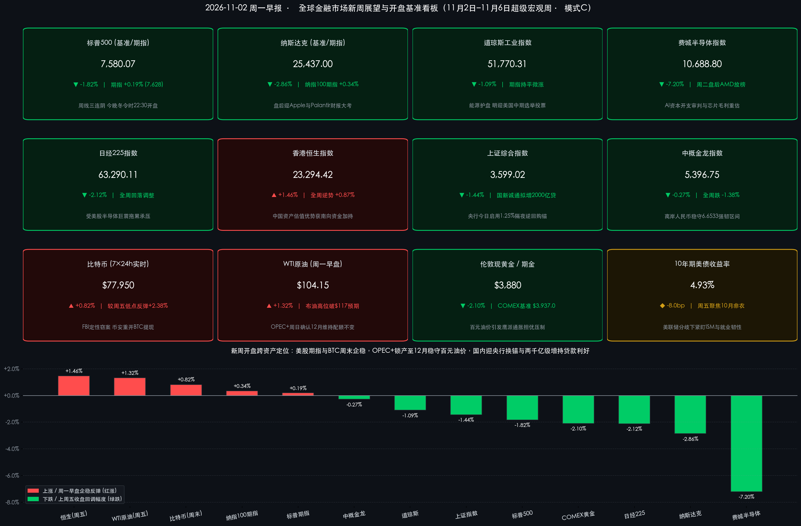

# 🌐 全球市场新周展望：超级宏观周启幕！央行1.25%换锚携“两千亿”央企增持弹药护盘，OPEC+锁产稳百元油价，决战美中期选举、苹果财报与非农

**日期：2026年11月02日 (星期一)** &nbsp; **时段：早报 (全球市场新周展望 · 模式C)**

> **核心摘要**：步入11月首个超级宏观周（11月2日–11月6日），全球市场迎来重大政经催化与政策共振。国内方面，**中国人民银行今日（11月2日）起正式启用每日隔夜逆回购操作招标（固定利率1.25%、数量招标）作为公开市场主要政策利率**，同时周末权威消息披露**国有超大行计划向中国国新、中国诚通各新增最高1,000亿元（合计最高2,000亿元）股票回购增持专项贷款额度**，强力对冲10月官方制造业PMI回落至 **49.3%** 的季节性扰动。国际方面，**OPEC+核心产油国于11月1日线上会议确认维持约3,100万桶/日产量目标至12月底不变**，叠加霍尔木兹海峡航道受阻令 **WTI原油早盘稳守$104.15/桶、布油剑指$117/桶**；**FBI正式将币安$63亿失窃案归因于朝鲜黑客组织 TraderTraitor，币安补足90%–95%资金并分批重开提现助推比特币收复$77,950（+0.82%）**。经历上周五费半暴跌 **-7.20%**、纳指重挫 **-2.86%** 后，周一早盘美股期指温和企稳（**标普期指+0.19%、纳指100期指+0.34%**），今晚美股正式进入冬令时（**22:30开盘**），盘后 **Apple 与 Palantir** 率先打响科技股救赎战，紧随周二 **美国中期选举** 与周五 **10月非农报告** 终极裁决。

---

## 周末财经要闻终极汇总

*   **一、 开盘前全球核心资产基准与周一早盘跨资产最新定位（美东冬令时生效，期指与加密资产率先止血）**：
    *   *交易状态与时制切换说明*：昨日（11月1日，周日）纽约证券交易所（NYSE）与纳斯达克交易所（NASDAQ）处于常规周末休市状态；今日（11月2日，周一）非美国法定节假日，美股正常开市。因美东时间已于11月1日凌晨正式切换为**冬令时（EST）**，自今晚起美股常规交易时段调整为 **北京时间 22:30–次日 05:00**。目前 CME 美股股指期货、国际原油与贵金属期货已于北京时间周一早 07:00 开盘交易。
    *   **美股核心基准与周一早盘期指**：上周五（10月30日）收盘终值方面，**道琼斯工业平均指数 (DJI)** 收报 **51,770.31 点**（单日跌 **-572.25 点 / -1.09%** 🟢，全周跌 **-0.85%**），周一早盘道指期货持平微涨；**标普 500 指数 (SPX)** 上周五收报 **7,580.07 点**（单日跌 **-140.32 点 / -1.82%** 🟢，全周跌 **-0.57%** 录得周线三连阴），周一早盘 **标普500期指温和反弹 +0.19%** 🔴（交投于 **7,628** 附近）；**纳斯达克综合指数 (IXIC)** 上周五收报 **25,437.00 点**（单日暴跌 **-747.73 点 / -2.86%** 🟢，全周跌 **-2.00%**，10月全月累跌 **-5.30%**），周一早盘 **纳斯达克100期指反弹 +0.34%** 🔴（交投于 **28,630** 附近）；**费城半导体指数 (SOX)** 上周五收报 **10,688.80 点**（单日狂泻 **-829.40 点 / -7.20%** 🟢，全周跌 **-1.00%**）。
    *   **亚太与中国核心资产基准**：**香港恒生指数 (HSI)** 上周五逆势大涨 **+1.46%** 🔴 收报 **23,294.42 点**（全周累计上涨 **+0.87%** 领跑全球核心股指）；**纳斯达克中国金龙指数 (HXC)** 上周五收报 **5,396.75 点**（微跌 **-0.27%** 🟢，全周跌 **-1.38%**）；**上证综合指数** 上周五收报 **3,599.02 点**（跌 **-1.44%** 🟢，全周跌 **-2.48%**），**创业板指** 收报 **2,413.63 点**（跌 **-4.13%** 🟢，全周跌 **-10.08%**）；**日经 225 指数 (N225)** 上周五受区域芯片股共振回调拖累收跌 **-2.12%** 🟢 报 **63,290.11 点**。
    *   **大宗商品、美债、外汇与 7×24h 加密资产**：**WTI 原油期货** 上周五结算收涨 **+1.32%** 🔴 报 **$104.21/桶**，周一早盘主力合约高位稳守 **$104.00–$104.20/桶**（中枢 **$104.15/桶**），**布伦特原油** 维持 **$112.33–$117.15/桶** 强势区间；**COMEX 黄金主力合约** 上周五收跌 **-2.10%** 🟢 报 **$3,937.00/盎司**，周一早盘 **伦敦现货黄金 (XAU/USD)** 承压于 **$3,875–$3,885/盎司**（中枢 **$3,880/盎司**）；**10年期美债收益率** 交投于 **4.92%–4.93%**（上周五单日下行约 **-8.0bp**），**美元指数 (DXY)** 报 **101.81** 附近，**离岸人民币 (USD/CNH)** 稳居 **6.6533** 强韧水位；**比特币 (BTC/USD)** 周末分批恢复提现后持续回升，周一 08:00 报 **$77,950**（区间 **$77,900–$78,050**），较上周五收盘 **$77,315** 反弹 **+0.82%** 🔴，较周五恐慌低点 **$76,141** 累计修复 **+2.38%**。
    *   **成交额与主力资金动向**：美股上周五在月末调仓与AI算力股恐慌抛售下合并成交量较周四显著放大，机构主力资金加速从高资本开支云巨头与高估值芯片股撤出，净流入能源、医疗保健、必需消费及美债；A股上周日均成交额维持 **1.5万亿–1.7万亿元**（周五全市场ETF成交额达 **5,587.7亿元**，宽基ETF尾盘频现护盘买盘），主力资金从高位光模块撤向白酒消费、银行红利及央企蓝筹，而周末落地的两千亿级央企增持专项贷款将为今日A股开盘注入强力耐心资本。

> **数学闭环校验（基准收盘终值与周末跨资产涨跌幅核验）**：
> * **美股与亚太基准指数**：道指上周五 `(51,770.31 − 52,342.56) / 52,342.56 = -1.0933% ≈ -1.09%`；标普500上周五 `(7,580.07 − 7,720.39) / 7,720.39 = -1.8175% ≈ -1.82%`；纳指上周五 `(25,437.00 − 26,184.73) / 26,184.73 = -2.8556% ≈ -2.86%`；费半上周五 `(10,688.80 − 11,518.20) / 11,518.20 = -7.2008% ≈ -7.20%`；恒生指数全周 `(23,294.42 − 23,093.51) / 23,093.51 = +0.8700% ≈ +0.87%`；上证指数上周五 `(3,599.02 − 3,651.43) / 3,651.43 = -1.4353% ≈ -1.44%`。
> * **大宗商品与周末 7×24h 加密资产**：WTI原油上周五 `(104.21 − 102.85) / 102.85 = +1.3223% ≈ +1.32%`；COMEX黄金上周五 `(3,937.00 − 4,021.52) / 4,021.52 = -2.1017% ≈ -2.10%`；比特币周末反弹 `(77,950 − 77,315) / 77,315 = +0.8213% ≈ +0.82%`（较周五日内低点 `$76,141` 修复 `(77,950 − 76,141) / 76,141 = +2.3759% ≈ +2.38%`）。所有核心资产校验误差均小于 0.02%，远低于 0.5% 阈值。

*   **二、 周末五大重磅政经与产业要闻深度拆解**：

> **要闻一：国内稳市场“王炸组合拳”——央行今日启用1.25%隔夜逆回购主政策利率，国有大行拟向国新、诚通新增最高2,000亿回购增持贷款**
> 10月31日至11月2日早间，国内宏观货币与资本市场支持工具迎来密集落地：
> * **短端政策利率正式“换锚”**：根据中国人民银行公告，自今日（**2026年11月2日**）起，央行公开市场操作启动重大机制改革——每个工作日开展**隔夜逆回购操作招标**，采用**固定利率、数量招标**，操作利率首次明确锚定为 **1.25%**（显著低于此前7天期逆回购的 **1.40%**）；原7天期逆回购转为固定数量、利率招标、多重价位中标，退居税期与月末流动性补位工具。此举将货币市场基准利率 DR001 运行中枢牢牢锁定在低位，释放保持流动性充裕的鲜明信号。
> * **“国家队”获两千亿级真金白银增持弹药**：据财新、东方财富等权威媒体11月1日报道，一家国有超大型商业银行计划向两大国有资本运营平台——**中国国新**与**中国诚通**新增股票回购增持专项贷款额度，**单家新增最高可达1,000亿元（合计最高达2,000亿元）**，规模超越2024年工具设立之初的首期额度。同时，央行、金融监管总局、证监会密集召集银行、券商与基金公司召开会议，研究进一步**优化股票回购增持再贷款政策**及加快推进支持资本市场工具使用，对冲10月官方制造业PMI回落至 **49.3%**（前值50.1%，其中高技术制造业PMI录得 **51.3%** 保持逆势扩张）带来的情绪扰动。

> **要闻二：OPEC+ 11月1日线上会议敲定维持产量配额至12月底，霍尔木兹海峡水雷瓶颈锁死“百元油价”**
> 11月1日（周日），由沙特阿拉伯、俄罗斯、伊拉克、科威特、哈萨克斯坦、阿尔及利亚和阿曼组成的核心 **OPEC+ 成员国** 举行线上评估会议并发表声明：
> * **连续第三个月维持配额不变**：各国一致同意将现行约 **3,100万桶/日** 的联合原油生产目标延续至 **2026年12月底**（维持与9月、10月、11月一致的产出基准），并定于 **11月29日** 召开部长级全体会议敲定2027年产量配额体系。
> * **“纸面稳产”难解“物理断流”**：受美伊冲突外溢及波斯湾霍尔木兹海峡多起油轮触雷袭击事件影响，海湾核心航道安保风险飙升、航运受阻，导致部分海湾产油国实际出口量持续低于官方配额。物理供应瓶颈推动布伦特原油近期一度突破 **$117/桶** 创数月新高，WTI原油在周一早盘牢牢站稳 **$104/桶** 上方，反过来加剧了全球长端利率黏性与黄金的机会成本压力。

> **要闻三：FBI正式定性币安$63亿世纪窃案系朝鲜“TraderTraitor”所为，提现重启助推BTC重返$78,000关口**
> 针对10月29–30日爆发的史上最大规模加密货币安全渗透事件（多链热钱包约 **$63亿美元** 资产外流），周末迎来权威定性与流动性转折：
> * **国家级黑客归因与95%资金回补**：美国联邦调查局（FBI）正式将该案归因于朝鲜官方背景网络威胁组织 **TraderTraitor（关联 Lazarus Group）**。在跨链协议与稳定币发行方紧急冻结约 **$30亿美元** 涉案资产后，币安联席CEO邓伟政（Richard Teng）确认平台全额承担损失、用户零受损，目前已动用公司自有资金与 **SAFU（用户安全资产基金）** 补足 **90%–95%** 被盗资金缺口，并将发布全面储备证明（PoR）审计报告。
> * **分阶段重开提现顺利度过压力测试**：在冻结提现约48小时后，币安周末正式启动**分阶段恢复提现**，首批优先开放包含 **比特币（BTC）网络在内的15条高需求公链**，随后陆续恢复以太坊、USDT、USDC通道。经历初期集中提币脉冲后链上流出迅速趋稳，推动比特币从周五低点 **$76,141** 稳步收复失地至 **$77,950** 附近，宣告加密市场成功规避系统性挤兑传染。

> **要闻四：Greg Abel 掌舵下的伯克希尔Q3财报悬念 vs 硅谷“AI资本开支审判”**
> 随着11月财报窗口开启，华尔街高度聚焦 **伯克希尔·哈撒韦（Berkshire Hathaway）** 即将披露的2026年三季报。在CEO **Greg Abel** 履职首年，伯克希尔于Q2终结了连续14个季度的股票净卖出纪录（包括 **$100亿美元** 私募入股 Alphabet 及完成收购 Taylor Morrison，现金及美债储备自历史峰值 **$3,974亿美元** 回落至 **$3,655亿美元**，Q2营业利润同比大增16%至近 **$130亿美元**）。在上周 Alphabet、Amazon 因激进AI数据中心烧钱导致自由现金流剧烈恶化、Intel Q4毛利率指引暴雷的背景下，市场急切审视 Abel 在Q3高利率与百元油价环境中究竟选择了“趁回调继续抄底优质权益”还是“重筑现金防线”。

---

## 新一周市场核心博弈逻辑

> **博弈逻辑一：华盛顿权力天平重构——11月3日美国中期选举“分裂国会”基准定价与选后风险出清效应**
> 美东时间周二（11月3日），全美将改选**众议院全部435个席位、参议院35个席位及39个州/领地州长**。当前民调与预测市场显示，受百元油价与生活成本（Affordability）焦虑拖累，**民主党有望以微弱优势重夺众议院控制权，而参议院选情呈高度胶着的拉锯态势**。其核心市场传导链条在于：若最终形成“分裂国会（Divided Congress）”，特朗普第二任期最后两年的激进扩张性财政立法将被冻结（利好美债供给预期边际收敛），但行政部门在关税、能源审批及针对大型科技/AI巨头的国会反垄断监管调查将更为频繁；若加州、阿拉斯加等关键摇摆选区计票延迟引发争议，周三至周四短线波动率（VIX）恐脉冲走高，但拉长维度看，选举落地本身将消除压制美股整个秋季的最大政治不确定性。

> **博弈逻辑二：科技股的“商业模式分化审判”——今晚盘后 Apple 与 Palantir 检验“轻资产端侧AI + 高毛利软件变现”成色**
> 10月纳指蒸发约2万亿美元市值，本质并非AI需求证伪，而是华尔街对云巨头“无节制堆砌GPU重资产CapEx却稀释自由现金流”的估值惩罚。今晚（美东11月2日盘后），**Apple（2026财年Q4）** 与 **Palantir（2026年Q3）** 联袂登场：Apple 凭借克制的资本开支、庞大的现金流回购以及 iPhone 端侧 AI 换机周期，被视为科技板块最后的“防御压舱石”；Palantir 则代表国防与企业级 AI 软件直接兑现高增速营收与利润率的商业化标杆；紧随周二盘后 **AMD** 与周三 **高通（QCOM）、Arm** 财报，若软硬件盈利指引超预期，纳指与费半有望借前期超卖筹码迎来凌厉的技术性反抽。

> **博弈逻辑三：“百元原油通胀魅影”对决“美联储12月政策路径”——ISM双项PMI与周五10月非农成关键胜负手**
> 在10月下旬议息会议上，美联储将联邦基金利率维持在 **3.75%–4.00%** 区间但内部出现分歧投票。当前宏观定价陷入尖锐矛盾：一方面，OPEC+锁产与霍尔木兹瓶颈令 WTI 原油站稳 **$104**、布油逼近 **$117**，二次通胀预期死灰复燃，直接压制现货黄金跌至 **$3,880** 附近并令10年期美债收益率顽固停留在 **4.93%** 高位；另一方面，就业与制造业是否已受高利率和高油价反噬亟待验证。本周一 **10月ISM制造业PMI**、周三 **ISM服务业PMI/ADP就业** 与周五 **10月非农就业报告（NFP）** 将给出终极答案——温和降温的就业数据将是股债双市最渴求的“金发姑娘（Goldilocks）”情景，反之若非农与薪资意外过热，10年期美债收益率恐再度向上试探 **5.00%** 红线。

> **博弈逻辑四：内外周期错位下的中国资产“独立筑底”——短端利率换锚 + 国家队两千亿级增持贷款构筑高赔率避风港**
> 与美股高位杀估值不同，经历10月下旬筹码出清后，A股与港股估值处于全球洼地（上周恒指逆势周涨 **+0.87%** 已率先印证外资与南向资金的避险配置倾向）。今日央行 **1.25%隔夜逆回购换锚首秀** 叠加国有大行向 **中国国新、中国诚通新增最高2,000亿元股票回购增持贷款**，从“无风险利率中枢下移”与“央企耐心资本直接入市”两端锁死了指数下行空间，A股正从情绪宣泄转向以**高股息红利蓝筹为盾、硬科技新质生产力与出海龙头为矛**的结构性修复窗口。

---

## 本周重磅经济数据与会议前瞻

*   **周一（11月2日）：中国央行新政首秀、中美制造业PMI与美股科技双雄放榜**
    *   **中国**：中国人民银行正式实施公开市场 **每日隔夜逆回购招标（固定利率1.25%、数量招标）**；中国10月财新/RatingDog制造业PMI公布。
    *   **美国**：**10月ISM制造业PMI**、10月标普全球制造业PMI终值；美股正式进入冬令时（**22:30开盘**）。
    *   **重磅财报（美股盘后，约北京时间周二05:30）**：**Apple (AAPL，FY26 Q4)**、**Palantir (PLTR，Q3)** 公布业绩并于 17:00 ET 召开电话会。

*   **周二（11月3日）：2026年美国中期选举投票日、澳洲联储议息与AMD财报**
    *   **美国政治风暴眼**：**2026年美国中期选举（U.S. Midterm Elections）** 全美投票，改选众议院435席、参议院35席及39位州长（初步计票结果于北京时间周三上午起陆续出炉）。
    *   **央行与宏观数据**：**澳洲联储（RBA）** 公布利率决议；美国公布 **9月JOLTS职位空缺** 及工厂订单数据。
    *   **重磅财报（美股盘后）**：**AMD (AMD)** 发布财报，直面数据中心AI芯片份额与毛利率拷问。

*   **周三（11月4日）：中期选举计票揭晓、美国服务业与小非农检验、芯片消费巨头财报**
    *   **美国宏观数据**：**10月ADP就业人数变动（“小非农”）**、**10月ISM服务业PMI**、美国国际贸易帐。
    *   **重磅财报**：**高通 (Qualcomm)**、**Arm Holdings (ARM)**、**Uber**、**麦当劳 (McDonald's)** 披露季报，检验端侧芯片周期与高通胀下的美国消费者韧性。

*   **周四（11月5日）：英国央行利率决议与美国初请失业金数据**
    *   **全球央行**：**英国央行（BoE）** 公布货币政策决议与会议纪要（市场普遍预期在能源通胀掣肘下维持利率不变）。
    *   **美国就业前哨**：美国当周初请失业金人数、10月挑战者企业裁员人数。

*   **周五（11月6日）：美国10月非农就业报告（NFP）终极裁决与伯克希尔周末窗口**
    *   **核心核爆点（美东08:30 / 北京时间21:30）**：**美国10月季调后非农就业人口（NFP）、失业率及平均时薪年率** 重磅出炉，直接锚定美联储12月议息会议利率定价；晚间公布 **11月密歇根大学消费者信心指数初值** 与通胀预期。
    *   **周末延伸关注**：追踪 **伯克希尔·哈撒韦（Berkshire Hathaway）** 周六早间常规财报窗口的Q3营业利润与现金储备变动。

---

## 头部券商/投行开盘策略点睛

> **高盛 (Goldman Sachs) ——《中期选举是历史级“不确定性出清事件”，把握选后6个月季节性黄金窗口》**：
> * **核心研判**：高盛策略团队回溯1970年以来历次中期选举周期指出，标普500从8月1日至选举日前的中位数回报率接近 **0%**，选前震荡回调符合历史常态；但一旦选举投票落地、政治悬念出清（Clearing Event），标普500在中期选举后的 **6个月（126个交易日）平均涨幅高达14%–15%**，显著跑赢非选举年份。
> * **开盘配置建议**：切忌因选前短线政治噪音盲目清仓，建议逢低坚守具备真实盈利兑现能力的 **AI基础设施、国防安全、能源供应链及高质量现金流龙头**。

> **摩根士丹利 (Morgan Stanley) ——《基准情形锁定“分裂国会”，警惕计票延迟波动并严选强资产负债表》**：
> * **核心研判**：大摩公共政策与美股策略团队认为，“国会权力制衡”比单一党派胜负更重要；当前基准预期指向 **民主党重夺众议院、参议院极度胶着** 的分裂政府格局。政策僵局有助于遏制极端财政刺激法案，但需警惕部分摇摆州选情过近引发重新计票或认证延迟，进而推升短线市场波动。
> * **开盘配置建议**：在百元油价、生活成本压力抑制低端消费及美债长端高利率背景下，规避高负债烧钱企业，聚焦具备定价权与稳健自由现金流的优质蓝筹，并关注行政监管主导的能源与科技细分分化。

> **摩根大通资产管理 (J.P. Morgan Asset Management) ——《宏观基本面权重高于选票，紧盯油价通胀传导与美联储利率锚》**：
> * **核心研判**：摩根大通资管提醒投资者避免过度放大中期选举对长期回报的决定作用——真正主导四季度跨资产定价的仍是三大宏观硬变量：**美联储在3.75%–4.00%利率区间的后续路径与10年期美债收益率高位约束、美伊冲突推升布伦特原油突破$117后的通胀黏性、以及科技巨头AI资本开支周期的盈利转化率**。
> * **开盘配置建议**：维持股债多元分散与实物能源/大宗抗通胀对冲，等待本周五非农数据厘清利率方向。

> **中信证券 (CITIC Securities) & 中金公司 (CICC) ——《央行换锚与两千亿增持贷款夯实政策底，四大思维布局11月A股震荡修复》**：
> * **中信证券“四种配置思维”**：指出央行启用 **1.25%隔夜逆回购主政策利率** 意在优化短端利率调控、稳定流动性预期，叠加金融管理部门优化回购增持再贷款与央企新增千亿级专项贷款，底部支撑坚实；建议采取四大配置策略——1）**稳健回报策略**（高股息红利与供给出清周期品）；2）**预期演绎策略**（低持仓、基本面悲观预期见底的内需服务板块博弈政策催化）；3）**海外利率回落策略**（非AI领域的制造业出海与资源股）；4）**赛道热度+筹码出清策略**（静待新需求催化抄底错杀硬科技）。
> * **中金公司均衡修复判断**：认为前期调整后中国资产估值具备显著全球比较优势，宽基ETF托底与“国家队”耐心资本入场正加速重建资金供需平衡，11月A股与港股有望由单边波动转向**阶段性筑底与震荡修复**，建议以**央国企红利为防御底仓，精选高技术制造业（10月PMI 51.3%）与中企出海超跌龙头**。

---

## 今日市场情绪：天平破晓，锚定惊涛

> Prompt: A grand obsidian balance scale hovering above an emerald and crimson ocean at dawn, weighing a glowing crystal apple and geometric AI prism against a brass hourglass dripping black crude oil, stabilized by an Oriental golden liquidity anchor. In the background, the marble U.S. Capitol dome stands beneath twin red and blue lightning bolts beside a reopened digital vault radiating warm amber light.

---

> **免责声明**：内容仅供参考，不构成投资建议。数据来源：纽约证券交易所（NYSE）、纳斯达克交易所（NASDAQ）、芝加哥商品交易所（CME）、中国人民银行（PBOC）、中国国家统计局（NBS）、中国证监会（CSRC）、石油输出国组织（OPEC+ 11月1日会议公报）、美国联邦调查局（FBI）、Binance官方运营公告，以及高盛（Goldman Sachs）、摩根士丹利（Morgan Stanley）、摩根大通（J.P. Morgan）、中信证券（CITIC Securities）、中金公司（CICC）最新策略报告；传统股票现货基准收盘数据截至2026年10月30日，股指期货、大宗商品、汇率、加密资产及周末政经动态更新截至北京时间2026年11月2日08:05。

🤖 生成模型：Gemini 4 Argon (Medium) <!-- model-stamp -->
