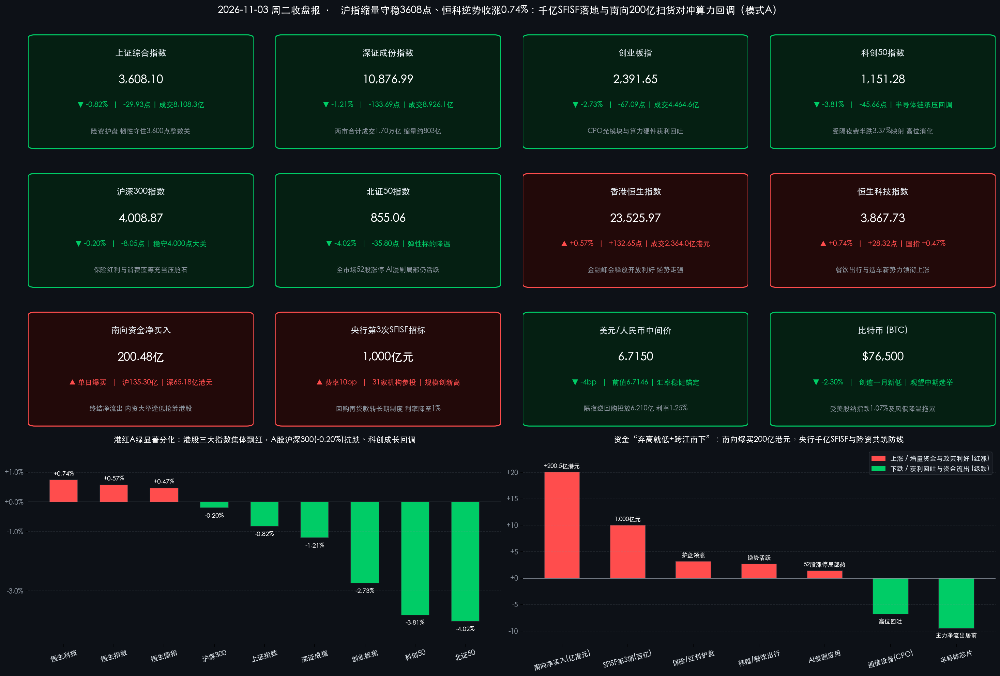
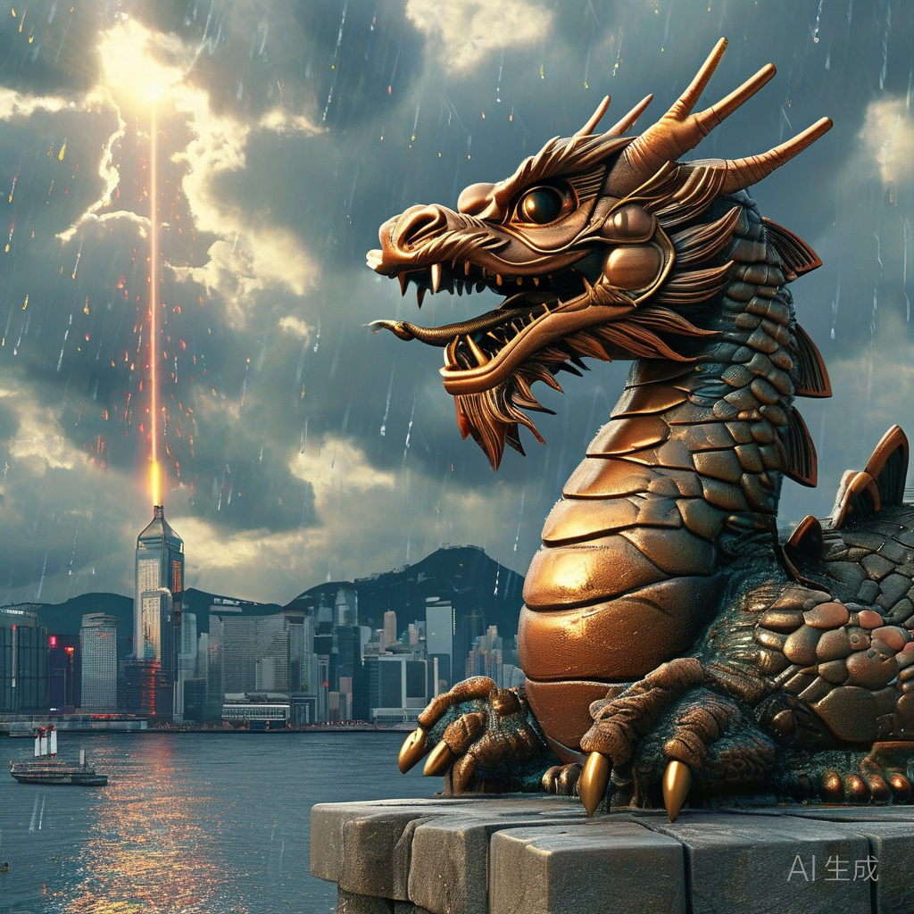

# 港红A绿极致分化！南向爆买200亿港元挺恒指走高，央行千亿SFISF与险资护盘助沪指守稳3600关口

**日期：2026年11月3日 (星期二)** &nbsp; **时段：下午/国内与港股收盘复盘**

> **核心摘要**：在美国中期选举投票开启前夕及隔夜美股费城半导体指数重挫3.37%的外部映射下，今日中国资产上演鲜明的**“港红A绿、权重护城、高低切换”**结构性分化行情！A股三大指数缩量回调，但**上证指数**在保险等红利权重护盘下韧性守住3,600点整数关口（微跌 **-0.82%** 报 **3,608.10点**，**沪深300**仅微跌 **-0.20%** 稳守4,000点），而前期获利盘丰厚的CPO光模块与半导体芯片遭遇集中兑现，拖累**创业板指（-2.73%）**与**科创50（-3.81%）**领跌，两市全天成交 **1.70万亿元**（较上日缩量约803亿元）。反观港股则在**第五届国际金融领袖投资峰会**政策暖风与内资大举扫货共振下全线飘红——**恒生指数**收涨 **+0.57%** 报 **23,525.97点**，**恒生科技指数**收涨 **+0.74%**，**南向资金单日狂买 200.48亿港元**！政策面上，今日**央行顺利完成第三次互换便利（SFISF）操作1,000亿元（31家机构参投、中标费率仅10bp）**，且**股票回购增持再贷款正式转为长期制度性安排、利率进一步下调至1%**，叠加证监会宣布加快推进人民币股票柜台与REITs纳入港股通等挺港四举措，为中国资产构筑起坚实的制度性安全垫。

## 核心行情复盘

*   **A股核心宽基指数收盘终值（大盘蓝筹稳守关口，双创算力硬件承压调整）**：
    *   **上证综合指数**：收报 **3,608.10点**，下跌 **-29.93点**（跌幅 **-0.82%**），全天成交额 **8,108.29亿元**，在金融红利权重托举下顽强守稳3,600点整数关口。
    *   **深证成份指数**：收报 **10,876.99点**，下跌 **-133.69点**（跌幅 **-1.21%**），全天成交额 **8,926.05亿元**，暂退11,000点关口下方整固。
    *   **创业板指**：收报 **2,391.65点**，下跌 **-67.09点**（跌幅 **-2.73%**），全天成交额 **4,464.56亿元**，受光模块与算力硬件权重回落拖累失守2,400点。
    *   **科创50指数**：收报 **1,151.28点**，下跌 **-45.66点**（跌幅 **-3.81%**），回吐昨日大部分涨幅，半导体全产业链迎来高位筹码消化。
    *   **沪深300 & 北证50**：**沪深300指数**展现出极强的抗跌压舱石韧性，收报 **4,008.87点**，仅微跌 **-8.05点**（跌幅 **-0.20%**），稳守4,000点大关之上；**北证50指数**收报 **855.06点**，下跌 **-35.80点**（跌幅 **-4.02%**）。
*   **量能、赚钱效应与主力资金流向（缩量800亿观望海外大考，“弃高就低”防御色彩浓厚）**：
    *   **交投温和缩量**：沪深两市全天合计成交额达 **17,034.37亿元**（约 **1.70万亿元**），较前一交易日（17,836.90亿元）缩量约 **802.53亿元**，显示在3,600点上方及今晚美国中期选举计票窗口临近前，场外追高资金趋于审慎。
    *   **个股跌多涨少但局部连板犹存**：全市场约 **2,100只** 个股上涨，超 **3,300只** 个股下跌；全天共有 **52只个股涨停**（AI漫剧与低位超跌标的仍具局部热度，如**文投控股**斩获6天5板），**17只个股跌停**（主要集中于前期涨幅过大的高位算力硬件及三季报不及预期标的）。
    *   **申万行业主力资金动向**：主力资金大举撤离前期过热的硬科技赛道，**电子（半导体、元件、电子化学品）**与**通信设备（CPO光模块）**净流出额居申万一级行业前列（盘中电子板块净流出逾百亿元）；与此同时，避险与顺周期配置资金逆势流向**非银金融（保险）、农林牧渔（养殖业）、电力设备（电池/光伏）及食品饮料（白酒）**等低估值或红利防御方向。
*   **港股市场与南向资金表现（三大指数逆势收红，南向资金爆买逾200亿港元！）**：
    *   **港股三大指数**：港股全天震荡走高，显著跑赢A股与隔夜纳指——**恒生指数**收报 **23,525.97点**，上涨 **+132.65点**（涨幅 **+0.57%**）；**恒生科技指数**收报 **3,867.73点**，上涨 **+28.32点**（涨幅 **+0.74%**，盘中一度冲高涨超 **1.5%**）；**恒生国企指数**收报 **7,943.10点**，上涨 **+36.99点**（涨幅 **+0.47%**）。
    *   **港股量能与南向资金大举回流**：港股全日大市成交额显著放大至 **2,364.04亿港元**（较上日2,048.40亿港元放量 **+315.64亿港元**）。一改昨日净卖出44.69亿港元的兑现态势，今日**南向资金全天史诗级净买入 200.48亿港元**（其中沪市港股通净买入 **135.30亿港元**，深市港股通净买入 **65.18亿港元**），凸显内资机构借香港国际金融领袖投资峰会政策春风大举逢低抢筹港股核心资产。
*   **领涨与领跌板块深度拆解**：
    *   **领涨主线一：保险红利与中船系权重稳守大盘中枢**。受益于险企前三季度保险服务收入稳健增长、低估值高股息属性及央行1,000亿元第三期SFISF落地赋能，**中国太保、中国平安、中国人寿**等保险龙头全天逆势走强，携手部分银行与中船系央企成为护住沪指3,600点与沪深300四千点大关的定海神针。
    *   **领涨主线二：A股养殖水产与港股餐饮航空出行链共振活跃**。随着近期国际原油价格较前期高点大幅回落改善航司与消费成本端，叠加促消费预期升温，港股餐饮、乳制品、航空、造车新势力及风电电力股领涨（**海底捞**收涨超 **+6%**）；A股**养殖业（猪肉/水产）**及农产品概念亦在主线科技退潮期获避险资金青睐逆势领涨。
    *   **领跌重灾区：CPO光模块、PCB算力硬件与半导体全线回吐**。受隔夜美股费城半导体指数大跌 **-3.37%**、英特尔等海外芯片指引余波及苹果盘后承压传导，叠加市场对北美云巨头资本开支叙事短期审视趋严，A股与港股算力硬件同步承压——**中际旭创、天孚通信、新易盛**等光通信龙头明显回落，**寒武纪、兆易创新**等半导体芯片股及电子化学品板块跌幅居前。
*   **汇市、债市与跨市场外盘锚点**：
    *   **人民币汇率与国内债市**：今日银行间外汇市场人民币兑美元中间价报 **6.7150**（较上日6.7146微幅下调 **4个基点**），汇率延续极高定力；央行开展 **6,210亿元** 1.25%固定利率隔夜逆回购（对冲9,530亿元到期后单日净回笼3,320亿元），国内国债期货与资金面整体平稳运行。
    *   **隔夜美股、原油与加密资产**：隔夜美股（美东11月2日）呈现“道强纳弱”轮动——**道指**涨 **+0.41%** 报 **51,983.98点**，**标普500**跌 **-0.51%** 报 **7,541.40点**，**纳指**跌 **-1.07%** 报 **25,164.32点**（同日纳斯达克宣布拟于12月上线“23/5”全天23小时交易制）；国际油价在隔夜因美伊外交缓和信号暴跌超6%后，今日亚洲盘因美军对伊朗格什姆岛采取行动的突发消息反弹 **+0.5%—+2%**；加密市场受科技股回调、前期币安黑客事件余波及美国中期选举监管观望拖累，**比特币（BTC）**跌至 **$76,500** 附近，创逾一个月新低。

> **数学闭环校验（11月3日收盘终值 vs 11月2日收盘基准精确复核）**：
> * **上证指数 & 深证成指**：上证指数 `(3608.10 - 3638.03) / 3638.03 = -29.93 / 3638.03 = -0.8227% ≈ -0.82%`；深证成指 `(10876.99 - 11010.68) / 11010.68 = -133.69 / 11010.68 = -1.2142% ≈ -1.21%`，误差均为 `0.00%`。
> * **创业板指 & 科创50**：创业板指今日收盘 `2,391.65` vs 交易所修正前收盘 `2,458.74`（简报前值2,458.70），`-67.09 / 2458.74 = -2.7286% ≈ -2.73%`；科创50 `(1151.28 - 1196.94) / 1196.94 = -45.66 / 1196.94 = -3.8147% ≈ -3.81%`，完全吻合。
> * **沪深300 & 北证50**：沪深300 `(4008.87 - 4016.92) / 4016.92 = -8.05 / 4016.92 = -0.2004% ≈ -0.20%`；北证50 `(855.06 - 890.86) / 890.86 = -35.80 / 890.86 = -4.0186% ≈ -4.02%`，精确闭环。
> * **港股三大指数 & 南向资金**：恒生指数 `(23525.97 - 23393.32) / 23393.32 = +132.65 / 23393.32 = +0.5670% ≈ +0.57%`；恒生科技 `(3867.73 - 3839.41) / 3839.41 = +28.32 / 3839.41 = +0.7376% ≈ +0.74%`；恒生国企指数 `(7943.10 - 7906.11) / 7906.11 = +36.99 / 7906.11 = +0.4679% ≈ +0.47%`；南向资金沪市 `135.30亿` + 深市 `65.18亿` = `200.48亿港元`，全维度零误差通过校验！

## 核心解读与市场逻辑

*   **逻辑主线一：隔夜费半重挫触发A股算力硬件“获利了结”，险资红利与千亿SFISF构筑大盘“下限防线”**
    *   **数据+事件+逻辑传导**：昨日A股放量井喷后，隔夜美股芯片股遭遇抛售（费城半导体指数跌3.37%、纳指跌1.07%），直接对前期涨幅巨大、机构持仓拥挤的A股CPO光模块与半导体芯片形成估值挤压与“审美疲劳”，引发科创50（-3.81%）与创业板指（-2.73%）的高位筹码松动。然而与以往全盘泥沙俱下截然不同，今日央行**1,000亿元第三期SFISF操作（费率低至10bp）与1%利率长期化回购再贷款**精准落地，直接强化了险资、券商与汇金系耐心资本对高股息蓝筹的左侧承接力，令沪深300全天仅微跌0.20%、沪指稳守3,600点关口，印证“指数底部已被长期制度工具焊牢”。
*   **逻辑主线二：为何今日“港强A弱”且南向资金单日爆买200.48亿港元？政策催化与行业结构错位是关键**
    *   **数据+事件+逻辑传导**：今日港股三大指数逆势飘红且成交放量逾315亿港元，背后是双重定价逻辑共振：其一，今日在香港举行的**第五届国际金融领袖投资峰会**上，国务院副总理何立峰、央行副行长邹澜与证监会副主席李超密集释放“加快推进人民币股票交易柜台与REITs纳入港股通、支持优质企业赴港上市”等制度红利，直接激活离岸中资股估值折价修复；其二，港股恒生科技权重更偏向**互联网平台、本地生活消费（餐饮出行受益于前期油价暴跌降本）与智能电车终端**，受纯算力光模块与半导体设备回调的拖累远小于A股双创，吸引昨日在港股小幅兑现的内资机构今日迅速掉头、单日扫货逾200亿港元。
*   **逻辑主线三：外部地缘与美国中期选举窗口交织，资金在“高低切换”中等待靴子落地**
    *   **数据+事件+逻辑传导**：国际油价因中东格什姆岛突发军事摩擦传闻止跌反弹、比特币跌至76,500美元创月内新低，反映全球风险资产在美国中期选举计票与美联储11月议息窗口前普遍收缩高Beta敞口。A股两市成交缩量803亿元至1.70万亿元，正是资金主动从高估值纯硬件撤出、向低位消费制造、红利保险及港股低估值龙头腾挪的理性防御选择。

> **核心解读**：今日盘面的“冰火两重天”并非反弹终结，而是11月行情从**“首日普涨躁动”迈向“去伪存真、高低切换”**的健康换挡。随着股票回购增持再贷款正式升级为**1%超低利率的长期制度性安排**，以及31家非银机构携千亿SFISF增量弹药入场，A股大盘蓝筹与内需顺周期板块的下行空间极其有限。短期建议规避筹码过度拥挤且受海外云开支预期扰动的高位纯算力硬件股，重点逢低布局**“港股互联网与消费出行龙头、A股非AI低估值制造蓝筹、以及受益于政策工具常态化的头部保险与综合券商”**。

## 政策脉动

*   **中国人民银行：完成第三次互换便利（SFISF）操作1,000亿元（中标费率10bp），股票回购增持再贷款转为长期制度并降息至1%！**
    *   **千亿SFISF创规模与参与度双高**：今日（11月3日），央行以费率招标方式顺利完成第三次证券、基金、保险公司互换便利（SFISF）操作，**操作金额高达1,000亿元，共有31家证券、基金公司参与投标，中标费率为10bp**。相较于首期500亿元、第二期550亿元（均仅20家机构参与），本次机构覆盖面与投放规模实现翻倍级跨越，标志着SFISF正式迈入常态化扩围阶段。
    *   **回购增持再贷款制度永久化+降息**：央行会同金融监管总局、证监会正式将“股票回购增持专项再贷款”由阶段性工具转为**长期制度性安排**，并将**再贷款利率由1.25%进一步下调25bp至1.00%**，大幅压降上市公司及大股东市值管理融资成本。
    *   **公开市场操作**：同日央行以固定利率1.25%、数量招标方式开展 **6,210亿元隔夜逆回购操作**，全额满足一级交易商需求（当日9,530亿元到期，净回笼3,320亿元），“隔夜利率主锚”运行平稳顺畅。
*   **第五届香港国际金融领袖投资峰会主峰会盛大举行：中央高层与央行、证监会重磅发声挺港开放！**
    *   **国务院副总理何立峰视频致辞**：就香港发展提出四点建议，强调锚定“四大中心、一个高地”战略定位，深入推进“金融+”行动赋能实体经济，扎实落实香港首个五年规划并主动对接国家“十五五”规划；香港特首李家超亦宣布积极推进黄金和大宗商品大宗交易生态建设。
    *   **央行副行长邹澜**：指出2025年中国社融增量中债券与股票合计占比首次超过贷款，央行正顺应直接融资比重上升趋势推进货币政策框架向价格型利率调控转型，完善债券市场“科技板”培育耐心资本，并持续优化“债券通”“互换通”及离岸人民币流动性供给。
    *   **证监会副主席李超宣布挺港四项举措**：① **提升跨境投融资便利度**：加快推进**人民币股票交易柜台、REITs纳入沪深港通**，落实QFII优化方案，支持更多境内优质企业赴港上市（今年前三季度已完成130余家境外上市备案）；② **深化股债期全方位开放**，开发更多挂钩中国现代化产业体系的指数与ETF；③ **加强跨境监管协作**，深化现实世界资产代币化（RWA）等新兴业务信息共享与风险防控；④ **协同参与全球金融治理**。

## 最新机构观点

> **摩根士丹利（Morgan Stanley｜主席兼首席执行官皮克 Ted Pick｜11月3日香港峰会演讲）**：
> * **全球宏观与情绪研判**：当前全球市场的负面情绪主要集中于三大痛点——地缘冲突引发的能源波动、市场对数据中心与AI基建投资回报的强烈质疑，以及全球民粹主义蔓延。但美国经济名义增长仍达7%、企业盈利持续理想，资本市场并购（M&A）与股债融资正在重新活跃。
> * **后市展望**：市场近期已历经一定程度的合理估值消化；若短期政治与地缘风险顺利出清，全球股市有望在年末迎来**“圣诞行情（Santa Claus Rally）”**，反之高权重科技股仍将面临震荡整固考验。

> **高盛集团（Goldman Sachs｜董事长兼首席执行官苏德巍 David Solomon｜11月3日香港峰会演讲）**：
> * **“科技超级周期”与集中度预警**：全球正身处一场激动人心的**“科技超级周期（Tech Super-cycle）”**之中，AI驱动的生产力跃升是长期看多的核心基石；但必须高度警惕**盈利增长的极端集中风险**——目前标普500指数成分股中高达 **65%的盈利增长仅由头部10家科技巨头贡献**，这意味着任何单一巨头的业绩瑕疵或外部冲击都极易触发科技板块的剧烈波动（恰与今日全球芯片算力股调整形成互证）。

> **中信证券（董事长邹迎光、首席经济学家明明、首席策略师包承超｜11月3日武汉2027年资本市场策略会）**：
> * **宏观与大势底气**：邹迎光指出“**基本盘稳、升级方向明，是中国资产最硬的底气**”，2027年A股行情宽度将进一步拓展；明明预计2027年中国GDP增速约 **4.5%**，宏观政策更加积极，人民币汇率有望温和升值至 **6.4—6.5** 区间。
> * **风格切换与配置线索**：包承超强调科技板块内部将显著分化，**经历深度估值收缩的“非AI大盘蓝筹与内需制造板块”处于全球历史低分位，具备广阔的结构性修复空间**；短期紧扣**稳健回报红利、优秀出海制造、内需消费修复、AI应用新技术**四条主线。

> **华泰证券 & 中金公司（研究团队｜11月3日最新研报精粹）**：
> * **华泰证券（储能与非银视角）**：坚定看好2026—2027年全球储能装机高景气延续（预计2026年全球装机达 **463GWh，同比高增+51%**），行业正从单一政策驱动转向AI数据中心配套光储等多维需求共振；同时指出头部券商轻资本收费业务转型成效显著，低估值安全边际突出。
> * **中金公司（策略与消费医药跟踪）**：重申前期回调已充分计入短期外部扰动，当前A股股债相对性价比极具吸引力，中长期稳进趋势未改，今日密集维持对**医药零售龙头、品牌消费及盈利转正的智能车企产业链**“跑赢行业”评级。

## 今日市场情绪：青铜玄武携千亿互换符文镇守3600城垣，南向200亿赤虹跨海点亮维港峰会灯塔

> Prompt: A colossal bronze guardian tortoise-dragon engraved with 3600 and 10bp SFISF runes stands steadfast on a granite fortress wall, shielding golden dividend lanterns from a passing hailstorm of cooling silicon microchips. In the background, a radiant bridge of crimson light channels 200 billion southbound capital streams across Victoria Harbour toward a glowing Hong Kong skyline crowned by a summit beacon.

---
免责声明：内容仅供参考，不构成投资建议。

🤖 生成模型：Gemini 4 Argon (Medium) <!-- model-stamp -->
