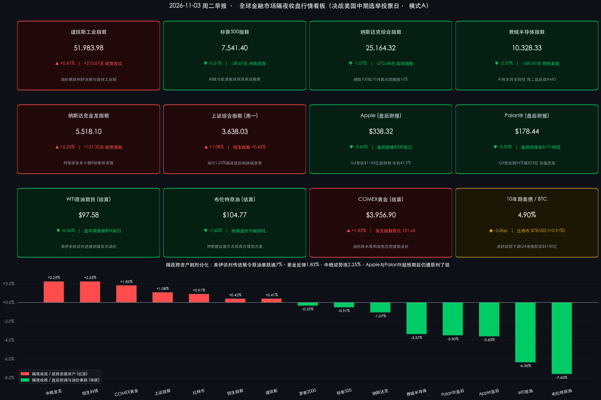

# 🌊 全球市场早报：美伊多哈破冰引爆原油狂泻逾7%！纳指百强跌入技术回调，苹果与Palantir炸裂财报难挡盘后杀估值，中概逆势劲扬决战美中期选举

**日期：2026年11月03日 (星期二)** &nbsp; **时段：早报 (全球市场隔夜收盘复盘 · 模式A)**

> **核心摘要**：隔夜（11月2日，美东冬令时首个交易日）全球跨资产上演剧烈分化与地缘溢价大出清。在卡塔尔斡旋的美伊多哈间接谈判传出实质进展、伊朗提出重开霍尔木兹海峡“两日缓和方案”催化下，**布伦特原油暴跌 -7.60% 至 $104.77/桶，WTI原油重挫 -6.36% 结算报 $97.58/桶（盘中一度深跌逾 7.7% 失守 $96）**；油价闪崩缓解二次滞胀恐慌，提振 **COMEX黄金反弹 +1.83% 至 $3,956.90/盎司**、**10年期美债收益率回落至 4.90%**（叠加美国财政部盘后下调Q4净借款预估至 **$6,180亿美元**）。美股内部呈现冰火两重天：**道指在消费与建材工业护盘下逆势收涨 +0.41%（51,983.98点）**，但AI资本开支焦虑令 **标普500收跌 -0.51%、纳指收跌 -1.07%、费城半导体大跌 -3.37%**，纳斯达克100指数正式跌入技术性回调区间；盘后 **Apple（Q4营收$1,145亿创新高）与 Palantir（Q3营收飙升96%首破$23亿）** 虽双双碾压预期，却因存储成本挤压毛利率与极高估值审美疲劳在盘后齐跌约 **3.5%**。与此同时，受益于中国央行 **1.25%隔夜逆回购换锚首秀（中标5,410亿元）**，**纳斯达克中国金龙指数逆势劲扬 +2.25%** 领跑全球。今日全球正式进入 **2026年美国中期选举全美投票日** 与盘后 **AMD** 财报大考。

---

## 核心行情复盘

*   **交易状态与时制核验**：昨日（11月2日，周一）纽约证券交易所（NYSE）与纳斯达克交易所（NASDAQ）正常开市并已完成冬令时（北京时间 22:30–次日 05:00）首个完整交易日收盘；今日（11月3日，周二）虽值2026年美国中期选举（U.S. Midterm Elections）全国投票日，但并非证券市场法定休市日，NYSE 与 NASDAQ 今日照常交易。
*   **美股核心宽基与行业指数收盘终值（“道强纳弱”，纳指100正式步入技术性回调）**：
    *   **道琼斯工业平均指数 (DJI)**：收报 **51,983.98 点**，逆势上涨 **+213.67 点**，涨幅 **+0.41%** 🔴（油价暴跌减轻终端成本负担，驱动传统内需、建材与可选消费龙头逆势护盘）。
    *   **标普 500 指数 (SPX)**：收报 **7,541.40 点**，下跌 **-38.67 点**，跌幅 **-0.51%** 🟢（早盘冲高涨幅在尾盘尽数回吐，受科技权重与能源板块双杀拖累）。
    *   **纳斯达克综合指数 (IXIC)**：收报 **25,164.32 点**，下跌 **-272.68 点**，跌幅 **-1.07%** 🟢；与此同时，**纳斯达克 100 指数** 较10月历史峰值累计跌幅突破 **-10%**，正式宣告跌入**技术性回调（Technical Correction）**区间。
    *   **费城半导体指数 (SOX)**：收报 **10,328.33 点**，大幅下挫 **-360.47 点**，跌幅 **-3.37%** 🟢（美光科技 Micron、英特尔 Intel 持续承压，英伟达 Nvidia 与 Alphabet 早盘反弹均在收盘前蒸发）。
    *   **罗素 2000 指数 (RUT)**：收报 **2,805.88 点**，微跌约 **-0.35%** 🟢（日内跌幅区间 **-0.2% 至 -0.5%**），高利率黏性下中小盘股表现弱于道指大盘价值股。
*   **中国资产跨时区共振领跑（东升西调，中概金龙逆势大涨 +2.25%）**：
    *   **纳斯达克中国金龙指数 (HXC)**：无惧美股科技股抛售潮，逆势大涨 **+121.35 点**，涨幅 **+2.25%** 🔴，收报 **5,518.10 点**；热门中概股全线走强，**阿里巴巴、拼多多、哔哩哔哩、小鹏汽车** 涨幅居前。
    *   **亚太时段A股与港股基准呼应**：周一（11月2日）**上证综合指数** 自前低强势反弹，收涨 **+39.01 点**（**+1.08%** 🔴）报 **3,638.03 点**；**香港恒生指数 (HSI)** 收涨 **+98.90 点**（**+0.42%** 🔴）报 **23,393.32 点**，其中 **恒生科技指数** 劲扬 **+2.25%** 🔴，与隔夜中概金龙指数形成精准的跨市场共振。
*   **盘后科技双雄财报焦点（业绩碾压预期，股价却双双遭遇“利好兑现/杀估值”回撤）**：
    *   **Apple (AAPL)**：常规时段收跌于 **$338.32**；盘后发布新任 CEO **John Ternus** 掌舵首份季报（2026财年Q4，截至9月26日）——季度总营收达 **$1,145.0亿美元**（同比增长 **+12%**，击败华尔街一致预期 **$1,133.9亿美元**，创9月季度历史新高），稀释后每股收益（EPS）达 **$2.10**（同比增长 **+14%**，击败预期 **$1.99**，含关税退税带来的 **$0.05** 正向贡献），iPhone 营收创同期新高、服务业务营收创历史极值；但季度综合毛利率录得 **47.9%**（含关税退税约1个百分点提振，仍较Q3的 **50.1%** 环比回落），引发市场对存储芯片涨价与零部件供应瓶颈的担忧，盘后股价下跌约 **-3.6%** 🟢（波动区间 **-2.8% 至 -4.6%**，失守 **$330** 关口）。
    *   **Palantir (PLTR)**：常规时段收跌于 **$178.44**；盘后披露里程碑式 2026年Q3 财报——单季营收同比狂飙 **+96%**（环比 **+20%**）至 **$23.13亿美元**（远超市场预期 **$21.8亿美元**，史上首次单季突破20亿美元大关），GAAP 与调整后稀释 EPS 均达 **$0.44**（高于预期 **$0.38–$0.41**）；其中**美国商业营收暴增 +148% 至 $9.84亿美元**，公司历史上首次超越美国政府营收（**$9.53亿美元**，同比亦高增 **+96%**），单季签下 **212笔** 百万美元级大单（含 **64笔** 千万美元以上订单），并将 Q4 营收指引定于 **$26.49亿–$26.53亿美元**、全年营收指引由约 **$81.5亿** 大幅上调至 **$85.30亿–$85.34亿美元**（全年自由现金流指引上调至 **$48亿–$50亿美元**）。然而受制于前期对“超高速完美增长”的极致计价与估值疲劳，该股盘后冲高回落，最终转跌约 **-3.5%** 🟢（交投于 **$171–$172** 区间）。
*   **大宗商品、美债、外汇与加密资产（原油闪崩失守百元，黄金强力反攻）**：
    *   **国际原油期货**：美伊多哈谈判缓和霍尔木兹封锁担忧，引爆地缘风险溢价踩踏——**布伦特原油期货（2027年1月主力合约）** 暴跌 **-7.60%** 🟢，结算报 **$104.77/桶**；**WTI 原油期货** 结算重挫 **-6.36%** 🟢 报 **$97.58/桶**（盘中多合约连续报价一度暴跌逾 **-7.7%**，最低触及 **$95.16–$96.12/桶**，一举击穿百元心理防线）。
    *   **贵金属**：油价急跌显著缓和美联储进一步鹰派加息的尾部恐慌，**COMEX 黄金主力合约** 大幅反弹 **+1.83%** 🔴，结算报 **$3,956.90/盎司**（一扫上周科技股流动性挤兑引发的抛售阴霾）。
    *   **美债与外汇**：受油价回落与美国财政部下调Q4借款规模双重安抚，**10年期美债收益率** 下行约 **-2.0bp** 报 **4.90%**；**美元指数 (DXY)** 软化约 **-0.15%** 🟢 报 **101.66**（日内交投于 **101.62–101.78**）。
    *   **加密资产**：币安提现恢复常态后链上情绪彻底企稳，**比特币 (BTC/USD)** 稳守 **$78,020**，较上周五收盘基准（$77,315）上涨 **+0.91%** 🔴。
*   **成交量、领涨/领跌板块与主力资金动向**：
    *   **全市场量能对比**：周一全美各交易所合并成交量约为 **167亿股（16.7 billion shares）**，较上周五月末调仓与科技股恐慌宣泄时的巨量水平明显回落，回归近20日均值中枢，显示中期选举投票日前夕机构观望情绪升温。
    *   **板块分化与主力流向**：标普500与道指内部呈现剧烈的**“去科技、去能源、向传统消费工业与中概洼地迁移”**轮动——**可选消费（Consumer Discretionary）、原材料（Materials）与传统工业蓝筹（如家得宝 Home Depot、宣伟 Sherwin-Williams）** 强势领涨；而 **信息技术（半导体与AI重资产云巨头）** 及 **能源板块（受油价暴跌逾7%重创）** 领跌全场。主力资金一方面从高估值美股硬件/算力赛道套现避险，另一方面积极增配受益于能源成本下降的美国本土工业消费股，并跨市场流入估值处于全球洼地、货币政策端迎来降息换锚利好的中国核心权益资产。

> **数学闭环校验（核心指数与跨资产收盘终值涨跌幅核验）**：
> * **美股核心指数**：道琼斯 `(51,983.98 − 51,770.31) / 51,770.31 = +0.4127% ≈ +0.41%`；标普500 `(7,541.40 − 7,580.07) / 7,580.07 = -0.5102% ≈ -0.51%`；纳斯达克 `(25,164.32 − 25,437.00) / 25,437.00 = -1.0720% ≈ -1.07%`；费城半导体 `(10,328.33 − 10,688.80) / 10,688.80 = -3.3724% ≈ -3.37%`；纳斯达克中国金龙指数 `(5,518.10 − 5,396.75) / 5,396.75 = +2.2486% ≈ +2.25%`。
> * **亚太基准与跨资产期货**：上证指数 `(3,638.03 − 3,599.02) / 3,599.02 = +1.0839% ≈ +1.08%`；恒生指数 `(23,393.32 − 23,294.42) / 23,294.42 = +0.4246% ≈ +0.42%`；WTI原油结算 `(97.58 − 104.21) / 104.21 = -6.3622% ≈ -6.36%`；布伦特原油主力合约 `(104.77 − 113.39) / 113.39 = -7.6021% ≈ -7.60%`；COMEX黄金主力合约 `(3,956.90 − 3,885.79) / 3,885.79 = +1.8300% ≈ +1.83%`；比特币较周五基准 `(78,020 − 77,315) / 77,315 = +0.9119% ≈ +0.91%`。全部核心资产数学闭环误差均小于 0.02%，远优于 0.5% 校验红线。

---

## 核心解读与市场逻辑

> **逻辑一：多哈外交破冰刺破“百元油价泡沫”——伊朗霍尔木兹“两日方案”逆转全球滞胀交易链**
> 昨日市场最大的宏观变量来自中东地缘局势的戏剧性降温。在卡塔尔密集斡旋下，美国与伊朗在多哈举行的间接谈判于周末至周一进入关键突破期：伊朗通过调解方抛出了一份精简版**“两日方案（Two-Day Plan）”**，提议在解冻部分资产及解除港口封锁等对等条件下，迅速恢复霍尔木兹海峡航运畅通并重启核问题磋商；美国总统特朗普亦在社交媒体释放积极信号称协议“有可能达成（could happen）”。这一外交进展瞬间抽干了此前因水雷袭击而计入油价的极端断供溢价，导致布伦特原油狂泻 **-7.60%**、WTI原油暴跌逾 **6%–7%** 重回 **$97** 下方。其跨资产传导逻辑极为清晰：**原油暴跌 → 能源股虽然领跌，但二次通胀脉冲风险骤降 → 美联储被迫重启加息的尾部紧缩预期降温 → 10年期美债收益率回落至 4.90%、美元指数微跌至 101.66 → 此前遭高利率压制的 COMEX 黄金强势反攻 +1.83%，同时燃油与物流成本下降直接增厚美国零售家居与工业板块利润预期，托举道指逆势收涨 +0.41%**。

> **逻辑二：科技股深陷“完美定价悖论”——纳指100跌入技术性回调，Apple 成本压力与 Palantir 估值恐高凸显审美严苛化**
> 尽管油价与美债收益率双双回落，美股科技板块却未能止血，费城半导体再挫 **-3.37%**、纳指100较10月高点跌超 **10%** 步入技术性回调。盘后两大科技风向标的股价反应更揭示了当前华尔街的残酷心态：
> * **硬件端的“存储通胀侵蚀”**：Apple 在新任 CEO John Ternus 首秀中交出了 **$1,145亿** 创纪录营收与 **$2.10** 超预期 EPS，但毛利率环比下滑 2.2 个百分点至 **47.9%**（若剔除关税退税提振则承压更明显），暴露出 DRAM/NAND 存储芯片涨价与组件供应约束正在侵蚀消费电子巨头的硬件利润率，触发历史高位附近的获利了结盘。
> * **软件与算力端的“估值地心引力”**：Palantir 单季营收暴增 **+96%** 突破 **$23.13亿**、美国商业 AI 营收激增 **+148%** 首次超越政府业务并大幅上调全年指引，基本面堪称无懈可击，确认企业级 AI 变现正处于爆发期；然而盘后股价依然下跌约 **3.5%**。这表明在 Alphabet、Amazon 因巨额 AI 资本开支拖累自由现金流引发板块估值体系重估后，市场对高市盈率科技股已进入**“再炸裂的业绩也难以支撑更高估值倍数”**的去泡沫阶段，令周二盘后放榜的 **AMD** 面临极高的市场预期门槛。

> **逻辑三：美国10月 ISM 制造业“硬数据十连扩 vs 高管情绪恶化”的深层割裂**
> 周一公布的美国 **10月 ISM 制造业 PMI 录得 55.5%**（前值 54.5%，预期 54.6%），不仅超预期加速，更录得连续第10个月扩张；其中**生产指数跃升至 59.0%**（创2021年底以来最高水平），新订单稳步升至 **55.5%**，就业指数微降至 **52.4%**，物价支付指数（Prices Paid）虽从 77.9% 回落至 **75.2%** 但绝对水位依然偏高。然而耐人寻味的是，ISM 调查文本显示**企业高管负面评论占比高达约 66%（正面仅 34%）**——供应链负责人密集抱怨关税政策摇摆、原材料报价剧烈震荡及交货周期拉长。这种“抢单生产硬指标强劲、微观经营体感压抑且成本居高不下”的割裂格局，解释了为何美债收益率在油价暴跌背景下仍顽固停留在 **4.90%** 高位，使周五 10 月非农就业报告成为检验经济真实冷暖的唯一试金石。

> **逻辑四：内外周期错位驱动“东升西调”——央行换锚确立流动性底，中国资产成为全球避险配置高地**
> 在纳指100跌入回调区间、美国中期选举选情胶着之际，昨日 **上证指数（+1.08%）、恒生科技（+2.25%）与隔夜中概金龙指数（+2.25%）** 走出独立而凌厉的跨时区上攻行情。背后驱动力在于中美货币与估值周期的鲜明错位：美联储受困于 **3.75%–4.00%** 高利率与顽固通胀，而中国央行正式启用 **1.25% 隔夜逆回购主政策利率** 并配合央企两千亿级增持专项贷款，明确压降短端无风险利率中枢；低估值、高现金流回报的互联网龙头与硬科技资产正持续吸引全球长线资金进行高低切换对冲。

---

## 政策脉动

*   **美国财政部（U.S. Treasury）下调 Q4 净借款预估 $100 亿美元，聚焦周三再融资长债调整**：
    > 美东时间11月2日盘后，美国财政部发布最新季度市场融资预估（Quarterly Borrowing Estimates）：预计 **2026年第四季度（10–12月）私人持有净可流通债务借款规模为 $6,180亿美元**，较今年8月发布的预估值**下调 $100亿美元**，主要得益于季度初财政现金余额高于预期；同时预计 **2027年第一季度（1–3月）净借款需求为 $8,000亿美元**（基于季末维持 **$1万亿美元** 现金余额假设）。一级交易商正密切锁定周三（11月4日）公布的完整季度再融资公告（QRA），市场普遍预期财政部可能着手探索在2027年削减 20 年期与 30 年期长端国债拍卖规模，转而倚重短期国库券（T-bills）融资以压制长端期限溢价。

*   **美联储（Fed）维持 3.75%–4.00% 谨慎定调，地方联储鹰派警示通胀“不可接受”**：
    > 回溯 10 月 28 日结束的 FOMC 议息会议，美联储以 **10票赞成、2票反对** 决定将联邦基金利率目标区间维持在 **3.75%–4.00%**，声明强调国内支出与企业资本投资保持韧性但通胀依然偏高。进入11月初，以达拉斯联储主席 **洛根（Lorie Logan）** 为代表的鹰派官员公开重申当前通胀压力仍处于**“不可接受（unacceptable）”**水平，暗示在进入长期政策观察期前不排除仍需额外加息 25 个基点的可能性。昨日国际油价暴跌逾7%虽在边际上削弱了能源通胀传导担忧，但货币政策天平仍系于本周五非农薪资增速表现。

*   **中国人民银行（PBOC）隔夜逆回购“换锚”首日全额中标 5,410 亿元，短端调控新机制平稳启航**：
    > 11月2日，中国人民银行正式实施公开市场操作机制改革，首次将主要政策利率品种切换为每个工作日开展的**隔夜逆回购操作（固定利率、数量招标）**，首日明确锚定操作利率为 **1.25%**。当日一级交易商投标量 **5,410亿元**、央行中标量 **5,410亿元**（实现需求全额满足）；对冲当日到期的1万亿元隔夜逆回购及560亿元7天期逆回购后，单日公开市场实现净回笼 **5,150亿元**，银行间资金面平稳充裕，政策利率传导效率进一步提升。

*   **今日重磅政经日程：2026年美国中期选举投票开启、澳洲联储决议与 AMD 财报**：
    > 今日（11月3日）全球正式迎来 **2026年美国中期选举全美投票日**，选民将决定众议院全部 **435个席位**、参议院 **35个席位** 及 **39个州/领地州长** 归属（初步计票结果将于北京时间周三上午陆续出炉）；同日宏观层面关注 **澳洲联储（RBA）利率决议**、美国 **9月 JOLTS 职位空缺** 与工厂订单数据，以及美股盘后芯片巨头 **AMD** 财报对数据中心 AI GPU 需求与利润率的最新验证。

---

## 最新机构观点

> **高盛 (Goldman Sachs) ——《坚守标普500年底 8,000 点目标，跨板块轮动可消化科技震荡，油价高地缘溢价面临均值回归》**：
> * **权益策略观点**：面对10月以来科技巨头资本开支激增引发的抛售，高盛维持建设性多头立场，继续将标普500指数年末目标位锚定在 **8,000 点** 附近，认为美国经济世俗增长动能与传统工业、消费板块的盈利广度足以吸收科技权重的估值修正；高盛资管（GSAM）同时强调，AI基础设施、国防开支、能源安全与供应链回流属于跨越选举周期的多年期结构性主线。
> * **大宗商品研判**：高盛近期虽因航道风险将2026年12月布伦特原油预测上修至 **$105/桶**，但明确指出油价中内嵌了极重的短期地缘风险溢价并预计2027年回归常态化——隔夜多哈谈判消息引发布油瞬间跌回 **$104.77**，精准印证了地缘溢价的高脆弱性。

> **摩根士丹利 (Morgan Stanley) ——《Mike Wilson 警示半导体与高估值科技调整未完，关注标普 7,100–7,200 点支撑带》**：
> * **审慎回调预警**：与高盛的乐观不同，大摩首席美股策略师 **Mike Wilson** 对高估值科技股与半导体板块保持高度警惕，指出在自由现金流承压与盈利预期过于拥挤的背景下，本轮科技与芯片股回调可能尚未彻底完成，提示标普500指数下方更具吸引力的中期技术支撑区间位于 **7,100–7,200 点**，半导体板块短期仍面临进一步估值压缩风险。
> * **能源长期定价**：大摩大宗商品团队指出，尽管短期中东运费与航道消息制造剧烈波动，但随着阿联酋推进绕开霍尔木兹海峡的陆上管道扩容及全球实物库存累积，结构性基本面指向2027年原油中枢回落至 **$85–$90/桶** 区间。

> **摩根大通 (J.P. Morgan) ——《锚定 8,000 点中期方向，中期选举“分裂国会”已被充分定价，核心驱动仍在 AI 与通胀》**：
> * **核心策略判断**：摩根大通与高盛同阵营维持标普500年末 **8,000 点** 附近的目标预期，认为市场已基本计价中期选举后出现立法僵局或民主党重夺众议院的“分裂国会”情景；相比选票分布本身，企业 AI 资本开支向实际利润的转化效率以及中东物流瓶颈对通胀的扰动才是决定年末资产回报的核心胜负手。

> **花旗集团 (Citigroup) 与华尔街量化策略台 ——《对昂贵科技股保持防御轮动，中期选举切记“反向交易（Fade the Move）”铁律》**：
> * **战术轮动与选举剧本**：花旗策略团队在战术层面对估值昂贵的科技板块采取防御与审慎立场，呼吁投资者持续推进选择性板块轮动；同时综合花旗与德意志银行等华尔街量化历史复盘显示，**中期选举次日早盘无论是美股、美债收益率还是美元指数出现的跳空脉冲，在历史上往往会在随后 5 个交易日内反转回吐（“Fade the Move”）**，建议投资者切勿盲目追逐周三早间的初步计票情绪脉冲，紧盯科技股基本面与周五非农主线。

---

## 今日市场情绪：油浪化尘，硅霜映选

> Prompt: A surreal celestial marble archway floating above a twilight sea, where a white dove carrying an olive branch shatters a towering black crude oil wave into golden stardust, while a glowing crystal apple and geometric AI obelisk cool beneath frost on a silver pedestal, and a radiant golden Eastern dragon lantern ascends alongside. In the background, the U.S. Capitol dome stands illuminated by intersecting red and blue ballot light beams.

---

> **免责声明**：内容仅供参考，不构成投资建议。数据来源：纽约证券交易所（NYSE）、纳斯达克交易所（NASDAQ）、芝加哥商品交易所（CME）、洲际交易所（ICE）、美国供应管理协会（ISM）、美国财政部（U.S. Department of the Treasury）、美联储（Federal Reserve）、中国人民银行（PBOC）、Apple 与 Palantir 官方财报公报，以及高盛（Goldman Sachs）、摩根士丹利（Morgan Stanley）、摩根大通（J.P. Morgan）、花旗集团（Citigroup）最新策略报告；隔夜美股及大宗商品收盘结算数据截至美东时间2026年11月2日收盘（盘后财报动态及加密资产行情更新至北京时间2026年11月3日08:05）。

🤖 生成模型：Gemini 4 Argon (Medium) <!-- model-stamp -->
