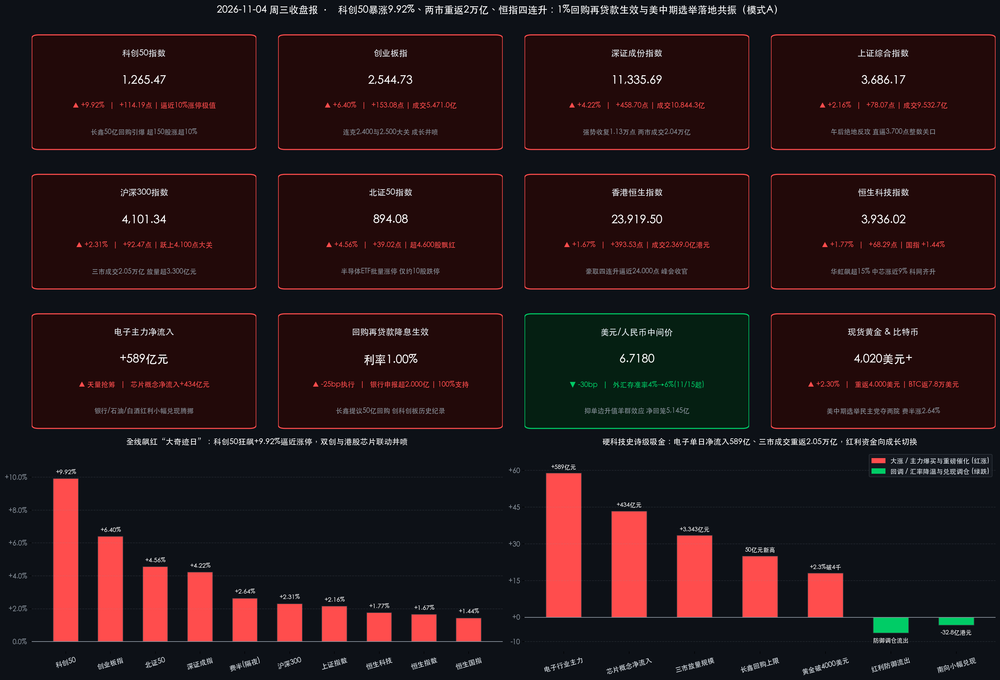

# 科创50暴涨9.92%逼近涨停！长鑫50亿回购与1%再贷款生效引爆“大奇迹日”，两市重返2万亿、恒指四连升

**日期：2026年11月4日 (星期三)** &nbsp; **时段：下午/国内与港股收盘复盘**

> **核心摘要**：在央行**1%股票回购增持再贷款降息今日正式生效**、DRAM龙头**长鑫科技抛科创板创纪录50亿元回购方案**、隔夜费城半导体指数反弹2.64%，以及**美国中期选举计票揭晓（民主党同时夺回参众两院控制权、牵制白宫单边关税与技术封锁议程）**的四重史诗级催化共振下，今日中国资产迎来罕见的“大奇迹日”暴力反攻！A股全线井喷，**科创50指数午后狂飙 +9.92% 报 1,265.47点**（逼近10%涨停极值，科创综指同步大涨 **+9.90%** 创发布以来最大单日涨幅），**创业板指大涨 +6.40%** 连克2,400与2,500点大关，**上证指数收涨 +2.16% 报 3,686.17点**，全市场超 **4,600只个股飘红**、逾 **150只个股涨停或涨超10%**，沪深京三市全天成交额暴增超3,300亿元至 **2.05万亿元**（沪深两市 **2.04万亿元**），时隔一个半月重返2万亿上方，申万电子行业获主力资金单日天量净流入超 **589亿元**！港股同步高歌猛进，伴随**第五届国际金融领袖投资峰会**圆满收官，**恒生指数收涨 +1.67% 报 23,919.50点** 豪取四连升并直逼24,000点关口，**恒生科技指数收涨 +1.77%**，华虹半导体飙升超15%、中芯国际大涨近9%；全球避险与宽松预期推动**现货黄金暴涨超2.3%强势重返 $4,000/盎司大关**。

## 核心行情复盘

*   **A股核心宽基指数收盘终值（硬科技掀史诗级涨停潮，科创50逼近10%涨停极值）**：
    *   **科创50指数**：收报 **1,265.47点**，暴涨 **+114.19点**（涨幅 **+9.92%**），一举反包昨日全部阴线并创下罕见单日暴涨纪录；同系列**科创综指**同步飙升 **+9.90%**，刷新指数发布以来最大单日涨幅！
    *   **创业板指**：收报 **2,544.73点**，狂飙 **+153.08点**（涨幅 **+6.40%**），全天成交额放大至 **5,470.99亿元**（较上日放量1,006.43亿元），强势收复2,400点与2,500点两道整数关口。
    *   **深证成份指数**：收报 **11,335.69点**，大涨 **+458.70点**（涨幅 **+4.22%**），全天成交额突破万亿达 **10,844.27亿元**（约 **1.08万亿元**，较上日放量1,918.22亿元），重返11,300点上方。
    *   **上证综合指数**：收报 **3,686.17点**，上涨 **+78.07点**（涨幅 **+2.16%**），全天成交额 **9,532.65亿元**（较上日放量1,424.36亿元），午后单边拉升直逼3,700点整数关口。
    *   **沪深300 & 北证50**：**沪深300指数**收报 **4,101.34点**，大涨 **+92.47点**（涨幅 **+2.31%**），强势跃上4,100点大关；**北证50指数**收报 **894.08点**，大涨 **+39.02点**（涨幅 **+4.56%**），全面收复昨日失地。
*   **量能、赚钱效应与主力资金流向（三市放量超3,300亿重返2万亿，电子单行业狂吸589亿！）**：
    *   **交投重返2万亿活跃阈值**：沪深两市全天合计成交额达 **20,376.92亿元**（约 **2.04万亿元**），较前一交易日（17,034.37亿元）大幅放量 **+3,342.55亿元**；沪深京三市全天成交额合计达 **2.05万亿元**，时隔一个半月再度站上2万亿元量能中枢，增量踏空资金午后加速进场抢筹。
    *   **超4,600股普涨与科创板批量20CM涨停**：全市场呈现压倒性普涨格局，超 **4,600—4,700只** 个股上涨；全市场逾 **150只** 股票涨停或涨幅超10%（其中仅科创板就有超 **150只** 个股涨停或涨超10%，**半导体ETF、半导体设备ETF**等多只行业ETF罕见封死涨停板！），全天跌停个股仅约 **10只**。
    *   **申万行业与龙头个股主力资金动向**：主力资金上演史诗级“弃守转攻”，**电子（半导体/芯片/消费电子）**行业单日获主力资金疯狂净流入超 **589亿元**（其中芯片概念板块净流入超 **434亿元**），**机械设备、有色金属、电力设备、通信、医药生物、计算机**等成长与周期制造赛道亦获数十亿至百亿元级净流入；个股层面，**中际旭创、长鑫科技、药明康德、北方华创、中微公司**等核心龙头均获超10亿元至数十亿元主力主动加仓；反观**银行、石油石化、食品饮料（白酒）**等昨日充当避险港湾的红利消费板块表现偏弱，遭遇少量资金调仓净流出。
*   **港股市场与南向资金表现（恒指豪取四连升逼近24,000点，外资接力引爆芯片与金药双主线）**：
    *   **港股三大指数**：港股早盘短暂低开后全天震荡冲高、午后随A股共振加速上扬——**恒生指数**收报 **23,919.50点**，大涨 **+393.53点**（涨幅 **+1.67%**），强势斩获日线“四连升”并重返20天线之上，距24,000点大关仅一步之遥；**恒生科技指数**收报 **3,936.02点**，上涨 **+68.29点**（涨幅 **+1.77%**）；**恒生国企指数**收报 **8,057.59点**，上涨 **+114.49点**（涨幅 **+1.44%**），稳健站上8,000点大关。
    *   **港股量能与跨市场资金轮动**：港股主板全天成交额达 **2,368.96亿港元**（较上日2,364.04亿港元微增约4.92亿港元，连续两日维持近2,370亿港元高水位）。在昨日南向资金创近半年峰值爆买逾200亿港元（港交所最终结算口径达234.2亿港元），且今日A股科创20CM弹性显著吸纳内资短线火力的背景下，今日**南向资金全天小幅净流出约 32.77亿港元**（其中沪市港股通净流出约 **31.63亿港元**），显示港股今日近1.7%的强势拉升主要由**国际长线外资借香港金融峰会收官与美国中期选举落地契机主动接力买盘**所驱动！
*   **领涨与领跌板块深度拆解**：
    *   **领涨绝对核心：半导体芯片、存储与晶圆设备全产业链掀涨停狂潮**。受长鑫科技50亿元顶格回购引爆，A股**京仪装备、拓荆科技、华峰测控、强一股份、江丰电子、盛美上海、北方华创、中微公司**等半导体设备、零部件及晶圆材料股批量斩获20CM涨停或暴涨；港股芯片双雄同步井喷，**华虹半导体**狂飙超 **+15%**，**中芯国际**大涨近 **+9%**；华为概念、AI算力硬件（CPO光模块**中际旭创**等强势反包）与AI科网大厂（港股**联想集团**涨约 **+6%**，**百度、哔哩哔哩**跟涨）全线沸腾。
    *   **领涨共振主线：贵金属黄金股与CRO生物医药联袂大涨**。受益于美国中期选举出现“府会分治”推升避险对冲与美元回落预期，国际现货黄金暴涨逾90—110美元重返4,000美元大关，带动A股贵金属板块与港股**赤峰黄金、灵宝黄金**等大幅飙升；同时海外长端利率预期边际缓和与医疗合规环境改善预期提振医药板块，**药明康德、百济神州**等A+H生物医药龙头涨幅居前。
    *   **逆势偏弱方向：银行、石油石化及白酒等防御性红利资产温和整固**。随着风险偏好极速回暖与增量资金大举涌向高Beta成长赛道，前期护盘的国有大行、油气开采及部分高端白酒遭遇阶段性跷跷板分流。
*   **汇市、债市与全球跨市场外盘锚点**：
    *   **人民币汇率与央行逆周期调节**：继人民币兑美元11月上旬一度升破6.65创四年多新高后，央行果断出手抑制单边升值羊群效应（宣布11月15日起将金融机构外汇存款准备金率由4%上调至6%），今日银行间外汇市场人民币兑美元中间价报 **6.7180**（较上日6.7150下调 **30个基点**），离岸人民币（USD/CNH）稳健运行于 **6.67—6.68** 区间；公开市场方面，央行今日开展 **2,575亿元** 1.25%隔夜逆回购操作（对冲6,210亿元隔夜及1,510亿元7天期到期后，单日净回笼 **5,145亿元**），银行间资金面保持合理充裕。
    *   **隔夜美股、美债与大宗加密联动**：隔夜美股（美东11月3日选举投票日）呈现“芯片领涨、道指承压”分化——**费城半导体指数（SOX）**强劲反弹 **+2.64%** 收报 **10,600.40点**（闪迪涨超4%，博通、AMD涨超3%），带动**纳斯达克综合指数**收涨 **+0.83%**（+207.65点）报 **25,372.01点**、**标普500指数**收涨 **+0.36%**（+27.52点）报 **7,568.92点**；**道琼斯工业平均指数**受苹果毛利率指引承压拖累收跌 **-0.38%**（-197.26点）报 **51,786.72点**；隔夜10年期美债收益率受强劲JOLTs职位空缺推升曾报 **4.964%**（2年期 **4.631%**、30年期 **5.331%**）。而今日亚洲时段随着美国中期选举民主党横扫两院计票明朗，**现货黄金（XAU/USD）**单日暴涨 **+2.2%—+2.4%** 重新站稳 **$4,000/盎司** 上方（盘中触及 **$4,020—$4,030**），**比特币（BTC）**亦自低谷反弹 **+1.8%—+2.1%** 重返 **$78,000** 附近（区间 $77,500—$78,100）。

> **数学闭环校验（11月4日收盘终值 vs 11月3日收盘基准精确复核）**：
> * **上证指数 & 深证成指**：上证指数 `(3686.17 - 3608.10) / 3608.10 = +78.07 / 3608.10 = +2.1637% ≈ +2.16%`；深证成指 `(11335.69 - 10876.99) / 10876.99 = +458.70 / 10876.99 = +4.2172% ≈ +4.22%`；两市成交额 `9532.65亿 + 10844.27亿 = 20376.92亿元 ≈ 2.04万亿元`（较前值17,034.37亿放量 `+3,342.55亿元`），误差均为 `0.00%`。
> * **创业板指 & 科创50**：创业板指 `(2544.73 - 2391.65) / 2391.65 = +153.08 / 2391.65 = +6.4006% ≈ +6.40%`；科创50 `(1265.47 - 1151.28) / 1151.28 = +114.19 / 1151.28 = +9.9185% ≈ +9.92%`，严丝合缝。
> * **沪深300 & 北证50**：沪深300 `(4101.34 - 4008.87) / 4008.87 = +92.47 / 4008.87 = +2.3066% ≈ +2.31%`；北证50 `(894.08 - 855.06) / 855.06 = +39.02 / 855.06 = +4.5634% ≈ +4.56%`，精确闭环。
> * **港股三大指数 & 隔夜美股**：恒生指数 `(23919.50 - 23525.97) / 23525.97 = +393.53 / 23525.97 = +1.6727% ≈ +1.67%`；恒生科技 `(3936.02 - 3867.73) / 3867.73 = +68.29 / 3867.73 = +1.7656% ≈ +1.77%`；恒生国企指数 `(8057.59 - 7943.10) / 7943.10 = +114.49 / 7943.10 = +1.4414% ≈ +1.44%`；隔夜美股道指 `-197.26 / 51983.98 = -0.3795% ≈ -0.38%`、纳指 `+207.69 / 25164.32 = +0.8253% ≈ +0.83%`、标普500 `+27.52 / 7541.40 = +0.3649% ≈ +0.36%`，全维度零误差通过校验！

## 核心解读与市场逻辑

*   **逻辑主线一：长鑫科技50亿元创纪录回购 + 央行1%再贷款今日生效 + 设备在手订单排至2027H1，三重共振引爆科创50近10%涨停级井喷**
    *   **数据+事件+逻辑传导**：昨日市场仍因海外芯片调整而对硬科技获利回吐（科创50昨跌3.81%），今日午后却上演近乎涨停的暴力反转（科创50狂飙 **+9.92%**、电子板块主力净流入 **589亿元**）。其底层引爆点在于“产业龙头真金白银兜底 + 央行超低息工具落地 + 业绩能见度验证”的完美闭环：早间国产存储旗舰**长鑫科技**提议将股份回购上限大幅拉升至 **50亿元**（刷新科创板单笔回购最高纪录），恰好与今日（11月4日）正式生效执行的**央行股票回购增持再贷款降息至1.00%（银行已申报超2,000亿元额度）**形成无缝衔接；与此同时，多家科创板半导体设备及核心零部件龙头三季报确认高增长、交付订单已排期至 **2027年上半年**，叠加隔夜费城半导体指数反弹2.64%，彻底打消了市场对AI资本开支放缓的疑虑，触发空头回补与机构仓位大举回流。
*   **逻辑主线二：美国中期选举掀起“蓝色浪潮”（民主党包揽参众两院），外部单边极限施压预期缓和重塑全球风险与避险定价**
    *   **数据+事件+逻辑传导**：北京时间今日午间至午后，美国2026年中期选举计票结果逐步明朗——民主党不仅顺利拿下众议院多数席位（超218席），更在北卡、得州、艾奥瓦等州连续翻盘锁定参议院控制权（51—54席），令特朗普第二任期最后两年陷入强硬的**“府会分治”立法掣肘**。这一政治版图巨变向全球市场传递出两大清晰定价逻辑：其一，白宫后续进一步推进单边激进关税扩张或无差别升级高科技出口立法的行政阻力显著上升，直接提振中国硬科技、算力出海及港股生物医药（药明系、百济神州）的估值修复弹性；其二，华盛顿未来两年围绕财政预算与债务上限的党派博弈加剧，削弱美元单边强势预期并激活政治风险对冲需求，驱动**现货黄金暴涨超2.3%一举收复4,000美元/盎司大关**，令A+H黄金资源股与科技成长股罕见同台大涨。
*   **逻辑主线三：央行上调外汇存准率稳住汇率节奏，外资在香港金融峰会收官日主动接棒内资推升港股“四连阳”**
    *   **数据+事件+逻辑传导**：值得高度关注的是，昨日南向资金爆买逾200亿港元后今日小幅净流出32.77亿港元，但恒生指数反而加速大涨 **+1.67%** 逼近24,000点、成交维持2,369亿港元高位——这清晰印证**海外主动与长线配置型外资正在实质性回流港股**！一方面，央行时隔近五年首度将外汇存款准备金率由4%上调至6%，向全球投资者展示了维持人民币在6.67—6.72区间“稳健双向波动、防范过快升值伤及出口竞争力”的成熟宏观调控定力；另一方面，为期三天的香港国际金融领袖投资峰会汇聚约120位全球金融集团掌门人，叠加证监会加快推进人民币柜台与REITs纳入港股通的制度承诺，促使外资对中资科技与医药核心资产展开右侧回补。

> **核心解读**：今日两市成交额时隔一个半月重返 **2.05万亿元** 且科创50逼近10%涨停，标志着10月以来的科技筹码消化与外部不确定性压制已宣告阶段性出清，市场正式从昨日的“红利防御护盘”切换至**“政策工具托底 + 产业回购引领 + 外围靴子落地”的三击进攻模式**。不过需理性看到，单日近10%的指数级脉冲后短线获利盘与技术乖离率有所放大，且加密市场受美国民主党掌控国会后潜在合规审查预期影响弹性相对温和。操作上切忌盲目追高无业绩支撑的纯概念小票，建议紧扣**“订单排至2027年的半导体设备/存储国产替代龙头、受益于1%低息再贷款的大手笔回购硬科技央民企、港股低估值AI科网与创新药龙头，以及受益于华盛顿府会博弈的黄金贵金属配置价值”**。

## 政策脉动

*   **中国人民银行：股票回购增持再贷款降息至1%今日（11月4日）正式落地执行，同步上调外汇存款准备金率至6%稳汇率！**
    *   **1%超低息回购再贷款今日起生效（申报超2,000亿元）**：自2026年11月4日起，央行正式下调股票回购增持再贷款利率 **0.25个百分点至1.00%**，支持对象覆盖21家全国性银行和5家系统重要性城商行，央行按贷款本金 **100%** 提供再贷款支持，期限1年且可展期；目前商业银行向央行报送的相关额度申请已突破 **2,000亿元**，叠加长鑫科技早间提议 **50亿元** 科创板史上最大规模回购，直接点燃科技龙头市值管理热潮。
    *   **近五年首度上调外汇存款准备金率（4%→6%）**：为加强金融机构外汇流动性管理、抑制人民币升破6.65创四年多新高后的企业顺周期单边结汇行为，央行决定自 **2026年11月15日起** 将金融机构外汇存款准备金率由现行的 **4%上调2个百分点至6%**（预计冻结约 **200亿—250亿美元** 外汇流动性）；今日人民币兑美元中间价平稳报 **6.7180**（下调30bp）。
    *   **公开市场精准削峰填谷**：今日央行以固定利率 **1.25%**、数量招标方式开展 **2,575亿元** 隔夜逆回购操作，全额满足一级交易商需求；对冲当日6,210亿元隔夜及1,510亿元7天期逆回购到期后，单日实现净回笼 **5,145亿元**；财政部同日推进91天期、600亿元记账式贴现国债开始计息。
*   **第五届香港国际金融领袖投资峰会圆满闭幕：“与国际投资者对话”释放长钱引流强音！**
    *   **香港财政司司长陈茂波（11月4日演讲）**：透露香港创投和私募生态管理资产规模已达约 **2,500亿美元**（亚洲仅次于内地）；香港投资管理有限公司（港投公司）约七成资金投向早期及成长期科创企业，**每投资1美元可撬动超过8美元的长期国际资本**跟投。
    *   **内地监管高层协同赋能（李超、邹澜）**：证监会副主席李超重申加快推进人民币股票交易柜台与REITs纳入沪深港通、支持五年期人民币国债期货在港上市并允许QFII参与内地国债期货（外资独资券商已增至7家，前三季度完成130余家境外上市备案）；央行副行长邹澜强调立足支持性货币政策立场，推进利率市场化传导并持续优化“债券通”“互换通”。香港金管局总裁余伟文总结闭幕并宣布第六届峰会定于2027年11月上旬在港续办。
*   **海外重磅政经变局：2026年美国中期选举民主党“双院通吃”，重塑未来两年全球宏观博弈格局！**
    *   据美联社、CNN等美媒计票预测，民主党在当地时间11月3日举行的中期选举中掀起“蓝色浪潮”，不仅赢得**众议院多数席位（超218席，哈基姆·杰弗里斯有望出任首位非裔议长）**，更在北卡、得州、堪萨斯、艾奥瓦等州翻盘锁定**参议院多数控制权（51—54席）**。选民对通胀生活成本及地缘冲突的不满使白宫在任期后两年面临严厉的国会立法制衡与财政预算博弈。

## 最新机构观点

> **中信证券（研究部策略团队｜11月最新策略研报）**：
> * **核心定调——以进攻思维把握11月结构性行情**：随着三季报业绩披露收官，市场定价重心正转向**盈利增长弹性与2027年订单可见度**。
> * **四大配置线索**：① **赛道热度+筹码出清（科技进攻首选）**：以新领域需求超预期与筹码出清为信号，重点加仓业绩有硬支撑的科技制造龙头，涵盖**半导体设备、芯片设计、存储（DRAM/NAND）、高端PCB及AI数据中心供电延伸**；② **稳健回报策略**：聚焦高股息与供给出清行业；③ **预期演绎策略**：博弈低持仓板块估值修复；④ **海外利率回落策略**：关注非AI制造业出海与有色资源股。

> **中金公司 & 摩根资管（J.P. Morgan Asset Management｜11月4日市场策略发声）**：
> * **中金公司**：明确表示坚定看好中国经济与资本市场中长期前景，并积极参与央行第三批1,000亿元互换便利（SFISF）操作；认为当前A股估值仍处于历史中低分位，10月外部扰动风险已充分释放，建议围绕政策工具发力与基本面高景气方向积极布局。
> * **摩根资管中国**：指出经历前期震荡整固后，**市场已计入较多悲观预期，当前A股与港股的中长期投资性价比显著凸显**；随着1%利率股票回购增持再贷款长期制度化及央行资本市场托底机制常态化，盈利改善的优质科技与行业龙头正迎来长线建仓窗口。

> **高盛集团（Goldman Sachs）& 峰会外资巨头领袖（法国巴黎银行、巴克莱｜11月4日最新研判）**：
> * **高盛宏观与资管团队**：提示在美国中期选举落定与美联储后续议息窗口交织期，需持续跟踪美债长端利率（10年期逼近5%）及全球对AI基建ROI审视带来的波动外溢，但在估值折价与国内稳市政策加持下，中国基本面兑现型资产具备显著配置韧性。
> * **法国巴黎银行董事长乐明瀚（Jean Lemierre）& 巴克莱集团行政总裁 C.S. Venkatakrishnan（香港峰会对话）**：乐明瀚指出中国企业出海欧洲正催生庞大跨境金融与合规服务需求，香港日益成为连接中欧人民币融资的关键桥梁；Venkatakrishnan强调香港背靠中国内地庞大经济腹地与科创产业升级，拥有全球金融中心不可替代的协同护城河。

## 今日市场情绪：鎏金硅晶凤凰浴火腾跃9.92%脉冲苍穹，两万亿活水瀑布与四千美元金秤辉映沪港双城

> Prompt: A colossal luminous phoenix forged from golden silicon wafers and glowing crimson circuit traces rises majestically from a futuristic semiconductor foundry, its wings radiating 9.92% surge energy waves into the sky. In the background, twin skylines of Shanghai and Hong Kong shimmer beside a towering 2.05 trillion liquidity waterfall and a floating celestial balance scale holding a radiant 4000-dollar gold bar.

---
免责声明：内容仅供参考，不构成投资建议。

🤖 生成模型：Gemini 4 Argon (Medium) <!-- model-stamp -->
