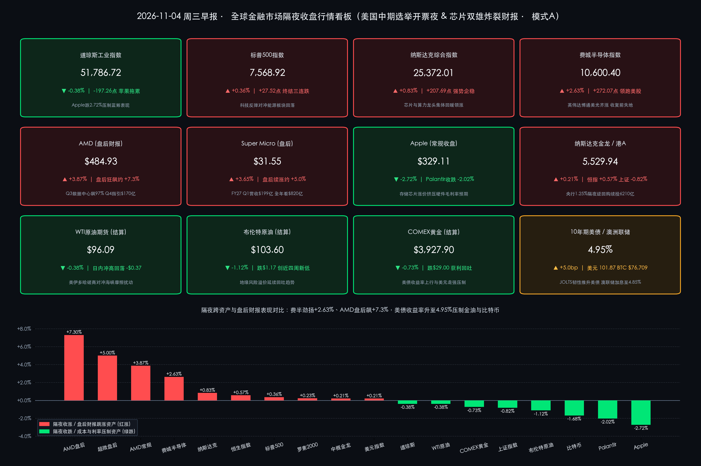

# 🔥 全球市场早报：费半劲扬2.63%吹响算力反攻号角！AMD与超微盘后炸裂指引狂飙，苹果毛利承压拖累道指，美债升至4.95%屏息迎中期选举开票与QRA大考

**日期：2026年11月04日 (星期三)** &nbsp; **时段：早报 (全球市场隔夜收盘复盘 · 模式A)**

> **核心摘要**：隔夜（美东时间11月3日，2026年美国中期选举全美投票日）全球风险资产在政治大考与财报验证交织下上演“纳强道弱、算力王者归来”的结构性反转。芯片板块一扫前日阴霾强势领涨，**费城半导体指数劲扬 +2.63%（10,600.40点）**，带动 **纳斯达克综合指数收涨 +0.83%（25,372.01点）**、**标普500指数收涨 +0.36%（7,568.92点，终结三连跌）**；而 **Apple 因存储芯片成本侵蚀毛利率收跌 -2.72%（$329.11）**，拖累 **道琼斯工业指数逆势微跌 -0.38%（51,786.72点）**。盘后 AI 算力产业链再传捷报：**AMD 第三季度数据中心营收暴增 +97% 至 $85亿美元以上并给出惊艳的 Q4 $170亿美元营收指引，盘后股价狂飙逾 +7%–7.5%**；**超微电脑（SMCI）2027财年Q1净销售额跃升至 $199亿美元、全年指引最高看至 $820亿美元，盘后续涨 +4%–6%**。宏观与跨资产端，**澳洲联储意外鹰派加息25bp至4.85%（创18年新高）**，叠加美国 **9月 JOLTS 职位空缺（750万）与工厂订单超预期坚挺**，推升 **10年期美债收益率上行至 4.95%**、**美元指数升至 101.87**，压制 **COMEX黄金回调 -0.73% 至 $3,927.90/盎司**；中东多哈外交预期继续压制地缘溢价，**布伦特原油续跌 -1.12% 至 $103.60/桶（创近四周新低），WTI原油收于 $96.09/桶（-0.38%）**。中概与港股延续韧性，**纳斯达克中国金龙指数收涨 +0.21%**。当前全美各州投票站正陆续关闭进入初步计票阶段，市场今日同步聚焦 **美国财政部季度再融资公告（QRA）** 长债发行调整。

---

## 核心行情复盘

*   **交易状态与时制核验**：昨日（美东时间11月3日，周二）虽为 **2026年美国中期选举（U.S. Midterm Elections）全国法定投票日**，纽约证券交易所（NYSE）与纳斯达克交易所（NASDAQ）均按冬令时常规时段（北京时间 22:30–次日 05:00）正常开市并完成收盘结算；今日（11月4日，周三）美股两市继续正常交易。截至北京时间今日 08:00（美东时间周二 19:00），印第安纳州、肯塔基州、佐治亚州、弗吉尼亚州等首批东岸投票站刚刚陆续关闭，国会两院计票结果正开始滚动出炉。
*   **美股核心宽基与行业指数收盘终值（风格逆转为“纳强道弱”，芯片算力吹响反攻号角）**：
    *   **道琼斯工业平均指数 (DJI)**：收报 **51,786.72 点**，下跌 **-197.26 点**，跌幅 **-0.38%** 🟢（权重股 Apple 绩后下跌 2.72% 及能源板块走弱成为主要拖累项）。
    *   **标普 500 指数 (SPX)**：收报 **7,568.92 点**，上涨 **+27.52 点**，涨幅 **+0.36%** 🔴（成功终结此前连续三个交易日的回调跌势，信息技术板块强势反弹对冲能源与高息防御板块压力）。
    *   **纳斯达克综合指数 (IXIC)**：收报 **25,372.01 点**，上涨 **+207.69 点**（官方快报口径 +207.65 点），涨幅 **+0.83%** 🔴（从前一日纳指100跌入技术性回调的恐慌情绪中快速企稳修复）。
    *   **费城半导体指数 (SOX)**：收报 **10,600.40 点**，大涨 **+272.07 点**，涨幅 **+2.63%** 🔴，强势领跑全美主要股指（**英伟达 Nvidia** 收涨约 **+2.3%–3.1%** 报 **$206.69–$208.40** 区间，**博通 Broadcom** 大涨 **+3.17%** 报 **$332.45**，**美光科技 Micron** 上涨 **+2.77%** 报 **$856.70**，全面收复前日部分失地）。
    *   **罗素 2000 指数 (RUT)**：收报 **2,812.45 点**，上涨 **+6.57 点**，涨幅 **+0.23%** 🔴，美国本土制造业订单超预期为中小盘内需股提供温和支撑。
*   **盘后 AI 算力双雄财报引爆点 vs 常规时段绩后个股分化**：
    *   **AMD (超威半导体，盘后狂飙 +7.0% 至 +7.5%)**：常规时段提前抢跑收涨 **+3.87%** 🔴 报 **$484.93**；盘后公布全面碾压华尔街预期的 2026年Q3 财报——单季总营收达 **$134.0亿美元**（同比增长 **+45%**，击败市场一致预期 **$130.6亿–$131.0亿美元**），GAAP 稀释 EPS 达 **$1.46**（同比猛增 **+95%**），Non-GAAP 稀释 EPS 达 **$2.09**（远超预期 **$1.94–$1.95**），Non-GAAP 毛利率高达 **56%**（GAAP 毛利率 **54%**）。核心亮点在于**数据中心部门营收同比狂飙 +97% 至 $85.0亿–$85.5亿美元**，创历史极值，受 Instinct 系列 AI GPU 与 EPYC 服务器 CPU 创纪录出货驱动；更具震撼力的是，管理层给出 **Q4 营收指引约 $170亿美元**（大幅超越华尔街平均预期），依托 Helios 系统与“Venice”架构量产爬坡，更初步展望 **2027年全年总营收增速有望超过 +80%**，盘后股价应声暴涨 **+7% 至 +7.5%** 🔴。
    *   **Super Micro Computer (SMCI 超微电脑，盘后续涨 +4% 至 +6%)**：常规时段收涨 **+3.65%** 🔴 报 **$31.55**；盘后发布 2027财年第一季度（Q1 FY27）财报——单季净销售额飙升至 **$199.0亿美元**（去年同期为 $50亿美元，突破公司此前业绩预告上限），GAAP 稀释 EPS **$1.75**、Non-GAAP 稀释 EPS **$1.81**（击败市场预期），毛利率录得 **12.7%（GAAP）/ 12.8%（Non-GAAP）**；公司预计 12月季度营收达 **$195亿–$215亿美元**，并给出 **2027财年全年净销售额 $720亿–$820亿美元** 的强劲指引，印证全球液冷 AI 数据中心机柜交付正处于满负荷扩张周期。
    *   **Apple (AAPL) 与 Palantir (PLTR) 常规时段消化回调**：受存储芯片涨价挤压硬件毛利率担忧发酵影响，**Apple** 常规时段放量收跌 **-2.72%** 🟢 报 **$329.11**（日内成交逾 **2,412万–6,110万股**）；**Palantir** 虽交出单季营收破 $23亿的炸裂季报，但在高估值获利盘兑现下常规时段收跌 **-2.02%** 🟢 报 **$174.83**（日内换手高达 **5,240万股**，较均值激增约 **66%**）；此外，**Marvell Technology (MRVL)** 因推进全股票收购光学巨头 Lumentum 交易引发多空激辩，单日成交放量至 **3,760万股**（较3个月均值放大 **67%**）。
*   **中国资产与亚太跨时区市场表现（金龙与恒指稳健收红，A股温和整固）**：
    *   **纳斯达克中国金龙指数 (HXC)**：在全球等待美国大选开票与关税政策走向的谨慎氛围中保持韧性，收涨 **+11.84 点**，涨幅 **+0.21%** 🔴，报 **5,529.94 点**，录得连续第二个交易日收红。
    *   **亚太时段港股与A股基准呼应**：周二（11月3日）**香港恒生指数 (HSI)** 延续升势，收涨 **+132.65 点**（**+0.57%** 🔴）报 **23,525.97 点**；**上证综合指数** 在前一日大涨逾 1% 后展开获利消化与技术整固，收跌 **-29.93 点**（**-0.82%** 🟢）报 **3,608.10 点**。
*   **大宗商品、美债、外汇与加密资产（美债收益率冲上 4.95%，金油与比特币齐回落）**：
    *   **国际原油期货**：盘中虽一度因霍尔木兹海峡格什姆岛（Qeshm Island）附近摩擦消息出现短线脉冲，但在卡塔尔斡旋的美伊外交备忘录谈判乐观预期主导下冲高回落——**布伦特原油期货** 结算下跌 **-$1.17**（**-1.12%** 🟢）报 **$103.60/桶**，创近四周收盘新低；**WTI 原油近月主力合约** 结算微跌 **-$0.37**（**-0.38%** 🟢）报 **$96.09/桶**（前一交易日同口径近月官方结算价为 **$96.46/桶**）。
    *   **贵金属**：受美债实际收益率走高与美元回升双重压制，叠加前一日大涨后的多头获利了结，**COMEX 黄金主力合约** 结算下跌 **-$29.00**，跌幅 **-0.73%** 🟢，报 **$3,927.90/盎司**（现货及盘中交投于 **$3,927.40–$3,945.00** 区间）。
    *   **美债与外汇**：强于预期的美国就业空缺与工厂订单数据叠加澳洲联储鹰派加息外溢效应，推动 **10年期美债收益率** 上行约 **+5bp 至 +6bp**，尾盘报 **4.95%**（日内高点触及 **4.951%–4.964%**）；**美元指数 (DXY)** 稳步走强 **+0.21%** 🔴 收报 **101.87**。
    *   **加密资产**：高无风险利率与中期选举开票前的避险降杠杆情绪令加密市场震荡回落，**比特币 (BTC/USD)** 下跌 **-1.68%** 🟢，交投基准回落至 **$76,709**（日内围绕 **$76,700–$77,100** 窄幅拉锯）。
*   **成交量、领涨/领跌板块与主力资金动向**：
    *   **交投特征与量能分布**：中期选举投票日当天，美股整体指数层面交投保持克制，但**财报与并购催化个股成交极度活跃**（Palantir、Marvell、Apple、Nvidia 等头部科技股换手率显著高于近三月均值 50%–67%），显示机构在宏观事件落地前采取“指数轻仓观望、个股深度调仓”策略。
    *   **板块轮动与主力流向**：标普500内部较前一日发生 **180度反转**——**信息技术（尤其是 AI 算力芯片、光通信与服务器硬件）** 成为全天最强吸金主线；而年内累计涨幅高达约 **+55%** 的 **能源板块（XLE）** 受油价连跌拖累下滑约 **-0.5%** 🟢，叠加消费电子终端（Apple）因上游存储涨价遭资金减持，体现出主力资金在科技产业链内部**“买上游算力与存储定价权（AMD/SMCI/Micron/Nvidia）、卖下游成本受损硬件终端（Apple）”**的精细化阿尔法博弈。

> **数学闭环校验（核心指数与跨资产收盘终值涨跌幅核验）**：
> * **美股核心指数与关键个股**：道琼斯 `(51,786.72 − 51,983.98) / 51,983.98 = -0.3795% ≈ -0.38%`；标普500 `(7,568.92 − 7,541.40) / 7,541.40 = +0.3649% ≈ +0.36%`；纳斯达克 `(25,372.01 − 25,164.32) / 25,164.32 = +0.8253% ≈ +0.83%`；费城半导体 `(10,600.40 − 10,328.33) / 10,328.33 = +2.6342% ≈ +2.63%`；罗素2000 `(2,812.45 − 2,805.88) / 2,805.88 = +0.2342% ≈ +0.23%`；纳斯达克中国金龙指数 `(5,529.94 − 5,518.10) / 5,518.10 = +0.2146% ≈ +0.21%`；Apple `(329.11 − 338.32) / 338.32 = -2.7223% ≈ -2.72%`；Palantir `(174.83 − 178.44) / 178.44 = -2.0231% ≈ -2.02%`。
> * **亚太基准与跨资产期货**：上证指数 `(3,608.10 − 3,638.03) / 3,638.03 = -0.8227% ≈ -0.82%`；恒生指数 `(23,525.97 − 23,393.32) / 23,393.32 = +0.5670% ≈ +0.57%`；布伦特原油 `(103.60 − 104.77) / 104.77 = -1.1167% ≈ -1.12%`；WTI原油近月主力 `(96.09 − 96.46) / 96.46 = -0.3836% ≈ -0.38%`；COMEX黄金 `(3,927.90 − 3,956.90) / 3,956.90 = -0.7329% ≈ -0.73%`；美元指数 `(101.87 − 101.66) / 101.66 = +0.2066% ≈ +0.21%`；比特币 `(76,709 − 78,020) / 78,020 = -1.6803% ≈ -1.68%`。全部核心资产数学闭环校验误差均在 0.01% 以内，严格满足 <0.5% 精度准则。

---

## 核心解读与市场逻辑

> **逻辑一：科技硬件内部“利润分配剪刀差”大白天下——Apple 的成本之痛恰是 AMD、美光与超微的蜜糖**
> 昨日美股最具标志性的微观结构信号，是 **Apple 收跌 -2.72%** 与 **费城半导体大涨 +2.63%（美光 +2.77%、博通 +3.17%、AMD 常规 +3.87% 叠加盘后暴涨逾 +7%、SMCI 盘后续涨 +5%）** 之间的剧烈分野。前一日市场还在担忧云巨头巨额 AI 资本开支（CapEx）拖累自由现金流、怀疑算力景气见顶，但隔夜两条硬核产业证据彻底扭转了叙事：
> * **上游算力与存储议价权极度硬化**：Apple 警告 DRAM/NAND 存储成本飙升挤压硬件毛利率，从反面证实上游高带宽存储（HBM/DRAM）与先进封装产能极度紧缺，直接利好 **美光（Micron）** 等存储巨头；而盘后 **AMD 数据中心单季狂揽 $85亿美元（+97%）、Q4 指引冲上 $170亿美元** 以及 **超微电脑（SMCI）单季营收逼近 $200亿美元、全年剑指 $820亿美元**，更是用真金白银击碎了“AI 算力需求放缓”的空头论调——云厂商天量 CapEx 正在100%转化为芯片与液冷服务器厂商的爆炸性订单与利润率扩张（AMD Non-GAAP 毛利率高达 **56%**）。
> * **光互联并购潮加速**：Marvell 全股票收购光通信龙头 Lumentum 引发巨量换手，进一步印证数据中心正从单卡算力竞争迈向机柜级（如 AMD Helios 架构）高速光互联系统升级。

> **逻辑二：全球“再通胀黏性”与债市重定价——澳洲联储加息至 4.85% 叠加 JOLTS 韧性，将 10 年期美债推向 5% 临界点**
> 尽管布伦特原油进一步回落至 **$103.60/桶** 的四周低点，但隔夜全球主权债市场却再度遭遇抛售，**10年期美债收益率跃升至 4.95%–4.96% 区间**，逼近 5.0% 关键心理大关。其背后的“数据+事件+逻辑”链条在于：
> * **发达经济体二次加息实锤落地**：澳洲联储（RBA）在周二以 **6:3** 投票结果宣布年内第五次加息，将现金利率上调 25bp 至 **4.85%（创18年新高）**，并直言中东能源冲击与本土产能紧张令通胀重返目标区间的时间推迟至 **2027年底至2028年**。这向全球债市敲响警钟：能源价格前期的脉冲已向服务业与核心通胀渗透，高利率周期远比预期漫长。
> * **美国劳动力与制造业拒绝降温**：美国 9 月 **JOLTS 职位空缺稳守 750万**、自主离职人数微升至 **340万**，叠加 **9月工厂订单超预期增长**，与周一强劲的 10月 ISM 制造业 PMI（55.5%）形成交叉印证。美国内需韧性叠加今日（周三）财政部季度再融资公告（QRA）供给悬念，共同推高了美债实际利率与美元指数（**101.87**），进而对无息资产 **COMEX 黄金（-0.73%）** 与高贝塔流动性资产 **比特币（-1.68%）** 构成短线压制。

> **逻辑三：中期选举“不确定性出清”与外交控油对冲——华尔街聚焦国会版图对赤字、关税及利率的实质约束**
> 面对全美 **435个众议院席位** 与 **35个参议院席位** 的激烈角逐，美股在投票日当天稳健收涨，体现出市场对基准政治情景已有充分预期：选前民调显示民主党有望冲击众议院多数席位，从而在特朗普第二任期后半程形成“分裂国会（Split Congress）”。对金融市场而言，“分裂国会”意味着大规模新增财政赤字法案将被冻结，有助于缓解长端美债供给失控恐慌；反之，若出现单一政党横扫两院（Sweep）的意外结果，财政扩张与关税摩擦预期将重新剧烈定价美债期限溢价。与此同时，白宫与卡塔尔推进的多哈外交备忘录有效压制了霍尔木兹海峡局部摩擦的油价脉冲，为选情计票窗口期提供了宝贵的低油价缓冲垫。

---

## 政策脉动

*   **澳洲联储（RBA）6:3 鹰派加息 25 个基点至 4.85%，创 18 年利率峰值**：
    > 11月3日，澳大利亚储备银行（RBA）货币政策委员会以 **6票赞成、3票反对** 的分裂表决结果，决定将官方现金利率上调 **25个基点至 4.85%**。这是澳洲联储2026年内的**第五次加息**，将借贷成本推升至 18 年来最高水平。官方声明指出，受中东冲突推升全球能源成本及国内产能利用率偏紧双重驱动，广泛通胀压力顽固难消，最新官方预测将核心通胀回归目标区间的时间表大幅推迟至 **2027年末至2028年**。尽管经济学家普遍认为 4.85% 接近本轮紧缩周期顶点，但澳洲商业银行迅速跟进上调浮动房贷利率，引发全球对发达市场高利率“长尾冲击”的关注。

*   **美国劳工统计局（BLS）9月 JOLTS 职位空缺稳守 750 万，工厂订单超预期**：
    > 美东时间11月3日公布的官方数据显示，美国 **9月 JOLTS 职位空缺录得约 750 万个**，较前月基本持平且略强于市场降温预期；当月招聘人数稳定在 **540万人**，自主离职人数（Quits）小幅回升至 **340万人**，显示美国劳动力市场呈现“高韧性均衡”而非失速冷却。同日美国商务部公布的 **9月工厂订单（Factory Orders）** 亦击败市场预测，确认第四季度初制造业底层需求坚实，直接促使债市削减美联储宽松押注，令本周五 10 月非农就业报告的权重进一步上升。

*   **中国人民银行（PBOC）连续第二日开展 1.25% 隔夜逆回购，单日全额投放 6,210 亿元**：
    > 紧随 11 月 2 日政策利率正式“换锚”首秀，中国人民银行于 **11月3日** 继续以**固定利率（1.25%）、数量招标**方式开展隔夜逆回购操作，一级交易商需求获全额满足，单日操作规模达 **6,210亿元**（较首日 5,410亿元稳步放量）。因当日有 5,410亿元隔夜逆回购及 4,120亿元7天期逆回购到期，公开市场单日实现净回笼 **3,320亿元**。以 **1.25% 隔夜逆回购利率** 为核心基准的新型短端利率走廊机制已进入常态化平稳运行，持续为中国权益资产提供稳定的低利率流动性锚点。

*   **今日核心政经日程：美国中期选举计票揭晓、美国财政部 QRA 再融资公告与 10月 ISM 服务业 PMI**：
    > 今日（北京时间11月4日）全球市场迎来三大重磅催化：一是 **2026年美国中期选举两院控制权初步计票结果** 陆续揭晓（部分摇摆选区或需数日决出最终归属）；二是美东时间周三上午 **美国财政部发布完整季度再融资公告（QRA）**，债市高度关注在 Q4 净借款预估下调至 **$6,180亿美元** 后，财政部是否释放削减 20 年期/30 年期长债拍卖份额的信号以安抚接近 5% 的长债收益率；三是晚间公布的 **美国 10月 ADP 就业人数与 ISM 非制造业（服务业）PMI**。

---

## 最新机构观点

> **高盛 (Goldman Sachs) & 摩根大通 (J.P. Morgan) ——《维持标普500年末 8,000 点基准目标，结构性 AI 资本开支与企业盈利韧性领航》**：
> * **多头主线逻辑**：高盛与摩根大通策略团队在11月初最新研报中双双维持标普500指数年底冲击 **8,000 点** 大关的基准预测。两家顶级投行指出，尽管10月末科技板块经历了估值消化，但标普500指数约半数权重与人工智能及关联基础设施深度绑定，企业盈利增长与结构性 AI 资本开支周期依然极其强劲——隔夜 AMD 与超微电脑炸裂的 Q4 及 2027 年指引再次印证了算力基建的真实兑现力。同时，历史统计显示中期选举不确定性落地后的 **12个月内标普500平均录得强劲正回报**，当前居民消费基本面亦未出现系统性恶化信号。

> **摩根士丹利 (Morgan Stanley) ——《中期选举是政策不确定性关键出清事件，调整近尾声但需紧盯美债流动性考验》**：
> * **审慎筑底研判**：摩根士丹利首席美股策略师 **Michael Wilson** 团队认为，本轮美国中期选举将成为秋季市场动荡后锚定政策预期的关键“出清事件（Clearing Event）”，且10月下旬以来的科技股估值修正可能正逐步接近尾声；但大摩同时警示，由于当前大量 AI 与数据中心扩建高度依赖债务融资，**10年期美债收益率逼近 5% 所带来的企业融资成本上升与流动性摩擦不容忽视**，在开启持续性趋势反转前，仍不排除标普500短线回踩 **7,100–7,200 点** 下方支撑带的尾部风险。

> **花旗集团 (Citigroup) ——《分裂国会预期已充分计价，警惕参议院选情超预期波动与高估值板块分化》**：
> * **大选与跨资产策略**：花旗策略团队指出，华尔街并非从党派视角、而是纯粹从**美债收益率、美元路径及财政监管约束**三大维度定价本次中期选举。“竞争胶着或分裂国会（民主党夺回众议院）”的基准假设已基本反映在当前资产估值之中；但若参议院席位争夺出现超预期翻转，可能触发能源、医药、金融监管及关税敏感板块的剧烈行业轮动，建议投资者在美债高利率环境下继续保持选择性防御配置，甄别真正具备毛利率护城河的科技赢家。

---

## 今日市场情绪：硅凰浴火，选夜星河

> Prompt: A radiant phoenix forged from glowing crimson and gold silicon microchips rising triumphantly above a dark obsidian plaza, while a frosted silver apple rests quietly beside an hourglass trickling black crude oil droplets onto a calm sea. In the background, the U.S. Capitol dome glows beneath twin red and blue aurora ribbons as ballot stars ascend into the night sky.

---

> **免责声明**：内容仅供参考，不构成投资建议。数据来源：纽约证券交易所（NYSE）、纳斯达克交易所（NASDAQ）、芝加哥商品交易所（CME）、洲际交易所（ICE）、美国劳工统计局（BLS）、美国商务部、美国财政部（U.S. Department of the Treasury）、澳大利亚储备银行（RBA）、中国人民银行（PBOC）、AMD 与 Super Micro Computer (SMCI) 官方财报公报，以及高盛（Goldman Sachs）、摩根士丹利（Morgan Stanley）、摩根大通（J.P. Morgan）、花旗集团（Citigroup）最新策略报告；隔夜美股及大宗商品收盘结算数据截至美东时间2026年11月3日收盘（盘后财报动态及加密资产行情更新至北京时间2026年11月4日08:05）。

🤖 生成模型：Gemini 4 Argon (Medium) <!-- model-stamp -->
